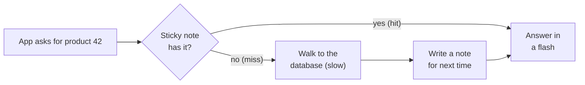
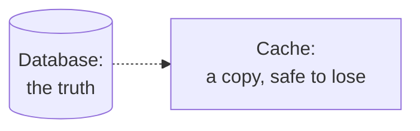
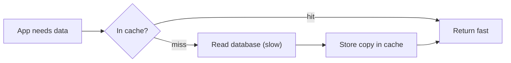
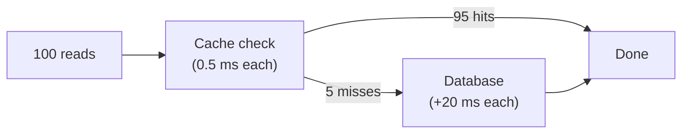
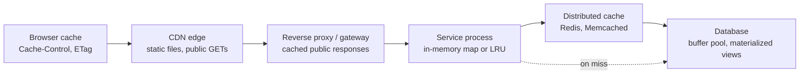
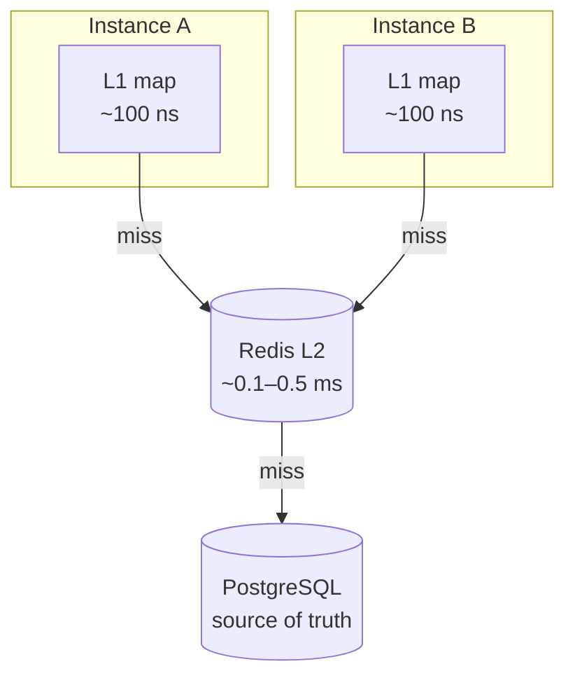

# Caching Fundamentals

> [!summary] TL;DR
> A **cache** is a small, fast copy of data whose real home (the **source of truth**, usually a database) is slower or more expensive to reach. Reads that find the data in the cache (a **hit**) skip the slow trip; reads that do not (a **miss**) pay for the slow trip and usually fill the cache for next time.

> [!abstract] Core idea
> - A cache trades **freshness and memory** for **speed and lower load** on the source of truth.
> - Its value is set by the **hit ratio**: the share of reads answered by the cache.
> - Caches exist at every layer: browser, CDN, proxy, inside your process, a shared store like Redis, and inside the database itself.
> - The cache is a copy. The database stays the source of truth, and the system must stay correct when the cache is empty, stale or down.
> - Every cache needs four decisions: what to cache, the key, how long it stays fresh, and what happens when it fails.

## Start here: the basics 🟢

> [!info] How to read this note (pick your level)
> - 🟢 **New to this?** Read "From zero" below, then sections 1, 2 and the cheat sheet (10). Stop there, that is a full first pass.
> - 🟡 **Know the basics?** Add section 3 (how it works) and 4 (worked example).
> - 🔴 **Interview / SDE-3 prep?** Add 7, 8 and 9. Headings are tagged 🟢🟡🔴 so you always know where you are.

> [!note] Before this note
> - [[Latency Numbers Every Engineer Should Know]]: reading memory takes well under a millisecond, while a database query over the network takes several milliseconds or more.
> - [[Memory Hierarchy and CPU Caches]]: small, fast storage sits in front of big, slow storage, and the fast part keeps copies of what you used recently.

**From zero, in 60 seconds** 🟢

Your database is a filing cabinet down the hall: it has the real answer, but every trip there is slow. A **cache** is a sticky note on your monitor: a quick copy of an answer you keep fetching anyway.



A read that finds the copy is a **hit**; one that does not is a **miss** and pays the slow trip. The share of hits — the **hit ratio** — decides everything: at 95% hits, your database only sees 1 in 20 reads.

The catch: the note is a copy, and copies can go **stale** when the real data changes. So every cache needs four decisions: what to cache, what to name the key, how long the copy stays trusted, and what happens when the cache is empty or down.



The rest of this note is just three questions:
1. Where can caches live (browser to database) and what goes in each?
2. How do you measure whether a cache is helping (hit-ratio maths)?
3. What goes wrong (staleness, eviction, stampedes) and where to read next?


**The problem in one story.**
A shop page shows a product's name, price and stock.
Every visitor makes the server ask the database for the same row again.
The database gets slow when thousands of people ask at once.
So the server keeps a quick copy of the answer nearby and reuses it for the next visitor.

**Words you need first**

| Word | Plain meaning | Tiny example |
| --- | --- | --- |
| Database | The main, permanent store of your data | PostgreSQL holding the `products` table |
| Source of truth | The place whose value counts if copies disagree | The DB row, not the cached copy |
| Latency | How long one request takes | 20 ms for a DB query vs 0.06 ms for a Redis `GET` |
| Key / value | A name you look up, and the data stored under it | `product:42` → `{"price": 499}` |
| Hit / miss | Found in the cache / not found, must go to the DB | Second visitor = hit, first = miss |
| Hit ratio | Share of reads the cache answers | 95 of 100 reads hit = 95% |
| Stale | A copy that no longer matches the source | Cache says ₹499, DB now says ₹549 |
| Redis | A fast in-memory key-value server many apps share | `SET`, `GET`, `EXPIRE` |
| TTL (time to live) | How long a cached copy may be used before it expires | 60 s for a product price |
| Eviction | The cache throwing out an entry because it is full | Oldest unused product dropped |
| p50 / p99 | The time that 50% / 99% of requests finish within | p99 = 20 ms: only 1 in 100 is slower |
| CDN | A network of servers near users that keep copies of files | An image served from a Mumbai server |

**Picture it**



**Analogy.** A sticky note on your monitor holds an answer whose full version is in a filing cabinet down the hall.
Where it breaks: a real sticky note never vanishes on its own, but cache entries expire or get evicted on purpose.

**How the rest of this note builds up**

- First, why caches exist (section 1) and the sticky-note mental model (section 2).
- Then how a cache works across layers: browser, CDN, in-process, Redis, database (section 3).
- Then a worked Go example and the variants and trade-offs (sections 4-6).
- Finally the SDE-3 view: production sizing and monitoring, the deep dive, and interview questions (sections 7-9).

> [!tip] Remember
> A cache is a fast copy; the database stays the truth, and the system must work when the copy is gone.

## 1. Why it exists 🟢

🟢 **Plain version:** Asking the database takes about 20 ms. Asking Redis takes well under 1 ms. If the cache answers 95 out of 100 reads, the database only does 5 of them, so it stays calm and the page is fast. One cache server is often cheaper than the extra database servers you would need without it. The bullets below put real measured numbers on this.

Take a product page that needs one product row plus its price and stock. Without a cache, every view runs the queries against PostgreSQL.

- **Latency:** say the queries take 20 ms at p50 (an estimate for an indexed lookup plus a join on a busy **primary**, the main database server that takes writes). A Redis `GET` on the same host took **0.063 ms at p50 and 0.319 ms at p99** (measured on Redis 8.2 with `redis-benchmark -t get -c 1 -n 20000`, localhost). Across a network inside one zone, add roughly 0.2–0.5 ms (estimate).
- **Load:** at 5,000 reads per second, the database runs 5,000 query sets per second. With a 95% hit ratio it runs 250. That is the difference between needing **read replicas** (extra copies of the database that only answer reads) and not.
- **Cost:** memory is more expensive per GB than disk, but one cache node that absorbs 95% of reads is often cheaper than the extra database capacity it replaces.

The same idea appears in hardware ([[Memory Hierarchy and CPU Caches]]) and in the operating system ([[Page Cache, File Systems and fsync]]). This note is about caches you design yourself in a backend system.

### Real-life example: a restaurant menu on Swiggy 🟢

When you open a popular restaurant on a food app like Swiggy, thousands of other people are opening the same menu at the same minute.
The menu changes rarely, maybe a few times a day, so the app can keep a ready copy in a cache instead of asking the database every time.
Your phone gets the menu in a blink, and the database is left free for things that must be exact, like placing your order and taking payment.
If the restaurant changes a price, the copy is refreshed or expires after its TTL, so for a short while some people may still see the old price.

## 2. Mental model 🟢

A cache is a **sticky note on your monitor**. The full answer lives in a filing cabinet down the hall (the database). The first time someone asks, you walk to the cabinet, read the answer and write it on a sticky note. The next ten people get the sticky-note answer in a second.

Three problems follow directly from the analogy:

- **The note can be wrong.** Someone changes the file in the cabinet and nobody updates the note. That is **staleness** (see [[Cache Invalidation, TTL and Consistency]]).
- **The monitor has limited space.** When it is full, some note must go. That is **eviction** (see [[Cache Eviction Policies - LRU, LFU, TTL]]).
- **If the note falls off, many people walk to the cabinet at once.** That is a **stampede** (see [[Cache Failure Modes - Stampede, Avalanche, Penetration, Hot and Big Keys]]).

## Common beginner mistakes 🟢

- **Treating the cache as the only copy** → a cache can be wiped or restarted at any time, so data that lives only there is lost → always keep the real value in the database and let the cache be a copy.
- **Caching without a TTL or size limit** → old keys pile up and memory fills, or stale prices live forever → give every entry a TTL and set a memory limit with an eviction policy.
- **Leaving the user or tenant out of the key** → `dashboard:summary` built for one customer is shown to another → put the user or tenant ID in the key for any private data.
- **Caching data that must be exact** → a cached balance or payment status can be a few seconds old → read those straight from the database.
- **Watching only the average speed** → the average looks great while 1 in 20 users waits 20 ms on a miss → also track hit ratio per key prefix and p99 latency.

## 3. How it works 🟡

> 🟢 → 🟡 **You now know** that a cache is a fast, throw-away copy and that the hit ratio decides how much it helps. **Next we open the box**: the exact steps of a cached read, the small formula behind hit ratio, the layers where caches live, and why "inside the program" and "shared Redis" behave so differently.

### A read through a cache

1. Build a **cache key** from the request, for example `product:42:v1`.
2. Look the key up in the cache.
3. **Hit:** return the stored value.
4. **Miss:** read the source of truth, return the value, and store it in the cache with a **TTL** (time to live: how long the entry may be served before it expires).

Who performs step 4 (the application, the cache library or a background job) is what separates the patterns in [[Caching Patterns]].

### Hit-ratio maths

**In plain words:** one tiny formula tells you what a cache buys: the average read pays the cache lookup always, and the slow database trip only on the misses. The database feels misses, not hits.

**Step by step:**
1. 100 reads arrive. Every one checks the cache first, which costs about 0.5 ms.
2. Say 95 are hits. They are done after that 0.5 ms.
3. The other 5 are misses. Each also walks to the database and pays about 20 ms more.
4. Spread over all 100 reads, the misses add 5 × 20 ms ÷ 100 = 1 ms. So the average read takes about 1.5 ms.
5. The database only saw 5 reads, not 100. That is why the miss share matters most.



Let `h` be the hit ratio, `t_c` the cache lookup time and `t_db` the source-of-truth time. A miss usually pays for the cache lookup as well, so:

```text
average latency = t_c + (1 - h) * t_db
```

The simpler form `h·t_c + (1−h)·t_db` ignores the wasted lookup on a miss. It is close enough when `t_c` is tiny.

With `t_c = 0.5 ms` and `t_db = 20 ms`:

| Hit ratio | Average latency | DB reads per 10,000 requests |
| --- | --- | --- |
| 0% (no cache) | 20.5 ms (or 20 ms with no cache at all) | 10,000 |
| 90% | 2.5 ms | 1,000 |
| 95% | 1.5 ms | 500 |
| 99% | 0.7 ms | 100 |

Two lessons:

- **Going from 90% to 99% cuts database load by 10×**, not by 10%. Miss ratio is what the database feels.
- **Averages hide the tail.** If more than 1% of requests miss, the p99 latency is set by the miss path (about 20 ms here, or worse if the miss queries are slow), however fast the hits are. To improve p99, reduce misses on hot keys or make the miss path faster.

### Where caches live

**In plain words:** a request can be answered from a cache at nearly every hop on its journey, from the browser all the way into the database's own memory. Each layer answers for a different audience.

**Step by step:**
1. You open a product page. Your **browser** first checks its own saved copy of the logo and scripts. If they are still fresh, no request leaves your phone.
2. Requests that do leave go to a nearby **CDN** server, which may already hold the product images for everyone in your city.
3. The API call passes a **reverse proxy** (a server in front of the app that forwards requests and can reuse public answers).
4. Inside the app, a small **in-process** map may already know common things like the list of categories.
5. If not, the app asks the shared **Redis** cache for `product:42:v1`.
6. Only if every layer misses does the app query the database, which still keeps hot pages of its tables in its own memory.

A request can meet a cache at almost every hop:



| Layer | What it holds | Who controls freshness | Shared by |
| --- | --- | --- | --- |
| Browser | Static assets, API responses marked cacheable | HTTP headers (`Cache-Control`: how long a copy may be reused; `ETag`: a fingerprint of the content to check if it changed) | One user |
| CDN | Images, JS/CSS, public pages, video segments | HTTP headers + purge API | Everyone near that edge |
| Reverse proxy / gateway | Public `GET` responses | Proxy config + headers | All users of that proxy |
| In-process (L1) | Small, hot, rarely changing data: config, feature flags, lookup tables | Your code | One process |
| Distributed (L2) | Sessions, rendered fragments, query results, counters | Your code | Every instance of every service that uses it |
| Database internals | Hot pages and index blocks (PostgreSQL `shared_buffers`, its memory area for recently used table pages), precomputed results (**materialized views**: a saved query result the database refreshes on demand) | The database engine | All queries |

Details of the HTTP layers belong to [[HTTP Caching - Cache-Control, ETag, Conditional Requests]] and [[CDN and Edge]].

One point from the CDN worth keeping here: the **first** request for an object at an edge is a miss that goes to the origin; only the **second and later** requests from that region are hits.

Cold caches are normal after deploys, purges and new regions.

> [!warning] Not every fast store is a cache
> Kafka keeps messages for a retention period, but it is a **durable log**, the source of truth for those events, not a cache. Elasticsearch is a **derived index** that you rebuild from the source, close in spirit to a cache but queried for search, not used to skip a lookup. A cache is defined by being **safe to lose**: if you wipe it, the system is slower but still correct.

### In-process vs distributed

**In plain words:** a cache inside your program is fastest but private to each instance; a shared cache like Redis is one copy for everyone but costs a network hop. Many systems use a small one in front of the other.

**Step by step:**
1. Your service runs as two copies, instance A and instance B.
2. Instance A keeps its own little map. It reads `category:list` once, keeps it, and answers the next reads in about 100 nanoseconds.
3. Instance B has its own separate map, so it must fetch the same value once more.
4. An admin renames a category. Instance A's map still shows the old name until its TTL ends, while B, having fetched later, may show the new one.
5. With Redis instead, both instances read one shared copy, so a single delete fixes both, but every read now pays a network trip of about 0.1 to 0.5 ms.



- **In-process** (a Go map behind a **mutex**, a lock that lets only one goroutine touch the map at a time, or a library such as Ristretto, a ready-made Go cache): no network hop, no **serialisation** (turning a Go value into bytes, for example JSON, so it can be sent or stored). But each instance has its own copy, so instances disagree after a write, memory is multiplied by the instance count, and the cache is empty after each restart.
- **Distributed** (Redis, Memcached): one shared copy, survives deploys of the application, one place to invalidate. But it costs a network round trip plus encoding and decoding, and it is another service that can fail.
- **Both (two-level):** a tiny L1 with a short TTL in front of Redis. How to keep the two levels in step is covered in [[Caching Patterns]].

## 4. Worked example 🟡

### Whiteboard version

**In plain words:** a cache is literally a map plus expiry times plus two counters.

The smallest useful cache: a map with expiry times and two counters.

```go
type entry struct {
	val       string
	expiresAt time.Time
}

func (c *Cache) Get(key string) (string, bool) {
	c.mu.Lock()
	defer c.mu.Unlock()
	e, ok := c.items[key]
	if ok && !c.now().Before(e.expiresAt) {
		delete(c.items, key) // expired: treat as a miss
		ok = false
	}
	if !ok {
		c.misses++
		return "", false
	}
	c.hits++
	return e.val, true
}
```

The full version below adds `Set`, a hit-ratio method, an injectable clock for tests, and the latency formula from section 3.

### Full code (Go 1.24, standard library only)

**What this code does, in plain words:** it keeps a map from key to value, and stamps every value with the time it expires. `Get` throws away an expired value when someone reads it and counts the read as a miss. It also counts hits and misses so you can print the hit ratio.

```go
// Package fundamentals is a minimal in-process cache with TTL and hit-ratio stats.
package fundamentals

import (
	"sync"
	"time"
)

// EffectiveLatency is the average read latency for hit ratio h:
// h*cacheLat + (1-h)*(cacheLat + dbLat). A miss pays for the cache lookup too.
func EffectiveLatency(h float64, cacheLat, dbLat time.Duration) time.Duration {
	miss := 1 - h
	return time.Duration(float64(cacheLat) + miss*float64(dbLat))
}

type entry struct {
	val       string
	expiresAt time.Time
}

// Cache is a map guarded by a mutex. Entries expire lazily: an expired
// entry is removed when someone reads it.
type Cache struct {
	mu     sync.Mutex
	items  map[string]entry
	now    func() time.Time // injectable clock for tests
	hits   uint64
	misses uint64
}

func New(now func() time.Time) *Cache {
	if now == nil {
		now = time.Now
	}
	return &Cache{items: make(map[string]entry), now: now}
}

func (c *Cache) Set(key, val string, ttl time.Duration) {
	c.mu.Lock()
	defer c.mu.Unlock()
	c.items[key] = entry{val: val, expiresAt: c.now().Add(ttl)}
}

func (c *Cache) Get(key string) (string, bool) {
	c.mu.Lock()
	defer c.mu.Unlock()
	e, ok := c.items[key]
	if ok && !c.now().Before(e.expiresAt) {
		delete(c.items, key) // lazy expiry
		ok = false
	}
	if !ok {
		c.misses++
		return "", false
	}
	c.hits++
	return e.val, true
}

// HitRatio returns hits / (hits + misses), or 0 before any read.
func (c *Cache) HitRatio() float64 {
	c.mu.Lock()
	defer c.mu.Unlock()
	total := c.hits + c.misses
	if total == 0 {
		return 0
	}
	return float64(c.hits) / float64(total)
}
```

This cache has **no size limit**: a key that is written once and never read again stays in memory forever. That is acceptable only for a small, bounded key set (for example, 200 feature flags). Anything larger needs an eviction policy ([[Cache Eviction Policies - LRU, LFU, TTL]]).

### Test (passes `go vet` and `go test -race`)

```go
package fundamentals

import (
	"fmt"
	"sync"
	"testing"
	"time"
)

func TestEffectiveLatency(t *testing.T) {
	cache, db := 500*time.Microsecond, 20*time.Millisecond
	cases := []struct {
		h    float64
		want time.Duration
	}{
		{0, 20500 * time.Microsecond},
		{0.90, 2500 * time.Microsecond},
		{0.99, 700 * time.Microsecond},
	}
	for _, c := range cases {
		got := EffectiveLatency(c.h, cache, db)
		if diff := got - c.want; diff > time.Microsecond || diff < -time.Microsecond {
			t.Errorf("h=%.2f: got %v, want %v", c.h, got, c.want)
		}
	}
}

func TestTTLAndHitRatio(t *testing.T) {
	now := time.Unix(0, 0)
	c := New(func() time.Time { return now })
	if _, ok := c.Get("user:42"); ok {
		t.Fatal("empty cache must miss")
	}
	c.Set("user:42", "Asha", 30*time.Second)
	for range 3 {
		if v, ok := c.Get("user:42"); !ok || v != "Asha" {
			t.Fatalf("want hit Asha, got %q %v", v, ok)
		}
	}
	now = now.Add(30 * time.Second) // exactly at expiry: gone
	if _, ok := c.Get("user:42"); ok {
		t.Fatal("entry must expire at its TTL")
	}
	if got := c.HitRatio(); got != 0.6 { // 3 hits, 2 misses
		t.Fatalf("hit ratio = %v, want 0.6", got)
	}
}

func TestConcurrentAccess(t *testing.T) {
	c := New(nil)
	var wg sync.WaitGroup
	for g := range 8 {
		wg.Add(1)
		go func() {
			defer wg.Done()
			for i := range 1000 {
				k := fmt.Sprintf("k%d", (g*i)%50)
				if _, ok := c.Get(k); !ok {
					c.Set(k, "v", time.Minute)
				}
			}
		}()
	}
	wg.Wait()
	if c.HitRatio() < 0.9 {
		t.Fatalf("expected a warm cache, hit ratio %v", c.HitRatio())
	}
}
```

### Sizing a Redis cache

**In plain words:** each key costs more than its value — Redis adds roughly 90 bytes of bookkeeping per key — so measure one key and multiply, then add headroom.

How much memory do 1 million cached products need? Measured on Redis 8.2: 100,000 keys named like `product:42:v1`, each holding a 500-byte string, grew `used_memory` by **about 575 bytes per key** without a TTL and **about 590 bytes per key** with one (the expiry is stored in a second table). `MEMORY USAGE product:42:v1` reported 528 bytes for one key.

So 1 million such products need roughly 590 MB, before replication and before the **fragmentation** (small unusable gaps left in memory as values come and go) headroom that Redis needs (an estimate: plan for 1.3–1.5× the data size). The extra ~90 bytes per key over the value size is per-key overhead, which is why caching millions of tiny values costs more than their raw size suggests.

## 5. Variants and comparison 🟡

| Choice | How it works | Use when | Cost |
| --- | --- | --- | --- |
| HTTP caching (browser, CDN, proxy) | Responses marked cacheable by headers are reused by intermediaries | Public or per-user `GET` responses, static files | Freshness controlled by headers you cannot recall once sent (only purge at the CDN) |
| In-process cache | Map or LRU inside each instance | Tiny, hot, read-mostly data; lowest latency needed | Copies diverge across instances; lost on restart; memory × instance count |
| Distributed cache | Shared Redis or Memcached cluster | Data shared across instances, sessions, query results | Network hop, serialisation, another service to run |
| Two-level (L1 + L2) | Short-TTL L1 in front of Redis | Very hot keys where even Redis is the bottleneck | Two places to invalidate |
| Database-side (materialized view, buffer pool) | The database precomputes or keeps hot pages in RAM | Expensive aggregations that can be a few minutes old | Refresh cost; still a database round trip |

### Cache vs read replica 🟡

People often mix these up, because both take read load off the main database.

| | Cache (Redis) | Read replica |
| --- | --- | --- |
| What it holds | Only the keys you chose to copy, for a TTL | A full copy of the whole database |
| How you read it | `GET product:42:v1` by exact key | Any SQL query |
| Safe to lose? | Yes, it refills from the database | Yes, but rebuilding it takes hours |
| Typical speed | Under 1 ms | Same as the main database, several ms |

## 6. Trade-offs and when not to use 🟡

Every cache adds a second copy, and second copies can disagree. Skip the cache when:

- **The data changes on almost every read** (live auction price, stock level during a flash sale). The hit ratio would be low and every write needs invalidation.
- **The source is already fast enough.** A primary-key lookup that takes 1 ms at p99 on an idle database does not need Redis in front of it.
- **Correctness beats latency.** Payment confirmation, balances shown before a transfer, and authorisation decisions must read the source of truth.
- **The key space is huge and uniform**, so no subset is hot. A cache that holds 1% of the data with uniform access hits about 1% of the time.
- **Permissions are complex.** If a response depends on who is asking, the key must include every input that changes it, or one user sees another user's data.

Measure first: find the slow, hot reads in your traces, then cache those.

## 7. In production 🔴

> 🟡 → 🔴 **You now know** how a cached read works, how hit ratio turns into speed and database load, and where each kind of cache lives. **Next is the advanced part**: how big companies design keys, what breaks when a cache fails, what to put on a dashboard, and why the size of the "hot" data matters more than the size of all data.

- **Real systems:**
	- Facebook ran Memcached (an older, simpler in-memory key-value server) as a **look-aside** cache (the app checks the cache first and fills it itself on a miss) in front of MySQL at very large scale, and published the problems that followed (stale sets, thundering herds, cross-region invalidation) in *Scaling Memcache at Facebook* (NSDI 2013).
	- PostgreSQL's `shared_buffers` is a database-managed page cache; the docs suggest starting at 25% of RAM on a dedicated server.
	- CDNs such as CloudFront and Cloudflare cache at the edge (see [[CDN and Edge]]).
- **Key design:** keys are stable, explicit and include everything that changes the answer.

```text
{domain}:{tenant_id}:{entity_or_query}:{schema_version}:{filters_hash}

invoice:ws_123:inv_999:v1
dashboard:ws_123:summary:v2
clients:ws_123:list:v1:9f2c1a        <- hash of status=active&page=1&sort=name
```

- Put the **tenant or user** in the key for any private data. A missing tenant ID is a data-leak bug, not a performance bug.
- Put a **schema version** in the key, so a deploy that changes the JSON shape reads new keys instead of failing to decode old ones.
- Hash long query strings and filter sets; keep the readable parts (domain, tenant) in clear text for debugging.
- **Failure modes → fixes:**
	- Cache down → read from the database with a short cache timeout, and protect the database with limits (see [[Caching Patterns]] and [[Circuit Breaker]]).
	- Many keys expire together, or one hot key expires → stampede (see [[Cache Failure Modes - Stampede, Avalanche, Penetration, Hot and Big Keys]]).
	- Stale data after a write → invalidation design (see [[Cache Invalidation, TTL and Consistency]]).
	- One key gets most of the traffic → see [[Hot Keys and Hot Partitions]].
- **What to monitor:**
	- Hit ratio per key prefix, not only globally. A 98% global ratio can hide a 40% ratio on the endpoint users complain about.
	- Evictions per second (Redis `evicted_keys`): rising evictions mean the cache is too small for the working set.
	- Memory used versus `maxmemory`.
	- Cache latency p99 and error rate.
	- Miss-path latency and database QPS caused by misses.

## 8. Deep dive 🔴

- **Working set, not data size, decides cache size.** If 2% of products get 80% of views (a skewed, Zipf-like pattern that is common for popularity), caching that 2% gives most of the benefit. Plot hit ratio against cache size (the hit-ratio curve) from a replay of real traffic and stop where the curve flattens. [[Cache Eviction Policies - LRU, LFU, TTL]] shows measured curves for LRU and LFU.
- **Serialisation is part of the hit cost.** A Redis hit returns bytes; decoding a 50 KB JSON document in Go can cost more than the network round trip. Cache the smallest shape the caller needs, and consider a binary format for large values.
- **A cache changes the failure model.** A database sized for 5% of traffic (because the cache absorbs 95%) will fall over when the cache is cold or down. Either size the database for the cold case, or limit how fast misses reach it (request coalescing, rate limits, warm-up before taking traffic).
- **Caching writes is different from caching reads.** Read caches are safe to lose. A cache that holds writes not yet in the database (write-behind, see [[Caching Patterns]]) is no longer safe to lose and needs persistence and replication like a database.
- **Memory hierarchy echo.** The same rules hold for CPU caches: locality makes caching work, the miss path dominates the tail, and a write must be propagated or invalidated. The vocabulary (hit, miss, write-through, write-back, eviction) comes from hardware.

## 9. Interview questions 🔴

> [!question]- Your cache has a 95% hit ratio. Why might p99 latency still be bad?
> 5% of requests miss, which is more than 1%, so the p99 request is a miss and pays the full database latency. Improve the miss path (faster query, request coalescing) or raise the hit ratio on the hot endpoints; making hits faster does nothing for p99.

> [!question]- When would you put a cache in the process instead of in Redis?
> For small, hot, read-mostly data where a stale read for a few seconds is fine: config, feature flags, lookup tables. You avoid a network hop and serialisation. The cost is that every instance holds its own copy, so a write is visible on different instances at different times and the cache is empty after every restart.

> [!question]- Trap: "Kafka retains messages, so it is a cache." True?
> No. Kafka is a durable, replicated log and the source of truth for its events. A cache is a copy that is safe to lose because the truth lives elsewhere. Wiping Kafka loses data; wiping a cache only costs latency.

> [!question]- How do you decide what to cache?
> Find reads that are slow or expensive, frequent, and tolerant of some staleness, using traces and query statistics. Check that the key space has a hot subset so a cache of affordable size gets a high hit ratio. Write down the freshness each feature needs before choosing TTLs.

> [!question]- What goes into a good cache key?
> Every input that changes the answer: entity ID, tenant or user for private data, query filters and pagination, and a schema version. Keep a readable prefix and hash long parts. A key that misses the tenant ID leaks data between customers.

> [!question]- How would you size a Redis cache for 1 million product objects of about 500 bytes?
> Measure one key with `MEMORY USAGE` and extrapolate, or load a sample and read `used_memory`. On Redis 8.2 a 500-byte value cost about 590 bytes with a TTL, so about 590 MB, plus fragmentation headroom and replicas. Then check the hit-ratio curve: you may only need the hot fraction.

## 10. Cheat sheet 🟢

- Cache = a disposable copy; the database stays the source of truth.
- Average latency = `t_c + (1 − h) · t_db`; database load is proportional to the miss ratio.
- If misses exceed 1%, p99 is set by the miss path, not the hits.
- Layers: browser → CDN → proxy → in-process → Redis → database buffer pool.
- Keys include tenant, entity, filters and a schema version.
- Size by working set; measure bytes per key (about 590 B for a 500 B value with TTL on Redis 8.2).
- Monitor hit ratio per prefix, evictions, memory, miss latency and DB load from misses.
- Do not cache data that changes on every read, must be exact, or is cheap to fetch.

## Self-check 🟢🟡

🟢 Easy

> [!question]- What is a cache hit?
> A read that finds the value in the cache, so it skips the slow trip to the database.

> [!question]- If you wipe a cache, what should happen to the system?
> It gets slower for a while but stays correct, because the database still has the real data.

> [!question]- What does a TTL do?
> It sets how long a cached copy may be used before it expires and must be fetched again.

🟡 Medium

> [!question]- Going from a 90% to a 99% hit ratio: by how much does database load fall?
> By 10 times, from 10 misses per 100 reads to 1, because the database only sees misses.

> [!question]- Why can p99 latency stay bad even when the hit ratio is 95%?
> 5% of reads miss, which is more than 1%, so the p99 read is a miss and pays the full database time.

> [!question]- Name one cost of an in-process cache compared with Redis.
> Each instance holds its own copy, so after a write the instances disagree, and the copy is empty after every restart.

## Links 🟢

- **Before this:** [[Latency Numbers Every Engineer Should Know]], [[Memory Hierarchy and CPU Caches]]
- **Next:** [[Caching Patterns]], [[Cache Invalidation, TTL and Consistency]], [[Cache Eviction Policies - LRU, LFU, TTL]], [[Cache Failure Modes - Stampede, Avalanche, Penetration, Hot and Big Keys]]
- **Compare with:** [[HTTP Caching - Cache-Control, ETag, Conditional Requests]], [[CDN and Edge]], [[Materialized Views and Denormalization]], [[Redis Fundamentals]]

### Watch on YouTube

- [How does Caching on the Backend work? (System Design Fundamentals)](https://www.youtube.com/watch?v=bP4BeUjNkXc) · Software Developer Diaries · clear visual intro to why caching exists and the hit/miss/hit-ratio basics
- [🧠 System Design Fundamentals 11 ✅  Caching & CDN in System Design / Cache Strategies, TTL & Eviction](https://www.youtube.com/watch?v=mTHT3LmsNbw) · InterviewWithBunny · broader system-design framing covering cache layers, TTL and eviction together
