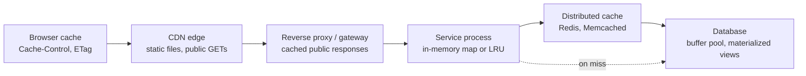
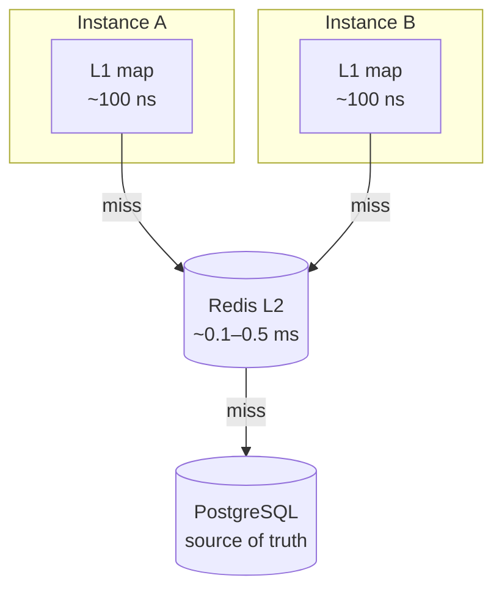

# Caching Fundamentals

> [!summary] TL;DR
> A **cache** is a small, fast copy of data whose real home (the **source of truth**, usually a database) is slower or more expensive to reach. Reads that find the data in the cache (a **hit**) skip the slow trip; reads that do not (a **miss**) pay for the slow trip and usually fill the cache for next time.

> [!abstract] Core idea
> - A cache trades **freshness and memory** for **speed and lower load** on the source of truth.
> - Its value is set by the **hit ratio**: the share of reads answered by the cache.
> - Caches exist at every layer: browser, CDN, proxy, inside your process, a shared store like Redis, and inside the database itself.
> - The cache is a copy. The database stays the source of truth, and the system must stay correct when the cache is empty, stale or down.
> - Every cache needs four decisions: what to cache, the key, how long it stays fresh, and what happens when it fails.

## 1. Why it exists

Take a product page that needs one product row plus its price and stock. Without a cache, every view runs the queries against PostgreSQL.

- **Latency:** say the queries take 20 ms at p50 (an estimate for an indexed lookup plus a join on a busy primary). A Redis `GET` on the same host took **0.063 ms at p50 and 0.319 ms at p99** (measured on Redis 8.2 with `redis-benchmark -t get -c 1 -n 20000`, localhost). Across a network inside one zone, add roughly 0.2–0.5 ms (estimate).
- **Load:** at 5,000 reads per second, the database runs 5,000 query sets per second. With a 95% hit ratio it runs 250. That is the difference between needing read replicas and not.
- **Cost:** memory is more expensive per GB than disk, but one cache node that absorbs 95% of reads is often cheaper than the extra database capacity it replaces.

The same idea appears in hardware ([[Memory Hierarchy and CPU Caches]]) and in the operating system ([[Page Cache, File Systems and fsync]]). This note is about caches you design yourself in a backend system.

## 2. Mental model

A cache is a **sticky note on your monitor**. The full answer lives in a filing cabinet down the hall (the database). The first time someone asks, you walk to the cabinet, read the answer and write it on a sticky note. The next ten people get the sticky-note answer in a second.

Three problems follow directly from the analogy:

- **The note can be wrong.** Someone changes the file in the cabinet and nobody updates the note. That is **staleness** (see [[Cache Invalidation, TTL and Consistency]]).
- **The monitor has limited space.** When it is full, some note must go. That is **eviction** (see [[Cache Eviction Policies - LRU, LFU, TTL]]).
- **If the note falls off, many people walk to the cabinet at once.** That is a **stampede** (see [[Cache Failure Modes - Stampede, Avalanche, Penetration, Hot and Big Keys]]).

## 3. How it works

### A read through a cache

1. Build a **cache key** from the request, for example `product:42:v1`.
2. Look the key up in the cache.
3. **Hit:** return the stored value.
4. **Miss:** read the source of truth, return the value, and store it in the cache with a **TTL** (time to live: how long the entry may be served before it expires).

Who performs step 4 (the application, the cache library or a background job) is what separates the patterns in [[Caching Patterns]].

### Hit-ratio maths

Let `h` be the hit ratio, `t_c` the cache lookup time and `t_db` the source-of-truth time. A miss usually pays for the cache lookup as well, so:

```text
average latency = t_c + (1 - h) * t_db
```

The simpler form `h·t_c + (1−h)·t_db` ignores the wasted lookup on a miss. It is close enough when `t_c` is tiny.

With `t_c = 0.5 ms` and `t_db = 20 ms`:

| Hit ratio | Average latency | DB reads per 10,000 requests |
| --- | --- | --- |
| 0% (no cache) | 20.5 ms (or 20 ms with no cache at all) | 10,000 |
| 90% | 2.5 ms | 1,000 |
| 95% | 1.5 ms | 500 |
| 99% | 0.7 ms | 100 |

Two lessons:

- **Going from 90% to 99% cuts database load by 10×**, not by 10%. Miss ratio is what the database feels.
- **Averages hide the tail.** If more than 1% of requests miss, the p99 latency is set by the miss path (about 20 ms here, or worse if the miss queries are slow), however fast the hits are. To improve p99, reduce misses on hot keys or make the miss path faster.

### Where caches live

A request can meet a cache at almost every hop:



| Layer | What it holds | Who controls freshness | Shared by |
| --- | --- | --- | --- |
| Browser | Static assets, API responses marked cacheable | HTTP headers (`Cache-Control`, `ETag`) | One user |
| CDN | Images, JS/CSS, public pages, video segments | HTTP headers + purge API | Everyone near that edge |
| Reverse proxy / gateway | Public `GET` responses | Proxy config + headers | All users of that proxy |
| In-process (L1) | Small, hot, rarely changing data: config, feature flags, lookup tables | Your code | One process |
| Distributed (L2) | Sessions, rendered fragments, query results, counters | Your code | Every instance of every service that uses it |
| Database internals | Hot pages and index blocks (PostgreSQL `shared_buffers`), precomputed results (materialized views) | The database engine | All queries |

Details of the HTTP layers belong to [[HTTP Caching - Cache-Control, ETag, Conditional Requests]] and [[CDN and Edge]]. One point from the CDN worth keeping here: the **first** request for an object at an edge is a miss that goes to the origin; only the **second and later** requests from that region are hits. Cold caches are normal after deploys, purges and new regions.

> [!warning] Not every fast store is a cache
> Kafka keeps messages for a retention period, but it is a **durable log**, the source of truth for those events, not a cache. Elasticsearch is a **derived index** that you rebuild from the source, close in spirit to a cache but queried for search, not used to skip a lookup. A cache is defined by being **safe to lose**: if you wipe it, the system is slower but still correct.

### In-process vs distributed



- **In-process** (a Go map behind a mutex, or a library such as Ristretto): no network hop, no serialisation. But each instance has its own copy, so instances disagree after a write, memory is multiplied by the instance count, and the cache is empty after each restart.
- **Distributed** (Redis, Memcached): one shared copy, survives deploys of the application, one place to invalidate. But it costs a network round trip plus encoding and decoding, and it is another service that can fail.
- **Both (two-level):** a tiny L1 with a short TTL in front of Redis. How to keep the two levels in step is covered in [[Caching Patterns]].

## 4. Worked example

### Whiteboard version

The smallest useful cache: a map with expiry times and two counters.

```go
type entry struct {
	val       string
	expiresAt time.Time
}

func (c *Cache) Get(key string) (string, bool) {
	c.mu.Lock()
	defer c.mu.Unlock()
	e, ok := c.items[key]
	if ok && !c.now().Before(e.expiresAt) {
		delete(c.items, key) // expired: treat as a miss
		ok = false
	}
	if !ok {
		c.misses++
		return "", false
	}
	c.hits++
	return e.val, true
}
```

The full version below adds `Set`, a hit-ratio method, an injectable clock for tests, and the latency formula from section 3.

### Full code (Go 1.24, standard library only)

```go
// Package fundamentals is a minimal in-process cache with TTL and hit-ratio stats.
package fundamentals

import (
	"sync"
	"time"
)

// EffectiveLatency is the average read latency for hit ratio h:
// h*cacheLat + (1-h)*(cacheLat + dbLat). A miss pays for the cache lookup too.
func EffectiveLatency(h float64, cacheLat, dbLat time.Duration) time.Duration {
	miss := 1 - h
	return time.Duration(float64(cacheLat) + miss*float64(dbLat))
}

type entry struct {
	val       string
	expiresAt time.Time
}

// Cache is a map guarded by a mutex. Entries expire lazily: an expired
// entry is removed when someone reads it.
type Cache struct {
	mu     sync.Mutex
	items  map[string]entry
	now    func() time.Time // injectable clock for tests
	hits   uint64
	misses uint64
}

func New(now func() time.Time) *Cache {
	if now == nil {
		now = time.Now
	}
	return &Cache{items: make(map[string]entry), now: now}
}

func (c *Cache) Set(key, val string, ttl time.Duration) {
	c.mu.Lock()
	defer c.mu.Unlock()
	c.items[key] = entry{val: val, expiresAt: c.now().Add(ttl)}
}

func (c *Cache) Get(key string) (string, bool) {
	c.mu.Lock()
	defer c.mu.Unlock()
	e, ok := c.items[key]
	if ok && !c.now().Before(e.expiresAt) {
		delete(c.items, key) // lazy expiry
		ok = false
	}
	if !ok {
		c.misses++
		return "", false
	}
	c.hits++
	return e.val, true
}

// HitRatio returns hits / (hits + misses), or 0 before any read.
func (c *Cache) HitRatio() float64 {
	c.mu.Lock()
	defer c.mu.Unlock()
	total := c.hits + c.misses
	if total == 0 {
		return 0
	}
	return float64(c.hits) / float64(total)
}
```

This cache has **no size limit**: a key that is written once and never read again stays in memory forever. That is acceptable only for a small, bounded key set (for example, 200 feature flags). Anything larger needs an eviction policy ([[Cache Eviction Policies - LRU, LFU, TTL]]).

### Test (passes `go vet` and `go test -race`)

```go
package fundamentals

import (
	"fmt"
	"sync"
	"testing"
	"time"
)

func TestEffectiveLatency(t *testing.T) {
	cache, db := 500*time.Microsecond, 20*time.Millisecond
	cases := []struct {
		h    float64
		want time.Duration
	}{
		{0, 20500 * time.Microsecond},
		{0.90, 2500 * time.Microsecond},
		{0.99, 700 * time.Microsecond},
	}
	for _, c := range cases {
		got := EffectiveLatency(c.h, cache, db)
		if diff := got - c.want; diff > time.Microsecond || diff < -time.Microsecond {
			t.Errorf("h=%.2f: got %v, want %v", c.h, got, c.want)
		}
	}
}

func TestTTLAndHitRatio(t *testing.T) {
	now := time.Unix(0, 0)
	c := New(func() time.Time { return now })
	if _, ok := c.Get("user:42"); ok {
		t.Fatal("empty cache must miss")
	}
	c.Set("user:42", "Asha", 30*time.Second)
	for range 3 {
		if v, ok := c.Get("user:42"); !ok || v != "Asha" {
			t.Fatalf("want hit Asha, got %q %v", v, ok)
		}
	}
	now = now.Add(30 * time.Second) // exactly at expiry: gone
	if _, ok := c.Get("user:42"); ok {
		t.Fatal("entry must expire at its TTL")
	}
	if got := c.HitRatio(); got != 0.6 { // 3 hits, 2 misses
		t.Fatalf("hit ratio = %v, want 0.6", got)
	}
}

func TestConcurrentAccess(t *testing.T) {
	c := New(nil)
	var wg sync.WaitGroup
	for g := range 8 {
		wg.Add(1)
		go func() {
			defer wg.Done()
			for i := range 1000 {
				k := fmt.Sprintf("k%d", (g*i)%50)
				if _, ok := c.Get(k); !ok {
					c.Set(k, "v", time.Minute)
				}
			}
		}()
	}
	wg.Wait()
	if c.HitRatio() < 0.9 {
		t.Fatalf("expected a warm cache, hit ratio %v", c.HitRatio())
	}
}
```

### Sizing a Redis cache

How much memory do 1 million cached products need? Measured on Redis 8.2: 100,000 keys named like `product:42:v1`, each holding a 500-byte string, grew `used_memory` by **about 575 bytes per key** without a TTL and **about 590 bytes per key** with one (the expiry is stored in a second table). `MEMORY USAGE product:42:v1` reported 528 bytes for one key.

So 1 million such products need roughly 590 MB, before replication and before the fragmentation headroom that Redis needs (an estimate: plan for 1.3–1.5× the data size). The extra ~90 bytes per key over the value size is per-key overhead, which is why caching millions of tiny values costs more than their raw size suggests.

## 5. Variants and comparison

| Choice | How it works | Use when | Cost |
| --- | --- | --- | --- |
| HTTP caching (browser, CDN, proxy) | Responses marked cacheable by headers are reused by intermediaries | Public or per-user `GET` responses, static files | Freshness controlled by headers you cannot recall once sent (only purge at the CDN) |
| In-process cache | Map or LRU inside each instance | Tiny, hot, read-mostly data; lowest latency needed | Copies diverge across instances; lost on restart; memory × instance count |
| Distributed cache | Shared Redis or Memcached cluster | Data shared across instances, sessions, query results | Network hop, serialisation, another service to run |
| Two-level (L1 + L2) | Short-TTL L1 in front of Redis | Very hot keys where even Redis is the bottleneck | Two places to invalidate |
| Database-side (materialized view, buffer pool) | The database precomputes or keeps hot pages in RAM | Expensive aggregations that can be a few minutes old | Refresh cost; still a database round trip |

## 6. Trade-offs and when not to use

Every cache adds a second copy, and second copies can disagree. Skip the cache when:

- **The data changes on almost every read** (live auction price, stock level during a flash sale). The hit ratio would be low and every write needs invalidation.
- **The source is already fast enough.** A primary-key lookup that takes 1 ms at p99 on an idle database does not need Redis in front of it.
- **Correctness beats latency.** Payment confirmation, balances shown before a transfer, and authorisation decisions must read the source of truth.
- **The key space is huge and uniform**, so no subset is hot. A cache that holds 1% of the data with uniform access hits about 1% of the time.
- **Permissions are complex.** If a response depends on who is asking, the key must include every input that changes it, or one user sees another user's data.

Measure first: find the slow, hot reads in your traces, then cache those.

## 7. In production

- **Real systems:**
	- Facebook ran Memcached as a look-aside cache in front of MySQL at very large scale, and published the problems that followed (stale sets, thundering herds, cross-region invalidation) in *Scaling Memcache at Facebook* (NSDI 2013).
	- PostgreSQL's `shared_buffers` is a database-managed page cache; the docs suggest starting at 25% of RAM on a dedicated server.
	- CDNs such as CloudFront and Cloudflare cache at the edge (see [[CDN and Edge]]).
- **Key design:** keys are stable, explicit and include everything that changes the answer.

```text
{domain}:{tenant_id}:{entity_or_query}:{schema_version}:{filters_hash}

invoice:ws_123:inv_999:v1
dashboard:ws_123:summary:v2
clients:ws_123:list:v1:9f2c1a        <- hash of status=active&page=1&sort=name
```

- Put the **tenant or user** in the key for any private data. A missing tenant ID is a data-leak bug, not a performance bug.
- Put a **schema version** in the key, so a deploy that changes the JSON shape reads new keys instead of failing to decode old ones.
- Hash long query strings and filter sets; keep the readable parts (domain, tenant) in clear text for debugging.
- **Failure modes → fixes:**
	- Cache down → read from the database with a short cache timeout, and protect the database with limits (see [[Caching Patterns]] and [[Circuit Breaker]]).
	- Many keys expire together, or one hot key expires → stampede (see [[Cache Failure Modes - Stampede, Avalanche, Penetration, Hot and Big Keys]]).
	- Stale data after a write → invalidation design (see [[Cache Invalidation, TTL and Consistency]]).
	- One key gets most of the traffic → see [[Hot Keys and Hot Partitions]].
- **What to monitor:**
	- Hit ratio per key prefix, not only globally. A 98% global ratio can hide a 40% ratio on the endpoint users complain about.
	- Evictions per second (Redis `evicted_keys`): rising evictions mean the cache is too small for the working set.
	- Memory used versus `maxmemory`.
	- Cache latency p99 and error rate.
	- Miss-path latency and database QPS caused by misses.

## 8. Deep dive

- **Working set, not data size, decides cache size.** If 2% of products get 80% of views (a skewed, Zipf-like pattern that is common for popularity), caching that 2% gives most of the benefit. Plot hit ratio against cache size (the hit-ratio curve) from a replay of real traffic and stop where the curve flattens. [[Cache Eviction Policies - LRU, LFU, TTL]] shows measured curves for LRU and LFU.
- **Serialisation is part of the hit cost.** A Redis hit returns bytes; decoding a 50 KB JSON document in Go can cost more than the network round trip. Cache the smallest shape the caller needs, and consider a binary format for large values.
- **A cache changes the failure model.** A database sized for 5% of traffic (because the cache absorbs 95%) will fall over when the cache is cold or down. Either size the database for the cold case, or limit how fast misses reach it (request coalescing, rate limits, warm-up before taking traffic).
- **Caching writes is different from caching reads.** Read caches are safe to lose. A cache that holds writes not yet in the database (write-behind, see [[Caching Patterns]]) is no longer safe to lose and needs persistence and replication like a database.
- **Memory hierarchy echo.** The same rules hold for CPU caches: locality makes caching work, the miss path dominates the tail, and a write must be propagated or invalidated. The vocabulary (hit, miss, write-through, write-back, eviction) comes from hardware.

## 9. Interview questions

> [!question]- Your cache has a 95% hit ratio. Why might p99 latency still be bad?
> 5% of requests miss, which is more than 1%, so the p99 request is a miss and pays the full database latency. Improve the miss path (faster query, request coalescing) or raise the hit ratio on the hot endpoints; making hits faster does nothing for p99.

> [!question]- When would you put a cache in the process instead of in Redis?
> For small, hot, read-mostly data where a stale read for a few seconds is fine: config, feature flags, lookup tables. You avoid a network hop and serialisation. The cost is that every instance holds its own copy, so a write is visible on different instances at different times and the cache is empty after every restart.

> [!question]- Trap: "Kafka retains messages, so it is a cache." True?
> No. Kafka is a durable, replicated log and the source of truth for its events. A cache is a copy that is safe to lose because the truth lives elsewhere. Wiping Kafka loses data; wiping a cache only costs latency.

> [!question]- How do you decide what to cache?
> Find reads that are slow or expensive, frequent, and tolerant of some staleness, using traces and query statistics. Check that the key space has a hot subset so a cache of affordable size gets a high hit ratio. Write down the freshness each feature needs before choosing TTLs.

> [!question]- What goes into a good cache key?
> Every input that changes the answer: entity ID, tenant or user for private data, query filters and pagination, and a schema version. Keep a readable prefix and hash long parts. A key that misses the tenant ID leaks data between customers.

> [!question]- How would you size a Redis cache for 1 million product objects of about 500 bytes?
> Measure one key with `MEMORY USAGE` and extrapolate, or load a sample and read `used_memory`. On Redis 8.2 a 500-byte value cost about 590 bytes with a TTL, so about 590 MB, plus fragmentation headroom and replicas. Then check the hit-ratio curve: you may only need the hot fraction.

## 10. Cheat sheet

- Cache = a disposable copy; the database stays the source of truth.
- Average latency = `t_c + (1 − h) · t_db`; database load is proportional to the miss ratio.
- If misses exceed 1%, p99 is set by the miss path, not the hits.
- Layers: browser → CDN → proxy → in-process → Redis → database buffer pool.
- Keys include tenant, entity, filters and a schema version.
- Size by working set; measure bytes per key (about 590 B for a 500 B value with TTL on Redis 8.2).
- Monitor hit ratio per prefix, evictions, memory, miss latency and DB load from misses.
- Do not cache data that changes on every read, must be exact, or is cheap to fetch.

## Links

- **Before this:** [[Latency Numbers Every Engineer Should Know]], [[Memory Hierarchy and CPU Caches]]
- **Next:** [[Caching Patterns]], [[Cache Invalidation, TTL and Consistency]], [[Cache Eviction Policies - LRU, LFU, TTL]], [[Cache Failure Modes - Stampede, Avalanche, Penetration, Hot and Big Keys]]
- **Compare with:** [[HTTP Caching - Cache-Control, ETag, Conditional Requests]], [[CDN and Edge]], [[Materialized Views and Denormalization]], [[Redis Fundamentals]]
