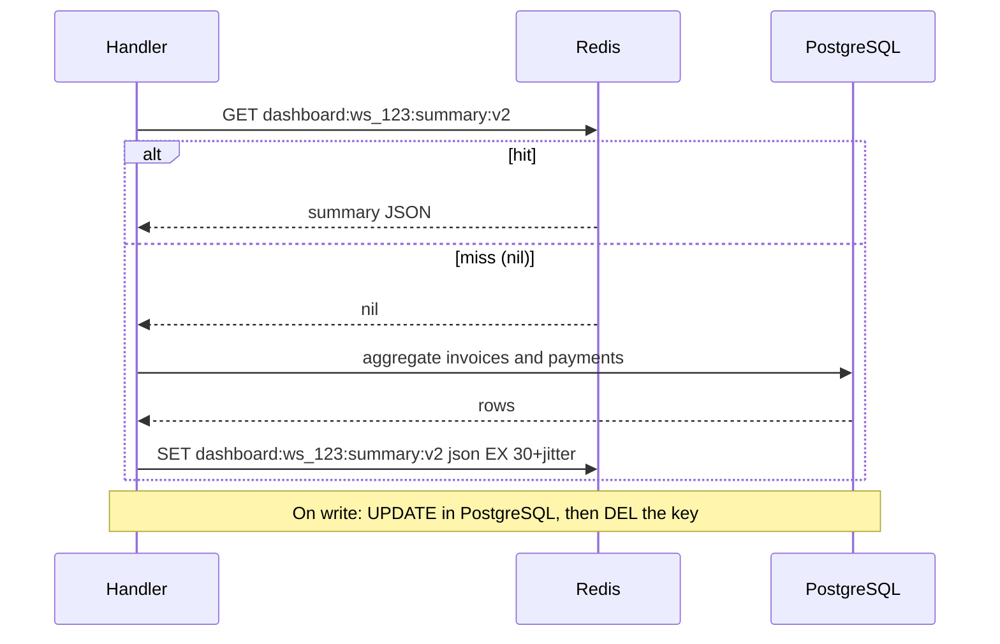
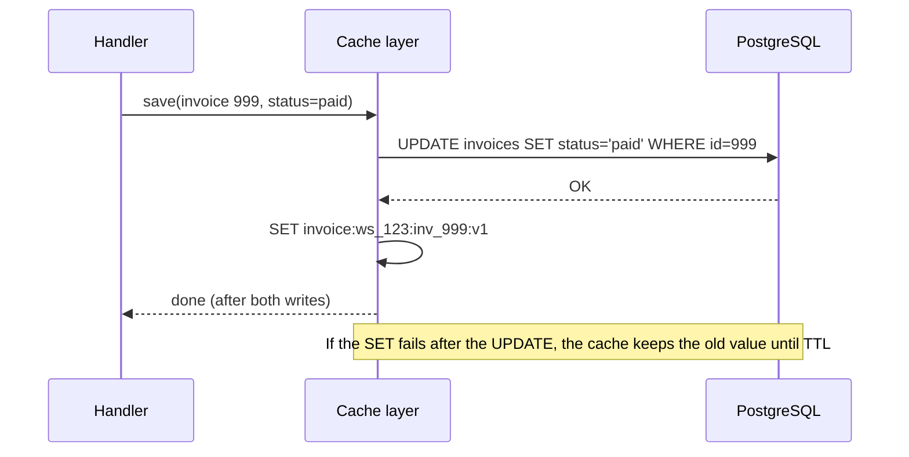
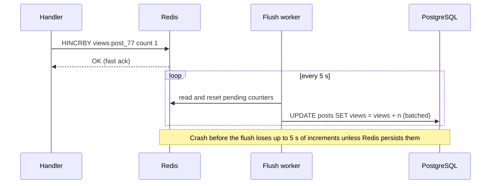
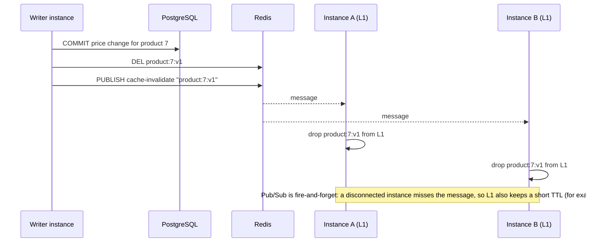

# Caching Patterns

> [!summary] TL;DR
> A **caching pattern** decides who reads and writes the cache and in what order relative to the database. **Cache-aside** (the app loads the cache on a miss) is the default; **read-through**, **write-through**, **write-behind** and **refresh-ahead** move that work into a cache layer or a background job, each with a different failure behaviour.

> [!abstract] Core idea
> - **Cache-aside:** the application checks the cache, reads the database on a miss, and fills the cache. Writes go to the database, then delete the cache key.
> - **Read-through / write-through:** a cache layer sits in the path and talks to the database for you. Write-through keeps the cache warm; it does **not** make cache and database strongly consistent.
> - **Write-behind:** writes land in the cache and reach the database later. Fast, but the cache now holds data you can lose.
> - **Refresh-ahead:** hot keys are reloaded before they expire, so users rarely see a miss.
> - Whatever the pattern, a cache outage must degrade to "slower", not "down".

## 1. Why it exists

"Put Redis in front of the database" leaves the important questions open. Take InvoiceOps, a multi-tenant invoicing API (Go + PostgreSQL) whose dashboard endpoint aggregates invoices and payments for one workspace. The aggregation takes about 120 ms (an estimate for a few thousand invoice rows), and the dashboard is opened about 300 times per second at peak.

- Who fills the cache on a miss: the handler, or a cache library?
- When a payment is recorded, do we update the cached summary, delete it, or let it expire?
- If 300 requests miss at once, do we run the 120 ms query 300 times?
- If Redis times out, does the dashboard return 500 or a slower 200?

Each pattern below is a different set of answers.

## 2. Mental model

Think of a **personal assistant** (the cache) in front of a **records office** (the database).

- **Cache-aside:** you ask the assistant; if they don't know, *you* go to the records office and then tell the assistant the answer.
- **Read-through:** you only ever talk to the assistant; they go to the records office for you.
- **Write-through:** you hand a change to the assistant, who files it at the records office *and* updates their notes before saying "done".
- **Write-behind:** the assistant says "done" right away and files your change at the records office later.
- **Refresh-ahead:** the assistant re-checks popular answers shortly before their notes expire.

## 3. How it works

### Cache-aside (lazy loading)



- Only data that someone reads gets cached, so memory goes to the working set.
- A cache failure only slows reads; the database is always in the path for misses.
- Each miss costs three trips (cache, database, cache), and the first read after expiry is slow.
- Writes **delete** rather than set the key. Two concurrent writers that each *set* the cache can leave the older value there; a delete leaves nothing to be wrong, and the next read reloads. A narrower race still remains (a slow reader filling an old value after the delete); [[Cache Invalidation, TTL and Consistency]] covers it and its fixes.

### Read-through

The application calls `cache.Get(key)` and the cache layer runs a **loader** on a miss. The logic is the same as cache-aside, but it lives in a library or a caching proxy, so every caller gets the same miss handling, coalescing and TTLs. Examples: a Go wrapper with a loader function, Caffeine's `LoadingCache` in Java, or a caching proxy in front of a service. Redis itself does not load from your database.

### Write-through



- Reads after a write usually hit a warm cache.
- Every write pays for two writes, and data that is written but never read still fills memory.
- **It is not strong consistency.** The two writes are not one transaction. If the database commit succeeds and the cache write fails (or the process crashes in between), the cache is stale. Two concurrent writers can also apply their cache writes in the opposite order to their database commits. Keep a TTL as a safety net, or delete instead of set.

### Write-behind (write-back)



- Writes are as fast as the cache, and many small writes collapse into one batched database write.
- The cache now holds data that exists nowhere else. Losing a Redis node loses those writes unless Redis persistence and replication are configured (see [[Redis Persistence - RDB and AOF]]).
- Other readers of the database see old values until the flush; ordering and retries of the flush are your problem.
- Good fit: counters, view counts, analytics, rate-limit windows, where losing a few seconds is acceptable. Bad fit: money and orders.

### Refresh-ahead

A background job (or the read path, once a key passes, say, 80% of its TTL) reloads hot keys before they expire. Users of hot keys almost never see a miss, at the cost of reloading keys that might not be read again. It works best for a small, known set of hot keys, such as the home page's top lists. Probabilistic early refresh and serving stale data during a rebuild belong to [[Cache Failure Modes - Stampede, Avalanche, Penetration, Hot and Big Keys]].

## 4. Worked example

Cache-aside for product reads, with the four protections a production version needs:

1. **Request coalescing** with `singleflight`: 100 concurrent misses on one key run one database query.
2. **Negative caching:** a missing product ID is cached as a tombstone with a short TTL, so repeated lookups of a non-existent ID do not hit the database every time.
3. **Cache-down fallback:** the cache gets a small time budget (50 ms here, well below the database latency); on any cache error the request reads the database instead of failing.
4. **Delete on write:** `Update` commits to the database first, then deletes the key.

### Whiteboard version

```go
func (r *Repo) Get(ctx context.Context, id int64) (Product, error) {
	raw, err := r.Cache.Get(ctx, key(id))
	if err == nil {
		return decode(raw) // hit (or tombstone -> ErrNotFound)
	}
	if !errors.Is(err, ErrCacheMiss) {
		return r.DB.LoadProduct(ctx, id) // cache down: go straight to the DB
	}
	v, err, _ := r.group.Do(key(id), func() (any, error) {
		p, err := r.DB.LoadProduct(ctx, id) // one query per key, however many callers
		cacheResult(p, err)                 // value with TTL, or tombstone with short TTL
		return p, err
	})
	return v.(Product), err
}
```

### Full code (Go 1.24, go-redis v9.7.0, x/sync v0.10.0)

```go
// Package patterns implements cache-aside reads with request coalescing,
// negative caching and a database fallback when the cache is down.
package patterns

import (
	"context"
	"encoding/json"
	"errors"
	"fmt"
	"time"

	"github.com/redis/go-redis/v9"
	"golang.org/x/sync/singleflight"
)

// ErrCacheMiss is returned by a Store when the key is absent.
var ErrCacheMiss = errors.New("cache miss")

// ErrNotFound is returned when the product does not exist in the database.
var ErrNotFound = errors.New("not found")

// Store is the small slice of a cache client this code needs.
type Store interface {
	Get(ctx context.Context, key string) ([]byte, error)
	Set(ctx context.Context, key string, val []byte, ttl time.Duration) error
	Del(ctx context.Context, key string) error
}

// DB is the source of truth.
type DB interface {
	LoadProduct(ctx context.Context, id int64) (Product, error) // ErrNotFound if absent
	SaveProduct(ctx context.Context, p Product) error
}

type Product struct {
	ID    int64  `json:"id"`
	Name  string `json:"name"`
	Price int64  `json:"price_paise"`
}

// tombstone marks "this ID does not exist" (negative caching).
var tombstone = []byte("null")

type Repo struct {
	Cache       Store
	DB          DB
	TTL         time.Duration // TTL for found products
	NegativeTTL time.Duration // short TTL for "not found"
	CacheBudget time.Duration // max time to wait for the cache before going to the DB
	group       singleflight.Group
}

func key(id int64) string { return fmt.Sprintf("product:%d:v1", id) }

// Get reads through the cache. Concurrent misses for one key share one DB load.
func (r *Repo) Get(ctx context.Context, id int64) (Product, error) {
	k := key(id)
	cctx, cancel := context.WithTimeout(ctx, r.CacheBudget)
	raw, err := r.Cache.Get(cctx, k)
	cancel()
	switch {
	case err == nil:
		if string(raw) == string(tombstone) {
			return Product{}, ErrNotFound
		}
		var p Product
		if jerr := json.Unmarshal(raw, &p); jerr == nil {
			return p, nil
		}
		// Corrupt entry: fall through and reload it.
	case errors.Is(err, ErrCacheMiss):
		// Normal miss.
	default:
		// Cache down or slow: serve from the DB, do not fail the request.
		return r.DB.LoadProduct(ctx, id)
	}

	v, err, _ := r.group.Do(k, func() (any, error) {
		p, err := r.DB.LoadProduct(ctx, id)
		if errors.Is(err, ErrNotFound) {
			_ = r.Cache.Set(ctx, k, tombstone, r.NegativeTTL)
			return Product{}, ErrNotFound
		}
		if err != nil {
			return Product{}, err
		}
		if b, merr := json.Marshal(p); merr == nil {
			_ = r.Cache.Set(ctx, k, b, r.TTL) // best effort
		}
		return p, nil
	})
	return v.(Product), err
}

// Update writes the database first, then deletes the cache entry so the
// next read reloads it. Deleting (not setting) avoids two writers racing
// to put different values in the cache.
func (r *Repo) Update(ctx context.Context, p Product) error {
	if err := r.DB.SaveProduct(ctx, p); err != nil {
		return err
	}
	return r.Cache.Del(ctx, key(p.ID))
}

// RedisStore adapts go-redis to Store.
type RedisStore struct{ C *redis.Client }

func (s RedisStore) Get(ctx context.Context, k string) ([]byte, error) {
	b, err := s.C.Get(ctx, k).Bytes()
	if errors.Is(err, redis.Nil) {
		return nil, ErrCacheMiss
	}
	return b, err
}

func (s RedisStore) Set(ctx context.Context, k string, v []byte, ttl time.Duration) error {
	return s.C.Set(ctx, k, v, ttl).Err()
}

func (s RedisStore) Del(ctx context.Context, k string) error {
	return s.C.Del(ctx, k).Err()
}
```

Points worth saying out loud in a review:

- `redis.Nil` is go-redis's "key does not exist" error. It must be told apart from real errors, or every miss looks like an outage.
- The tombstone is `null`, which can never be a valid encoded `Product` object, so it cannot be confused with real data.
- Inside `group.Do`, the first caller's `ctx` is used for the query. If that caller cancels, all the waiters get its error. For long loads, run the load with `context.WithoutCancel(ctx)` (since Go 1.21) plus its own timeout.
- `Update` returns the `Del` error. If the delete fails, the TTL is the safety net; for stronger guarantees, drive invalidation from the database's change stream instead (see [[Cache Invalidation, TTL and Consistency]]).

### Tests (pass `go vet` and `go test -race`; the last one ran against a real Redis 8.2)

```go
package patterns

import (
	"context"
	"errors"
	"sync"
	"sync/atomic"
	"testing"
	"time"

	"github.com/redis/go-redis/v9"
)

type memStore struct {
	mu   sync.Mutex
	m    map[string][]byte
	ttl  map[string]time.Duration
	down bool
}

func newMem() *memStore {
	return &memStore{m: map[string][]byte{}, ttl: map[string]time.Duration{}}
}

func (s *memStore) Get(_ context.Context, k string) ([]byte, error) {
	s.mu.Lock()
	defer s.mu.Unlock()
	if s.down {
		return nil, errors.New("dial tcp: connection refused")
	}
	v, ok := s.m[k]
	if !ok {
		return nil, ErrCacheMiss
	}
	return v, nil
}

func (s *memStore) Set(_ context.Context, k string, v []byte, ttl time.Duration) error {
	s.mu.Lock()
	defer s.mu.Unlock()
	if s.down {
		return errors.New("dial tcp: connection refused")
	}
	s.m[k], s.ttl[k] = v, ttl
	return nil
}

func (s *memStore) Del(_ context.Context, k string) error {
	s.mu.Lock()
	defer s.mu.Unlock()
	delete(s.m, k)
	return nil
}

type fakeDB struct {
	mu    sync.Mutex
	rows  map[int64]Product
	loads atomic.Int64
	delay time.Duration
}

func (d *fakeDB) LoadProduct(_ context.Context, id int64) (Product, error) {
	d.loads.Add(1)
	time.Sleep(d.delay)
	d.mu.Lock()
	defer d.mu.Unlock()
	p, ok := d.rows[id]
	if !ok {
		return Product{}, ErrNotFound
	}
	return p, nil
}

func (d *fakeDB) SaveProduct(_ context.Context, p Product) error {
	d.mu.Lock()
	defer d.mu.Unlock()
	d.rows[p.ID] = p
	return nil
}

func newRepo(s Store, db *fakeDB) *Repo {
	return &Repo{Cache: s, DB: db, TTL: 10 * time.Minute, NegativeTTL: 30 * time.Second, CacheBudget: 50 * time.Millisecond}
}

func TestMissThenHit(t *testing.T) {
	db := &fakeDB{rows: map[int64]Product{7: {ID: 7, Name: "Mug", Price: 49900}}}
	r := newRepo(newMem(), db)
	for range 3 {
		p, err := r.Get(context.Background(), 7)
		if err != nil || p.Name != "Mug" {
			t.Fatalf("got %+v %v", p, err)
		}
	}
	if n := db.loads.Load(); n != 1 {
		t.Fatalf("DB loads = %d, want 1", n)
	}
}

func TestConcurrentMissesCoalesce(t *testing.T) {
	db := &fakeDB{rows: map[int64]Product{7: {ID: 7, Name: "Mug"}}, delay: 50 * time.Millisecond}
	r := newRepo(newMem(), db)
	var wg sync.WaitGroup
	for range 100 {
		wg.Add(1)
		go func() {
			defer wg.Done()
			if _, err := r.Get(context.Background(), 7); err != nil {
				t.Error(err)
			}
		}()
	}
	wg.Wait()
	if n := db.loads.Load(); n != 1 {
		t.Fatalf("100 concurrent misses caused %d DB loads, want 1", n)
	}
}

func TestNegativeCaching(t *testing.T) {
	db := &fakeDB{rows: map[int64]Product{}}
	s := newMem()
	r := newRepo(s, db)
	for range 5 {
		if _, err := r.Get(context.Background(), 404); !errors.Is(err, ErrNotFound) {
			t.Fatalf("want ErrNotFound, got %v", err)
		}
	}
	if n := db.loads.Load(); n != 1 {
		t.Fatalf("DB loads = %d, want 1 (tombstone should absorb repeats)", n)
	}
	if ttl := s.ttl[key(404)]; ttl != 30*time.Second {
		t.Fatalf("tombstone TTL = %v, want the short negative TTL", ttl)
	}
}

func TestCacheDownFallsBackToDB(t *testing.T) {
	db := &fakeDB{rows: map[int64]Product{7: {ID: 7, Name: "Mug"}}}
	s := newMem()
	s.down = true
	r := newRepo(s, db)
	p, err := r.Get(context.Background(), 7)
	if err != nil || p.Name != "Mug" {
		t.Fatalf("cache outage must not fail reads: %+v %v", p, err)
	}
}

func TestUpdateInvalidates(t *testing.T) {
	db := &fakeDB{rows: map[int64]Product{7: {ID: 7, Name: "Mug", Price: 49900}}}
	r := newRepo(newMem(), db)
	ctx := context.Background()
	_, _ = r.Get(ctx, 7)
	if err := r.Update(ctx, Product{ID: 7, Name: "Mug", Price: 39900}); err != nil {
		t.Fatal(err)
	}
	p, _ := r.Get(ctx, 7)
	if p.Price != 39900 {
		t.Fatalf("read after update returned stale price %d", p.Price)
	}
}

// Runs only when the scratch Redis on port 6391 is up.
func TestAgainstRealRedis(t *testing.T) {
	c := redis.NewClient(&redis.Options{Addr: "localhost:6391"})
	defer c.Close()
	ctx := context.Background()
	if err := c.Ping(ctx).Err(); err != nil {
		t.Skip("no Redis on :6391")
	}
	c.Del(ctx, key(7), key(404))
	db := &fakeDB{rows: map[int64]Product{7: {ID: 7, Name: "Mug"}}}
	r := newRepo(RedisStore{C: c}, db)
	if _, err := r.Get(ctx, 7); err != nil {
		t.Fatal(err)
	}
	if _, err := r.Get(ctx, 7); err != nil {
		t.Fatal(err)
	}
	if db.loads.Load() != 1 {
		t.Fatalf("second read should hit Redis")
	}
	if _, err := r.Get(ctx, 404); !errors.Is(err, ErrNotFound) {
		t.Fatal(err)
	}
	ttl := c.TTL(ctx, key(404)).Val()
	if ttl <= 0 || ttl > 30*time.Second {
		t.Fatalf("tombstone TTL in Redis = %v", ttl)
	}
}
```

Result: all six tests passed with `-race`. In `TestConcurrentMissesCoalesce`, 100 goroutines missing the same key during a 50 ms load produced exactly **1** database load.

### The InvoiceOps dashboard, end to end

- **Read:** cache-aside on `dashboard:{workspace_id}:summary:v2`, TTL 30 s plus jitter, request coalescing.
- **Write:** recording a payment commits the payment and the invoice balance in one PostgreSQL transaction, then deletes the dashboard key (or publishes `invoice.updated`, whose consumer deletes it).
- **Freshness contract:** the dashboard may be up to 30 s stale, and the response carries `last_updated_at` so the UI can say so. The payment confirmation page does **not** read the cache.

## 5. Variants and comparison

| Pattern | Read path | Write path | On cache failure | Use when | Main risk |
| --- | --- | --- | --- | --- | --- |
| Cache-aside | App reads cache, then DB on miss, then fills cache | App writes DB, then deletes key | Reads go to DB (slower) | Default for read-heavy data | Stale-set race; cold-start misses |
| Read-through | Cache layer loads on miss | Usually paired with write-through or delete | Depends on the layer; often reads fail if the layer is down | Many callers need identical loading logic | Layer becomes a dependency |
| Write-through | Usually hits | Write DB and cache synchronously | Write may succeed in DB and fail in cache → stale | Data read soon after it is written | Slower writes; caches unread data; not atomic |
| Write-behind | Hits | Write cache; flush to DB later | Unflushed writes lost | Counters, metrics, high-rate idempotent updates | Data loss; DB lags behind |
| Refresh-ahead | Hits for hot keys | Unchanged | Falls back to on-demand loading | Small set of very hot keys with costly rebuilds | Wasted reloads |
| Two-level (L1 + Redis) | In-process, then Redis, then DB | Delete in Redis and broadcast an L1 eviction | L1 keeps serving until its TTL | Very hot keys, latency-critical reads | Instances disagree for up to the L1 TTL |

### Two-level caching with pub/sub invalidation



Redis Pub/Sub does not store messages. An instance that is reconnecting misses the invalidation, so the **L1 TTL is the bound on staleness**, and the broadcast only makes the common case faster. Redis 6+ also offers client-side caching with server-assisted invalidation (`CLIENT TRACKING`), where Redis remembers which keys a connection read and pushes invalidation messages for them; see [[Redis in Production - Memory, Latency, Security]].

### Choosing a serialisation format

| Format | Size | Speed in Go | Schema evolution | Notes |
| --- | --- | --- | --- | --- |
| JSON | Largest | Slowest of the three with `encoding/json` | Add fields freely; readers ignore unknown ones | Readable in `redis-cli`; easiest to debug |
| MessagePack | Smaller | Faster | Similar to JSON | Not human-readable |
| Protocol Buffers | Smallest | Fast | Explicit, field numbers ([[Protocol Buffers and Schema Evolution]]) | Needs `.proto` files; good for large, hot values |

Whatever the format, put a schema version in the key (`:v1`) so a deploy that changes the shape never decodes old bytes.

## 6. Trade-offs and when not to use

- **Cache-aside** is the safest default because the cache can vanish without losing data. Its weakness is the miss path: the first reader after expiry pays full price, and the delete-then-refill sequence has a race.
- **Write-through** only helps if written data is read soon. For write-heavy data that is rarely read, it doubles write cost for nothing.
- **Write-behind** turns the cache into a database. Use it only when you would also accept losing those writes, or when Redis has AOF persistence and replicas and you have accepted the remaining window.
- **Refresh-ahead** wastes work on keys that cool down. Limit it to an explicit hot list.
- **Do not cache** permission checks, balances or anything a user acts on immediately after a write, unless the read path can prove freshness (for example, by version).

## 7. In production

- **Real systems:** Facebook's memcache deployment is the classic cache-aside system with delete-on-write (*Scaling Memcache at Facebook*, NSDI 2013). The AWS Redis caching whitepaper and ElastiCache docs describe lazy loading and write-through, and suggest adding a TTL to write-through writes as well, so entries that are never read or that miss an update still age out. (The AWS caching best-practices page phrases its rule as a TTL on every key except those updated by write-through; this vault keeps a TTL on every key as the safer default.)
- **Failure modes → fixes:**
	- Redis slow or down → short cache timeout (here 50 ms), read from the database, and protect the database with a limiter or [[Circuit Breaker]] so a cache outage does not become a database outage.
	- Accidental negative caching (a `null` stored for 5 minutes because the loader returned nothing on an error) → cache "not found" only on a real not-found, with its own short TTL, and never cache errors.
	- Many misses for one key → `singleflight` in-process; across instances, see [[Cache Failure Modes - Stampede, Avalanche, Penetration, Hot and Big Keys]].
	- Write-behind flush falls behind → alert on queue depth and the age of the oldest unflushed write.
- **What to monitor:** hit ratio per key prefix; cache errors and timeouts (fallbacks); database QPS from the miss path; `singleflight` shared-result rate; tombstone count; for write-behind, pending writes and flush lag.

## 8. Deep dive

- **Why delete beats set on write.** Writer 1 commits price 399, writer 2 commits price 349. If each then *sets* the cache, the network can deliver writer 1's set last, leaving 399 in the cache while the database says 349, until the TTL. Deleting is idempotent and order-insensitive: whichever delete arrives last, the key is gone, and the next reader loads 349.
- **The remaining race.** A reader that missed *before* the write can still fill the old value *after* the delete. Facebook's fix is **leases**; other fixes are versioned values or delayed double delete. These are the subject of [[Cache Invalidation, TTL and Consistency]].
- **Write-through and transactions.** You cannot put a Redis write inside a PostgreSQL transaction. If you set the cache before `COMMIT`, a rollback leaves a value that never existed. If you set it after `COMMIT`, a crash in between leaves the cache stale. The reliable form is: commit, then let a change-data-capture stream or an outbox event drive the cache update ([[Transactional Outbox and CDC]]).
- **Read-through ownership.** Moving the loader into a shared cache service centralises coalescing and TTL policy, but every team's database access now runs through that service. Most Go shops keep a small read-through wrapper as a library rather than a separate service.
- **Coalescing scope.** `singleflight` only coalesces within one process. With 40 instances, a hot-key expiry can still trigger 40 queries. That is usually fine; when it is not, use a distributed rebuild lock or serve stale while one instance refreshes (see [[Cache Failure Modes - Stampede, Avalanche, Penetration, Hot and Big Keys]]).

## 9. Interview questions

> [!question]- Which caching pattern would you use for a dashboard summary, and why?
> Cache-aside with a short TTL plus jitter, delete-on-write when invoices or payments change, and request coalescing. The dashboard tolerates seconds of staleness, the database stays the source of truth, and losing Redis only slows the page. Show `last_updated_at` so users know the age.

> [!question]- Trap: does write-through give you strong consistency between cache and database?
> No. It keeps the cache warm, but the database write and the cache write are two separate operations. A failure or crash between them leaves the cache stale, and two concurrent writers can apply cache writes in a different order from their commits. Keep a TTL, or drive cache updates from the commit log.

> [!question]- On a write, should you update the cache or delete the key?
> Delete. Updating from concurrent writers can leave the older value last; deleting is idempotent and the next read loads the committed state. Updating only makes sense when one writer owns the key or values carry versions.

> [!question]- What happens to your service when Redis goes down?
> With the code above: cache calls fail after a 50 ms budget and reads go to the database, so latency rises but requests succeed. The risk is that the database now sees 100% of reads; protect it with concurrency limits or a circuit breaker and shed load if needed.

> [!question]- When is write-behind acceptable?
> When losing the last few seconds of writes is acceptable and writes are high-rate and mergeable: view counters, metrics, rate-limit windows. Never for money or orders. Mitigate with Redis AOF and replicas, idempotent flushes, and alerts on flush lag.

> [!question]- What is negative caching and what can go wrong?
> Caching "this ID does not exist" so repeated lookups do not reach the database. Use a short TTL, because the item might be created later, and store a tombstone only on a real not-found, never on a database error, or a brief outage becomes minutes of false 404s.

> [!question]- How do you keep an in-process L1 cache consistent across 20 instances?
> You cannot make it strongly consistent cheaply. Give L1 a short TTL that bounds staleness, and broadcast invalidations (Redis Pub/Sub or `CLIENT TRACKING`) so most changes propagate in milliseconds. Pub/Sub can drop messages during reconnects, so the TTL is the real guarantee.

## 10. Cheat sheet

- Cache-aside: read cache → miss → read DB → set with TTL; write DB → delete key.
- Read-through and write-through move the same steps into a cache layer.
- Write-through keeps the cache warm; it is not atomic with the database.
- Write-behind: fastest writes, but the cache holds data you can lose.
- Refresh-ahead: reload hot keys before expiry.
- Production must-haves: coalescing, a short cache timeout with DB fallback, negative caching with a short TTL, a TTL on every key.
- Two-level caches: the L1 TTL bounds staleness; Pub/Sub only speeds it up.

## Links

- **Before this:** [[Caching Fundamentals]], [[Redis Fundamentals]]
- **Next:** [[Cache Invalidation, TTL and Consistency]], [[Cache Failure Modes - Stampede, Avalanche, Penetration, Hot and Big Keys]], [[Redis in Go]]
- **Compare with:** [[Cache Eviction Policies - LRU, LFU, TTL]], [[Transactional Outbox and CDC]], [[Materialized Views and Denormalization]]
