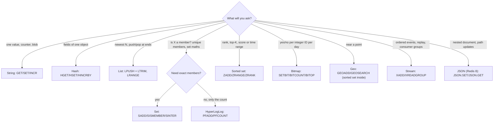
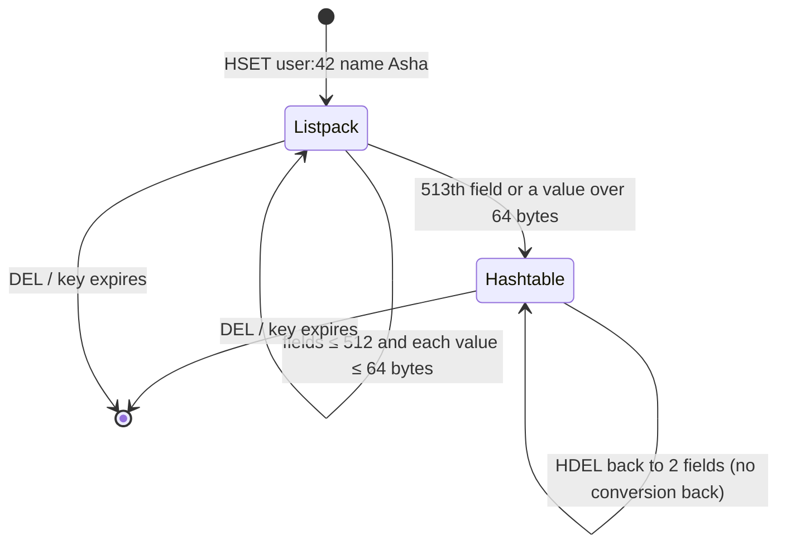

# Redis Data Structures and When to Use Each

> [!summary] TL;DR
> Redis stores values as typed data structures, and picking the right type is most of Redis design. Use a string for one value or counter, a hash for an object, a list for a recent-items feed, a set for unique members, a sorted set for anything ranked or time-ordered, a stream for an event log, and the special encodings (bitmap, HyperLogLog, geo) when they shrink memory by orders of magnitude.

> [!abstract] Core idea
> - Start from the question you will ask ("top 10?", "is X a member?", "last 20 items?") and pick the type whose command answers it in O(1) or O(log N).
> - Hash for objects (update one field), sorted set for ranking and time windows, set for uniqueness, list for capped feeds.
> - Bitmaps and HyperLogLog trade exactness or flexibility for huge memory savings: measured 5.57 MB for a 100k-member set vs 14 KB for a HyperLogLog.
> - Every type has O(N) commands (`HGETALL`, `SMEMBERS`, `LRANGE 0 -1`) that become dangerous when the key is big.
> - Classic mistake: storing a whole object as one JSON string and rewriting it to change one field, or storing each field as its own top-level key.

## 1. Why it exists

A ticketing app needs five features on top of its database:

1. Show a user's profile on every page (name, city, plan).
2. Keep each user's "recently viewed" list of 20 events.
3. Rank 2 million players in a weekly quiz and show "you are #48,213".
4. Count unique visitors per event page, for 50,000 pages.
5. Find drivers within 5 km of a venue.

If everything is a plain string, each feature fights the storage: you read and rewrite a JSON blob to change one field, sort 2 million scores in your app to find one rank, and keep 50,000 sets of visitor IDs that use gigabytes. Redis offers a different structure for each shape of question, with the work done inside the server in O(1) or O(log N).

## 2. Mental model

Think of Redis types as **the containers in a kitchen**:

- **String** = a jar with one thing in it (a number you can increment, or a blob).
- **Hash** = a labelled spice rack: one rack, many named slots; change one slot without touching the others.
- **List** = a stack of plates: add or take from either end fast; reaching the middle is slow.
- **Set** = a bag of unique marbles: add, remove, "is this marble in the bag?", intersect two bags.
- **Sorted set** = a bag where every marble has a number painted on it and the bag keeps them in order: "who is 10th?" and "what is Asha's place?" are fast.
- **Stream** = a receipt roll: append-only entries with IDs, readable by several teams who each remember where they stopped.
- **Bitmap / HyperLogLog / Geo** = clever ways of using the jar (string) or ordered bag (sorted set) to store huge amounts in little space.

## 3. How it works

### 3.1 Pick by the question



### 3.2 The types, one by one

| Type | Internals (small → large) | Key commands and cost | Typical key pattern |
| --- | --- | --- | --- |
| **String** | `int`, `embstr` (≤ 44 bytes), `raw` | `GET`/`SET`/`INCR`/`APPEND` O(1); `GETRANGE` O(len) | `cache:product:42`, `views:event:9` |
| **Hash** | listpack → hashtable (above 512 fields or 64-byte values) | `HGET`/`HSET`/`HINCRBY` O(1); `HGETALL` O(N) | `user:42` |
| **List** | listpack → quicklist (linked list of listpacks) | `LPUSH`/`RPOP` O(1); `LINDEX`/`LRANGE` O(N) toward the middle; `BLPOP` blocks | `recent:user:42` |
| **Set** | intset (all integers) or listpack → hashtable | `SADD`/`SISMEMBER`/`SREM` O(1); `SINTER` O(N×M) worst case; `SMEMBERS` O(N) | `tags:event:9`, `followers:42` |
| **Sorted set** | listpack → skip list + hash table | `ZADD`/`ZINCRBY`/`ZRANK` O(log N); `ZRANGE` O(log N + M) | `lb:weekly`, `delayed:jobs` |
| **Stream** | radix tree of listpacks | `XADD` O(1); `XRANGE` O(log N + M); consumer groups with `XREADGROUP`/`XACK` | `events:orders` |
| **Bitmap** | a string; bit *i* = ID *i* | `SETBIT`/`GETBIT` O(1); `BITCOUNT`/`BITOP` O(N) | `dau:2026-11-04` |
| **HyperLogLog** | a string, sparse → dense (about 12 KB) | `PFADD` O(1); `PFCOUNT` O(1) per key; `PFMERGE` | `uv:event:9:2026-11-04` |
| **Geo** | a sorted set whose score is a 52-bit geohash | `GEOADD` O(log N); `GEOSEARCH` O(N + log M) for N items in the area | `drivers:pune` |
| **JSON** (Redis 8) | tree of values | `JSON.SET key $.path`, `JSON.GET`, `JSON.NUMINCRBY` | `doc:order:42` |

Two more that exist but are niche: **bitfield** (`BITFIELD`, many small packed integers in one string) and **vector set** (new in Redis 8, for similarity search on embeddings).

Pub/Sub is not a type: it stores nothing. Lists, streams and Pub/Sub as messaging tools are compared in [[Redis as a Queue - Lists, Streams and Pub-Sub]].

### 3.3 Small values use compact encodings

Redis stores small collections as one flat **listpack** (a contiguous byte array) and switches to a pointer-based structure once a threshold is crossed. Measured on Redis 8.2:

```text
> SADD ints 1 2 3         -> OBJECT ENCODING ints   = "intset"
> SADD strs a b c         -> OBJECT ENCODING strs   = "listpack"
> HSET h f1 v1 f2 v2      -> OBJECT ENCODING h      = "listpack"
> 512 HSETs on one hash   -> "listpack"
> 513 HSETs on one hash   -> "hashtable"   (stays hashtable after HDEL)
> GEOADD drivers ...      -> TYPE drivers = "zset", ENCODING "listpack"
```

The thresholds are configurable (`hash-max-listpack-entries 512`, `set-max-listpack-entries 128`, `zset-max-listpack-entries 128`, and others). Keeping objects small enough to stay in a listpack is the cheapest memory win in Redis.



## 4. Worked example

### Whiteboard version

```text
Profile        -> Hash   user:<id>      HSET name/city/plan/score, HINCRBY score
Recently viewed-> List   recent:<id>    LPUSH item; LTRIM 0 19; EXPIRE 30d  (MULTI)
Unique visitors-> HLL    uv:<page>      PFADD visitor; PFCOUNT page1 page2 = union
Leaderboard    -> ZSet   lb:weekly      ZINCRBY; ZREVRANGE 0 9 WITHSCORES; ZREVRANK
Daily actives  -> Bitmap dau:<date>     SETBIT <userID> 1; BITCOUNT; BITOP AND
Nearby drivers -> Geo    drivers:<city> GEOADD lon lat id; GEOSEARCH ... BYRADIUS 5 km

Memory check (100,000 unique visitors, measured):
  Set  = 5,572,936 bytes, exact
  HLL  =    14,352 bytes, 99,471 counted (0.53% low)
```

### Memory: the same data in three layouts

Measured on Redis 8.2 by `INFO memory` before and after loading 10,000 users with three short fields (`name`, `city`, `age`):

| Layout | Keys | Extra memory | Per user | Update one field |
| --- | --- | --- | --- | --- |
| One string key per field (`user:1:name`, …) | 30,000 | 2,239,968 bytes | ~224 B | `SET user:1:city` |
| One hash per user (`HSET user:1 name … city … age …`) | 10,000 | 1,051,680 bytes | ~105 B | `HSET user:1 city …` |
| One JSON string per user | 10,000 | 1,052,128 bytes | ~105 B | read, edit, rewrite the whole value |

`INFO memory` deltas include keyspace hash-table resizing, so they move by tens of percent between runs (another run gave 1,371,584 bytes for the hash layout); compare layouts within one run.

`MEMORY USAGE` for a single user gave the same ranking: 112 bytes across three string keys, 80 bytes for the JSON string, 64 bytes for the listpack hash. Per-key overhead (the keyspace entry, the object header, the allocator) is what makes the first layout expensive. The hash and JSON layouts tie on memory in this test, and the hash wins on partial updates and `HINCRBY`.

### Memory: exact vs approximate uniques

Measured on Redis 8.2 with 100,000 distinct IDs `user:1` … `user:100000`:

| Structure | Result | Memory (`MEMORY USAGE`) |
| --- | --- | --- |
| Set (`SADD`) | 100,000, exact, members listable | 5,572,936 bytes (`hashtable` encoding) |
| HyperLogLog (`PFADD`) | 99,471 (0.53% low) | 14,352 bytes |
| Bitmap, one bit per numeric ID up to 100,000 | exact count with `BITCOUNT`, membership with `GETBIT` | 12,501-byte string (14,352 by `MEMORY USAGE`) |

The documented HyperLogLog standard error is 0.81%, and its size stays about 12 KB whether you add a thousand or a billion items. A bitmap is exact but only fits dense integer IDs: its size depends on the highest ID, not on how many bits are set.

### Go code (Go 1.24, go-redis v9)

```go
// Package structures maps three everyday features to the Redis type that fits.
package structures

import (
	"context"
	"time"

	"github.com/redis/go-redis/v9"
)

// Profile is stored as a Hash: one key, one field per attribute, so a single
// field can be read or changed without rewriting the whole object.
type Profile struct {
	Name  string `redis:"name"`
	City  string `redis:"city"`
	Plan  string `redis:"plan"`
	Score int    `redis:"score"`
}

func SaveProfile(ctx context.Context, rdb *redis.Client, id string, p Profile) error {
	return rdb.HSet(ctx, "user:"+id, p).Err() // HSET user:<id> name .. city .. plan .. score ..
}

func LoadProfile(ctx context.Context, rdb *redis.Client, id string) (Profile, bool, error) {
	var p Profile
	res := rdb.HGetAll(ctx, "user:"+id)
	if err := res.Err(); err != nil {
		return p, false, err
	}
	if len(res.Val()) == 0 {
		return p, false, nil // HGETALL on a missing key returns an empty map
	}
	return p, true, res.Scan(&p)
}

// PushRecent keeps the last n items viewed, newest first, in a capped List.
// LPUSH + LTRIM + EXPIRE go in one MULTI/EXEC so readers never see an
// uncapped list.
func PushRecent(ctx context.Context, rdb *redis.Client, id, item string, n int64) error {
	key := "recent:" + id
	_, err := rdb.TxPipelined(ctx, func(p redis.Pipeliner) error {
		p.LPush(ctx, key, item)
		p.LTrim(ctx, key, 0, n-1)
		p.Expire(ctx, key, 30*24*time.Hour)
		return nil
	})
	return err
}

func Recent(ctx context.Context, rdb *redis.Client, id string) ([]string, error) {
	return rdb.LRange(ctx, "recent:"+id, 0, -1).Result()
}

// AddVisitor and UniqueVisitors use a HyperLogLog: about 12 KB per key no
// matter how many visitors, with about 0.81% standard error.
func AddVisitor(ctx context.Context, rdb *redis.Client, page, visitor string) error {
	return rdb.PFAdd(ctx, "uv:"+page, visitor).Err()
}

func UniqueVisitors(ctx context.Context, rdb *redis.Client, pages ...string) (int64, error) {
	keys := make([]string, len(pages))
	for i, p := range pages {
		keys[i] = "uv:" + p
	}
	return rdb.PFCount(ctx, keys...).Result() // several keys = count of the union
}
```

```go
package structures

import (
	"context"
	"fmt"
	"math"
	"os"
	"slices"
	"testing"

	"github.com/redis/go-redis/v9"
)

func newClient(t *testing.T, keys ...string) *redis.Client {
	t.Helper()
	addr := os.Getenv("REDIS_ADDR")
	if addr == "" {
		addr = "localhost:6379"
	}
	rdb := redis.NewClient(&redis.Options{Addr: addr})
	ctx := context.Background()
	if err := rdb.Ping(ctx).Err(); err != nil {
		t.Skipf("no Redis at %s: %v", addr, err)
	}
	rdb.Del(ctx, keys...)
	t.Cleanup(func() { rdb.Del(ctx, keys...); rdb.Close() })
	return rdb
}

func TestProfileRoundTrip(t *testing.T) {
	ctx := context.Background()
	rdb := newClient(t, "user:42", "user:missing")
	in := Profile{Name: "Asha", City: "Pune", Plan: "gold", Score: 7}
	if err := SaveProfile(ctx, rdb, "42", in); err != nil {
		t.Fatal(err)
	}
	rdb.HIncrBy(ctx, "user:42", "score", 3) // update one field in place
	out, ok, err := LoadProfile(ctx, rdb, "42")
	if err != nil || !ok {
		t.Fatalf("ok=%v err=%v", ok, err)
	}
	in.Score = 10
	if out != in {
		t.Fatalf("got %+v want %+v", out, in)
	}
	if enc := rdb.ObjectEncoding(ctx, "user:42").Val(); enc != "listpack" {
		t.Fatalf("small hash encoding = %q, want listpack", enc)
	}
	if _, ok, _ := LoadProfile(ctx, rdb, "missing"); ok {
		t.Fatal("missing profile reported as found")
	}
}

func TestRecentIsCappedNewestFirst(t *testing.T) {
	ctx := context.Background()
	rdb := newClient(t, "recent:7")
	for i := 1; i <= 8; i++ {
		if err := PushRecent(ctx, rdb, "7", fmt.Sprintf("movie:%d", i), 5); err != nil {
			t.Fatal(err)
		}
	}
	got, _ := Recent(ctx, rdb, "7")
	want := []string{"movie:8", "movie:7", "movie:6", "movie:5", "movie:4"}
	if !slices.Equal(got, want) {
		t.Fatalf("got %v want %v", got, want)
	}
}

func TestUniqueVisitorsWithinHLLError(t *testing.T) {
	ctx := context.Background()
	rdb := newClient(t, "uv:home", "uv:about")
	for i := range 20000 {
		AddVisitor(ctx, rdb, "home", fmt.Sprintf("v%d", i))
	}
	for i := 10000; i < 30000; i++ { // half overlap with home
		AddVisitor(ctx, rdb, "about", fmt.Sprintf("v%d", i))
	}
	union, err := UniqueVisitors(ctx, rdb, "home", "about")
	if err != nil {
		t.Fatal(err)
	}
	if e := math.Abs(float64(union)-30000) / 30000; e > 0.03 {
		t.Fatalf("union=%d, error %.2f%% too large", union, e*100)
	}
	t.Logf("union estimate %d for 30000 true (%.2f%% off)", union, math.Abs(float64(union)-30000)/300)
}
```

Measured: `go test -race ./structures/` against Redis 8.2 passed. The HyperLogLog test logged `union estimate 30099 for 30000 true (0.33% off)`: `PFCOUNT` over two keys counted the union without double-counting the 10,000 shared visitors.

## 5. Variants and comparison

The data-choice table (use case → type):

| Use case | Type | Why not the obvious alternative |
| --- | --- | --- |
| Cached API response, HTML fragment | String | A hash adds nothing if you always read the whole value |
| Page-view or stock counter | String + `INCR`/`DECRBY` | Atomic in one command; no read-modify-write |
| User profile, cart, session data | Hash | Update one field; fewer keys than one-string-per-field |
| Recently viewed, activity feed (last N) | List with `LPUSH` + `LTRIM` | A sorted set works too but costs more memory when order is just arrival |
| Tags, followers, "who liked this", dedupe | Set | Exact membership in O(1); set maths with `SINTER`/`SUNION` |
| Leaderboard, top-K, priority | Sorted set | Rank and range in O(log N) without sorting in the app |
| Sliding-window rate limit, delayed jobs | Sorted set with timestamp scores | `ZREMRANGEBYSCORE` drops old entries by time |
| Unique visitors per page per day | HyperLogLog | 12 KB instead of megabytes; accept ~0.81% error |
| Daily active users by numeric ID | Bitmap | 1 bit per user; `BITOP AND` for "active both days" |
| Nearby drivers, stores | Geo | Radius and box queries built in |
| Event log with replay and consumer groups | Stream | A list loses the message once popped |
| Nested document with partial updates | JSON (Redis 8) or Hash if one level | Avoids rewriting the whole blob |

Strings vs hashes vs JSON for objects:

| Option | Read whole | Update one field | Nested data | Per-field TTL |
| --- | --- | --- | --- | --- |
| JSON string | 1 `GET` + decode | rewrite all (race unless `WATCH`/Lua) | yes | no |
| Hash | `HGETALL` | `HSET`/`HINCRBY`, atomic | one level only | yes, `HEXPIRE` since 7.4 |
| JSON type | `JSON.GET` | `JSON.SET key $.a.b` | yes | no |

## 6. Trade-offs and when not to use

- **Big collections turn O(N) commands into outages.** `HGETALL` on a 2-million-field hash or `SMEMBERS` on a 5-million-member set blocks the server and floods the network. Use `HSCAN`/`SSCAN`/`ZSCAN`, or split the key (`followers:42:0` … `followers:42:15`). See [[Cache Failure Modes - Stampede, Avalanche, Penetration, Hot and Big Keys]].
- **Lists are bad at the middle.** `LINDEX` and `LINSERT` walk the list. If you need random access by position, a sorted set by index or a hash is better.
- **Sorted sets cost memory.** Beyond 128 members they use a skip list plus a hash table, about 1.7× a plain set for the same members (measured on Redis 8.2: 100,000 members used 9,369,336 bytes as a sorted set vs 5,572,936 as a set). Use them when you need ranking, not just membership.
- **HyperLogLog cannot list members or remove one.** If you need "who", use a set; if you need deletes, HLL is wrong.
- **Bitmaps need dense integer IDs.** A single bit at offset 4,000,000,000 allocates a ~500 MB string. Hash sparse IDs into a range or use a set.
- **Cluster and multi-key commands:** `SINTER`, `PFCOUNT a b`, `BITOP` and `ZUNIONSTORE` need all keys in the same hash slot in Redis Cluster; use hash tags like `uv:{event9}:mon`. See [[Redis Replication, Sentinel and Cluster]].
- **When a simpler option wins:** if the data needs ad-hoc filters ("users in Pune on the gold plan"), use the database or a search index, not a hand-built set per filter.

## 7. In production

- **Real systems:** leaderboards on sorted sets, capped feeds on lists, HyperLogLog for unique counts in analytics dashboards, geo sets for nearby search; full designs are in [[Redis Use Cases]] and [[Case Study - Leaderboard and Top-K]].
- **Failure modes and fixes:**
	- An unbounded list or set (a feed nobody trims): always pair growth with `LTRIM`, `ZREMRANGEBYRANK` or a TTL.
	- A hash that silently crossed the listpack threshold: memory per key jumps; watch `MEMORY USAGE` on samples and keep values under 64 bytes where you can.
	- Deleting a huge collection with `DEL`: use `UNLINK`, or enable `lazyfree-lazy-user-del` (measured default `no` on Redis 8.2).
- **What to monitor:** `redis-cli --bigkeys` and `--memkeys` on a replica, `SLOWLOG` for O(N) commands, the size distribution of your largest keys, `used_memory` growth per key prefix.

## 8. Deep dive

### 8.1 Sorted set internals

A large sorted set is two structures kept in sync:
- a **hash table** from member to score, so `ZSCORE` is O(1);
- a **skip list** ordered by (score, member). Each node has a random number of forward pointers, giving O(log N) search, insert and delete on average. Redis's skip list also stores the **span** of each pointer (how many nodes it jumps), which is how `ZRANK` computes a rank in O(log N) instead of counting.

Members with equal scores are ordered by member bytes, so ties are deterministic.

### 8.2 HyperLogLog in one paragraph

Each item is hashed. The hash's low bits pick one of 16,384 registers; the rest of the bits give the length of the run of zero bits. Each register keeps the maximum it has seen. Long runs of zeros are rare, so the maxima estimate how many distinct items were hashed, and averaging over 16,384 registers (with a harmonic mean and corrections) gives the ~0.81% error. 16,384 registers × 6 bits = 12 KB. Small HLLs use a sparse encoding and are much smaller. Two HLLs merge by taking the register-wise maximum, which is why `PFCOUNT a b` gives the union.

### 8.3 Geo is a sorted set

`GEOADD` converts (longitude, latitude) into a 52-bit interleaved geohash and stores it as the score. Points close together share score prefixes, so a radius search becomes a few score-range scans on the neighbouring geohash boxes, followed by an exact distance filter. Measured on Redis 8.2: three drivers added with `GEOADD`; `GEOSEARCH drivers FROMLONLAT 73.8567 18.5204 BYRADIUS 5 km ASC WITHDIST` returned `d1 0.0002` and `d2 2.6794`, and left out `d3` (about 9 km away). `TYPE drivers` returned `zset`, so `ZREM` removes a driver.

### 8.4 Field-level TTL

Before Redis 7.4 only whole keys could expire. Since 7.4, `HEXPIRE`, `HPEXPIRE` and `HTTL` set a TTL per hash field, which fits "one hash of per-device tokens, each with its own expiry".

## 9. Interview questions

> [!question]- How do you model a leaderboard with 10 million players, and what is the cost of "what is my rank"?
> One sorted set: `ZINCRBY lb <delta> <player>` on each score change, `ZREVRANGE lb 0 9 WITHSCORES` for the top 10, `ZREVRANK lb <player>` for a rank. Rank is O(log N) thanks to the skip list's spans. Memory is the main cost; shard by time window (`lb:2026-w45`) so old boards expire.

> [!question]- Trap: you need unique visitors per page. Why not just a set per page?
> A set stores every member: measured on Redis 8.2, 100,000 IDs used 5.57 MB. Across 50,000 pages that is hundreds of GB. A HyperLogLog uses about 12 KB per page with ~0.81% error, and `PFCOUNT` across keys gives the union. Use a set only if you must list or remove members.

> [!question]- Hash vs JSON string vs one key per field for a user object?
> One key per field wastes per-key overhead (measured about 224 vs 105 bytes per user). A JSON string is compact but every field change rewrites the whole value and races unless you use `WATCH` or Lua. A hash is compact while it stays a listpack, updates fields atomically and supports `HINCRBY` and per-field TTL since 7.4.

> [!question]- When do you use a list and when a stream?
> A list is a simple deque: `LPUSH` + `LTRIM` for capped feeds, `BLMOVE` for a basic work queue. A stream is an append-only log with IDs, range reads, consumer groups, acknowledgements and pending-entry recovery; use it when consumers must not lose messages or must replay.

> [!question]- What is a listpack and why should you care?
> A compact contiguous encoding Redis uses for small hashes, lists, sets and sorted sets. It avoids per-element pointers, so small collections use far less memory. Crossing the threshold (for hashes, 512 fields or a value over 64 bytes) converts it to a hash table permanently, and memory per key jumps.

> [!question]- Which data-structure commands are dangerous in production?
> The O(N) ones on big keys: `HGETALL`, `SMEMBERS`, `LRANGE 0 -1`, `ZRANGE 0 -1`, `SINTER` of large sets, and `DEL` of a huge key. Replace them with the `*SCAN` family, bounded ranges and `UNLINK`.

## 10. Cheat sheet

- String: one value or counter (`INCR`); Hash: object fields (`HSET`, `HINCRBY`).
- List: capped feeds (`LPUSH` + `LTRIM`); Set: exact unique members and set maths.
- Sorted set: ranking, top-K, time windows; `ZRANK` and `ZADD` are O(log N).
- Stream: durable event log with consumer groups; Pub/Sub is not a type.
- HyperLogLog: unique counts in 12 KB at ~0.81% error; Bitmap: 1 bit per dense integer ID.
- Geo is a sorted set of geohash scores; JSON and vector sets arrived with Redis 8.
- Small collections use listpack/intset; crossing the threshold is one-way.
- Keep keys small and bounded; walk big ones with `*SCAN`.

## Links

- **Before this:** [[Redis Fundamentals]], [[Redis Hands-on Setup with Go]]
- **Next:** [[Redis Use Cases]], [[Case Study - Leaderboard and Top-K]]
- **Compare with:** [[Redis as a Queue - Lists, Streams and Pub-Sub]], [[Hash Tables and Go Maps]]
