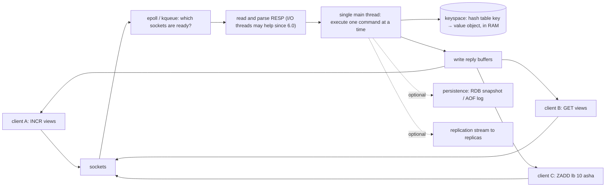
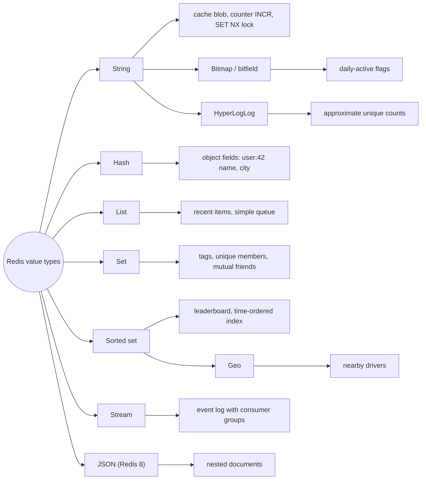
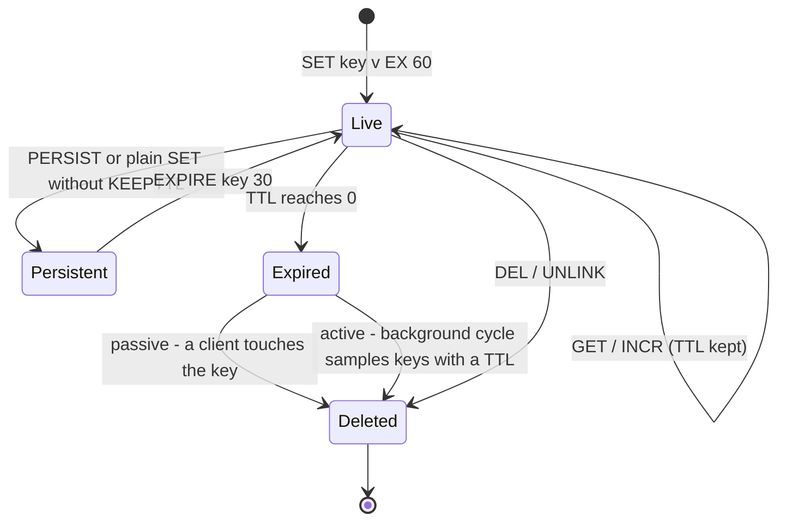

# Redis Fundamentals

> [!summary] TL;DR
> Redis is a server that keeps your data in RAM and lets you work on it as ready-made data structures (strings, hashes, lists, sets, sorted sets and more) over the network. Because every command runs on one thread straight against memory, a single command takes microseconds and is always atomic; data can optionally be saved to disk.

> [!abstract] Core idea
> - Redis is an **in-memory data-structure server**: you send commands like `INCR`, `ZADD` or `HSET`, not SQL.
> - One main thread executes every command, one at a time, so each command is atomic without locks.
> - Speed comes from RAM, no locks, an event loop (epoll on Linux) and compact encodings; the network round trip is usually the real cost, which is why pipelining matters.
> - Persistence (RDB snapshots, AOF log) and replication are optional add-ons, so Redis is a great cache and a risky system of record unless you configure durability on purpose.
> - Classic mistake: one slow command (`KEYS *`, a huge `DEL`, a long Lua script) blocks every other client.

## 1. Why it exists

A movie-booking site shows "seats left" on every show page. The number lives in PostgreSQL, and a page view runs `SELECT seats_left FROM shows WHERE id = $1`.

- At 20,000 page views per second, that query hits the database 20,000 times per second, even though the value changes only when someone books.
- An indexed primary-key read on a busy database is roughly 0.5–2 ms including the network (an estimate). A Redis `GET` on the same network is roughly 0.1–0.3 ms (an estimate; see the measured numbers in section 4).
- When a booking happens you also need to *decrement* the counter safely while thousands of people read it.

You could keep the counter in each app server's memory, but then 30 app servers hold 30 different numbers. You need one shared, very fast place that many servers can read and update atomically. That is what Redis gives you: a shared memory that speaks in data structures. The general idea of keeping a copy of data close to the reader is covered in [[Caching Fundamentals]]; this note is about Redis itself.

## 2. Mental model

Think of Redis as **one very fast clerk at a single counter**, sitting in a room full of labelled boxes.

- Every box has a name (the **key**, for example `show:42:seats`) and holds one kind of thing (the **type**: a number, a list, a set, a leaderboard).
- Clients queue at the counter. The clerk takes one request, does it completely, and only then takes the next. Nobody ever sees a half-done change.
- The clerk never walks to a warehouse. Everything is in the room (RAM), so each request takes microseconds.
- Some boxes have a timer label (a **TTL**, time to live). When the timer runs out, the box is thrown away.

The single clerk is both the strength (no locks, every command atomic) and the weakness (one slow request makes everyone wait).

## 3. How it works

### 3.1 The server in one picture

Redis is a TCP server (default port 6379). Clients send commands in a simple text protocol called **RESP** (REdis Serialization Protocol). The server keeps a big hash table, the **keyspace**, that maps each key to a value object.



Step by step:

1. **Multiplexing.** The kernel tells Redis which of thousands of sockets have data ready, using `epoll` on Linux or `kqueue` on macOS (the measured server reported `multiplexing_api:kqueue`). One thread can serve tens of thousands of connections this way; see [[I-O Models - Blocking, epoll, io_uring and the Go Netpoller]].
2. **Parsing.** The command bytes are parsed. Since Redis 6.0, optional **I/O threads** (`io-threads`, default 1) can do socket reads and writes in parallel. Command *execution* stays on one thread.
3. **Execution.** The main thread looks up the key in the keyspace and runs the command against the in-memory structure.
4. **Reply.** The result goes into the client's output buffer and is written back.
5. **Side effects.** If configured, the write is appended to the AOF log and sent to replicas.

### 3.2 Why it is fast

| Reason | What it means |
| --- | --- |
| RAM, not disk | A memory access is around 100 ns; an SSD read is tens of microseconds or more. |
| One executor thread | No locks, no context switches between commands, no lock contention. |
| Event loop | One thread waits on all sockets at once instead of one thread per client. |
| Compact encodings | Small hashes, lists, sets and sorted sets are stored as one flat **listpack** (a packed byte array); small integer sets as an **intset**. Fewer pointers, better CPU cache use. |
| Simple protocol | RESP is cheap to parse. |

The catch: on a real network the **round-trip time (RTT)** between app and Redis is usually larger than the time Redis spends on the command. Sending many commands without waiting for each reply, called **pipelining**, removes most of that cost (measured in section 4).

### 3.3 Keys, types and expiry

- A **key** is a binary-safe string, usually namespaced with colons: `user:42`, `show:42:seats`.
- A **value** has one type. The main types: string, hash, list, set, sorted set, stream, plus bitmaps and bitfields (operations on strings), HyperLogLog (a probabilistic counter stored as a string), geospatial indexes (stored as a sorted set) and, in Redis 8, JSON and vector sets. Pub/Sub is a messaging feature, not a data type. The full guide is [[Redis Data Structures and When to Use Each]].


- A string value can be up to 512 MB (documented limit), but anything above a few KB is a warning sign (see big keys in section 6).
- A **TTL** is set with `SET key value EX 60`, `EXPIRE key 60` or `PEXPIRE` (milliseconds). `TTL key` returns the seconds left, `-1` for no TTL and `-2` if the key does not exist (measured).

Keys expire in two ways:



- **Passive (lazy) expiry:** when a client touches an expired key, Redis deletes it and answers as if it never existed.
- **Active expiry:** a background cycle runs `hz` times per second (default 10) and samples keys that have a TTL, deleting expired ones; it keeps going while a large share of the sample is expired. `active-expire-effort` (since 6.0) tunes how hard it works.
- An expired key can therefore still use memory for a while until one of the two paths reaches it. Expiry is not eviction: **eviction** removes keys that have *not* expired because memory is full, controlled by `maxmemory-policy`; see [[Cache Eviction Policies - LRU, LFU, TTL]].

A trap worth remembering: a plain `SET` on a key that had a TTL **removes** the TTL. Measured: after `SET a 1 EX 100` then `SET a 2`, `TTL a` returns `-1`. Use `SET ... KEEPTTL` (since 6.0) or set the TTL again.

### 3.4 Atomicity: three tools

Every single command is atomic: `INCR`, `SET NX`, `ZINCRBY` and `LPUSH` can never interleave with another client's command. When you need *several* steps to be atomic, you have three tools:

| Tool | How it works | Gotcha |
| --- | --- | --- |
| `MULTI` … `EXEC` | Commands are queued, then run back-to-back with nothing in between. | No reads inside: you cannot branch on a value. **No rollback**: if one command fails at runtime, the others still apply. |
| `WATCH` + `MULTI/EXEC` | Optimistic locking: `EXEC` aborts if a watched key changed since `WATCH`. You read, decide, then commit or retry. | Retries under contention. |
| Lua script (`EVAL`) or Function (`FCALL`, since 7.0) | Runs on the server as one unit; can read, branch and write. | Blocks the whole server while running. After `busy-reply-threshold` (default 5000 ms) other clients get `BUSY` errors. |

## 4. Worked example

### Whiteboard version

```text
Problem: 50 seats, 200 buyers at once, each wants 1 seat.

Naive:   left = GET seats        (round trip 1)
         if left >= 1: DECRBY seats 1   (round trip 2)
         -> between 1 and 2 other buyers read the same "left" -> oversell

WATCH:   WATCH seats
         left = GET seats
         MULTI; DECRBY seats 1; EXEC   -> EXEC returns nil if seats changed
         on nil: retry from WATCH

Lua:     EVAL "if GET >= n then DECRBY else -1" 1 seats 1
         -> whole check-and-decrement runs as one command, one round trip

Result we expect: sold = 50, left = 0, never negative.
```

### The code (Go 1.24, go-redis v9)

The three variants side by side. The naive one is wrong on purpose.

```go
// Package fundamentals shows the three ways to make a read-modify-write
// atomic in Redis: a single command, MULTI/EXEC with WATCH, and a Lua script.
package fundamentals

import (
	"context"
	"errors"

	"github.com/redis/go-redis/v9"
)

// ErrSoldOut means fewer seats are left than were requested.
var ErrSoldOut = errors.New("sold out")

// ReserveNaive is BROKEN on purpose: GET and DECRBY are two round trips,
// so two clients can both read "1 left" and both reserve it.
func ReserveNaive(ctx context.Context, rdb *redis.Client, key string, n int64) error {
	left, err := rdb.Get(ctx, key).Int64()
	if err != nil {
		return err
	}
	if left < n {
		return ErrSoldOut
	}
	return rdb.DecrBy(ctx, key, n).Err()
}

// ReserveWatch uses optimistic locking: WATCH the key, read it, then queue
// DECRBY inside MULTI/EXEC. EXEC aborts (redis.TxFailedErr) if another client
// changed the key after WATCH, and we retry.
func ReserveWatch(ctx context.Context, rdb *redis.Client, key string, n int64) error {
	txf := func(tx *redis.Tx) error {
		left, err := tx.Get(ctx, key).Int64()
		if err != nil {
			return err
		}
		if left < n {
			return ErrSoldOut
		}
		_, err = tx.TxPipelined(ctx, func(p redis.Pipeliner) error {
			p.DecrBy(ctx, key, n)
			return nil
		})
		return err
	}
	for {
		err := rdb.Watch(ctx, txf, key)
		if errors.Is(err, redis.TxFailedErr) {
			continue // someone else won the race; read again
		}
		return err
	}
}

// reserveScript runs inside Redis as one unit: no other command can run
// between the GET and the DECRBY.
var reserveScript = redis.NewScript(`
local left = tonumber(redis.call('GET', KEYS[1]) or '0')
local n = tonumber(ARGV[1])
if left < n then return -1 end
return redis.call('DECRBY', KEYS[1], n)
`)

// ReserveLua is one round trip and never retries.
func ReserveLua(ctx context.Context, rdb *redis.Client, key string, n int64) error {
	left, err := reserveScript.Run(ctx, rdb, []string{key}, n).Int64()
	if err != nil {
		return err
	}
	if left < 0 {
		return ErrSoldOut
	}
	return nil
}
```

The test starts 200 goroutines against 50 seats on a real Redis. It skips when no Redis is reachable.

```go
package fundamentals

import (
	"context"
	"os"
	"testing"

	"github.com/redis/go-redis/v9"
)

// newClient connects to REDIS_ADDR (default localhost:6379) and skips the
// test when no Redis is reachable.
func newClient(t *testing.T) *redis.Client {
	t.Helper()
	addr := os.Getenv("REDIS_ADDR")
	if addr == "" {
		addr = "localhost:6379"
	}
	rdb := redis.NewClient(&redis.Options{Addr: addr, PoolSize: 64})
	if err := rdb.Ping(context.Background()).Err(); err != nil {
		t.Skipf("no Redis at %s: %v", addr, err)
	}
	t.Cleanup(func() { rdb.Close() })
	return rdb
}
```

```go
package fundamentals

import (
	"context"
	"errors"
	"sync"
	"sync/atomic"
	"testing"

	"github.com/redis/go-redis/v9"
)

type reserveFn func(context.Context, *redis.Client, string, int64) error

// race starts 200 buyers for 50 seats and counts how many succeeded.
func race(t *testing.T, fn reserveFn) (sold int64, left int64) {
	t.Helper()
	ctx := context.Background()
	rdb := newClient(t)
	key := "test:seats:" + t.Name()
	rdb.Set(ctx, key, 50, 0)
	t.Cleanup(func() { rdb.Del(ctx, key) })

	var ok atomic.Int64
	var wg sync.WaitGroup
	for range 200 {
		wg.Add(1)
		go func() {
			defer wg.Done()
			err := fn(ctx, rdb, key, 1)
			switch {
			case err == nil:
				ok.Add(1)
			case errors.Is(err, ErrSoldOut):
			default:
				t.Error(err)
			}
		}()
	}
	wg.Wait()
	left, _ = rdb.Get(ctx, key).Int64()
	return ok.Load(), left
}

func TestReserveWatchNeverOversells(t *testing.T) {
	sold, left := race(t, ReserveWatch)
	if sold != 50 || left != 0 {
		t.Fatalf("sold=%d left=%d, want 50 and 0", sold, left)
	}
}

func TestReserveLuaNeverOversells(t *testing.T) {
	sold, left := race(t, ReserveLua)
	if sold != 50 || left != 0 {
		t.Fatalf("sold=%d left=%d, want 50 and 0", sold, left)
	}
}

func TestReserveNaiveCanOversell(t *testing.T) {
	// Not asserted: the race is timing-dependent. It shows what goes wrong.
	sold, left := race(t, ReserveNaive)
	t.Logf("naive: sold=%d left=%d", sold, left)
}
```

Measured on Redis 8.2 (`go test -race -v`, three runs): the WATCH and Lua versions sold exactly 50 seats every time. The naive version oversold on every run, but by a different amount each time (one run logged `naive: sold=200 left=-150`, a review re-run logged `naive: sold=137 left=-87`), because the result depends on how the goroutines interleave.

### Numbers: what one thread can do, and what pipelining buys

Measured on Redis 8.2.1, Apple M4, client and server on the same machine over loopback, `redis-benchmark -c 50`:

| Run | SET requests/s | GET requests/s | p50 latency |
| --- | --- | --- | --- |
| one command per round trip (`-n 200000`) | 150,489 | 205,128 | 0.215 ms (SET) |
| pipelined, 16 commands per round trip (`-P 16`, `-n 2000000`) | 1,601,281 | 1,041,667 | 0.423 ms (SET, per batch) |

Pipelining gave about 10× more SETs per second from the same single thread, because the server spent its time executing commands instead of waiting on sockets. Over a real network with 0.5 ms RTT the gap is larger, since an unpipelined client can do at most about 2,000 sequential commands per second per connection (an estimate: 1 / 0.5 ms).

Measured on Redis 8.2 with 1,000,000 keys: `KEYS 'key:99999*'` took **53,759 µs** (about 54 ms) according to `SLOWLOG GET`. For those 54 ms no other client got any reply. `SCAN` with the same pattern returned the same keys in many short calls.

## 5. Variants and comparison

| Option | Data model | Threads | Persistence | Use when | Cost |
| --- | --- | --- | --- | --- | --- |
| **Redis** | Rich data structures, TTL per key, scripting | One executor + optional I/O threads | Optional RDB + AOF | Cache plus counters, leaderboards, sessions, rate limits, locks | All data must fit in RAM; durability is opt-in |
| **Valkey** | Same as Redis 7.2 (forked from it), evolving separately | Same model, more I/O threading work | Same | You want a BSD-licensed Redis-compatible server, or your cloud defaults to it | Diverges slowly from Redis 8 features (for example JSON is a separate module) |
| **Memcached** | Strings only (opaque blobs), TTL | Multi-threaded | None | Pure, simple, large-scale blob cache | No data structures, no replication built in, no persistence |
| **PostgreSQL** | Relational tables, SQL, indexes | Process per connection | WAL, crash-safe by default | System of record, ad-hoc queries, joins | Disk and fsync on writes; ms not µs |
| **In-process map** (Go `map` + mutex, ristretto) | Whatever your code holds | Your goroutines | None | Per-instance hot data, no network hop | Not shared between instances; lost on restart |

**Redis vs a database, in short:** Redis answers known access patterns (by key) very fast; a database answers any question about durable data. Redis has no secondary indexes, joins or ad-hoc queries in its core types, and with default settings an unplanned restart can lose recent writes.

**Licensing (status as of late 2026, documented sources in frontmatter):**
- Up to Redis 7.2 the server was BSD-3 licensed.
- In March 2024 Redis announced that, starting with Redis 7.4 (released mid-2024), the server would ship under a dual source-available licence (RSALv2 or SSPLv1). Cloud providers could no longer offer it as a managed service without a deal.
- The Linux Foundation forked Redis 7.2.4 as **Valkey** (BSD-3), backed by AWS, Google Cloud, Oracle and others. AWS ElastiCache and MemoryDB now offer Valkey.
- In May 2025 Redis 8.0 added **AGPLv3** as a third licence option, which is an OSI-approved open-source licence.
- For application code the client protocol is the same, so go-redis talks to both.

## 6. Trade-offs and when not to use

- **RAM is the limit and the bill.** Every key, plus per-key overhead, lives in memory. Measured on Redis 8.2: 10,000 users stored as 3 separate string keys each used about 2.2 MB of extra memory; the same data as one small hash per user used about 1.0–1.4 MB (the `INFO memory` delta varies between runs because the keyspace hash table resizes). Design keys with memory in mind.
- **One slow command blocks everyone.** `KEYS *`, `HGETALL` or `SMEMBERS` on a key with millions of elements, `DEL` of a huge key (use `UNLINK`, which frees memory in a background thread, since 4.0), `FLUSHALL` without `ASYNC`, or a long Lua script all stall every client. Use `SCAN`, `HSCAN`, `SSCAN` and `ZSCAN` to walk large collections.
- **Big keys.** A single 50 MB value or a set with 10 million members is slow to read, slow to delete, slow to replicate and impossible to split across shards. See [[Cache Failure Modes - Stampede, Avalanche, Penetration, Hot and Big Keys]].
- **Durability is not the default you think.** With RDB snapshots only, a crash loses everything since the last snapshot. With AOF `appendfsync everysec` (the AOF default), you can lose about one second. See [[Redis Persistence - RDB and AOF]].
- **Not a query engine.** If you will need "find all orders over ₹500 last week", that belongs in a database.
- **When a simpler option wins:**
	- A single app instance with a small hot set: an in-process cache avoids the network hop.
	- Data that must never be lost (payments, orders): keep it in PostgreSQL; use Redis only as a cache or helper in front of it.
	- Large blobs (images, PDFs): object storage plus a CDN, see [[CDN and Edge]].

## 7. In production

- **Real systems:** Redis is commonly used as the cache and fast-state layer in front of a relational database (sessions, rate limits, leaderboards, feature flags, job queues). Managed offerings include AWS ElastiCache (Redis OSS and Valkey engines), Google Cloud Memorystore, Azure Cache for Redis, Redis Cloud and Upstash. Setup and client config are in [[Redis Hands-on Setup with Go]]; Go client patterns are in [[Redis in Go]].
- **Failure modes and fixes:**
	- Memory full with the default policy `noeviction` (measured: `maxmemory-policy noeviction` on a fresh Redis 8.2): writes start failing with `OOM command not allowed`. Fix: set `maxmemory` and an eviction policy such as `allkeys-lru` for a pure cache.
	- Latency spikes from a blocking command: find it with `SLOWLOG GET`, ban `KEYS` with ACLs or `rename-command`.
	- Fork pauses and memory doubling during RDB snapshot or AOF rewrite (copy-on-write): leave headroom, see [[Redis in Production - Memory, Latency, Security]].
	- Losing the only node: add replicas and failover, see [[Redis Replication, Sentinel and Cluster]].
- **What to monitor:** `used_memory` vs `maxmemory`, `evicted_keys`, `expired_keys`, `keyspace_hits` / `keyspace_misses` (hit ratio), `connected_clients`, `instantaneous_ops_per_sec`, `SLOWLOG` entries, replication lag, and `mem_fragmentation_ratio`.

## 8. Deep dive

### 8.1 Encodings: the same type, different memory layouts

Redis picks an internal **encoding** per value and switches it as the value grows. Measured on Redis 8.2 with `OBJECT ENCODING`:

| Value | Encoding | `MEMORY USAGE` (bytes) |
| --- | --- | --- |
| `SET counter 12345` | `int` | 16 |
| `SET name alice` | `embstr` (string ≤ 44 bytes stored in one allocation with its header) | 32 |
| `SET long <60 x's>` | `raw` | 80 |
| `SADD ints 1 2 3` | `intset` | – |
| `SADD strs a b c` | `listpack` | – |
| `HSET h f1 v1 f2 v2`, small list, small zset | `listpack` | – |
| hash with 513 fields | `hashtable` | – |

Thresholds come from config (measured defaults on Redis 8.2): `hash-max-listpack-entries 512`, `hash-max-listpack-value 64`, `set-max-intset-entries 512`, `set-max-listpack-entries 128`, `zset-max-listpack-entries 128`, `list-max-listpack-size -2` (8 KB per list node). Conversion is one-way: measured, a hash that grew to 513 fields stayed `hashtable` after one field was deleted. A listpack is scanned linearly, so its operations are O(n), but with n ≤ 128–512 it beats a pointer-heavy hash table on both memory and CPU cache.

### 8.2 The single-threaded design, precisely

"Single-threaded" means one thread executes commands. Redis does use other threads:
- **I/O threads** (since 6.0, `io-threads`) read and write sockets.
- **Background threads** do lazy freeing (`UNLINK`, `FLUSHALL ASYNC`), AOF `fsync` and closing files.
- **Forked child processes** write RDB snapshots and rewrite the AOF.

To use more CPU cores for commands you run more Redis processes: shards in Redis Cluster, each owning part of the 16,384 hash slots; see [[Redis Replication, Sentinel and Cluster]] and [[Consistent Hashing]].

### 8.3 Edge cases

- `MULTI/EXEC` does not roll back. If `INCR` hits a string that is not a number inside a transaction, that command fails and the other queued commands still run.
- Lua scripts must declare every key they touch in `KEYS` so Redis Cluster can route them to one slot; keys in different slots fail with `CROSSSLOT`.
- Expired keys on a replica: replicas do not expire keys on their own; they wait for the primary's `DEL`, but reads on a replica hide logically expired keys (since 3.2).
- JSON in Redis 8 ships with the full Redis Open Source distribution. A server built without those modules does not know the commands: measured on this Redis 8.2.1 build, `MODULE LIST` showed only `vectorset`, and `JSON.SET` answered `ERR unknown command`.

## 9. Interview questions

> [!question]- Redis is single-threaded. How can it handle 100k+ requests per second?
> Each command is a short in-memory operation with no locks, and one thread multiplexes thousands of sockets with epoll. Measured on Redis 8.2 on one laptop core: about 150k SET/s unpipelined and 1.6M SET/s with 16-command pipelines. The limit is usually network round trips, not CPU.

> [!question]- Trap: is a MULTI/EXEC transaction like a SQL transaction?
> No. It guarantees that queued commands run back-to-back without other clients in between, but there is no rollback if one fails at runtime, and you cannot read a value inside it to decide what to do. For check-then-act use `WATCH` (optimistic retry) or a Lua script.

> [!question]- How does a key with a TTL actually get deleted?
> Two ways: passively, when a client touches it after expiry; and actively, by a background cycle that runs `hz` times per second, samples keys with a TTL and deletes expired ones. So expired keys can hold memory for a while. Eviction is different: it removes non-expired keys when `maxmemory` is reached.

> [!question]- Why is `KEYS *` banned in production, and what do you use instead?
> It walks the whole keyspace in one blocking command; measured on Redis 8.2 it took about 54 ms on 1M keys, during which every other client waited. Use `SCAN` with `MATCH` and `COUNT`, which walks incrementally with a cursor and may return duplicates you must tolerate.

> [!question]- When would you pick Memcached over Redis?
> When you need only a simple string cache and want multi-threaded scaling on one big box, with no need for data structures, persistence or replication. For counters, sets, leaderboards, TTL-based locks or anything atomic beyond get/set, Redis.

> [!question]- What does pipelining change, and what does it not change?
> It sends many commands without waiting for each reply, so N commands cost about one round trip instead of N. It does not make them atomic: other clients' commands can interleave. For atomicity use MULTI/EXEC or Lua.

> [!question]- Can you use Redis as your primary database?
> Only if the data fits in RAM, you configure AOF with an fsync policy you accept, run replicas with failover, and your access patterns are all by key. Even then you lose ad-hoc queries. Most teams keep the system of record in a database and use Redis for derived or short-lived state.

## 10. Cheat sheet

- Redis = in-memory data-structure server; one thread executes commands, so each command is atomic.
- Speed: RAM, no locks, epoll event loop, listpack/intset encodings; the RTT dominates, so pipeline.
- Types: string, hash, list, set, sorted set, stream, bitmap, HyperLogLog, geo, JSON. Pub/Sub is not a type.
- TTL: `EX`/`EXPIRE`; `TTL` gives -1 (none) or -2 (missing); plain `SET` clears the TTL unless `KEEPTTL`.
- Expiry = lazy + active sampling; eviction = `maxmemory` + `maxmemory-policy` (default `noeviction`).
- Multi-step atomicity: `WATCH` + `MULTI/EXEC` (optimistic) or Lua/Functions (server-side, blocks everyone).
- Never: `KEYS`, huge values, `DEL` of huge keys (use `UNLINK`), long scripts.
- Licence: Redis 8 is RSALv2/SSPLv1/AGPLv3; Valkey is the BSD fork of 7.2.

## Links

- **Before this:** [[Caching Fundamentals]], [[Hash Tables and Go Maps]]
- **Next:** [[Redis Hands-on Setup with Go]], then [[Redis Data Structures and When to Use Each]] and [[Redis Use Cases]]
- **Go deeper:** [[Redis Persistence - RDB and AOF]], [[Redis Replication, Sentinel and Cluster]], [[Redis in Production - Memory, Latency, Security]]
- **Compare with:** [[Caching Patterns]], [[Cache Eviction Policies - LRU, LFU, TTL]]
