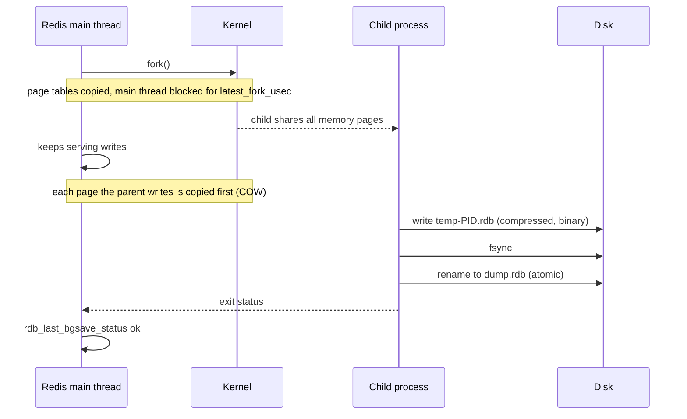
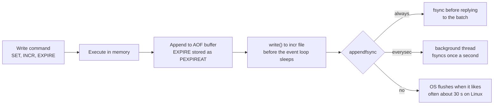
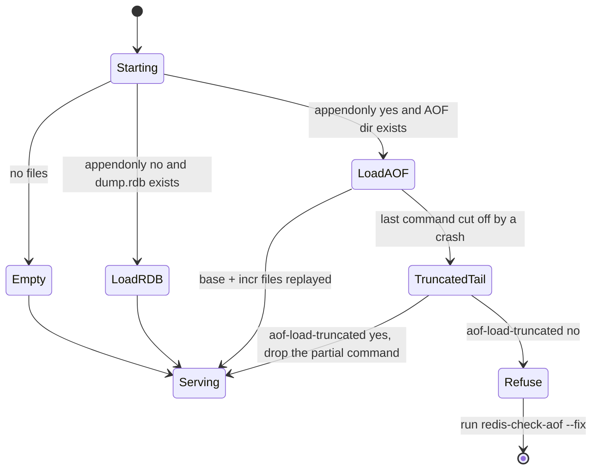

# Redis Persistence - RDB and AOF

> [!summary] TL;DR
> Redis keeps data in RAM and can save it to disk in two ways. **RDB** writes a compact snapshot of all data every so often, so you can lose the writes since the last snapshot. **AOF** (append-only file) logs every write command and replays the log on restart, so with `appendfsync everysec` you lose at most about a second of writes. Most production setups that care about data use both.

> [!abstract] Core idea
> - RDB = point-in-time snapshot, made by a forked child process using copy-on-write memory. Small file, fast restart, but minutes of data loss.
> - AOF = a log of write commands, flushed to disk every write, every second, or when the OS decides. Bigger file, smaller data loss.
> - Since Redis 7.0 the AOF is a directory: an RDB-format base file plus incremental log files plus a manifest.
> - Persistence protects against a restart, not against losing the machine. That needs replicas and off-host backups.
> - Classic mistake: thinking `appendfsync always` makes Redis a fully durable database. It is durable on that disk, but replication is still asynchronous.

## 1. Why it exists

Redis serves InvoiceOps' dashboard cache, rate-limit counters and a job queue. At 03:00 the host reboots for a kernel patch.

- With no persistence, Redis starts empty. The cache is cold (an avalanche on PostgreSQL, see [[Cache Failure Modes - Stampede, Avalanche, Penetration, Hot and Big Keys]]), every rate-limit counter resets, and the 40,000 queued jobs are gone.
- With an RDB snapshot every 5 minutes, Redis reloads 1,000,000 keys in about a second (measured below), but jobs enqueued in the last 0-5 minutes are lost.
- With AOF and `appendfsync everysec`, at most about one second of writes is lost.

Which one you need depends on what the data is. A pure cache can often run with no persistence at all; a queue or a counter store cannot.

## 2. Mental model

Two ways to back up a notebook:
- **RDB** is photocopying the whole notebook every few minutes. Copies are compact and quick to restore, but anything written since the last copy is gone if the notebook burns.
- **AOF** is keeping a diary of every change ("set x to 5", "add 3 to y"). To rebuild, you replay the diary. The diary is never more than a second behind, but it grows forever, so now and then you rewrite it as a short summary of the current state (an **AOF rewrite**).

Terms:
- **fork**: a Unix system call that creates a child process sharing the parent's memory pages.
- **Copy-on-write (COW)**: after a fork, a memory page is only copied when parent or child writes to it.
- **fsync**: the system call that forces data from the OS page cache onto the physical disk. A `write()` alone only reaches the page cache, which a power loss erases.

## 3. How it works

### RDB snapshot



- Triggers: `save <seconds> <changes>` rules (the Redis 7+ default is `save 3600 1 300 100 60 10000`: after an hour if 1 key changed, 5 minutes if 100 changed, 1 minute if 10,000 changed), `BGSAVE`, `SHUTDOWN` when save points exist, and a replica's full sync.
- `SAVE` (no "BG") writes in the main thread and blocks every client. Never use it on a live server.
- The child writes a temp file and renames it, so `dump.rdb` is always a complete snapshot.
- If a background save fails and `stop-writes-on-bgsave-error yes` (the default) is set, Redis refuses writes with a `MISCONF` error until a save succeeds. This turns silent data-loss risk into a loud outage.

### AOF



- The AOF stores commands in the Redis protocol format. Relative expiries are rewritten as absolute ones, so replay does not extend TTLs. Measured on Redis 8.2: `EXPIRE probe 100` appeared in the file as `PEXPIREAT probe 1793776272290`.
- **AOF rewrite** (`BGREWRITEAOF`, or automatic when the AOF has grown by `auto-aof-rewrite-percentage` (100%) and is at least `auto-aof-rewrite-min-size` (64 MB); defaults measured on Redis 8.2) forks a child that writes the current dataset as a new base file. With `aof-use-rdb-preamble yes` (added in Redis 4.0, the default since Redis 5.0) that base is in RDB format, which is smaller and faster to load.
- **Multi-part AOF (Redis 7.0+).** The AOF is a directory (`appenddirname`, default `appendonlydir`) holding a base file, one or more incremental files, and a manifest that lists them. A rewrite creates a new base and a new incremental file and swaps the manifest, so Redis never has to merge a rewrite buffer into the old file.

### Restart



When AOF is enabled, Redis loads only the AOF, because it is the more complete record. A common outage: someone enables `appendonly yes` in the config file of a server that only had `dump.rdb`, restarts it, and Redis loads an empty AOF. The safe way is `CONFIG SET appendonly yes` on the running server (it writes a fresh AOF from memory), wait until `aof_rewrite_in_progress:0`, then update the config file.

## 4. Worked example

### Whiteboard version

A persistence block for a Redis that holds queues and counters, not just cache:

```conf
# Snapshots: compact backups and fast full resyncs
save 3600 1 300 100 60 10000
stop-writes-on-bgsave-error yes
rdbcompression yes
dbfilename dump.rdb

# Log every write; lose at most ~1 s on a crash
appendonly yes
appenddirname appendonlydir
appendfsync everysec
aof-use-rdb-preamble yes
auto-aof-rewrite-percentage 100
auto-aof-rewrite-min-size 64mb
aof-load-truncated yes
```

For a pure cache, `save ""` and `appendonly no` are valid choices: a restart costs a cold cache, not lost data.

### Measured: what each option costs

Setup: Redis 8.2 (Homebrew build) on an Apple M4 laptop with its internal SSD. 1,000,000 string keys of 100 bytes created with `DEBUG POPULATE 1000000 key 100` (the padding is zeros, so it compresses unusually well). `DEBUG` commands are refused by default since Redis 7.0 (`enable-debug-command no`), so the test server was started with `enable-debug-command local`.

| Measurement (Redis 8.2) | Result |
| --- | --- |
| `used_memory` for 1,000,000 keys | 151.6 MB |
| `latest_fork_usec` for that dataset | 4,640 µs |
| `dump.rdb` size | 34.1 MB |
| AOF base file, RDB preamble | 34.1 MB (`appendonly.aof.1.base.rdb`) |
| AOF base file, pure AOF (`aof-use-rdb-preamble no`) | 131.4 MB (`appendonly.aof.4.base.aof`) |
| `DEBUG RELOAD` (save + load RDB) | 1.33 s |
| `DEBUG LOADAOF`, pure AOF base | 0.71 s |
| `DEBUG LOADAOF`, RDB-preamble base | 0.52 s |

Write throughput, `redis-benchmark -t set -n 100000 -c 50 -r 100000`, same machine:

| Setting | SET requests/s | p50 latency |
| --- | --- | --- |
| `appendonly no` | 174,825 | 0.223 ms |
| `appendonly yes`, `appendfsync no` | 172,117-181,488 (two runs) | 0.223-0.231 ms |
| `appendonly yes`, `appendfsync everysec` | 176,678-185,185 (three runs) | 0.223 ms |
| `appendonly yes`, `appendfsync always` | 5,988 | 7.807 ms |

Read it this way: `everysec` costs almost nothing, because a background thread does the fsync. `always` is about 30 times slower here, because every batch of writes waits for the SSD to confirm a flush. On a cloud volume with higher fsync latency the gap is usually larger.

The directory after enabling AOF on the running server, measured on Redis 8.2:

```text
appendonlydir/
  appendonly.aof.1.base.rdb   34.1M
  appendonly.aof.1.incr.aof   0B
  appendonly.aof.manifest     102B

$ cat appendonlydir/appendonly.aof.manifest
file appendonly.aof.1.base.rdb seq 1 type b
file appendonly.aof.1.incr.aof seq 1 type i startoffset 0
```

### Go: turn `INFO persistence` into alerts

A persistence problem is silent until a restart. This check runs from a health endpoint or a cron job and reports the failures that matter. It compiles, passes `go vet`, and its tests pass with `go test -race` on Go 1.24.

```go
// Package persist turns `INFO persistence` into alerts a pager can act on.
package persist

import (
	"bufio"
	"fmt"
	"strconv"
	"strings"
	"time"
)

// ParseInfo reads "key:value" lines from an INFO reply into a map.
func ParseInfo(raw string) map[string]string {
	out := make(map[string]string)
	sc := bufio.NewScanner(strings.NewReader(raw))
	for sc.Scan() {
		line := strings.TrimSpace(sc.Text())
		if line == "" || strings.HasPrefix(line, "#") {
			continue
		}
		if k, v, ok := strings.Cut(line, ":"); ok {
			out[k] = v
		}
	}
	return out
}

// Policy states what "healthy" means for this instance.
type Policy struct {
	ExpectAOF      bool          // the instance must have appendonly yes
	MaxSnapshotAge time.Duration // 0 disables the RDB age check
	MaxUnsaved     int64         // 0 disables the unsaved-changes check
}

// Check returns one human-readable problem per failed rule.
func Check(info map[string]string, p Policy, now time.Time) []string {
	var probs []string
	if info["loading"] == "1" {
		probs = append(probs, "loading dataset from disk: not serving yet")
	}
	if s := info["rdb_last_bgsave_status"]; s != "" && s != "ok" {
		// With stop-writes-on-bgsave-error yes (default) Redis now rejects writes.
		probs = append(probs, "last BGSAVE failed: writes may be rejected (MISCONF)")
	}
	if p.ExpectAOF {
		if info["aof_enabled"] != "1" {
			probs = append(probs, "AOF expected but appendonly is off")
		}
		if s := info["aof_last_write_status"]; s != "" && s != "ok" {
			probs = append(probs, "AOF write/fsync failing: writes are rejected")
		}
		if s := info["aof_last_bgrewrite_status"]; s != "" && s != "ok" {
			probs = append(probs, "last AOF rewrite failed: AOF keeps growing")
		}
	}
	if p.MaxSnapshotAge > 0 {
		if ts, err := strconv.ParseInt(info["rdb_last_save_time"], 10, 64); err == nil {
			if age := now.Sub(time.Unix(ts, 0)); age > p.MaxSnapshotAge {
				probs = append(probs, fmt.Sprintf("last successful RDB save %s ago", age.Round(time.Second)))
			}
		}
	}
	if p.MaxUnsaved > 0 {
		if n, err := strconv.ParseInt(info["rdb_changes_since_last_save"], 10, 64); err == nil && n > p.MaxUnsaved {
			probs = append(probs, fmt.Sprintf("%d writes not yet in any snapshot", n))
		}
	}
	return probs
}
```

```go
package persist

import (
	"strings"
	"testing"
	"time"
)

// Trimmed from a real reply, measured on Redis 8.2.
const sample = "# Persistence\r\nloading:0\r\nrdb_changes_since_last_save:5005522\r\n" +
	"rdb_bgsave_in_progress:0\r\nrdb_last_save_time:1793776217\r\nrdb_last_bgsave_status:ok\r\n" +
	"aof_enabled:0\r\naof_last_bgrewrite_status:ok\r\naof_last_write_status:ok\r\n"

func TestParseInfo(t *testing.T) {
	m := ParseInfo(sample)
	if m["rdb_last_save_time"] != "1793776217" || m["aof_enabled"] != "0" {
		t.Fatalf("parsed %v", m)
	}
	if _, ok := m["# Persistence"]; ok {
		t.Fatal("section header parsed as a field")
	}
}

func TestCheck(t *testing.T) {
	now := time.Unix(1793776217, 0).Add(2 * time.Hour)
	tests := []struct {
		name   string
		raw    string
		policy Policy
		want   []string // substrings, in order
	}{
		{"healthy cache without AOF", sample, Policy{}, nil},
		{"AOF expected but off", sample, Policy{ExpectAOF: true}, []string{"appendonly is off"}},
		{"stale snapshot and many unsaved writes", sample,
			Policy{MaxSnapshotAge: time.Hour, MaxUnsaved: 1_000_000},
			[]string{"2h0m0s ago", "5005522 writes"}},
		{"failed bgsave", strings.Replace(sample, "rdb_last_bgsave_status:ok", "rdb_last_bgsave_status:err", 1),
			Policy{}, []string{"MISCONF"}},
		{"AOF fsync failing", strings.NewReplacer("aof_enabled:0", "aof_enabled:1",
			"aof_last_write_status:ok", "aof_last_write_status:err").Replace(sample),
			Policy{ExpectAOF: true}, []string{"writes are rejected"}},
	}
	for _, tc := range tests {
		t.Run(tc.name, func(t *testing.T) {
			got := Check(ParseInfo(tc.raw), tc.policy, now)
			if len(got) != len(tc.want) {
				t.Fatalf("got %q, want %d problems", got, len(tc.want))
			}
			for i, w := range tc.want {
				if !strings.Contains(got[i], w) {
					t.Errorf("problem %d = %q, want it to contain %q", i, got[i], w)
				}
			}
		})
	}
}
```

## 5. Variants and comparison

| Option | How it works | Data lost on crash | Use when | Cost |
| --- | --- | --- | --- | --- |
| None (`save ""`, `appendonly no`) | RAM only | Everything | Pure cache that can be rebuilt; replicas exist | Cold start after restart |
| RDB only | Fork + snapshot on `save` rules | Writes since last snapshot (minutes) | Caches you want warm after restart; backups | Fork latency, COW memory |
| AOF `everysec` | Log every write, fsync each second | About 1 s (up to 2 s if the disk stalls) | Queues, counters, sessions | Bigger files, rewrites |
| AOF `always` | fsync before replying | Nothing acknowledged on this host | Rare: when Redis is the record and the latency is acceptable | 30× fewer writes/s here |
| AOF `no` | OS decides when to flush | Up to the OS flush interval | Rarely worth it over `everysec` | Same as above, less safe |
| RDB + AOF (hybrid) | AOF with RDB-format base, plus RDB backups | About 1 s | Default for data you care about | Both costs, both benefits |
| Managed snapshots (ElastiCache, Redis Cloud) | Provider schedules backups | Depends on provider | Backups without running cron | Less control over timing |

## 6. Trade-offs and when not to use

- **Persistence is not high availability.** If the disk or host is gone, so is the data. Run replicas ([[Redis Replication, Sentinel and Cluster]]) and copy RDB files off the host (object storage) on a schedule.
- **Replication is asynchronous.** A write acknowledged by the primary, fsynced locally, can still be lost if the primary dies and a replica that never received it is promoted. `WAIT` narrows this window but does not make Redis a consensus system.
- **Fork needs memory headroom.** In the worst case (every page written during the save) the child and parent together use twice the dataset's memory. Size `maxmemory` well below RAM. ElastiCache reserves 25% by default (`reserved-memory-percent`) for this.
- **Persistence on a cache can hurt.** Loading a large RDB on start delays readiness (the server answers `LOADING` until done), and fork latency adds p99 spikes. If the cache rebuilds cheaply, skip it.
- **Do not use Redis as the only copy of money or orders.** Use PostgreSQL as the system of record and Redis as a fast copy.

## 7. In production

- **Real systems:**
	- ElastiCache and Redis Cloud offer automatic daily snapshots and on-demand backups exported as RDB files.
	- Job-queue libraries built on Redis (BullMQ's docs, for example) recommend enabling AOF, because a lost job is worse than a slower write.
- **Failure modes → fixes:**
	- `MISCONF Redis is configured to save RDB snapshots, but it's currently unable to persist to disk` → disk full, permissions, or fork failed (out of memory). Fix the cause; do not just set `stop-writes-on-bgsave-error no`.
	- Fork fails with "Cannot allocate memory" → set `vm.overcommit_memory = 1` on Linux, as Redis' startup warning says.
	- Latency spikes during saves → check `latest_fork_usec`, disable transparent huge pages (with THP, a write copies a whole 2 MB page instead of 4 KB), and schedule rewrites off-peak.
	- AOF grows without bound → `aof_last_bgrewrite_status:err`; usually the same causes as a failed BGSAVE.
	- Truncated AOF after a power loss → `aof-load-truncated yes` drops the partial last command; for corruption in the middle, run `redis-check-aof --fix` on a copy and review what it removes.
	- Wrong file loaded after a config change → enable AOF with `CONFIG SET` first (see section 3).
	- A primary with persistence off restarts empty under a supervisor and its replicas sync the empty dataset → enable persistence on the primary or disable auto-restart, so replicas are not wiped.
- **What to monitor:** `rdb_last_bgsave_status`, `rdb_last_save_time` (age), `rdb_changes_since_last_save`, `aof_last_write_status`, `aof_last_bgrewrite_status`, `latest_fork_usec`, `rdb_last_cow_size`/`aof_last_cow_size`, `loading`, disk free space, and the age of the last off-host backup.

## 8. Deep dive

- **Why fork latency grows with memory.** `fork()` copies the page tables, not the pages. A page table entry maps 4 KB, so a 25 GB dataset has about 6.5 million entries to copy, and the main thread is blocked while that happens. That is why `latest_fork_usec` matters and why very large single instances are split into shards. Our 151.6 MB dataset took 4.6 ms on an M4; the cost on a large Linux VM is an estimate you should measure, not assume.
- **What COW costs.** Each page the parent writes during a save is duplicated. A write-heavy workload during a long save can approach 2× memory; `rdb_last_cow_size` reports the real figure.
- **`everysec` is "about" one second.** The fsync runs in a background thread. If the previous fsync is still running (slow disk), Redis delays further writes for up to 2 seconds, then writes without waiting, which is why the docs say you can lose up to 2 seconds in that case.
- **What a write returns.** With `always`, Redis fsyncs before sending replies for the commands in that event-loop iteration, so an acknowledged write is on this host's disk. With `everysec` a client can receive `OK` for a write that is not yet on disk.
- **Replica sync uses RDB.** A new replica, or one too far behind for a partial resync, receives a full RDB snapshot. Since Redis 7.0, `repl-diskless-sync yes` is the default (measured on Redis 8.2), so the snapshot is streamed over the socket instead of written to the primary's disk first.
- **Persistence and expiry.** Expired keys are not written into a new RDB, and on load a primary skips keys already past their expiry. AOF records `PEXPIREAT` with absolute times, so a replay one hour later sees those keys as already expired.
- **Comparison with databases.** A database's write-ahead log ([[Storage Engines - B-tree vs LSM and WAL]]) is written before the change is acknowledged, and checkpoints keep it bounded. AOF is similar, but Redis defaults to `everysec` rather than "fsync before acknowledging", trading a bounded loss window for throughput.

## 9. Interview questions

> [!question]- RDB or AOF for a Redis that holds a job queue?
> AOF with `appendfsync everysec`, plus RDB snapshots for backups. RDB alone can lose minutes of jobs; AOF bounds loss to about a second. If losing even that is unacceptable, the queue belongs in a system with synchronous replication (Kafka with `acks=all`, or the database via an outbox).

> [!question]- Trap: "We use `appendfsync always`, so no acknowledged write can ever be lost."
> It cannot be lost from this host's disk. It can still be lost in a failover, because replication is asynchronous: the promoted replica may not have it. It also cut write throughput about 30× in our measurement.

> [!question]- Why does a BGSAVE cause a latency spike, and how do you reduce it?
> `fork()` blocks the main thread while it copies page tables, proportional to memory size, and copy-on-write adds page faults afterwards. Keep instances smaller (shard), disable transparent huge pages, schedule saves off-peak, or take snapshots on a replica instead of the primary.

> [!question]- What is an AOF rewrite and why is it needed?
> The AOF grows with every write, even if the same key is overwritten a million times. A rewrite forks a child that writes the current dataset as a compact base file (RDB format by default), and new writes go to a new incremental file. Since 7.0 the manifest makes the switch atomic.

> [!question]- You enabled `appendonly yes` in redis.conf and restarted. Now the dataset is empty. Why?
> With AOF enabled, Redis loads the AOF and ignores `dump.rdb`. The AOF was empty or did not exist. Enable AOF with `CONFIG SET appendonly yes` on the running server first, so it writes the AOF from memory, then change the file.

> [!question]- A write returns `MISCONF`. What happened and what do you check?
> The last background save failed and `stop-writes-on-bgsave-error` is on, so Redis rejects writes. Check disk space and permissions on `dir`, the log for "Can't save in background: fork" (memory/overcommit), and `rdb_last_bgsave_status`.

> [!question]- Does a pure cache need persistence?
> Often not. It needs a cold-start plan instead: replicas so a restart is not a full miss, warm-up, and database protection. Persistence on a cache adds fork latency and slows restarts while giving back data that is easy to rebuild.

## 10. Cheat sheet

- RDB: fork + COW snapshot; small, fast to load; lose minutes. Never run `SAVE` on a live server.
- AOF: log of writes; `everysec` loses about 1 s (2 s worst case) and costs almost nothing; `always` cost 30× here.
- Hybrid (default preamble): RDB-format base + incremental AOF files + manifest (Redis 7.0+).
- AOF on means RDB is ignored on load: enable AOF with `CONFIG SET` first.
- Fork needs memory headroom (up to 2×), `vm.overcommit_memory=1`, THP off.
- `MISCONF` = failed save with `stop-writes-on-bgsave-error yes`.
- Persistence is not HA, and replication is async: replicas plus off-host backups.

## Links

- **Before this:** [[Redis Fundamentals]], [[Page Cache, File Systems and fsync]], [[Virtual Memory, Paging and the TLB]]
- **Next:** [[Redis Replication, Sentinel and Cluster]], [[Redis in Production - Memory, Latency, Security]]
- **Compare with:** [[Storage Engines - B-tree vs LSM and WAL]] (database WAL), [[Redis as a Queue - Lists, Streams and Pub-Sub]] (why queues need AOF), [[Replication]]
