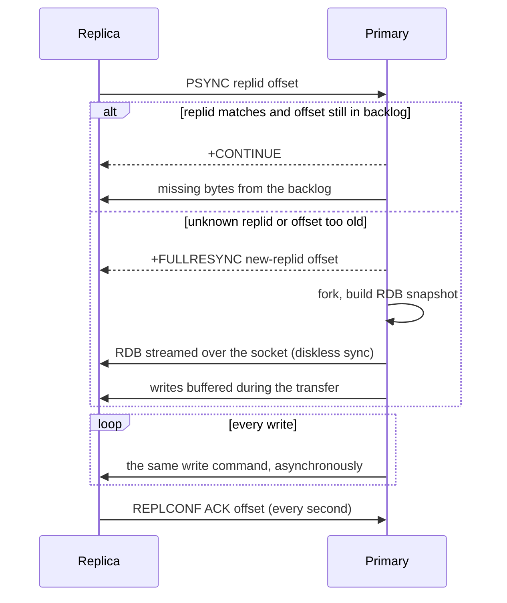
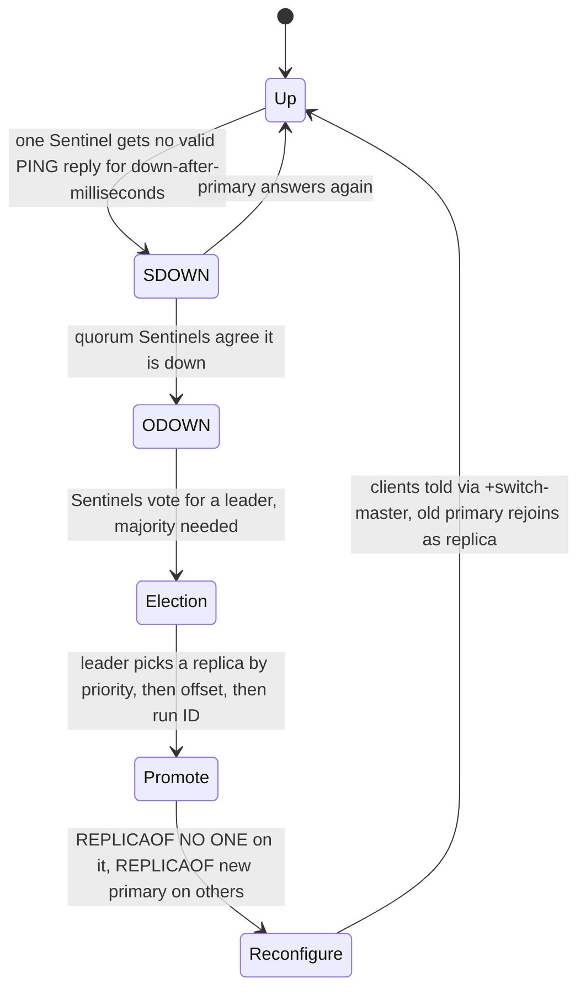
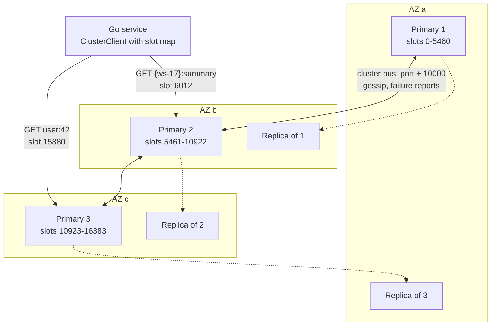

# Redis Replication, Sentinel and Cluster

> [!summary] TL;DR
> One Redis server is a single point of failure and is limited to one machine's memory. **Replication** copies a primary's data to replicas asynchronously. **Sentinel** watches a primary and promotes a replica when it dies. **Redis Cluster** splits the keyspace into 16,384 hash slots spread over several primaries, each with its own replicas, and fails over automatically.

> [!abstract] Core idea
> - Replication is asynchronous: a replica receives a full snapshot once, then a stream of every write. A failover can lose the last writes.
> - Sentinel = high availability for one dataset that fits on one primary. Clients ask Sentinel "who is the primary now?".
> - Cluster = sharding plus high availability. A key's slot is `CRC16(key) mod 16384`; clients keep a slot map and follow `MOVED`/`ASK` redirects.
> - Multi-key commands, transactions and Lua scripts in Cluster need all keys in one slot: use hash tags like `{user:42}`.
> - Managed services (ElastiCache, Redis Cloud) run the same two shapes: "cluster mode disabled" (one shard) and "cluster mode enabled" (many shards).

## 1. Why it exists

InvoiceOps runs one Redis 8 instance with 20 GB of data serving 80,000 operations per second.

- **Availability.** The VM dies. Until someone restarts it and it reloads its files (tens of seconds to minutes), every cache read misses and every job enqueue fails.
- **Read scale.** One process executes commands on one main thread. Reads that could go to a copy all queue on the primary.
- **Size and write scale.** At 200 GB the dataset no longer fits one VM's RAM, and all writes for every key go through one main thread.

Replication solves the first two, Sentinel automates the first, and Cluster solves all three.

## 2. Mental model

- **Replication** is a teacher (primary) dictating to students (replicas). Students write down everything the teacher says, a little behind. If the teacher leaves, a student has almost the whole lesson, but maybe not the last sentence.
- **Sentinel** is a group of hall monitors. When most of them agree the teacher is gone, they elect one monitor to pick the best student as the new teacher and tell everyone.
- **Cluster** is a school with 16,384 numbered lockers split among several classrooms. Each key has a fixed locker number; each classroom has its own teacher and students. If you go to the wrong classroom, you are told the right one (`MOVED`).

Terms:
- **Primary / replica**: the node that accepts writes, and its read-only copies (older docs say master/slave).
- **Failover**: promoting a replica to primary when the primary fails.
- **Split brain**: two nodes both acting as primary after a network partition.
- **Hash slot**: one of 16,384 buckets; every key belongs to exactly one.

## 3. How it works

### Replication



- Each primary has a **replication ID** and an **offset** (bytes of replication stream produced). A replica that reconnects sends both; if the bytes it missed are still in the **backlog** (`repl-backlog-size`, default 1 MB, measured on Redis 8.2), it gets a cheap **partial resync**. Otherwise it needs a **full resync**: a whole RDB snapshot.
- Size the backlog to cover your longest expected disconnect: write rate in bytes per second × seconds. At 5 MB/s of writes, 1 MB covers 0.2 seconds; 512 MB covers about 100 seconds.
- After a failover the promoted replica keeps the old ID as `master_replid2`, so other replicas can partially resync with it instead of all doing full syncs.
- **Replication is asynchronous.** The primary replies to the client before replicas have the write. `WAIT numreplicas timeout` blocks until that many replicas acknowledged the write, which narrows the loss window but is not a consensus protocol: a replica that acknowledged can still lose the write if it restarts without persistence, and a replica without it can still be promoted. `min-replicas-to-write N` plus `min-replicas-max-lag S` makes a primary refuse writes when fewer than N replicas are within S seconds, which limits how much an isolated primary can accept.
- Replicas are read-only by default (`replica-read-only yes`) and do not expire keys themselves; they wait for the primary's `DEL`, but they report logically expired keys as missing to readers.

### Sentinel



- Deploy at least **three** Sentinels on separate failure domains. `quorum` (often 2) is how many must agree the primary is down (**ODOWN**, objectively down); a **majority** of all Sentinels must still vote to authorise the failover, so a minority side of a partition cannot fail over.
- Defaults from the Sentinel docs: `down-after-milliseconds 30000`, `failover-timeout 180000`, `parallel-syncs 1`. Sentinel listens on port 26379.
- Clients connect to Sentinels, ask `SENTINEL get-master-addr-by-name <name>`, and reconnect when they see `+switch-master`. Never hard-code the primary's IP.
- **Lost writes.** If the old primary is cut off with some clients still writing to it, those writes are discarded when it rejoins as a replica. `min-replicas-to-write 1` and `min-replicas-max-lag 10` bound this to about 10 seconds of writes.

### Redis Cluster



- **Slot of a key** = `CRC16(key) mod 16384`. If the key contains `{...}` with at least one character between the braces, only that part is hashed. That is a **hash tag**: `{user:42}:cart` and `{user:42}:orders` share a slot.
- **Routing.** A client may send a command to any node. If that node does not own the slot it replies `-MOVED <slot> <host:port>`; the client updates its slot map and retries. Smart clients load the map at start with `CLUSTER SHARDS` (or the older `CLUSTER SLOTS`) and almost never get redirected.
- **Resharding.** An operator moves a slot from node A to node B. During the move, A marks the slot *migrating* and B *importing*. A key already moved gets `-ASK <slot> <B>`: the client sends `ASKING` and the command to B once, without updating its map. When the move finishes, A answers `MOVED`.
- **Failure detection and failover.** Nodes gossip on the cluster bus (port + 10000 by default). A node not answering for `cluster-node-timeout` (default 15,000 ms, measured on Redis 8.2) is marked PFAIL, and FAIL once a majority of primaries report it. Its replicas then ask the other primaries for votes; the one with the most up-to-date offset waits the shortest delay and usually wins. A majority of primaries must vote, so a cluster needs at least three primaries.
- **Limits.** Only database 0 exists (measured on Redis 8.2 at start-up: "Changing databases number from 16 to 1 since we are in cluster mode"). Multi-key commands, `MULTI`/`EXEC` and Lua scripts must touch keys in one slot, or they fail with `CROSSSLOT`. By default (`cluster-require-full-coverage yes`) the whole cluster stops accepting queries if any slot is unserved.

Redis Cluster does not use a consistent-hashing ring; the fixed slots and why they differ are explained in [[Consistent Hashing]].

## 4. Worked example

### Whiteboard version

How every cluster client finds a key's slot:

```go
func Slot(key string) int {
	if s := strings.IndexByte(key, '{'); s >= 0 {
		if e := strings.IndexByte(key[s+1:], '}'); e > 0 {
			key = key[s+1 : s+1+e] // hash only the tag
		}
	}
	var crc uint16 // CRC-16/XMODEM
	for _, c := range []byte(key) {
		crc ^= uint16(c) << 8
		for i := 0; i < 8; i++ {
			if crc&0x8000 != 0 {
				crc = crc<<1 ^ 0x1021
			} else {
				crc <<= 1
			}
		}
	}
	return int(crc) % 16384
}
```

### Slots, hash tags and redirects in Go

The package below computes slots exactly like Redis, checks whether a multi-key command will hit `CROSSSLOT`, and parses `MOVED`/`ASK` errors. It compiles, passes `go vet`, and its tests pass with `go test -race` on Go 1.24. The expected slot numbers in the test were taken from `CLUSTER KEYSLOT` on a cluster-enabled Redis 8.2.

```go
// Package slots computes Redis Cluster hash slots and parses redirects.
package slots

import (
	"fmt"
	"strconv"
	"strings"
)

const NumSlots = 16384

// crc16 is CRC-16/XMODEM (poly 0x1021, init 0), as in the cluster spec.
func crc16(b []byte) uint16 {
	var crc uint16
	for _, c := range b {
		crc ^= uint16(c) << 8
		for i := 0; i < 8; i++ {
			if crc&0x8000 != 0 {
				crc = crc<<1 ^ 0x1021
			} else {
				crc <<= 1
			}
		}
	}
	return crc
}

// HashTag returns the part of key that is hashed: the text between the
// first '{' and the next '}', if that text is non-empty; otherwise the key.
func HashTag(key string) string {
	if s := strings.IndexByte(key, '{'); s >= 0 {
		if e := strings.IndexByte(key[s+1:], '}'); e > 0 {
			return key[s+1 : s+1+e]
		}
	}
	return key
}

// Slot returns the cluster hash slot (0..16383) for key.
func Slot(key string) int {
	return int(crc16([]byte(HashTag(key)))) % NumSlots
}

// Redirect is a parsed "-MOVED 3999 10.0.0.7:6379" or "-ASK ..." error.
type Redirect struct {
	Ask  bool // ASK: one-off, send ASKING first; MOVED: update the slot map
	Slot int
	Addr string
}

func ParseRedirect(msg string) (Redirect, error) {
	f := strings.Fields(strings.TrimPrefix(msg, "-"))
	if len(f) != 3 || (f[0] != "MOVED" && f[0] != "ASK") {
		return Redirect{}, fmt.Errorf("not a redirect: %q", msg)
	}
	slot, err := strconv.Atoi(f[1])
	if err != nil || slot < 0 || slot >= NumSlots {
		return Redirect{}, fmt.Errorf("bad slot in %q", msg)
	}
	return Redirect{Ask: f[0] == "ASK", Slot: slot, Addr: f[2]}, nil
}

// SameSlot reports whether a multi-key command over keys can run in a
// cluster without a CROSSSLOT error.
func SameSlot(keys ...string) bool {
	for _, k := range keys[1:] {
		if Slot(k) != Slot(keys[0]) {
			return false
		}
	}
	return true
}
```

```go
package slots

import "testing"

func TestCRC16CheckValue(t *testing.T) {
	if got := crc16([]byte("123456789")); got != 0x31C3 {
		t.Fatalf("crc16 = %#x, want 0x31c3 (cluster spec test vector)", got)
	}
}

// Expected slots come from CLUSTER KEYSLOT, measured on Redis 8.2.
func TestSlotMatchesRedis(t *testing.T) {
	cases := map[string]int{
		"foo":                          12182,
		"bar":                          5061,
		"user:42":                      15880,
		"{user:42}:cart":               15880,
		"dashboard:{ws-17}:summary:v2": 6012,
		"a{}b":                         13694, // empty tag: whole key is hashed
		"{}x":                          10595,
		"x{y}{z}":                      12222, // only the first tag counts
		"invoice:9001":                 2571,
	}
	for k, want := range cases {
		if got := Slot(k); got != want {
			t.Errorf("Slot(%q) = %d, want %d", k, got, want)
		}
	}
}

func TestSameSlot(t *testing.T) {
	if !SameSlot("{user:42}:cart", "{user:42}:orders", "user:42") {
		t.Fatal("hash-tagged keys should share a slot")
	}
	if SameSlot("foo", "bar") {
		t.Fatal("foo and bar are in different slots")
	}
}

func TestParseRedirect(t *testing.T) {
	r, err := ParseRedirect("-MOVED 3999 10.0.0.7:6379")
	if err != nil || r.Ask || r.Slot != 3999 || r.Addr != "10.0.0.7:6379" {
		t.Fatalf("got %+v, %v", r, err)
	}
	r, err = ParseRedirect("ASK 12182 10.0.1.9:6379")
	if err != nil || !r.Ask || r.Slot != 12182 {
		t.Fatalf("got %+v, %v", r, err)
	}
	for _, bad := range []string{"ERR wrong", "MOVED x 1.2.3.4:1", "MOVED 16384 h:1"} {
		if _, err := ParseRedirect(bad); err == nil {
			t.Errorf("ParseRedirect(%q) should fail", bad)
		}
	}
}
```

What Redis itself said, measured on Redis 8.2 started with `--cluster-enabled yes` and all 16,384 slots assigned to one node:

```text
$ redis-cli -p 6393 cluster keyslot foo
(integer) 12182
$ redis-cli -p 6393 cluster keyslot 'dashboard:{ws-17}:summary:v2'
(integer) 6012
$ redis-cli -p 6393 cluster keyslot 'a{}b'     # empty tag: the whole key is hashed
(integer) 13694
$ redis-cli -p 6393 mset foo 1 bar 2
(error) CROSSSLOT Keys in request don't hash to the same slot
```

The InvoiceOps key `dashboard:{workspace_id}:summary:v2` already puts the workspace in a hash tag, so every key of one workspace lives in one slot and can be updated in one `MULTI` or Lua script. The price: one very busy workspace is one hot slot on one node (see [[Hot Keys and Hot Partitions]]).

### Connecting from Go

go-redis v9 has a client for each shape. Both compile against `github.com/redis/go-redis/v9` v9.7.0 and pass `go vet`.

```go
// Package haclients shows how a Go service connects to each Redis HA mode.
package haclients

import (
	"time"

	"github.com/redis/go-redis/v9"
)

// Sentinel: ask the sentinels who the current primary is; reconnect on failover.
func NewSentinelClient(password string) *redis.Client {
	return redis.NewFailoverClient(&redis.FailoverOptions{
		MasterName:    "invoiceops",
		SentinelAddrs: []string{"sentinel-a:26379", "sentinel-b:26379", "sentinel-c:26379"},
		Password:      password,
		DialTimeout:   500 * time.Millisecond,
		ReadTimeout:   200 * time.Millisecond,
		WriteTimeout:  200 * time.Millisecond,
		MaxRetries:    3, // retries ride over the few seconds of a failover
	})
}

// Cluster: the client keeps the slot map, follows MOVED/ASK, and can send
// reads to replicas (which may be slightly behind the primary).
func NewClusterClient(password string) *redis.ClusterClient {
	return redis.NewClusterClient(&redis.ClusterOptions{
		Addrs:          []string{"clustercfg.invoiceops.example:6379"},
		Password:       password,
		ReadOnly:       true, // allow reads from replicas
		RouteByLatency: true, // pick the closest node that owns the slot
		DialTimeout:    500 * time.Millisecond,
		ReadTimeout:    200 * time.Millisecond,
		MaxRedirects:   3,
	})
}
```

During a failover, commands fail for a few seconds (connection refused, `READONLY` from the demoted primary, or `CLUSTERDOWN`). Retries with backoff ([[Timeouts, Retries and Backoff]]) and idempotent writes let the service ride through; a cache read can fall back to the database.

## 5. Variants and comparison

| Option | How it works | Use when | Cost |
| --- | --- | --- | --- |
| Single node + persistence | One process, RDB/AOF on disk | Dev, pure caches that can be cold | Minutes of downtime on failure |
| Primary + replicas, manual failover | Async replication; operator promotes | Read scaling; a human on call is acceptable | Slow recovery, risk of mistakes |
| Sentinel | Primary + replicas + 3 Sentinels; automatic promotion | Data fits one node; you want HA and simple multi-key commands | Sentinel-aware clients; possible lost writes |
| Redis Cluster | 16,384 slots over N primaries, each with replicas | Data or write rate exceeds one node | CROSSSLOT rules, db 0 only, cluster-aware clients |
| Client-side sharding | Client hashes keys over independent nodes | Pure caches where losing a shard is fine | No automatic failover or resharding |
| Proxy (Envoy Redis proxy, twemproxy) | Proxy routes keys to shards | Legacy clients that cannot speak cluster | Extra hop; proxy is another failure point |
| Managed: ElastiCache cluster mode disabled | One shard: primary + up to 5 replicas, Multi-AZ failover | Like Sentinel, without running Sentinel | Single-shard memory limit |
| Managed: ElastiCache cluster mode enabled | Redis Cluster across shards and AZs | Like Redis Cluster, managed | Same cluster limits |
| Managed: ElastiCache Serverless | AWS scales capacity behind one endpoint | Spiky or unknown load, no capacity planning | Price per data stored and per request unit |

## 6. Trade-offs and when not to use

- **Do not cluster too early.** One primary with replicas and Sentinel (or a managed equivalent) handles tens of gigabytes and a large share of a million simple operations per second with pipelining. Cluster adds hash-tag design, CROSSSLOT failures and harder operations.
- **Replica reads are stale.** A user who writes and then reads from a replica may not see their write. Read from replicas only for data where lag is acceptable, or pin a user to the primary right after their own writes.
- **Hash tags trade balance for atomicity.** Putting a whole tenant in one tag makes multi-key operations possible but turns a big tenant into a hot slot.
- **None of this is strongly consistent.** Async replication plus failover can lose acknowledged writes. Locks and counters that must never be wrong need fencing or a consensus store (see [[Distributed Locks and Fencing Tokens]]).
- **Sentinel with two nodes does not work.** Two Sentinels cannot form a majority after losing one; use three or more on independent hosts.

## 7. In production

### Managed: ElastiCache and Valkey

- **Engines.** In March 2024 Redis moved from the BSD license to RSALv2/SSPLv1 (from Redis 7.4), and the Linux Foundation started **Valkey**, a BSD-licensed fork of Redis 7.2.4. Redis 8.0 (2025) added AGPLv3 as a license option. ElastiCache offers both Valkey and Redis OSS engines, with lower prices for Valkey.
- **Cluster mode disabled**: one shard, a primary and up to 5 read replicas. Clients use the **primary endpoint** (a DNS name that follows failover) for writes and the **reader endpoint** to spread reads across replicas.
- **Cluster mode enabled**: Redis Cluster with many shards (AWS documents up to 500 shards per cluster on recent engine versions). Clients connect to the **configuration endpoint** and must be cluster-aware.
- **Multi-AZ with automatic failover** places replicas in other Availability Zones and promotes one when the primary fails; the endpoint DNS moves with it.
- **ElastiCache Serverless** removes node sizing: one endpoint, capacity scales automatically, encryption in transit (TLS) is always on, and AWS recommends a cluster-mode-capable client.
- **Security**: encryption in transit (TLS) and at rest, AUTH tokens or role-based access control with Redis ACL users.
- **Sizing**: `reserved-memory-percent` (25% by default) keeps memory free for forks and buffers; the eviction policy is set in the parameter group.
- **Backups**: automatic daily snapshots and manual snapshots, exportable as RDB files to S3.

### Failure modes → fixes

- Failover loses the last second of writes → accept it for caches; for queues use idempotent consumers and `WAIT` on critical writes; keep the record in PostgreSQL.
- Replicas keep doing full resyncs ("Unable to partial resync" in logs) → backlog too small; raise `repl-backlog-size`. Full syncs also hit the replica output buffer limit (default `replica 256mb 64mb 60`, measured on Redis 8.2), which disconnects the replica and starts the loop again.
- Split brain after a partition → `min-replicas-to-write` on the primary, Sentinels on three independent hosts.
- `CROSSSLOT` errors after moving to Cluster → add hash tags so related keys share a slot.
- A whole cluster refuses queries when one shard has no live node → keep replicas per shard in other AZs; consider `cluster-require-full-coverage no` for caches so the remaining slots keep serving.
- Clients pinned to an old primary IP → use the Sentinel-aware or cluster-aware client, or the managed DNS endpoint, and set short DNS TTLs and retries.

### What to monitor

`role`, `connected_slaves`, `master_link_status`, replica lag (`master_repl_offset` minus each replica's offset), `sync_full` and `sync_partial_err` (from `INFO stats`), Sentinel `+sdown`/`+odown`/`+switch-master` events, `cluster_state`, `cluster_slots_fail`, and per-shard memory, CPU and operations (to spot a hot slot).

## 8. Deep dive

- **Why 16,384 slots?** The cluster bus heartbeat carries a bitmap of the sender's slots: 16,384 bits is 2 KB. 65,536 slots would make each heartbeat 8 KB. The Redis author also states the cluster is not designed for more than about 1,000 primaries, so 16,384 slots are enough to balance them.
- **Epochs.** Each primary has a `configEpoch`; a failover winner takes a new, higher epoch. When two nodes claim the same slot, the higher epoch wins, which is how a returning old primary learns it was replaced.
- **Replica selection in Cluster.** A replica waits `500 ms + random(0-500 ms) + rank × 1000 ms` before asking for votes, where rank 0 is the replica with the largest replication offset. So the most up-to-date replica usually wins without a tie.
- **Where writes are lost.** A client writes to primary P, P replies OK, then P dies before streaming the write; the promoted replica never had it. In a partition, a primary on the minority side keeps accepting writes until `cluster-node-timeout` passes and it stops serving; those writes are lost when it rejoins.
- **Pub/Sub in Cluster.** Classic `PUBLISH` is broadcast to every node over the bus, which does not scale. Redis 7.0 added sharded Pub/Sub (`SPUBLISH`/`SSUBSCRIBE`), where a channel lives in a slot like a key.
- **Resharding big keys.** `MIGRATE` moves keys one at a time, serialising each one; a key of hundreds of megabytes blocks both nodes while it moves. Split big keys first ([[Cache Failure Modes - Stampede, Avalanche, Penetration, Hot and Big Keys]]).

## 9. Interview questions

> [!question]- Is Redis replication synchronous? What does `WAIT` give you?
> No. The primary acknowledges writes before replicas have them. `WAIT n timeout` blocks until n replicas acknowledged the write, which shrinks the loss window, but a failover can still promote a replica without it, so Redis with `WAIT` is still not strongly consistent.

> [!question]- Sentinel or Cluster for a 15 GB cache at 50k ops/s?
> Sentinel (or a managed primary + replicas with Multi-AZ). It fits one node, so you get HA without hash-tag rules or CROSSSLOT errors. Move to Cluster when memory or write throughput outgrows one primary.

> [!question]- Trap: "Redis Cluster uses consistent hashing."
> It does not. It uses 16,384 fixed hash slots: `CRC16(key) mod 16384`. Slots are assigned to nodes explicitly and moved one slot at a time during resharding, with `MOVED` and `ASK` redirects.

> [!question]- What is the difference between `MOVED` and `ASK`?
> `MOVED` means the slot now permanently lives elsewhere: update the slot map and retry. `ASK` happens during a slot migration for a key already moved: send `ASKING` plus the command to the target once, without updating the map.

> [!question]- How can a Sentinel setup lose acknowledged writes, and how do you limit it?
> A partition isolates the primary with some clients; Sentinels on the majority side promote a replica; writes accepted by the old primary are discarded when it rejoins as a replica. Limit it with `min-replicas-to-write 1` and `min-replicas-max-lag 10` so an isolated primary stops accepting writes.

> [!question]- Why does a Lua script that touches `cart:42` and `orders:42` fail in Cluster, and how do you fix it?
> The keys hash to different slots, possibly on different nodes, and a script runs on one node: `CROSSSLOT`. Rename them `{user:42}:cart` and `{user:42}:orders` so the hash tag puts them in one slot.

> [!question]- Why does a replica keep doing full resyncs?
> The replication backlog is smaller than the stream it missed while disconnected, so partial resync fails; or the full sync overflows the replica output buffer limit and the primary drops it, restarting the loop. Raise `repl-backlog-size` and the replica buffer limit.

## 10. Cheat sheet

- Replication: async; PSYNC with replication ID + offset; backlog (1 MB default) decides partial vs full resync.
- `WAIT` and `min-replicas-to-write` narrow, but do not close, the write-loss window.
- Sentinel: ≥ 3 instances; quorum marks ODOWN, a majority authorises failover; clients ask Sentinel for the primary.
- Cluster: 16,384 slots, `CRC16 mod 16384`, hash tags `{...}`, `MOVED`/`ASK`, bus port + 10000, ≥ 3 primaries, db 0 only.
- Multi-key, `MULTI`, Lua in Cluster: one slot or `CROSSSLOT`.
- ElastiCache: cluster mode disabled (1 shard, ≤ 5 replicas, primary + reader endpoints) vs enabled (configuration endpoint) vs Serverless; Valkey is the BSD fork.
- Failover takes seconds: retries, timeouts and a DB fallback in the client.

## Links

- **Before this:** [[Replication]], [[Partitioning and Sharding]], [[Redis Persistence - RDB and AOF]]
- **Next:** [[Redis in Production - Memory, Latency, Security]], [[Redis in Go]]
- **Compare with:** [[Consistent Hashing]] (rings vs fixed slots), [[High Availability and Failover]], [[Leader Election]], [[Quorums and Leaderless Replication]]
