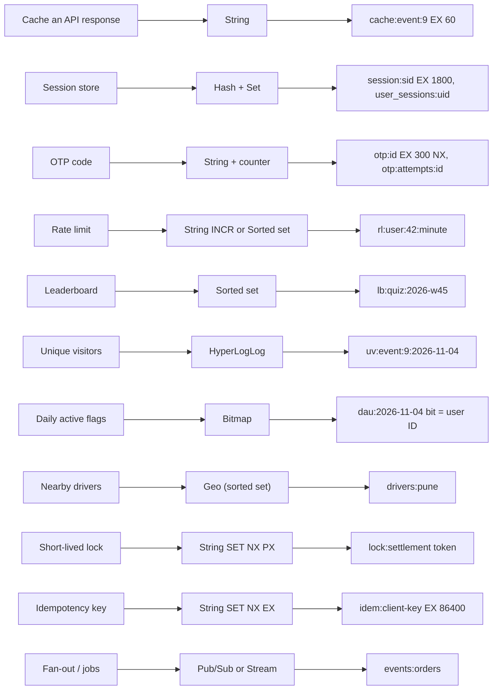
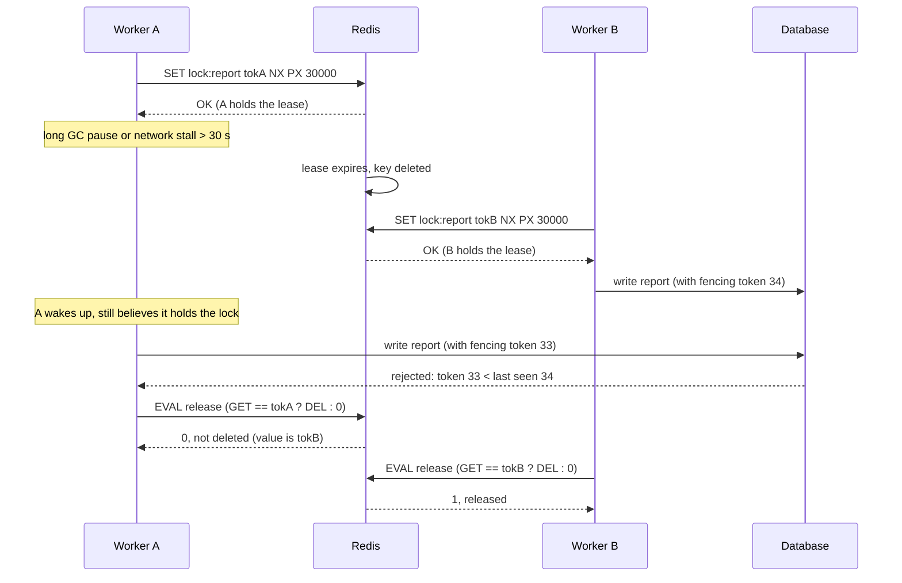

# Redis Use Cases

> [!summary] TL;DR
> Redis earns its place in a backend through a handful of recurring jobs: caching, sessions, one-time codes, counters and rate limits, leaderboards, unique counts, daily-active bitmaps, nearby search, short-lived locks, idempotency keys and lightweight messaging. Each job maps to one data structure, one key pattern and one TTL rule; this note shows that mapping, the correct commands, and where Redis is the wrong tool.

> [!abstract] Core idea
> - Every use case is "data structure + key pattern + TTL + failure policy". Get those four right and the feature is simple.
> - Atomic single commands (`INCR`, `SET NX PX`, `ZINCRBY`) do most of the work; multi-step logic goes into one Lua script.
> - Sessions are keyed by a random session ID, never by user ID; locks carry a random token and are released only by their owner.
> - A Redis lock is a lease that can expire under you; correctness-critical locks also need fencing tokens.
> - Classic mistake: making Redis the only copy of data you cannot lose.

## 1. Why it exists

A ticketing backend on PostgreSQL starts getting these requests in the same quarter:

- "The event page does 3 queries and gets 15,000 requests per second during a big on-sale."
- "Log a user out of every device."
- "Show a live top-100 of the quiz with 2 million players."
- "How many unique people saw each of 50,000 event pages today?"
- "Only one worker may run the nightly settlement job."
- "Clients retry payments on timeouts; never charge twice."

Each one can be built on PostgreSQL, but each would add load, latency or locking to the database that serves bookings. Redis solves them with in-memory structures that do the work in one atomic command, and with TTLs that clean up by themselves.

## 2. Mental model

Think of Redis as a **toolbox next to the database**, with one tool per job:

- The **database** is the filing cabinet: the official record, slow to open, never thrown away.
- **Redis** is the workbench: sticky notes with expiry times (cache, OTP, sessions), tally counters (rate limits), a scoreboard (sorted set), a stamp card (bitmap), a map with pins (geo), and a "busy, back in 30 s" sign (lock).

If the workbench is wiped, you lose convenience, not the business. Use cases that would lose the business if the workbench were wiped need the database too.

## 3. How it works

### 3.1 Use case → structure → key pattern



### 3.2 The use cases, briefly

**Cache.** Store the result of an expensive read under a key with a TTL: `SET cache:event:9 <json> EX 60`. Cache-aside, read-through and write-through, with their failure semantics, are in [[Caching Patterns]]; TTL choice and invalidation in [[Cache Invalidation, TTL and Consistency]].

**Session store.** Generate a random 128-bit session ID, store `session:<sid>` as a hash with an idle TTL, and add the ID to `user_sessions:<uid>` so you can log the user out everywhere. Keying by user ID (`session:42`) is wrong: one user has many devices, and a session ID derived from the user ID is guessable, so anyone could hijack a session by sending another user's ID. Cookie flags and CSRF are in [[Sessions and Cookies]].

**OTP and verification codes.** `SET otp:<id> <hmac> EX 300 NX`, an attempt counter, delete on success; full code in [[Redis Hands-on Setup with Go]].

**Counters and rate limits.** `INCR views:event:9` is atomic. For a rate limit, `INCR` plus `EXPIRE` must run as one unit (a Lua script, or `MULTI` / `INCR key` / `EXPIRE key 60 NX` / `EXEC`, using `EXPIRE ... NX` from Redis 7.0), or a crash between them leaves a counter that never resets. Avoid `SET key 0 EX 60 NX` followed by a separate `INCR`: if the key expires between the two commands, `INCR` recreates it with no TTL. Algorithms (fixed window, sliding window, token bucket, GCRA) and the distributed design live in [[Rate Limiting - Algorithms and Distributed Design]].

**Leaderboards.** `ZINCRBY lb <points> <player>`, `ZREVRANGE lb 0 99 WITHSCORES` for the top 100, `ZREVRANK lb <player>` for "you are #N". Measured on Redis 8.2:

```text
> ZADD lb 120 asha 135 ravi 150 meera
> ZREVRANGE lb 0 1 WITHSCORES
1) "meera"  2) "150"  3) "ravi"  4) "135"
> ZREVRANK lb asha
(integer) 2          # 0-based: asha is 3rd
```

A full design with time windows, ties and top-K at scale is in [[Case Study - Leaderboard and Top-K]].

**Unique counts.** Exact: `SADD` + `SCARD` (memory grows with members). Approximate: `PFADD` + `PFCOUNT` (about 12 KB, ~0.81% standard error). Measured on 100,000 IDs: 5,572,936 bytes as a set vs 14,352 bytes as a HyperLogLog that counted 99,471. Details in [[Redis Data Structures and When to Use Each]].

**Bitmaps for daily-active flags.** One key per day, bit number = numeric user ID. Measured on Redis 8.2:

```text
> SETBIT dau:2026-11-04 42 1
> SETBIT dau:2026-11-04 7 1
> SETBIT dau:2026-11-03 42 1
> BITOP AND both dau:2026-11-04 dau:2026-11-03
(integer) 6                  # bytes in the result string
> BITCOUNT both
(integer) 1                  # active on both days: user 42
> BITCOUNT dau:2026-11-04
(integer) 2
```

10 million users need 10,000,000 / 8 = 1.25 MB per day (calculated).

**Geo for nearby search.** `GEOADD drivers:pune <lon> <lat> <driver>` on every location ping, `GEOSEARCH drivers:pune FROMLONLAT <lon> <lat> BYRADIUS 5 km ASC COUNT 10 WITHDIST` to find the closest drivers (`GEOSEARCH` since 6.2; `GEORADIUS` is deprecated). Measured: of three drivers, the search returned `d1 0.0002` km and `d2 2.6794` km and skipped `d3`, about 9 km away. Remove drivers that go offline with `ZREM`, since a geo set is a sorted set and has no per-member TTL.

**Distributed locks.** `SET lock:<name> <random token> NX PX 30000` to acquire; release with a Lua script that deletes only if the value is still your token. Section 4 has the code and the hazard; the full treatment (Redlock, fencing tokens, leases in etcd/ZooKeeper) is in [[Distributed Locks and Fencing Tokens]].

**Idempotency keys.** `SET idem:<key> processing NX EX 86400` claims the key; the first request does the work and stores the response; retries return the stored response. The API contract is in [[Idempotency and Idempotency Keys]].

**Pub/Sub and streams.** Pub/Sub pushes a message to whoever is subscribed right now and stores nothing; streams keep an append-only log with consumer groups and acknowledgements. Both are covered in [[Redis as a Queue - Lists, Streams and Pub-Sub]].

### 3.3 The lock and its hazard



Two things save the day here. The **token check** on release stops A from deleting B's lock. The **fencing token** (a number that increases each time the lock is granted, checked by the resource) stops A's late write. Redis alone gives you the first. The second needs a source of increasing numbers (for example `INCR lock:report:fence` at acquire time, or a consensus store's revision) and a storage layer that rejects lower tokens; `SET NX PX` itself produces no fencing token.

## 4. Worked example

### Whiteboard version

```text
Leaderboard   ZINCRBY lb:weekly 45 ravi
              ZREVRANGE lb:weekly 0 9 WITHSCORES   -> top 10
              ZREVRANK lb:weekly asha (+1)         -> "you are #3"

Lock          token = 16 random bytes
              SET lock:job token NX PX ttl         -> OK = mine, nil = busy
              release: if GET == token then DEL    (one Lua script)

Idempotency   SET idem:key "processing" NX EX 86400
                OK  -> do the work, SET idem:key <response> EX 86400
                nil -> GET: "processing" = 409 retry later, else replay response
              on failure: DEL idem:key so the client may retry

Sessions      sid = 16 random bytes, base64url (22 chars)
              MULTI: HSET session:sid uid ..; EXPIRE 1800; SADD user_sessions:uid sid
              logout-all: SMEMBERS user_sessions:uid -> DEL all session:* + the set
```

### Leaderboard (Go 1.24, go-redis v9)

```go
// Package usecases implements four common Redis use cases.
package usecases

import (
	"context"

	"github.com/redis/go-redis/v9"
)

// Entry is one row of a leaderboard. Rank is 1-based.
type Entry struct {
	Player string
	Score  float64
	Rank   int64
}

// AddScore adds delta to a player's score (ZINCRBY creates missing members).
func AddScore(ctx context.Context, rdb *redis.Client, board, player string, delta float64) (float64, error) {
	return rdb.ZIncrBy(ctx, board, delta, player).Result()
}

// Top returns the n highest scores (ZREVRANGE board 0 n-1 WITHSCORES).
func Top(ctx context.Context, rdb *redis.Client, board string, n int64) ([]Entry, error) {
	zs, err := rdb.ZRevRangeWithScores(ctx, board, 0, n-1).Result()
	if err != nil {
		return nil, err
	}
	out := make([]Entry, len(zs))
	for i, z := range zs {
		out[i] = Entry{Player: z.Member.(string), Score: z.Score, Rank: int64(i) + 1}
	}
	return out, nil
}

// Rank returns a player's 1-based position from the top (ZREVRANK), O(log N).
func Rank(ctx context.Context, rdb *redis.Client, board, player string) (int64, bool, error) {
	r, err := rdb.ZRevRank(ctx, board, player).Result()
	if err == redis.Nil {
		return 0, false, nil
	}
	if err != nil {
		return 0, false, err
	}
	return r + 1, true, nil
}
```

### Lock with an owner token

```go
package usecases

import (
	"context"
	"crypto/rand"
	"encoding/hex"
	"errors"
	"time"

	"github.com/redis/go-redis/v9"
)

var ErrNotHeld = errors.New("lock: not held (expired or taken by someone else)")

// Acquire runs SET lock:<name> <random token> NX PX <ttl>. It returns the
// token, or "" if someone else holds the lock.
func Acquire(ctx context.Context, rdb *redis.Client, name string, ttl time.Duration) (string, error) {
	b := make([]byte, 16)
	if _, err := rand.Read(b); err != nil {
		return "", err
	}
	token := hex.EncodeToString(b)
	ok, err := rdb.SetNX(ctx, "lock:"+name, token, ttl).Result()
	if err != nil || !ok {
		return "", err
	}
	return token, nil
}

// releaseScript deletes the key only if it still holds our token. A plain
// DEL could delete a lock that expired and was then taken by another client.
var releaseScript = redis.NewScript(`
if redis.call('GET', KEYS[1]) == ARGV[1] then
  return redis.call('DEL', KEYS[1])
end
return 0
`)

func Release(ctx context.Context, rdb *redis.Client, name, token string) error {
	n, err := releaseScript.Run(ctx, rdb, []string{"lock:" + name}, token).Int()
	if err != nil {
		return err
	}
	if n == 0 {
		return ErrNotHeld
	}
	return nil
}
```

### Idempotency key

```go
package usecases

import (
	"context"
	"time"

	"github.com/redis/go-redis/v9"
)

const inFlight = "\x00processing"

// Begin claims an idempotency key. first=true means this request must do the
// work; otherwise prev holds the stored response ("" while still in flight).
func Begin(ctx context.Context, rdb *redis.Client, key string) (first bool, prev string, err error) {
	k := "idem:" + key
	ok, err := rdb.SetNX(ctx, k, inFlight, 24*time.Hour).Result()
	if err != nil || ok {
		return ok, "", err
	}
	v, err := rdb.Get(ctx, k).Result()
	if err == redis.Nil {
		return false, "", nil // expired between the two calls; caller retries
	}
	if v == inFlight {
		v = ""
	}
	return false, v, err
}

// Finish stores the response so retries get the same answer.
func Finish(ctx context.Context, rdb *redis.Client, key, response string) error {
	return rdb.Set(ctx, "idem:"+key, response, 24*time.Hour).Err()
}

// Abort frees the key when the work failed and may be retried.
func Abort(ctx context.Context, rdb *redis.Client, key string) error {
	return rdb.Del(ctx, "idem:"+key).Err()
}
```

For payments, the Redis key is a fast front door, not the guarantee: the database should also hold a unique constraint on the idempotency key, so a Redis restart cannot let a duplicate through.

### Sessions keyed by a random ID

```go
package usecases

import (
	"context"
	"crypto/rand"
	"encoding/base64"
	"time"

	"github.com/redis/go-redis/v9"
)

const sessionTTL = 30 * time.Minute

// CreateSession keys the session by a random 128-bit ID (never by user ID) and
// records the ID in user_sessions:<uid> so "log out everywhere" can find it.
func CreateSession(ctx context.Context, rdb *redis.Client, uid string) (string, error) {
	b := make([]byte, 16)
	if _, err := rand.Read(b); err != nil {
		return "", err
	}
	sid := base64.RawURLEncoding.EncodeToString(b)
	_, err := rdb.TxPipelined(ctx, func(p redis.Pipeliner) error {
		p.HSet(ctx, "session:"+sid, "uid", uid, "created", time.Now().Unix())
		p.Expire(ctx, "session:"+sid, sessionTTL)
		p.SAdd(ctx, "user_sessions:"+uid, sid)
		return nil
	})
	return sid, err
}

// Touch looks a session up and slides its idle timeout.
func Touch(ctx context.Context, rdb *redis.Client, sid string) (uid string, ok bool, err error) {
	uid, err = rdb.HGet(ctx, "session:"+sid, "uid").Result()
	if err == redis.Nil {
		return "", false, nil
	}
	if err != nil {
		return "", false, err
	}
	return uid, true, rdb.Expire(ctx, "session:"+sid, sessionTTL).Err()
}

// LogoutAll deletes every session of a user.
func LogoutAll(ctx context.Context, rdb *redis.Client, uid string) error {
	set := "user_sessions:" + uid
	sids, err := rdb.SMembers(ctx, set).Result()
	if err != nil {
		return err
	}
	keys := []string{set}
	for _, s := range sids {
		keys = append(keys, "session:"+s)
	}
	return rdb.Del(ctx, keys...).Err()
}
```

The `user_sessions:<uid>` set can keep IDs of sessions that already expired; prune them on login with `SMEMBERS` + `EXISTS`, or give the set a TTL as long as the absolute session lifetime.

### Tests

```go
package usecases

import (
	"context"
	"errors"
	"os"
	"sync"
	"sync/atomic"
	"testing"
	"time"

	"github.com/redis/go-redis/v9"
)

func newClient(t *testing.T, keys ...string) *redis.Client {
	t.Helper()
	addr := os.Getenv("REDIS_ADDR")
	if addr == "" {
		addr = "localhost:6379"
	}
	rdb := redis.NewClient(&redis.Options{Addr: addr, PoolSize: 64})
	ctx := context.Background()
	if err := rdb.Ping(ctx).Err(); err != nil {
		t.Skipf("no Redis at %s: %v", addr, err)
	}
	rdb.Del(ctx, keys...)
	t.Cleanup(func() { rdb.Del(ctx, keys...); rdb.Close() })
	return rdb
}

func TestLeaderboard(t *testing.T) {
	ctx := context.Background()
	rdb := newClient(t, "lb:weekly")
	AddScore(ctx, rdb, "lb:weekly", "asha", 120)
	AddScore(ctx, rdb, "lb:weekly", "ravi", 90)
	AddScore(ctx, rdb, "lb:weekly", "meera", 150)
	AddScore(ctx, rdb, "lb:weekly", "ravi", 45) // 135 now

	top, err := Top(ctx, rdb, "lb:weekly", 2)
	if err != nil {
		t.Fatal(err)
	}
	want := []Entry{{"meera", 150, 1}, {"ravi", 135, 2}}
	if len(top) != 2 || top[0] != want[0] || top[1] != want[1] {
		t.Fatalf("top = %+v", top)
	}
	if r, ok, _ := Rank(ctx, rdb, "lb:weekly", "asha"); !ok || r != 3 {
		t.Fatalf("asha rank = %d %v, want 3", r, ok)
	}
	if _, ok, _ := Rank(ctx, rdb, "lb:weekly", "nobody"); ok {
		t.Fatal("unknown player has a rank")
	}
}

func TestLockMutualExclusion(t *testing.T) {
	ctx := context.Background()
	rdb := newClient(t, "lock:job")
	var winners atomic.Int32
	var wg sync.WaitGroup
	for range 50 {
		wg.Add(1)
		go func() {
			defer wg.Done()
			if tok, err := Acquire(ctx, rdb, "job", time.Second); err == nil && tok != "" {
				winners.Add(1)
			}
		}()
	}
	wg.Wait()
	if winners.Load() != 1 {
		t.Fatalf("%d winners, want 1", winners.Load())
	}
}

func TestReleaseAfterExpiryDoesNotFreeNewOwner(t *testing.T) {
	ctx := context.Background()
	rdb := newClient(t, "lock:report")
	a, _ := Acquire(ctx, rdb, "report", 50*time.Millisecond)
	time.Sleep(80 * time.Millisecond) // A "pauses" past its TTL
	b, _ := Acquire(ctx, rdb, "report", time.Second)
	if a == "" || b == "" {
		t.Fatalf("a=%q b=%q", a, b)
	}
	if err := Release(ctx, rdb, "report", a); !errors.Is(err, ErrNotHeld) {
		t.Fatalf("stale release: %v, want ErrNotHeld", err)
	}
	if rdb.Get(ctx, "lock:report").Val() != b {
		t.Fatal("B's lock was deleted by A")
	}
	if err := Release(ctx, rdb, "report", b); err != nil {
		t.Fatal(err)
	}
}

func TestIdempotency(t *testing.T) {
	ctx := context.Background()
	rdb := newClient(t, "idem:pay-123")
	first, _, err := Begin(ctx, rdb, "pay-123")
	if err != nil || !first {
		t.Fatalf("first=%v err=%v", first, err)
	}
	if again, prev, _ := Begin(ctx, rdb, "pay-123"); again || prev != "" {
		t.Fatalf("in-flight retry: first=%v prev=%q", again, prev)
	}
	Finish(ctx, rdb, "pay-123", `{"status":"paid"}`)
	if again, prev, _ := Begin(ctx, rdb, "pay-123"); again || prev != `{"status":"paid"}` {
		t.Fatalf("retry after finish: first=%v prev=%q", again, prev)
	}
	Abort(ctx, rdb, "pay-123")
	if first, _, _ := Begin(ctx, rdb, "pay-123"); !first {
		t.Fatal("after Abort the key should be claimable")
	}
}

func TestSessionsLogoutAll(t *testing.T) {
	ctx := context.Background()
	rdb := newClient(t, "user_sessions:u9")
	s1, _ := CreateSession(ctx, rdb, "u9")
	s2, _ := CreateSession(ctx, rdb, "u9")
	if s1 == s2 || len(s1) != 22 {
		t.Fatalf("bad session ids %q %q", s1, s2)
	}
	if uid, ok, _ := Touch(ctx, rdb, s1); !ok || uid != "u9" {
		t.Fatalf("touch: %q %v", uid, ok)
	}
	if err := LogoutAll(ctx, rdb, "u9"); err != nil {
		t.Fatal(err)
	}
	for _, s := range []string{s1, s2} {
		if _, ok, _ := Touch(ctx, rdb, s); ok {
			t.Fatalf("session %s survived LogoutAll", s)
		}
	}
}
```

Measured: `go test -race ./usecases/` against Redis 8.2 passed all five tests. In the lock test, 50 goroutines raced and exactly one acquired; after a simulated 80 ms pause past a 50 ms lease, the stale owner's release returned `ErrNotHeld` and the new owner's lock survived.

## 5. Variants and comparison

| Use case | Redis approach | Alternative | Pick the alternative when |
| --- | --- | --- | --- |
| Cache | String with TTL | In-process cache (ristretto) | One instance, or as an L1 in front of Redis |
| Sessions | Hash per random session ID + TTL | Signed/encrypted cookie, JWT | You want no server-side store and can live with harder revocation |
| Counters / rate limits | `INCR` + TTL, Lua | API gateway limiter, in-process `x/time/rate` | Per-instance limits are good enough |
| Leaderboard | Sorted set | SQL `ORDER BY score LIMIT 100` with an index | Small boards, or ranks needed only in batch |
| Unique counts | HyperLogLog | `COUNT(DISTINCT)` in an analytics store | Exact numbers, offline reporting |
| Daily actives | Bitmap | Event table + warehouse query | Sparse or non-integer IDs |
| Nearby search | Geo set | PostGIS | Polygons, complex filters, durable data |
| Lock (efficiency) | `SET NX PX` + token | Database row lock, advisory lock | The protected work already runs in that database |
| Lock (correctness) | Not Redis alone | etcd / ZooKeeper lease + fencing token | Two holders at once would corrupt data |
| Idempotency | `SET NX EX` | Unique constraint in the database | Always also do this for money |
| Messaging | Pub/Sub, Streams | Kafka, NATS, SQS | Long retention, huge throughput, replay over days |

The **Redlock debate** in brief: Redlock acquires the same lock on a majority of independent Redis primaries (for example 3 of 5) to survive one node failing. Martin Kleppmann argued in 2016 that it still depends on bounded clock drift and pauses, and cannot give fencing tokens, so it is unsafe for correctness; Salvatore Sanfilippo (antirez) replied that its assumptions are reasonable in practice. The practical rule: a single-instance `SET NX PX` lock is fine for efficiency (avoiding duplicate work); for correctness, use fencing tokens with a consensus-based store. See [[Distributed Locks and Fencing Tokens]].

## 6. Trade-offs and when not to use

- **System of record without durability.** With default settings an unplanned restart can lose recent writes, and with eviction on, keys can disappear. Orders, payments and balances belong in the database.
- **Large blobs.** Values in the MB range are slow to transfer and replicate and block the single thread; put files in object storage and cache only metadata.
- **Ad-hoc queries.** Redis answers by key; "all sessions in Pune created yesterday" needs a database or search index.
- **Huge single keys.** A leaderboard with 100 million members or a global set of every user is one big key on one shard; split by time window or ID range. See [[Hot Keys and Hot Partitions]].
- **Locks as a correctness guarantee.** A lease can expire during a GC pause; without fencing tokens two workers can both act.
- **Pub/Sub for important messages.** A subscriber that is down or slow misses messages permanently.
- **When a simpler option wins:** a unique constraint beats a Redis idempotency key for correctness; `SELECT ... FOR UPDATE SKIP LOCKED` beats a Redis lock when the job queue already lives in PostgreSQL.

## 7. In production

- **Real systems:** Redis is widely used for sessions, rate limiting, leaderboards and caching in front of relational stores; managed services (ElastiCache, Memorystore, Upstash) host most of these deployments. Go client patterns that combine these use cases are in [[Redis in Go]].
- **Failure modes and fixes:**
	- Lock never released after a crash: always set a TTL (`PX`) at acquire time, never a separate `EXPIRE`.
	- Lock expires mid-work: size the TTL well above the p99 job time, renew it (extend only if the token still matches), and fence writes.
	- Session set grows forever: prune expired IDs or put a TTL on `user_sessions:<uid>`.
	- Leaderboard read storm on one key: cache the top 100 for a second in-process; the key is hot by design.
	- Geo set keeps offline drivers: remove them on disconnect, or keep one geo set per minute bucket and query the latest.
- **What to monitor:** per-prefix key counts and memory (sampled), lock acquire failures and lock-held durations, idempotency hits (retries replayed), `evicted_keys` (should be zero for sessions, locks and idempotency keys: keep them on an instance with `noeviction` and no cache data, because under a `volatile-*` policy their own TTLs make them eviction candidates), command latency per use case.

## 8. Deep dive

- **Separate instances by eviction needs.** Caches want `allkeys-lru`; sessions, locks and idempotency keys must never be evicted. Mixing them on one instance means a cache spike can evict a lock. Either use separate instances or `volatile-lru` with TTLs only on cache keys (which forces every non-cache key to have no TTL, often impractical). Separate instances is the simpler answer.
- **Lock renewal must be token-checked.** Extending a lock is the same compare-then-act as release: `if GET == token then PEXPIRE`. A blind `PEXPIRE` can extend someone else's lock.
- **Failover can break a lock.** Replication is asynchronous: a lock written to the primary may not reach the replica before failover, so a second client can acquire it on the new primary. `WAIT 1 100` narrows the window but does not make it safe. This is one more reason for fencing tokens.
- **Idempotency key content.** Store a hash of the request body with the key; if a retry arrives with the same key but a different body, return 422 instead of replaying a response that does not match.
- **Bitmaps and sparse IDs.** `SETBIT dau 4000000000 1` allocates a ~500 MB string at once. Map external IDs to dense integers or use a HyperLogLog.
- **Cluster.** Multi-key operations (`BITOP`, `PFCOUNT a b`, the session `MULTI`) need hash tags such as `session:{u9}:…` and `user_sessions:{u9}` to keep keys in one slot. See [[Redis Replication, Sentinel and Cluster]].

## 9. Interview questions

> [!question]- How do you implement a distributed lock with Redis, and what is wrong with `SETNX` + `DEL`?
> Acquire with `SET lock:x <random token> NX PX 30000` in one command; release with a Lua script that deletes only if the value equals your token. Plain `SETNX` + `EXPIRE` can leave a lock with no TTL, and plain `DEL` can delete another client's lock after yours expired.

> [!question]- Trap: your Redis lock has a 30 s TTL and the job takes 10 s. Can two workers ever run at once?
> Yes. A GC pause, a slow disk or a network partition can stretch the job past 30 s, the lease expires and a second worker acquires it. A failover can also lose the lock. Use it for efficiency, and protect correctness with fencing tokens checked by the resource.

> [!question]- How should sessions be keyed in Redis?
> By a random session ID with at least 128 bits from a CSPRNG: `session:<sid>` as a hash with an idle TTL. Keep `user_sessions:<uid>` as a set of IDs for logout-everywhere. Keying by user ID allows only one session per user and makes keys guessable.

> [!question]- You need unique viewers per page. Set or HyperLogLog?
> HyperLogLog if an estimate is fine: about 12 KB per key, ~0.81% error, union with `PFCOUNT a b`. A set if you must list or remove viewers; measured 5.57 MB for 100,000 members on Redis 8.2.

> [!question]- How do you prevent double charging when clients retry a payment?
> The client sends an idempotency key. The server does `SET idem:<key> processing NX EX 86400`: the first request does the work and stores the response; retries get the stored response or a 409 while in flight. Back it with a unique constraint in the database so a Redis loss cannot let a duplicate through.

> [!question]- When should you not use Redis?
> As the only copy of data you cannot lose, for large blobs, for ad-hoc queries, for correctness-critical locks without fencing, and for messages that must survive a consumer being down (Pub/Sub). Use the database, object storage, a consensus store or a durable log instead.

> [!question]- Why is GEOSEARCH fast, and how do you expire stale drivers?
> Geo members live in a sorted set scored by a 52-bit geohash, so a radius search scans a few score ranges and filters by exact distance. Members have no TTL, so remove drivers with `ZREM` on disconnect, or write per-minute keys with a TTL and query the newest.

## 10. Cheat sheet

- Every use case = structure + key pattern + TTL + failure policy.
- Sessions: `session:<random sid>` hash with idle TTL + `user_sessions:<uid>` set.
- Counters: `INCR`; rate limits need INCR and expiry atomic (see the rate limiting note).
- Leaderboard: `ZINCRBY`, `ZREVRANGE 0 N-1 WITHSCORES`, `ZREVRANK`; split by time window.
- Uniques: HyperLogLog (12 KB, ~0.81%); daily actives: bitmap per day; nearby: `GEOSEARCH`.
- Lock: `SET NX PX` + random token; release and renew by token in Lua; fence for correctness.
- Idempotency: `SET NX EX`, store the response, plus a database unique constraint.
- Not for: system of record, big blobs, ad-hoc queries, must-not-lose messages via Pub/Sub.

## Links

- **Before this:** [[Redis Data Structures and When to Use Each]], [[Redis Hands-on Setup with Go]]
- **Next:** [[Caching Patterns]], [[Redis in Production - Memory, Latency, Security]]
- **Owned elsewhere:** [[Rate Limiting - Algorithms and Distributed Design]], [[Distributed Locks and Fencing Tokens]], [[Redis as a Queue - Lists, Streams and Pub-Sub]], [[Sessions and Cookies]], [[Idempotency and Idempotency Keys]], [[Case Study - Leaderboard and Top-K]]
- **Compare with:** [[Hot Keys and Hot Partitions]], [[Redis in Go]]
