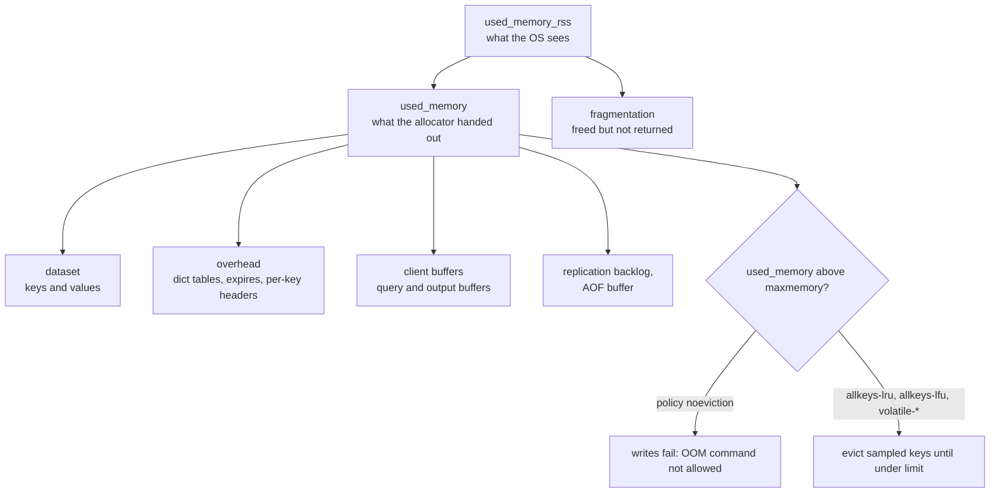
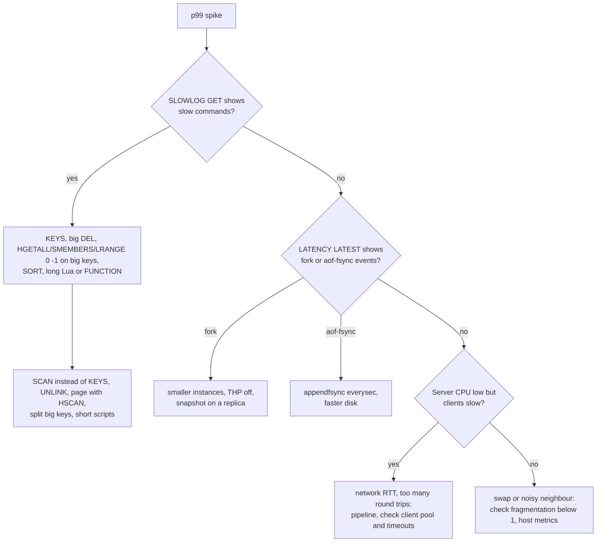
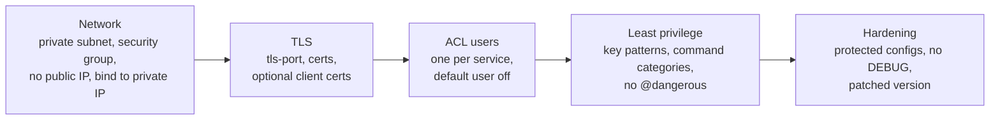

# Redis in Production - Memory, Latency, Security

> [!summary] TL;DR
> Running Redis well means three things. **Memory**: set `maxmemory` and an eviction policy, leave headroom for forks and buffers, and watch fragmentation and big keys. **Latency**: one main thread runs every command, so one slow command (`KEYS`, a big `DEL`, a long Lua script) delays everyone; find them with `SLOWLOG` and `LATENCY`. **Security**: never expose port 6379, require ACL users and TLS, block dangerous commands, and patch.

> [!abstract] Core idea
> - Redis memory = your data + per-key overhead + buffers + fragmentation. Without `maxmemory`, it grows until the OS kills it.
> - The default policy is `noeviction`: when memory is full, writes fail. Pick a policy on purpose.
> - Latency in Redis is mostly "who blocked the main thread?": slow commands, forks, swap, fsync, or the network.
> - Security is network isolation first (private subnet, no public IP), then ACL users with least privilege, then TLS.
> - Classic mistake: running `KEYS *` or `MONITOR` on a busy production server.

## 1. Why it exists

The InvoiceOps Redis has been fine for a year. Then, in one week:

- Monday: the instance hits the VM's 8 GB RAM during a nightly `BGSAVE` and the kernel's OOM killer terminates it. There was no `maxmemory`.
- Wednesday: p99 for every request jumps to 350 ms for one second each night. A cleanup job runs `DEL` on a hash with 2 million fields (measured below: 348.6 ms of blocking).
- Friday: a security scan finds the staging Redis reachable from the internet with no password. Exposed Redis servers are a well-known target: attackers have used `CONFIG SET dir` and `dbfilename` to write files such as SSH keys to the host.

Each of these has a standard fix. This note collects them.

## 2. Mental model

Redis is a very fast single-lane bridge. Every command crosses the same lane, one at a time.
- **Memory** is the weight limit of the bridge. Exceed it and it collapses (OOM) unless you declare in advance what to throw off (eviction).
- **Latency** is traffic on the lane. A single slow truck (a slow command) stops every car behind it, no matter how fast the cars are.
- **Security** is the toll gate. A bridge with no gate on a public road will be used by strangers.

Terms:
- **RSS** (resident set size): memory the OS has given the process.
- **Fragmentation ratio**: `used_memory_rss / used_memory`. Above 1.5 means much memory is held but unused; below 1 usually means part of Redis is swapped out.
- **Encoding**: Redis stores small collections in compact forms (listpack, intset) and converts them to full structures (hash table, skiplist) when they grow.

## 3. How it works

### Memory: where the bytes go



- **Set `maxmemory`.** Default is 0 (no limit) on a self-managed server, measured on Redis 8.2. Leave room below the machine's RAM for fork copy-on-write, client buffers and fragmentation: a common rule is `maxmemory` at about 60-75% of RAM when persistence or replication forks (an estimate; ElastiCache reserves 25% by default).
- **Pick a policy.** The default `maxmemory-policy` is `noeviction` (measured on Redis 8.2): writes fail when full. That is right for queues and data you cannot lose; for a cache use `allkeys-lru` or `allkeys-lfu`. How Redis samples keys for LRU/LFU is in [[Cache Eviction Policies - LRU, LFU, TTL]].
- **Per-key overhead.** Every key costs a dictionary entry, a key header and possibly an expiry entry. Measured on Redis 8.2: 1,000,000 string keys with 100-byte values used 151.6 MB, about 159 bytes per key, and `MEMORY USAGE` reported 128 bytes for a single key.
- **Compact encodings.** A hash with up to 512 fields of up to 64 bytes each (`hash-max-listpack-entries 512`, `hash-max-listpack-value 64`, measured defaults) is stored as a listpack. Measured on Redis 8.2: 512 fields used 6,160 bytes as a listpack and 36,992 bytes after the 513th field converted it to a hash table. Grouping many tiny keys into small hashes (`user:{id/1000}` with field `id%1000`) can save a lot of memory.
- **Fragmentation.** After many deletes, the allocator holds freed memory in partly used pages. On Linux builds with jemalloc, `activedefrag yes` moves values to compact memory while running. (The macOS build measured here uses the libc allocator, `mem_allocator:libc`, where active defrag is unavailable.)
- **Client buffers.** Each client has an output buffer. Defaults measured on Redis 8.2: `normal 0 0 0` (no limit), `replica 256mb 64mb 60`, `pubsub 32mb 8mb 60`. A slow Pub/Sub subscriber or a client running `HGETALL` on a huge hash can grow its buffer without bound if its class has no limit.

### Latency: who blocks the main thread



- `SLOWLOG` records commands slower than `slowlog-log-slower-than` (10,000 µs by default) and keeps the last `slowlog-max-len` (128) entries, both measured defaults on Redis 8.2. It measures execution only, not network or queueing time.
- `LATENCY` monitoring is off by default (`latency-monitor-threshold 0`). Set it (for example to 100 ms) to record events such as `command`, `fork`, `aof-fsync-always` and `expire-cycle`; `LATENCY DOCTOR` prints a human explanation.
- Since Redis 6.0, `io-threads` can move socket reads and writes to extra threads (default 1, measured). Command execution stays on the main thread, so I/O threads help with many clients and large replies, not with slow commands.
- Most "Redis is slow" reports are round trips. At 0.2 ms per round trip, 100 sequential `GET`s cost 20 ms; one `MGET` or a pipeline costs about one round trip.

### Security: layers



- **protected-mode** (default `yes`, measured on Redis 8.2) refuses remote connections when no password is set and Redis is bound to all interfaces. It is a safety net, not a security model.
- **ACL** (Redis 6+): named users with passwords, allowed key patterns (`~invoice:*`), allowed channels (`&...`) and command categories (`+@read`, `-@dangerous`). Disable or password-protect the `default` user.
- **TLS** (Redis 6+, built with TLS support): set `tls-port`, `tls-cert-file`, `tls-key-file`, and `port 0` to disable plaintext. Managed services expose this as "encryption in transit".
- **Dangerous commands.** `FLUSHALL`, `CONFIG`, `DEBUG`, `KEYS`, `MONITOR`, `SHUTDOWN` belong to `@dangerous`/`@admin`. Since Redis 7.0, `enable-protected-configs no` and `enable-debug-command no` are the defaults, so `CONFIG SET dir` and `DEBUG` are refused from clients unless enabled in the config file. Prefer ACLs over the old `rename-command`.
- **Patch.** Lua scripting runs inside the server; CVE-2025-49844, a use-after-free in the Lua engine disclosed in October 2025, allowed an authenticated user to run code on the host and was fixed in Redis 8.2.2 and backported releases. If you cannot patch at once, deny `EVAL`/`EVALSHA`/`FUNCTION` via ACL to users that do not need scripting.

## 4. Worked example

### Whiteboard version

The production block an InvoiceOps cache instance starts from:

```conf
bind 10.0.3.15                  # private IP only
protected-mode yes
port 0                          # no plaintext
tls-port 6379
tls-cert-file /etc/redis/tls/redis.crt
tls-key-file /etc/redis/tls/redis.key
tls-ca-cert-file /etc/redis/tls/ca.crt
aclfile /etc/redis/users.acl    # default user off; one user per service

maxmemory 6gb                   # on an 8 GB VM: headroom for fork and buffers
maxmemory-policy allkeys-lfu    # it is a cache; queues need noeviction
lazyfree-lazy-user-del yes      # DEL frees memory in the background
lazyfree-lazy-eviction yes

slowlog-log-slower-than 5000    # 5 ms
latency-monitor-threshold 50    # record events above 50 ms
client-output-buffer-limit pubsub 32mb 8mb 60
maxclients 10000
```

### Measured on Redis 8.2: the slow paths

Setup: Redis 8.2 (Homebrew build), Apple M4, local `redis-cli`, durations from `SLOWLOG GET` (server execution only). `DEBUG SLEEP` needs `enable-debug-command local`, because `DEBUG` is refused by default since Redis 7.0.

| Command | Data | Server time | What it means |
| --- | --- | --- | --- |
| `KEYS 'key:99999*'` | 1,000,000 keys | 18,369 µs | Scans every key; blocks all clients for 18 ms |
| `DEL big1` | hash, 2,000,000 fields, 128.8 MB | 348,648 µs | Frees every element on the main thread |
| `UNLINK big2` | same shape | 4 µs | Frees in a background thread |
| `DEBUG SLEEP 0.25` | n/a | `LATENCY LATEST` recorded a 251 ms `command` event | The latency monitor catches any stall above its threshold |

`SCAN` with `COUNT 1000` does the same job as `KEYS` in small steps, each a fraction of a millisecond, so other clients run between steps.

### Measured on Redis 8.2: a least-privilege ACL user

```text
$ redis-cli ACL SETUSER invoiceops on '>s3cret-from-vault' '~dashboard:*' '~invoice:*' '+@read' '+@write' '-@dangerous'
OK
$ redis-cli --user invoiceops --pass s3cret-from-vault SET session:1 x
(error) NOPERM No permissions to access a key
$ redis-cli --user invoiceops --pass s3cret-from-vault KEYS '*'
(error) NOPERM User invoiceops has no permissions to run the 'keys' command
$ redis-cli --user invoiceops --pass s3cret-from-vault SET dashboard:ws-17:summary:v2 '{}'
OK
```

`ACL LOG` then lists each denial with the user, the reason (`command` or `key`) and the client address, which is useful for spotting a misconfigured service or an intruder. Store the password in a secrets manager ([[Secrets Management]]), never in code.

### Go: find the biggest keys without blocking Redis

`redis-cli --bigkeys` and `--memkeys` exist, but a scheduled job that reports the top keys by memory to your metrics is more useful. This scanner uses `SCAN` in batches, measures each key with `MEMORY USAGE`, keeps a top-N heap, and pauses between batches. It compiles, passes `go vet`, and its tests pass with `go test -race` on Go 1.24 with go-redis v9.7.0.

```go
// Package bigkeys finds the largest keys with SCAN + MEMORY USAGE,
// pausing between batches so the scan never blocks Redis for long.
package bigkeys

import (
	"container/heap"
	"context"
	"sort"
	"time"

	"github.com/redis/go-redis/v9"
)

// Store is the slice of Redis the scanner needs (fakeable in tests).
type Store interface {
	Scan(ctx context.Context, cursor uint64, match string, count int64) ([]string, uint64, error)
	MemoryUsage(ctx context.Context, key string) (int64, error)
}

type KeySize struct {
	Key   string
	Bytes int64
}

type Options struct {
	Match string        // e.g. "dashboard:*"; empty means "*"
	Batch int64         // SCAN COUNT hint
	TopN  int           // how many keys to report
	Pause time.Duration // sleep between batches to cap the extra load
}

// minHeap keeps the TopN largest seen so far; the smallest is at index 0.
type minHeap []KeySize

func (h minHeap) Len() int           { return len(h) }
func (h minHeap) Less(i, j int) bool { return h[i].Bytes < h[j].Bytes }
func (h minHeap) Swap(i, j int)      { h[i], h[j] = h[j], h[i] }
func (h *minHeap) Push(x any)        { *h = append(*h, x.(KeySize)) }
func (h *minHeap) Pop() any {
	old := *h
	x := old[len(old)-1]
	*h = old[:len(old)-1]
	return x
}

// Top returns the TopN biggest keys, largest first, and how many keys it saw.
func Top(ctx context.Context, s Store, o Options) ([]KeySize, int, error) {
	if o.Match == "" {
		o.Match = "*"
	}
	h := &minHeap{}
	seen := 0
	var cursor uint64
	for {
		keys, next, err := s.Scan(ctx, cursor, o.Match, o.Batch)
		if err != nil {
			return nil, seen, err
		}
		for _, k := range keys {
			n, err := s.MemoryUsage(ctx, k)
			if err != nil {
				continue // key expired or was deleted between SCAN and MEMORY USAGE
			}
			seen++
			if h.Len() < o.TopN {
				heap.Push(h, KeySize{k, n})
			} else if n > (*h)[0].Bytes {
				(*h)[0] = KeySize{k, n}
				heap.Fix(h, 0)
			}
		}
		cursor = next
		if cursor == 0 { // SCAN is complete when the cursor returns to 0
			break
		}
		select {
		case <-ctx.Done():
			return nil, seen, ctx.Err()
		case <-time.After(o.Pause):
		}
	}
	out := []KeySize(*h)
	sort.Slice(out, func(i, j int) bool { return out[i].Bytes > out[j].Bytes })
	return out, seen, nil
}

// RedisStore adapts a go-redis client.
type RedisStore struct{ C *redis.Client }

func (r RedisStore) Scan(ctx context.Context, cur uint64, match string, n int64) ([]string, uint64, error) {
	return r.C.Scan(ctx, cur, match, n).Result()
}

func (r RedisStore) MemoryUsage(ctx context.Context, key string) (int64, error) {
	return r.C.MemoryUsage(ctx, key, 0).Result() // SAMPLES 0 = exact, O(n) for that key
}
```

```go
package bigkeys

import (
	"context"
	"errors"
	"fmt"
	"testing"
)

// fakeStore pages through keys like SCAN does, a few per call.
type fakeStore struct {
	keys  []string
	sizes map[string]int64
	calls int
}

func (f *fakeStore) Scan(_ context.Context, cur uint64, _ string, n int64) ([]string, uint64, error) {
	f.calls++
	end := min(int(cur)+int(n), len(f.keys))
	next := uint64(end)
	if end == len(f.keys) {
		next = 0
	}
	return f.keys[cur:end], next, nil
}

func (f *fakeStore) MemoryUsage(_ context.Context, k string) (int64, error) {
	n, ok := f.sizes[k]
	if !ok {
		return 0, errors.New("redis: nil") // deleted between SCAN and MEMORY USAGE
	}
	return n, nil
}

func TestTopFindsLargestAcrossPages(t *testing.T) {
	f := &fakeStore{sizes: map[string]int64{}}
	for i := 0; i < 1000; i++ {
		k := fmt.Sprintf("k:%d", i)
		f.keys = append(f.keys, k)
		f.sizes[k] = int64(100 + i%7)
	}
	f.sizes["k:500"] = 128_777_288 // a 2M-field hash
	f.sizes["k:10"] = 36_992
	f.sizes["k:999"] = 6_160
	delete(f.sizes, "k:3") // vanished mid-scan

	top, seen, err := Top(context.Background(), f, Options{Batch: 100, TopN: 3})
	if err != nil {
		t.Fatal(err)
	}
	want := []string{"k:500", "k:10", "k:999"}
	for i, w := range want {
		if top[i].Key != w {
			t.Fatalf("top = %+v, want order %v", top, want)
		}
	}
	if seen != 999 || f.calls != 10 {
		t.Fatalf("seen=%d calls=%d, want 999 and 10", seen, f.calls)
	}
}

func TestTopStopsOnCancel(t *testing.T) {
	f := &fakeStore{sizes: map[string]int64{}}
	for i := 0; i < 50; i++ {
		f.keys = append(f.keys, fmt.Sprint(i))
		f.sizes[fmt.Sprint(i)] = 1
	}
	ctx, cancel := context.WithCancel(context.Background())
	cancel()
	if _, _, err := Top(ctx, f, Options{Batch: 10, TopN: 1}); !errors.Is(err, context.Canceled) {
		t.Fatalf("err = %v, want context.Canceled", err)
	}
}
```

A small `main` runs it against a real server:

```go
package main

import (
	"context"
	"fmt"
	"log"
	"time"

	"github.com/redis/go-redis/v9"

	"redisnotes/bigkeys"
)

func main() {
	rdb := redis.NewClient(&redis.Options{Addr: "localhost:6393"})
	defer rdb.Close()
	ctx, cancel := context.WithTimeout(context.Background(), 5*time.Minute)
	defer cancel()

	start := time.Now()
	top, seen, err := bigkeys.Top(ctx, bigkeys.RedisStore{C: rdb},
		bigkeys.Options{Batch: 1000, TopN: 3, Pause: time.Millisecond})
	if err != nil {
		log.Fatal(err)
	}
	fmt.Printf("scanned %d keys in %v\n", seen, time.Since(start).Round(time.Millisecond))
	for _, k := range top {
		fmt.Printf("%-12s %12d bytes\n", k.Key, k.Bytes)
	}
}
```

Measured on Redis 8.2 with 1,100,000 small string keys, one 200,000-field hash and one 5,000-element list:

```text
scanned 1100002 keys in 1m14.961s
bighash          14345800 bytes
biglist             16520 bytes
key:609678            128 bytes
```

The scan took 75 seconds because it makes one round trip per key (about 68 µs each here, an estimate from total time ÷ keys) plus a 1 ms pause per batch. That is the point: it never blocks Redis. To make it faster, pipeline the `MEMORY USAGE` calls for each batch, and run it against a replica.

## 5. Variants and comparison

| Problem | Option | How it works | Cost |
| --- | --- | --- | --- |
| Memory full | `noeviction` (default) | Writes fail with an OOM error | Outage for writers, no silent data loss |
| Memory full | `allkeys-lru` / `allkeys-lfu` | Evict sampled keys | Any key can vanish: only for caches |
| Memory full | `volatile-*` | Evict only keys with a TTL | Fails like `noeviction` if no key has a TTL |
| Finding keys | `KEYS` | One blocking pass | Blocks everyone; never in production |
| Finding keys | `SCAN` | Cursor, small batches | May return a key twice; no snapshot |
| Big-key report | `redis-cli --bigkeys` / `--memkeys` | SCAN + length or `MEMORY USAGE` | Ad hoc, from an operator shell |
| Hot-key report | `redis-cli --hotkeys` | SCAN + `OBJECT FREQ` | Needs an LFU policy |
| Watch traffic | `MONITOR` | Streams every command | Can halve throughput; seconds only, never on a busy primary |
| Access control | `requirepass` | One shared password | No per-service limits or audit |
| Access control | ACL users | Per-user keys, commands, channels | Files or `ACL SAVE` to manage |
| Transport | TLS | Encrypted, optional mTLS | CPU cost; I/O threads help |

## 6. Trade-offs and when not to use

- **Eviction hides capacity problems.** A cache under `allkeys-lru` never fails, but its hit ratio quietly drops; alert on `evicted_keys` rate and hit ratio, not only on errors.
- **Memory headroom is money.** Reserving 25-40% of RAM is expensive at scale; snapshotting on replicas or disabling persistence on pure caches reduces how much you need.
- **TLS costs CPU.** Measure throughput with and without TLS before sizing; enable `io-threads` on multi-core hosts if TLS handshakes or encryption become the bottleneck.
- **ACL rules can block your own tools.** Monitoring agents need `INFO`, `SLOWLOG GET` and `LATENCY LATEST`, which sit in `@admin`/`@dangerous`. Grant them as explicit commands and subcommands (`+info +slowlog|get +latency|latest`) to a separate monitoring user; never grant `+@slow`, which also includes `CONFIG`, `FLUSHALL` and `KEYS`.
- **Do not self-manage when a managed service fits.** Patching, failover, backups and TLS certificates are the bulk of the work above; ElastiCache, MemoryDB or Redis Cloud do most of it.

## 7. In production

- **Real systems:** Managed Redis/Valkey services enforce several of these defaults for you: ElastiCache keeps `reserved-memory-percent` at 25%, offers in-transit and at-rest encryption, and RBAC user groups; parameter groups set the eviction policy.
- **Failure modes → fixes:**
	- OOM kill during `BGSAVE` → set `maxmemory`, leave headroom, `vm.overcommit_memory=1`, consider snapshots only on replicas.
	- `OOM command not allowed when used memory > 'maxmemory'` → either the policy is `noeviction` on purpose (add memory, shorten TTLs), or a cache was left on the default policy.
	- Fragmentation ratio above 1.5 after mass deletes → `activedefrag yes` (jemalloc builds) or a rolling restart via failover.
	- Fragmentation ratio below 1 → Redis is partly swapped; latency is unpredictable. Add RAM or reduce `maxmemory`; disable swap for Redis hosts.
	- Latency spikes from transparent huge pages → `echo never > /sys/kernel/mm/transparent_hugepage/enabled`; Redis logs a warning at start when THP is on.
	- Client connection storms (thousands of pods × pool size) → hit `maxclients` (10,000 by default, measured); right-size pools in [[Redis in Go]] and watch `connected_clients` and `rejected_connections`.
	- A slow subscriber grows its output buffer → `client-output-buffer-limit pubsub` disconnects it; prefer Streams for consumers that fall behind (see [[Redis as a Queue - Lists, Streams and Pub-Sub]]).
	- Exposed instance → firewall/security group, private subnet, ACL, TLS; rotate credentials if it was reachable.
- **What to monitor:**
	- Memory: `used_memory`, `used_memory_rss`, `mem_fragmentation_ratio`, `maxmemory`, `evicted_keys`, `expired_keys`, top keys by size.
	- Latency: client-side p99 per command, `SLOWLOG` length and entries, `LATENCY LATEST`, `instantaneous_ops_per_sec`, `latest_fork_usec`.
	- Clients: `connected_clients`, `blocked_clients`, `rejected_connections`, `client_recent_max_output_buffer`.
	- Security: `ACL LOG` entries, failed auth counts, Redis version against current advisories.
	- Export with `redis_exporter` to Prometheus ([[Metrics and Prometheus]]).

## 8. Deep dive

- **Why a single slow command hurts p99 so much.** If 50,000 commands per second arrive and one takes 350 ms, about 17,500 commands queue behind it. Each of them sees up to 350 ms extra latency, so one command in a second can move the p99 of the whole second ([[Latency, Percentiles and Bottleneck Analysis]]).
- **Lazy freeing.** `UNLINK`, `FLUSHALL ASYNC` and the `lazyfree-lazy-*` options (`lazyfree-lazy-eviction`, `-expire`, `-server-del`, `-user-del`; `lazyfree-lazy-user-del` is `no` by default, measured on Redis 8.2) unlink the key from the keyspace on the main thread and free its memory in a background thread. Small values are still freed inline because handing them off costs more than freeing them.
- **Expiry cost.** Redis deletes expired keys lazily (on access) and with an active cycle that samples keys with a TTL several times a second. If many keys expire at once, the active cycle can use a lot of CPU; `expire-cycle` latency events show it. TTL jitter helps here too.
- **Encodings and memory.** Converting a listpack to a hash table happens once, on the write that crosses the threshold, and is O(n) for that key. Raising `hash-max-listpack-entries` saves memory but makes each access O(n) inside the listpack, so keep values small.
- **`SCAN` guarantees.** A full iteration returns every key that existed for the whole iteration at least once; keys added or removed during the scan may or may not appear, and duplicates are possible. Code that acts on scan results must be idempotent.
- **Measuring client-side latency correctly.** `redis-cli --latency` and `--latency-history` measure round trips from a client host; `--intrinsic-latency 100` on the server host measures how much the OS or hypervisor itself delays a process, which is the floor Redis cannot beat.

## 9. Interview questions

> [!question]- Your Redis was OOM-killed during a nightly snapshot. What happened and how do you prevent it?
> `BGSAVE` forks; copy-on-write duplicates every page written during the save, so memory can approach 2× the dataset. With no `maxmemory` and no headroom the kernel killed it. Set `maxmemory` well below RAM, `vm.overcommit_memory=1`, disable THP, and snapshot on a replica.

> [!question]- Trap: "We set `maxmemory`, so Redis will evict old keys when it is full."
> Only if the policy evicts. The default is `noeviction`, which makes writes fail when full. A cache needs `allkeys-lru` or `allkeys-lfu`; `volatile-*` only evicts keys that have a TTL.

> [!question]- p99 latency spikes once an hour; CPU is low. How do you investigate?
> Check `SLOWLOG GET` for slow commands (KEYS, big DEL, HGETALL), enable `latency-monitor-threshold` and read `LATENCY LATEST`/`DOCTOR` for `fork` or `aof-fsync` events, correlate with BGSAVE/AOF rewrite times and cron jobs, and check swap and THP on the host.

> [!question]- Why is `KEYS *` dangerous and what do you use instead?
> It walks the whole keyspace in one command on the single main thread: 18 ms for 1 million keys measured here, seconds for hundreds of millions, and every client waits. Use `SCAN` with a `MATCH` and `COUNT`, ideally on a replica, and keep secondary indexes (sets) for lookups you need often.

> [!question]- How would you secure a Redis used by three services?
> Private network only, no public IP, security groups limited to those services. TLS for transport. Disable the `default` user and create one ACL user per service with only its key prefixes and command categories, no `@dangerous`. Passwords from a secrets manager, rotated; `ACL LOG` monitored; keep Redis patched.

> [!question]- What does a fragmentation ratio of 0.6 mean? And 2.0?
> 0.6: RSS is smaller than what Redis allocated, so part of its memory is in swap; latency will be erratic. 2.0: half of the RSS is freed-but-held memory, usually after mass deletes; enable active defrag (jemalloc) or restart a node through failover.

> [!question]- Do Redis I/O threads make slow commands faster?
> No. Since 6.0 they parallelise reading requests and writing replies; commands still execute one at a time on the main thread. They help with many connections, large replies and TLS, not with a slow `SMEMBERS`.

## 10. Cheat sheet

- `maxmemory` at about 60-75% of RAM (estimate) when forks happen; ElastiCache reserves 25%.
- Default policy is `noeviction`: choose `allkeys-lfu`/`lru` for caches.
- Never in production: `KEYS`, `MONITOR` on a busy primary, `DEL` on a huge key (use `UNLINK`).
- `SLOWLOG` (10 ms default threshold) for slow commands; `LATENCY` monitor for forks and fsync.
- Fragmentation: >1.5 wasted memory, <1 swapping.
- Security: private network → TLS → per-service ACL users → no `@dangerous` → patch (CVE-2025-49844 fixed in 8.2.2).
- Small hashes (listpack) are about 6× smaller than real hash tables (6,160 vs 36,992 bytes at 512 fields, measured).

## Links

- **Before this:** [[Redis Fundamentals]], [[Redis Persistence - RDB and AOF]], [[Redis Replication, Sentinel and Cluster]]
- **Next:** [[Redis in Go]], [[Metrics and Prometheus]]
- **Compare with:** [[Cache Eviction Policies - LRU, LFU, TTL]], [[Cache Failure Modes - Stampede, Avalanche, Penetration, Hot and Big Keys]], [[Latency, Percentiles and Bottleneck Analysis]], [[Secrets Management]], [[TLS and HTTPS]]
