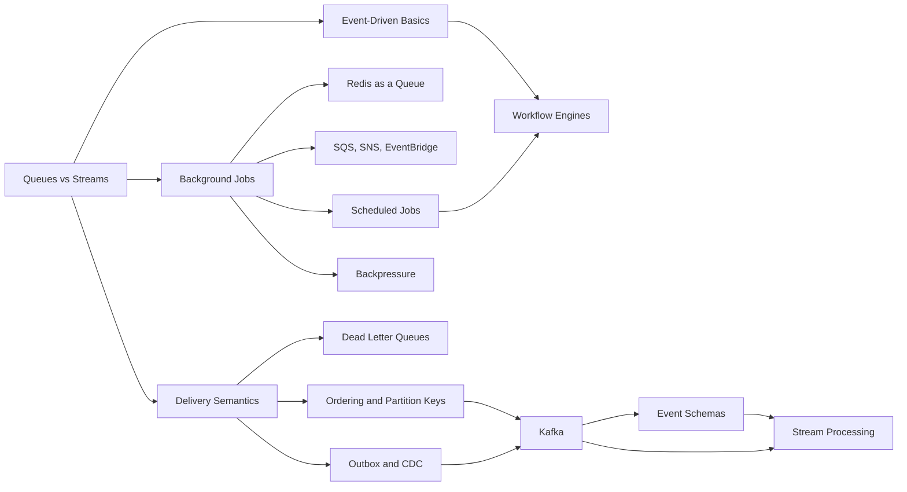

# 09 Messaging & Async MOC

> [!summary] What this folder covers
> How services talk without waiting on each other: queues and logs, delivery guarantees, retries and dead letters, ordering, the outbox, Kafka, schedulers, workflow engines and stream processing. After this folder you can pick a broker, design a reliable consumer and defend the choice in an interview.

## Before and after

- **Before this:** [[07 Databases MOC]]
- **After this:** [[10 Distributed Systems & Resilience MOC]]

Back to [[Home]].

## Learning path

1. [[Queues vs Streams and Broker Comparison]] · basic. The core split between a queue that deletes work and a log that keeps it, and how the main brokers fit.
2. [[Event-Driven Architecture Basics]] · basic. Commands versus events, choreography versus orchestration, and what you give up by going async.
3. [[Background Jobs and Worker Pools]] · basic. Moving slow work off the request path with leases, retries and bounded workers.
4. [[Redis as a Queue - Lists, Streams and Pub-Sub]] · intermediate. When Redis is enough as a broker and where each of its three options loses messages.
5. [[AWS SQS, SNS and EventBridge]] · intermediate. The managed AWS trio: visibility timeouts, fan-out, FIFO and event routing.
6. [[Delivery Semantics and Exactly-Once]] · intermediate. At-most, at-least and "exactly" once, and why idempotent consumers are the real answer.
7. [[Dead Letter Queues and Poison Messages]] · intermediate. Stopping one bad message from blocking or looping forever, and how to redrive safely.
8. [[Scheduled Jobs - Cron to Durable Schedulers]] · intermediate. From a crontab line to a scheduler that survives replicas, crashes and clock skew.
9. [[Backpressure and Flow Control]] · intermediate. What happens when producers outrun consumers, and how to push back instead of falling over.
10. [[Message Ordering and Partition Keys]] · intermediate. Ordering is per key, not global; choosing keys that keep order without hot partitions.
11. [[Transactional Outbox and CDC]] · advanced. Writing to the database and publishing an event without the dual-write bug.
12. [[Kafka and Event Streaming]] · advanced. Partitions, replication, consumer groups and offsets: Kafka from the inside.
13. [[Event Schemas and Schema Registry]] · advanced. Evolving event payloads without breaking consumers you have never met.
14. [[Workflow Engines and Durable Execution]] · advanced. Long multi-step processes that resume after crashes, using Temporal-style replay.
15. [[Stream Processing Basics]] · advanced. Windows, watermarks and state for continuous aggregates over a stream.

## Concept map

## Interview focus

- When would you choose a queue over a log like Kafka? See [[Queues vs Streams and Broker Comparison]].
- Can you get exactly-once delivery, and how do you make a consumer safe against duplicates? See [[Delivery Semantics and Exactly-Once]].
- How do you update the database and publish an event atomically? See [[Transactional Outbox and CDC]].
- How does Kafka guarantee ordering, and what happens during a consumer group rebalance? See [[Kafka and Event Streaming]] and [[Message Ordering and Partition Keys]].
- A message keeps failing and blocks the queue. What do you do? See [[Dead Letter Queues and Poison Messages]].
- Consumers are falling behind and lag keeps growing. How do you handle it? See [[Backpressure and Flow Control]].
- How do you run a cron job exactly once across several replicas? See [[Scheduled Jobs - Cron to Durable Schedulers]].
- How do you change an event's schema without breaking consumers? See [[Event Schemas and Schema Registry]].
- How would you implement a multi-step checkout that survives crashes? See [[Workflow Engines and Durable Execution]].

## Sources worth reading

- Martin Kleppmann, *Designing Data-Intensive Applications*, chapter 11 (Stream Processing).
- Jay Kreps, "The Log: What every software engineer should know about real-time data's unifying abstraction".
- Apache Kafka documentation, Design section: https://kafka.apache.org/documentation/#design
- Confluent, "Exactly-Once Semantics Are Possible: Here's How Kafka Does It".
- Chris Richardson, microservices.io patterns: Transactional Outbox and Idempotent Consumer.
- AWS documentation: Amazon SQS Developer Guide (visibility timeout, FIFO, dead-letter queues).
- Temporal documentation: "What is a Temporal Workflow?" and durable execution concepts.
