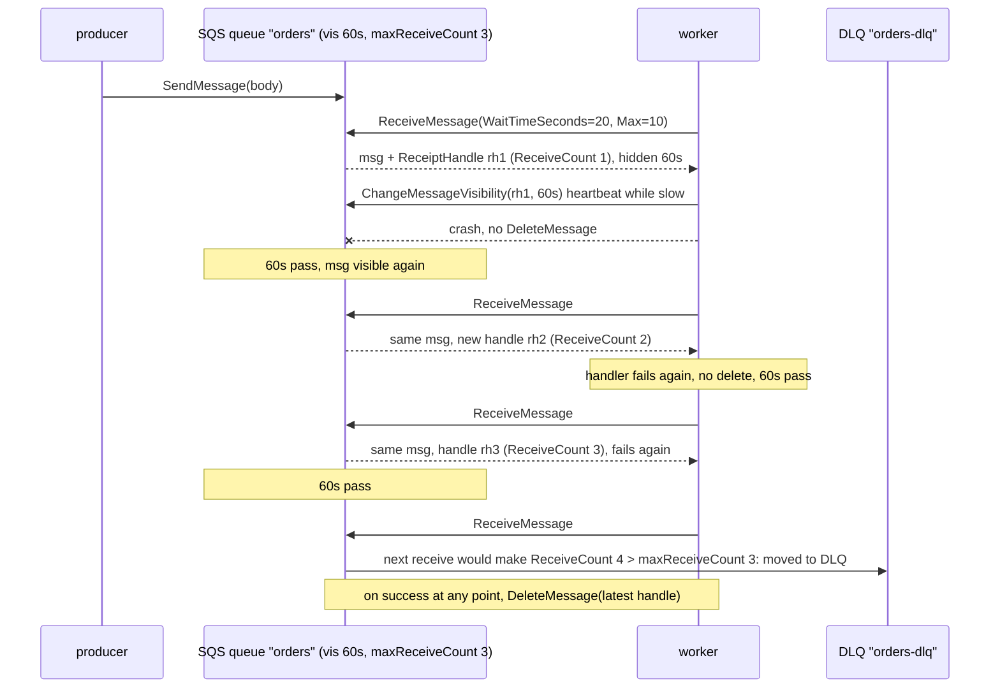
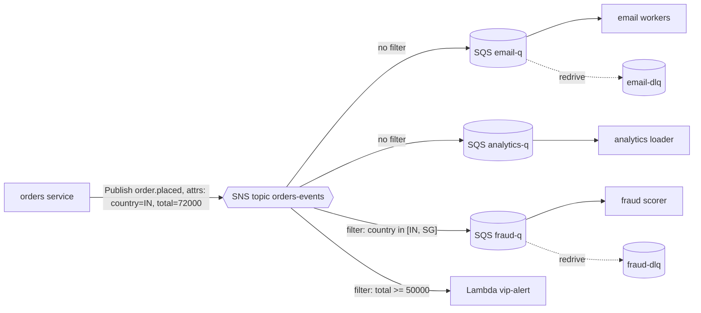
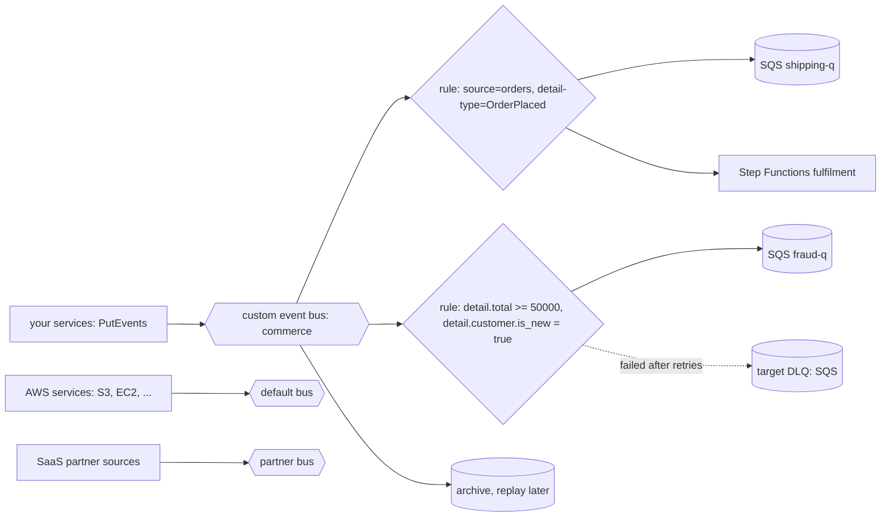

# AWS SQS, SNS and EventBridge

> [!summary] TL;DR
> Three managed AWS messaging services. **SQS** is a queue: workers pull messages and delete them when done. **SNS** is a topic: it pushes a copy of each message to every subscriber. **EventBridge** is an event router: it matches events against rules and sends them to targets. Most designs combine them, for example SNS or EventBridge in front of one SQS queue per consumer.

> [!abstract] Core idea
> - SQS: pull, at least once, visibility timeout instead of locks, redrive to a DLQ after `maxReceiveCount` receives. FIFO queues order within a `MessageGroupId`.
> - SNS: push fan-out with filter policies; it does not keep messages for slow subscribers, so put an SQS queue behind each one.
> - EventBridge: content-based routing with event patterns, many AWS and SaaS sources, archive and replay, built-in scheduler.
> - None of them gives exactly-once processing end to end. Consumers are idempotent.
> - For ordered, replayable, high-volume streams use Kinesis or Kafka (MSK) instead.

## 1. Why it exists

An e-commerce backend on AWS wants: (1) a queue for 3 million thumbnail jobs a day from S3 uploads, (2) an `order.placed` event that 5 teams consume, and (3) routing where only orders above ₹50,000 from new customers go to the fraud team. Running RabbitMQ or Kafka for this means EC2 instances, patching, disk alarms, replication and on-call. The managed trio covers all three with no servers: SQS for (1), SNS → SQS fan-out for (2), and an EventBridge rule for (3). You pay per request and the services scale on their own.

What you still own: visibility timeouts, retries, DLQs, idempotent consumers, IAM policies and cost. That is what this note is about.

## 2. Mental model

- **SQS** is a shared to-do tray. You take a card, it becomes invisible to others for a while; when you finish you shred it; if you do not, it reappears.
- **SNS** is a photocopier with a mailing list. Every message is copied to each subscriber whose filter matches. It keeps no archive for a subscriber that missed it beyond its retry policy.
- **EventBridge** is a mailroom sorter. Each letter (event) is read, matched against rules ("from billing, type InvoicePaid, amount > 50000"), and dropped into the right pigeonholes (targets).

## 3. How it works

### SQS: receive, hide, delete, or redrive



Key behaviours, with their documented limits:

- **Long polling.** `WaitTimeSeconds` up to 20 s: the call waits for messages instead of returning empty at once. Fewer empty receives, lower cost, lower latency than short polling.
- **Batch of up to 10** messages per `ReceiveMessage`, `SendMessageBatch` and `DeleteMessageBatch`.
- **Visibility timeout** 0 s to 12 h, default 30 s, set on the queue or per receive. `ChangeMessageVisibility` extends it (a heartbeat) or sets 0 to release a message now (a fast "nack").
- **Receipt handle.** Each receive returns a new handle. Delete with the latest one; AWS documents that an old handle may not delete the message.
- **Retention** 60 s to 14 days, default 4 days. Unprocessed messages are deleted when retention expires, DLQ or not.
- **Delay** up to 15 minutes per queue (`DelaySeconds`) or per message (standard queues only).
- **Message size** up to 1 MiB (raised from 256 KiB in August 2025). Larger payloads go to S3 with a pointer in the message (the "claim check" pattern; the SQS Extended Client Library does this).
- **Redrive policy** `{"deadLetterTargetArn": "...", "maxReceiveCount": 3}`: when a message's receive count exceeds the maximum, SQS moves it to the DLQ. The DLQ must be the same type (FIFO for FIFO) in the same account and region. A **DLQ redrive** task moves messages back to the source after a fix. Design details are in [[Dead Letter Queues and Poison Messages]].

**Standard vs FIFO queues:**

| | Standard | FIFO (`.fifo` name) |
| --- | --- | --- |
| Delivery | At least once; rare duplicates | Exactly-once *processing* within the 5-minute deduplication interval, as AWS defines it |
| Order | Best effort | Strict within a `MessageGroupId`; groups are independent |
| Throughput | Nearly unlimited | 300 API calls/s per action without batching (3,000 messages/s with batches of 10); high-throughput mode raises this, with per-region limits |
| Deduplication | None | `MessageDeduplicationId`, or content-based (SHA-256 of the body) |
| In flight per group | Any | Messages in a group behind an in-flight message wait until it is deleted or becomes visible |

"Exactly once" in SQS FIFO means a duplicate *send* within 5 minutes is dropped and a group's next message is not delivered while one is in flight. A consumer that crashes after its side effect but before `DeleteMessage` still gets the message again. See [[Delivery Semantics and Exactly-Once]].

### SNS → SQS fan-out with filters



- Each subscriber gets its own copy in its own queue: own pace, own retries, own DLQ, own scaling. One slow consumer cannot slow another.
- **Filter policies** match message attributes (or, with `FilterPolicyScope: MessageBody`, fields in a JSON body). A subscriber without a filter gets everything.
- **Raw message delivery** on an SQS subscription delivers your body as is; without it, SQS receives an SNS JSON envelope (`Type`, `MessageId`, `TopicArn`, `Message`, ...) and the consumer must unwrap it.
- The SQS queue's access policy must allow `sns.amazonaws.com` to `sqs:SendMessage`, scoped with an `aws:SourceArn` condition to the topic. With SSE-KMS on the queue, the KMS key policy must also allow SNS. Missing permissions fail silently from the publisher's point of view: `Publish` succeeds, the queue stays empty. See [[AWS 02 - IAM]].
- SNS FIFO topics preserve order per message group and deliver to SQS FIFO queues.

### EventBridge: rules route by content



- An event has a standard envelope: `version`, `id`, `detail-type`, `source`, `account`, `time`, `region`, `resources`, and your payload under `detail`.
- **Rules** hold an **event pattern** (exact match, prefix, suffix, `anything-but`, numeric ranges, `exists`, wildcards) and up to **5 targets**. An **input transformer** reshapes the event per target.
- **Targets** include SQS, SNS, Lambda, Step Functions, Kinesis, ECS tasks, API Gateway and **API destinations** (any HTTPS endpoint with auth and rate limits).
- **Retries:** by default EventBridge retries a failed delivery for up to 24 hours and 185 attempts, with backoff; configure a per-target DLQ (an SQS queue) so dropped events are kept.
- **Archive and replay:** archive a bus's events (optionally filtered) and replay a time range to a rule, for example to rebuild a new consumer's state.
- **Schema registry** can discover event shapes and generate code bindings ([[Event Schemas and Schema Registry]]).
- **Pipes** connect one source (SQS, Kinesis, DynamoDB Streams, MSK, ...) to one target with optional filter and enrichment, replacing glue Lambdas.
- **Scheduler** runs one-time and cron or rate schedules with time zones and flexible windows, invoking targets such as SQS or Lambda ([[Scheduled Jobs - Cron to Durable Schedulers]]).
- `PutEvents` takes up to 10 entries per call, and the total request size is limited (256 KB historically; check the current EventBridge quota page, as AWS has been raising payload limits). Delivery is at least once and **unordered**.

## 4. Worked example

### Whiteboard version

```text
order.placed  --> SNS topic (or EventBridge bus)
                    |-- email-q    (no filter)          -> workers -> DeleteMessage
                    |-- fraud-q    (country in IN,SG)   -> workers
                    '-- vip Lambda (total >= 50000)

worker loop:
  msgs = ReceiveMessage(Wait=20s, Max=10, VisibilityTimeout=60s)
  for each m, in parallel:
     every 20s: ChangeMessageVisibility(m.handle, 60s)    # heartbeat
     if handle(m) ok: DeleteMessage(m.handle)             # ack
     else: do nothing -> reappears after 60s
  queue redrive: ReceiveCount > 3 -> orders-dlq
FIFO: one in-flight message per MessageGroupId; dedup id dropped for 5 min
```

### Configuration

Queue attributes with a redrive policy, then an SNS filter policy. Keys in a filter policy are ANDed, so this example policy matches only orders from IN or SG **and** with `total >= 50000` (a stricter subscription than the diagram's `fraud-q`, shown to illustrate numeric matching):

```json
{
  "RedrivePolicy": {
    "deadLetterTargetArn": "arn:aws:sqs:ap-south-1:123456789012:orders-dlq",
    "maxReceiveCount": 3
  },
  "VisibilityTimeout": "60",
  "ReceiveMessageWaitTimeSeconds": "20",
  "MessageRetentionPeriod": "1209600"
}
```

```json
{
  "country": ["IN", "SG"],
  "total": [{ "numeric": [">=", 50000] }]
}
```

An EventBridge event pattern for the fraud rule:

```json
{
  "source": ["com.shop.orders"],
  "detail-type": ["OrderPlaced"],
  "detail": {
    "total": [{ "numeric": [">=", 50000] }],
    "customer": { "is_new": [true] }
  }
}
```

Representative output (AWS CLI v2, not run here: no AWS account in this environment) of one receive with the receive count requested:

```text
$ aws sqs receive-message --queue-url https://sqs.ap-south-1.amazonaws.com/123456789012/orders \
    --max-number-of-messages 10 --wait-time-seconds 20 \
    --message-system-attribute-names ApproximateReceiveCount
{
    "Messages": [
        {
            "MessageId": "5fea7756-0ea4-451a-a703-a558b933e274",
            "ReceiptHandle": "AQEBzbVv...truncated...",
            "MD5OfBody": "fafb00f5732ab283681e124bf8747ed1",
            "Body": "{\"order_id\":\"o-42\",\"total\":72000}",
            "Attributes": { "ApproximateReceiveCount": "2" }
        }
    ]
}
```

`ApproximateReceiveCount` is 2: this message was received once before and not deleted.

### Code 1: a worker against the real SDK interface

The worker uses the AWS SDK for Go v2 (`service/sqs` v1.34.8). Its `API` interface is the subset of `*sqs.Client` it calls, so tests use a fake. In `main`, pass `sqs.NewFromConfig(cfg)`.

```go
// Package sqsworker is a long-polling SQS consumer written against the
// AWS SDK for Go v2. The API interface lets tests use a fake.
package sqsworker

import (
	"context"
	"log/slog"
	"sync"
	"time"

	"github.com/aws/aws-sdk-go-v2/aws"
	"github.com/aws/aws-sdk-go-v2/service/sqs"
	"github.com/aws/aws-sdk-go-v2/service/sqs/types"
)

// API is the subset of *sqs.Client the worker uses.
type API interface {
	ReceiveMessage(ctx context.Context, in *sqs.ReceiveMessageInput, opts ...func(*sqs.Options)) (*sqs.ReceiveMessageOutput, error)
	DeleteMessage(ctx context.Context, in *sqs.DeleteMessageInput, opts ...func(*sqs.Options)) (*sqs.DeleteMessageOutput, error)
	ChangeMessageVisibility(ctx context.Context, in *sqs.ChangeMessageVisibilityInput, opts ...func(*sqs.Options)) (*sqs.ChangeMessageVisibilityOutput, error)
}

type Worker struct {
	API        API
	QueueURL   string
	Visibility time.Duration // e.g. 60s; must exceed a normal run
	Heartbeat  time.Duration // e.g. 20s; extends visibility while a run is slow
	Handle     func(ctx context.Context, m types.Message) error
	Log        *slog.Logger
}

// PollOnce does one long poll (up to 20 s) and processes the batch in
// parallel. A message is deleted only after its handler succeeds; a failed
// one simply reappears after its visibility timeout, and the queue's
// redrive policy moves it to the DLQ after maxReceiveCount receives.
func (w *Worker) PollOnce(ctx context.Context) (int, error) {
	out, err := w.API.ReceiveMessage(ctx, &sqs.ReceiveMessageInput{
		QueueUrl:                    aws.String(w.QueueURL),
		MaxNumberOfMessages:         10, // the API maximum
		WaitTimeSeconds:             20, // long polling: fewer empty responses
		VisibilityTimeout:           int32(w.Visibility / time.Second),
		MessageSystemAttributeNames: []types.MessageSystemAttributeName{types.MessageSystemAttributeNameApproximateReceiveCount},
	})
	if err != nil {
		return 0, err
	}
	var wg sync.WaitGroup
	var mu sync.Mutex
	deleted := 0
	for _, m := range out.Messages {
		wg.Add(1)
		go func() {
			defer wg.Done()
			if w.process(ctx, m) {
				mu.Lock()
				deleted++
				mu.Unlock()
			}
		}()
	}
	wg.Wait()
	return deleted, nil
}

func (w *Worker) process(ctx context.Context, m types.Message) bool {
	done := make(chan struct{})
	defer close(done)
	go func() { // heartbeat
		t := time.NewTicker(w.Heartbeat)
		defer t.Stop()
		for {
			select {
			case <-done:
				return
			case <-t.C:
				_, err := w.API.ChangeMessageVisibility(ctx, &sqs.ChangeMessageVisibilityInput{
					QueueUrl: aws.String(w.QueueURL), ReceiptHandle: m.ReceiptHandle,
					VisibilityTimeout: int32(w.Visibility / time.Second),
				})
				if err != nil {
					w.Log.Warn("heartbeat failed", "id", aws.ToString(m.MessageId), "err", err)
				}
			}
		}
	}()

	if err := w.Handle(ctx, m); err != nil {
		w.Log.Warn("handler failed; will be redelivered", "id", aws.ToString(m.MessageId),
			"receives", m.Attributes[string(types.MessageSystemAttributeNameApproximateReceiveCount)], "err", err)
		return false
	}
	_, err := w.API.DeleteMessage(ctx, &sqs.DeleteMessageInput{
		QueueUrl: aws.String(w.QueueURL), ReceiptHandle: m.ReceiptHandle,
	})
	if err != nil {
		// The work is done but the ack failed: the message will come back.
		// This is why handlers must be idempotent.
		w.Log.Warn("delete failed", "id", aws.ToString(m.MessageId), "err", err)
		return false
	}
	return true
}
```

```go
package sqsworker

import (
	"context"
	"errors"
	"io"
	"log/slog"
	"sync"
	"testing"
	"time"

	"github.com/aws/aws-sdk-go-v2/aws"
	"github.com/aws/aws-sdk-go-v2/service/sqs"
	"github.com/aws/aws-sdk-go-v2/service/sqs/types"
)

type fakeSQS struct {
	mu         sync.Mutex
	batch      []types.Message
	lastIn     *sqs.ReceiveMessageInput
	deleted    []string
	heartbeats int
}

func (f *fakeSQS) ReceiveMessage(_ context.Context, in *sqs.ReceiveMessageInput, _ ...func(*sqs.Options)) (*sqs.ReceiveMessageOutput, error) {
	f.mu.Lock()
	defer f.mu.Unlock()
	f.lastIn = in
	return &sqs.ReceiveMessageOutput{Messages: f.batch}, nil
}

func (f *fakeSQS) DeleteMessage(_ context.Context, in *sqs.DeleteMessageInput, _ ...func(*sqs.Options)) (*sqs.DeleteMessageOutput, error) {
	f.mu.Lock()
	defer f.mu.Unlock()
	f.deleted = append(f.deleted, aws.ToString(in.ReceiptHandle))
	return &sqs.DeleteMessageOutput{}, nil
}

func (f *fakeSQS) ChangeMessageVisibility(_ context.Context, in *sqs.ChangeMessageVisibilityInput, _ ...func(*sqs.Options)) (*sqs.ChangeMessageVisibilityOutput, error) {
	f.mu.Lock()
	defer f.mu.Unlock()
	f.heartbeats++
	return &sqs.ChangeMessageVisibilityOutput{}, nil
}

func msg(id string) types.Message {
	return types.Message{MessageId: aws.String(id), ReceiptHandle: aws.String("rh-" + id), Body: aws.String(id)}
}

func TestDeletesOnlySuccessfulMessages(t *testing.T) {
	f := &fakeSQS{batch: []types.Message{msg("ok-1"), msg("fail-2"), msg("ok-3")}}
	w := &Worker{API: f, QueueURL: "https://sqs.ap-south-1.amazonaws.com/123456789012/orders",
		Visibility: 60 * time.Second, Heartbeat: 20 * time.Second, Log: slog.New(slog.NewTextHandler(io.Discard, nil)),
		Handle: func(_ context.Context, m types.Message) error {
			if aws.ToString(m.Body) == "fail-2" {
				return errors.New("downstream 503")
			}
			return nil
		}}
	n, err := w.PollOnce(context.Background())
	if err != nil || n != 2 {
		t.Fatalf("deleted %d err %v", n, err)
	}
	for _, h := range f.deleted {
		if h == "rh-fail-2" {
			t.Fatal("a failed message must not be deleted")
		}
	}
	if f.lastIn.WaitTimeSeconds != 20 || f.lastIn.MaxNumberOfMessages != 10 || f.lastIn.VisibilityTimeout != 60 {
		t.Fatalf("receive input %+v", f.lastIn)
	}
}

func TestSlowHandlerSendsHeartbeats(t *testing.T) {
	f := &fakeSQS{batch: []types.Message{msg("slow")}}
	w := &Worker{API: f, QueueURL: "q", Visibility: time.Second, Heartbeat: 10 * time.Millisecond,
		Log: slog.New(slog.NewTextHandler(io.Discard, nil)),
		Handle: func(context.Context, types.Message) error {
			time.Sleep(55 * time.Millisecond)
			return nil
		}}
	if _, err := w.PollOnce(context.Background()); err != nil {
		t.Fatal(err)
	}
	f.mu.Lock()
	defer f.mu.Unlock()
	if f.heartbeats < 3 {
		t.Fatalf("want at least 3 heartbeats, got %d", f.heartbeats)
	}
}
```

Run with `go test -race ./sqsworker` (Go 1.24): both tests pass. The first checks that only successful messages are deleted and that the receive call uses long polling (20 s), the batch maximum (10) and the 60 s visibility timeout; the second checks that a slow handler sends heartbeats.

### Code 2: an in-memory model of the semantics

The fake below models what the worker must survive: redrive after `maxReceiveCount`, heartbeats, stale receipt handles, FIFO group blocking and deduplication, and SNS filter fan-out. It is a test double for reasoning and unit tests, not a replacement for integration tests against real AWS or LocalStack.

```go
// Package sqsfake is an in-memory model of the SQS and SNS behaviour a
// consumer must handle: visibility timeout, receipt handles, redrive to a
// DLQ after maxReceiveCount, FIFO message groups with deduplication, and
// SNS fan-out with filter policies. It is a test double, not a client.
package sqsfake

import (
	"fmt"
	"slices"
	"sync"
	"time"
)

type Message struct {
	ID            string
	Body          string
	Attributes    map[string]string
	GroupID       string // FIFO only
	ReceiveCount  int    // ApproximateReceiveCount
	ReceiptHandle string
}

type stored struct {
	msg            Message
	invisibleUntil time.Time
}

type Queue struct {
	Name              string
	FIFO              bool
	VisibilityTimeout time.Duration
	DeadLetter        *Queue // redrive target, nil for none
	MaxReceiveCount   int

	mu      sync.Mutex
	now     func() time.Time
	msgs    []*stored
	dedup   map[string]time.Time // FIFO dedup id -> first seen
	seq     int
	handles int
}

func NewQueue(name string, fifo bool, vis time.Duration, now func() time.Time) *Queue {
	return &Queue{Name: name, FIFO: fifo, VisibilityTimeout: vis, now: now, dedup: map[string]time.Time{}}
}

// DedupWindow is the documented FIFO deduplication interval.
const DedupWindow = 5 * time.Minute

// SendMessage stores a message. On a FIFO queue a repeated dedupID within
// five minutes is accepted but not stored again.
func (q *Queue) SendMessage(body string, attrs map[string]string, groupID, dedupID string) (string, error) {
	q.mu.Lock()
	defer q.mu.Unlock()
	if q.FIFO {
		if groupID == "" || dedupID == "" {
			return "", fmt.Errorf("%s: FIFO send needs MessageGroupId and a deduplication id", q.Name)
		}
		if first, ok := q.dedup[dedupID]; ok && q.now().Sub(first) < DedupWindow {
			return "duplicate", nil
		}
		q.dedup[dedupID] = q.now()
	}
	q.seq++
	id := fmt.Sprintf("%s-%d", q.Name, q.seq)
	q.msgs = append(q.msgs, &stored{msg: Message{ID: id, Body: body, Attributes: attrs, GroupID: groupID}})
	return id, nil
}

// ReceiveMessage returns up to max visible messages (SQS allows 1-10).
// A message that has already been received MaxReceiveCount times is moved
// to the dead-letter queue instead of being delivered again. On a FIFO
// queue, a group with a message in flight is skipped entirely, which keeps
// order within the group.
func (q *Queue) ReceiveMessage(max int) []Message {
	q.mu.Lock()
	defer q.mu.Unlock()
	now := q.now()
	blocked := map[string]bool{}
	var out []Message
	kept := q.msgs[:0]
	for _, s := range q.msgs {
		inFlight := now.Before(s.invisibleUntil)
		if q.FIFO && (inFlight || blocked[s.msg.GroupID]) {
			blocked[s.msg.GroupID] = true
			kept = append(kept, s)
			continue
		}
		if inFlight || len(out) == max {
			kept = append(kept, s)
			continue
		}
		if q.DeadLetter != nil && s.msg.ReceiveCount >= q.MaxReceiveCount {
			q.DeadLetter.put(s.msg) // redrive: drop from this queue
			continue
		}
		q.handles++
		s.msg.ReceiveCount++
		s.msg.ReceiptHandle = fmt.Sprintf("rh-%d", q.handles)
		s.invisibleUntil = now.Add(q.VisibilityTimeout)
		out = append(out, s.msg)
		if q.FIFO {
			blocked[s.msg.GroupID] = true // one in flight per group in this model
		}
		kept = append(kept, s)
	}
	q.msgs = kept
	return out
}

func (q *Queue) put(m Message) {
	q.mu.Lock()
	defer q.mu.Unlock()
	if m.ID == "" { // a fresh copy from SNS gets its own id
		q.seq++
		m.ID = fmt.Sprintf("%s-%d", q.Name, q.seq)
	}
	m.ReceiptHandle = ""
	q.msgs = append(q.msgs, &stored{msg: m})
}

func (q *Queue) find(handle string) *stored {
	for _, s := range q.msgs {
		if s.msg.ReceiptHandle == handle {
			return s
		}
	}
	return nil
}

// DeleteMessage is the ack. It needs the latest receipt handle.
func (q *Queue) DeleteMessage(handle string) error {
	q.mu.Lock()
	defer q.mu.Unlock()
	for i, s := range q.msgs {
		if s.msg.ReceiptHandle == handle {
			q.msgs = append(q.msgs[:i], q.msgs[i+1:]...)
			return nil
		}
	}
	return fmt.Errorf("receipt handle %s is not current", handle)
}

// ChangeMessageVisibility is the heartbeat for slow work. A timeout of 0
// makes the message visible at once (a fast "nack").
func (q *Queue) ChangeMessageVisibility(handle string, timeout time.Duration) error {
	q.mu.Lock()
	defer q.mu.Unlock()
	s := q.find(handle)
	if s == nil {
		return fmt.Errorf("receipt handle %s is not current", handle)
	}
	s.invisibleUntil = q.now().Add(timeout)
	return nil
}

func (q *Queue) Len() int {
	q.mu.Lock()
	defer q.mu.Unlock()
	return len(q.msgs)
}

// Topic is SNS: it pushes a copy of each message to every subscription
// whose filter policy matches. It stores nothing.
type Topic struct {
	mu   sync.Mutex
	subs []subscription
}

type subscription struct {
	q      *Queue
	filter map[string][]string // attribute -> allowed values
}

func (t *Topic) Subscribe(q *Queue, filter map[string][]string) {
	t.mu.Lock()
	defer t.mu.Unlock()
	t.subs = append(t.subs, subscription{q: q, filter: filter})
}

// Publish returns how many queues received a copy.
func (t *Topic) Publish(body string, attrs map[string]string) int {
	t.mu.Lock()
	subs := append([]subscription(nil), t.subs...)
	t.mu.Unlock()
	n := 0
	for _, s := range subs {
		if matches(s.filter, attrs) {
			s.q.put(Message{Body: body, Attributes: attrs})
			n++
		}
	}
	return n
}

func matches(filter map[string][]string, attrs map[string]string) bool {
	for key, allowed := range filter {
		v, ok := attrs[key]
		if !ok {
			return false
		}
		if !slices.Contains(allowed, v) {
			return false
		}
	}
	return true
}
```

```go
package sqsfake

import (
	"testing"
	"time"
)

type clock struct{ t time.Time }

func (c *clock) now() time.Time { return c.t }

func TestRedriveAfterMaxReceiveCount(t *testing.T) {
	c := &clock{t: time.Unix(0, 0)}
	dlq := NewQueue("orders-dlq", false, 30*time.Second, c.now)
	q := NewQueue("orders", false, 30*time.Second, c.now)
	q.DeadLetter, q.MaxReceiveCount = dlq, 3
	q.SendMessage(`{"order_id":"bad"}`, nil, "", "")

	for i := 1; i <= 3; i++ { // consumer fails every time and never deletes
		got := q.ReceiveMessage(10)
		if len(got) != 1 || got[0].ReceiveCount != i {
			t.Fatalf("receive %d: %+v", i, got)
		}
		c.t = c.t.Add(31 * time.Second) // visibility timeout expires
	}
	if got := q.ReceiveMessage(10); len(got) != 0 {
		t.Fatalf("4th receive should redrive, got %+v", got)
	}
	if q.Len() != 0 || dlq.Len() != 1 {
		t.Fatalf("source=%d dlq=%d", q.Len(), dlq.Len())
	}
}

func TestHeartbeatAndStaleHandle(t *testing.T) {
	c := &clock{t: time.Unix(0, 0)}
	q := NewQueue("thumbs", false, 30*time.Second, c.now)
	q.SendMessage("img-1", nil, "", "")
	m := q.ReceiveMessage(1)[0]

	c.t = c.t.Add(25 * time.Second)
	if err := q.ChangeMessageVisibility(m.ReceiptHandle, 60*time.Second); err != nil {
		t.Fatal(err)
	}
	c.t = c.t.Add(40 * time.Second) // 65s after receive: still hidden thanks to the heartbeat
	if got := q.ReceiveMessage(1); len(got) != 0 {
		t.Fatal("heartbeat should have kept the message hidden")
	}
	c.t = c.t.Add(30 * time.Second)
	again := q.ReceiveMessage(1)
	if len(again) != 1 {
		t.Fatal("message should reappear once the extended timeout passes")
	}
	if err := q.DeleteMessage(m.ReceiptHandle); err == nil {
		t.Fatal("old receipt handle must not delete in this model")
	}
	if err := q.DeleteMessage(again[0].ReceiptHandle); err != nil {
		t.Fatal(err)
	}
}

func TestFIFOOneInFlightPerGroupAndDedup(t *testing.T) {
	c := &clock{t: time.Unix(0, 0)}
	q := NewQueue("payments.fifo", true, 30*time.Second, c.now)
	q.SendMessage("A1", nil, "acct-A", "a1")
	q.SendMessage("A2", nil, "acct-A", "a2")
	q.SendMessage("B1", nil, "acct-B", "b1")
	if id, _ := q.SendMessage("A1 retry", nil, "acct-A", "a1"); id != "duplicate" {
		t.Fatal("same dedup id within 5 minutes must be dropped")
	}
	if _, err := q.SendMessage("x", nil, "", ""); err == nil {
		t.Fatal("FIFO send without group id must fail")
	}

	first := q.ReceiveMessage(10)
	if len(first) != 2 || first[0].Body != "A1" || first[1].Body != "B1" {
		t.Fatalf("want A1 and B1 (A2 waits behind A1), got %+v", first)
	}
	q.DeleteMessage(first[0].ReceiptHandle) // A1 done
	next := q.ReceiveMessage(10)
	if len(next) != 1 || next[0].Body != "A2" {
		t.Fatalf("want A2 after A1 is deleted, got %+v", next)
	}

	c.t = c.t.Add(DedupWindow + time.Second)
	if id, _ := q.SendMessage("A1 again", nil, "acct-A", "a1"); id == "duplicate" {
		t.Fatal("after the window the same dedup id is accepted")
	}
}

func TestSNSFanOutWithFilterPolicy(t *testing.T) {
	c := &clock{t: time.Unix(0, 0)}
	email := NewQueue("email", false, 30*time.Second, c.now)
	fraud := NewQueue("fraud", false, 30*time.Second, c.now)
	var topic Topic
	topic.Subscribe(email, nil)                                          // everything
	topic.Subscribe(fraud, map[string][]string{"country": {"IN", "SG"}}) // only some

	if n := topic.Publish(`{"order":"o1"}`, map[string]string{"country": "IN"}); n != 2 {
		t.Fatalf("IN order reached %d queues", n)
	}
	if n := topic.Publish(`{"order":"o2"}`, map[string]string{"country": "US"}); n != 1 {
		t.Fatalf("US order reached %d queues", n)
	}
	if email.Len() != 2 || fraud.Len() != 1 {
		t.Fatalf("email=%d fraud=%d", email.Len(), fraud.Len())
	}
	// Each queue holds its own copy: deleting from one leaves the other.
	m := email.ReceiveMessage(1)[0]
	email.DeleteMessage(m.ReceiptHandle)
	if fraud.Len() != 1 {
		t.Fatal("fan-out copies are independent")
	}
}
```

Run with `go test -race ./sqsfake` (Go 1.24): all 4 tests pass. The FIFO test shows the ordering rule concretely: with `A1`, `A2` in group `acct-A` and `B1` in `acct-B`, the first receive returns `A1` and `B1`; `A2` waits until `A1` is deleted. One simplification: real SQS FIFO can return several messages of the same group in one batch (in order); the model returns one per group per receive, which is stricter but keeps the same ordering guarantee.

## 5. Variants and comparison

| Service | Model | Order | Retention | Consumers | Use when | Watch out for |
| --- | --- | --- | --- | --- | --- | --- |
| SQS standard | Queue, pull | Best effort | Up to 14 days | Competing workers | Job queues, buffering, decoupling | Duplicates; visibility timeout tuning |
| SQS FIFO | Queue, pull | Per message group | Up to 14 days | Competing workers, one in flight per group | Per-account or per-order sequences | Throughput limits; a stuck group blocks only itself, but blocks it fully |
| SNS standard | Push fan-out | None | None beyond delivery retries | Many subscriber types | Fan-out to queues, Lambda, HTTP, email, SMS | Missing queue policy = silent loss; envelope unless raw delivery |
| SNS FIFO | Push fan-out | Per message group | None | SQS FIFO queues | Ordered fan-out | Lower throughput than standard |
| EventBridge | Rule-based router, push | None | Optional archive and replay | Up to 5 targets per rule, many rules | Cross-team or cross-account event bus, SaaS and AWS events, content routing | Higher latency than SNS; per-event cost; 256 KB events |
| Kinesis Data Streams | Partitioned log | Per shard (partition key) | 24 h default, up to 365 days | Many readers, replay | Ordered high-volume streams, analytics | Shard math: 1 MB/s or 1,000 records/s in, 2 MB/s out per shard (provisioned) |
| Amazon MSK | Managed Kafka | Per partition | Configurable | Consumer groups | Kafka APIs and ecosystem ([[Kafka and Event Streaming]]) | You still tune Kafka |
| Amazon MQ | Managed RabbitMQ or ActiveMQ | Per queue | Until consumed | AMQP/JMS clients | Lift-and-shift of existing brokers | Instance-based sizing |

**SNS vs EventBridge for fan-out.** SNS has lower latency, higher throughput and simpler semantics; choose it for a high-volume topic owned by one team. EventBridge is better as an organisation-wide bus: richer content filtering, schema discovery, archive and replay, cross-account buses and SaaS integrations.

## 6. Trade-offs and when not to use

- **No replay in SQS or SNS.** Once deleted, a message is gone. If a consumer bug corrupts data for an hour, you need an EventBridge archive, a Kinesis or Kafka stream, or the source database.
- **Ordering is narrow.** FIFO orders only within a group; standard queues and EventBridge do not order at all. Design with versions ([[Message Ordering and Partition Keys]]).
- **Per-request cost adds up.** SQS bills each 64 KB chunk of a payload as one request, and empty receives count too. Long polling and batching cut the bill; a tight short-polling loop on an idle queue is pure cost.
- **Latency floor.** Fine for jobs and events; not for request/response inside a user's click path.
- **Lock-in.** APIs, IAM and quotas are AWS-specific. Hide them behind a small interface (as the worker does) if portability matters.
- **Do not use** SNS alone for anything that must not be lost: always back critical subscribers with a queue and a DLQ. Do not use EventBridge for high-rate telemetry streams; use Kinesis or Kafka.

## 7. In production

- **Real systems:** S3 event notifications → SQS → workers is the standard upload pipeline ([[AWS 07 - S3]]); SNS → SQS fan-out per microservice; EventBridge as the central bus with one custom bus per domain and cross-account rules; EventBridge Scheduler for reminders and cron.
- **Lambda as consumer:** the SQS event source mapping polls for you. Batch size up to 10,000 for standard queues (10 for FIFO); a batch size above 10 requires a batching window of at least 1 s. Return partial batch failures (`ReportBatchItemFailures`) so one bad message does not retry the whole batch. AWS recommends a queue visibility timeout of at least six times the function timeout. Use maximum concurrency on the mapping to protect downstreams.
- **Failure modes → fixes:**
	- Visibility timeout below runtime → duplicate parallel processing; raise it above p99 and heartbeat.
	- Messages land in the DLQ that would have succeeded → `maxReceiveCount` too low for transient errors, or visibility too short; use 3 to 5 and backoff by extending visibility on failure.
	- DLQ retention shorter than the source's → messages expire in the DLQ; set DLQ retention to 14 days.
	- SNS → SQS delivers nothing → missing queue policy or KMS key permission; test the subscription after every IaC change.
	- FIFO group stalls → one poison message blocks its group; redrive it to the DLQ quickly (low `maxReceiveCount`) and alert.
	- EventBridge rule matches nothing → pattern typo or wrong `source`; test patterns with `TestEventPattern` and alarm on `FailedInvocations` and zero `MatchedEvents`.
- **What to monitor (CloudWatch):** `ApproximateNumberOfMessagesVisible`, `ApproximateAgeOfOldestMessage`, `ApproximateNumberOfMessagesNotVisible` (in flight), `NumberOfEmptyReceives` (cost), DLQ visible count > 0 as an alarm; SNS `NumberOfNotificationsFailed`; EventBridge `FailedInvocations`, `ThrottledRules`, `InvocationsSentToDlq`.

## 8. Deep dive

**Why SQS duplicates happen even without crashes.** Standard queues store copies on several servers for durability. On rare occasions a receive hits a server whose copy was not yet deleted, so a message is delivered again. That is why AWS documents standard queues as at-least-once and tells you to design idempotent consumers ([[Idempotency and Idempotency Keys]]).

**FIFO throughput is a group problem.** Throughput scales with the number of active message groups, because each group has at most one batch in flight. A FIFO queue with a single group ID is a single-lane road no matter how many consumers you add. Choose a group ID with many values (account id, order id), not a constant.

**Visibility as a retry scheduler.** On a transient failure, call `ChangeMessageVisibility(handle, backoff)` with a growing delay (for example 10 s × 2^receiveCount, capped). This gives per-message exponential backoff without a separate retry queue. See [[Timeouts, Retries and Backoff]].

**Fan-out ordering of setup.** Create the queue and its policy, then subscribe it to the topic, then start publishing. Messages published before the subscription existed are not delivered to it; SNS has no history.

**Reliable publishing.** `SendMessage` after a database commit is a dual write. Use the [[Transactional Outbox and CDC]] (a relay reads the outbox and calls `SendMessage` or `PutEvents`), or DynamoDB Streams / EventBridge Pipes from a table you already write.

**Cross-account and cross-region.** EventBridge rules can target a bus in another account or region, which makes a "hub" account bus common. SQS DLQs must be in the same account and region as the source queue.

**Exactly-once claims, precisely.** SQS FIFO deduplicates sends within 5 minutes and orders per group. SNS FIFO does the same for fan-out. Neither makes your side effects exactly-once; an idempotency key or dedupe table in your database does.

## 9. Interview questions

> [!question]- How does SQS make sure two workers do not process the same message, and when does that fail?
> A received message is hidden for the visibility timeout; others cannot receive it. It fails when processing outlasts the timeout (the message reappears and a second worker takes it) and, on standard queues, on rare duplicate deliveries. Fix with a timeout above p99, heartbeats, and idempotent handlers.

> [!question]- Design fan-out of `order.placed` to five teams on AWS.
> Publish once to an SNS topic (or an EventBridge bus). Each team owns an SQS queue subscribed to it, with a filter policy if they need a subset, its own DLQ and alarms. Teams consume at their own pace and failures stay isolated. Publish from an outbox so a committed order always produces the event.

> [!question]- Trap: "We use SQS FIFO, so we have exactly-once processing and need no idempotency." Correct?
> No. FIFO drops duplicate sends within the 5-minute deduplication window and keeps one message per group in flight. If a consumer performs the side effect and crashes before `DeleteMessage`, the message is delivered again after the visibility timeout. The handler still needs idempotency.

> [!question]- When would you choose EventBridge over SNS?
> When you need content-based routing on fields in the payload, many producers and consumers across teams or accounts, AWS or SaaS events as sources, archive and replay, or schema discovery. Choose SNS for high-throughput, low-latency fan-out of one team's topic.

> [!question]- A FIFO queue's throughput is far below what you expected despite 50 consumers. Why?
> Probably few message group IDs (maybe one). Only one message per group is in flight, so parallelism equals the number of active groups. Use a higher-cardinality group ID such as account or order id, and keep per-group processing fast.

> [!question]- How do you handle a message that always fails?
> Set a redrive policy with a small `maxReceiveCount` (3 to 5) so it moves to a DLQ, alarm on DLQ depth, inspect it, fix the bug, and redrive it back to the source with a DLQ redrive task, at a controlled rate into an idempotent consumer.

> [!question]- Kinesis or SQS for clickstream events that three analytics jobs read?
> Kinesis (or MSK). Several independent readers, per-key ordering and replay need a log. SQS would require one queue per reader via SNS and could not replay.

## 10. Cheat sheet

- SQS: long poll 20 s, batch 10, visibility 30 s default (max 12 h), retention 4 days default (max 14), delay ≤ 15 min, message ≤ 1 MiB.
- Delete with the latest receipt handle; heartbeat with `ChangeMessageVisibility`.
- Redrive: `maxReceiveCount` 3 to 5; DLQ same type, account and region; retention 14 days; redrive back after a fix.
- FIFO: order per `MessageGroupId`, 5-minute dedup, throughput scales with number of groups.
- SNS: push fan-out with filter policies; put SQS behind every subscriber that matters; raw delivery; queue policy for SNS.
- EventBridge: rules with patterns, ≤ 5 targets each, 24 h / 185 retries then target DLQ, archive and replay, Scheduler, Pipes.
- Lambda + SQS: partial batch responses; visibility ≥ 6 × function timeout.
- None is exactly-once end to end; idempotent consumers and outbox publishing.

## Links

- **Before this:** [[Queues vs Streams and Broker Comparison]], [[Event-Driven Architecture Basics]], [[Background Jobs and Worker Pools]]
- **Next:** [[Dead Letter Queues and Poison Messages]], [[Delivery Semantics and Exactly-Once]], [[Message Ordering and Partition Keys]]
- **Compare with:** [[Kafka and Event Streaming]], [[Redis as a Queue - Lists, Streams and Pub-Sub]], [[Scheduled Jobs - Cron to Durable Schedulers]]
