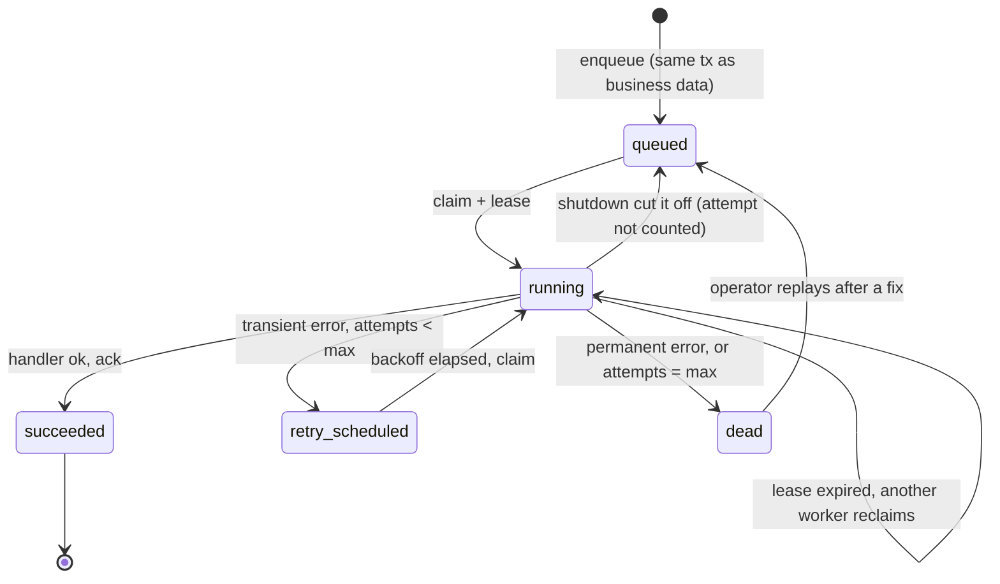
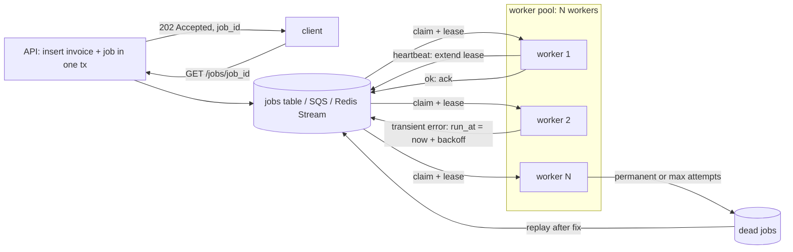

# Background Jobs and Worker Pools

> [!summary] TL;DR
> A **background job** is work the user should not wait for (an email, a PDF, a webhook) that the API records in a durable queue and returns at once. A **worker pool** is a fixed set of processes or goroutines that take jobs from that queue, run them, and mark them done, retrying or giving up when they fail.

> [!abstract] Core idea
> - The request path only *enqueues* and returns `202 Accepted` with a job id; workers do the slow part.
> - A worker **leases** a job (it is hidden, not deleted); the lease expires if the worker dies, so another worker retries it.
> - Delivery is at least once: a job can run twice, so handlers must be idempotent.
> - Retries use backoff and a maximum; permanent failures go to a dead-letter state for a human.
> - Size the pool by what the job waits on, cap concurrency per downstream, and drain gracefully on shutdown.

## 1. Why it exists

An invoicing API generates a PDF (≈2 s of CPU), stores it in S3 (≈300 ms), and emails it (≈500 ms at the provider) when the user clicks "Send invoice". Inline, that request takes about 2.8 s (an estimate for this example). Three things go wrong:

- **Latency:** the user stares at a spinner; the load balancer may time out at its idle timeout.
- **Coupling to outages:** when the email provider is down, the "Send" button fails, although the invoice is fine.
- **Capacity:** at 50 clicks per second, the API needs 50 × 2.8 ≈ 140 requests in flight at once (Little's Law: in-flight = arrival rate × time in system), all holding memory and DB connections.

With a background job, the API writes the invoice and a job row and returns in about 20 ms. Eight workers make PDFs at their own pace, the email provider's outage only delays emails, and a burst of 5,000 clicks becomes a queue that drains over a few minutes instead of 5,000 concurrent requests.

Typical work that leaves the request path: transactional emails and SMS, PDF and report generation, image and video processing, webhook fan-out to customers ([[Webhooks - Sending and Receiving]]), search indexing, data exports, and calls to slow third parties.

## 2. Mental model

A restaurant kitchen. The waiter (API) writes the order on a ticket, spikes it on the rail (queue), and goes back to the floor. Cooks (workers) take tickets. A cook who takes a ticket holds it (lease). If the cook walks out, the ticket goes back on the rail after a while (lease expiry). A dish that keeps failing is put aside for the chef to look at (dead letter), not retried forever. The number of cooks is set by the number of stoves (downstream capacity), not by the number of tickets.

## 3. How it works

### The job lifecycle



1. **Enqueue.** Insert the job durably. The safest place is the same database transaction that created the invoice, so you never have an invoice without its email job, or an email job for a rolled-back invoice. If the queue is a separate system (SQS, Redis), use the [[Transactional Outbox and CDC]] instead of "commit, then enqueue".
2. **Claim with a lease.** A worker takes one job and marks it `running` until `now + lease`. SQS calls the lease a **visibility timeout**; Postgres queues store a `locked_until` column; Redis Streams keep the entry in the pending entries list.
3. **Run.** The handler gets a context with a timeout shorter than the lease. Long jobs **heartbeat**: they extend the lease every third of its length (SQS: `ChangeMessageVisibility`).
4. **Ack.** On success, mark it done (or delete it).
5. **Retry.** On a transient error (timeout, 503, connection reset), schedule the next attempt after a backoff that grows: 10 s, 20 s, 40 s, with jitter. See [[Timeouts, Retries and Backoff]].
6. **Dead-letter.** On a permanent error (invalid email address, schema mismatch) or after the last attempt, move it to `dead` with the error, for a person to inspect and replay. See [[Dead Letter Queues and Poison Messages]].
7. **Crash.** If the worker dies mid-job, nothing acks. The lease expires and another worker claims it as the next attempt. That is the "at least once" in at-least-once.

### The pool around the queue



**Returning the job to the client.** The API returns `202 Accepted` with a `Location: /jobs/{id}` header (or the id in the body). The client polls `GET /jobs/{id}` for `{state, progress, result_url, error}`, or the server pushes completion through a webhook, SSE or WebSocket.

### Claiming jobs in PostgreSQL

A Postgres table is a complete job queue for most teams up to thousands of jobs per second (an estimate; it depends on the hardware and row churn). `FOR UPDATE SKIP LOCKED` makes concurrent workers skip rows another transaction has locked instead of waiting.

```sql
CREATE TABLE jobs (
    id            bigint GENERATED ALWAYS AS IDENTITY PRIMARY KEY,
    kind          text        NOT NULL,
    payload       jsonb       NOT NULL,
    state         text        NOT NULL DEFAULT 'queued'
                  CHECK (state IN ('queued','running','retry_scheduled','succeeded','dead')),
    attempts      int         NOT NULL DEFAULT 0,
    max_attempts  int         NOT NULL DEFAULT 5,
    run_at        timestamptz NOT NULL DEFAULT now(),
    locked_until  timestamptz,
    last_error    text,
    created_at    timestamptz NOT NULL DEFAULT now()
);

-- Only runnable rows are indexed, so the index stays small as succeeded rows pile up.
CREATE INDEX jobs_runnable ON jobs (run_at)
    WHERE state IN ('queued', 'retry_scheduled', 'running');

-- Claim one job: due now, or abandoned by a crashed worker.
WITH next AS (
    SELECT id
    FROM jobs
    WHERE (state IN ('queued', 'retry_scheduled') AND run_at <= now())
       OR (state = 'running' AND locked_until < now())
    ORDER BY run_at
    LIMIT 1
    FOR UPDATE SKIP LOCKED
)
UPDATE jobs j
SET state = 'running',
    attempts = j.attempts + 1,
    locked_until = now() + interval '60 seconds'
FROM next
WHERE j.id = next.id
RETURNING j.id, j.kind, j.payload, j.attempts;
```

Representative output (PostgreSQL 17), one worker's claim:

```text
  id   |     kind     |              payload               | attempts
-------+--------------+------------------------------------+----------
 90412 | send_invoice | {"invoice_id": 7781, "to": "a@b.c"} |        1
(1 row)

UPDATE 1
```

A second worker running the same statement at the same moment skips row 90412 and gets the next one. The claim commits immediately; the job runs **outside** that transaction, so no row lock is held for the job's duration. Completion is a separate `UPDATE ... WHERE id = $1 AND attempts = $2`, and the `attempts` check stops a worker whose lease expired from overwriting the new owner's result. Go code that wires this up with pgx, River and graceful shutdown lives in [[Background Workers and Job Queues]].

## 4. Worked example

### Whiteboard version

```text
claim(lease):
  pick oldest job where (queued|retry and run_at <= now) or (running and lease expired)
  state=running, attempts++, lease_until = now + lease

worker loop (N copies):
  while not shutting down:
     job = claim(60s)            else sleep(poll) and continue
     start heartbeat: every 20s extend lease (stop job if lease lost)
     err = handle(ctx with timeout < lease)
     finish(job, attempt, err):
        ok                         -> succeeded
        permanent or attempts=max  -> dead
        else                       -> retry_scheduled, run_at = now + backoff(attempts)
     stale attempt number          -> ignore (someone else owns it now)

shutdown: stop claiming; give in-flight jobs a drain window; requeue the rest
```

### Code: the lifecycle and pool as a tested model

This is an in-memory model of the queue semantics, so every rule above has a test. A production version swaps `Store` for the SQL above or for SQS.

```go
// Package jobs is a durable-queue model: jobs are leased, not removed,
// and a worker pool runs them with retries, a dead state and a graceful drain.
package jobs

import (
	"context"
	"errors"
	"sync"
	"time"
)

type State string

const (
	Queued    State = "queued"
	Running   State = "running"
	Succeeded State = "succeeded"
	Retry     State = "retry_scheduled"
	Dead      State = "dead"
)

type Job struct {
	ID          string
	Kind        string
	Payload     string
	State       State
	Attempts    int
	MaxAttempts int
	RunAt       time.Time // not before this time
	LeaseUntil  time.Time // valid while Running
	LastError   string
}

// ErrPermanent marks an error that retrying cannot fix (bad payload,
// validation failure). Such a job goes straight to Dead.
var ErrPermanent = errors.New("permanent")

// Store keeps jobs in memory. A real one is a Postgres table claimed with
// FOR UPDATE SKIP LOCKED, a Redis Stream, or SQS.
type Store struct {
	mu      sync.Mutex
	now     func() time.Time
	backoff func(attempt int) time.Duration
	jobs    map[string]*Job
	order   []string // FIFO by enqueue
}

func NewStore(now func() time.Time, backoff func(attempt int) time.Duration) *Store {
	return &Store{now: now, backoff: backoff, jobs: map[string]*Job{}}
}

func (s *Store) Enqueue(j Job) {
	s.mu.Lock()
	defer s.mu.Unlock()
	if j.MaxAttempts == 0 {
		j.MaxAttempts = 5
	}
	j.State = Queued
	s.jobs[j.ID] = &j
	s.order = append(s.order, j.ID)
}

// Claim leases the oldest runnable job: one that is due, or one whose
// previous worker's lease has expired (that worker crashed or hung).
func (s *Store) Claim(lease time.Duration) (Job, bool) {
	s.mu.Lock()
	defer s.mu.Unlock()
	now := s.now()
	for _, id := range s.order {
		j := s.jobs[id]
		due := (j.State == Queued || j.State == Retry) && !now.Before(j.RunAt)
		abandoned := j.State == Running && now.After(j.LeaseUntil)
		if !due && !abandoned {
			continue
		}
		j.State = Running
		j.Attempts++
		j.LeaseUntil = now.Add(lease)
		return *j, true
	}
	return Job{}, false
}

// Extend is the heartbeat for long jobs: push the lease forward.
// It fails if the lease was lost, so the worker should stop.
func (s *Store) Extend(id string, attempt int, lease time.Duration) bool {
	s.mu.Lock()
	defer s.mu.Unlock()
	j := s.jobs[id]
	if j == nil || j.State != Running || j.Attempts != attempt {
		return false
	}
	j.LeaseUntil = s.now().Add(lease)
	return true
}

// Finish records the outcome of one attempt. attempt guards against a
// worker whose lease expired reporting on a job someone else now owns.
func (s *Store) Finish(id string, attempt int, runErr error) {
	s.mu.Lock()
	defer s.mu.Unlock()
	j := s.jobs[id]
	if j == nil || j.State != Running || j.Attempts != attempt {
		return // stale report
	}
	switch {
	case runErr == nil:
		j.State = Succeeded
	case errors.Is(runErr, ErrPermanent) || j.Attempts >= j.MaxAttempts:
		j.State, j.LastError = Dead, runErr.Error()
	default:
		j.State, j.LastError = Retry, runErr.Error()
		j.RunAt = s.now().Add(s.backoff(j.Attempts))
	}
}

// Requeue hands a job back without counting the attempt (used on shutdown).
func (s *Store) Requeue(id string, attempt int) {
	s.mu.Lock()
	defer s.mu.Unlock()
	if j := s.jobs[id]; j != nil && j.State == Running && j.Attempts == attempt {
		j.State, j.Attempts = Queued, j.Attempts-1
	}
}

func (s *Store) Get(id string) Job {
	s.mu.Lock()
	defer s.mu.Unlock()
	return *s.jobs[id]
}

// Pool runs N workers against a Store.
type Pool struct {
	Store   *Store
	Workers int
	Lease   time.Duration
	Poll    time.Duration // sleep when the queue is empty
	Timeout time.Duration // per-job limit; keep it below Lease
	Handle  func(ctx context.Context, j Job) error
}

// Run blocks until ctx is cancelled. Then workers stop claiming, and each
// in-flight job either finishes within drain or is handed back.
func (p *Pool) Run(ctx context.Context, drain time.Duration) {
	var wg sync.WaitGroup
	for range p.Workers {
		wg.Add(1)
		go func() {
			defer wg.Done()
			p.loop(ctx, drain)
		}()
	}
	wg.Wait()
}

func (p *Pool) loop(ctx context.Context, drain time.Duration) {
	for ctx.Err() == nil {
		j, ok := p.Store.Claim(p.Lease)
		if !ok {
			select {
			case <-ctx.Done():
			case <-time.After(p.Poll):
			}
			continue
		}
		p.runOne(ctx, j, drain)
	}
}

func (p *Pool) runOne(ctx context.Context, j Job, drain time.Duration) {
	// The job's context outlives a shutdown signal by at most drain.
	jobCtx, cancel := context.WithTimeout(context.WithoutCancel(ctx), p.Timeout)
	defer cancel()
	stop := context.AfterFunc(ctx, func() {
		time.AfterFunc(drain, cancel)
	})
	defer stop()

	// Heartbeat: extend the lease every Lease/3 while the job runs. If the
	// lease is lost, cancel the job so two workers do not run it at once.
	done := make(chan struct{})
	defer close(done)
	go func() {
		t := time.NewTicker(p.Lease / 3)
		defer t.Stop()
		for {
			select {
			case <-done:
				return
			case <-t.C:
				if !p.Store.Extend(j.ID, j.Attempts, p.Lease) {
					cancel()
					return
				}
			}
		}
	}()

	err := p.Handle(jobCtx, j)
	if ctx.Err() != nil && errors.Is(err, context.Canceled) {
		p.Store.Requeue(j.ID, j.Attempts) // cut off by shutdown, not a failure
		return
	}
	p.Store.Finish(j.ID, j.Attempts, err)
}
```

```go
package jobs

import (
	"context"
	"errors"
	"fmt"
	"sync"
	"sync/atomic"
	"testing"
	"time"
)

type clock struct {
	mu sync.Mutex
	t  time.Time
}

func (c *clock) now() time.Time      { c.mu.Lock(); defer c.mu.Unlock(); return c.t }
func (c *clock) add(d time.Duration) { c.mu.Lock(); c.t = c.t.Add(d); c.mu.Unlock() }

// backoff doubles from 10s: 10s, 20s, 40s ... (jitter left out to keep tests exact).
func backoff(attempt int) time.Duration { return 10 * time.Second << (attempt - 1) }

func TestRetryThenDead(t *testing.T) {
	c := &clock{t: time.Unix(0, 0)}
	s := NewStore(c.now, backoff)
	s.Enqueue(Job{ID: "j1", Kind: "send_email", MaxAttempts: 3})

	for attempt := 1; attempt <= 3; attempt++ {
		j, ok := s.Claim(time.Minute)
		if !ok || j.Attempts != attempt {
			t.Fatalf("attempt %d: claim ok=%v job=%+v", attempt, ok, j)
		}
		s.Finish(j.ID, j.Attempts, errors.New("smtp 421"))
		if attempt < 3 {
			if got := s.Get("j1"); got.State != Retry {
				t.Fatalf("attempt %d: state %s", attempt, got.State)
			}
			if _, ok := s.Claim(time.Minute); ok {
				t.Fatal("job claimed before its backoff elapsed")
			}
			c.add(backoff(attempt))
		}
	}
	if got := s.Get("j1"); got.State != Dead || got.LastError != "smtp 421" {
		t.Fatalf("want dead after 3 attempts, got %+v", got)
	}
}

func TestPermanentErrorGoesStraightToDead(t *testing.T) {
	c := &clock{t: time.Unix(0, 0)}
	s := NewStore(c.now, backoff)
	s.Enqueue(Job{ID: "j2"})
	j, _ := s.Claim(time.Minute)
	s.Finish(j.ID, j.Attempts, fmt.Errorf("bad email address: %w", ErrPermanent))
	if got := s.Get("j2"); got.State != Dead || got.Attempts != 1 {
		t.Fatalf("got %+v", got)
	}
}

func TestExpiredLeaseIsReclaimedAndStaleFinishIgnored(t *testing.T) {
	c := &clock{t: time.Unix(0, 0)}
	s := NewStore(c.now, backoff)
	s.Enqueue(Job{ID: "j3"})

	first, _ := s.Claim(30 * time.Second) // worker A hangs
	c.add(31 * time.Second)
	second, ok := s.Claim(30 * time.Second) // worker B takes over
	if !ok || second.Attempts != 2 {
		t.Fatalf("want reclaim as attempt 2, got %+v ok=%v", second, ok)
	}
	s.Finish(first.ID, first.Attempts, nil) // A wakes up late
	if s.Get("j3").State != Running {
		t.Fatal("a stale worker must not finish a job it no longer owns")
	}
	if s.Extend(first.ID, first.Attempts, time.Minute) {
		t.Fatal("a stale worker must not extend the lease")
	}
	s.Finish(second.ID, second.Attempts, nil)
	if s.Get("j3").State != Succeeded {
		t.Fatal("owner's finish must count")
	}
}

func TestPoolRunsEveryJobOnceWithBoundedConcurrency(t *testing.T) {
	s := NewStore(time.Now, backoff)
	for i := range 50 {
		s.Enqueue(Job{ID: fmt.Sprint("j", i)})
	}
	var running, peak, done atomic.Int32
	p := &Pool{Store: s, Workers: 4, Lease: time.Second, Poll: 5 * time.Millisecond, Timeout: 500 * time.Millisecond,
		Handle: func(ctx context.Context, j Job) error {
			n := running.Add(1)
			for {
				old := peak.Load()
				if n <= old || peak.CompareAndSwap(old, n) {
					break
				}
			}
			time.Sleep(time.Millisecond)
			running.Add(-1)
			done.Add(1)
			return nil
		}}
	ctx, cancel := context.WithCancel(context.Background())
	go func() {
		for done.Load() < 50 {
			time.Sleep(time.Millisecond)
		}
		cancel()
	}()
	p.Run(ctx, time.Second)

	if done.Load() != 50 || peak.Load() > 4 {
		t.Fatalf("done=%d peak=%d", done.Load(), peak.Load())
	}
	for i := range 50 {
		if st := s.Get(fmt.Sprint("j", i)).State; st != Succeeded {
			t.Fatalf("j%d is %s", i, st)
		}
	}
}

func TestShutdownRequeuesJobThatOutlivesDrain(t *testing.T) {
	s := NewStore(time.Now, backoff)
	s.Enqueue(Job{ID: "slow"})
	started := make(chan struct{})
	p := &Pool{Store: s, Workers: 1, Lease: time.Minute, Poll: time.Millisecond, Timeout: time.Minute,
		Handle: func(ctx context.Context, j Job) error {
			close(started)
			<-ctx.Done() // a long export that honours cancellation
			return ctx.Err()
		}}
	ctx, cancel := context.WithCancel(context.Background())
	go func() { <-started; cancel() }()
	p.Run(ctx, 20*time.Millisecond)

	if got := s.Get("slow"); got.State != Queued || got.Attempts != 0 {
		t.Fatalf("want requeued with attempt not counted, got %+v", got)
	}
}

func TestShutdownLetsShortJobFinish(t *testing.T) {
	s := NewStore(time.Now, backoff)
	s.Enqueue(Job{ID: "quick"})
	started := make(chan struct{})
	p := &Pool{Store: s, Workers: 1, Lease: time.Minute, Poll: time.Millisecond, Timeout: time.Minute,
		Handle: func(ctx context.Context, j Job) error {
			close(started)
			select {
			case <-time.After(30 * time.Millisecond):
				return nil
			case <-ctx.Done():
				return ctx.Err()
			}
		}}
	ctx, cancel := context.WithCancel(context.Background())
	go func() { <-started; cancel() }()
	p.Run(ctx, time.Second)

	if got := s.Get("quick"); got.State != Succeeded {
		t.Fatalf("job inside the drain window should finish, got %+v", got)
	}
}

func TestHeartbeatKeepsLongJobLeased(t *testing.T) {
	s := NewStore(time.Now, backoff)
	s.Enqueue(Job{ID: "long"})
	p := &Pool{Store: s, Workers: 1, Lease: 30 * time.Millisecond, Poll: time.Millisecond, Timeout: time.Second,
		Handle: func(ctx context.Context, j Job) error {
			time.Sleep(100 * time.Millisecond) // longer than one lease
			if _, stolen := s.Claim(30 * time.Millisecond); stolen {
				return errors.New("lease was not extended")
			}
			return nil
		}}
	ctx, cancel := context.WithCancel(context.Background())
	go func() {
		for s.Get("long").State == Queued || s.Get("long").State == Running {
			time.Sleep(time.Millisecond)
		}
		cancel()
	}()
	p.Run(ctx, time.Second)
	if got := s.Get("long"); got.State != Succeeded || got.Attempts != 1 {
		t.Fatalf("got %+v", got)
	}
}
```

Run with `go test -race ./jobs` (Go 1.24): all 7 tests pass, also with `-count=3`. What they prove:

| Test | Behaviour |
| --- | --- |
| `TestRetryThenDead` | Attempts 1 and 2 go to `retry_scheduled` and are not claimable until the backoff (10 s, then 20 s) passes; attempt 3 goes to `dead` with the last error |
| `TestPermanentErrorGoesStraightToDead` | An error wrapping `ErrPermanent` skips retries |
| `TestExpiredLeaseIsReclaimedAndStaleFinishIgnored` | After 31 s on a 30 s lease, worker B reclaims as attempt 2; worker A's late "success" and heartbeat are ignored |
| `TestPoolRunsEveryJobOnceWithBoundedConcurrency` | 50 jobs, 4 workers: all succeed, never more than 4 at once |
| `TestShutdownRequeuesJobThatOutlivesDrain` | A job still running after the 20 ms drain window is cancelled and handed back without counting the attempt |
| `TestShutdownLetsShortJobFinish` | A job that ends within the drain window completes normally |
| `TestHeartbeatKeepsLongJobLeased` | A 100 ms job on a 30 ms lease is not stolen, because the heartbeat extends the lease |

## 5. Variants and comparison

| Backend | How claim and ack work | Use when | Cost |
| --- | --- | --- | --- |
| Postgres table (River, or your own `SKIP LOCKED`) | Row lock + `locked_until`; ack is an `UPDATE` | Already on Postgres; want enqueue in the same transaction as business data | Table and index churn (vacuum); polling or `LISTEN/NOTIFY` for wake-ups; one DB carries both loads |
| Redis (asynq, or Streams directly) | asynq: lists and sorted sets with a lease; Streams: consumer groups + `XACK` ([[Redis as a Queue - Lists, Streams and Pub-Sub]]) | High rate, low latency, scheduled and unique tasks | Enqueue is a separate system from your DB (needs outbox); durability depends on AOF and failover |
| Amazon SQS | Visibility timeout; `DeleteMessage`; redrive to DLQ after `maxReceiveCount` | On AWS; want zero ops and elastic scale | Delay at most 15 min; no priorities (use separate queues); per-request cost ([[AWS SQS, SNS and EventBridge]]) |
| RabbitMQ | `basic.ack`/`nack`, `prefetch` per consumer; priorities; dead-letter exchanges | Need routing, priorities, low latency | Run a cluster (quorum queues) |
| Kafka | Offset commit per partition | Jobs derived from an event stream you already have | Head-of-line blocking per partition; retries need extra topics |
| In-process (goroutines + channel) | Nothing durable | Best-effort work you can lose on restart (warming a cache) | Jobs vanish on crash or deploy |
| Workflow engine (Temporal) | Durable state per step, timers, retries | Multi-step jobs with compensation, hours or days long | New infrastructure and programming model ([[Workflow Engines and Durable Execution]]) |

### Sizing the pool

- **IO-bound jobs** (HTTP calls, emails): concurrency ≈ target throughput × average job time. To send 200 emails/s at 500 ms each you need about 100 jobs in flight; in Go that can be 100 goroutines in one process. Cap it below the provider's rate limit.
- **CPU-bound jobs** (PDF rendering, image resizing): about one job per CPU core per process; more just adds context switching. Scale out with more processes.
- **Per-queue concurrency:** run separate queues (or weights) for `critical`, `default`, `bulk`, so a 2-million-row export does not starve password-reset emails.
- **Per-tenant fairness:** if one tenant enqueues 100,000 jobs, round-robin claims across tenants or cap concurrent jobs per tenant; otherwise everyone else waits behind them.
- **Per-downstream limits:** a semaphore per provider (for example 20 concurrent calls to the PSP) protects partners. See [[Backpressure and Flow Control]].

## 6. Trade-offs and when not to use

- **The user sees "processing", not a result.** You need a status endpoint or push, and UI states for pending, failed and retried.
- **At-least-once means duplicates.** A crash after the email was sent but before the ack sends it again. Make handlers idempotent (provider idempotency key, a `sent_at` check in the same transaction, or a dedupe table): [[Idempotency and Idempotency Keys]].
- **Order is not guaranteed** across workers. If job B must follow job A, chain them (A enqueues B on success) or use a workflow.
- **Retry storms.** 10,000 jobs failing against a down provider, all retried every 10 s without jitter, hit it with synchronized waves when it recovers. Use exponential backoff with jitter and a circuit breaker per provider.
- **Do not use a background job** when the work takes 50 ms and the user needs its result to continue, or when you cannot tolerate eventual completion (a payment authorization the UI must show). Do it inline with a timeout.

## 7. In production

- **Real systems:** River (Go, Postgres), asynq (Go, Redis), Sidekiq (Ruby, Redis), Celery (Python, RabbitMQ/Redis), BullMQ (Node, Redis), and SQS with Lambda or ECS consumers. River and Postgres-backed queues are popular in Go because `INSERT job` joins the business transaction.
- **Failure modes → fixes** (the classic list: backlog, duplicates, stuck workers, retry storms, poison messages, lost acks, uneven concurrency):
	- **Backlog grows for hours** → alert on oldest-job age, scale workers on queue depth; check whether a downstream is slow rather than adding workers blindly.
	- **Duplicates** → idempotent handlers; check `attempts` on completion so stale workers cannot overwrite.
	- **Stuck workers** (deadlocked, waiting forever on a socket) → per-job timeout below the lease; leases expire so the job is retried elsewhere.
	- **Retry storm** → backoff with jitter, max attempts, circuit breaker per provider.
	- **Poison message** crashes the worker on every attempt → catch panics per job, classify as permanent, dead-letter after the max.
	- **Lost ack** (job done, ack failed) → it will run again; idempotency covers it.
	- **Uneven concurrency** (one queue or tenant hogs workers) → separate queues with weights, per-tenant caps.
- **Graceful shutdown on deploy:** on SIGTERM stop claiming, let in-flight jobs finish within a drain window shorter than the orchestrator's grace period (Kubernetes default `terminationGracePeriodSeconds` is 30 s), then cancel and hand the rest back. See [[Graceful Shutdown and Health Checks]].
- **Autoscaling:** scale worker replicas on queue depth or oldest-job age, not CPU (IO-bound workers idle on CPU while the backlog grows). KEDA has scalers for SQS, Redis Streams, PostgreSQL queries and Kafka lag. See [[Autoscaling]].
- **What to monitor:** queue depth per queue, oldest job age, enqueue and completion rate, success/failure/retry rate per job kind, dead-job count, job runtime p50 and p99, lease expiries (a sign of crashes or too-short leases), and trace context carried from the request into the job.

## 8. Deep dive

**Lease length is a trade-off between duplicate work and recovery time.** A 60 s lease means a crashed worker's job waits up to 60 s before anyone retries it. A 5 s lease recovers fast but, if a GC pause or slow network delays one heartbeat, the job is reclaimed while still running, and two workers run it at once. Choose a lease around 3 heartbeat intervals and keep the per-job timeout below the lease.

**Leases are not locks.** Even with heartbeats, a paused worker can wake up after its lease expired and finish the work. The `attempts` check stops it from *recording* a stale result, but its side effect (the email) already happened. The real defence is an idempotent side effect, or a **fencing token**: pass the attempt number to the downstream, which rejects writes from older attempts.

**Postgres queue at scale.** Each claim updates a row, creating a dead tuple; a queue that processes 1,000 jobs/s creates 1,000+ dead tuples per second in a small hot table. Autovacuum must keep up, long-running transactions elsewhere (a 30-minute report) stop vacuum from removing them, and the claim query slows down as it skips dead rows. Mitigations: partial index on runnable states, delete or archive finished jobs in batches, keep transactions short, and partition by time for very large volumes.

**Wake-up latency.** Polling every second adds up to 1 s of latency and constant queries. Postgres `LISTEN/NOTIFY` (River uses it) or Redis blocking reads wake workers immediately; keep polling as a fallback because notifications are not durable.

**Priorities without starvation.** Strict priority (always take `critical` first) starves `bulk` under sustained load. Weighted selection (asynq's default is weighted; for example 6:3:1) gives lower queues a guaranteed share.

**Exactly-once job execution does not exist** across a crash between "side effect done" and "ack recorded". You get effectively-once by making the effect idempotent. See [[Delivery Semantics and Exactly-Once]].

## 9. Interview questions

> [!question]- Walk through what happens when a worker crashes halfway through a job.
> The job is in `running` with a lease (or SQS visibility timeout). Nobody acks it. When the lease expires, another worker's claim picks it up as the next attempt. If the first worker had already sent the email, it is sent again unless the handler is idempotent. If it reappears too often, max attempts moves it to dead.

> [!question]- How do you make sure a job is enqueued if and only if the order is saved?
> Put the job in the same transaction: a jobs table in the same Postgres database (River does this), or an outbox row that a relay publishes to SQS or Kafka. "Commit, then enqueue" loses the job if the process dies between the two; "enqueue, then commit" runs jobs for orders that rolled back.

> [!question]- How many workers do you need to send 300 emails per second if each send takes 400 ms?
> By Little's Law, in-flight = 300 × 0.4 = 120 concurrent sends. That is IO-bound, so 120 goroutines across a few processes is fine, with headroom (say 150) and a cap below the provider's rate limit. CPU-bound work would instead be sized by cores.

> [!question]- Trap: "Our visibility timeout is 30 s and jobs take up to 2 minutes. It works fine in tests." What happens in production?
> After 30 s the message becomes visible and a second worker starts the same job, then a third at 60 s. You get duplicate side effects and wasted capacity, and the receive count can push it to the DLQ although it was succeeding. Set the timeout above p99 runtime and heartbeat with `ChangeMessageVisibility`.

> [!question]- How should workers behave on SIGTERM during a deploy?
> Stop claiming new jobs, let in-flight ones finish within a drain window shorter than the grace period, then cancel the rest and release their leases (or let them expire) so another worker retries them. Do not count a cut-off attempt as a failure.

> [!question]- What would you alert on for a job system?
> Oldest-job age per queue (catches stalls even at low volume), dead-job count increasing, failure rate per job kind, and lease expiries. Queue depth alone misleads: 10,000 jobs draining fast is fine; 10 jobs stuck for an hour is not.

> [!question]- Postgres `SKIP LOCKED` queue or SQS?
> Postgres if you already run it and want transactional enqueue with business data, at moderate volume. SQS for zero-ops elastic scale and isolation from the main database, at the price of an outbox for reliable enqueue and no priorities within a queue.

## 10. Cheat sheet

- API enqueues in the business transaction and returns `202` + job id; client polls `/jobs/{id}`.
- Lifecycle: queued → running (lease) → succeeded | retry_scheduled → dead; lease expiry = reclaim.
- At least once: idempotent handlers; reject stale completions by attempt number.
- Retries: exponential backoff + jitter + max attempts; permanent errors dead-letter at once.
- Pool size: IO-bound = throughput × job time; CPU-bound ≈ cores per process.
- Separate queues for priority, caps per tenant and per downstream.
- SIGTERM: stop claiming, drain, requeue the rest.
- Alert on oldest-job age and dead jobs; scale on depth or age, not CPU.

## Links

- **Before this:** [[Queues vs Streams and Broker Comparison]], [[Event-Driven Architecture Basics]]
- **Next:** [[Redis as a Queue - Lists, Streams and Pub-Sub]], [[Dead Letter Queues and Poison Messages]], [[Scheduled Jobs - Cron to Durable Schedulers]]
- **Compare with:** [[Background Workers and Job Queues]] (Go implementation), [[Workflow Engines and Durable Execution]], [[AWS SQS, SNS and EventBridge]]
