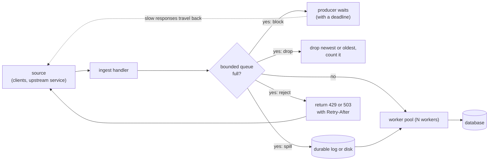
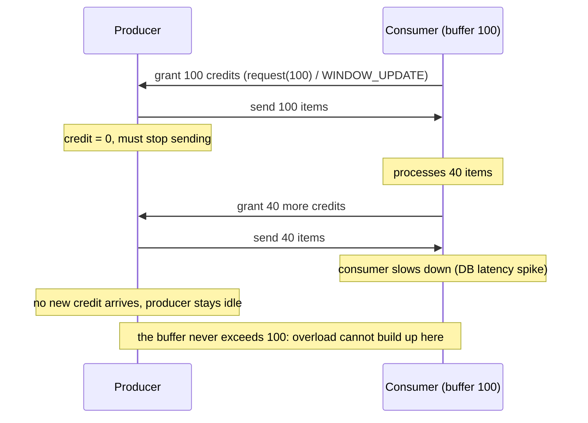

# Backpressure and Flow Control

> [!summary] TL;DR
> **Backpressure** is a slow consumer pushing back on a fast producer so that work does not pile up without limit. **Flow control** is the protocol-level version: the receiver tells the sender how much more it may send. Without it, a queue between a 1,000-per-second producer and a 800-per-second consumer grows by 200 items every second until memory or latency gives out.

> [!abstract] Core idea
> - Every queue must be bounded. An unbounded queue does not remove overload; it turns it into rising latency and then an out-of-memory crash.
> - When the bound is hit, you have four choices: block the producer, drop something, spill to disk, or reject upstream with 429/503.
> - Pull-based and credit-based designs (Kafka polling, TCP windows, HTTP/2 windows, `request(n)`) build backpressure into the protocol.
> - Pressure must travel all the way to the source. A hop that silently absorbs it just moves the pile-up.
> - Choose per data type: metrics may be dropped; payments must block or be queued durably.

## 1. Why it exists

An ingest service accepts 1,000 events per second. Its workers can process 800 per second. The service puts incoming events in an in-memory Go slice-backed queue with no limit.

- After 1 minute the queue holds 12,000 events. After 1 hour, 720,000.
- A new event joins the back of the queue, so it waits for the whole backlog ahead of it to drain: 720,000 events at 800 per second is 900 seconds, about **15 minutes**, before a worker touches it. (Little's Law, `L = λ × W`, describes a queue in steady state; this one is not steady, it grows without limit, so the wait comes from simple drain arithmetic.)
- At 2 KB per event, 720,000 events is about 1.4 GB of heap (an estimate). The pod hits its memory limit, is OOM-killed, and every queued event is lost at once.

The queue did not fix the overload. It hid it for an hour, made every request slow, and then lost the data. A **bounded** queue would have made the problem visible in the first second, and a deliberate policy would have decided who waits and what is dropped.

## 2. Mental model

A motorway on-ramp with a traffic light (ramp metering). When the motorway is full, the light turns red and cars wait on the ramp, a short and bounded queue. If the ramp itself fills, the queue spills back onto the city streets, and drivers there decide to take another route. Nobody is allowed to park cars on the motorway's hard shoulder "for later".

Terms:

- **Producer / consumer:** the side creating work and the side doing it.
- **Bounded buffer:** a queue with a fixed capacity.
- **Load shedding:** refusing or dropping work on purpose to protect the system. See [[Load Shedding and Graceful Degradation]].
- **Credit (window):** a number of items or bytes the receiver has said it can accept. The sender may send up to that much, then must wait for more credit.
- **Consumer lag:** in a log-based broker, how far a consumer group is behind the newest message.

## 3. How it works

### Where the pressure goes when the buffer is full



### The strategies

| Strategy | What happens at the bound | Good for | Danger |
| --- | --- | --- | --- |
| **Block the producer** | The producer waits until there is room | Work that must not be lost: orders, payments | Without a deadline, blocked callers pile up upstream instead (goroutines, threads, connections) |
| **Drop newest** | Reject the item that just arrived | Telemetry where the backlog is still useful | Silent loss unless counted |
| **Drop oldest** | Discard the head to make room for the new item | Data where only the latest matters: location pings, prices | Old items can be lost even though they were accepted |
| **Sample** | Keep 1 in N | High-volume logs and traces | Statistical, not complete |
| **Spill to disk / durable log** | Overflow goes to Kafka, SQS or a local file | Bursty load that averages below capacity | Only delays the problem if the average is too high |
| **Reject upstream** | `429 Too Many Requests` or `503 Service Unavailable` with `Retry-After` | Request/response APIs | Clients must back off properly, or they retry-storm. See [[Timeouts, Retries and Backoff]] |
| **Throttle at the source** | Rate-limit the producer to a known capacity | Known, stable consumer capacity | A fixed rate cannot adapt to a slower consumer. See [[Rate Limiting - Algorithms and Distributed Design]] |

### Credit-based flow control

Instead of reacting when the buffer is already full, the receiver **grants** credit in advance. TCP's receive window, HTTP/2 and gRPC flow-control windows, AMQP prefetch, and Reactive Streams' `request(n)` all work this way.



The consumer's buffer can never overflow, because the producer can never have more items in flight than the credit it was given.

## 4. Worked example

### Whiteboard version

In Go, a buffered channel **is** a bounded queue, and `select` chooses the policy:

```text
q := make(chan Job, 1000)            // the bound

block:   select { case q <- j: ok ; case <-ctx.Done(): give up }
reject:  select { case q <- j: ok ; default: return ErrFull -> HTTP 503 }
drop-oldest: if full { <-q ; dropped++ } ; q <- j

workers: for i in 1..N: go func() { for j := range q { handle(j) } }()
metrics: len(q) as a gauge, dropped and rejected as counters
```

### Full version in Go

A generic bounded queue with three producer policies and a worker pool. It compiles and passes `go vet` and `go test -race` on Go 1.24.

```go
package bp

import (
	"context"
	"errors"
	"sync/atomic"
)

// ErrFull is returned when the queue rejects work. An HTTP handler maps it
// to 503 or 429 with a Retry-After header.
var ErrFull = errors.New("queue full")

// Queue is a bounded buffer between producers and a fixed worker pool.
// Its capacity is the most work we accept before pushing back.
type Queue[T any] struct {
	ch      chan T
	dropped atomic.Int64
}

func NewQueue[T any](capacity int) *Queue[T] {
	return &Queue[T]{ch: make(chan T, capacity)}
}

// Submit blocks the producer until there is room or ctx ends.
// Use it when every item matters (payments, orders).
func (q *Queue[T]) Submit(ctx context.Context, v T) error {
	select {
	case q.ch <- v:
		return nil
	case <-ctx.Done():
		return ctx.Err()
	}
}

// TrySubmit never blocks: it rejects when full so the caller can shed load.
func (q *Queue[T]) TrySubmit(v T) error {
	select {
	case q.ch <- v:
		return nil
	default:
		return ErrFull
	}
}

// SubmitDropOldest makes room by discarding the oldest queued item.
// Use it when only fresh data matters (metrics, location pings).
// With several concurrent producers it may drop more than one item.
func (q *Queue[T]) SubmitDropOldest(v T) {
	for {
		select {
		case q.ch <- v:
			return
		default:
		}
		select {
		case <-q.ch:
			q.dropped.Add(1)
		default:
		}
	}
}

// Dropped reports how many items SubmitDropOldest discarded.
func (q *Queue[T]) Dropped() int64 { return q.dropped.Load() }

// Len is the current depth: export it as a gauge.
func (q *Queue[T]) Len() int { return len(q.ch) }

// Run starts n workers that call handle for each item until ctx ends.
func (q *Queue[T]) Run(ctx context.Context, n int, handle func(T)) {
	for i := 0; i < n; i++ {
		go func() {
			for {
				select {
				case v := <-q.ch:
					handle(v)
				case <-ctx.Done():
					return
				}
			}
		}()
	}
}
```

```go
package bp

import (
	"context"
	"errors"
	"sync"
	"testing"
	"time"
)

func TestTrySubmitShedsWhenFull(t *testing.T) {
	q := NewQueue[int](2)
	if q.TrySubmit(1) != nil || q.TrySubmit(2) != nil {
		t.Fatal("queue should accept up to capacity")
	}
	if err := q.TrySubmit(3); !errors.Is(err, ErrFull) {
		t.Fatalf("got %v, want ErrFull", err)
	}
}

func TestSubmitBlocksUntilDeadline(t *testing.T) {
	q := NewQueue[int](1)
	_ = q.TrySubmit(1)
	ctx, cancel := context.WithTimeout(context.Background(), 20*time.Millisecond)
	defer cancel()
	start := time.Now()
	err := q.Submit(ctx, 2)
	if !errors.Is(err, context.DeadlineExceeded) {
		t.Fatalf("got %v, want deadline exceeded", err)
	}
	if time.Since(start) < 20*time.Millisecond {
		t.Fatal("Submit returned before the deadline: it did not block")
	}
}

func TestDropOldestKeepsNewest(t *testing.T) {
	q := NewQueue[int](3)
	for i := 1; i <= 5; i++ {
		q.SubmitDropOldest(i)
	}
	if q.Dropped() != 2 {
		t.Fatalf("dropped %d, want 2", q.Dropped())
	}
	var got []int
	for q.Len() > 0 {
		got = append(got, <-q.ch)
	}
	if len(got) != 3 || got[0] != 3 || got[2] != 5 {
		t.Fatalf("kept %v, want [3 4 5]", got)
	}
}

func TestWorkersDrainAndUnblockProducers(t *testing.T) {
	q := NewQueue[int](4)
	ctx, cancel := context.WithCancel(context.Background())
	defer cancel()
	var mu sync.Mutex
	sum := 0
	var wg sync.WaitGroup
	wg.Add(100)
	q.Run(ctx, 3, func(v int) {
		mu.Lock()
		sum += v
		mu.Unlock()
		wg.Done()
	})
	for i := 1; i <= 100; i++ {
		if err := q.Submit(ctx, i); err != nil {
			t.Fatal(err)
		}
	}
	wg.Wait()
	if sum != 5050 {
		t.Fatalf("sum = %d, want 5050", sum)
	}
}
```

How an HTTP handler uses it, with shedding at the edge (the logic is the tested `TrySubmit`):

```text
POST /events
    err := q.TrySubmit(evt)
    if errors.Is(err, bp.ErrFull):  respond 503, header Retry-After: 2
    else:                           respond 202 Accepted
```

**Sizing the bound with Little's Law.** Little's Law says `L = λ × W` for a queue in steady state: the average number of items in it equals the throughput times the average time each spends there. Suppose the latency budget for queueing is 2 seconds and workers drain 800 events per second. The queue may hold at most `L = λ × W = 800 × 2 = 1,600` events. A bigger buffer does not add capacity; it only adds waiting time beyond the budget. So the capacity comes from the latency target, not from "how much memory do we have".

Other Go tools for the same job:

- `golang.org/x/sync/semaphore.Weighted`, or a buffered channel used as a semaphore, to cap in-flight calls to a dependency. See [[Bulkheads and Concurrency Limits]].
- `errgroup.Group.SetLimit(n)` to cap concurrent goroutines in a fan-out.
- `golang.org/x/time/rate.Limiter` to throttle a producer to a fixed rate.

## 5. Variants and comparison

| Mechanism | How pressure is signalled | Where you meet it | Notes |
| --- | --- | --- | --- |
| TCP receive window | Receiver advertises free buffer bytes in every ACK; window 0 stops the sender | Every TCP connection | A slow reader in your app fills its socket buffer and the remote writer blocks. See [[TCP - Handshake, Reliability, Flow and Congestion Control]] |
| HTTP/2 flow control | Per-stream and per-connection windows, `WINDOW_UPDATE` frames; initial window 65,535 bytes | gRPC, HTTP/2 APIs | Stops one fast stream from starving others on the connection |
| gRPC streaming | HTTP/2 windows underneath; `Send` blocks when the window is exhausted | [[gRPC]] server and client streams | grpc-go also grows windows dynamically from bandwidth-delay estimates |
| Kafka consumer (pull) | Consumer fetches only when it is ready; `max.poll.records` (default 500) bounds a batch; `pause()` / `resume()` per partition | Kafka | The broker never pushes; lag grows on disk instead of in your memory |
| RabbitMQ prefetch | `basic.qos` limits unacked messages per consumer or channel | RabbitMQ | Without prefetch, the broker pushes as fast as it can into the client |
| RabbitMQ publisher flow control | Memory or disk alarm blocks publishing connections | RabbitMQ | Publishers see blocked connections; monitor for it |
| SQS | Consumer pulls with `ReceiveMessage` (up to 10 per call); in-flight message quota (about 120,000 for a standard queue) | SQS | The queue is durable, so pressure becomes queue age |
| Reactive Streams | Subscriber calls `request(n)`; publisher may send at most `n` | Project Reactor, RxJava, Akka Streams | Pure credit-based flow control in a library |

## 6. Trade-offs and when not to use

- **Blocking spreads upstream.** If an HTTP handler blocks on a full queue with no deadline, each blocked request holds a goroutine, a connection and memory. Always block with `ctx` and a deadline shorter than the client's timeout.
- **Dropping is a product decision.** For metrics, dropping 1% during a spike is fine. For orders, it is data loss. Write down per data type which policy applies.
- **A durable broker is a big buffer, not a cure.** Kafka can hold days of backlog, which absorbs bursts well. If the average arrival rate exceeds the average processing rate, lag grows forever. Add capacity or shed.
- **Autoscaling on lag has limits.** Kafka consumers beyond the partition count sit idle, so lag-based scaling (KEDA) caps at the partition count. Scaling consumers also moves the pressure to the database they write to.
- **Retries amplify overload.** A client that retries a 503 twice, immediately, turns 1,000 requests per second into 3,000. Rejection only works with exponential backoff, jitter and `Retry-After` on the client side.
- **When not to bother:** a batch job reading a file at its own pace already has natural backpressure; adding queues and policies only adds code.

## 7. In production

- **Real systems:**
	- Kafka's pull model: producers write to the log as fast as brokers accept, consumers read at their own pace, and the backlog lives on broker disk as consumer lag.
	- KEDA's Kafka scaler adds consumer pods as lag grows, up to the partition count.
	- Envoy and other proxies return 503 when circuit-breaker limits on pending requests are exceeded, which is backpressure at the network edge.
	- gRPC and HTTP/2 windows stop a slow downstream from being flooded by a streaming upstream.
- **Failure modes → fixes:**
	- A Go channel is always bounded, so teams "fix" a full channel with an unbounded slice-backed queue or a goroutine per request, which only hides the overload → bound everything, including goroutine count.
	- Slow consumer in a fan-out (pub/sub) stalls all subscribers when the publisher blocks → per-subscriber bounded buffers with a drop or disconnect policy for the slow one.
	- Pressure absorbed at one hop (an in-memory queue in front of a durable broker, or a proxy with a huge buffer) → the downstream overload stays invisible to the source; keep buffers small and propagate rejections.
	- Kafka consumer stuck on a slow batch exceeds `max.poll.interval.ms` and is evicted, causing rebalances → smaller `max.poll.records`, or `pause()` partitions while a worker pool drains, and keep polling.
	- Retry storm after a 503 → client backoff with jitter; server sends `Retry-After`.
- **What to monitor:**
	- Queue depth (`Len()`) and, more importantly, **age of the oldest item** (it maps directly to user-visible delay).
	- Rejected and dropped counts per policy.
	- Consumer lag per partition, and time lag (how old the message being processed is).
	- Producer block time (how long `Submit` waits).
	- Worker utilisation: if it is near 100% all the time, you need capacity, not a bigger buffer.

## 8. Deep dive

- **Why queues explode near 100% utilisation.** For a simple single-server queue with random arrivals (M/M/1), average time in the system is `1 / (μ − λ)`. With service rate `μ = 1,000` per second, going from 80% load (λ = 800) to 95% (λ = 950) moves average time from 5 ms to 20 ms, and at 99% it is 100 ms. Latency rises sharply long before the queue is "full", which is why systems shed load at about 80 to 90% of capacity rather than at 100% (this is a model, not a measurement; real systems differ).
- **Bufferbloat.** Large buffers keep throughput high but make every item wait behind the backlog. The same thing happens in network routers and in application queues. Small buffers plus early rejection give lower latency for the work you accept.
- **Adaptive concurrency limits.** Instead of a fixed worker count, adjust the limit by observed latency, like TCP congestion control: increase while latency is flat, cut it when latency rises (AIMD or gradient algorithms, as in Netflix's concurrency-limits library). Rejected requests become the pressure signal. See [[Bulkheads and Concurrency Limits]].
- **End-to-end propagation.** In a chain `client → API → queue → worker → DB`, the DB being slow should eventually reach the client as a 429/503 or as slower responses. Each hop must either pass the signal back (bounded buffer, rejection, flow-control window) or shed explicitly. A hop with an unbounded buffer cuts the signal, and the overload appears later and larger somewhere else.
- **Choosing per data type.**
	- Payments and orders: block with a deadline or write to a durable queue; never drop.
	- User-facing reads: reject fast with 503 so clients can retry elsewhere.
	- Metrics and logs: sample or drop oldest, and count what was dropped.
	- Real-time positions: keep only the latest per entity (conflate).
- **Conflation.** For "latest value wins" data, replace the queued value for a key instead of appending. A queue of 1 million price ticks for 500 symbols becomes at most 500 entries.

## 9. Interview questions

> [!question]- Why is an unbounded queue dangerous if memory is plentiful?
> Because latency, not memory, fails first. A new item waits for the backlog ahead of it to drain, so its wait is queue length divided by drain rate: 720,000 queued items at 800 per second is a 15-minute delay. Callers time out while the work is still queued, and eventually memory runs out and the whole backlog is lost.

> [!question]- Name the options when a bounded queue is full, and when you would pick each.
> Block the producer with a deadline (must-not-lose work), drop newest or oldest (telemetry, latest-value data), spill to a durable log (bursts that average below capacity), reject upstream with 429/503 and `Retry-After` (request/response APIs), or throttle the source (known stable capacity).

> [!question]- How does HTTP/2 or gRPC stop a fast sender from overwhelming a slow receiver?
> Credit-based flow control: each stream and the whole connection have a window of bytes the receiver will accept, starting at 65,535 bytes in HTTP/2. The sender stops when the window hits zero, and the receiver sends `WINDOW_UPDATE` frames as it consumes data. In gRPC, `Send` blocks when the window is exhausted.

> [!question]- Trap: "We put Kafka in front of the service, so we have backpressure solved." Have you?
> Only for bursts. Kafka's pull model protects the consumer's memory, but if the average arrival rate exceeds the processing rate, lag grows without bound and data eventually ages out of retention. You still need more consumer capacity (up to the partition count), or shedding at the source.

> [!question]- How would you implement load shedding in a Go HTTP handler?
> A buffered channel (or semaphore) as the bound, and `select` with a `default` branch: if the send fails, return 503 with `Retry-After` immediately. Export the queue depth and the rejection count as metrics.

> [!question]- What should you monitor to catch backpressure problems early?
> Age of the oldest queued item and consumer time lag, not just depth. Also rejection and drop counters, producer block time, and worker utilisation; constant 100% utilisation means you need capacity, not a bigger buffer.

## 10. Cheat sheet

- Bound every queue; size the bound from the latency budget: `L = λ × W`.
- When full: block (with deadline), drop (newest, oldest, sample), spill to durable log, reject 429/503 + `Retry-After`, or throttle the source.
- Go: buffered channel = bounded queue; `select` + `default` = shed; semaphores cap in-flight work.
- Credit-based flow control: TCP window, HTTP/2 `WINDOW_UPDATE` (65,535-byte initial window), gRPC, `request(n)`, RabbitMQ prefetch.
- Pull-based brokers (Kafka) move backlog to disk as lag; lag still needs capacity or shedding.
- Propagate pressure end to end; an unbounded hop hides it.
- Payments block or queue durably; metrics may drop.

## Links

- **Before this:** [[Goroutines and Channels]], [[select and Concurrency Patterns]], [[Background Jobs and Worker Pools]]
- **Next:** [[Load Shedding and Graceful Degradation]], [[Bulkheads and Concurrency Limits]], [[Kafka and Event Streaming]]
- **Compare with:** [[Rate Limiting - Algorithms and Distributed Design]] (limits set by policy rather than by consumer capacity), [[TCP - Handshake, Reliability, Flow and Congestion Control]] (flow control at the transport layer), [[Autoscaling]] (adding capacity instead of pushing back)
