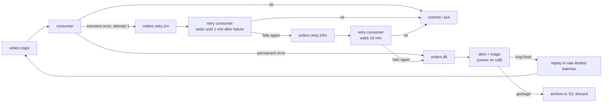
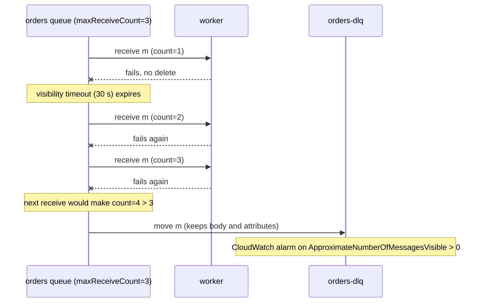

# Dead Letter Queues and Poison Messages

> [!summary] TL;DR
> A **poison message** is one that fails every time a consumer tries it, for example because its JSON is malformed. A **dead-letter queue (DLQ)** is a separate queue where such messages are moved after a set number of failed attempts, so they stop blocking or looping, and a human can inspect, fix and replay them later.

> [!abstract] Core idea
> - Retrying a poison message forever either blocks the queue behind it or burns workers in a loop.
> - Classify every error: transient (timeout, 503) → retry with backoff; permanent (bad schema, validation) → dead-letter at once.
> - SQS and RabbitMQ dead-letter natively; Kafka does not, so you build retry topics plus a dead-letter topic.
> - A DLQ is useless without an owner, an alert on depth and age, and a safe replay path into idempotent consumers.
> - Skipping a message breaks per-key ordering; decide what happens to the later messages for that key.

## 1. Why it exists

An `orders` consumer handles 500 messages per second. A producer bug ships one event with `"currency": "XYZ"`, which the consumer rejects.

- **On SQS without a DLQ:** the message becomes visible again after each 30-second visibility timeout, and it keeps failing until its retention period expires (default 4 days). That is about 11,500 failed attempts (4 × 86,400 / 30, an estimate), each one logging a stack trace and paging nobody.
- **On a Kafka partition:** the consumer cannot commit past the bad offset without skipping it. If the code retries in place, every later message in that partition waits. Consumer lag for that partition grows by its share of the 500 messages per second until someone notices.
- **On RabbitMQ with `nack` and `requeue=true`:** the message goes straight back to the queue and is redelivered at once, in a tight loop that can use a full CPU core.

A DLQ caps the damage: after N attempts the message is moved aside, the queue keeps flowing, and an alert tells the owning team there is something to look at.

## 2. Mental model

A post office sorting room has a shelf labelled "undeliverable". A letter with an unreadable address is tried a couple of times, then put on the shelf instead of being sent round the building forever. The rest of the mail keeps moving. Once a day a clerk goes through the shelf, fixes what can be fixed, and puts those letters back into the normal flow.

Terms:

- **Poison message:** a message that fails deterministically, no matter how often it is retried.
- **Transient error:** a failure caused by the environment that may succeed later (timeout, connection reset, HTTP 503, 429, lock conflict).
- **Permanent error:** a failure caused by the message itself (parse error, schema mismatch, failed validation, reference to a deleted entity).
- **Redrive:** moving messages from one queue to another, either into the DLQ (after max attempts) or back out of it (replay).
- **Receive count:** how many times a broker has handed out a message. SQS exposes it as `ApproximateReceiveCount`.

## 3. How it works

### The decision a consumer makes on every failure



The main consumer never sleeps. A failed message is republished to a retry topic with a "not before" timestamp, and the main partition keeps moving. This is called **non-blocking retry**.

### Broker mechanics

**AWS SQS.** A queue gets a **redrive policy**: `{"deadLetterTargetArn": "...orders-dlq", "maxReceiveCount": 5}`. Each receive increments the message's receive count. When a receive would exceed `maxReceiveCount`, SQS moves the message to the DLQ instead. The DLQ must be the same type as the source (FIFO with FIFO, standard with standard). **DLQ redrive** (console or the `StartMessageMoveTask` API) moves messages back to the source queue or another queue, with an optional rate limit.



A message's retention is measured from when it was **first** sent to the source queue (for standard queues), so a message that sat 3 days in the source and lands in a DLQ with 4-day retention is deleted about one day later. For FIFO queues the timestamp resets when the message moves to the DLQ. Set the DLQ retention longer than the source's, ideally the 14-day maximum.

**RabbitMQ.** A queue is given a **dead-letter exchange** with the `x-dead-letter-exchange` argument (or a policy). A message is dead-lettered when:

- a consumer rejects it with `basic.reject` or `basic.nack` and `requeue=false`;
- its per-message or per-queue TTL expires;
- the queue exceeds its length limit (the default overflow behaviour drops from the head, and dropped messages are dead-lettered);
- on a **quorum queue**, it is redelivered more times than the queue's `delivery-limit` (since RabbitMQ 4.0 the default limit is 20; earlier versions had no limit unless one was set).

The dead-lettered message gets an `x-death` header recording the queue, the reason (`rejected`, `expired`, `maxlen`, `delivery_limit`) and a count. A common retry trick: dead-letter into a "wait" queue that has a TTL and dead-letters back to the work queue, giving a fixed delay.

**Kafka.** There is no native DLQ for consumers. A partition is an ordered log, and the consumer only tracks an offset, so "moving a message aside" is something the application does: publish it to another topic, then commit past it. Conventions:

- Retry topics with fixed delays (`orders.retry.1m`, `orders.retry.10m`) and a dead-letter topic (`orders.dlt`; Spring Kafka uses the `-dlt` suffix).
- Kafka Connect sink connectors have built-in dead-letter support: `errors.tolerance=all` with `errors.deadletterqueue.topic.name`.

## 4. Worked example

### Whiteboard version

The routing decision fits on a whiteboard:

```text
on failure(msg, err):
    msg.attempts += 1
    if err is permanent:            -> dead-letter topic now
    if msg.attempts <= len(tiers):  -> tiers[attempts-1].topic, not before now + delay
    else:                           -> dead-letter topic
dead letter = original payload + headers + error + attempts + timestamps + consumer version
```

### Full version in Go

A router for Kafka-style retry tiers. It compiles and passes `go vet` and `go test -race` on Go 1.24. The handler wraps errors it knows are hopeless in `Permanent`, so they skip the retry tiers.

```go
package dlq

import (
	"errors"
	"fmt"
	"time"
)

// Permanent marks an error that no retry can fix: bad schema, failed
// validation, unknown enum value. Such messages go straight to the DLT.
type Permanent struct{ Err error }

func (p Permanent) Error() string { return "permanent: " + p.Err.Error() }
func (p Permanent) Unwrap() error { return p.Err }

// Message is a consumed record plus the retry metadata carried in headers.
type Message struct {
	Key      string
	Payload  []byte
	Attempts int       // how many times processing has failed so far
	FirstErr time.Time // when the first failure happened
}

// DeadLetter is what we store for triage: enough to debug and replay.
type DeadLetter struct {
	Original        Message
	Error           string
	Attempts        int
	FailedAt        time.Time
	ConsumerVersion string
}

// Tier is one retry topic with its delay, e.g. orders.retry.1m.
type Tier struct {
	Topic string
	Delay time.Duration
}

// Router decides where a failed message goes next.
type Router struct {
	Tiers           []Tier // in order; one attempt per tier
	DeadTopic       string // e.g. orders.dlt
	ConsumerVersion string
	Now             func() time.Time
}

// Decision is the outcome for one failed message.
type Decision struct {
	Topic     string
	NotBefore time.Time   // the retry consumer waits until then
	Dead      *DeadLetter // set when Topic is the dead-letter topic
}

// OnFailure routes msg after handler error err. A nil err is a bug.
func (r Router) OnFailure(msg Message, err error) (Decision, error) {
	if err == nil {
		return Decision{}, fmt.Errorf("OnFailure called without an error")
	}
	now := r.Now()
	msg.Attempts++
	if msg.FirstErr.IsZero() {
		msg.FirstErr = now
	}
	var perm Permanent
	if !errors.As(err, &perm) && msg.Attempts <= len(r.Tiers) {
		t := r.Tiers[msg.Attempts-1]
		return Decision{Topic: t.Topic, NotBefore: now.Add(t.Delay)}, nil
	}
	return Decision{
		Topic: r.DeadTopic,
		Dead: &DeadLetter{
			Original:        msg,
			Error:           err.Error(),
			Attempts:        msg.Attempts,
			FailedAt:        now,
			ConsumerVersion: r.ConsumerVersion,
		},
	}, nil
}
```

```go
package dlq

import (
	"errors"
	"testing"
	"time"
)

func newRouter(now time.Time) Router {
	return Router{
		Tiers: []Tier{
			{Topic: "orders.retry.1m", Delay: time.Minute},
			{Topic: "orders.retry.10m", Delay: 10 * time.Minute},
		},
		DeadTopic:       "orders.dlt",
		ConsumerVersion: "orders-consumer@1.4.2",
		Now:             func() time.Time { return now },
	}
}

func TestTransientErrorsWalkTheTiers(t *testing.T) {
	now := time.Date(2026, 11, 4, 9, 0, 0, 0, time.UTC)
	r := newRouter(now)
	msg := Message{Key: "order-42"}
	timeout := errors.New("inventory service timeout")

	want := []string{"orders.retry.1m", "orders.retry.10m", "orders.dlt"}
	for i, topic := range want {
		d, err := r.OnFailure(msg, timeout)
		if err != nil {
			t.Fatal(err)
		}
		if d.Topic != topic {
			t.Fatalf("failure %d: topic %q, want %q", i+1, d.Topic, topic)
		}
		msg.Attempts++
		if d.Dead != nil && d.Dead.Attempts != 3 {
			t.Fatalf("dead letter attempts = %d, want 3", d.Dead.Attempts)
		}
	}
}

func TestRetryDelay(t *testing.T) {
	now := time.Date(2026, 11, 4, 9, 0, 0, 0, time.UTC)
	d, _ := newRouter(now).OnFailure(Message{Attempts: 1}, errors.New("503"))
	if d.Topic != "orders.retry.10m" || !d.NotBefore.Equal(now.Add(10*time.Minute)) {
		t.Fatalf("got %+v", d)
	}
}

func TestPermanentErrorSkipsRetries(t *testing.T) {
	now := time.Date(2026, 11, 4, 9, 0, 0, 0, time.UTC)
	err := Permanent{Err: errors.New("unknown currency \"XYZ\"")}
	d, _ := newRouter(now).OnFailure(Message{Key: "order-7"}, err)
	if d.Topic != "orders.dlt" || d.Dead == nil {
		t.Fatalf("got %+v, want straight to DLT", d)
	}
	if d.Dead.ConsumerVersion != "orders-consumer@1.4.2" || d.Dead.Attempts != 1 {
		t.Fatalf("dead letter missing metadata: %+v", d.Dead)
	}
}
```

**Trace for `order-42` hitting a downstream timeout three times:**

| Failure at | Attempts after | Destination | Not before |
| --- | --- | --- | --- |
| 09:00:00 | 1 | `orders.retry.1m` | 09:01:00 |
| 09:01:02 | 2 | `orders.retry.10m` | 09:11:02 |
| 09:11:04 | 3 | `orders.dlt` | n/a, dead letter recorded |

An order with currency `"XYZ"` goes straight to `orders.dlt` on the first failure, because no retry can fix it.

### What a dead letter must carry

| Field | Why |
| --- | --- |
| Original payload, byte for byte | Replay must send exactly what the producer sent |
| Original headers, key, topic, partition, offset | To trace it back and keep the key for ordering on replay |
| Error message and stack trace | Triage without reproducing the failure |
| Attempt count, first-failure and last-failure timestamps | Tells "flapped for an hour" from "failed instantly" |
| Consumer name and version (git SHA) | Tells whether a later deploy already fixed it |

## 5. Variants and comparison

| Option | How it works | Use when | Cost |
| --- | --- | --- | --- |
| Retry in place, blocking | Consumer sleeps and retries the same message | Strict per-key ordering matters more than throughput; failures are brief | One bad message stalls its whole partition or queue |
| Broker redelivery + DLQ (SQS, RabbitMQ quorum queue) | Broker counts receives and moves the message after N | You are on SQS or RabbitMQ | Delay between attempts is the visibility timeout or TTL, not real backoff |
| Retry topics + DLT (Kafka) | Republish to delayed topics, then a dead-letter topic | Kafka, high throughput, ordering per key can be relaxed | More topics and consumers; per-key order is broken for retried messages |
| Park the key | On failure, store the message and hold all later messages for that key in a side table until it is resolved | Per-entity order must hold (ledger entries, state machines) | Extra state and logic; one stuck key waits for a human |
| Drop and log | Ack and log the failure | Data that has no value once stale (metrics, presence) | Silent loss |

## 6. Trade-offs and when not to use

- **Every retry reorders.** A message sent to `orders.retry.1m` is processed after later messages for the same order. If the consumer applies state changes ("paid" then "shipped"), a retried "paid" can land after "shipped". Use version checks (see [[Message Ordering and Partition Keys]]) or park the key.
- **Do not retry permanent errors.** Sending a schema error through both retry tiers wastes 11 minutes of delay and puts the same stack trace in the logs three times (one per attempt). Classify first.
- **A DLQ hides failures if nobody watches it.** A DLQ with no alert is a slower way of dropping data. Each DLQ needs an owning team and a runbook.
- **Retention is short.** SQS keeps messages at most 14 days, Kafka topics follow their `retention.ms`. Archive dead letters to object storage (S3) if they may be needed later.
- **When not to use one:** if the handler cannot fail per message (a pure transformation with validated input), or if the data loses value instantly, a DLQ only adds operational load.

## 7. In production

- **Real systems:**
	- SQS redrive policy plus a CloudWatch alarm on the DLQ's `ApproximateNumberOfMessagesVisible` and `ApproximateAgeOfOldestMessage`; replay with DLQ redrive.
	- RabbitMQ quorum queues with a `delivery-limit` and a dead-letter exchange routing to a per-service `*.dlq` queue.
	- Kafka consumers built with Spring Kafka's non-blocking retries, or hand-built retry topics in Go; Kafka Connect sinks with `errors.deadletterqueue.topic.name`.
	- Go job libraries track this per job: River moves a job to the `discarded` state after its max attempts, and asynq moves tasks to an `archived` set. See [[Background Jobs and Worker Pools]].
- **Failure modes → fixes:**
	- **Silent growth:** the DLQ fills for weeks unnoticed → alert when depth > 0 for critical flows, and on oldest-message age.
	- **No replay path:** messages are inspected but never reprocessed → build the redrive tool before the first incident.
	- **No owner:** the platform team owns the broker but not the data → the producing or consuming team owns each DLQ, named in its tags.
	- **Replay storm:** 200,000 messages are redriven at once and overload the dependency that caused the failures → replay in rate-limited batches (for example 50 per second), watching error rates. See [[Backpressure and Flow Control]].
	- **Replay double-applies:** the consumer is not idempotent, or its dedupe rows were pruned → idempotent consumers with dedupe retention longer than the replay window (see [[Delivery Semantics and Exactly-Once]]).
	- **Visibility timeout shorter than processing time** → healthy-but-slow messages hit `maxReceiveCount` and land in the DLQ. Set the timeout above the p99 processing time, or extend it while working.
- **What to monitor:**
	- DLQ depth and age of the oldest message, per queue.
	- Rate of messages entering the DLQ, split by error class.
	- Retry-topic consumer lag.
	- Replay success rate after a redrive.

### Triage runbook

1. Group the dead letters by error message and consumer version.
2. If a later consumer version already fixed the bug, redrive.
3. If the payload is bad, fix the producer, then decide per message: repair and replay, or archive and discard.
4. Replay in small batches, watch error rate and lag, and stop at the first spike.
5. Record what happened, including counts, in the incident notes.

## 8. Deep dive

- **Where the attempt count lives.** SQS and RabbitMQ count on the broker side. With Kafka retry topics you must carry the count in a header when republishing, and the delay too: the retry consumer reads the header, and if "not before" is in the future it **pauses** that partition (`consumer.Pause`) until then rather than sleeping inside the poll loop, because sleeping past `max.poll.interval.ms` gets it evicted from the group.
- **Delays in a log are per topic, not per message.** A retry topic holds messages in arrival order, all with the same delay, so the head is always the next due message. This is why each delay gets its own topic instead of one topic with per-message delays.
- **Ordering-preserving variant.** When order per key matters, keep an in-memory or DB set of "blocked keys". On failure, write the message to a side table and add its key to the set. Later messages with a blocked key go to the side table too. When the head is fixed, drain that key's side-table rows in order. This is how "park the key" works.
- **Poison pills in deserialisation.** A message that cannot be deserialised fails before your handler sees it. In Kafka clients the deserialiser error happens inside `poll`, so you must catch it there (Spring's `ErrorHandlingDeserializer` exists for this reason) and route the raw bytes to the DLT. Schema validation at the producer, with a registry, prevents most of these (see [[Event Schemas and Schema Registry]]).
- **Replay safety checklist.** Idempotent consumer; replay preserves the original key; rate limit; a way to tag replayed messages (header `x-replayed-from: orders.dlt`) so metrics and audits can tell them apart.
- **Choosing the attempt limit.** It should cover the longest transient outage you want to ride out. Tiers of 1 minute and 10 minutes ride out about 11 minutes. If a dependency's typical incident lasts 30 minutes, add a 30-minute tier instead of raising a single tier's count.

## 9. Interview questions

> [!question]- What is a poison message, and what does it do to a queue without a DLQ?
> A message that fails every time, usually because its content is invalid. With in-place retries it blocks everything behind it (Kafka partition, FIFO group). With requeue it loops forever, burning CPU and logs, until retention expires.

> [!question]- Which errors should skip retries and go straight to the DLQ?
> Permanent ones that depend only on the message: parse or schema errors, validation failures, unknown enum values, references to entities that will never exist. Transient errors such as timeouts, 503, 429 and lock conflicts get retries with backoff first.

> [!question]- Trap: "Kafka moves failed messages to a DLQ after max retries." True?
> No. Kafka consumers have no built-in DLQ; the consumer only tracks an offset. The application (or a framework such as Spring Kafka) republishes to retry and dead-letter topics. Kafka Connect sink connectors are the exception with `errors.deadletterqueue.topic.name`.

> [!question]- How does SQS decide to move a message to the DLQ?
> The source queue's redrive policy sets `maxReceiveCount`. Each receive increments the message's receive count; when it exceeds the maximum, SQS moves the message to the configured DLQ, which must be the same queue type.

> [!question]- What breaks when you replay 200,000 dead letters?
> The dependency that caused the failures can be overloaded again, duplicates appear if consumers are not idempotent or dedupe rows were pruned, and per-key order is lost. Replay in rate-limited batches into idempotent consumers, keeping the original keys.

> [!question]- How do retries interact with ordering, and what can you do about it?
> A retried message is processed after later messages for the same key. Either make the consumer order-tolerant with per-entity version checks, or park the key: hold all later messages for that key until the failed one is resolved.

## 10. Cheat sheet

- Poison message = fails deterministically; without a DLQ it blocks or loops.
- Classify: transient → retry with backoff; permanent → DLQ at once.
- SQS: redrive policy `maxReceiveCount`, DLQ redrive back to source, 14-day max retention.
- RabbitMQ: dead-letter exchange on reject/nack without requeue, TTL expiry, length limit, quorum `delivery-limit`.
- Kafka: no native DLQ; retry topics (`orders.retry.1m`) + `orders.dlt`; pause, do not sleep.
- Store payload, headers, error, attempts, timestamps, consumer version.
- Alert on DLQ depth and oldest age; every DLQ has an owner and a runbook.
- Replay slowly into idempotent consumers; retries and replays break per-key order.

## Links

- **Before this:** [[Delivery Semantics and Exactly-Once]], [[Timeouts, Retries and Backoff]]
- **Next:** [[Message Ordering and Partition Keys]], [[Backpressure and Flow Control]], [[Kafka and Event Streaming]]
- **Compare with:** [[AWS SQS, SNS and EventBridge]] (native redrive), [[Background Jobs and Worker Pools]] (job-level discard and archive states), [[Event Schemas and Schema Registry]] (preventing poison messages at the source)
