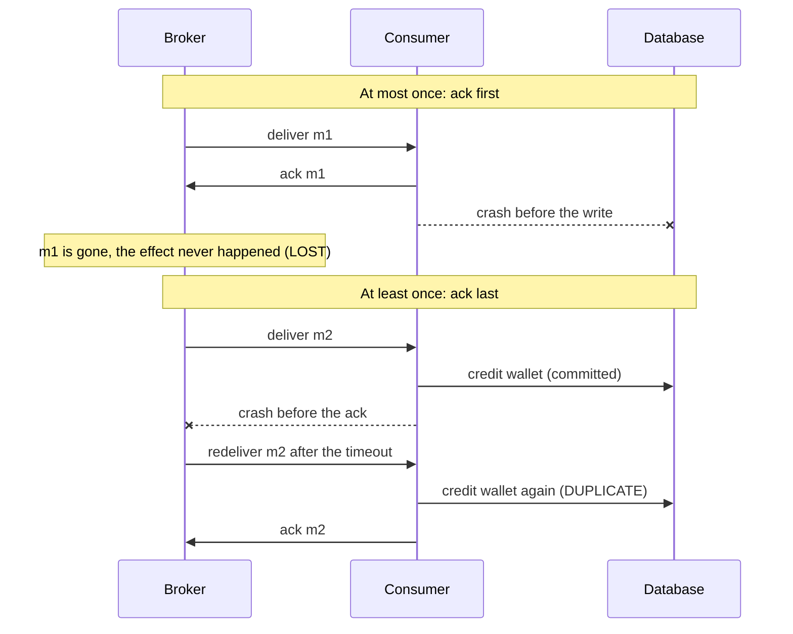
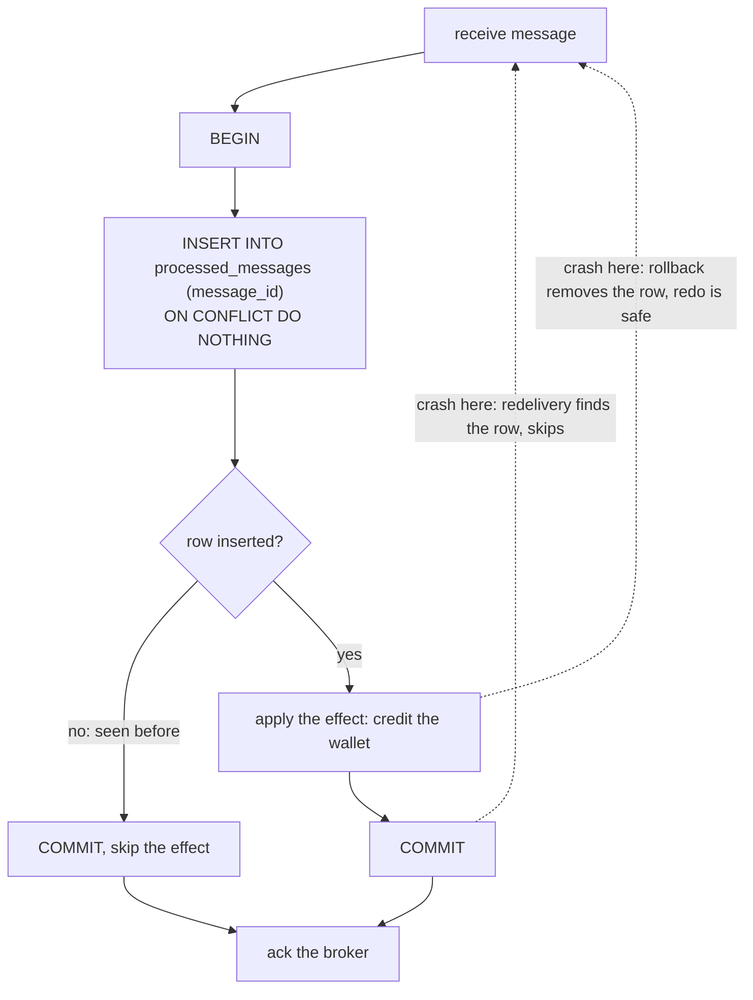

# Delivery Semantics and Exactly-Once

> [!summary] TL;DR
> A **delivery guarantee** says how many times a message's effect can happen when things crash: at most once (maybe lost), at least once (maybe duplicated), or exactly once. Over a real network, exactly-once *delivery* is impossible; what systems actually build is **effectively-once processing**: deliver at least once, and make the effect idempotent so a duplicate changes nothing.

> [!abstract] Core idea
> - The guarantee is decided by **when the consumer acknowledges**: before the work (at most once) or after it (at least once).
> - A sender that hears nothing cannot tell "lost" from "done but the reply was lost", so it must either give up (loss) or resend (duplicates).
> - Effectively-once = at-least-once delivery + a dedupe record written in the **same transaction** as the effect.
> - Kafka's exactly-once covers Kafka-to-Kafka pipelines only. An email or a card charge still needs an idempotency key.
> - In an interview, say exactly which hops are covered and what happens to duplicates at each one.

## 1. Why it exists

A payments consumer reads `PaymentCaptured` events and credits a merchant's wallet. It processes about 2,000 events per second.

- The consumer credits the wallet, then crashes before it acknowledges the message.
- The broker never got the ack, so after the visibility timeout (SQS default: 30 seconds) or after a consumer-group rebalance (Kafka) it delivers the message again.
- The new consumer credits the wallet a second time. The merchant is paid twice.

Flip the order and the bug flips too. If the consumer acks first and then crashes before crediting, the message is gone and the merchant is never paid.

Even a 0.01% duplicate rate is 0.2 duplicates per second at this volume, about 17,000 per day (an estimate from the numbers above). Every messaging design has to answer: **when a crash happens at the worst moment, do we lose the message or repeat it, and how do we make that safe?**

## 2. Mental model

Think of a courier delivering a parcel that needs a signature.

- **At most once:** the courier leaves the parcel at the door and walks away. If it is stolen, it is gone. No duplicates, possible loss.
- **At least once:** the courier waits for a signature, and if nobody signs, comes back tomorrow with another copy. Nothing is lost, but you might end up with two parcels.
- **Effectively once:** the courier keeps coming back, but you keep a list of tracking numbers you have already received, and you refuse any parcel already on the list. You get each parcel's contents exactly once, even though the courier knocked several times.

Key terms, defined at first use:

- **Ack (acknowledgement):** the consumer telling the broker "done, you may forget this message". In SQS it is `DeleteMessage`; in RabbitMQ `basic.ack`; in Kafka, committing the consumer offset.
- **Redelivery:** the broker sending the same message again because no ack arrived in time.
- **Idempotent effect:** an operation that gives the same result whether it runs once or many times (`SET status = 'paid'` is idempotent; `balance = balance + 500` is not).
- **Dedupe store:** a table of message IDs already processed, used to make a non-idempotent effect idempotent.

## 3. How it works

### The three semantics are decided by where the ack goes



**Failure timeline.** Where the crash lands decides the outcome:

| Crash point | Ack before work (at most once) | Ack after work (at least once) | Ack after work + dedupe in the same txn |
| --- | --- | --- | --- |
| Before processing starts | Message lost | Redelivered, processed once | Redelivered, processed once |
| During processing, before commit | Message lost | Redelivered, txn rolled back, processed once | Same as left |
| After commit, before ack | n/a (already acked) | Redelivered, **effect applied twice** | Redelivered, dedupe row found, **skipped** |
| After ack | Done | Done | Done |

Only the last column survives every crash point.

### Why exactly-once *delivery* is impossible

This is the **Two Generals problem**. Two generals must agree on an attack time by sending messengers through enemy territory, where any messenger can be captured. General A sends "attack at dawn". To know it arrived, A needs an acknowledgement. But B cannot know whether the acknowledgement arrived, so B needs an acknowledgement of the acknowledgement, and so on forever. No finite number of messages makes both sides certain.

For a broker it means: when a consumer's ack is lost, the broker cannot tell "the consumer never processed it" from "it processed it and the ack vanished". It must pick one: resend (risking duplicates) or not (risking loss). No protocol removes this choice; you can only make duplicates harmless.

### Effectively-once: the idempotent consumer

The consumer turns the duplicate into a no-op by recording the message ID in the **same database transaction** as the effect.



Because the dedupe row and the effect commit together, there are only two possible states after any crash: both happened, or neither did. The SQL, PostgreSQL 17 dialect:

```sql
CREATE TABLE processed_messages (
    consumer     text        NOT NULL,          -- each consumer group dedupes separately
    message_id   text        NOT NULL,
    processed_at timestamptz NOT NULL DEFAULT now(),
    PRIMARY KEY (consumer, message_id)
);

BEGIN;
WITH fresh AS (
    INSERT INTO processed_messages (consumer, message_id)
    VALUES ('wallet-credit', 'evt-7f3a')
    ON CONFLICT DO NOTHING
    RETURNING message_id                -- no row returned means duplicate
)
UPDATE wallets SET balance = balance + 500
WHERE merchant_id = 42
  AND EXISTS (SELECT 1 FROM fresh);     -- the credit runs only for a fresh ID
COMMIT;                                 -- then ack the broker
```

The ID must come from the **producer** (for example the outbox row ID or the business event ID), not from the broker. A broker-assigned ID changes if the producer itself retries a publish, and then the dedupe store sees two different IDs for one event.

## 4. Worked example

### Whiteboard version

The whole pattern is one function: one transaction holds both the "seen" marker (`MarkProcessed`, which is `INSERT … ON CONFLICT DO NOTHING`) and the effect (`Credit`). This is the `Handle` function from the full listing below.

```go
func Handle(db DB, msg Message) (applied bool, err error) {
	err = db.InTx(func(tx Tx) error {
		fresh, err := tx.MarkProcessed(msg.ID)
		if err != nil {
			return err
		}
		if !fresh {
			return nil // duplicate: skip the effect, still ack
		}
		applied = true
		return tx.Credit(msg.Account, msg.Amount)
	})
	if err != nil {
		applied = false
	}
	return applied, err
}
```

### Full version with an in-memory transactional fake

The `MemDB` below stands in for PostgreSQL: a transaction buffers its writes and applies them all at commit, or none if the function fails or the commit "crashes". It compiles and passes `go vet` and `go test -race` on Go 1.24.

```go
package dedupe

import (
	"errors"
	"sync"
)

// Message is what the broker hands the consumer. ID is set by the producer
// (for example an outbox row ID), so a redelivery carries the same ID.
type Message struct {
	ID      string
	Account string
	Amount  int64
}

// Tx is the slice of a database transaction the consumer needs.
type Tx interface {
	// MarkProcessed inserts the message ID into processed_messages.
	// It returns false if the ID is already there (ON CONFLICT DO NOTHING).
	MarkProcessed(id string) (bool, error)
	Credit(account string, amount int64) error
}

// DB runs fn in one transaction: all writes commit together or none do.
type DB interface {
	InTx(fn func(Tx) error) error
}

// Handle applies msg at most once per ID, even when the broker delivers it
// many times. The caller acks the broker only after Handle returns nil.
func Handle(db DB, msg Message) (applied bool, err error) {
	err = db.InTx(func(tx Tx) error {
		fresh, err := tx.MarkProcessed(msg.ID)
		if err != nil {
			return err
		}
		if !fresh {
			return nil // duplicate: skip the effect, still ack
		}
		applied = true
		return tx.Credit(msg.Account, msg.Amount)
	})
	if err != nil {
		applied = false
	}
	return applied, err
}

// MemDB is an in-memory fake of a transactional database.
type MemDB struct {
	mu        sync.Mutex
	processed map[string]bool
	balance   map[string]int64
	// FailCommit makes the next commit fail, simulating a crash before COMMIT.
	FailCommit bool
}

func NewMemDB() *MemDB {
	return &MemDB{processed: map[string]bool{}, balance: map[string]int64{}}
}

var ErrCrash = errors.New("crash before commit")

type memTx struct {
	db        *MemDB
	processed map[string]bool
	credits   map[string]int64
}

func (t *memTx) MarkProcessed(id string) (bool, error) {
	if t.db.processed[id] || t.processed[id] {
		return false, nil
	}
	t.processed[id] = true
	return true, nil
}

func (t *memTx) Credit(account string, amount int64) error {
	t.credits[account] += amount
	return nil
}

func (d *MemDB) InTx(fn func(Tx) error) error {
	d.mu.Lock() // serialise transactions, like a unique index would
	defer d.mu.Unlock()
	tx := &memTx{db: d, processed: map[string]bool{}, credits: map[string]int64{}}
	if err := fn(tx); err != nil {
		return err // rollback: discard tx writes
	}
	if d.FailCommit {
		d.FailCommit = false
		return ErrCrash
	}
	for id := range tx.processed {
		d.processed[id] = true
	}
	for acc, amt := range tx.credits {
		d.balance[acc] += amt
	}
	return nil
}

func (d *MemDB) Balance(account string) int64 {
	d.mu.Lock()
	defer d.mu.Unlock()
	return d.balance[account]
}
```

The tests replay the three interesting rows of the failure timeline: a lost ack (redelivery after commit), a crash before commit, and 20 concurrent copies of the same message.

```go
package dedupe

import (
	"errors"
	"sync"
	"testing"
)

func TestRedeliveryAppliesOnce(t *testing.T) {
	db := NewMemDB()
	msg := Message{ID: "evt-1", Account: "acc-9", Amount: 500}

	first, err := Handle(db, msg)
	if err != nil || !first {
		t.Fatalf("first delivery: applied=%v err=%v", first, err)
	}
	// The ack was lost, so the broker delivers again.
	second, err := Handle(db, msg)
	if err != nil || second {
		t.Fatalf("redelivery: applied=%v err=%v, want skipped", second, err)
	}
	if got := db.Balance("acc-9"); got != 500 {
		t.Fatalf("balance = %d, want 500", got)
	}
}

func TestCrashBeforeCommitIsRetriedSafely(t *testing.T) {
	db := NewMemDB()
	msg := Message{ID: "evt-2", Account: "acc-9", Amount: 300}

	db.FailCommit = true
	if _, err := Handle(db, msg); !errors.Is(err, ErrCrash) {
		t.Fatalf("want crash, got %v", err)
	}
	// No ack was sent, so the broker redelivers. Nothing was committed,
	// so the dedupe row is absent and the effect runs now.
	applied, err := Handle(db, msg)
	if err != nil || !applied {
		t.Fatalf("retry: applied=%v err=%v", applied, err)
	}
	if got := db.Balance("acc-9"); got != 300 {
		t.Fatalf("balance = %d, want 300", got)
	}
}

func TestConcurrentDuplicates(t *testing.T) {
	db := NewMemDB()
	msg := Message{ID: "evt-3", Account: "acc-1", Amount: 100}
	var wg sync.WaitGroup
	for i := 0; i < 20; i++ {
		wg.Add(1)
		go func() {
			defer wg.Done()
			if _, err := Handle(db, msg); err != nil {
				t.Error(err)
			}
		}()
	}
	wg.Wait()
	if got := db.Balance("acc-1"); got != 100 {
		t.Fatalf("balance = %d, want 100", got)
	}
}
```

**Tracing `TestCrashBeforeCommitIsRetriedSafely`:**

1. Delivery 1: `MarkProcessed("evt-2")` and `Credit(300)` go into the transaction buffer.
2. The commit fails (`ErrCrash`). Both buffered writes are discarded. The consumer does not ack.
3. Delivery 2: `processed_messages` has no `evt-2`, so the effect runs and commits. Balance is 300, not 0 and not 600.

In PostgreSQL the same guarantee comes from the `PRIMARY KEY (consumer, message_id)`: two concurrent transactions inserting the same key serialise on the unique index, and the second one gets "0 rows inserted" after the first commits.

## 5. Variants and comparison

| Approach | How it works | Use when | Cost |
| --- | --- | --- | --- |
| At most once | Ack (or auto-commit offsets) before processing | Losing a few messages is fine: metrics samples, cache invalidation hints | Silent loss on every crash |
| At least once, naturally idempotent effect | Ack after work; the effect is an upsert or a `SET` | The operation is already idempotent (`UPDATE … SET status='shipped'`) | Must check that it is really idempotent under reordering (see [[Message Ordering and Partition Keys]]) |
| At least once + dedupe table (inbox) | Message ID and effect in one DB transaction | Effect lives in the same database as the dedupe table | One extra insert per message; table needs pruning |
| Broker dedupe window | SQS FIFO drops a repeat `MessageDeduplicationId` sent within 5 minutes | Guarding against producer retries on publish | Only covers the publish side, and only for 5 minutes |
| Kafka transactions (EOS) | Idempotent producer + atomic write of outputs and consumer offsets | Kafka → process → Kafka pipelines (Kafka Streams, Flink with Kafka) | Extra latency per transaction; covers Kafka only |
| Transactional sink with stored offsets | Write the results and the source offset in one DB transaction; on restart seek to the stored offset | Kafka → database pipelines | You manage offsets yourself instead of committing them to Kafka |
| Idempotency key at an external API | Send a stable key (`Idempotency-Key`) to the PSP or email provider | Side effects outside your database | Depends on the provider honouring keys, and for how long |

### Kafka exactly-once semantics (EOS), precisely

- **Idempotent producer** (`enable.idempotence=true`, default since Kafka 3.0): the broker gives the producer a **producer ID**, and the producer numbers each batch per partition with a **sequence number**. If a network retry resends a batch, the broker sees the repeated sequence number and drops it. This removes duplicates caused by producer retries, per partition, for the life of that producer session.
- **Transactions** (`transactional.id`, since Kafka 0.11, KIP-98): a producer can write to several partitions **and** commit the consumer's input offsets (`sendOffsetsToTransaction`) atomically. Consumers with `isolation.level=read_committed` see only committed transactions. The stable `transactional.id` lets a restarted producer **fence** its old "zombie" instance (bumped epoch), so the zombie's writes are rejected.
- **Scope:** read from Kafka, process, write to Kafka. The moment your processing calls an HTTP API, sends an email or writes to PostgreSQL, those effects are outside the transaction and can repeat when the transaction aborts and the input is reprocessed.

## 6. Trade-offs and when not to use

- **Dedupe tables grow.** At 2,000 messages per second that is about 173 million rows per day (estimate). Prune rows older than the longest possible redelivery delay (broker retention plus the longest retry and DLQ replay window), or partition the table by day and drop old partitions.
- **The dedupe window must cover every redelivery path.** A replay from a dead-letter queue a week later (see [[Dead Letter Queues and Poison Messages]]) will double-apply if the dedupe rows were already pruned after 24 hours.
- **The effect must live in the same transaction.** If the consumer writes the dedupe row to PostgreSQL and the effect to Redis, a crash between them breaks the guarantee. Either make the second store's write idempotent on its own, or keep both in one database.
- **Kafka transactions cost latency.** Consumers in `read_committed` mode wait until the transaction commits, so end-to-end latency includes the commit interval (Kafka Streams' `commit.interval.ms` defaults to 100 ms under exactly-once). Do not enable them for a pipeline whose sink is not Kafka; they buy nothing there.
- **Skip all of this when the effect is naturally idempotent.** `UPDATE orders SET status='shipped' WHERE id=$1` needs no dedupe table, as long as a stale event cannot overwrite a newer one (use a version check).
- **At most once is a valid choice** for telemetry where a lost sample matters less than the cost of tracking it.

## 7. In production

- **Real systems:**
	- AWS SQS standard queues are at-least-once and can occasionally deliver a message more than once even without a crash. SQS FIFO queues add a 5-minute deduplication interval by `MessageDeduplicationId` or content hash.
	- Kafka Streams (`processing.guarantee=exactly_once_v2`) and Flink use Kafka transactions for Kafka-to-Kafka pipelines. Flink's two-phase-commit sinks pre-commit at each checkpoint and commit when the checkpoint completes.
	- Payment providers such as Stripe accept an idempotency key on create calls, which is how a consumer makes a charge safe to repeat. See [[Idempotency and Idempotency Keys]].
	- The end-to-end chain most teams build: [[Transactional Outbox and CDC]] on the producer (state change and event commit together), at-least-once broker, idempotent consumer on the other side.
- **Failure modes → fixes:**
	- Processing takes longer than the SQS visibility timeout, so the message reappears and a second worker processes it concurrently → extend the timeout with `ChangeMessageVisibility` while working, and rely on the dedupe row's unique key to stop the second one.
	- Kafka consumer exceeds `max.poll.interval.ms` (default 5 minutes), is kicked out of the group, and its partitions are reassigned; the uncommitted batch is processed again → smaller `max.poll.records`, faster handlers, and idempotent effects.
	- Auto-commit of offsets (`enable.auto.commit=true`) commits on a timer, independently of whether processing finished → at-most-once behaviour on crash; commit manually after processing.
	- The producer generates a fresh UUID on each publish retry → duplicates with different IDs that the dedupe table cannot catch. Derive the ID from the business event (outbox row ID).
- **What to monitor:**
	- Duplicate rate: count of "0 rows inserted" on the dedupe table per minute. A spike means rebalances or timeouts.
	- Redelivery count (SQS `ApproximateReceiveCount`, RabbitMQ `redelivered` flag).
	- Kafka consumer rebalance rate and transaction abort rate.
	- Size and oldest row of the dedupe table, to check pruning works.

## 8. Deep dive

- **Exactly-once is a property of a pipeline, not a broker.** Draw each hop (producer → broker, broker → consumer, consumer → side effect) and state the guarantee and the dedupe mechanism for each. A chain is only as strong as its weakest hop.
- **External side effects need a "prepare, then confirm" shape.** For a card charge: insert the intent row and idempotency key, commit, call the PSP with that key, then record the result. If the call times out, the outcome is **unknown**, not failed. Retry with the same key, or reconcile by querying the PSP. An email provider without idempotency keys cannot be made exactly-once; the best you can do is record "sent" right after the call and accept a rare duplicate.
- **Dedupe store design choices:**
	- Same database as the effect: the strongest option, described above.
	- Redis `SET msg:{id} 1 NX EX 86400` as a fast pre-check: cheap, but it is a separate store, so a crash between the Redis write and the DB commit can make a message look processed when it was not. Use it only to reduce load in front of a DB-level check, never as the only check.
	- Natural keys: if the effect is "create order for checkout `c-91`", a `UNIQUE (checkout_id)` on the orders table is the dedupe store.
- **Offsets stored with results.** For Kafka → PostgreSQL, keep a table `consumer_offsets(topic, partition, next_offset)` and update it in the same transaction as the results. On startup, read it and `Seek` each partition there. Kafka's own committed offsets become irrelevant, and the pipeline is exactly-once into PostgreSQL without Kafka transactions.
- **Zombie fencing in general.** A consumer that paused (GC, network partition) may wake up and finish a batch after its partitions moved to another consumer. Kafka transactions fence it through the producer epoch. In your own database, the equivalent is a fencing token or generation number checked on write (see [[Distributed Locks and Fencing Tokens]]).
- **Ordering interacts with dedupe.** A dedupe table stops repeats but not reordering. If `OrderShipped` (v3) is processed before `OrderPaid` (v2), both are "fresh" and both apply. Pair dedupe with a per-entity version check.

## 9. Interview questions

> [!question]- Define at-most-once, at-least-once and exactly-once in one line each.
> At most once: ack before processing, so a crash loses the message but never repeats it. At least once: ack after processing, so a crash repeats it but never loses it. Exactly once: the effect happens once despite crashes, which in practice means at-least-once delivery plus an idempotent or deduplicated effect.

> [!question]- Trap: "We use Kafka with exactly-once enabled, so our consumer that charges cards is safe." Is it?
> No. Kafka EOS makes the Kafka writes and offset commits atomic. The HTTP call to the payment provider is outside that transaction; if the transaction aborts after the call, the input is reprocessed and the card is charged again. The charge needs an idempotency key sent to the provider and an intent row stored before the call.

> [!question]- Why must the dedupe insert and the effect be in the same transaction?
> Otherwise a crash between them leaves one without the other. Dedupe row first then crash: the message is marked processed but the effect never happened (lost). Effect first then crash: the effect happened but no row exists, so the redelivery applies it again.

> [!question]- Why is exactly-once delivery impossible, in two sentences?
> When an ack is lost, the sender cannot distinguish "not processed" from "processed, reply lost" (the Two Generals problem). It must resend and risk a duplicate, or not resend and risk a loss.

> [!question]- What does SQS FIFO's deduplication actually guarantee?
> Within a 5-minute interval, a message sent with a `MessageDeduplicationId` already seen is accepted but not delivered again. It protects against producer publish retries. It does not stop a consumer from processing a message twice when the visibility timeout expires mid-processing.

> [!question]- How long should you keep rows in the dedupe table?
> Longer than the longest time a duplicate can arrive: broker retention, the full retry schedule, and any manual DLQ replay window. If replays can happen 14 days later, 24-hour pruning is a bug.

> [!question]- How do you get exactly-once from Kafka into PostgreSQL without Kafka transactions?
> Store the consumer's next offset per partition in a PostgreSQL table, updated in the same transaction as the results. On restart or rebalance, seek to the stored offsets instead of Kafka's committed ones. Reprocessing is impossible because results and position move together.

## 10. Cheat sheet

- Ack before work → at most once (loss). Ack after work → at least once (duplicates).
- Exactly-once delivery is impossible (Two Generals); build effectively-once processing.
- Effectively-once = at-least-once + dedupe row and effect in **one** transaction.
- Message IDs come from the producer's event, never from a per-attempt UUID.
- Kafka EOS = idempotent producer (PID + sequence) + transactions (`transactional.id`, `read_committed`), Kafka → Kafka only.
- SQS FIFO dedupe = 5 minutes, publish side only.
- External calls (PSP, email) need idempotency keys and an "unknown outcome" path.
- Keep dedupe rows longer than your longest replay window.

## Links

- **Before this:** [[Queues vs Streams and Broker Comparison]], [[Transactions and ACID]], [[Idempotency and Idempotency Keys]]
- **Next:** [[Dead Letter Queues and Poison Messages]], [[Transactional Outbox and CDC]], [[Message Ordering and Partition Keys]]
- **Compare with:** [[Kafka and Event Streaming]] (how EOS is implemented in the broker), [[Timeouts, Retries and Backoff]] (where duplicates come from on the sending side), [[Saga Pattern]] (compensating instead of preventing duplicates)
