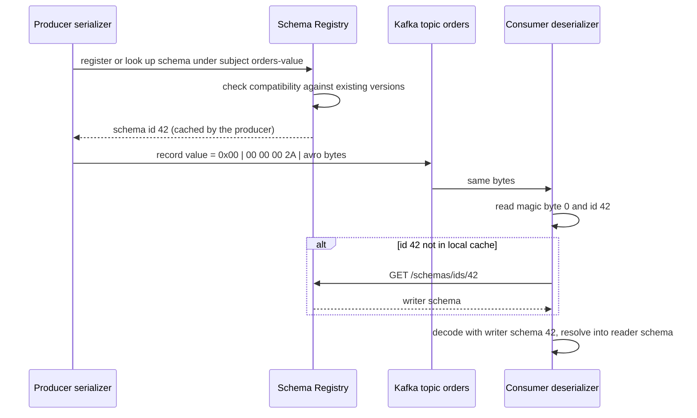
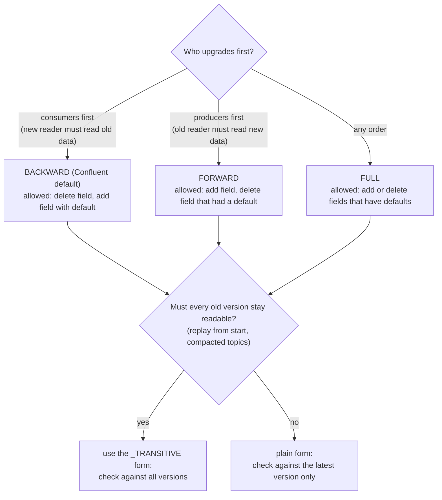

# Event Schemas and Schema Registry

> [!summary] TL;DR
> An **event schema** is the agreed shape of a message: its field names, types and defaults. A **schema registry** is a small service that stores every version of each schema, gives each one an ID, and refuses a new version that would break existing readers. Producers put the schema ID in front of each message so consumers know exactly how to decode it.

> [!abstract] Core idea
> - Producers and consumers deploy at different times, so for a while old and new code read each other's messages. Schemas must evolve without breaking either side.
> - A **compatibility mode** (BACKWARD, FORWARD, FULL, their `_TRANSITIVE` forms, NONE) is the rule the registry enforces on every new version.
> - Safe changes: add a field with a default, remove a field that had one. Unsafe: rename, change a type, add a required field, reuse a Protobuf field number.
> - The registry is **not** in the message path: each message carries a 5-byte header (magic byte + 4-byte ID), and clients cache schemas by ID.
> - Classic mistake: thinking BACKWARD means "producers can upgrade first". It means the *new schema can read old data*, so consumers upgrade first.

## 1. Why it exists

The order service publishes `OrderPlaced` as JSON to Kafka. Twelve services consume it. One Friday a developer renames `amount` to `amount_paise` to make the unit clear, and deploys the producer.

- Every consumer that reads `amount` now gets nothing (or zero) and either crashes or, worse, records ₹0 orders.
- Kafka keeps the new messages for 7 days, so even after a rollback the bad records sit in the log and every replaying consumer hits them again.
- Nobody saw it coming, because the "contract" lived only in twelve codebases.

With a registry, the producer's CI (or its first `serialize` call) asks: "is this new schema compatible with the last one under subject `orders-value`?" A rename is a delete of `amount` plus an add of `amount_paise` with no default. The new schema cannot fill `amount_paise` from old messages, so the change fails the BACKWARD check and never ships.

## 2. Mental model

The registry is a **library catalogue of contract versions**. Each version gets a catalogue number (the schema ID). A message carries only the catalogue number, not the whole contract. A reader who has not seen that number looks it up once and keeps a copy.

The librarian also enforces a house rule before filing a new version: "any reader holding the previous version must still be able to read new books" (or the reverse, or both). That rule is the compatibility mode.

Terms:
- **Writer schema:** the schema the producer used to encode a message.
- **Reader schema:** the schema the consumer's code expects. Avro decodes by resolving writer against reader.
- **Subject:** the name under which versions of one schema are grouped, such as `orders-value`.
- **Serde:** serializer/deserializer, the client library that talks to the registry and encodes messages.

## 3. How it works



The registry is contacted once per new schema, not once per message. If it is down, producers and consumers keep working with their cached IDs; only *new* schemas cannot be registered or looked up.

### Wire format

| Bytes | Content |
| --- | --- |
| 0 | Magic byte, always `0` |
| 1–4 | Schema ID, 4-byte big-endian integer |
| 5… | Avro binary; for Protobuf first a list of message indexes (which message in the `.proto` file), then the Protobuf bytes; for JSON Schema the JSON text |

### Subjects and naming strategies

| Strategy | Subject name | Effect |
| --- | --- | --- |
| `TopicNameStrategy` (default) | `<topic>-key`, `<topic>-value` | One value schema per topic; compatibility checked per topic |
| `RecordNameStrategy` | fully-qualified record name, e.g. `com.shop.OrderPlaced` | Several event types in one topic; one evolution history per type across topics |
| `TopicRecordNameStrategy` | `<topic>-<fully-qualified name>` | Several types per topic, evolved separately in each topic |

Use a multi-type strategy when one topic must carry several event types for one aggregate (`OrderPlaced`, `OrderPaid`, `OrderShipped`) so that their relative order is kept in one partition.

### Compatibility modes



| Mode | Check | Upgrade order | Allowed changes (Avro) |
| --- | --- | --- | --- |
| BACKWARD | new schema reads data from the latest version | consumers, then producers | delete fields; add fields with defaults |
| BACKWARD_TRANSITIVE | new schema reads data from all versions | consumers, then producers | same, against all history |
| FORWARD | latest version reads data from the new schema | producers, then consumers | add fields; delete fields that had defaults |
| FORWARD_TRANSITIVE | all versions read new data | producers, then consumers | same, against all history |
| FULL | both directions with the latest | any order | add or delete fields that have defaults |
| FULL_TRANSITIVE | both directions with all versions | any order | same, against all history |
| NONE | no check | coordinated big-bang | anything (dangerous) |

For a Kafka topic that consumers may replay from the beginning, the plain modes are weaker than they look: a consumer on version 5 may meet version-1 records. `BACKWARD_TRANSITIVE` or `FULL_TRANSITIVE` is the safer choice for long-retention or compacted topics.

### Formats

| Format | Schema in message? | Evolution rules | Strengths | Weaknesses |
| --- | --- | --- | --- | --- |
| Avro | No, only the ID | Resolution by field **name**; defaults fill missing fields; aliases for renames | Compact; designed for writer/reader resolution; common in Kafka and data lakes | Needs the writer schema to decode anything; less familiar outside data teams |
| Protobuf | No; fields identified by **number** | Never change or reuse a field number; `reserved` removed numbers and names; unknown fields are kept | Same schemas as gRPC; generated Go code; `buf breaking` in CI | Every proto3 field has a zero-value default, so "missing" and "zero" look the same unless you use `optional` |
| JSON Schema | No (with the registry) | Depends on whether objects are open (`additionalProperties`) or closed | Human-readable; works with existing JSON events | Larger messages; compatibility rules are subtle for open vs closed content models |

Protobuf evolution in detail lives in [[Protocol Buffers and Schema Evolution]]; this note covers the event-stream side.

## 4. Worked example

### Whiteboard version

```text
subject orders-value, mode BACKWARD
v1 {order_id: string, amount_paise: long}                         -> id 1
v2 v1 + {currency: string, default "INR"}                         -> id 2  OK
    new reader (v2) on old data: currency missing -> default "INR"
v3 v2 + {user_id: string, no default}                             -> REJECTED
    new reader (v3) on v2 data: user_id missing, no default -> cannot decode
fix: v3' = v2 + {user_id: ["null","string"], default null}        -> OK
message on the wire with id 2:
    00 | 00 00 00 02 | <avro bytes>
consumer: id 2 in cache? no -> GET /schemas/ids/2 -> cache -> decode
```

### Go: a registry with compatibility checks and the wire format

The model below uses flat record schemas and Avro's resolution rule: a reader can read a writer's data if every reader field exists in the writer with the same type, or has a default. Real Avro also handles nesting, unions, aliases and type promotions (such as `int` to `long`); this code treats any type change as breaking, which is stricter.

```go
// Package schema models a tiny schema registry: the Confluent wire format and
// Avro-style compatibility checks on flat record schemas.
package schema

import (
	"encoding/binary"
	"errors"
	"fmt"
	"slices"
	"sync"
)

// Field is one field of a flat record schema.
type Field struct {
	Name       string
	Type       string // "string", "long", ...
	HasDefault bool
}

// Schema is a flat record. Real Avro adds nesting, unions and type promotion.
type Schema struct {
	Name   string
	Fields []Field
}

func (s Schema) field(name string) (Field, bool) {
	for _, f := range s.Fields {
		if f.Name == name {
			return f, true
		}
	}
	return Field{}, false
}

// CanRead reports whether a consumer using reader can decode data written
// with writer, following Avro schema resolution: every reader field must
// exist in the writer with the same type, or have a default. Writer fields
// the reader does not know are skipped.
func CanRead(reader, writer Schema) error {
	for _, rf := range reader.Fields {
		wf, ok := writer.field(rf.Name)
		switch {
		case !ok && !rf.HasDefault:
			return fmt.Errorf("reader field %q missing in writer and has no default", rf.Name)
		case ok && wf.Type != rf.Type:
			return fmt.Errorf("field %q changed type %s -> %s", rf.Name, wf.Type, rf.Type)
		}
	}
	return nil
}

// Mode is a compatibility level.
type Mode string

const (
	Backward           Mode = "BACKWARD" // new schema reads data written with the previous one
	BackwardTransitive Mode = "BACKWARD_TRANSITIVE"
	Forward            Mode = "FORWARD" // previous schema reads data written with the new one
	ForwardTransitive  Mode = "FORWARD_TRANSITIVE"
	Full               Mode = "FULL"
	FullTransitive     Mode = "FULL_TRANSITIVE"
	None               Mode = "NONE"
)

// Check tests candidate against the existing versions (oldest first).
func Check(mode Mode, versions []Schema, candidate Schema) error {
	if mode == None || len(versions) == 0 {
		return nil
	}
	against := versions[len(versions)-1:]
	if mode == BackwardTransitive || mode == ForwardTransitive || mode == FullTransitive {
		against = versions
	}
	back := mode == Backward || mode == BackwardTransitive || mode == Full || mode == FullTransitive
	fwd := mode == Forward || mode == ForwardTransitive || mode == Full || mode == FullTransitive
	for _, old := range against {
		if back {
			if err := CanRead(candidate, old); err != nil {
				return fmt.Errorf("not backward compatible: %w", err)
			}
		}
		if fwd {
			if err := CanRead(old, candidate); err != nil {
				return fmt.Errorf("not forward compatible: %w", err)
			}
		}
	}
	return nil
}

// Registry maps subjects to versioned schemas and global ids.
type Registry struct {
	mu       sync.Mutex
	mode     Mode
	subjects map[string][]int // subject -> schema ids, oldest first
	byID     map[int]Schema
	nextID   int
}

func NewRegistry(mode Mode) *Registry {
	return &Registry{mode: mode, subjects: map[string][]int{}, byID: map[int]Schema{}}
}

// Register returns the id for schema s under subject, adding a new version
// only if it passes the compatibility check. Registering the same schema
// again returns the existing id.
func (r *Registry) Register(subject string, s Schema) (int, error) {
	r.mu.Lock()
	defer r.mu.Unlock()
	var versions []Schema
	for _, id := range r.subjects[subject] {
		old := r.byID[id]
		if old.Name == s.Name && slices.Equal(old.Fields, s.Fields) {
			return id, nil
		}
		versions = append(versions, old)
	}
	if err := Check(r.mode, versions, s); err != nil {
		return 0, err
	}
	r.nextID++
	r.byID[r.nextID] = s
	r.subjects[subject] = append(r.subjects[subject], r.nextID)
	return r.nextID, nil
}

// Lookup returns the schema for a global id (what a consumer does on a cache miss).
func (r *Registry) Lookup(id int) (Schema, bool) {
	r.mu.Lock()
	defer r.mu.Unlock()
	s, ok := r.byID[id]
	return s, ok
}

const magicByte = 0

var ErrBadMagic = errors.New("not in schema-registry wire format")

// Encode prefixes payload with magic byte 0 and the 4-byte big-endian schema id.
func Encode(id int, payload []byte) []byte {
	out := make([]byte, 5, 5+len(payload))
	out[0] = magicByte
	binary.BigEndian.PutUint32(out[1:5], uint32(id))
	return append(out, payload...)
}

// Decode splits a wire-format message into schema id and payload.
func Decode(msg []byte) (int, []byte, error) {
	if len(msg) < 5 || msg[0] != magicByte {
		return 0, nil, ErrBadMagic
	}
	return int(binary.BigEndian.Uint32(msg[1:5])), msg[5:], nil
}
```

```go
package schema

import (
	"bytes"
	"errors"
	"testing"
)

var v1 = Schema{Name: "OrderPlaced", Fields: []Field{
	{Name: "order_id", Type: "string"},
	{Name: "amount_paise", Type: "long"},
}}

// v2 adds an optional field with a default: safe in every mode.
var v2 = Schema{Name: "OrderPlaced", Fields: []Field{
	{Name: "order_id", Type: "string"},
	{Name: "amount_paise", Type: "long"},
	{Name: "currency", Type: "string", HasDefault: true},
}}

// v3bad adds a required field: old data has no value for it.
var v3bad = Schema{Name: "OrderPlaced", Fields: []Field{
	{Name: "order_id", Type: "string"},
	{Name: "amount_paise", Type: "long"},
	{Name: "currency", Type: "string", HasDefault: true},
	{Name: "user_id", Type: "string"},
}}

func TestCompatibilityModes(t *testing.T) {
	// Deleting a field that has no default.
	dropAmount := Schema{Name: "OrderPlaced", Fields: []Field{{Name: "order_id", Type: "string"}}}
	cases := []struct {
		name string
		mode Mode
		cand Schema
		ok   bool
	}{
		{"add optional, backward", Backward, v2, true},
		{"add optional, full", Full, v2, true},
		{"add required, backward", Backward, v3bad, false},
		{"add required, forward", Forward, v3bad, true},
		{"delete field, backward", Backward, dropAmount, true},
		{"delete field without default, forward", Forward, dropAmount, false},
		{"anything, none", None, v3bad, true},
	}
	for _, c := range cases {
		err := Check(c.mode, []Schema{v1}, c.cand)
		if (err == nil) != c.ok {
			t.Errorf("%s: err = %v", c.name, err)
		}
	}
}

func TestTransitiveCatchesOlderVersions(t *testing.T) {
	// a -> b -> c where c brings back "note" as a long.
	a := Schema{Name: "E", Fields: []Field{{Name: "id", Type: "string"}, {Name: "note", Type: "string", HasDefault: true}}}
	b := Schema{Name: "E", Fields: []Field{{Name: "id", Type: "string"}}}
	c := Schema{Name: "E", Fields: []Field{{Name: "id", Type: "string"}, {Name: "note", Type: "long", HasDefault: true}}}
	if err := Check(Backward, []Schema{a, b}, c); err != nil {
		t.Fatalf("BACKWARD only checks b, should pass: %v", err)
	}
	if err := Check(BackwardTransitive, []Schema{a, b}, c); err == nil {
		t.Fatal("BACKWARD_TRANSITIVE must reject: c cannot read a's string note")
	}
}

func TestRegistryIDs(t *testing.T) {
	r := NewRegistry(Backward)
	id1, err := r.Register("orders-value", v1)
	if err != nil {
		t.Fatal(err)
	}
	again, _ := r.Register("orders-value", v1)
	if again != id1 {
		t.Fatalf("same schema got new id %d", again)
	}
	id2, err := r.Register("orders-value", v2)
	if err != nil || id2 == id1 {
		t.Fatalf("v2: id=%d err=%v", id2, err)
	}
	if _, err := r.Register("orders-value", v3bad); err == nil {
		t.Fatal("v3bad must be rejected under BACKWARD")
	}
	if s, ok := r.Lookup(id2); !ok || len(s.Fields) != 3 {
		t.Fatalf("lookup %d: %v %v", id2, s, ok)
	}
}

func TestWireFormat(t *testing.T) {
	msg := Encode(258, []byte("avro-bytes"))
	if !bytes.Equal(msg[:5], []byte{0, 0, 0, 1, 2}) {
		t.Fatalf("header % x", msg[:5])
	}
	id, payload, err := Decode(msg)
	if err != nil || id != 258 || string(payload) != "avro-bytes" {
		t.Fatalf("decode: %d %q %v", id, payload, err)
	}
	if _, _, err := Decode([]byte(`{"json":1}`)); !errors.Is(err, ErrBadMagic) {
		t.Fatalf("plain JSON must fail, got %v", err)
	}
}
```

`go vet` is clean and `go test -race` passes (Go 1.24). Note what `TestTransitiveCatchesOlderVersions` shows: version `c` passes the plain BACKWARD check (it only looks at `b`, which has no `note` field) but fails the transitive check, because a consumer on `c` replaying from the start would meet version `a`'s string `note` where it expects a long.

### The same checks against a real registry

The registry's REST API exposes the check directly, which is how CI should call it (representative output, Confluent Schema Registry 7.x; no registry was run for this note):

```bash
curl -s -X POST -H "Content-Type: application/vnd.schemaregistry.v1+json" \
  --data '{"schema": "{\"type\":\"record\",\"name\":\"OrderPlaced\",\"fields\":[{\"name\":\"order_id\",\"type\":\"string\"},{\"name\":\"amount_paise\",\"type\":\"long\"},{\"name\":\"user_id\",\"type\":\"string\"}]}"}' \
  "http://localhost:8081/compatibility/subjects/orders-value/versions/latest?verbose=true"
```

```json
{
  "is_compatible": false,
  "messages": [
    "{errorType:'READER_FIELD_MISSING_DEFAULT_VALUE', description:'The field 'user_id' at path '/fields/2' in the new schema has no default value and is missing in the old schema', additionalInfo:'user_id'}",
    "{oldSchemaVersion: 2}",
    "{compatibility: 'BACKWARD'}"
  ]
}
```

For Protobuf contracts kept in Git, `buf breaking --against '.git#branch=main'` does the same job before the schema reaches the registry.

## 5. Variants and comparison

| Option | How it works | Use when | Cost |
| --- | --- | --- | --- |
| Confluent Schema Registry | REST service storing schemas in a compacted Kafka topic (`_schemas`); Avro, Protobuf, JSON Schema | Kafka-centric stacks, Confluent clients | Another service to run (or pay for); community licence terms |
| Apicurio Registry | Open-source registry (Red Hat); Confluent-compatible API plus its own; many artifact types (also OpenAPI, AsyncAPI) | Want an Apache-licensed registry or to store API specs too | Smaller ecosystem of serdes |
| AWS Glue Schema Registry | Managed registry with its own serdes for MSK, Kinesis, Lambda | AWS-native streaming | Different wire format from Confluent's; AWS lock-in |
| Schemas in Git only | `.proto` / `.avsc` in a shared repo, checked with `buf breaking` in CI | Small teams, gRPC-first shops | No runtime lookup; consumers need the code release to read new types |
| No schema (free JSON) | Producers emit whatever JSON they like | Prototypes | Breaks are found in production |

## 6. Trade-offs and when not to use

- **Coupling to a central service and its clients.** Every producer and consumer needs a serde that speaks the registry protocol; non-JVM language support varies.
- **Binary messages are opaque.** You cannot `kafkacat` a topic and read it without the registry. Tooling must be registry-aware.
- **Compatibility rules cannot catch semantic breaks.** Changing `amount` from rupees to paise keeps the type `long` and passes every check. Field names with units, and documentation, are still needed.
- **Defaults are a contract too.** Adding `currency` with default `"INR"` silently assigns INR to old events. Pick defaults that are true for old data, or use a nullable field.
- **When not to use it:** two services owned by one team with a handful of event types and short retention may be fine with versioned JSON and contract tests ([[API Contract Design and OpenAPI]] for the HTTP equivalent).

## 7. In production

- **Real systems:** Confluent Schema Registry is the default in Kafka-centric stacks; Apicurio is common with Red Hat and Strimzi; AWS Glue Schema Registry with Amazon MSK and Kinesis.
- **Data contracts and ownership:** the producing team owns the schema (it lives in their repo). A schema change is a code review that consumers can see. Some registries attach rules to schemas (for example, field-level validation or tags marking PII) so that the contract covers meaning as well as shape.
- **Failure modes → fixes:**
	- *Auto-registration in production* (`auto.register.schemas=true` by default in Confluent serializers): any producer build can register a new version. Fix: register from CI, set `auto.register.schemas=false` and `use.latest.version=true` in production.
	- *Compatibility set to NONE "temporarily"* and never reset. Fix: manage subject configs as code; alert on NONE.
	- *Registry outage at startup:* consumers that have never seen an ID cannot decode. Fix: run the registry highly available; it is read-mostly and easy to replicate.
	- *Poison message with an unknown ID or wrong magic byte* (a producer that skipped the serializer): send it to a dead letter topic instead of crash-looping ([[Dead Letter Queues and Poison Messages]]).
- **What to monitor:** registration rejections in CI, number of versions per subject, subjects in NONE mode, deserialisation error rate per consumer, registry request latency and cache-miss rate.

## 8. Deep dive

- **When a break is unavoidable.** Options, from least to most disruptive:
	1. Add the new field alongside the old, dual-write both for a deprecation period, then remove the old one (expand and contract, the same idea as [[Zero-Downtime Schema Migrations]]).
	2. Publish a new event type (`OrderPlacedV2`) under its own subject, in the same topic with a record-name strategy.
	3. Create a new topic (`orders.v2`), run producers on both until every consumer has moved, then retire the old one.
	4. For event-sourced stores where old events live forever, write **upcasters**: functions that convert old event versions into the current shape when they are read ([[Event Sourcing]]).
- **Why Avro resolution needs the writer schema.** Avro binary has no field tags or names; it is the values in schema order. Without the exact writer schema the bytes cannot be parsed, which is why the ID is mandatory and why the registry must keep every version forever (soft-deleted versions still resolve by ID).
- **Protobuf traps.**
	- Changing a field's type between compatible wire types (for example `int32` to `int64`) is allowed by the wire format, but values can be truncated when old readers parse new data.
	- Renaming a field is safe on the wire (numbers matter, not names) but breaks JSON encodings of the message and generated code.
	- Moving a field into or out of a `oneof` is unsafe.
- **Key schemas.** The record key decides the partition. Changing the key's schema, or even its serialised bytes, changes the partition and breaks per-key ordering. Treat key schemas as frozen.
- **Global vs per-subject IDs.** Confluent IDs are global across subjects: the same schema text registered in two subjects gets the same ID. Versions are per subject. The Go model above draws IDs from one global counter, but unlike Confluent it gives identical schema text in a second subject a new ID.
- **CloudEvents.** A CNCF spec for event metadata (id, source, type, time, datacontenttype, dataschema). It standardises the envelope, not the payload schema, and pairs well with a registry.

## 9. Interview questions

> [!question]- What does BACKWARD compatibility mean, and who deploys first? (trap)
> The new schema can read data written with the previous one. So consumers upgrade to the new schema first (they can still read old messages), then producers start writing it. Many people get the order backwards. FORWARD is the opposite: producers first.

> [!question]- Is the schema registry a single point of failure for every message?
> No. The message carries only a 4-byte ID after the magic byte, and clients cache schemas by ID. The registry is called for new schemas only. An outage blocks registering or first-time lookups, not the steady-state data path.

> [!question]- Which changes are safe for an Avro event under FULL compatibility?
> Adding a field with a default and removing a field that had a default. Renames (without aliases), type changes and adding a required field are not safe. Prefer nullable fields with `null` defaults for new optional data.

> [!question]- When would you use BACKWARD_TRANSITIVE instead of BACKWARD?
> When consumers may read data written with any old version: long retention, compacted topics, replays from the beginning, event-sourced stores. Plain BACKWARD only checks against the latest version, so a chain of individually valid changes can still break reading of version 1.

> [!question]- Avro vs Protobuf for Kafka events?
> Avro: compact, designed for writer/reader resolution, popular in data platforms, field identity by name. Protobuf: field identity by number, the same schemas as your gRPC APIs, good Go code generation and `buf breaking`. Pick the one your organisation already has tooling for.

> [!question]- How do you rename a field in a live event?
> Not in one step. Add the new field (with a default), have producers write both, move consumers to the new field, then remove the old field once no consumer reads it and old data has aged out of retention. In Avro an alias can map the old name for readers.

> [!question]- How do you stop a breaking schema from reaching production?
> Check compatibility in CI against the registry (or `buf breaking` for Protobuf), disable auto-registration in production serializers, and keep subject compatibility levels in version-controlled config.

## 10. Cheat sheet

- Wire format: `0x00` + 4-byte big-endian schema ID + payload; clients cache by ID.
- Subject per topic by default (`orders-value`); record-name strategies for several types per topic.
- BACKWARD (default): new reads old, consumers first. FORWARD: old reads new, producers first. FULL: both.
- `_TRANSITIVE` checks all versions; use it for replay and long retention.
- Safe: add or remove fields that have defaults. Unsafe: rename, type change, new required field, reused Protobuf number.
- Registry is off the data path; disable auto-registration in production; check in CI.
- Semantic changes (units, meaning) pass every check: name fields with units.

## Links

- **Before this:** [[Kafka and Event Streaming]], [[Protocol Buffers and Schema Evolution]], [[Event-Driven Architecture Basics]]
- **Next:** [[Stream Processing Basics]], [[Transactional Outbox and CDC]] (where event payloads are written)
- **Compare with:** [[API Versioning and Backward Compatibility]] (the same problem for HTTP APIs), [[Zero-Downtime Schema Migrations]] (expand and contract for tables), [[Event Sourcing]] (upcasters)
