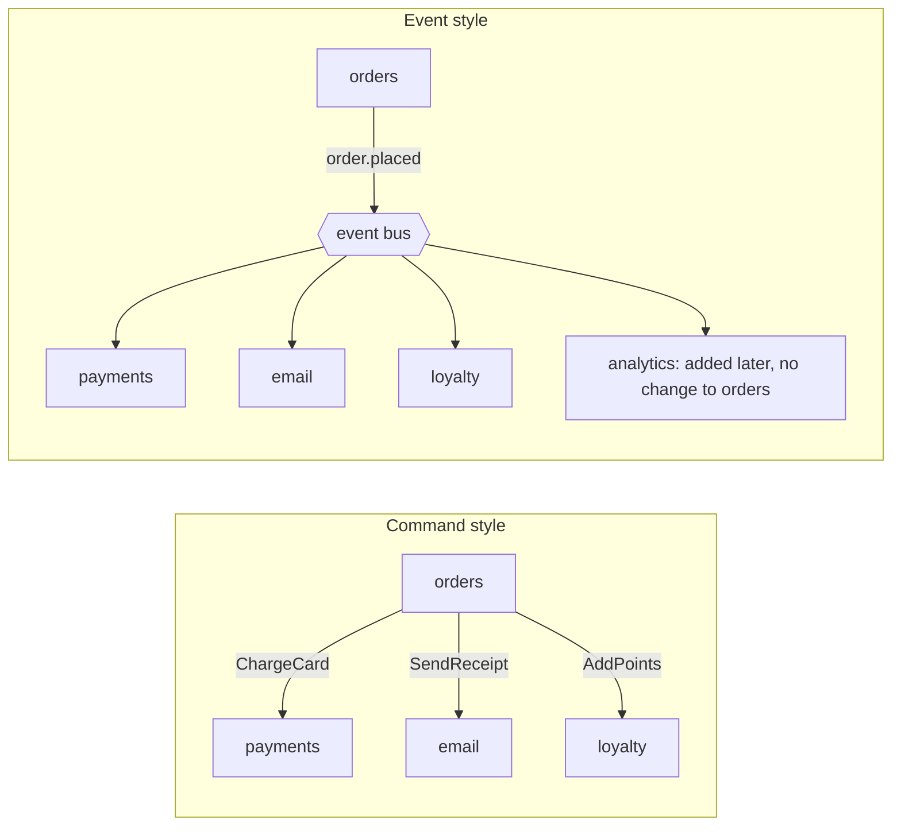
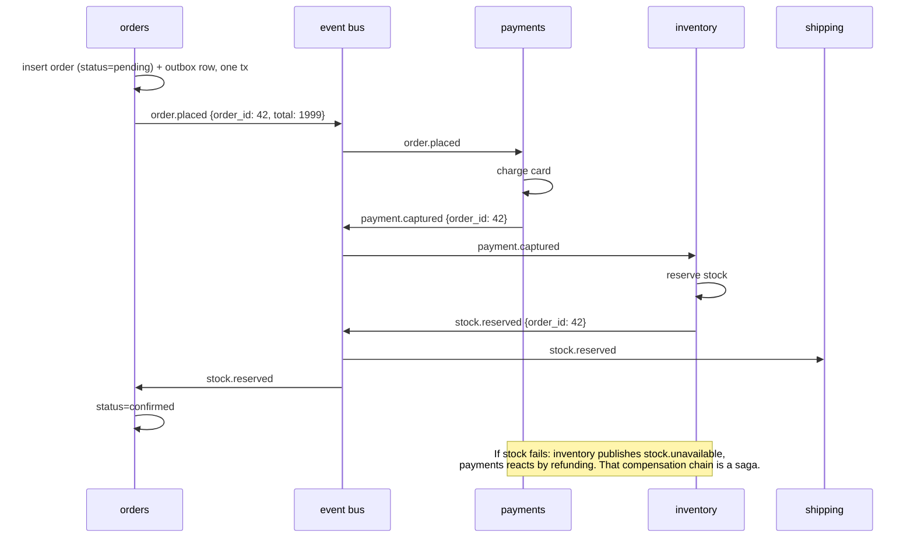
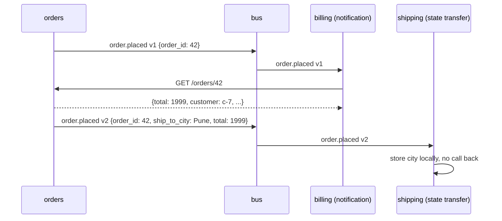

# Event-Driven Architecture Basics

> [!summary] TL;DR
> In an **event-driven architecture**, a service announces facts that already happened ("order placed") as **events**, and other services react to them on their own. The sender does not know or wait for the receivers, which makes the system easier to extend but harder to follow and debug.

> [!abstract] Core idea
> - An **event** is a fact in the past tense that anyone may react to; a **command** is a request to one specific receiver to do something.
> - **Event notification** carries just an id ("order 42 placed"); **event-carried state transfer** carries the data consumers need.
> - **Choreography**: services react to each other's events with no central controller. Easy to add consumers, hard to see the whole flow.
> - Events arrive late, twice or out of order. Consumers must cope, and publishers must publish reliably (outbox).
> - Classic mistake: an "event" that is really a command in disguise (`SendWelcomeEmail`), which couples the publisher to one consumer.

## 1. Why it exists

An orders service in a monolith-turned-microservices system calls, on every checkout: payments, inventory, email, loyalty, analytics and fraud. That is 6 synchronous calls. If each is 99.9% available, the chain is about 0.999^6 ≈ 99.4% available, so roughly 6 in 1,000 checkouts hit some failure (an estimate that assumes independent failures). Each new team that wants to "know about orders" needs a code change and a deploy of the orders service.

With events, the orders service commits the order and publishes `order.placed`. Payments, email, loyalty, analytics and fraud subscribe. The orders service no longer changes when the 7th consumer arrives, and an email outage does not fail checkouts. The cost: the business process "place order" now lives in six codebases, and its state is **eventually consistent** (the loyalty balance is updated a few hundred milliseconds or minutes later, not inside the checkout transaction).

## 2. Mental model

A town notice board. The bakery pins "Fresh bread at 7 am". It does not phone each customer, and it does not know who reads the board. Anyone interested acts on the notice. Compare a phone call to the baker saying "bake 20 loaves for me": that is a command, addressed to one party, who can say no.

Three words to keep straight:

- **Event:** "OrderPlaced". Past tense, immutable, owned by the publisher. Zero or many consumers. The publisher does not expect a reply.
- **Command:** "ChargeCard". Imperative, addressed to one receiver who owns the decision, may be rejected. Often sent through a queue, which is fine, but it is still a command.
- **Query:** "GetOrder". Asks for data; no side effects.

## 3. How it works

### Commands vs events



In the command style the orders service knows every receiver; the dependency arrows point out of it. In the event style the arrows point into the bus, and the dependency is reversed: consumers depend on the event's contract, not the publisher's code.

### Choreography: a checkout as a chain of reactions



Steps:

1. The publisher changes its own state and records the event **in the same database transaction** (an outbox row). A relay publishes it. Publishing directly after commit is a **dual write**: if the process dies between commit and publish, the event is lost forever. See [[Transactional Outbox and CDC]].
2. The broker delivers the event to each subscriber (each has its own queue or consumer group).
3. Each subscriber does its local work in its own transaction and may publish new events.
4. No service holds the whole flow. When a later step fails, earlier steps are undone by compensating events. The full pattern, including when to switch to a central **orchestrator**, is in [[Saga Pattern]].

### Two event styles



- **Event notification** (thin event): small and safe to change, but every consumer calls back, so the publisher still takes load and must be up. If the order changed between the event and the call, the consumer sees the newer state, which may or may not be what it wants.
- **Event-carried state transfer** (fat event): consumers keep their own copy and never call back, so they keep working when the publisher is down. Cost: bigger events, a wider contract that is harder to change, and data duplicated across services.

A third style, **event sourcing**, uses events as the publisher's own source of truth. It is a storage pattern, not a messaging style, and is covered in [[Event Sourcing]].

## 4. Worked example

### Whiteboard version

```text
envelope = {id, source, type, version, time, data}     <- CloudEvents-like
bus.subscribe("order.placed", "billing",  h1)
bus.subscribe("order.placed", "shipping", h2)

orders:   tx { insert order; insert outbox(order.placed) }   relay -> bus.publish
billing:  on order.placed(id)      -> GET /orders/id -> charge      (notification)
shipping: on order.placed(full)    -> save city locally            (state transfer)

publish(e):
  for each subscriber of e.type:
     err = handler(e)          one failure does not stop the others
     if err: retry only that subscriber, later
```

### Code: an in-process bus with both event styles

The bus below is the in-memory version of what a broker does for a topic: deliver to every subscriber of a type, independently. The envelope follows the CloudEvents core attribute names (`id`, `source`, `type`, `time`) plus a version number.

```go
// Package eda shows an in-process event bus with a versioned envelope,
// and the two event styles: notification and event-carried state transfer.
package eda

import (
	"context"
	"encoding/json"
	"errors"
	"fmt"
	"sync"
	"time"
)

// Event is the envelope every event travels in. The field names follow
// the CloudEvents core attributes (id, source, type, time) plus a version.
type Event struct {
	ID      string          `json:"id"`
	Source  string          `json:"source"`
	Type    string          `json:"type"` // past tense: "order.placed"
	Version int             `json:"version"`
	Time    time.Time       `json:"time"`
	Data    json.RawMessage `json:"data"`
}

type Handler func(ctx context.Context, e Event) error

// Bus delivers each published event to every subscriber of its type.
// The publisher does not know who (if anyone) is listening.
type Bus struct {
	mu   sync.RWMutex
	subs map[string]map[string]Handler // type -> subscriber name -> handler
}

func NewBus() *Bus { return &Bus{subs: map[string]map[string]Handler{}} }

func (b *Bus) Subscribe(eventType, subscriber string, h Handler) {
	b.mu.Lock()
	defer b.mu.Unlock()
	if b.subs[eventType] == nil {
		b.subs[eventType] = map[string]Handler{}
	}
	b.subs[eventType][subscriber] = h
}

// Publish calls every handler. One failing subscriber does not stop the
// others; their errors are joined and named, so a real broker could retry
// only the failed subscriber.
func (b *Bus) Publish(ctx context.Context, e Event) error {
	b.mu.RLock()
	hs := make(map[string]Handler, len(b.subs[e.Type]))
	for name, h := range b.subs[e.Type] {
		hs[name] = h
	}
	b.mu.RUnlock()

	var errs []error
	for name, h := range hs {
		if err := h(ctx, e); err != nil {
			errs = append(errs, fmt.Errorf("subscriber %s: %w", name, err))
		}
	}
	return errors.Join(errs...)
}

// OrderPlacedThin is a notification event: it says what happened and
// carries only the id. Consumers call back for details.
type OrderPlacedThin struct {
	OrderID string `json:"order_id"`
}

// OrderPlacedFat is event-carried state transfer: it carries the state
// consumers need, so they never call the order service.
type OrderPlacedFat struct {
	OrderID    string `json:"order_id"`
	CustomerID string `json:"customer_id"`
	TotalPaise int64  `json:"total_paise"`
	ShipToCity string `json:"ship_to_city"`
}

func NewEvent(id, source, typ string, version int, at time.Time, data any) (Event, error) {
	raw, err := json.Marshal(data)
	if err != nil {
		return Event{}, err
	}
	return Event{ID: id, Source: source, Type: typ, Version: version, Time: at, Data: raw}, nil
}
```

```go
package eda

import (
	"context"
	"encoding/json"
	"errors"
	"strings"
	"sync/atomic"
	"testing"
	"time"
)

var t0 = time.Date(2026, 11, 4, 10, 0, 0, 0, time.UTC)

func TestNotificationConsumerCallsBack(t *testing.T) {
	bus := NewBus()
	var lookups atomic.Int32
	getOrder := func(id string) OrderPlacedFat { // stands in for GET /orders/{id}
		lookups.Add(1)
		return OrderPlacedFat{OrderID: id, TotalPaise: 199900}
	}
	var billed int64
	bus.Subscribe("order.placed", "billing", func(_ context.Context, e Event) error {
		var n OrderPlacedThin
		if err := json.Unmarshal(e.Data, &n); err != nil {
			return err
		}
		billed = getOrder(n.OrderID).TotalPaise
		return nil
	})

	e, _ := NewEvent("evt-1", "orders", "order.placed", 1, t0, OrderPlacedThin{OrderID: "o-42"})
	if err := bus.Publish(context.Background(), e); err != nil {
		t.Fatal(err)
	}
	if lookups.Load() != 1 || billed != 199900 {
		t.Fatalf("lookups=%d billed=%d", lookups.Load(), billed)
	}
}

func TestStateTransferConsumerBuildsLocalCopy(t *testing.T) {
	bus := NewBus()
	cityOf := map[string]string{} // shipping's own read model
	bus.Subscribe("order.placed", "shipping", func(_ context.Context, e Event) error {
		var o OrderPlacedFat
		if err := json.Unmarshal(e.Data, &o); err != nil {
			return err
		}
		cityOf[o.OrderID] = o.ShipToCity
		return nil
	})
	e, _ := NewEvent("evt-2", "orders", "order.placed", 2, t0,
		OrderPlacedFat{OrderID: "o-43", CustomerID: "c-7", TotalPaise: 50000, ShipToCity: "Pune"})
	if err := bus.Publish(context.Background(), e); err != nil {
		t.Fatal(err)
	}
	if cityOf["o-43"] != "Pune" {
		t.Fatalf("read model = %v", cityOf)
	}
}

func TestOneFailingSubscriberDoesNotBlockOthers(t *testing.T) {
	bus := NewBus()
	var emailed atomic.Bool
	bus.Subscribe("order.placed", "email", func(context.Context, Event) error {
		emailed.Store(true)
		return nil
	})
	bus.Subscribe("order.placed", "loyalty", func(context.Context, Event) error {
		return errors.New("points service down")
	})
	e, _ := NewEvent("evt-3", "orders", "order.placed", 1, t0, OrderPlacedThin{OrderID: "o-44"})
	err := bus.Publish(context.Background(), e)
	if !emailed.Load() {
		t.Fatal("email subscriber should still run")
	}
	if err == nil || !strings.Contains(err.Error(), "subscriber loyalty") {
		t.Fatalf("want a named loyalty error, got %v", err)
	}
}

func TestPublishWithNoSubscribersIsNotAnError(t *testing.T) {
	e, _ := NewEvent("evt-4", "orders", "order.cancelled", 1, t0, OrderPlacedThin{OrderID: "o-45"})
	if err := NewBus().Publish(context.Background(), e); err != nil {
		t.Fatal(err)
	}
}
```

Run with `go test -race ./eda` (Go 1.24): all 4 tests pass. They show:

- The notification consumer made exactly one call back to the publisher; the state-transfer consumer made none.
- A failing loyalty subscriber did not stop the email subscriber, and the returned error names which subscriber failed, so only that one is retried. With a real broker each subscriber has its own queue, so this isolation is automatic.
- Publishing an event nobody listens to is not an error. Events are facts, not requests.

## 5. Variants and comparison

| Option | How it works | Use when | Cost |
| --- | --- | --- | --- |
| Synchronous request/response | Caller waits for the callee | Caller needs the answer now (price, auth, stock check before payment) | Temporal coupling; availability multiplies down the chain |
| Command via queue | One named receiver, async | A job must be done by a specific service, with retries | Sender knows the receiver |
| Event notification | Thin event, consumers call back | Data changes often, consumers need the freshest state, few consumers | Callback load; publisher must be up |
| Event-carried state transfer | Fat event with the needed data | Many consumers, publisher outages must not spread, consumers keep local read models ([[CQRS]]) | Larger contract, duplicated data, schema evolution matters |
| Event sourcing | Events are the system of record | Audit, temporal queries, rebuilding projections | Hard to change past events; snapshots and upcasting |
| Choreography | Services react to each other's events | Few steps, independent teams, flow rarely changes | Flow is implicit; hard to answer "where is order 42?" |
| Orchestration | A coordinator sends commands and waits for replies | Many steps, compensation logic, need visibility | Central component to build and run ([[Workflow Engines and Durable Execution]]) |

## 6. Trade-offs and when not to use

- **Eventual consistency is user-visible.** After checkout the "My points" page may lag. Design the UI for it ("points arrive within a minute") or keep that read synchronous.
- **Hidden coupling.** Consumers depend on field names, meanings and timing of events they do not own. Renaming `total` to `amount` silently breaks three teams. Treat events as public APIs with versioning and a registry ([[Event Schemas and Schema Registry]]).
- **Event spaghetti.** With 40 event types and 15 services reacting to each other, nobody can draw the order flow. Signs: cycles (A reacts to B reacts to A), and incidents that need five teams to trace. Fix: name the business process, move it to an orchestrator, keep choreography for simple fan-out.
- **Debugging needs tooling.** Without a correlation id in every event and tracing across the broker, "why was order 42 not shipped?" takes hours. Propagate trace context in message headers ([[Distributed Tracing with OpenTelemetry]]).
- **Duplicates and reordering are normal.** At-least-once delivery means every consumer must be idempotent ([[Delivery Semantics and Exactly-Once]]), and must handle `order.cancelled` arriving before `order.placed` ([[Message Ordering and Partition Keys]]).
- **Do not use events** for a request that needs an answer to continue, inside a single small service, or as a way to avoid deciding which team owns a process.

## 7. In production

- **Real systems:** event buses are usually Kafka, SNS + SQS, EventBridge, or Pulsar ([[Queues vs Streams and Broker Comparison]]). Debezium turns database changes into events without touching application code. AWS EventBridge routes events by content with rules, and its schema registry can discover event shapes.
- **Naming conventions that age well:**
	- `<entity>.<past-tense verb>`: `order.placed`, `payment.captured`, `shipment.dispatched`.
	- Name the business fact, not the table change: `order.cancelled`, not `orders_row_updated`.
	- Never name the reaction you hope for: `send_welcome_email` is a command; publish `user.registered` and let the email service decide.
	- Include `id` (for dedupe), `source`, `type`, `version` (or a schema id), `time`, and a correlation or trace id.
- **Failure modes → fixes:**
	- Event lost because the process died between DB commit and publish → outbox or CDC.
	- Consumer double-applies a duplicate → dedupe on event `id` in the same transaction as the effect.
	- Breaking schema change → additive changes only; new major version as a new type; consumers ignore unknown fields.
	- Infinite loop between two services → never react to your own events; add a hop count or a cause id.
	- Slow consumer backlog → per-consumer queues and lag alerts, so one slow consumer does not slow the others.
- **What to monitor:** publish rate and errors per event type, consumer lag or oldest-message age per subscriber, DLQ depth, end-to-end latency from `time` in the envelope to processing, and outbox backlog.

## 8. Deep dive

**Where to draw event boundaries.** Events are most stable when they cross a bounded context boundary ([[Domain-Driven Design - Strategic Design]]). Inside one context, use domain events in-process; at the edge, publish **integration events** with a deliberately smaller, stable schema. Publishing internal domain events directly leaks your model and freezes it.

**Fat vs thin is a spectrum, and "delta" events are a trap.** An event like `order.updated {changed: {status: "paid"}}` forces every consumer to have seen all earlier deltas in order. Prefer either a thin notification or a full snapshot of the fields consumers need. Snapshots make reordering harmless if each carries a version: the consumer applies an event only if `event.version > stored.version`.

**Ordering scope.** A broker orders events per partition, per message group, or per queue. Put all events for one aggregate (one order) under the same key so they stay ordered relative to each other. Across aggregates there is no order, and you should not need one.

**Time.** `time` in the envelope is the producer's clock, which can be skewed by seconds between hosts. Use it for latency metrics and humans, not for ordering decisions. Use per-aggregate version numbers for ordering.

**Replays change semantics.** If events go through a log with retention, a new consumer can rebuild state from history. That only works if events carry enough state (state transfer) and the consumer's handler is side-effect free during replay, or the replay would resend six months of emails.

**Request/reply over events** (send a command, wait for a reply event on a reply topic with a correlation id) is possible but brings back temporal coupling with extra moving parts. Use it for long-running steps where an orchestrator persists its state, not to fake a synchronous API.

## 9. Interview questions

> [!question]- What is the difference between an event and a command?
> An event states a past fact (`order.placed`), is owned by the publisher, and may have zero or many consumers who decide what to do. A command (`ChargeCard`) asks one specific receiver to act and can be rejected. Both can travel through a broker; the difference is who owns the decision and who knows whom.

> [!question]- Event notification vs event-carried state transfer: when would you pick each?
> Notification (just an id) when consumers need the freshest data, there are few of them, and the publisher can take the call-back load. State transfer (the needed fields in the event) when many consumers exist and they must keep working while the publisher is down. State transfer makes the event a wider public contract.

> [!question]- Trap: "We publish the event right after `COMMIT`, so it is reliable." Is it?
> No. That is a dual write. If the process crashes or the broker is unreachable between the commit and the publish, the order exists and the event never goes out. Write the event to an outbox table in the same transaction and relay it, or use CDC on the table.

> [!question]- Choreography or orchestration for a 7-step order fulfilment with refunds?
> Orchestration. Seven steps with compensations are hard to follow when spread across services as reactions; a coordinator (or a workflow engine) makes the state of each order visible and the compensation order explicit. Choreography suits 2 or 3 steps and simple fan-out.

> [!question]- How do you stop event-driven systems from turning into spaghetti?
> Publish business facts at bounded-context edges, keep an event catalog with owners and schemas, ban command-like event names, require a correlation id and tracing through the broker, and move multi-step processes with compensations into an orchestrator.

> [!question]- A consumer receives `order.cancelled` before `order.placed`. What do you do?
> Key both events by order id so the broker keeps them in one partition or group. Still defend against it: store a per-order version and ignore older events, or park the early event and apply it after the missing one arrives. Never assume global order.

## 10. Cheat sheet

- Event = past-tense fact, many consumers, no reply expected. Command = one receiver, may be rejected.
- Name events `entity.past_tense_verb`; never name the reaction.
- Notification = id only, consumers call back. State transfer = data included, consumers keep copies.
- Publish via outbox or CDC, never "commit then publish".
- Consumers are idempotent (dedupe by event id) and tolerate reordering (versions).
- Choreography for simple fan-out; orchestration (saga coordinator, workflow engine) for long flows with compensation.
- Envelope: id, source, type, version, time, correlation id, data.

## Links

- **Before this:** [[Queues vs Streams and Broker Comparison]], [[Monolith vs Microservices]]
- **Next:** [[Background Jobs and Worker Pools]], [[Transactional Outbox and CDC]], [[Event Schemas and Schema Registry]]
- **Compare with:** [[Saga Pattern]], [[Event Sourcing]], [[CQRS]], [[Workflow Engines and Durable Execution]]
