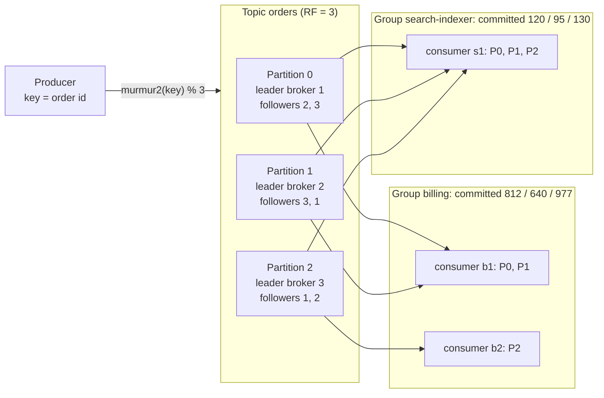
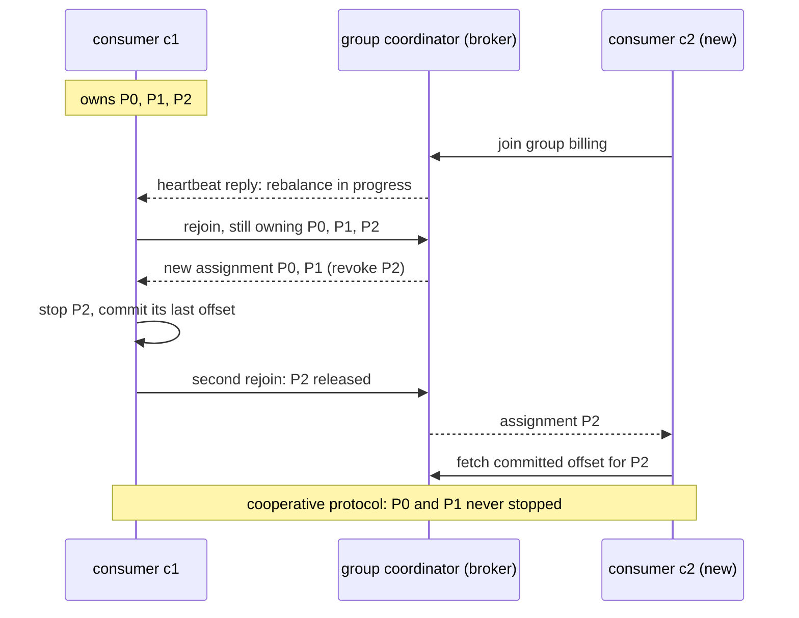

# Kafka and Event Streaming

> [!summary] TL;DR
> **Event streaming** means writing events to a durable, ordered **log** that many readers can read at their own pace and re-read later. **Apache Kafka** is the most widely used log: a topic is split into **partitions**, each an append-only file where every record gets a number called its **offset**, and each consumer group remembers the offset it has reached.

> [!abstract] Core idea
> - A topic is N partitions; a record's key decides its partition, and order is guaranteed only inside one partition.
> - Records are not deleted when read. They stay until retention (time or size) or compaction removes them, so you can replay.
> - A consumer group splits the partitions among its members (at most one member per partition) and commits offsets; commit after processing gives at-least-once.
> - Durability comes from replication: `replication.factor=3`, `acks=all`, `min.insync.replicas=2`.
> - Classic mistake: thinking more consumers always means more speed. Consumers beyond the partition count sit idle.

## 1. Why it exists

A ride-hailing app emits 50,000 location and trip events per second. Five teams need them: pricing (real time), fraud (real time), the data warehouse (hourly), a machine-learning feature store, and a new team that wants last week's data to backfill a model.

With a classic queue (RabbitMQ, SQS) a message is gone once one consumer acknowledges it. Five readers means five copies of every message, set up by the producer, and the new team cannot get last week at all. With direct HTTP calls the producer must know all five teams and slows down when any of them does.

A log fixes all three:
- The producer writes each event once.
- Every team is a separate **consumer group** with its own position in the log.
- Events stay for the retention period (7 days by default, `retention.ms=604800000`), so the new team starts from an offset of a week ago.

## 2. Mental model

Think of a **ledger book with several numbered pages running in parallel** (the partitions). Writers only add lines at the bottom of a page. Each line has a line number (the offset). Readers keep a bookmark per page. Different reader teams keep different bookmarks, so they never interfere. Old pages are torn out after a week, regardless of who has read them.

Terms used below:
- **Broker:** one Kafka server. A **cluster** is several brokers.
- **Topic:** a named log, e.g. `orders`.
- **Partition:** one ordered, append-only slice of a topic, stored on disk as segment files.
- **Offset:** a record's position in its partition: 0, 1, 2, ...
- **Leader / follower:** each partition has one leader replica that takes writes and followers that copy it.
- **ISR (in-sync replicas):** the replicas currently caught up with the leader.
- **Consumer group:** a set of consumers sharing one bookmark per partition.
- **Lag:** the log end offset minus the group's committed offset: how far behind the group is.

## 3. How it works



### Producing

1. The producer picks a partition. With a key, the Java client's default is `toPositive(murmur2(keyBytes)) % numPartitions`, so the same key always goes to the same partition while the partition count stays the same. Without a key, since Kafka 3.3 (KIP-794) the client fills a batch for one partition and then moves on ("uniform sticky"), which gives bigger batches than round-robin.
2. Records are grouped into **batches** per partition. `batch.size` (default 16,384 bytes) caps a batch; `linger.ms` lets the producer wait a few milliseconds to fill it. Batches are compressed as a unit (`compression.type` = `lz4`, `zstd`, `snappy` or `gzip`).
3. The leader appends the batch to its log; followers fetch it.
4. The producer's `acks` decides when it hears "success":
	- `acks=0`: no wait. Records can be lost silently.
	- `acks=1`: the leader wrote it. Lost if the leader dies before followers copy it.
	- `acks=all`: every replica in the ISR has it. Combined with `min.insync.replicas=2` on a topic with three replicas, the write needs two copies or it fails.
5. **Idempotent producer** (`enable.idempotence=true`, default since Kafka 3.0 together with `acks=all`): the broker tags each producer with an id and each batch with a sequence number per partition, and drops a retried batch it already has. Retries no longer create duplicates or reorder records.

### Consuming

A consumer group's members agree on who reads which partitions (**assignment**), then loop: `poll()` a batch, process it, **commit** the offset of the next record to read. Committed offsets are stored in the internal topic `__consumer_offsets`.



- **Eager rebalancing** (the old default) made every member drop every partition, then reassigned all of them: a stop-the-world pause.
- **Cooperative sticky** (KIP-429) revokes only the partitions that move; the others keep flowing, as in the diagram.
- **Static membership** (KIP-345, `group.instance.id`) lets a restarting pod come back within `session.timeout.ms` (default 45 s) without triggering a rebalance at all.
- **KIP-848**, generally available in Kafka 4.0 (`group.protocol=consumer`), moves assignment logic to the broker-side coordinator and makes rebalances incremental by design.
- A consumer that takes longer than `max.poll.interval.ms` (default 5 minutes) between polls is considered dead and its partitions are reassigned, which is a common cause of rebalance storms with slow handlers.

**When to commit:**
- `enable.auto.commit=true` (the default) commits, inside a later `poll()` call and at most every 5 s (`auto.commit.interval.ms`), the offsets of records the previous `poll()` returned. With a simple loop that finishes each batch before polling again this is at-least-once, and a crash repeats up to 5 s of records. If records are handed to other goroutines or threads, the offset can be committed before they are processed, and a crash loses them.
- Manual commit **after** processing gives at-least-once: a crash before the commit means the batch is read again. Handlers must then be idempotent; see [[Delivery Semantics and Exactly-Once]].

### Storage and retention

- A partition is a directory of **segments** (`log.segment.bytes`, default 1 GiB) plus offset and time index files. Only the active segment is written; old segments are deleted or compacted whole.
- **Delete retention:** remove segments older than `retention.ms` or beyond `retention.bytes`.
- **Log compaction** (`cleanup.policy=compact`): keep at least the latest record for each key. A record with a null value (a **tombstone**) deletes the key after `delete.retention.ms` (default 24 h). Used for changelogs and "current state of each entity" topics, including `__consumer_offsets` itself.
- **Tiered storage** (KIP-405, production-ready in Kafka 3.9) moves closed segments to object storage, so retention can be long without large local disks.

### Replication and the controller

- The leader tracks the **ISR**. A follower that falls behind for longer than `replica.lag.time.max.ms` (default 30 s) is removed from it.
- A record is **committed** once every ISR member has it; consumers only see records up to that point (the **high watermark**).
- If the leader dies, the controller picks a new leader from the ISR. `unclean.leader.election.enable=false` (the default) refuses to elect an out-of-sync replica, choosing unavailability over data loss.
- **KRaft:** cluster metadata (topics, partitions, leaders, ISR) lives in a Raft-replicated metadata log run by controller nodes (see [[Consensus - Raft and Paxos]]). Kafka 4.0 removed ZooKeeper support entirely.

## 4. Worked example

### Whiteboard version

```text
topic orders: 6 partitions, RF=3, min.insync.replicas=2, producer acks=all
key order-1001 -> murmur2 = 297523878   -> 297523878 % 6 = 0 -> P0
key order-1003 -> murmur2 = 664887688   -> % 6 = 4            -> P4
P0 log:  [0:Placed o-1001] [1:Placed o-1002] [2:Paid o-1001]
group billing committed P0 = 1  ->  next read = offset 1
billing reads 1, 2 -> crashes before commit -> restarts at 1 -> reads 1, 2 again
lag(P0) = log end offset 3 - committed 1 = 2
broker 2 dies: P0 still has 2 in-sync copies -> writes keep working
broker 3 also dies: ISR = 1 < 2 -> producers get NotEnoughReplicas, reads still work
```

The partition numbers above are real: they come from the Go `PartitionFor` below, which reproduces Kafka's partitioner bit for bit.

### Go: Kafka's partitioner and a committing consumer

This is an in-memory model, not a client. It shows three things you can test without a broker: the exact key-to-partition function, a range assignment, and how committing after processing gives redelivery.

```go
// Package kafka is a toy, in-memory model of a Kafka topic: the default key
// partitioner, append-only partitions with offsets, and a consumer group that
// commits offsets after processing.
package kafka

import (
	"sort"
	"sync"
)

// Murmur2 is the hash used by Kafka's Java client to pick a partition for a
// keyed record (org.apache.kafka.common.utils.Utils.murmur2).
func Murmur2(data []byte) int32 {
	const seed uint32 = 0x9747b28c
	const m uint32 = 0x5bd1e995
	const r = 24
	length := len(data)
	h := seed ^ uint32(length)
	for i := 0; i+4 <= length; i += 4 {
		k := uint32(data[i]) | uint32(data[i+1])<<8 | uint32(data[i+2])<<16 | uint32(data[i+3])<<24
		k *= m
		k ^= k >> r
		k *= m
		h *= m
		h ^= k
	}
	tail := length &^ 3
	switch length % 4 {
	case 3:
		h ^= uint32(data[tail+2]) << 16
		fallthrough
	case 2:
		h ^= uint32(data[tail+1]) << 8
		fallthrough
	case 1:
		h ^= uint32(data[tail])
		h *= m
	}
	h ^= h >> 13
	h *= m
	h ^= h >> 15
	return int32(h)
}

// PartitionFor mirrors the Java client: toPositive(murmur2(key)) % n.
func PartitionFor(key string, n int) int {
	return int(uint32(Murmur2([]byte(key)))&0x7fffffff) % n
}

// Record is one message stored at an offset.
type Record struct {
	Partition int
	Offset    int64
	Key       string
	Value     string
}

// Topic is a set of append-only partitions.
type Topic struct {
	mu         sync.Mutex
	partitions [][]Record
}

func NewTopic(partitions int) *Topic {
	return &Topic{partitions: make([][]Record, partitions)}
}

// Produce appends a keyed record and returns where it landed.
func (t *Topic) Produce(key, value string) (partition int, offset int64) {
	t.mu.Lock()
	defer t.mu.Unlock()
	p := PartitionFor(key, len(t.partitions))
	off := int64(len(t.partitions[p]))
	t.partitions[p] = append(t.partitions[p], Record{p, off, key, value})
	return p, off
}

// Fetch returns up to max records of partition p starting at offset from.
func (t *Topic) Fetch(p int, from int64, max int) []Record {
	t.mu.Lock()
	defer t.mu.Unlock()
	log := t.partitions[p]
	if from >= int64(len(log)) {
		return nil
	}
	end := min(from+int64(max), int64(len(log)))
	return append([]Record(nil), log[from:end]...)
}

// EndOffset is the offset the next record in p will get (the "log end offset").
func (t *Topic) EndOffset(p int) int64 {
	t.mu.Lock()
	defer t.mu.Unlock()
	return int64(len(t.partitions[p]))
}

// Group stores committed offsets per partition, like __consumer_offsets.
type Group struct {
	mu        sync.Mutex
	committed map[int]int64
}

func NewGroup() *Group { return &Group{committed: map[int]int64{}} }

func (g *Group) Committed(p int) int64 {
	g.mu.Lock()
	defer g.mu.Unlock()
	return g.committed[p]
}

func (g *Group) Commit(p int, next int64) {
	g.mu.Lock()
	defer g.mu.Unlock()
	g.committed[p] = next
}

// Lag is end offset minus committed offset, summed over partitions.
func (g *Group) Lag(t *Topic) int64 {
	var lag int64
	for p := range t.partitions {
		lag += t.EndOffset(p) - g.Committed(p)
	}
	return lag
}

// RangeAssign gives each member a contiguous block of partitions, like the
// range assignor for one topic. Members are sorted so every member computes
// the same answer.
func RangeAssign(members []string, partitions int) map[string][]int {
	ms := append([]string(nil), members...)
	sort.Strings(ms)
	out := make(map[string][]int, len(ms))
	per, extra := partitions/len(ms), partitions%len(ms)
	p := 0
	for i, m := range ms {
		n := per
		if i < extra {
			n++
		}
		for j := 0; j < n; j++ {
			out[m] = append(out[m], p)
			p++
		}
	}
	return out
}

// Poll processes one batch from partition p and then commits. If handle
// fails, nothing is committed and the batch is read again next time:
// at-least-once delivery.
func Poll(t *Topic, g *Group, p, max int, handle func(Record) error) (int, error) {
	from := g.Committed(p)
	recs := t.Fetch(p, from, max)
	for _, r := range recs {
		if err := handle(r); err != nil {
			return 0, err
		}
	}
	if len(recs) > 0 {
		g.Commit(p, recs[len(recs)-1].Offset+1)
	}
	return len(recs), nil
}
```

```go
package kafka

import (
	"errors"
	"fmt"
	"testing"
)

// Test vectors from Kafka's own UtilsTest.testMurmur2.
func TestMurmur2MatchesKafka(t *testing.T) {
	cases := map[string]int32{
		"21":                         -973932308,
		"foobar":                     -790332482,
		"a-little-bit-long-string":   -985981536,
		"a-little-bit-longer-string": -1486304829,
		"lkjh234lh9fiuh90y23oiuhsafujhadof229phr9h19h89h8": -58897971,
		"abc": 479470107,
	}
	for in, want := range cases {
		if got := Murmur2([]byte(in)); got != want {
			t.Errorf("murmur2(%q) = %d, want %d", in, got, want)
		}
	}
}

func TestSameKeySamePartitionInOrder(t *testing.T) {
	tp := NewTopic(6)
	for i := 0; i < 5; i++ {
		tp.Produce("order-42", fmt.Sprintf("v%d", i))
		tp.Produce(fmt.Sprintf("other-%d", i), "x")
	}
	p := PartitionFor("order-42", 6)
	var vals []string
	for _, r := range tp.Fetch(p, 0, 100) {
		if r.Key == "order-42" {
			vals = append(vals, r.Value)
		}
	}
	if got := fmt.Sprint(vals); got != "[v0 v1 v2 v3 v4]" {
		t.Fatalf("got %s", got)
	}
}

func TestRangeAssign(t *testing.T) {
	got := RangeAssign([]string{"c2", "c1", "c3"}, 7)
	want := "map[c1:[0 1 2] c2:[3 4] c3:[5 6]]"
	if fmt.Sprint(got) != want {
		t.Fatalf("got %v", got)
	}
}

func TestCrashBeforeCommitRedelivers(t *testing.T) {
	tp := NewTopic(1)
	for i := 0; i < 3; i++ {
		tp.Produce("k", fmt.Sprintf("m%d", i))
	}
	g := NewGroup()
	var seen []string
	crash := errors.New("consumer died")
	_, err := Poll(tp, g, 0, 10, func(r Record) error {
		seen = append(seen, r.Value)
		if r.Value == "m1" {
			return crash
		}
		return nil
	})
	if !errors.Is(err, crash) || g.Committed(0) != 0 {
		t.Fatalf("err=%v committed=%d", err, g.Committed(0))
	}
	if _, err := Poll(tp, g, 0, 10, func(r Record) error {
		seen = append(seen, r.Value)
		return nil
	}); err != nil {
		t.Fatal(err)
	}
	if got := fmt.Sprint(seen); got != "[m0 m1 m0 m1 m2]" {
		t.Fatalf("got %s", got)
	}
	if g.Lag(tp) != 0 {
		t.Fatalf("lag = %d", g.Lag(tp))
	}
}

func TestTwoGroupsReadIndependently(t *testing.T) {
	tp := NewTopic(2)
	for i := 0; i < 10; i++ {
		tp.Produce(fmt.Sprintf("k%d", i), "v")
	}
	billing, search := NewGroup(), NewGroup()
	for p := 0; p < 2; p++ {
		if _, err := Poll(tp, billing, p, 100, func(Record) error { return nil }); err != nil {
			t.Fatal(err)
		}
	}
	if billing.Lag(tp) != 0 || search.Lag(tp) != 10 {
		t.Fatalf("billing lag %d, search lag %d", billing.Lag(tp), search.Lag(tp))
	}
}
```

`go vet` is clean and `go test -race` passes (Go 1.24). `TestMurmur2MatchesKafka` uses the test vectors from Kafka's own `UtilsTest`, so `PartitionFor` matches the Java client's default for keyed records.

**Measured with this code:** of 100,000 keys `order-0` to `order-99999`, **74,862 (74.9%)** change partition when a topic grows from 6 to 8 partitions. That is the expected `1 - 6/24` for plain modulo hashing. This is why adding partitions to a keyed topic breaks per-key ordering for in-flight keys, and why teams over-provision partitions up front.

### In a real cluster

Creating the topic and checking lag looks like this (representative output, Kafka 4.0 CLI tools; no broker was run for this note):

```bash
kafka-topics.sh --bootstrap-server localhost:9092 --create --topic orders \
  --partitions 6 --replication-factor 3 --config min.insync.replicas=2
kafka-consumer-groups.sh --bootstrap-server localhost:9092 --describe --group billing
```

```text
GROUP    TOPIC   PARTITION  CURRENT-OFFSET  LOG-END-OFFSET  LAG   CONSUMER-ID       HOST         CLIENT-ID
billing  orders  0          812             815             3     b1-4f2c...        /10.0.1.17   b1
billing  orders  1          640             640             0     b1-4f2c...        /10.0.1.17   b1
billing  orders  2          977             1402            425   b2-91aa...        /10.0.1.18   b2
```

Partition 2's lag of 425 while the others are near zero points to a slow consumer `b2` or a hot key on partition 2, not to a cluster-wide problem.

## 5. Variants and comparison

| System | Model | Ordering | Retention / replay | Best fit | Cost |
| --- | --- | --- | --- | --- | --- |
| Apache Kafka | Partitioned log, consumer groups, pull | Per partition | Time/size, compaction, tiered storage | High-throughput event backbone, CDC, stream processing | Operating brokers and controllers; partition planning |
| Redpanda | Kafka API, written in C++, Raft per partition | Per partition | Same model, tiered storage | Kafka API with fewer components | Smaller ecosystem; vendor features |
| Apache Pulsar | Brokers plus BookKeeper storage; topics and subscriptions | Per partition or key-shared | Retention plus tiered storage | Multi-tenancy, many topics, queue and stream semantics in one | More components (brokers, bookies, metadata store) |
| Amazon Kinesis Data Streams | Managed shards | Per shard | 24 h default, up to 365 days | AWS-native streaming without running brokers | Per-shard limits and pricing |
| Redis Streams | Log in one Redis key, consumer groups with pending lists | Per stream | Trimmed with `MAXLEN` / `MINID`; memory-bound | Small volumes, already running Redis; see [[Redis as a Queue - Lists, Streams and Pub-Sub]] | Memory cost, single-key throughput limits |
| RabbitMQ / SQS | Queues: delete on ack | Per queue (best effort) or FIFO groups | No replay after ack | Task distribution, per-message routing; see [[Queues vs Streams and Broker Comparison]] | No history; fan-out needs copies |

## 6. Trade-offs and when not to use

- **Parallelism is capped by partitions.** A group with 6 partitions uses at most 6 consumers. Raising the partition count later remaps keys (74.9% in the measurement above for 6 → 8).
- **Head-of-line blocking.** One slow or failing record blocks every later record in its partition for that group. There is no per-message ack or redelivery delay as in SQS; you build retries with retry topics and a dead letter topic (see [[Dead Letter Queues and Poison Messages]]).
- **Operational weight.** Brokers, controllers, partition reassignment, disk planning, client tuning. A managed service removes most of it at a price.
- **Not a database.** Lookups by key are not supported (except through stream processing state stores); compaction is eventual.
- **When not to use it:**
	- A few hundred jobs per minute that must each be retried with a delay: use a job queue ([[Background Jobs and Worker Pools]]).
	- Request/response between two services: use HTTP or gRPC.
	- You need per-message priority or routing rules: RabbitMQ or SQS fit better.

## 7. In production

- **Real systems:** Kafka was built at LinkedIn and open-sourced in 2011. Common uses: CDC pipelines with Debezium ([[Transactional Outbox and CDC]]), log and metrics transport ([[Case Study - Metrics and Logging Platform]]), event-driven microservices, and stream processing with Kafka Streams or Flink ([[Stream Processing Basics]]).
- **Failure modes → fixes:**
	- *Consumer lag grows without end.* Handlers too slow for the input rate. Fix: more partitions and consumers, batch work, or make the handler async with bounded concurrency per key; see [[Backpressure and Flow Control]].
	- *Rebalance storms.* Handlers exceed `max.poll.interval.ms`, or pods restart often. Fix: smaller `max.poll.records`, cooperative sticky or KIP-848, static membership.
	- *Hot partition.* One key (a celebrity user, one big tenant) gets most of the traffic. Fix: a better key, or salt the key and re-aggregate; see [[Hot Keys and Hot Partitions]].
	- *Silent data loss.* `acks=1` plus a leader crash, or `min.insync.replicas=1`. Fix: `acks=all`, `min.insync.replicas=2` with RF=3, unclean election off.
	- *Poison record crash loop.* A record that always fails deserialisation stops the partition. Fix: catch deserialisation errors and send the raw bytes to a dead letter topic.
- **What to monitor:**
	- Consumer lag per group and partition, and lag in time (how old the oldest unprocessed record is).
	- Under-replicated partitions and offline partitions (should be 0).
	- ISR shrink and expand rate.
	- Produce and fetch request latency (p99), request errors.
	- Rebalance count and duration per group.
	- Disk usage per broker against retention.

## 8. Deep dive

- **Why it is fast:** sequential appends to segment files, the OS page cache instead of an in-process cache, batching and compression end to end (the broker stores the producer's compressed batch as is), and zero-copy transfer (`sendfile`) from page cache to socket for plaintext connections. TLS disables zero-copy because the bytes must be encrypted in user space.
- **High watermark vs log end offset.** The leader's log may hold records not yet copied to all ISR members. Consumers read only up to the high watermark, so they never see a record that a leader failover could lose.
- **Leader epochs.** After a failover, a returning replica truncates its log to the point agreed under the new leader epoch, not simply to its old high watermark. This fixed old cases where replicas diverged.
- **Exactly-once inside Kafka.** Transactions (KIP-98) let a producer write to several partitions and commit consumer offsets atomically (`sendOffsetsToTransaction`). Consumers with `isolation.level=read_committed` skip aborted records. This gives exactly-once for consume-transform-produce loops within Kafka only; effects outside Kafka still need idempotency. Detail: [[Delivery Semantics and Exactly-Once]].
- **Sizing partitions.** A common estimate: partitions ≥ max(target throughput / per-partition producer throughput, target throughput / per-partition consumer throughput). Measure per-partition throughput in your setup rather than trusting a headline number. Too many partitions cost memory, open files and longer leader elections.
- **Ordering with retries.** Without idempotence, `max.in.flight.requests.per.connection > 1` plus a retry could reorder batches. With the idempotent producer, ordering holds for up to 5 in-flight requests per connection.
- **Consumer offset semantics.** The committed offset is the *next* offset to read, not the last processed one, so a manual commit must send `last + 1`. Committing `last` is a classic off-by-one: after a restart the last record is processed again.
- **Compaction is not instant.** The cleaner only compacts closed segments, and the head of the log can hold several versions of a key. A compacted topic gives "at least the latest value per key", never "only".

## 9. Interview questions

> [!question]- How does Kafka guarantee ordering, and where does it stop?
> Records with the same key go to the same partition, and a partition is an append-only log read in offset order by one consumer of a group. So order holds per partition (per key), never across partitions. Changing the partition count, or retries without the idempotent producer, can break it.

> [!question]- You have 12 partitions and scale your consumer group to 20 pods. What happens? (trap)
> Eight pods get no partitions and sit idle. A partition is assigned to at most one member of a group. To get more parallelism, add partitions (which remaps keys) or process records concurrently inside each consumer while keeping per-key order.

> [!question]- What settings make a write durable, and what do you give up?
> `replication.factor=3`, `min.insync.replicas=2`, producer `acks=all`, and `unclean.leader.election.enable=false`. A write then survives any one broker loss. You give up some latency (waiting for followers) and availability: with two brokers down, writes to that partition fail with `NotEnoughReplicas`.

> [!question]- Auto-commit or manual commit?
> Auto-commit commits on a timer, during later polls, the offsets of what `poll()` returned. A crash repeats recently processed records, and if processing is handed off asynchronously it can skip records that were committed but not yet processed. Commit manually after processing for at-least-once, and make the handler idempotent. For exactly-once inside Kafka, use transactions.

> [!question]- What is log compaction and when would you use it?
> The cleaner keeps at least the latest record per key and removes older ones; a null value (tombstone) deletes the key. Use it for "latest state per entity" topics: changelogs, CDC of a table, configuration, consumer offsets. It is not suitable when you need every historical event.

> [!question]- What does consumer lag tell you, and what do you do when it grows?
> It is the log end offset minus the committed offset: how many records the group still has to process. Steady growth means the consumers cannot keep up. Check which partitions lag (one hot partition vs all), then scale consumers up to the partition count, speed up the handler, or add partitions.

> [!question]- What changed with KRaft?
> Kafka stores its own metadata in a Raft-replicated log on controller nodes instead of ZooKeeper. It means one system to run, faster controller failover and support for many more partitions. Kafka 4.0 removed ZooKeeper mode entirely.

## 10. Cheat sheet

- Topic = partitions; partition = append-only log; offset = position; order only per partition.
- Key → `murmur2(key) % partitions`; changing the partition count remaps most keys.
- Durable: RF=3, `acks=all`, `min.insync.replicas=2`, idempotent producer (default since 3.0).
- Group: one member per partition max; cooperative sticky, static membership, KIP-848 (4.0) cut rebalance pain.
- Commit after processing → at-least-once; committed offset = next to read.
- Retention by time/size (7 days default) or compaction (latest per key, tombstones).
- Watch lag, under-replicated partitions, rebalances.
- KRaft only since 4.0; tiered storage for long retention.

## Links

- **Before this:** [[Queues vs Streams and Broker Comparison]], [[Message Ordering and Partition Keys]], [[Replication]]
- **Next:** [[Event Schemas and Schema Registry]], [[Stream Processing Basics]], [[Delivery Semantics and Exactly-Once]]
- **Compare with:** [[Redis as a Queue - Lists, Streams and Pub-Sub]], [[AWS SQS, SNS and EventBridge]], [[Transactional Outbox and CDC]] (how events get into Kafka safely)
