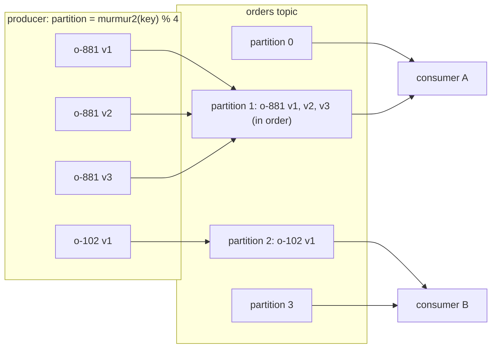
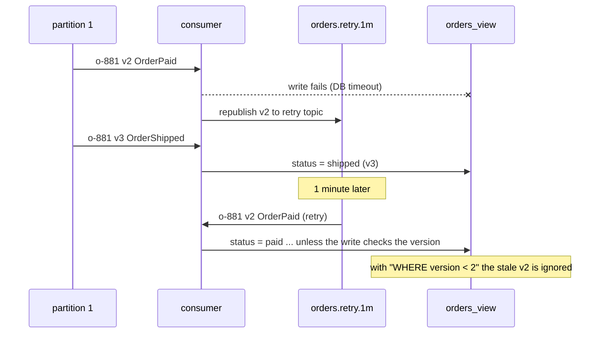

# Message Ordering and Partition Keys

> [!summary] TL;DR
> Brokers can keep messages in order only **within** one partition (Kafka), message group (SQS FIFO) or queue with one consumer (RabbitMQ). A **partition key** such as `order_id` sends all messages about one entity to the same partition, so you get order **per key** and parallelism **across keys**. Global order for everything would mean one partition and one consumer, which caps throughput.

> [!abstract] Core idea
> - Ask "order relative to what?" Almost always the answer is "per entity", not "globally".
> - Same key → same partition → same consumer → processed in order. Different keys run in parallel.
> - Order breaks in quiet places: worker pools inside a consumer, retries and DLQs, producer retries, adding partitions, rebalances.
> - Make consumers order-tolerant anyway: carry a per-entity version and ignore anything older than what you have.
> - Pick the key for even load: a key that is too coarse (`tenant_id` of a huge tenant) creates a hot partition.

## 1. Why it exists

An order service publishes three events for order `o-881`: `OrderCreated` (v1), `OrderPaid` (v2), `OrderShipped` (v3). A projection consumer keeps an `orders_view` table for the customer app.

The topic has 12 partitions and the producer sends messages **without a key**, so they are spread across partitions. Three consumers in a group each read different partitions at different speeds.

- `OrderShipped` lands on partition 4, whose consumer is fast. The view says "shipped".
- `OrderPaid` lands on partition 9, whose consumer is 2 seconds behind. It arrives later and sets the view back to "paid".
- The customer now sees "paid" for an order that has already shipped, and nothing will ever correct it.

The fix is to key by `order_id`: every event for `o-881` goes to one partition, is read by one consumer, in the order it was written. Twelve partitions still give twelve-way parallelism across different orders.

## 2. Mental model

A bank has 12 tellers. If customers join any queue at random, two deposits from the same person can be handled out of order by different tellers. So the bank assigns tellers by account number: account `…81` always goes to teller 9. Each teller works through their queue in order, so every account's transactions happen in order, and the 12 tellers still work in parallel. The bank gave up a single global order, which nobody needed, to keep per-account order, which everyone needs.

Terms:

- **Partition:** an ordered, append-only sub-log of a topic. Kafka guarantees order only within one partition.
- **Partition key (message key):** the value hashed to choose a partition. Kafka's default partitioner uses `murmur2(key) % number_of_partitions` for keyed records.
- **Message group:** SQS FIFO's equivalent: messages with the same `MessageGroupId` are delivered in order, one batch at a time.
- **Per-key ordering:** messages with the same key are processed in send order; messages with different keys have no defined order relative to each other.
- **Sequence number / version:** a counter carried in each message so a consumer can detect gaps, duplicates and reordering.

## 3. How it works

### Keys map entities to partitions, partitions map to consumers



Within one consumer group, each partition is read by exactly one consumer, so `o-881`'s events are processed by consumer A in offset order. Consumer B handles `o-102` at the same time.

### How each broker offers ordering

| Broker | Ordering unit | How you choose it | Parallelism limit |
| --- | --- | --- | --- |
| Kafka | Partition | Message key; `murmur2(key) % partitions` by default | At most one consumer per partition per group |
| SQS FIFO | Message group | `MessageGroupId` per message | While a group has messages in flight, SQS returns no more from that group; throughput quota is 300 messages per second per API action without batching (3,000 with batching of 10), higher in high-throughput mode |
| SQS standard | None | n/a | Best-effort ordering only |
| Kinesis Data Streams | Shard | Partition key, MD5-hashed to a shard's hash-key range | One shard: 1 MB/s or 1,000 records/s in |
| Google Pub/Sub | Ordering key | `ordering_key` on publish, ordering enabled on the subscription | Per ordering key |
| RabbitMQ | Queue | Routing; one consumer (or Single Active Consumer) for strict order | Several consumers or requeues break order |

### How retries break order



Non-blocking retries (see [[Dead Letter Queues and Poison Messages]]) trade order for throughput. The version check in the consumer is what makes that trade safe.

## 4. Worked example

### Whiteboard version

```text
producer:  key = order_id                     -> same partition for one order
consumer:  for each partition, one goroutine  -> in order per key
           if you need more workers: lane = hash(key) % N, one goroutine per lane
apply:     UPDATE orders_view
           SET status = $2, version = $3
           WHERE id = $1 AND version < $3      -- 0 rows = stale or duplicate: skip
```

### Full version in Go

Two pieces, both compiled and passing `go vet` and `go test -race` on Go 1.24:

1. A **keyed dispatcher**: a consumer that wants 4 workers instead of 1 per partition, without breaking per-key order. Each key always maps to the same lane, and each lane is one goroutine.
2. A **version-checked store**: the in-memory form of the conditional `UPDATE`, which makes the consumer safe against late and duplicate events.

```go
package order

import (
	"hash/fnv"
	"sync"
)

// Event is one change to an entity. Version increases by 1 per change of
// the same Key, assigned by the writer (for example a row version column).
type Event struct {
	Key     string
	Version int64
	Status  string
}

// Dispatcher gives parallelism across keys and strict order within a key:
// every event for a key goes to the same lane, and a lane is one goroutine.
// It is the in-process version of "partition by key".
type Dispatcher struct {
	lanes []chan Event
	wg    sync.WaitGroup
}

func NewDispatcher(lanes, buffer int, handle func(lane int, e Event)) *Dispatcher {
	d := &Dispatcher{lanes: make([]chan Event, lanes)}
	for i := range d.lanes {
		ch := make(chan Event, buffer)
		d.lanes[i] = ch
		d.wg.Add(1)
		go func(lane int) {
			defer d.wg.Done()
			for e := range ch {
				handle(lane, e)
			}
		}(i)
	}
	return d
}

// Lane picks the lane for a key, like hash(key) % partitions in a broker.
func (d *Dispatcher) Lane(key string) int {
	h := fnv.New32a()
	h.Write([]byte(key))
	return int(h.Sum32() % uint32(len(d.lanes)))
}

// Dispatch must be called from one goroutine (the partition reader) so that
// events enter each lane in the order they were read.
func (d *Dispatcher) Dispatch(e Event) { d.lanes[d.Lane(e.Key)] <- e }

// Close stops accepting events and waits for the lanes to drain.
func (d *Dispatcher) Close() {
	for _, ch := range d.lanes {
		close(ch)
	}
	d.wg.Wait()
}

// Store keeps the latest state per key and refuses to go backwards.
// It makes a consumer safe against reordering and duplicates.
type Store struct {
	mu    sync.Mutex
	state map[string]Event
}

func NewStore() *Store { return &Store{state: map[string]Event{}} }

// Apply is the in-memory form of
//
//	UPDATE orders SET status = $2, version = $3 WHERE id = $1 AND version < $3
//
// It returns false for a stale or duplicate event.
func (s *Store) Apply(e Event) bool {
	s.mu.Lock()
	defer s.mu.Unlock()
	if cur, ok := s.state[e.Key]; ok && cur.Version >= e.Version {
		return false
	}
	s.state[e.Key] = e
	return true
}

func (s *Store) Get(key string) (Event, bool) {
	s.mu.Lock()
	defer s.mu.Unlock()
	e, ok := s.state[key]
	return e, ok
}
```

```go
package order

import (
	"fmt"
	"sync"
	"testing"
)

func TestPerKeyOrderWithParallelLanes(t *testing.T) {
	var mu sync.Mutex
	seen := map[string][]int64{}
	lanesUsed := map[int]bool{}
	d := NewDispatcher(4, 16, func(lane int, e Event) {
		mu.Lock()
		seen[e.Key] = append(seen[e.Key], e.Version)
		lanesUsed[lane] = true
		mu.Unlock()
	})
	// Interleave 50 keys x 20 versions, as one partition would.
	for v := int64(1); v <= 20; v++ {
		for k := 0; k < 50; k++ {
			d.Dispatch(Event{Key: fmt.Sprintf("order-%d", k), Version: v})
		}
	}
	d.Close()
	for key, vs := range seen {
		for i, v := range vs {
			if v != int64(i+1) {
				t.Fatalf("%s saw versions %v: out of order", key, vs)
			}
		}
	}
	if len(lanesUsed) < 2 {
		t.Fatalf("only %d lane used: no parallelism", len(lanesUsed))
	}
}

func TestStoreIgnoresStaleAndDuplicateEvents(t *testing.T) {
	s := NewStore()
	steps := []struct {
		e    Event
		want bool
	}{
		{Event{"order-1", 1, "created"}, true},
		{Event{"order-1", 3, "shipped"}, true},  // v2 is late
		{Event{"order-1", 2, "paid"}, false},    // arrives after v3: ignored
		{Event{"order-1", 3, "shipped"}, false}, // redelivery: ignored
	}
	for i, st := range steps {
		if got := s.Apply(st.e); got != st.want {
			t.Fatalf("step %d: Apply = %v, want %v", i, got, st.want)
		}
	}
	if e, _ := s.Get("order-1"); e.Status != "shipped" {
		t.Fatalf("final status %q, want shipped", e.Status)
	}
}
```

`TestPerKeyOrderWithParallelLanes` dispatches 1,000 events (50 orders × 20 versions, interleaved as a partition would deliver them) into 4 lanes and checks that every order saw versions 1 to 20 in order, while more than one lane did work. `TestStoreIgnoresStaleAndDuplicateEvents` replays the retry diagram: v2 arriving after v3 is ignored, and so is a redelivered v3.

The same check in PostgreSQL 17, with the upsert form used by projections:

```sql
INSERT INTO orders_view (id, status, version)
VALUES ('o-881', 'paid', 2)
ON CONFLICT (id) DO UPDATE
SET status = EXCLUDED.status, version = EXCLUDED.version
WHERE orders_view.version < EXCLUDED.version;   -- stale or duplicate: 0 rows affected
```

## 5. Variants and comparison

| Approach | How it works | Use when | Cost |
| --- | --- | --- | --- |
| Global order (1 partition, 1 consumer) | Everything in one sequence | Low volume and order across all entities truly matters (a single ledger) | Throughput of one consumer; no parallelism; one hot broker |
| Per-key order (partition key) | Same key → same partition | The default for entity events | Hot keys; resizing partitions remaps keys |
| Per-key lanes inside a consumer | `hash(key) % N` goroutines per partition | Handler is slow (I/O) and one goroutine per partition is too few | Offset commits must wait for all lanes to finish up to that offset |
| Order-tolerant consumer (versions) | Each event carries an entity version; apply only if newer | Always, as a second line of defence; required with retries | Producer must assign versions (row version, outbox sequence) |
| Resequencing buffer | Consumer holds events until the gap is filled (v2 before v3) | Every event must be applied, in order (ledger deltas, not state snapshots) | Memory, a timeout for gaps that never fill |
| Commutative design | Make operations order-independent (sets, counters, CRDTs) | You can redesign the data | Not every business rule commutes |

## 6. Trade-offs and when not to use

- **Order vs parallelism.** Parallelism is capped at the number of ordering units. A topic with 12 partitions cannot be processed by more than 12 consumers in one group. Choose the partition count for the peak throughput you expect, because changing it later remaps keys.
- **Key choice decides load balance.** `customer_id` with one customer producing 30% of traffic puts 30% on one partition (see [[Hot Keys and Hot Partitions]]). Choose the narrowest key whose order you need: usually `order_id`, not `customer_id`, and never a constant.
- **Adding partitions moves keys.** Going from 12 to 16 partitions changes `murmur2(key) % n` for most keys. Events for one order written before and after the change sit in different partitions, and the old ones may be read later. Drain or tolerate this with version checks, or create a new topic and migrate.
- **Strict order means blocking on failure.** If one message for a key cannot be processed, either everything behind it waits (head-of-line blocking) or you skip it and break order. Decide per stream.
- **When not to care:** independent commands (send this email), idempotent snapshots where the latest wins anyway, and analytics aggregated by time windows. Using a key there only creates hot spots.

## 7. In production

- **Real systems:**
	- Kafka topics keyed by entity ID (order, account, device), with consumers that check entity versions.
	- SQS FIFO with `MessageGroupId = account_id` for per-account processing; many groups give parallelism across accounts.
	- Change data capture: Debezium keys each change event by the table's primary key, so all changes to one row stay in order on one partition. See [[Transactional Outbox and CDC]].
	- Kinesis with a device ID partition key for per-device telemetry order.
- **Failure modes → fixes:**
	- **Producer retries reorder within a partition.** With `max.in.flight.requests.per.connection > 1` and no idempotence, batch 1 can fail and be retried after batch 2 succeeds. Kafka's idempotent producer (`enable.idempotence=true`, default since 3.0) preserves order with up to 5 in-flight requests.
	- **Null keys.** Records without a key are spread across partitions by the sticky partitioner, so there is no order between them at all.
	- **Worker pool after the poll loop.** A consumer that hands records to a shared pool processes `o-881 v3` on one goroutine while `v2` is still on another. Use per-key lanes as above.
	- **Rebalance replays.** When a partition moves to another consumer, records after the last committed offset are processed again, so v2 can be seen after v3 was applied once. Version checks make the replay harmless.
	- **Retry topics and DLQ replays** deliver old events late. Version checks or park-the-key.
	- **Multiple producers for one entity** (two services both emit `Order*` events) have no shared order at all. Make one service the owner of an entity's events, or publish through one outbox.
- **What to monitor:**
	- Per-partition lag and per-partition throughput (skew shows hot keys).
	- Count of stale events ignored by the version check (a spike means reordering upstream).
	- Gaps detected by resequencing consumers and how long they wait.

## 8. Deep dive

- **Where versions come from.** The best source is the database row that changed: a `version` column incremented on each update (also used for optimistic locking), or the outbox table's sequence per aggregate. Wall-clock timestamps from different machines are not safe for ordering because clocks drift (see [[Clocks and Ordering]]).
- **State events vs delta events.** If each event carries the full new state ("status = shipped, version 3"), consumers can skip stale ones: the latest wins. If events carry changes ("add 500 to balance"), a skipped event is lost money. Delta streams need gap detection: if the last applied version is 7 and 9 arrives, hold 9 until 8 arrives (resequencing), or fetch the current state from the source. This is why [[Event Sourcing]] stores ordered per-aggregate streams.
- **Committing offsets with lanes.** If lane 1 finished offset 105 but lane 3 is still on offset 101, the consumer may only commit offset 101 (Kafka commits mean "everything before this is done"). Track the lowest unfinished offset per partition and commit that. Libraries such as Confluent's parallel consumer do this bookkeeping.
- **SQS FIFO internals that matter.** Order is per `MessageGroupId`. When a message from a group is received and not yet deleted, SQS does not return later messages from that group until it is deleted or its visibility timeout expires. One slow message therefore blocks its group, which is exactly the head-of-line trade-off, made by the broker.
- **Hot partitions with skewed keys.** If one key is 30% of traffic, adding partitions does not help, since one key always maps to one partition. Options: split the key (`account-42#shard-3`) when per-key order can be relaxed for sub-entities, or give the hot entity its own topic and consumer.
- **Global order when you really need it.** Use a single partition, or a single writer that stamps a sequence (a log, a ledger table with a sequence). Accept the throughput ceiling, and scale by splitting the domain (one ledger per currency or region) rather than by parallelising one ledger.

## 9. Interview questions

> [!question]- Does Kafka guarantee message order?
> Only within a partition. Messages with the same key go to the same partition and are read in offset order by one consumer of a group. There is no order between partitions, so a topic with keyless records has no useful ordering.

> [!question]- How do you get both ordering and parallelism?
> Order per entity, not globally. Key by the entity ID so each entity's events share a partition, and use many partitions so different entities run in parallel. Inside a consumer, use per-key lanes rather than a shared worker pool.

> [!question]- Trap: "We keyed by order_id, so our consumer always sees events in order." What can still go wrong?
> Producer retries without idempotence, a worker pool after the poll loop, retry topics and DLQ replays, rebalance replays after an uncommitted offset, and adding partitions. Each can deliver an older event after a newer one. A per-entity version check on write is the safety net.

> [!question]- What happens to ordering when you increase a topic from 12 to 16 partitions?
> The default partitioner computes `murmur2(key) % 16` instead of `% 12`, so most keys move to a different partition. Older events for a key remain in the old partition and may be processed after newer ones in the new partition. Plan the partition count up front, or migrate with version-tolerant consumers.

> [!question]- How does SQS FIFO keep order, and what does it cost?
> Messages with the same `MessageGroupId` are delivered in order, and SQS will not hand out later messages from a group while an earlier one is in flight. Parallelism comes from many groups. The cost is head-of-line blocking within a group and lower throughput quotas than standard queues.

> [!question]- Why are timestamps a poor tool for ordering events from different services?
> Clocks on different machines drift and can go backwards, so a later event can carry an earlier timestamp. Use a version or sequence assigned by the single owner of the entity, such as a row version or an outbox sequence.

> [!question]- How do you pick a partition key?
> The narrowest entity whose events must stay ordered (order ID, account ID), with high cardinality and no dominant value. Check the traffic share of the top keys; if one key is a large fraction of traffic, split it or isolate it.

## 10. Cheat sheet

- Order exists only per partition / message group / single-consumer queue.
- Key by entity ID: same key → same partition → in order; different keys → parallel.
- Parallelism ≤ number of partitions (per consumer group).
- Order breakers: non-idempotent producer retries, keyless records, worker pools, retry topics, DLQ replays, rebalances, partition increases.
- Always version-check on write: `WHERE version < $new`.
- State events tolerate skips; delta events need gap detection.
- Hot key = hot partition; adding partitions does not fix it.

## Links

- **Before this:** [[Queues vs Streams and Broker Comparison]], [[Delivery Semantics and Exactly-Once]], [[Partitioning and Sharding]]
- **Next:** [[Kafka and Event Streaming]], [[Transactional Outbox and CDC]], [[Stream Processing Basics]]
- **Compare with:** [[Clocks and Ordering]] (ordering without a single log), [[Hot Keys and Hot Partitions]] (the cost of a bad key), [[Dead Letter Queues and Poison Messages]] (how retries trade order for throughput)
