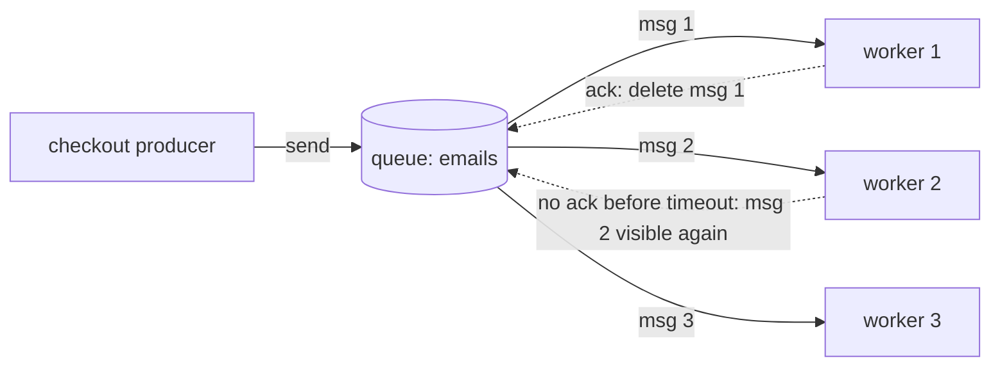
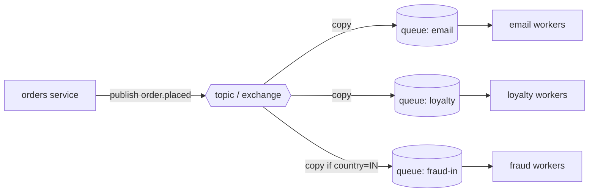
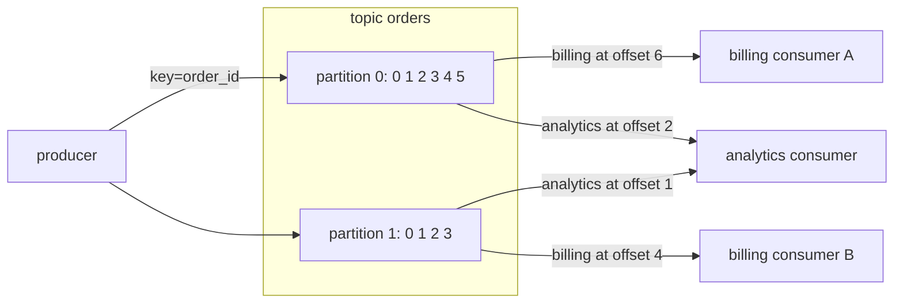

# Queues vs Streams and Broker Comparison

> [!summary] TL;DR
> A **message broker** is a server that holds messages between the program that sends them (the **producer**) and the program that handles them (the **consumer**). A **queue** hands each message to one consumer and deletes it once that consumer confirms it; a **stream** (also called a **log**) keeps every message in order and lets any number of readers go through it at their own pace.

> [!abstract] Core idea
> - Queue: one message, one worker, deleted on ack. Good for jobs ("send this email").
> - Log/stream: messages stay for a retention period; each consumer group keeps its own position (offset). Good for events many systems read, and for replay.
> - Pub/sub fan-out copies one message to many subscribers; with a queue behind each subscriber it becomes durable.
> - Every durable broker (all of these except Redis Pub/Sub and NATS core, which are at most once) is "at least once" in normal use, so consumers must tolerate duplicates.
> - Pick by use case: task queue → SQS, RabbitMQ, a Postgres or Redis queue; event bus and replay → Kafka, Pulsar, Redis Streams, NATS JetStream.

## 1. Why it exists

A checkout service calls three things after a payment: send a receipt email (≈400 ms at the email provider), update loyalty points (≈80 ms), and notify the warehouse (≈150 ms). Done inline, the user waits about 630 ms more, and if the email provider is down for 5 minutes, every checkout in those 5 minutes fails or hangs. (These latencies are an illustrative estimate.)

Put a broker in between and the checkout writes three small messages (a few milliseconds) and returns. The email consumer can be down for 5 minutes; its messages wait in the broker and are sent when it comes back. The broker gives you:

- **Decoupling in time:** producer and consumer do not have to be up at the same moment.
- **Load levelling:** a burst of 5,000 orders in a minute becomes a backlog that 10 workers drain at their own rate instead of 5,000 concurrent calls.
- **Fan-out:** one "order placed" fact can reach email, loyalty and analytics without the checkout knowing they exist.

The question this note answers is *which shape of broker*: a queue, a pub/sub topic, or a log, and which product implements it.

## 2. Mental model

- A **queue** is a **ticket counter line**. Each customer (message) is served by exactly one clerk (consumer). Once served, they leave the line. Add more clerks and the line moves faster. These clerks are **competing consumers**.
- A **log** is a **newspaper archive**. Articles are printed in order and kept for, say, seven days. Each reader (consumer group) has a bookmark (offset). Two readers do not compete; each reads everything. A new reader can start from last week's first page (**replay**).
- **Pub/sub** is a **mailing list**. One post is copied into every subscriber's inbox. Whether a copy survives a subscriber being offline depends on whether the inbox is durable (an SQS queue behind SNS) or not (Redis Pub/Sub, which drops it).

Analogy summary: queue = work to be done once; log = history to be read by many.

## 3. How it works

### Point-to-point queue with competing consumers



1. The producer sends a message; the broker stores it.
2. A consumer receives it. The broker does **not** delete it yet; it hides it from others (SQS calls this the **visibility timeout**; RabbitMQ tracks it as an **unacknowledged** delivery on that consumer's channel).
3. The consumer does the work and **acks** (SQS: `DeleteMessage`; RabbitMQ: `basic.ack`). Now the broker deletes it.
4. If the consumer crashes, the hidden message becomes available again (SQS: timeout expires; RabbitMQ: the channel or connection closes). Another consumer gets it. This is why delivery is **at least once**.

### Pub/sub fan-out



The topic (SNS topic, RabbitMQ fanout or topic exchange) copies the message to each bound queue. Each queue then behaves like the point-to-point queue above, so each subscriber gets durability, retries and its own pace. Filters (SNS filter policies, RabbitMQ routing keys) decide which queues get a copy.

### Partitioned log with two consumer groups



- Records are appended to a **partition** chosen from the key, so all events for one order stay in one partition and keep their order. (See [[Message Ordering and Partition Keys]].)
- Within a **consumer group**, each partition is read by one member at a time; that is how a log scales readers.
- Each group stores its own **committed offset**: "I have processed everything before record 6". Reading does not delete. Retention (time or size) deletes old segments later.
- Billing is caught up; analytics is behind (it has **lag**). Neither affects the other.

### Ack models side by side

| Broker | How a consumer says "done" | What happens if it never does |
| --- | --- | --- |
| SQS | `DeleteMessage(receiptHandle)` | Message reappears when the visibility timeout (default 30 s, max 12 h) expires |
| RabbitMQ | `basic.ack(deliveryTag)`; `basic.nack`/`basic.reject` with or without requeue | Redelivered when the channel closes; `prefetch` (`basic.qos`) caps unacked messages per consumer |
| Kafka | Commit offset N for a partition (meaning "everything before N is done") | After a crash or rebalance, the group restarts from the last committed offset, so records after it are reprocessed |
| Redis Streams | `XACK stream group id` | Entry stays in the group's pending entries list (PEL) until another consumer claims it with `XAUTOCLAIM` |
| Redis Pub/Sub | No ack | Nothing: a message is delivered only to subscribers connected right now |

## 4. Worked example

### Whiteboard version

```text
QUEUE                                   LOG
messages: [m1 m2 m3]                    records: [r0 r1 r2 r3]   (never removed by reading)
receive():                              offsets: {billing: 4, analytics: 1}
  first visible m -> hide it for 30s    poll(group):
  m.receives++                            return records[offsets[group]:]
  return m with a new receipt           commit(group, n):
ack(receipt):                             offsets[group] = n
  delete m if receipt is current        replay:
crash: m becomes visible after 30s        commit(group, 0)  then poll again
=> each message done by ONE worker      => every group sees EVERY record
=> history is gone after ack            => history kept until retention
```

### Code: both shapes in Go

The model below is in-memory, so the semantics can be tested without a broker. The queue copies SQS's visibility timeout and receipt; the log copies a single Kafka partition with per-group offsets.

```go
// Package mq contrasts the two broker shapes: a queue that deletes a
// message once it is acked, and a log that keeps records and lets each
// consumer group track its own offset.
package mq

import (
	"strconv"
	"sync"
	"time"
)

// Message is what a queue consumer receives.
type Message struct {
	ID       int
	Body     string
	Receives int    // how many times it has been handed out
	Receipt  string // proof of this particular receive; needed to ack
}

type entry struct {
	msg            Message
	invisibleUntil time.Time
}

// Queue is a point-to-point queue with a visibility timeout (SQS style).
// A received message is hidden, not removed. Ack removes it; if the
// consumer never acks, it becomes visible again and is redelivered.
type Queue struct {
	mu      sync.Mutex
	now     func() time.Time
	vis     time.Duration
	entries []*entry
	nextID  int
	nextRcp int
}

func NewQueue(visibility time.Duration, now func() time.Time) *Queue {
	return &Queue{vis: visibility, now: now}
}

func (q *Queue) Send(body string) int {
	q.mu.Lock()
	defer q.mu.Unlock()
	q.nextID++
	q.entries = append(q.entries, &entry{msg: Message{ID: q.nextID, Body: body}})
	return q.nextID
}

// Receive hands out the oldest visible message and hides it for the
// visibility timeout. Competing consumers never get the same visible message.
func (q *Queue) Receive() (Message, bool) {
	q.mu.Lock()
	defer q.mu.Unlock()
	now := q.now()
	for _, e := range q.entries {
		if now.Before(e.invisibleUntil) {
			continue // in flight with another consumer
		}
		q.nextRcp++
		e.msg.Receives++
		e.msg.Receipt = "r" + strconv.Itoa(q.nextRcp)
		e.invisibleUntil = now.Add(q.vis)
		return e.msg, true
	}
	return Message{}, false
}

// Ack deletes the message, but only with the receipt from the latest
// receive. A slow consumer whose timeout expired cannot delete a message
// that has since been handed to someone else.
func (q *Queue) Ack(receipt string) bool {
	q.mu.Lock()
	defer q.mu.Unlock()
	for i, e := range q.entries {
		if e.msg.Receipt == receipt {
			q.entries = append(q.entries[:i], q.entries[i+1:]...)
			return true
		}
	}
	return false
}

// Len counts stored messages, visible or in flight.
func (q *Queue) Len() int {
	q.mu.Lock()
	defer q.mu.Unlock()
	return len(q.entries)
}

// Log is an append-only log (one Kafka partition, or a Redis Stream).
// Reading never deletes. Each consumer group owns one committed offset.
type Log struct {
	mu      sync.Mutex
	records []string
	offsets map[string]int // group -> next offset to read
}

func NewLog() *Log { return &Log{offsets: map[string]int{}} }

// Append returns the offset of the new record.
func (l *Log) Append(v string) int {
	l.mu.Lock()
	defer l.mu.Unlock()
	l.records = append(l.records, v)
	return len(l.records) - 1
}

// Poll returns up to max records from the group's committed offset.
// It does not move the offset: the consumer commits after processing.
func (l *Log) Poll(group string, max int) (from int, recs []string) {
	l.mu.Lock()
	defer l.mu.Unlock()
	from = l.offsets[group]
	end := min(from+max, len(l.records))
	return from, append([]string(nil), l.records[from:end]...)
}

// Commit records that everything before next has been processed.
func (l *Log) Commit(group string, next int) {
	l.mu.Lock()
	defer l.mu.Unlock()
	l.offsets[group] = next
}

// Lag is how many records the group has not processed yet.
func (l *Log) Lag(group string) int {
	l.mu.Lock()
	defer l.mu.Unlock()
	return len(l.records) - l.offsets[group]
}
```

The tests pin down the four behaviours that matter in interviews.

```go
package mq

import (
	"testing"
	"time"
)

type clock struct{ t time.Time }

func (c *clock) now() time.Time { return c.t }

func TestCompetingConsumersGetDifferentMessages(t *testing.T) {
	c := &clock{t: time.Unix(0, 0)}
	q := NewQueue(30*time.Second, c.now)
	q.Send("email-1")
	q.Send("email-2")

	a, _ := q.Receive() // worker A
	b, _ := q.Receive() // worker B
	if a.ID == b.ID {
		t.Fatalf("both workers got message %d", a.ID)
	}
	if _, ok := q.Receive(); ok {
		t.Fatal("a third receive should find nothing visible")
	}
	q.Ack(a.Receipt)
	q.Ack(b.Receipt)
	if q.Len() != 0 {
		t.Fatalf("acked messages must be deleted, %d left", q.Len())
	}
}

func TestUnackedMessageIsRedeliveredAfterVisibilityTimeout(t *testing.T) {
	c := &clock{t: time.Unix(0, 0)}
	q := NewQueue(30*time.Second, c.now)
	q.Send("charge-card")

	first, _ := q.Receive() // worker crashes and never acks
	c.t = c.t.Add(29 * time.Second)
	if _, ok := q.Receive(); ok {
		t.Fatal("message visible before the timeout expired")
	}
	c.t = c.t.Add(2 * time.Second)
	second, ok := q.Receive()
	if !ok || second.ID != first.ID || second.Receives != 2 {
		t.Fatalf("want redelivery of %d with Receives=2, got %+v ok=%v", first.ID, second, ok)
	}
	if q.Ack(first.Receipt) {
		t.Fatal("a stale receipt must not delete a message now owned by another consumer")
	}
	if !q.Ack(second.Receipt) {
		t.Fatal("the current receipt must delete")
	}
}

func TestLogKeepsRecordsAndGroupsReadIndependently(t *testing.T) {
	l := NewLog()
	for _, v := range []string{"o1", "o2", "o3"} {
		l.Append(v)
	}

	from, recs := l.Poll("billing", 10)
	l.Commit("billing", from+len(recs))
	if l.Lag("billing") != 0 || l.Lag("analytics") != 3 {
		t.Fatalf("lag billing=%d analytics=%d", l.Lag("billing"), l.Lag("analytics"))
	}

	// A new group added later still sees all history.
	_, recs = l.Poll("analytics", 10)
	if len(recs) != 3 || recs[0] != "o1" {
		t.Fatalf("analytics got %v", recs)
	}

	// Replay: move billing's offset back and read again.
	l.Commit("billing", 1)
	_, recs = l.Poll("billing", 10)
	if len(recs) != 2 || recs[0] != "o2" {
		t.Fatalf("replay got %v", recs)
	}
}

func TestLogCrashBeforeCommitRereads(t *testing.T) {
	l := NewLog()
	l.Append("o1")
	l.Append("o2")
	_, recs := l.Poll("billing", 10) // processed, then crashed before Commit
	_, again := l.Poll("billing", 10)
	if len(recs) != 2 || len(again) != 2 {
		t.Fatalf("uncommitted records must be read again: %v then %v", recs, again)
	}
}
```

Run with `go test -race ./mq` (Go 1.24): all 4 tests pass.

What the tests show:

- **Competing consumers:** two workers get two different messages; a third receive finds nothing while both are in flight.
- **Redelivery:** after 31 s with no ack, the same message comes back with `Receives=2`. Real SQS reports this as `ApproximateReceiveCount`.
- **Stale receipt:** the first worker's old receipt cannot delete the message after someone else received it. Real SQS documents that you must use the most recent receipt handle, otherwise the message might not be deleted.
- **Log:** committing does not delete; a group added later reads all history; moving the offset back replays.

## 5. Variants and comparison

| System | Model | Ordering | Retention and replay | Routing and fan-out | Ops burden | Go client |
| --- | --- | --- | --- | --- | --- | --- |
| **Amazon SQS** standard | Queue, pull (long polling up to 20 s) | Best effort | Deleted on ack; unacked kept 1 min to 14 days (default 4 days); no replay | None; use SNS or EventBridge in front | None (managed) | `aws-sdk-go-v2/service/sqs` |
| **SQS FIFO** | Queue | Strict within a `MessageGroupId` | As above; 5-minute deduplication window | As above | None | same |
| **Amazon SNS** | Pub/sub push | FIFO topics only | Stores nothing durable for you; durability comes from the SQS queue behind it | Filter policies; fan-out to SQS, Lambda, HTTP, email, SMS | None | `aws-sdk-go-v2/service/sns` |
| **RabbitMQ** classic/quorum queues | Queue, push with `prefetch` | Per queue, until redeliveries or several consumers interleave | Deleted on ack; no replay | Exchanges: direct, topic, fanout, headers | Medium (cluster, quorum queues use Raft) | `rabbitmq/amqp091-go` |
| **RabbitMQ streams** (3.9+) | Append-only log | Per stream | Retained by size or age; replay from an offset | Via exchanges | Medium | `rabbitmq-stream-go-client` |
| **Apache Kafka** | Partitioned log, pull | Per partition | Retained by time or size, or compacted by key; replay by offset | Topics; consumer groups | High self-hosted; managed options (Amazon MSK, Confluent Cloud) | `twmb/franz-go`, `segmentio/kafka-go`, `confluent-kafka-go` (cgo) |
| **Apache Pulsar** | Log with queue-style subscriptions | Per partition (Exclusive, Failover); per key (Key_Shared) | Retained in BookKeeper, offload to object storage | Subscription types: Exclusive, Shared, Failover, Key_Shared | High (brokers + BookKeeper + metadata store) | `apache/pulsar-client-go` |
| **NATS JetStream** | Log (stream) with pull or push consumers | Per stream (per subject within it) | Limits by age, size or count; work-queue retention deletes on ack | Subject wildcards | Low to medium (single binary, Raft) | `nats-io/nats.go` |
| **Redis Streams** | Log with consumer groups | Per stream | Trimmed with `MAXLEN`/`MINID`; replay by ID | None built in | Low, but memory-bound | `redis/go-redis/v9` |
| **Redis Lists** | Queue | FIFO | Deleted on pop | None | Low | `go-redis`; `hibiken/asynq` builds jobs on Redis |
| **Redis Pub/Sub** | Fire-and-forget fan-out | Per channel | **None**: offline subscribers miss messages (at most once) | Channels and patterns | Low | `go-redis` |
| **Postgres job table** | Queue via `FOR UPDATE SKIP LOCKED` | By your `ORDER BY` | Rows until you delete them | None | You already run Postgres | `riverqueue/river` |

> [!warning] Interview trap
> "Kafka is a queue." It is a log. Two consumer groups each get every record; inside one group, the unit of parallelism is the partition, not the message. A slow record blocks the records behind it in that partition, which a queue with competing consumers would not do.

### Decision guide by use case

| Use case | First choice | Why |
| --- | --- | --- |
| Background task queue (emails, PDFs, thumbnails) | SQS, or a Postgres-backed queue (River) if Postgres is already there; asynq on Redis | Per-message ack, retries, DLQ; no need for replay |
| Event bus between services (many independent consumers) | SNS → SQS per consumer, EventBridge, Kafka | Each consumer gets its own copy and pace |
| CDC stream, audit trail, rebuilding read models | Kafka (or Pulsar, Kinesis) | Ordered per key, long retention, replay |
| Complex routing (by region, priority, header) | RabbitMQ exchanges, EventBridge rules | Routing is a broker feature, not consumer code |
| Real-time fan-out where loss is fine (live cursors, typing indicators) | Redis Pub/Sub, NATS core | Lowest latency, no storage |
| Tiny team, low volume, already on Redis | Redis Streams | One less system; accept memory-bound retention |

## 6. Trade-offs and when not to use

- **Queues lose history.** Once acked, a message is gone. If a bug corrupted 2 hours of processing, you cannot replay; you need the producer's database or an archive.
- **Logs push work onto consumers.** The consumer must track offsets, handle rebalances and avoid head-of-line blocking within a partition. A poison record stops its partition unless you skip it into a retry topic ([[Dead Letter Queues and Poison Messages]]).
- **Parallelism in a log is capped by partitions.** A topic with 12 partitions supports at most 12 active consumers per group; the 13th sits idle.
- **Push brokers can overwhelm consumers** unless prefetch is set. RabbitMQ with no `basic.qos` limit pushes as fast as the network allows. See [[Backpressure and Flow Control]].
- **Do not add a broker** when the caller needs the answer now (a price quote, a login). A synchronous call with a timeout is simpler. Also skip it for 50 jobs a day in a monolith: a jobs table in Postgres is enough.
- **Every broker hop adds failure modes:** duplicates, reordering, poison messages, schema drift. The [[Transactional Outbox and CDC]] solves the "DB committed but publish failed" gap that a naive broker integration has.

## 7. In production

- **Real systems:**
	- SQS + SNS fan-out is the default AWS pattern for decoupled services ([[AWS SQS, SNS and EventBridge]]).
	- Kafka carries CDC from databases via Debezium, and clickstreams; see [[Kafka and Event Streaming]].
	- RabbitMQ is common for task routing with priorities; new deployments should use quorum queues for replicated, durable queues (classic mirrored queues were removed in RabbitMQ 4.0).
	- River and similar Postgres queues are popular in Go because the job row commits in the same transaction as the business data.
- **Failure modes → fixes:**
	- Consumer slower than producer, backlog grows for hours → alert on oldest-message age, scale consumers on lag ([[Background Jobs and Worker Pools]]).
	- Visibility timeout shorter than processing time → the same message runs twice in parallel; set the timeout above p99 runtime and extend it with a heartbeat.
	- Kafka consumer group rebalancing in a loop → processing between polls exceeds `max.poll.interval.ms`; process smaller batches or move work off the poll thread.
	- Redis Pub/Sub used for jobs → messages vanish during a deploy; use Streams or a real queue.
- **What to monitor:** backlog (`ApproximateNumberOfMessagesVisible` in SQS, consumer lag in Kafka), age of oldest message, in-flight count, redelivery or receive count, DLQ depth, publish errors.

## 8. Deep dive

**Push vs pull.** RabbitMQ pushes deliveries to a consumer up to its prefetch count; the broker does flow control. Kafka, SQS and JetStream pull consumers ask for batches; the consumer does flow control by not asking. Pull makes batching and backpressure natural; push gives lower latency for small volumes. SQS **long polling** (`WaitTimeSeconds` up to 20) avoids paying for empty responses while still being pull.

**Why a log scales reads cheaply.** A queue must track state per message (in flight, receipt, receive count). A log tracks one integer per group per partition. Reading is a sequential scan of a file, which the OS page cache serves well, so adding a fifth consumer group costs almost nothing on the broker. The price is coarse-grained acks: you cannot ack record 7 while record 6 is still being retried, because the offset is a single number.

**Queues on top of logs and logs on top of queues.** The line is blurring:
- Pulsar's Shared subscription and Kafka's share groups (KIP-932: early access in Kafka 4.0, preview in 4.1, production-ready in 4.2) give per-message acks over a log.
- RabbitMQ streams and SQS's lack of replay show the opposite: RabbitMQ added a log type because users wanted replay.
- JetStream offers both: `WorkQueuePolicy` retention deletes on ack; `LimitsPolicy` keeps messages like a log.

**Ordering scope is always narrower than people think.** SQS FIFO orders within a message group, Kafka within a partition, RabbitMQ within a queue only while there is one consumer and no requeue. Global order across a whole topic means one partition and one consumer, which caps throughput at one consumer's speed.

**Delivery guarantees come from the ack point, not the product.** Ack before processing gives at most once; ack after gives at least once. Exactly-once claims are scoped (Kafka transactions cover Kafka-to-Kafka read-process-write). The full treatment is in [[Delivery Semantics and Exactly-Once]], and making a consumer safe to run twice is in [[Idempotency and Idempotency Keys]].

## 9. Interview questions

> [!question]- What is the difference between a queue and a log?
> A queue gives each message to one consumer and deletes it after the ack; consumers compete. A log appends records and keeps them for a retention period; each consumer group tracks its own offset, so many groups read everything and can replay. Queues track per-message state; logs track one offset per partition per group.

> [!question]- You need to send 1 million emails a day with retries. Kafka or SQS?
> SQS (or RabbitMQ, or a Postgres job queue). Emails are independent tasks: you want per-message ack, per-message retry and a DLQ, and you never replay them. In Kafka, one slow or failing email blocks its partition unless you build retry topics yourself.

> [!question]- Trap: "We use Redis Pub/Sub so jobs are never lost." What is wrong?
> Redis Pub/Sub stores nothing. A message reaches only subscribers connected at that instant; if the worker is restarting, the job is gone. A slow subscriber can also be disconnected when its output buffer exceeds the `client-output-buffer-limit pubsub` setting. Use Redis Streams with consumer groups, or a real queue.

> [!question]- How does fan-out work with SNS and SQS, and why put a queue behind each subscriber?
> SNS copies each published message to all matching subscriptions. If a subscriber is an SQS queue, its copy is stored durably and consumed at that subscriber's pace with its own retries and DLQ. Pushing straight to an HTTP endpoint gives you only SNS's retry policy; when that is exhausted the message is dropped unless the subscription has its own DLQ.

> [!question]- What does a visibility timeout protect against, and what goes wrong if it is too short?
> It hides a received message so other consumers do not take it, and it brings the message back if the consumer dies. If it is shorter than processing time, the message reappears while the first worker is still working, and two workers process it in parallel. Set it above p99 runtime and extend it with `ChangeMessageVisibility` for long jobs.

> [!question]- How do you get more parallelism from a Kafka consumer group that is already at 12 consumers for 12 partitions?
> Add partitions (which changes key-to-partition mapping for new records, so per-key order breaks across the change), or process records concurrently inside a consumer while keeping per-key order (for example, hash keys onto worker goroutines and commit only the lowest completed offset). Adding a 13th consumer does nothing.

> [!question]- When would you choose RabbitMQ over Kafka?
> When you need routing (topic exchanges by pattern, headers), per-message ack and requeue, priorities, or low latency for moderate volume, and you do not need replay. Use quorum queues for durability. Choose Kafka for high-throughput event streams, long retention, replay and many independent consumer groups.

## 10. Cheat sheet

- Queue: one consumer per message, delete on ack, competing consumers scale it.
- Log: append and retain; consumer groups with offsets; replay; parallelism = partitions.
- Pub/sub: copy to every subscriber; durable only if each subscriber has a queue or log.
- Ack models: SQS delete + visibility timeout; RabbitMQ ack/nack + prefetch; Kafka offset commit; Redis Streams XACK + PEL.
- Ordering is per group/partition/queue, never global for free.
- Everything is at least once in practice: make consumers idempotent.
- Task queue → SQS, RabbitMQ, River; event bus → SNS+SQS, EventBridge, Kafka; replay/CDC → Kafka; lossy real-time → Redis Pub/Sub, NATS core.

## Links

- **Before this:** [[Stacks, Queues and Deques]], [[Monolith vs Microservices]]
- **Next:** [[Event-Driven Architecture Basics]], [[Background Jobs and Worker Pools]], [[Kafka and Event Streaming]]
- **Compare with:** [[Redis as a Queue - Lists, Streams and Pub-Sub]], [[AWS SQS, SNS and EventBridge]], [[Case Study - Distributed Message Queue]]
