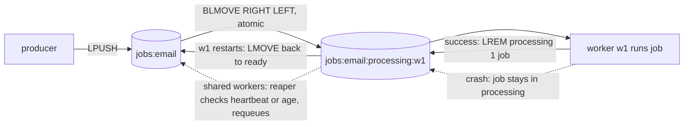
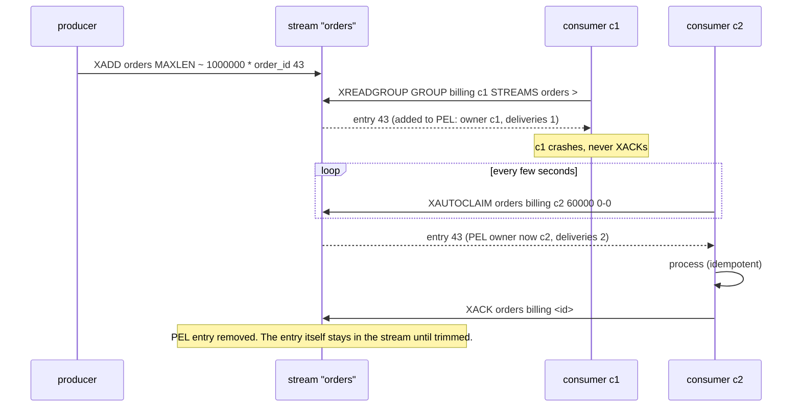

# Redis as a Queue - Lists, Streams and Pub-Sub

> [!summary] TL;DR
> Redis offers three ways to pass messages: **Lists** (a simple work queue), **Streams** (an append-only log with consumer groups and acknowledgements), and **Pub/Sub** (live broadcast that stores nothing). Lists and Streams can be made reliable with the right commands; Pub/Sub cannot.

> [!abstract] Core idea
> - `LPUSH` + `BRPOP` loses a job if the worker dies after the pop. Use `BLMOVE` into a per-worker processing list and recover it on restart.
> - Streams are the real queue in Redis: consumer groups, a pending entries list (PEL), `XACK`, and `XAUTOCLAIM` to take over a crashed consumer's entries.
> - Pub/Sub is fire-and-forget: offline or slow subscribers miss messages. Never use it for jobs.
> - Everything is at least once, and an acked write can still be lost on failover or with `appendfsync everysec`. Handlers must be idempotent.
> - Choose Kafka, RabbitMQ or SQS when you need long retention, replay at scale, or data bigger than RAM.

## 1. Why it exists

A team already runs Redis for caching and needs a queue for 2,000 email jobs per minute. Adding RabbitMQ or Kafka means another cluster to run, monitor and secure. Redis can do the job: on a laptop (Apple M4, Redis 8.2.1, `redis-benchmark` with its default 50 clients and no pipelining), `LPUSH` measured about 183,000 ops/s, `RPOP` about 188,000 ops/s and `XADD` about 171,000 ops/s, each with a p50 latency near 0.2 ms. That is two orders of magnitude more than this team needs.

The catch is that the obvious Redis queue is not reliable, and the most obvious "messaging" command, `PUBLISH`, is not a queue at all. This note shows which structure to use and how to close the gaps. Data-structure basics are in [[Redis Data Structures and When to Use Each]].

## 2. Mental model

- **List queue:** a pile of envelopes. A worker takes the bottom one. If the worker drops it on the way, it is gone, unless the worker first moves it to its own "in progress" tray.
- **Stream:** a numbered logbook. Entries stay in the book. Each team (consumer group) has a bookmark and a list of entries handed out but not signed off (the PEL). A supervisor can reassign unsigned entries from an absent member.
- **Pub/Sub:** a radio broadcast. Whoever is tuned in hears it; nobody can rewind.

## 3. How it works

### List queue and the lost-job problem

```text
producer:  LPUSH jobs:email '{"id":"j1"}'
worker:    BRPOP jobs:email 5            -> returns j1, and j1 is no longer in Redis
worker:    *crash before sending*        -> j1 is lost
```

`BRPOP` is a destructive read: the job leaves Redis the moment the worker receives it. The fix is to atomically move it to a list owned by that worker, and remove it only after the work is done.



Measured on Redis 8.2.1:

```text
127.0.0.1:6394> LPUSH jobs:email {"id":"j1"} {"id":"j2"}
(integer) 2
127.0.0.1:6394> BLMOVE jobs:email jobs:email:processing:w1 RIGHT LEFT 5
"{\"id\":\"j1\"}"
127.0.0.1:6394> LREM jobs:email:processing:w1 1 {"id":"j1"}
(integer) 1
```

- `BLMOVE` (since Redis 6.2) replaces the deprecated `BRPOPLPUSH`. It pops from `jobs:email` and pushes onto the processing list in one atomic step, so the job is always in exactly one of the two lists.
- With a **processing list per worker**, a restarting worker moves its own leftovers back. With a **shared processing list**, you need a **reaper**: a process that requeues jobs whose owner's heartbeat key has expired, or that have been in the list longer than a timeout (store a claim timestamp in a hash, since a list holds no metadata).
- `LREM` scans the list, so keep processing lists short (one or a few jobs per worker).
- Lists have no retry counter, no delay and no dead-letter. You build them: a retry count inside the payload, a sorted set for delays, a `jobs:email:dead` list.

### Streams with consumer groups



The pieces:

- **`XADD key [MAXLEN|MINID [~] n] * field value ...`** appends an entry with an ID `<ms>-<seq>`. `MAXLEN ~ 1000000` trims to about a million entries; the `~` lets Redis trim whole internal nodes, which is much cheaper than exact trimming. `MINID` trims by ID, which means by time.
- **Consumer group** (`XGROUP CREATE orders billing $ MKSTREAM`): a named cursor (`last-delivered-id`) plus a **PEL** (pending entries list) of entries delivered but not yet acked, each with an owner, idle time and delivery count. `$` starts at the end; `0` starts from the beginning.
- **`XREADGROUP ... STREAMS orders >`**: `>` means "entries never delivered to this group". Each goes to one consumer in the group (competing consumers). Reading with an ID such as `0` instead returns *this consumer's own* pending entries, which is how a restarted consumer resumes its unfinished work.
- **`XACK`** removes the entry from the PEL. It does **not** delete it from the stream.
- **`XPENDING`** shows the PEL: the summary form gives counts per consumer; the extended form gives idle time and delivery count per entry.
- **`XAUTOCLAIM`** (since 6.2) transfers entries idle longer than `min-idle-time` to the caller and increments their delivery count. It replaces the older `XPENDING` + `XCLAIM` loop.
- **Dead-lettering is yours to build**: when the delivery count passes a limit, copy the entry to another stream (`orders:dlq`) and `XACK` it.

Measured on Redis 8.2.1 (the IDs are server-generated timestamps; the idle time is in milliseconds):

```text
127.0.0.1:6394> XGROUP CREATE orders billing $ MKSTREAM
OK
127.0.0.1:6394> XADD orders MAXLEN ~ 1000000 * order_id 42 total 1999
"1793776793514-0"
127.0.0.1:6394> XADD orders * order_id 43 total 500
"1793776793519-0"
127.0.0.1:6394> XREADGROUP GROUP billing c1 COUNT 10 STREAMS orders >
1) 1) "orders"
   2) 1) 1) "1793776793514-0"
         2) 1) "order_id"
            2) "42"
            3) "total"
            4) "1999"
      2) 1) "1793776793519-0"
         2) 1) "order_id"
            2) "43"
            3) "total"
            4) "500"
127.0.0.1:6394> XACK orders billing 1793776793514-0
(integer) 1
127.0.0.1:6394> XPENDING orders billing - + 10
1) 1) "1793776793519-0"
   2) "c1"
   3) (integer) 18
   4) (integer) 1
127.0.0.1:6394> XAUTOCLAIM orders billing c2 1000 0-0 COUNT 10
1) "0-0"
2) 1) 1) "1793776793519-0"
      2) 1) "order_id"
         2) "43"
         3) "total"
         4) "500"
3) (empty array)
127.0.0.1:6394> XPENDING orders billing - + 10
1) 1) "1793776793519-0"
   2) "c2"
   3) (integer) 4
   4) (integer) 2
```

Read it line by line: c1 got both entries and acked only the first. The PEL showed entry 43 owned by c1 with 1 delivery. After it had been idle for more than 1,000 ms, `XAUTOCLAIM` moved it to c2 and the delivery count became 2. The first reply element `0-0` is the cursor (scan finished); the third lists IDs that were in the PEL but have since been deleted from the stream (empty here).

### Pub/Sub

```text
127.0.0.1:6394> PUBLISH news hello
(integer) 0          <- number of subscribers that received it: nobody was listening, so it is gone
127.0.0.1:6394> CONFIG GET client-output-buffer-limit
... pubsub 33554432 8388608 60
```

- Delivery is **at most once**. Redis keeps no copy. A subscriber that is restarting, or reconnecting after a network blip, misses everything published meanwhile.
- A slow subscriber's unread messages pile up in its output buffer on the server. The default limit for Pub/Sub clients (measured above with `CONFIG GET`) is a hard 32 MB, or 8 MB sustained for 60 seconds; past it, Redis **disconnects** the subscriber and its backlog is lost.
- In Redis Cluster, classic `PUBLISH` is broadcast to every node. Sharded Pub/Sub (`SPUBLISH`/`SSUBSCRIBE`, since 7.0) keeps a channel on its slot's shard.
- Good for: cache-invalidation hints, live dashboards, chat presence, telling WebSocket servers to push something, when a missed message is harmless or recoverable.

### Delayed jobs with a sorted set

```text
127.0.0.1:6394> ZADD jobs:delayed 1762250700 job-7 1762250460 job-8      (score = run_at, unix seconds)
(integer) 2
127.0.0.1:6394> ZRANGE jobs:delayed -inf 1762250500 BYSCORE LIMIT 0 100  (now = 1762250500)
1) "job-8"
127.0.0.1:6394> ZREM jobs:delayed job-8
(integer) 1          <- 1 means this poller won the job; push it to the ready queue
```

Several pollers may see the same due job; only the one whose `ZREM` returns 1 enqueues it. Production libraries do "move due jobs to the ready list" in a Lua script so the read, remove and push are one atomic step.

## 4. Worked example

### Whiteboard version

```text
LIST (reliable):
  job = BLMOVE ready processing:<me> RIGHT LEFT 5
  handle(job); LREM processing:<me> 1 job
  on start: LMOVE processing:<me> ready  (until empty)

STREAM:
  XGROUP CREATE s g $ MKSTREAM            (ignore BUSYGROUP)
  loop:
    XREADGROUP GROUP g <me> COUNT 10 BLOCK 5000 STREAMS s >
    for each: if handle ok -> XACK s g id   (failed ones stay in PEL)
  reclaimer every few seconds:
    XAUTOCLAIM s g <me> <min-idle> 0-0 COUNT 10
    deliveries = XPENDING s g id id 1
    if deliveries > max: MULTI; XADD s:dlq ...; XACK s g id; EXEC
    else handle and XACK
```

### Code: both reliable patterns in Go, tested against a real Redis

Written with `github.com/redis/go-redis/v9` (v9.7.0). The tests run against a throwaway Redis 8.2 on port 6394 and skip if none is running.

```go
// Package redisq shows the two reliable Redis queue shapes: a list queue
// with a processing list, and a Streams consumer group with reclaim and
// a dead-letter stream.
package redisq

import (
	"context"
	"errors"
	"time"

	"github.com/redis/go-redis/v9"
)

// ListQueue moves each job atomically from Ready to this worker's own
// Processing list, so a crash leaves the job in Processing, not lost.
type ListQueue struct {
	RDB        *redis.Client
	Ready      string // e.g. "jobs:email"
	Processing string // e.g. "jobs:email:processing:worker-1"
}

func (q ListQueue) Push(ctx context.Context, job string) error {
	return q.RDB.LPush(ctx, q.Ready, job).Err()
}

// Pop blocks up to wait. redis.Nil means the queue stayed empty.
func (q ListQueue) Pop(ctx context.Context, wait time.Duration) (string, error) {
	return q.RDB.BLMove(ctx, q.Ready, q.Processing, "RIGHT", "LEFT", wait).Result()
}

// Ack removes the finished job from the processing list.
func (q ListQueue) Ack(ctx context.Context, job string) error {
	return q.RDB.LRem(ctx, q.Processing, 1, job).Err()
}

// Recover runs when this worker starts: anything still in its processing
// list was in flight when it died, so move it back to Ready.
func (q ListQueue) Recover(ctx context.Context) (int, error) {
	n := 0
	for {
		err := q.RDB.LMove(ctx, q.Processing, q.Ready, "RIGHT", "RIGHT").Err()
		if errors.Is(err, redis.Nil) {
			return n, nil
		}
		if err != nil {
			return n, err
		}
		n++
	}
}

// StreamConsumer reads a stream through a consumer group.
type StreamConsumer struct {
	RDB           *redis.Client
	Stream        string // "orders"
	Group         string // "billing"
	Name          string // this consumer, e.g. the pod name
	DeadLetter    string // "orders:dlq"
	MinIdle       time.Duration
	MaxDeliveries int64
	Handle        func(ctx context.Context, m redis.XMessage) error
}

// EnsureGroup creates the group at the end of the stream ("$") and the
// stream itself if missing. BUSYGROUP means it already exists.
func (c StreamConsumer) EnsureGroup(ctx context.Context) error {
	err := c.RDB.XGroupCreateMkStream(ctx, c.Stream, c.Group, "$").Err()
	if err != nil && err.Error() == "BUSYGROUP Consumer Group name already exists" {
		return nil
	}
	return err
}

// ReadNew reads never-delivered entries (">") and acks each one that the
// handler accepts. A failed entry stays in the pending entries list (PEL).
func (c StreamConsumer) ReadNew(ctx context.Context, count int64, block time.Duration) (int, error) {
	res, err := c.RDB.XReadGroup(ctx, &redis.XReadGroupArgs{
		Group: c.Group, Consumer: c.Name, Streams: []string{c.Stream, ">"},
		Count: count, Block: block,
	}).Result()
	if errors.Is(err, redis.Nil) {
		return 0, nil
	}
	if err != nil {
		return 0, err
	}
	acked := 0
	for _, s := range res {
		for _, m := range s.Messages {
			if c.Handle(ctx, m) == nil {
				if err := c.RDB.XAck(ctx, c.Stream, c.Group, m.ID).Err(); err != nil {
					return acked, err
				}
				acked++
			}
		}
	}
	return acked, nil
}

// Reclaim takes over entries idle longer than MinIdle (their consumer
// crashed or is stuck). Entries delivered too often go to the dead-letter
// stream instead of being retried forever.
func (c StreamConsumer) Reclaim(ctx context.Context, count int64) (retried, dead int, err error) {
	msgs, _, err := c.RDB.XAutoClaim(ctx, &redis.XAutoClaimArgs{
		Stream: c.Stream, Group: c.Group, Consumer: c.Name,
		MinIdle: c.MinIdle, Start: "0-0", Count: count,
	}).Result()
	if err != nil {
		return 0, 0, err
	}
	for _, m := range msgs {
		// XAUTOCLAIM already counted this claim as a delivery.
		p, err := c.RDB.XPendingExt(ctx, &redis.XPendingExtArgs{
			Stream: c.Stream, Group: c.Group, Start: m.ID, End: m.ID, Count: 1,
		}).Result()
		if err != nil || len(p) == 0 {
			continue // acked meanwhile by someone else
		}
		if p[0].RetryCount > c.MaxDeliveries {
			values := map[string]any{"orig_id": m.ID, "deliveries": p[0].RetryCount}
			for k, v := range m.Values {
				values[k] = v
			}
			// Copy then ack in one MULTI/EXEC so the entry is never in both or neither.
			_, err := c.RDB.TxPipelined(ctx, func(pipe redis.Pipeliner) error {
				pipe.XAdd(ctx, &redis.XAddArgs{Stream: c.DeadLetter, Values: values})
				pipe.XAck(ctx, c.Stream, c.Group, m.ID)
				return nil
			})
			if err != nil {
				return retried, dead, err
			}
			dead++
			continue
		}
		if c.Handle(ctx, m) == nil {
			if err := c.RDB.XAck(ctx, c.Stream, c.Group, m.ID).Err(); err != nil {
				return retried, dead, err
			}
			retried++
		}
	}
	return retried, dead, nil
}
```

```go
package redisq

import (
	"context"
	"errors"
	"testing"
	"time"

	"github.com/redis/go-redis/v9"
)

// The tests need a throwaway Redis: redis-server --port 6394 --save "".
func newRDB(t *testing.T) *redis.Client {
	t.Helper()
	rdb := redis.NewClient(&redis.Options{Addr: "localhost:6394", DB: 15})
	if err := rdb.Ping(t.Context()).Err(); err != nil {
		t.Skip("no Redis on :6394:", err)
	}
	rdb.FlushDB(t.Context())
	t.Cleanup(func() { rdb.FlushDB(context.Background()); rdb.Close() })
	return rdb
}

func TestListQueueSurvivesWorkerCrash(t *testing.T) {
	ctx := t.Context()
	rdb := newRDB(t)
	q := ListQueue{RDB: rdb, Ready: "jobs:email", Processing: "jobs:email:processing:w1"}
	q.Push(ctx, "j1")

	job, err := q.Pop(ctx, time.Second)
	if err != nil || job != "j1" {
		t.Fatalf("pop %q %v", job, err)
	}
	// The worker dies here without Ack. The job is parked, not lost.
	if n, _ := rdb.LLen(ctx, q.Processing).Result(); n != 1 {
		t.Fatalf("processing list has %d", n)
	}

	// Worker restarts.
	if n, err := q.Recover(ctx); err != nil || n != 1 {
		t.Fatalf("recovered %d %v", n, err)
	}
	job, _ = q.Pop(ctx, time.Second)
	q.Ack(ctx, job)
	if n, _ := rdb.LLen(ctx, q.Processing).Result(); n != 0 {
		t.Fatal("ack should empty the processing list")
	}
	if _, err := q.Pop(ctx, time.Second); !errors.Is(err, redis.Nil) {
		t.Fatalf("want empty queue, got %v", err)
	}
}

func TestStreamCrashReclaimAndDeadLetter(t *testing.T) {
	ctx := t.Context()
	rdb := newRDB(t)
	base := StreamConsumer{RDB: rdb, Stream: "orders", Group: "billing", DeadLetter: "orders:dlq",
		MinIdle: 50 * time.Millisecond, MaxDeliveries: 3}
	if err := base.EnsureGroup(ctx); err != nil {
		t.Fatal(err)
	}
	if err := base.EnsureGroup(ctx); err != nil {
		t.Fatal("second EnsureGroup must be a no-op:", err)
	}
	rdb.XAdd(ctx, &redis.XAddArgs{Stream: "orders", MaxLen: 1_000_000, Approx: true,
		Values: map[string]any{"order_id": "42"}})
	rdb.XAdd(ctx, &redis.XAddArgs{Stream: "orders", Values: map[string]any{"order_id": "poison"}})

	// c1 reads both and "crashes": its handler never returns success.
	c1 := base
	c1.Name = "c1"
	c1.Handle = func(context.Context, redis.XMessage) error { return errors.New("crashed") }
	if n, err := c1.ReadNew(ctx, 10, 0); err != nil || n != 0 {
		t.Fatalf("c1 acked %d %v", n, err)
	}
	pending, _ := rdb.XPending(ctx, "orders", "billing").Result()
	if pending.Count != 2 {
		t.Fatalf("PEL should hold 2, has %d", pending.Count)
	}

	// c2 reclaims idle entries. Order 42 succeeds; poison keeps failing.
	c2 := base
	c2.Name = "c2"
	c2.Handle = func(_ context.Context, m redis.XMessage) error {
		if m.Values["order_id"] == "poison" {
			return errors.New("cannot parse")
		}
		return nil
	}
	totalRetried, totalDead := 0, 0
	for range 4 {
		time.Sleep(60 * time.Millisecond) // let entries go idle
		r, d, err := c2.Reclaim(ctx, 10)
		if err != nil {
			t.Fatal(err)
		}
		totalRetried += r
		totalDead += d
	}
	if totalRetried != 1 || totalDead != 1 {
		t.Fatalf("retried=%d dead=%d", totalRetried, totalDead)
	}
	pending, _ = rdb.XPending(ctx, "orders", "billing").Result()
	if pending.Count != 0 {
		t.Fatalf("PEL should be empty, has %d", pending.Count)
	}
	dlq, _ := rdb.XRange(ctx, "orders:dlq", "-", "+").Result()
	if len(dlq) != 1 || dlq[0].Values["order_id"] != "poison" || dlq[0].Values["deliveries"] != "4" {
		t.Fatalf("dlq = %+v", dlq)
	}
	// The log still holds both entries: acking does not delete from a stream.
	if n, _ := rdb.XLen(ctx, "orders").Result(); n != 2 {
		t.Fatalf("XLEN = %d", n)
	}
}
```

Run with `go test -race ./redisq` (Go 1.24, Redis 8.2.1 on :6394): both tests pass. What happened in the stream test, step by step:

1. c1 read both entries and failed both, so the PEL held 2 entries with 1 delivery each.
2. In the first reclaim round, `XAUTOCLAIM` gave both to c2 (deliveries 2). Order 42 succeeded and was acked; the poison entry failed.
3. Rounds two and three reclaimed the poison entry again (deliveries 3, then 4).
4. On the round where deliveries reached 4 (more than `MaxDeliveries = 3`), it was copied to `orders:dlq` with `deliveries=4` and acked in one `MULTI`/`EXEC`.
5. The PEL ended empty, and `XLEN orders` was still 2: acking never deletes entries; trimming does.

One go-redis detail surfaced while testing: `BLMove` with a timeout under 1 s logs "minimal supported value is 1s - truncating to 1s", so the test uses 1 s.

## 5. Variants and comparison

| Option | Durable? | Ack and redelivery | Fan-out | Retention and replay | Use when |
| --- | --- | --- | --- | --- | --- |
| List + `BRPOP` | Only as durable as Redis | None; pop = gone | No | No | Losing a job is acceptable |
| List + `BLMOVE` processing list | Same | Manual: `LREM` = ack, reaper or restart recovery | No | No | Simple job queue, few job types |
| Streams + consumer groups | Same | PEL, `XACK`, `XAUTOCLAIM`, delivery counts | Yes: one group per consumer service | Yes, until trimmed; replay by ID | Default Redis choice for queues and small event logs |
| Pub/Sub | No storage at all | None (at most once) | Yes, to connected subscribers | No | Live, lossy notifications |
| Sorted set by `run_at` | Same | Manual | No | No | Delayed and scheduled jobs |
| asynq (Go) / BullMQ (Node) | Same | Built in: retries with backoff, leases, dead or failed sets | No | Completed jobs kept for a configurable time | You want a job library, not raw commands |

**Queue vs Pub/Sub at a glance** (kept from the old note, corrected):

| Question | Redis queue (List or Stream) | Redis Pub/Sub |
| --- | --- | --- |
| Is the message stored? | Yes, until popped (List) or trimmed (Stream) | **Never.** (Kafka and Google Cloud Pub/Sub do store messages; Redis Pub/Sub does not.) |
| Who gets it? | One worker (Stream: one per group) | Every connected subscriber |
| Offline consumer | Gets it later | Misses it |
| Retries | Yes (with the patterns above) | No |

**Libraries.** In Go, **asynq** stores tasks in Redis and gives you retries with backoff, scheduled tasks (`ProcessIn`, `ProcessAt`), unique tasks (deduplicated for a TTL), periodic tasks via its scheduler, weighted or strict queue priorities, and a web UI (asynqmon). In Node, **BullMQ** offers delayed and repeatable jobs, priorities, rate limiting, parent-child "flows" and retries with backoff. Both still deliver at least once.

## 6. Trade-offs and when not to use

- **Memory-bound.** Every pending job and every stream entry lives in RAM. A downstream outage that builds a 50-million-job backlog can push Redis into `maxmemory`, where the eviction policy may delete your queue keys (use `noeviction` on a Redis that holds queues) or writes fail.
- **Durability is weaker than a broker's.** With `appendfsync everysec` (the default when AOF is on; measured default on this server), a crash can lose about the last second of acknowledged writes. Without AOF, an RDB snapshot can be minutes old. See [[Redis Persistence - RDB and AOF]].
- **Replication is asynchronous.** The primary acks `XADD` before replicas have it. If the primary dies and Sentinel or Cluster promotes a replica, recent jobs can vanish. `WAIT numreplicas timeout` (and `WAITAOF`, since 7.2) reduce the window but do not make Redis a strongly consistent store. See [[Redis Replication, Sentinel and Cluster]].
- **One stream is one key, so one shard.** In Redis Cluster a hot stream does not spread across nodes; you shard by hand (`orders:{0}`..`orders:{15}`) and lose cross-shard order.
- **Choose something else when** you need multi-day retention or data larger than memory (Kafka, Pulsar), many independent consumer groups replaying history (Kafka), per-partition ordering at high throughput with rebalancing handled for you (Kafka), complex routing (RabbitMQ), or zero operations on AWS with DLQ built in (SQS). See [[Queues vs Streams and Broker Comparison]].

## 7. In production

- **Real systems:** Sidekiq (Ruby), BullMQ (Node) and asynq (Go) all run job queues on Redis at large scale. Redis Streams are common as a lightweight event bus inside one product, and for activity feeds and IoT ingestion where retention is hours.
- **Failure modes → fixes:**
	- Worker crash after `BRPOP` → job lost; switch to `BLMOVE` or Streams.
	- PEL grows forever → consumers fail without acking and nobody reclaims; run an `XAUTOCLAIM` loop and dead-letter by delivery count.
	- Consumer names change on every deploy (pod names) → old names keep PEL entries; reclaim by idle time and delete idle consumers with `XGROUP DELCONSUMER` after their PEL is empty.
	- Stream never trimmed → memory grows until eviction or OOM; always `XADD ... MAXLEN ~` or `MINID`, or `XTRIM` on a schedule.
	- Trimming removed entries still pending → `XAUTOCLAIM` reports their IDs as deleted; since Redis 8.2 `XTRIM`/`XADD` accept `ACKED` to trim only entries acked by all groups, and `XACKDEL` acks and deletes in one step.
	- Pub/Sub subscriber disconnected under load → it was over the output-buffer limit; move to Streams, or make it faster.
	- Duplicates after reclaim or failover → idempotent handlers ([[Delivery Semantics and Exactly-Once]], [[Idempotency and Idempotency Keys]]).
- **What to monitor:** `XLEN` and `XINFO GROUPS` (`pending`, `lag`, `last-delivered-id` per group), oldest PEL entry idle time (`XPENDING` extended), DLQ stream length, `LLEN` of ready and processing lists, `used_memory` vs `maxmemory`, replication offset gap, and `client_recent_max_output_buffer` for Pub/Sub.

## 8. Deep dive

**How streams are stored.** A stream is a radix tree whose nodes are listpacks holding many entries (`stream-node-max-entries`, default 100, measured on this server). Entries with the same fields are delta-encoded against the node's first entry, which is why streams with stable field names are compact. Trimming with `~` drops whole nodes, which is why it is cheap; exact `MAXLEN` may have to split a node.

**IDs and ordering.** IDs are `<milliseconds>-<sequence>` and strictly increasing per stream. If the server clock goes backwards, Redis keeps using the last ID's millisecond and increases the sequence, so order holds. Order is per stream; one consumer group spreads entries across consumers, so processing order across consumers is not guaranteed. For per-entity order, shard streams by entity key and give each shard one consumer.

**Group lag.** Since Redis 7.0, `XINFO GROUPS` reports `entries-read` and `lag` (entries not yet delivered to the group). Measured on 8.2.1 after the test sequence: `pending 0`, `lag 0`, `entries-read 2`. `lag` can be unknown (nil) after some trims or `XSETID` operations, so alert on PEL age as well.

**Delivery count semantics.** The delivery counter is incremented by `XREADGROUP` with `>`, by `XCLAIM` and by `XAUTOCLAIM` (the measured run above shows 1 → 2 after a claim). Re-reading your own pending entries with ID `0` increments it too (measured on 8.2.1: 1 → 2); do not depend on exact counts for correctness, only as a poison-message threshold.

**Atomic dead-lettering.** Copy-to-DLQ then ack must not leave an entry in both or neither. A `MULTI`/`EXEC` block (as in the Go code) or a Lua script makes the two writes atomic on the server. Because both keys must be on the same shard in Cluster, name them with a hash tag: `{orders}` and `{orders}:dlq`.

**Exactly-once is still not available.** Between "handler finished" and "`XACK` reached Redis" a crash leads to redelivery. Redis transactions cannot include your database write. Store the processed entry ID in your database in the same transaction as the effect, and skip IDs already seen.

## 9. Interview questions

> [!question]- Why is `LPUSH` + `BRPOP` not a reliable queue, and how do you fix it with lists alone?
> `BRPOP` removes the job as it hands it over, so a worker crash before finishing loses it. Use `BLMOVE ready processing:<worker> RIGHT LEFT` so the job moves atomically into a processing list, `LREM` it after success, and on restart (or with a reaper for shared lists) move leftovers back to ready.

> [!question]- Explain the PEL and what happens when a stream consumer dies.
> The pending entries list holds every entry delivered to a group but not yet acked, with owner, idle time and delivery count. When a consumer dies, its entries stay in the PEL. Another consumer runs `XAUTOCLAIM` with a minimum idle time, takes ownership, processes and `XACK`s them. Entries whose delivery count exceeds a limit go to a dead-letter stream.

> [!question]- Trap: "We acked the message in Redis, so it is durable." Is it?
> Not necessarily. With `appendfsync everysec` a crash can lose about a second of acked writes, and replication is asynchronous, so a failover to a replica can lose recent `XADD`s and `XACK`s. Lost adds lose jobs; lost acks cause redelivery. `WAIT`/`WAITAOF` narrow the window. Design for at-least-once and keep the source of truth in your database.

> [!question]- When would you use Redis Pub/Sub?
> For live, lossy signals where missing one is harmless: telling all WebSocket nodes "user 42 has a new notification, go check", cache invalidation hints, presence. Never for jobs or anything that must be processed, because offline or slow subscribers lose messages.

> [!question]- How do you implement delayed jobs in Redis?
> A sorted set with score = run-at timestamp. A poller reads due members with `ZRANGE key -inf now BYSCORE LIMIT 0 100`, removes each with `ZREM` (only the caller that gets 1 owns it), and pushes it to the ready queue; or does all three in one Lua script. asynq and BullMQ do this internally.

> [!question]- Your team wants Redis Streams for an event log that 6 services read, with 30-day replay. Good idea?
> Probably not. Thirty days of events in RAM is expensive, one stream is one shard, and there is no tiered storage. Kafka (or a managed log) keeps data on disk, partitions it, and is built for many groups replaying. Redis Streams fit hours of retention and modest volume.

## 10. Cheat sheet

- Lists: `LPUSH` + `BLMOVE` to a processing list + `LREM`; recover leftovers; no retries or DLQ built in.
- Streams: `XADD ... MAXLEN ~ N`, `XGROUP CREATE ... $ MKSTREAM`, `XREADGROUP ... >`, `XACK`, `XPENDING`, `XAUTOCLAIM`; DLQ by delivery count.
- `XACK` does not delete; trimming does. Since 8.2: `XACKDEL`, `XTRIM ... ACKED`.
- Pub/Sub stores nothing; slow subscribers get disconnected at the output-buffer limit.
- Delayed jobs: sorted set scored by run-at; claim with `ZREM` = 1 or Lua.
- Durability: AOF `everysec` ≈ 1 s loss window; async replication loses writes on failover. Idempotent handlers.
- Go: go-redis for raw commands, asynq for a job system.
- Long retention, replay, more data than RAM → Kafka; zero-ops AWS → SQS.

## Links

- **Before this:** [[Redis Data Structures and When to Use Each]], [[Queues vs Streams and Broker Comparison]], [[Background Jobs and Worker Pools]]
- **Next:** [[Delivery Semantics and Exactly-Once]], [[Dead Letter Queues and Poison Messages]], [[Kafka and Event Streaming]]
- **Compare with:** [[AWS SQS, SNS and EventBridge]], [[Redis Persistence - RDB and AOF]], [[Background Workers and Job Queues]]
