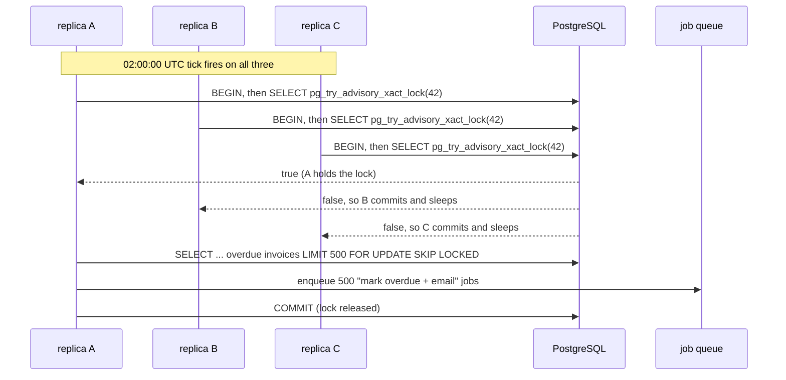
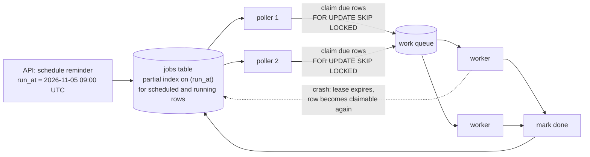

# Scheduled Jobs - Cron to Durable Schedulers

> [!summary] TL;DR
> A **scheduled job** is work that must start at a time rather than in response to a request: "every night at 02:00, mark invoices overdue" (**recurring**, written as a **cron** expression) or "remind this user at 9 am tomorrow" (**one-off**, a **delayed job**). The easy part is the timer; the hard parts are running it **once** across many replicas, surviving restarts and missed runs, and making a repeated run harmless.

> [!abstract] Core idea
> - A cron line in each of 3 replicas runs the job 3 times. Use one scheduler, a lock, or leader election.
> - Store future work in a durable table (`run_at`) and claim it with `FOR UPDATE SKIP LOCKED`, so a restart loses nothing.
> - Execution is at least once: jobs must be idempotent, checkpointed and safe to overlap or forbid overlap.
> - Decide explicitly what happens to runs missed during downtime: skip, run once, or run all.
> - Run schedules in UTC and alert when a job did **not** run (dead man's switch).

## 1. Why it exists

An invoicing service has these jobs (kept from the owner's original job list):

- mark invoices overdue at 02:00 every night;
- send "due soon" reminders three days before the due date;
- delete expired refresh tokens hourly;
- reconcile payments with the provider every 15 minutes.

The first version is a `time.Ticker` inside the API process. Then the service scales to 3 replicas, and every customer gets **three** reminder emails. A deploy at 01:59 restarts all pods, and that night's overdue run never happens. In March, the server's local time zone jumps from 02:00 to 03:00 for daylight saving, and, depending on the cron implementation, the 02:00 job either runs late or silently does not run at all.

Each of these is a different problem: **duplication**, **durability**, **missed runs** and **time zones**. This note covers all four.

## 2. Mental model

Think of a hospital ward's medication schedule.

- The **chart on the wall** is the durable job store. A nurse going off shift does not take the schedule home; the next nurse reads the chart.
- **Initialling the chart** before giving a dose is the claim. Two nurses cannot both give the 9 am dose because the first one's initials are already there.
- If the ward was evacuated at 9 am, the head nurse decides afterwards whether to give the missed dose late, skip it, or give both. That is the **catch-up policy**.
- A dose that cannot be given twice safely (insulin) needs a double check. That is **idempotency**.

Terms:

- **Cron expression:** five fields, `minute hour day-of-month month day-of-week`. `0 2 * * *` means 02:00 every day; `*/15 * * * *` every 15 minutes; `0 9 * * 1-5` 09:00 on weekdays.
- **Recurring vs one-off:** recurring jobs repeat by rule; one-off (delayed) jobs run once at a stored `run_at` time.
- **Lease:** a claim that expires on its own, so a crashed worker's job becomes claimable again.
- **Dead man's switch:** an alert that fires when an expected signal (a successful run) stops arriving.

## 3. How it works

### Level 1: one process, one timer

`cron` on one VM, or a loop around `time.Ticker` in Go. Simple and fine for one machine. It breaks as soon as there are two copies of the process or the machine restarts at the wrong moment. A Go `Ticker` also drops ticks when the job is slower than the period, because it delivers at most one pending tick; the Go-side details (and the Go 1.23 timer changes) are in [[Scheduled Jobs]].

### Level 2: make "N replicas" run once

Options, from simplest to most general:

1. **Run the scheduler somewhere else:** a Kubernetes CronJob, EventBridge Scheduler, or one dedicated scheduler deployment with 1 replica.
2. **Lock per run:** every replica wakes up, tries a lock, and only the winner runs.
3. **Leader election:** replicas elect one leader (Kubernetes Lease, etcd), and only the leader runs schedules. See [[Leader Election]].



The transaction-scoped advisory lock (`pg_try_advisory_xact_lock`) is released at `COMMIT`. The session-scoped `pg_try_advisory_lock` is held by a database **connection**, which in a Go `database/sql` pool can be handed back and reused by other code while still holding the lock; prefer the transaction form or a dedicated connection.

A lock only stops **simultaneous** runs. A replica whose clock is 5 seconds late can still run after the winner has finished and released. So the job itself must also be idempotent: "mark overdue where status = 'sent' and due date has passed" naturally does nothing the second time.

### Level 3: durable one-off scheduling

"Remind me at 9 am tomorrow" cannot live in a process's memory. Store it:



The schema and the claim query in PostgreSQL 17:

```sql
CREATE TABLE jobs (
    id           bigint GENERATED ALWAYS AS IDENTITY PRIMARY KEY,
    kind         text        NOT NULL,
    payload      jsonb       NOT NULL,
    run_at       timestamptz NOT NULL,
    state        text        NOT NULL DEFAULT 'scheduled',  -- scheduled | running | done | failed
    locked_until timestamptz,
    attempts     int         NOT NULL DEFAULT 0,
    dedupe_key   text UNIQUE                                 -- e.g. 'reminder:invoice-881:2026-11-05'
);
CREATE INDEX jobs_due ON jobs (run_at) WHERE state IN ('scheduled', 'running');

-- Each poller, every second or so:
WITH due AS (
    SELECT id FROM jobs
    WHERE state IN ('scheduled', 'running')
      AND run_at <= now()
      AND (locked_until IS NULL OR locked_until < now())   -- free, or lease expired
    ORDER BY run_at
    LIMIT 100
    FOR UPDATE SKIP LOCKED                                 -- other pollers skip these rows
)
UPDATE jobs j
SET state = 'running', locked_until = now() + interval '5 minutes', attempts = attempts + 1
FROM due WHERE j.id = due.id
RETURNING j.id, j.kind, j.payload;
```

`SKIP LOCKED` makes concurrent pollers take **different** rows instead of waiting on each other. The lease (`locked_until`) handles crashes: if a worker dies, the row becomes due again after 5 minutes. That is at-least-once execution, so the job's effect must be idempotent ([[Delivery Semantics and Exactly-Once]]). The `dedupe_key` stops the same reminder from being scheduled twice.

## 4. Worked example

### Whiteboard version

```text
recurring:  every replica ticks -> try lock -> winner enqueues work -> commit (unlock)
one-off:    INSERT jobs(run_at) ; pollers: claim due rows SKIP LOCKED + lease
            worker runs job -> mark done ; crash -> lease expires -> runs again
catch-up after downtime (last run 09:00, back at 14:30, hourly):
    skip     -> next run 15:00
    run once -> run the 14:00 slot now
    run all  -> run 10:00..14:00 now (cap it!)
every effect idempotent ; alert if last success is older than 2 x period
```

### Full version in Go

An in-memory model of the jobs table (claim with lease, complete) and the catch-up policy. It compiles and passes `go vet` and `go test -race` on Go 1.24. `ClaimDue` holds a mutex for the whole select-and-lease step, which is what `FOR UPDATE SKIP LOCKED` inside one statement gives you in PostgreSQL.

```go
package sched

import (
	"slices"
	"sync"
	"time"
)

// Job is one row of the jobs table: run Kind at RunAt.
type Job struct {
	ID          int64
	Kind        string
	RunAt       time.Time
	LockedUntil time.Time // lease: another poller may reclaim after this
	Done        bool
}

// Store is an in-memory fake of
//
//	SELECT ... WHERE run_at <= now() AND NOT done AND locked_until < now()
//	ORDER BY run_at LIMIT n FOR UPDATE SKIP LOCKED
//
// followed by UPDATE jobs SET locked_until = now() + lease.
type Store struct {
	mu   sync.Mutex
	jobs []*Job
	next int64
}

func (s *Store) Schedule(kind string, runAt time.Time) int64 {
	s.mu.Lock()
	defer s.mu.Unlock()
	s.next++
	s.jobs = append(s.jobs, &Job{ID: s.next, Kind: kind, RunAt: runAt})
	return s.next
}

// ClaimDue leases up to limit due jobs to one poller. Two pollers never get
// the same job while its lease is live.
func (s *Store) ClaimDue(now time.Time, limit int, lease time.Duration) []Job {
	s.mu.Lock()
	defer s.mu.Unlock()
	var due []*Job
	for _, j := range s.jobs {
		if !j.Done && !j.RunAt.After(now) && j.LockedUntil.Before(now) {
			due = append(due, j)
		}
	}
	slices.SortFunc(due, func(a, b *Job) int { return a.RunAt.Compare(b.RunAt) })
	if len(due) > limit {
		due = due[:limit]
	}
	out := make([]Job, 0, len(due))
	for _, j := range due {
		j.LockedUntil = now.Add(lease)
		out = append(out, *j)
	}
	return out
}

// Complete marks a job done. A worker that crashed never calls it, so the
// lease expires and another poller runs the job again: at-least-once.
func (s *Store) Complete(id int64) {
	s.mu.Lock()
	defer s.mu.Unlock()
	for _, j := range s.jobs {
		if j.ID == id {
			j.Done = true
		}
	}
}

// CatchUp is the policy for runs missed while the scheduler was down.
type CatchUp int

const (
	SkipMissed CatchUp = iota // run nothing for the gap; wait for the next slot
	RunOnce                   // run one catch-up now, however many were missed
	RunAll                    // run every missed slot, up to a cap
)

// MissedRuns returns the slots to run now. lastRun is the last slot that ran,
// every is the fixed interval, and maxRuns caps RunAll.
func MissedRuns(lastRun, now time.Time, every time.Duration, p CatchUp, maxRuns int) []time.Time {
	var missed []time.Time
	for t := lastRun.Add(every); !t.After(now); t = t.Add(every) {
		missed = append(missed, t)
	}
	switch {
	case len(missed) == 0 || p == SkipMissed:
		return nil
	case p == RunOnce:
		return missed[len(missed)-1:]
	case len(missed) > maxRuns:
		return missed[len(missed)-maxRuns:]
	default:
		return missed
	}
}
```

```go
package sched

import (
	"sync"
	"testing"
	"time"
)

var t0 = time.Date(2026, 11, 4, 9, 0, 0, 0, time.UTC)

func TestThreePollersNeverShareAJob(t *testing.T) {
	var s Store
	for i := 0; i < 300; i++ {
		s.Schedule("send-reminder", t0.Add(-time.Duration(i)*time.Second))
	}
	var mu sync.Mutex
	seen := map[int64]int{}
	var wg sync.WaitGroup
	for p := 0; p < 3; p++ {
		wg.Add(1)
		go func() {
			defer wg.Done()
			for {
				batch := s.ClaimDue(t0, 25, time.Minute)
				if len(batch) == 0 {
					return
				}
				for _, j := range batch {
					mu.Lock()
					seen[j.ID]++
					mu.Unlock()
					s.Complete(j.ID)
				}
			}
		}()
	}
	wg.Wait()
	if len(seen) != 300 {
		t.Fatalf("ran %d distinct jobs, want 300", len(seen))
	}
	for id, n := range seen {
		if n != 1 {
			t.Fatalf("job %d ran %d times", id, n)
		}
	}
}

func TestFutureJobsWait(t *testing.T) {
	var s Store
	s.Schedule("remind", t0.Add(time.Hour))
	if got := s.ClaimDue(t0, 10, time.Minute); len(got) != 0 {
		t.Fatalf("claimed a future job: %+v", got)
	}
	if got := s.ClaimDue(t0.Add(time.Hour), 10, time.Minute); len(got) != 1 {
		t.Fatalf("job not claimed at run_at")
	}
}

func TestExpiredLeaseIsReclaimed(t *testing.T) {
	var s Store
	id := s.Schedule("charge", t0)
	if got := s.ClaimDue(t0, 1, time.Minute); len(got) != 1 {
		t.Fatal("first claim failed")
	}
	// The worker crashed without Complete. Inside the lease: nothing.
	if got := s.ClaimDue(t0.Add(30*time.Second), 1, time.Minute); len(got) != 0 {
		t.Fatal("claimed while lease is live")
	}
	// After the lease: run again (at-least-once).
	got := s.ClaimDue(t0.Add(2*time.Minute), 1, time.Minute)
	if len(got) != 1 || got[0].ID != id {
		t.Fatalf("expired lease not reclaimed: %+v", got)
	}
}

func TestMissedRunsPolicies(t *testing.T) {
	last := t0                                  // last hourly run at 09:00
	now := t0.Add(5*time.Hour + 30*time.Minute) // back up at 14:30
	if got := MissedRuns(last, now, time.Hour, SkipMissed, 0); got != nil {
		t.Fatalf("skip: %v", got)
	}
	if got := MissedRuns(last, now, time.Hour, RunOnce, 0); len(got) != 1 || !got[0].Equal(t0.Add(5*time.Hour)) {
		t.Fatalf("once: %v", got)
	}
	got := MissedRuns(last, now, time.Hour, RunAll, 3)
	if len(got) != 3 || !got[0].Equal(t0.Add(3*time.Hour)) {
		t.Fatalf("all capped: %v", got)
	}
	if got := MissedRuns(last, now, time.Hour, RunAll, 10); len(got) != 5 {
		t.Fatalf("all: %d runs, want 5", len(got))
	}
}
```

The race test runs three concurrent pollers over 300 due jobs with batches of 25; every job runs exactly once. The lease test shows the at-least-once side: a job whose worker never calls `Complete` runs a second time after its lease expires.

**Catch-up trace** for an hourly job last run at 09:00, with the scheduler down until 14:30:

| Policy | Runs started at 14:30 | Use for |
| --- | --- | --- |
| `SkipMissed` | none; next is 15:00 | Work that only matters "now": cache warmers, token cleanup |
| `RunOnce` | the 14:00 slot | Jobs that process "everything due so far": overdue marking, reconciliation |
| `RunAll`, cap 3 | 12:00, 13:00, 14:00 | Per-slot work: hourly reports, one billing period each |

## 5. Variants and comparison

| Option | How it works | Use when | Cost |
| --- | --- | --- | --- |
| OS `cron` on one VM | crontab line runs a binary | One box, low stakes | Single point of failure; no history; local time zone by default |
| In-process ticker or cron library (robfig/cron) | Timer inside your service | Single-replica service, or combined with a lock | Runs N times with N replicas; missed while down |
| Kubernetes CronJob | Controller creates a Job per schedule | You already run Kubernetes; batch-style jobs | Pod start latency (seconds); minute granularity; controller can miss or double-start in rare cases |
| EventBridge Scheduler | Managed `at()`, `rate()`, `cron()` schedules with time zones, retries and a DLQ | AWS, many schedules, including millions of one-off ones | Vendor lock-in; at-least-once invocation |
| DB jobs table + `SKIP LOCKED` (River, or your own) | Rows with `run_at`, pollers claim | Postgres stack; jobs must be transactional with business data | Polling load; table bloat from updates |
| Redis sorted set | `ZADD delayed <unix-ts> <job-id>`; poller moves due IDs to a work list | High volume, short delays, Redis already present (asynq does this) | Durability depends on Redis persistence; the move must be atomic (Lua) |
| SQS delay or message timer | Message invisible for up to 15 minutes | Short delays only | 15-minute maximum |
| RabbitMQ delayed messages | TTL + dead-letter "wait" queue, or the delayed-message exchange plugin | RabbitMQ shops | Per-queue TTL means one delay per queue; plugin stores delays on one node |
| Durable timers (Temporal) | `workflow.Sleep(24h)` persisted in workflow history | Timers are steps in a longer business process | Running a workflow engine. See [[Workflow Engines and Durable Execution]] |

### Kubernetes CronJob settings that matter

- `concurrencyPolicy`: `Allow` (default, runs may overlap), `Forbid` (skip a run while the previous one is still running), `Replace` (kill the old run and start the new one).
- `startingDeadlineSeconds`: how late a run may start before it counts as missed. If it is unset and the controller finds **more than 100 missed schedules** since the last run, it does not start the job and logs an error.
- `timeZone` (stable since Kubernetes 1.27): for example `Etc/UTC`. Without it, schedules follow the controller manager's time zone.
- `backoffLimit` on the job template, and `successfulJobsHistoryLimit` (default 3) / `failedJobsHistoryLimit` (default 1).
- The docs say a CronJob creates a Job "about once" per schedule; in rare cases two or none. Jobs must be idempotent.

## 6. Trade-offs and when not to use

- **Do the work in workers, not in the scheduler.** The scheduler should only decide *what is due* and enqueue it. A scheduler that sends 50,000 emails itself holds its lock for an hour and cannot be scaled.
- **Batches must be resumable.** Process in chunks of 500 with `FOR UPDATE SKIP LOCKED`, commit each chunk, and loop until empty. A crash after chunk 30 resumes at chunk 31 because finished rows no longer match the `WHERE`.
- **Overlap.** If a 15-minute job sometimes takes 20 minutes, two runs overlap. Choose: forbid overlap (lock or `concurrencyPolicy: Forbid`), or make overlap harmless (row-level `SKIP LOCKED` so two runs split the work).
- **Thundering herd at :00.** Thousands of services scheduling `0 * * * *` all hit shared dependencies at the same second. Add jitter (a random 0 to 300 seconds offset per job) when the exact minute does not matter.
- **Polling cost.** A jobs table polled every second by 10 pollers is 10 queries per second even when idle. That is fine for PostgreSQL; at millions of timers, use a timing wheel or a managed scheduler.
- **When not to use a scheduler at all:** if the trigger is an event ("invoice created"), react to the event and schedule a one-off job then, rather than scanning the whole table every minute.

### Time zones and DST

- Store and schedule in **UTC**. `0 2 * * *` in `Europe/London` hits a missing hour on the last Sunday of March (01:00 jumps to 02:00) and a repeated hour in October.
- Implementations differ: some run a skipped job right after the jump, some skip it, some run a repeated hour twice. Do not rely on any of them.
- If the business really means local time ("send at 9 am in the user's time zone"), compute the next `run_at` in UTC from the user's zone with a proper time zone database, one occurrence at a time, and store the UTC instant.

## 7. In production

- **Real systems:**
	- Kubernetes CronJob for nightly batch jobs; EventBridge Scheduler on AWS for large numbers of one-off schedules.
	- Go libraries: `robfig/cron/v3` (cron specs, `WithLocation`, `SkipIfStillRunning`), River (Postgres-backed jobs with periodic jobs and `SKIP LOCKED`), asynq (Redis-backed, with a scheduler for periodic tasks). Code for these is in [[Scheduled Jobs]] and [[Background Workers and Job Queues]].
	- Temporal schedules and timers for long business processes.
- **Failure modes → fixes** (from the owner's original list, expanded):
	- **Overlapping runs** → lock per run or `Forbid`, or row-level claiming so overlaps split work.
	- **Missed runs** after downtime → an explicit catch-up policy, plus a durable "last successful run" record.
	- **Time zone bugs** → UTC everywhere, `timeZone` set explicitly.
	- **No idempotency** → every job safe to run twice; `dedupe_key` on scheduled rows.
	- **N replicas, N runs** → one scheduler, lock, or leader.
	- **Lock holder pauses** (GC, network) past its lease and keeps working while another replica runs → fencing tokens checked on write ([[Distributed Locks and Fencing Tokens]]), or make the work row-claimed so it cannot double-process.
- **What to monitor:**
	- `last_success_timestamp` per job as a gauge, with an alert when `now() - last_success > 2 × period`. This is the dead man's switch: it catches jobs that silently stop running, which error alerts never do.
	- Run duration and rows processed per run (a sudden 0 is suspicious).
	- Due-but-unclaimed jobs: `count(*) WHERE run_at < now() - interval '1 minute' AND state = 'scheduled'`, meaning pollers are behind.
	- Lease expiries (a sign of crashing or too-slow workers).

## 8. Deep dive

- **Timing wheels for millions of timers.** A heap gives `O(log n)` insert and pop (see [[Heaps and Priority Queues]]). A **timing wheel** is a circular array of buckets, one per tick (say 1 second, 3,600 buckets for an hour). Inserting a timer is `O(1)`: put it in bucket `(now + delay) mod 3600`. Each tick, fire the current bucket. Delays longer than one revolution go into a **hierarchical** wheel (seconds, minutes, hours, like a clock's hands) and cascade down as they get close. Kafka uses hierarchical timing wheels for delayed operations inside the broker, and Netty provides a `HashedWheelTimer`.
- **Scaling a DB-backed scheduler.** Partition jobs by `hash(id) % P` and give each poller a set of partitions, or partition the table by `run_at` day and drop old partitions instead of deleting rows. A load of 10,000 due jobs per second is past the comfortable range of one polled PostgreSQL table (an estimate; measure on your hardware). The full design, including sharding and timer buckets, is [[Case Study - Distributed Job Scheduler]].
- **Redis ZSET pattern, done safely.** Score = due Unix time. A poller runs a Lua script that does `ZRANGEBYSCORE delayed -inf <now> LIMIT 0 100`, `ZREM`s those IDs, and `LPUSH`es them to a ready list, all atomically, so two pollers never move the same ID. Without the script, two pollers can both read the same due IDs. Data structure choice is covered in [[Redis Data Structures and When to Use Each]].
- **Exactly when?** No scheduler runs at an exact instant. Pollers add up to one poll interval of delay, Kubernetes adds pod start time, EventBridge Scheduler offers a flexible time window on purpose. State the precision you need ("within 60 seconds") and design to it.
- **Long periodic jobs should checkpoint.** Store progress (`last_processed_id`) in a table after each chunk. A restart resumes from the checkpoint instead of starting over, and the catch-up policy only has to decide about new slots.

## 9. Interview questions

> [!question]- You run a cron library in a service with 5 replicas. What goes wrong, and how do you fix it?
> Each replica fires, so the job runs 5 times. Fix by moving scheduling out (Kubernetes CronJob, a 1-replica scheduler, EventBridge Scheduler), by taking a per-run lock such as `pg_try_advisory_xact_lock`, or by leader election. Also make the job idempotent, because locks do not stop a late replica from running after the winner finished.

> [!question]- How do you schedule "send this reminder at 9 am tomorrow" so it survives deploys?
> Insert a row with `run_at` (UTC) and a dedupe key into a jobs table in the same transaction as the business change. Pollers claim due rows with `FOR UPDATE SKIP LOCKED` and a lease, enqueue or run them, then mark them done. A crash lets the lease expire, so the job runs again; the reminder send must be idempotent.

> [!question]- Trap: "We set concurrencyPolicy: Forbid, so the job never runs twice." True?
> No. `Forbid` only skips a new run while the previous Job is still active. The CronJob controller can still occasionally create two Jobs for one schedule, a Job can retry pods (`backoffLimit`), and a pod can be restarted mid-run. The job still has to be idempotent.

> [!question]- What should happen to runs missed during a 5-hour outage?
> Choose per job. Skip for work that only matters now (cleanup). Run once for jobs that process "everything due so far" (overdue marking). Run each missed slot, with a cap, for per-period work (hourly reports). Store the last successful slot so the decision is possible.

> [!question]- Why schedule in UTC?
> Local time has gaps and repeats at DST changes, so a job at 02:00 local can be skipped or run twice depending on the implementation. UTC has neither. Convert to local time only when the business rule is local, one occurrence at a time.

> [!question]- How would you detect that a nightly job silently stopped running?
> Export a last-success timestamp per job and alert when it is older than about twice the period. Error-rate alerts cannot catch it because a job that never starts produces no errors. Hosted services (for example Healthchecks-style pings) work the same way.

> [!question]- How do you hold millions of pending timers efficiently?
> A hierarchical timing wheel gives `O(1)` insert and per-tick firing, instead of `O(log n)` for a heap. Durability still needs a store: keep timers in a table or log, load the next window (for example the next hour) into the wheel, and shard by timer ID across nodes.

## 10. Cheat sheet

- Cron = `min hour dom month dow`; `0 2 * * *` is 02:00 daily. Schedule in UTC.
- N replicas with a timer = N runs. Fix: external scheduler, per-run lock, or leader.
- Durable one-off jobs: `jobs(run_at)` + `FOR UPDATE SKIP LOCKED` + lease → at-least-once.
- Every job idempotent, chunked (500 rows), checkpointed, resumable.
- Missed runs: skip, run once, or run all with a cap. Decide per job.
- K8s CronJob: `concurrencyPolicy`, `startingDeadlineSeconds`, >100 missed → no start, `timeZone`.
- Delays: SQS ≤ 15 minutes; Redis ZSET + Lua; Temporal timers; timing wheels at scale.
- Alert on "last success too old" (dead man's switch), not only on errors.

## Links

- **Before this:** [[Background Jobs and Worker Pools]], [[Delivery Semantics and Exactly-Once]], [[Locking - Optimistic vs Pessimistic]]
- **Next:** [[Workflow Engines and Durable Execution]], [[Case Study - Distributed Job Scheduler]]
- **Compare with:** [[Scheduled Jobs]] (the Go code: ticker loops, robfig/cron, advisory locks), [[Leader Election]] (one scheduler among replicas), [[Distributed Locks and Fencing Tokens]] (why a lock alone is not enough)
