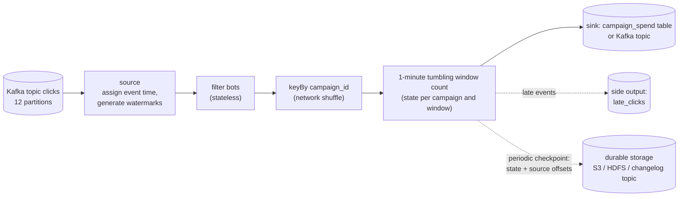
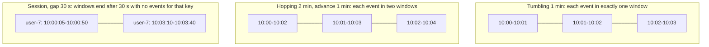
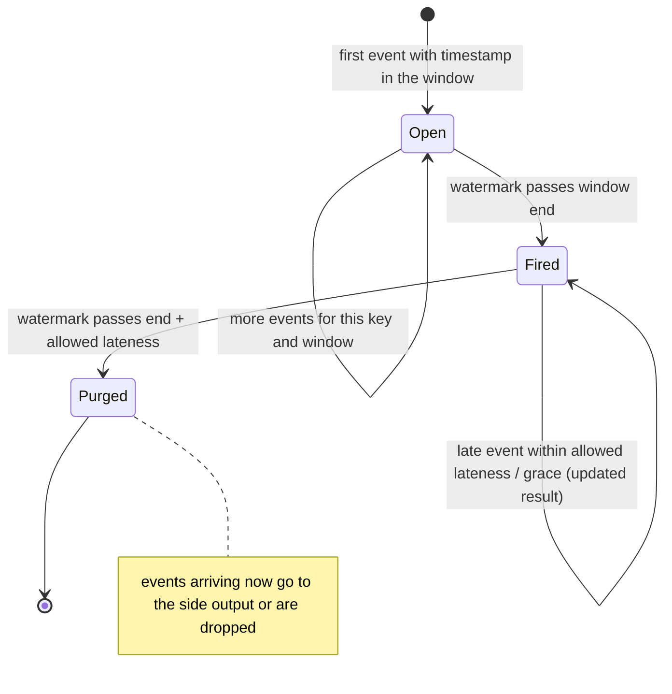

# Stream Processing Basics

> [!summary] TL;DR
> **Stream processing** computes results continuously over an endless flow of events (clicks, payments, sensor readings) instead of running a batch job over a finished file. The hard parts are **state** (counts and joins that span many events), **time** (events arrive late and out of order), and **failure** (restoring state without counting anything twice). **Windows**, **watermarks** and **checkpoints** are the three tools that handle them.

> [!abstract] Core idea
> - Stateless steps (filter, map) treat each event alone. Stateful steps (count, join, deduplicate) keep state per key, partitioned like the input.
> - Use **event time** (when it happened), not processing time (when it arrived), or results change with network delays and replays.
> - A **window** groups events by time: tumbling (fixed, no overlap), hopping/sliding (fixed, overlapping) or session (closed by a gap of inactivity).
> - A **watermark** says "no events older than T should still arrive"; a window is emitted when the watermark passes its end. Later events are **late data**: dropped, sent to a side output, or used to update the result.
> - Checkpoints snapshot state together with input offsets, so a restart rewinds both and the state is exactly-once even though input is replayed.

## 1. Why it exists

An ad platform charges advertisers per click and must stop a campaign the minute its budget is spent. Clicks arrive at 200,000 per second from phones around the world.

- **Batch** (an hourly job over yesterday's files) is far too slow: a campaign could overspend for up to an hour.
- **Naive real time** (a consumer that increments a counter per message) breaks in three ways:
	- A phone in a tunnel uploads 40 buffered clicks 3 minutes late. A processing-time counter assigns them to the wrong minute.
	- The consumer crashes and replays from its last committed offset. Clicks get counted twice in an in-memory map that was half-written, or lost if the map was not saved.
	- One process cannot hold the state for 2 million campaigns and keep up with 200,000 events per second.

A stream processor partitions the state by key across many workers, buckets events by their own timestamps, decides when a bucket is complete with a watermark, and checkpoints state and offsets together.

## 2. Mental model

A **toll plaza with a counting clerk per lane**. Cars (events) carry a ticket stamped with the time they entered the motorway (event time). Every minute the clerk must report how many cars entered in each minute.

- Cars arrive out of order: a slow truck that entered at 10:00:58 reaches the booth at 10:01:07. The clerk keeps the 10:00 tally open a little longer.
- The clerk's rule of thumb: "I have now seen a car stamped 10:01:15, and no car is more than 10 seconds slower than the fastest; so the 10:00 tally is final." That rule is the **watermark**.
- A truck stamped 10:00:20 that turns up at 10:05 is **late**. The clerk notes it in a separate book (the side output) rather than reopening a report that has already been sent.
- Every few minutes the clerk photocopies all tallies along with "the last car I counted was number 81,233" (a **checkpoint**). After a coffee spill they restore the photocopy and recount from car 81,234.

## 3. How it works

### The pipeline



- **Operators** are the boxes. Each runs as several parallel instances.
- **keyBy** sends every event for one key to the same instance, so that instance holds all the state for that key. This is a network shuffle; in Kafka Streams it is a repartition topic.
- **State** lives next to the operator: in memory, or in an embedded RocksDB store for state larger than memory.

### Event time, processing time and watermarks

| Time | Meaning | Use for |
| --- | --- | --- |
| Event time | Timestamp inside the event: when it happened | Correct, repeatable results; billing; analytics |
| Ingestion time | When the event entered the broker | A compromise when events carry no timestamp |
| Processing time | Clock of the machine processing it | Lowest latency where approximate results are fine (live dashboards) |

A **watermark** is a special marker flowing with the events that carries a time `W` and asserts "events with timestamp ≤ W are complete". The common heuristic is **bounded out-of-orderness**: `W = max event time seen − allowed delay`. A small delay emits results sooner but sends more events to late handling; a large delay is more complete but slower. With several input partitions, an operator's watermark is the **minimum** across its inputs, so one idle or slow partition holds everything back (Flink's `withIdleness` marks idle sources so they do not).

### Windows



- **Tumbling:** fixed size, no overlap. "Clicks per campaign per minute."
- **Hopping** (called *sliding* in Flink): fixed size, advance smaller than size, so windows overlap. "Clicks in the last 5 minutes, updated every minute."
- **Session:** per key, grows while events keep arriving within the gap, closes after the gap. "One browsing session."
- A window is emitted (fires) when the watermark passes its end. **Allowed lateness** (Flink) or **grace period** (Kafka Streams) keeps the window's state a bit longer so late events can update an already-emitted result.

### Window lifecycle



### Checkpoints and exactly-once state

Flink injects **checkpoint barriers** into each source partition. When an operator has received the barrier on all inputs, it snapshots its state asynchronously and passes the barrier on. When every operator has acknowledged, the checkpoint (state plus the source offsets at the barrier) is complete. On failure the job restarts from the last complete checkpoint: offsets rewind, state rewinds to match, and replayed events rebuild exactly the same state. This is a variant of the Chandy-Lamport snapshot algorithm.

Kafka Streams keeps each state store in local RocksDB, backed by a compacted **changelog topic**; with `processing.guarantee=exactly_once_v2` it writes state changes, output records and input offsets in one Kafka transaction.

Exactly-once applies to the state inside the processor. Output to an external system is exactly-once only if the sink is transactional (two-phase commit with the checkpoint) or idempotent (upserts keyed by window and key); see [[Delivery Semantics and Exactly-Once]].

## 4. Worked example

### Whiteboard version

```text
tumbling window 1 min, watermark = max event time - 10 s
arrival order    event time   max seen   watermark   action
ad-1             10:00:05     10:00:05   09:59:55    window 10:00 open, ad-1=1
ad-1             10:00:50     10:00:50   10:00:40    ad-1=2
ad-2             10:01:03     10:01:03   10:00:53    window 10:01 open for ad-2
ad-1 (delayed)   10:00:58     10:01:03   10:00:53    still before 10:01 -> ad-1=3
ad-1             10:01:15     10:01:15   10:01:05    watermark >= 10:01 -> FIRE ad-1@10:00 = 3
ad-1 (too late)  10:00:40     ...        10:01:05    window already fired -> side output
processing-time counting would have put the delayed click in 10:01: wrong minute
```

### Go: an event-time tumbling window with a watermark

A single-instance, in-memory operator. Real engines add parallelism, checkpointing and allowed lateness; the windowing logic is the same.

```go
// Package stream counts events per key in event-time tumbling windows, using
// a bounded-out-of-orderness watermark to decide when a window is complete.
package stream

import (
	"sort"
	"time"
)

// Event is one input record. Time is when it happened (event time), not when
// it arrived.
type Event struct {
	Key  string
	Time time.Time
}

// Result is the final count for one key and window [Start, Start+size).
type Result struct {
	Key   string
	Start time.Time
	Count int
}

type winKey struct {
	key   string
	start time.Time
}

// TumblingCounter is a keyed, stateful operator.
type TumblingCounter struct {
	size      time.Duration
	maxDelay  time.Duration // how out of order events may arrive
	open      map[winKey]int
	maxSeen   time.Time
	watermark time.Time
	Late      []Event // side output: events for windows already emitted
}

func NewTumblingCounter(size, maxDelay time.Duration) *TumblingCounter {
	return &TumblingCounter{size: size, maxDelay: maxDelay, open: map[winKey]int{}}
}

// Watermark is the operator's claim that no event older than it will arrive.
func (t *TumblingCounter) Watermark() time.Time { return t.watermark }

// Add processes one event and returns any windows the watermark has closed.
func (t *TumblingCounter) Add(e Event) []Result {
	start := e.Time.Truncate(t.size)
	if !t.watermark.IsZero() && !start.Add(t.size).After(t.watermark) {
		t.Late = append(t.Late, e) // its window already fired
		return nil
	}
	t.open[winKey{e.Key, start}]++
	if e.Time.After(t.maxSeen) {
		t.maxSeen = e.Time
		t.watermark = t.maxSeen.Add(-t.maxDelay)
	}
	return t.fire()
}

// fire emits every window whose end is at or before the watermark.
func (t *TumblingCounter) fire() []Result {
	var out []Result
	for k, n := range t.open {
		if !k.start.Add(t.size).After(t.watermark) {
			out = append(out, Result{k.key, k.start, n})
			delete(t.open, k)
		}
	}
	sort.Slice(out, func(i, j int) bool {
		if !out[i].Start.Equal(out[j].Start) {
			return out[i].Start.Before(out[j].Start)
		}
		return out[i].Key < out[j].Key
	})
	return out
}
```

```go
package stream

import (
	"fmt"
	"testing"
	"time"
)

var base = time.Date(2026, 11, 4, 10, 0, 0, 0, time.UTC)

func at(min, sec int) time.Time {
	return base.Add(time.Duration(min)*time.Minute + time.Duration(sec)*time.Second)
}

func show(rs []Result) string {
	s := ""
	for _, r := range rs {
		s += fmt.Sprintf("%s@%s=%d ", r.Key, r.Start.Format("15:04"), r.Count)
	}
	return s
}

func TestOutOfOrderEventsLandInTheirEventTimeWindow(t *testing.T) {
	c := NewTumblingCounter(time.Minute, 10*time.Second)
	var got []Result
	for _, e := range []Event{
		{"ad-1", at(0, 5)},
		{"ad-1", at(0, 50)},
		{"ad-2", at(1, 3)},  // watermark 10:00:53, window 10:00 still open
		{"ad-1", at(0, 58)}, // out of order but within 10s: counted in 10:00
		{"ad-1", at(1, 15)}, // watermark 10:01:05 closes 10:00
	} {
		got = append(got, c.Add(e)...)
	}
	if s := show(got); s != "ad-1@10:00=3 " {
		t.Fatalf("got %q", s)
	}
}

func TestTooLateEventGoesToSideOutput(t *testing.T) {
	c := NewTumblingCounter(time.Minute, 10*time.Second)
	c.Add(Event{"ad-1", at(0, 30)})
	c.Add(Event{"ad-1", at(1, 20)}) // watermark 10:01:10 fires 10:00
	if out := c.Add(Event{"ad-1", at(0, 40)}); out != nil {
		t.Fatalf("late event changed results: %v", out)
	}
	if len(c.Late) != 1 {
		t.Fatalf("late = %d, want 1", len(c.Late))
	}
}

func TestProcessingOrderDoesNotChangeEventTimeResult(t *testing.T) {
	in := []Event{{"a", at(0, 1)}, {"b", at(0, 2)}, {"a", at(0, 59)}, {"a", at(1, 0)}, {"b", at(2, 30)}}
	shuffled := []Event{in[1], in[0], in[2], in[3], in[4]}
	run := func(es []Event) string {
		c := NewTumblingCounter(time.Minute, 5*time.Second)
		var rs []Result
		for _, e := range es {
			rs = append(rs, c.Add(e)...)
		}
		return show(rs)
	}
	if a, b := run(in), run(shuffled); a != b || a != "a@10:00=2 b@10:00=1 a@10:01=1 " {
		t.Fatalf("in order %q, shuffled %q", a, b)
	}
}
```

`go vet` is clean and `go test -race` passes (Go 1.24). `TestProcessingOrderDoesNotChangeEventTimeResult` is the key property of event-time processing: the same events in a different arrival order give the same windows.

### The same job in Flink SQL

Flink SQL declares the watermark on the table and the window as a table-valued function (Flink 1.13+ syntax; shown for comparison, not run for this note):

```sql
CREATE TABLE clicks (
    campaign_id STRING,
    click_ts    TIMESTAMP(3),
    WATERMARK FOR click_ts AS click_ts - INTERVAL '10' SECOND
) WITH ('connector' = 'kafka', 'topic' = 'clicks', 'format' = 'avro-confluent' /* plus broker and registry options */);

SELECT campaign_id, window_start, window_end, COUNT(*) AS clicks
FROM TABLE(TUMBLE(TABLE clicks, DESCRIPTOR(click_ts), INTERVAL '1' MINUTE))
GROUP BY campaign_id, window_start, window_end;
```

Representative output (Flink 1.20, three campaigns; the SQL client's tableau mode would also show an `op` column such as `+I`):

```text
campaign_id  window_start          window_end            clicks
ad-1         2026-11-04 10:00:00   2026-11-04 10:01:00   3
ad-2         2026-11-04 10:00:00   2026-11-04 10:01:00   41
ad-3         2026-11-04 10:00:00   2026-11-04 10:01:00   7
```

## 5. Variants and comparison

| Option | How it works | Use when | Cost |
| --- | --- | --- | --- |
| Plain Kafka consumer | Your code, your state, your offsets | Stateless transforms, simple per-event actions | You build windows, state recovery and exactly-once yourself |
| Kafka Streams | Java library inside your service; state in RocksDB + changelog topics; scales by adding instances | Kafka in, Kafka out; JVM services; no separate cluster | JVM only; tied to Kafka; repartition topics add load |
| Apache Flink | Separate cluster (JobManager, TaskManagers); checkpoints to object storage; DataStream API and Flink SQL | Large state, complex event-time logic, many sources and sinks | A cluster to run (or a managed service); operational expertise |
| Spark Structured Streaming | Micro-batches (or continuous mode) on Spark | Teams already on Spark; unified batch and stream code | Higher latency in micro-batch mode (often seconds) |
| Managed (Kinesis Data Analytics / Amazon Managed Service for Apache Flink, Google Dataflow) | Hosted Flink or Beam runners | Avoid running clusters | Cost; provider limits |
| Streaming databases (Materialize, RisingWave, ksqlDB) | SQL views kept up to date incrementally | Mostly SQL logic, query results directly | Less control over custom logic |

**Lambda vs Kappa architecture:**
- *Lambda* runs a batch layer (exact, slow) and a speed layer (approximate, fast) and merges them. Two codebases must agree.
- *Kappa* uses only the stream: to fix a bug, replay the log from the start through new code. This needs long retention, which tiered storage makes cheap ([[Kafka and Event Streaming]]).

### Joins

| Join | State kept | Example |
| --- | --- | --- |
| Stream-stream (windowed) | Both sides within the join window | Match `ad_impression` with `ad_click` within 10 minutes |
| Stream-table | Latest row per key of the table (from a compacted topic or CDC) | Enrich each order with the customer's current tier |
| Table-table | Both tables, updated as either changes | Materialised view joining two CDC streams |

## 6. Trade-offs and when not to use

- **Completeness vs latency.** Every watermark delay is a trade: shorter means faster but more late data; longer means more complete but slower. No setting gives both.
- **State is the cost driver.** Session windows, long hopping windows and stream-stream joins hold state for every key; a misconfigured join can grow without bound. Set state TTLs.
- **Operational complexity.** Checkpoint tuning, savepoints for upgrades, rebalancing state across instances, and schema changes on stateful jobs.
- **Debuggability.** A wrong count may come from a late event, a watermark stall or a replay. You need side outputs and metrics to tell which.
- **When not to use it:**
	- Freshness of an hour is acceptable: a scheduled SQL query over a warehouse is simpler and exact.
	- Per-event actions with no aggregation: a plain consumer is enough.
	- Small data that fits one database: a materialised view or a periodic `GROUP BY` wins.

## 7. In production

- **Real systems:** fraud scoring on payment streams, real-time ad budget pacing, IoT telemetry aggregation, live leaderboards ([[Case Study - Leaderboard and Top-K]]), metric roll-ups ([[Case Study - Metrics and Logging Platform]]), and keeping read models current for [[CQRS]].
- **Failure modes → fixes:**
	- *Watermark stuck.* One Kafka partition gets no data, so the minimum watermark never advances and no window fires. Fix: idle-source detection (Flink `withIdleness`), or fewer source partitions so that every partition keeps receiving data.
	- *Results double after a restart.* Sink was neither transactional nor idempotent. Fix: transactional sink with the checkpoint, or upsert by `(key, window_start)`.
	- *State grows until out of memory or disk.* Unbounded keys with no TTL, or a join without a window. Fix: state TTL, windowed joins, RocksDB with incremental checkpoints.
	- *Checkpoints time out under backpressure.* Barriers queue behind slow records. Fix: find the slow operator, scale it, or use unaligned checkpoints (Flink); see [[Backpressure and Flow Control]].
	- *Hot key.* One campaign gets most clicks and one instance falls behind. Fix: two-phase aggregation (pre-aggregate on a salted key, then combine); see [[Hot Keys and Hot Partitions]].
	- *Upgrading a stateful job breaks state.* Changed operator IDs or state schema. Fix: stable operator UIDs, savepoints, and state schema evolution ([[Event Schemas and Schema Registry]]).
- **What to monitor:** consumer lag of the source, watermark lag (wall-clock time minus current watermark), late events per minute, checkpoint duration and size, backpressure per operator, state size per key group, end-to-end latency from event time to output.

## 8. Deep dive

- **Watermarks are a heuristic.** They can be too fast (dropping valid data) or too slow (delaying results). Perfect watermarks exist only when the source knows its order (for example, a single ordered log of server-generated timestamps).
- **Triggers vs watermarks.** The Dataflow model separates *what* is computed (windows), *where in event time* (windowing), *when in processing time* to emit (triggers: on watermark, early every 10 s, on each late event) and *how* refinements relate (discarding vs accumulating). Flink and Beam expose this; Kafka Streams has `suppress` to emit only final results.
- **Exactly-once mechanics.** Barrier alignment waits for the barrier on every input before snapshotting, so the snapshot is consistent. Unaligned checkpoints (Flink 1.11+) also store in-flight buffers, trading bigger checkpoints for progress under backpressure.
- **State rescaling.** Flink splits keyed state into a fixed number of **key groups** (the job's max parallelism) and assigns ranges of key groups to instances, so scaling out moves whole key groups. Max parallelism cannot change without losing state, so set it high at the start. Kafka Streams scales by tasks, one per input partition.
- **Deduplication.** Exactly-once state does not remove duplicates already present in the input (for example from an at-least-once producer). Deduplicate with keyed state on the event ID with a TTL.
- **Session windows merge.** A late event can bridge two sessions, merging two windows into one; engines implement this with mergeable window state.
- **Clock skew.** Event time comes from producers' clocks. A phone with its clock set a year ahead can push the watermark far into the future and make every later event late. Clamp event times to a sane range around ingestion time; see [[Clocks and Ordering]].

## 9. Interview questions

> [!question]- Event time or processing time for billing clicks, and why?
> Event time. Billing must assign each click to the minute it happened, regardless of network delays or replays. Processing time changes the result every time you replay or a device reconnects late.

> [!question]- What is a watermark, and what happens to events behind it?
> A watermark of time `W` asserts that events with timestamps ≤ W are complete, usually computed as max event time seen minus an allowed delay. Windows ending at or before W fire. Events behind it are late: updated into the result within allowed lateness or grace, otherwise sent to a side output or dropped.

> [!question]- Does Flink's exactly-once mean your downstream database sees each result exactly once? (trap)
> No. Exactly-once covers the processor's internal state via checkpoints and replay. Output to an external system can be repeated after a restart unless the sink is transactional (committed with the checkpoint) or idempotent (upsert by key and window).

> [!question]- Tumbling, hopping and session windows: give a use case for each.
> Tumbling: clicks per campaign per minute (each event counted once). Hopping: requests in the last 5 minutes, updated every minute, for alerting. Session: a user's visit, ending after 30 minutes of inactivity.

> [!question]- Your windowed job emits nothing even though input is flowing. What do you check?
> The watermark. One idle or very slow input partition holds the operator's watermark at the minimum, so no window closes. Check per-partition watermarks, enable idle-source detection, and check for events with timestamps far in the past or future.

> [!question]- Kafka Streams or Flink?
> Kafka Streams when input and output are Kafka and you want a library inside a JVM service with no extra cluster. Flink when state is large, logic is complex, sources and sinks vary, or you want SQL over streams and a managed cluster.

> [!question]- How does a stateful operator recover after a crash without double counting?
> It restores the last checkpoint, which contains both its state and the source offsets taken at the same barrier, and resumes reading from those offsets. Events after the checkpoint are reprocessed into state that has not seen them yet, so each event affects the state once.

## 10. Cheat sheet

- Stateless (filter, map) vs stateful (count, join, dedupe); state is partitioned by key.
- Use event time; watermark = max event time − allowed delay; min across inputs.
- Windows: tumbling, hopping (Flink "sliding"), session; fire when watermark passes the end.
- Late data: allowed lateness / grace, else side output.
- Checkpoint = state + source offsets together; exactly-once state, not exactly-once sinks.
- Kafka Streams = library + RocksDB + changelog; Flink = cluster + barriers + object storage.
- Watch watermark lag, late events, checkpoint duration, backpressure.

## Links

- **Before this:** [[Kafka and Event Streaming]], [[Message Ordering and Partition Keys]], [[Delivery Semantics and Exactly-Once]]
- **Next:** [[Case Study - Metrics and Logging Platform]], [[Case Study - Leaderboard and Top-K]], [[Time-Series and Columnar Storage]]
- **Compare with:** [[Workflow Engines and Durable Execution]] (durable per-request flows rather than continuous aggregates), [[CQRS]] (stream-fed read models), [[Clocks and Ordering]]
