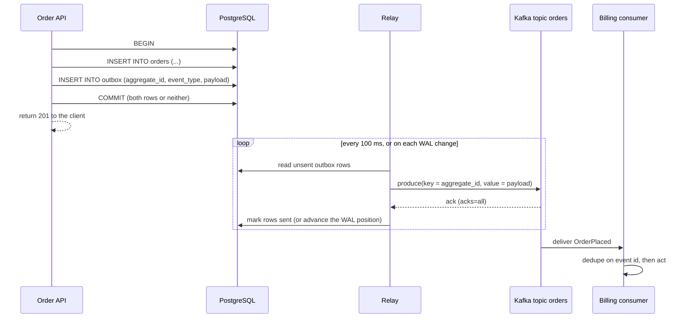
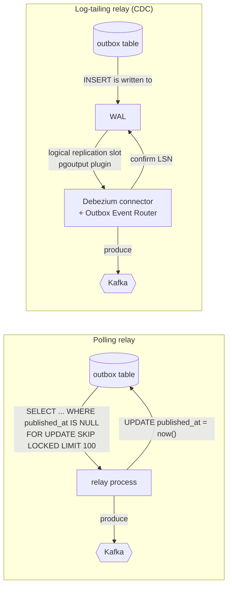

# Transactional Outbox and CDC

> [!summary] TL;DR
> A service often must do two things for one request: save a row in its database and publish an event to a broker (a message system such as Kafka or RabbitMQ). The **transactional outbox** writes the event into an `outbox` table in the *same database transaction* as the business row, and a separate **relay** later copies it to the broker. **CDC** (change data capture) is one way to build that relay: it reads the database's write-ahead log instead of polling the table.

> [!abstract] Core idea
> - You cannot commit to PostgreSQL and Kafka atomically, so never try: commit only to the database.
> - The event row and the business row share one local transaction, so both exist or neither does.
> - A relay (a polling loop, or Debezium reading the WAL) publishes outbox rows afterwards, so delivery is **at-least-once**.
> - Consumers must therefore be idempotent, and per-entity order holds only if the relay keeps it.
> - Classic mistake: "publish after commit" in the request handler. A crash between the two loses the event forever.

## 1. Why it exists

An order service handles `POST /orders`. It must insert the order and publish `OrderPlaced` so that billing, email and search react. There are only two naive orders of operations, and both break.

| Order | Crash point | Result |
| --- | --- | --- |
| Commit, then publish | Process dies (deploy, OOM kill) after `COMMIT`, before `Publish` | The order exists, nobody hears about it. Billing never charges; the customer never gets an email. |
| Publish, then commit | Publish succeeds, then the `INSERT` fails (constraint violation, deadlock, lost connection) | Consumers act on an order that does not exist. Billing charges a phantom order. |

This is the **dual-write problem**: two systems, no shared transaction. Retrying does not fix it, because the process that would retry is the one that crashed.

The numbers are not exotic. Suppose a service does 2,000 orders per second, and deploys, OOM kills and node failures mean that 1 request in 100 million dies exactly in the gap between commit and publish (an illustrative estimate). That still loses about 1.7 events a day (2,000 × 86,400 × 10⁻⁸ ≈ 1.7), and each lost event is a support ticket and a manual fix. Distributed transactions (two-phase commit, XA) across PostgreSQL and Kafka are not an option: Kafka does not take part in XA, and 2PC adds a blocking coordinator anyway.

## 2. Mental model

Write the letter and drop it into the office **out-tray** in the same motion as filing the paperwork. A mail clerk empties the out-tray later. If the clerk is sick, letters wait in the tray; they are never lost. If the clerk posts a letter and then forgets to take it out of the tray, it gets posted twice, so the recipient must recognise duplicates.

- **Outbox table:** the out-tray. It lives in the service's own database.
- **Relay:** the clerk. Two designs:
	- **Polling publisher:** a loop that queries the table for unsent rows.
	- **Log tailing (CDC):** a reader of the database's write-ahead log (WAL, the append-only file the database writes every change to before applying it; see [[Storage Engines - B-tree vs LSM and WAL]]). Debezium is the common tool.
- **Idempotent consumer:** the recipient who ignores a letter with a reference number it has already handled (owned by [[Delivery Semantics and Exactly-Once]]).

## 3. How it works

### The write path



Crash analysis:
- Crash before `COMMIT`: neither row exists; the client sees an error and retries (with an idempotency key, see [[Idempotency and Idempotency Keys]]).
- Crash after `COMMIT`: the outbox row is durable; the relay will publish it eventually.
- Relay crashes after the broker ack but before marking the row: the row is published again. This duplicate is the price of the pattern and is why consumers dedupe.

### The outbox table

```sql
CREATE TABLE outbox (
    id             bigint GENERATED ALWAYS AS IDENTITY PRIMARY KEY,
    event_id       uuid        NOT NULL DEFAULT gen_random_uuid() UNIQUE, -- what consumers dedupe on
    aggregate_type text        NOT NULL,           -- 'order'  -> topic choice
    aggregate_id   text        NOT NULL,           -- 'o-1001' -> partition key
    event_type     text        NOT NULL,           -- 'OrderPlaced'
    payload        jsonb       NOT NULL,
    headers        jsonb       NOT NULL DEFAULT '{}', -- trace id, schema id, tenant
    created_at     timestamptz NOT NULL DEFAULT now(),
    published_at   timestamptz                     -- NULL = not sent yet
);

-- Only unsent rows are indexed, so the index stays tiny.
CREATE INDEX outbox_unsent ON outbox (id) WHERE published_at IS NULL;
```

`gen_random_uuid()` is built into PostgreSQL since version 13. `event_id` travels with the message (as a header or inside the payload) so that the consumer has a stable key to deduplicate on; see [[Idempotency and Idempotency Keys]].

### Two relay designs



**Polling relay** in PostgreSQL 17:

```sql
BEGIN;
SELECT id, event_id, aggregate_type, aggregate_id, event_type, payload, headers
FROM outbox
WHERE published_at IS NULL
ORDER BY id
LIMIT 100
FOR UPDATE SKIP LOCKED;          -- other relays skip these rows instead of waiting
-- publish each row to the broker, wait for acks
UPDATE outbox SET published_at = now() WHERE id = ANY($1);  -- $1 = ids of the rows just published, bound by the relay code
COMMIT;
```

- `FOR UPDATE SKIP LOCKED` lets several relay processes share the table without blocking each other: each grabs a different batch.
- The row locks are held while publishing, so a relay that dies mid-batch releases them when its connection drops, and another relay picks the batch up.
- To cut latency below the polling interval, the writer can `NOTIFY outbox` in the same transaction and the relay can `LISTEN outbox`; the notification is delivered only on commit.

**Log-tailing relay (CDC):** PostgreSQL logical decoding turns WAL records into row changes. Debezium creates a **logical replication slot** (a server-side bookmark that remembers how far this reader has confirmed) using the built-in `pgoutput` plugin, streams every `INSERT` into `outbox`, and its **Outbox Event Router** single message transform turns each row into a Kafka record: the topic comes from `aggregatetype` (`outbox.event.order` by default), the key from `aggregateid`, and the value from `payload`. Debezium's default column names are `id`, `aggregatetype`, `aggregateid`, `type` and `payload`. The snake_case table above therefore needs mapping in the connector config, for example `transforms.outbox.table.field.event.id=event_id`, `table.field.event.key=aggregate_id`, `route.by.field=aggregate_type` and `table.field.event.type=event_type`. With `route.by.field=aggregate_type` the default topic is still `outbox.event.<value>`, here `outbox.event.order`; `route.topic.replacement` changes it.

With CDC the application can even delete the outbox row in the same transaction right after inserting it: the WAL still holds the insert, so Debezium publishes it, and the table never grows.

## 4. Worked example

### Whiteboard version

```text
POST /orders {id: o-1, amount: 49900}
  BEGIN
    INSERT orders  (o-1, 49900)
    INSERT outbox  (id=1, aggregate_id=o-1, OrderPlaced)
  COMMIT                         <- the only commit that matters
relay tick 1: fetch [1]  -> publish 1 -> crash before UPDATE
relay tick 2: fetch [1]  -> publish 1 again -> UPDATE published_at
broker now holds: OrderPlaced#1, OrderPlaced#1   (duplicate)
billing consumer: processes #1, sees #1 in its inbox table, skips
outbox lag = rows with published_at IS NULL = 0
```

The rule to remember: **the relay may publish twice, never zero times, and never out of order for one aggregate.**

### Go: a polling relay with an in-memory database

The relay below stops at the first failed publish. That keeps order: if event 2 fails, event 3 must not go out ahead of it. `MemDB` stands in for PostgreSQL; one mutex plays the part of one transaction, so `PlaceOrder` writes both rows atomically.

```go
// Package outbox shows a polling outbox relay with an in-memory database.
package outbox

import (
	"context"
	"errors"
	"sync"
)

// Event is one row of the outbox table.
type Event struct {
	ID          int64
	AggregateID string // also the broker partition key
	EventType   string
	Payload     string
	Published   bool
}

// MemDB stands in for PostgreSQL: one mutex plays the role of one transaction.
type MemDB struct {
	mu     sync.Mutex
	orders map[string]int64 // order id -> amount in paise
	outbox []Event
	nextID int64
	// FailMark makes the next MarkPublished call fail (simulates a crash).
	FailMark bool
}

func NewMemDB() *MemDB { return &MemDB{orders: map[string]int64{}} }

// PlaceOrder writes the business row and the outbox row atomically,
// like INSERT INTO orders ...; INSERT INTO outbox ...; COMMIT.
func (db *MemDB) PlaceOrder(orderID string, amount int64) {
	db.mu.Lock()
	defer db.mu.Unlock()
	db.orders[orderID] = amount
	db.nextID++
	db.outbox = append(db.outbox, Event{
		ID: db.nextID, AggregateID: orderID, EventType: "OrderPlaced",
		Payload: orderID,
	})
}

// FetchUnpublished returns up to limit unpublished rows in id order.
func (db *MemDB) FetchUnpublished(_ context.Context, limit int) ([]Event, error) {
	db.mu.Lock()
	defer db.mu.Unlock()
	var out []Event
	for _, e := range db.outbox {
		if !e.Published {
			out = append(out, e)
			if len(out) == limit {
				break
			}
		}
	}
	return out, nil
}

var ErrCrash = errors.New("relay crashed before marking rows")

// MarkPublished flags rows as sent.
func (db *MemDB) MarkPublished(_ context.Context, ids []int64) error {
	db.mu.Lock()
	defer db.mu.Unlock()
	if db.FailMark {
		db.FailMark = false
		return ErrCrash
	}
	set := make(map[int64]bool, len(ids))
	for _, id := range ids {
		set[id] = true
	}
	for i := range db.outbox {
		if set[db.outbox[i].ID] {
			db.outbox[i].Published = true
		}
	}
	return nil
}

// Pending counts unpublished rows (the "outbox lag" metric).
func (db *MemDB) Pending() int {
	db.mu.Lock()
	defer db.mu.Unlock()
	n := 0
	for _, e := range db.outbox {
		if !e.Published {
			n++
		}
	}
	return n
}

// Publisher is the broker client (Kafka, RabbitMQ, SQS ...).
type Publisher interface {
	Publish(ctx context.Context, key string, e Event) error
}

// Relay moves outbox rows to the broker.
type Relay struct {
	DB        *MemDB
	Pub       Publisher
	BatchSize int
}

// RunOnce publishes one batch. It stops at the first failed publish so that
// events of one aggregate never overtake each other, then marks the rows that
// did go out. A crash between Publish and MarkPublished means those rows are
// published again on the next run: delivery is at-least-once.
func (r *Relay) RunOnce(ctx context.Context) (int, error) {
	batch, err := r.DB.FetchUnpublished(ctx, r.BatchSize)
	if err != nil {
		return 0, err
	}
	var sent []int64
	var pubErr error
	for _, e := range batch {
		if pubErr = r.Pub.Publish(ctx, e.AggregateID, e); pubErr != nil {
			break
		}
		sent = append(sent, e.ID)
	}
	if len(sent) > 0 {
		if err := r.DB.MarkPublished(ctx, sent); err != nil {
			return 0, err
		}
	}
	return len(sent), pubErr
}
```

The tests cover the three behaviours that matter: everything gets out in order, a broker failure loses nothing and keeps order, and a crash between publish and mark produces a duplicate.

```go
package outbox

import (
	"context"
	"errors"
	"fmt"
	"sync"
	"testing"
)

// fakeBroker records what it receives and can fail on chosen calls.
type fakeBroker struct {
	mu     sync.Mutex
	got    []Event
	calls  int
	failOn map[int]bool // 1-based call numbers that fail
}

func (b *fakeBroker) Publish(_ context.Context, _ string, e Event) error {
	b.mu.Lock()
	defer b.mu.Unlock()
	b.calls++
	if b.failOn[b.calls] {
		return errors.New("broker unavailable")
	}
	b.got = append(b.got, e)
	return nil
}

func ids(es []Event) []int64 {
	out := make([]int64, len(es))
	for i, e := range es {
		out[i] = e.ID
	}
	return out
}

func TestRelayPublishesAllInOrder(t *testing.T) {
	db := NewMemDB()
	for i := 1; i <= 5; i++ {
		db.PlaceOrder(fmt.Sprintf("o%d", i), int64(i*100))
	}
	b := &fakeBroker{}
	r := &Relay{DB: db, Pub: b, BatchSize: 2}
	ctx := context.Background()
	for db.Pending() > 0 {
		if _, err := r.RunOnce(ctx); err != nil {
			t.Fatal(err)
		}
	}
	if got := fmt.Sprint(ids(b.got)); got != "[1 2 3 4 5]" {
		t.Fatalf("published %s", got)
	}
}

func TestRelayStopsAtFailureWithoutLoss(t *testing.T) {
	db := NewMemDB()
	for i := 1; i <= 3; i++ {
		db.PlaceOrder(fmt.Sprintf("o%d", i), 100)
	}
	b := &fakeBroker{failOn: map[int]bool{2: true}} // 2nd publish fails
	r := &Relay{DB: db, Pub: b, BatchSize: 10}
	n, err := r.RunOnce(context.Background())
	if err == nil || n != 1 {
		t.Fatalf("want 1 sent and an error, got %d, %v", n, err)
	}
	if db.Pending() != 2 {
		t.Fatalf("pending = %d, want 2", db.Pending())
	}
	if _, err := r.RunOnce(context.Background()); err != nil {
		t.Fatal(err)
	}
	if got := fmt.Sprint(ids(b.got)); got != "[1 2 3]" {
		t.Fatalf("order broken: %s", got)
	}
}

func TestCrashBeforeMarkRepublishes(t *testing.T) {
	db := NewMemDB()
	db.PlaceOrder("o1", 100)
	b := &fakeBroker{}
	r := &Relay{DB: db, Pub: b, BatchSize: 10}
	db.FailMark = true
	if _, err := r.RunOnce(context.Background()); !errors.Is(err, ErrCrash) {
		t.Fatalf("want ErrCrash, got %v", err)
	}
	if _, err := r.RunOnce(context.Background()); err != nil {
		t.Fatal(err)
	}
	// The same event id reached the broker twice: consumers must dedupe on it.
	if got := fmt.Sprint(ids(b.got)); got != "[1 1]" {
		t.Fatalf("got %s, want a duplicate of event 1", got)
	}
}

func TestConcurrentWritersAndRelay(t *testing.T) {
	db := NewMemDB()
	b := &fakeBroker{}
	r := &Relay{DB: db, Pub: b, BatchSize: 50}
	var wg sync.WaitGroup
	for w := 0; w < 4; w++ {
		wg.Add(1)
		go func(w int) {
			defer wg.Done()
			for i := 0; i < 250; i++ {
				db.PlaceOrder(fmt.Sprintf("w%d-%d", w, i), 1)
			}
		}(w)
	}
	done := make(chan struct{})
	go func() { wg.Wait(); close(done) }()
	ctx := context.Background()
	for {
		select {
		case <-done:
			for db.Pending() > 0 {
				if _, err := r.RunOnce(ctx); err != nil {
					t.Fatal(err)
				}
			}
			if len(b.got) != 1000 {
				t.Fatalf("published %d, want 1000", len(b.got))
			}
			for i, e := range b.got {
				if e.ID != int64(i+1) {
					t.Fatalf("position %d has id %d", i, e.ID)
				}
			}
			return
		default:
			if _, err := r.RunOnce(ctx); err != nil {
				t.Fatal(err)
			}
		}
	}
}
```

Run with `go vet ./... && go test -race ./...` (Go 1.24): all four tests pass, and the race detector is quiet with four writers and a relay running at once.

### What it looks like in PostgreSQL

Outbox lag, the first number to put on a dashboard (representative output, PostgreSQL 17):

```sql
SELECT count(*)                       AS unsent,
       now() - min(created_at)        AS oldest_unsent_age
FROM outbox
WHERE published_at IS NULL;
```

```text
 unsent | oldest_unsent_age
--------+-------------------
     37 | 00:00:00.412
```

For the CDC relay, the number that matters is how much WAL the slot is holding back (representative output, PostgreSQL 17):

```sql
SELECT slot_name, active,
       pg_size_pretty(pg_wal_lsn_diff(pg_current_wal_lsn(), confirmed_flush_lsn)) AS behind
FROM pg_replication_slots
WHERE slot_type = 'logical';
```

```text
  slot_name   | active | behind
--------------+--------+---------
 debezium_ord | t      | 184 kB
```

## 5. Variants and comparison

| Option | How it works | Use when | Cost |
| --- | --- | --- | --- |
| Outbox + polling relay | Relay queries `published_at IS NULL`, publishes, marks | Default for most teams; no extra infrastructure | Polling load and latency (tens to hundreds of ms); table bloat without cleanup |
| Outbox + CDC (Debezium) | Relay reads the WAL through a logical slot | High volume, low latency, or a platform team already runs Kafka Connect | Kafka Connect cluster to operate; slot retention risk; schema of WAL events |
| CDC on business tables (no outbox) | Debezium streams `orders` row changes directly | Feeding a search index, cache or warehouse with table state | Leaks your internal schema as the public contract; no event intent ("why did it change?") |
| Listen to yourself | Publish only; the service consumes its own event to update its DB | Writes that can tolerate being asynchronous | The API cannot read its own write immediately; more moving parts |
| Event sourcing | The event log *is* the state; no separate business row | Domains needing a full audit history | Big model change; see [[Event Sourcing]] |
| Kafka transactions | Atomic writes across Kafka partitions and offsets | Consume-transform-produce entirely inside Kafka | Does not include your database; useless for the DB + Kafka dual write |

> [!warning] Interview trap
> "Use Kafka transactions" does not solve the dual write. Kafka transactions make a set of Kafka writes (and consumer offset commits) atomic. PostgreSQL is not part of that transaction, so the order row and the event can still disagree.

## 6. Trade-offs and when not to use

- **Duplicates are guaranteed to happen eventually.** Every consumer needs an inbox table or another idempotency check. If a consumer cannot be made idempotent, the outbox alone is not enough.
- **Latency.** Polling adds up to one interval of delay. CDC is usually lower but has its own batching. Neither suits a response the caller must wait for; use a synchronous call there.
- **Write amplification.** Every business write also writes an outbox row, its index entry and WAL. On a hot table this is measurable; measure before and after.
- **Operational weight of CDC.** Kafka Connect, connector configs, slot monitoring and PostgreSQL upgrades that must keep slots working.
- **When not to use it:**
	- The event is pure telemetry where losing a few is acceptable: publish directly, fire-and-forget.
	- There is no database write at all: there is nothing to make atomic.
	- The consumer is in the same database: just write to its table in the same transaction.

## 7. In production

- **Real systems:**
	- Debezium's PostgreSQL and MySQL connectors with the Outbox Event Router are the common open-source CDC relay.
	- Managed CDC services exist on the major clouds (for example AWS DMS can stream changes into Kinesis or Kafka).
	- Job libraries backed by PostgreSQL (for example River for Go) offer "insert the job in the same transaction", which is the outbox idea applied to background jobs; see [[Background Jobs and Worker Pools]].
- **Failure modes → fixes:**
	- *Idle replication slot fills the disk.* A logical slot keeps every WAL segment the reader has not confirmed. If Debezium is down for a weekend, WAL piles up until the primary runs out of disk. Fix: alert on slot lag, set `max_slot_wal_keep_size` (PostgreSQL 13+) so PostgreSQL invalidates the slot instead of dying, and enable Debezium heartbeats so a slot on a quiet database still advances.
	- *Failover loses the slot.* Before PostgreSQL 17, logical slots existed only on the primary, so a failover forced a fresh snapshot. PostgreSQL 17 can synchronise logical slots to a physical standby: the slot must be created with `failover = true`, the standby needs `sync_replication_slots = on` together with `hot_standby_feedback = on` and a `primary_slot_name`, and the primary should list that standby's physical slot in `synchronized_standby_slots` so the logical reader never gets ahead of it. The CDC tool must also create the slot with the failover flag (recent Debezium versions expose this as `slot.failover`).
	- *Relay stuck on one poison row* (payload the broker rejects, e.g. too large). The whole outbox stalls behind it. Fix: after N failures, move the row to a parked state and alert; see [[Dead Letter Queues and Poison Messages]].
	- *Outbox table bloat.* Millions of sent rows slow the scan and vacuum. Fix: delete sent rows in small batches, or partition the table by day and drop old partitions.
	- *Order broken by parallel relays.* Two relays each grab a batch and publish concurrently, so `o-1:Paid` may land before `o-1:Placed`. Fix below in the deep dive.
- **What to monitor:**
	- Unsent row count and oldest unsent age (alert at, say, 30 s; pick from your SLO).
	- Relay publish error rate and retries.
	- For CDC: slot lag in bytes (`pg_wal_lsn_diff`), whether the slot is `active`, and connector status.
	- Consumer dedupe hits: a sudden rise means the relay is replaying.

## 8. Deep dive

- **The identity-gap trap.** A relay that remembers "last published id = 500" and then queries `WHERE id > 500` can skip events. Identity values are handed out at `INSERT` time, but transactions commit in a different order: transaction A takes id 501, transaction B takes id 502 and commits first, the relay publishes 502 and moves its mark past 501, then A commits and 501 is never seen. Querying on `published_at IS NULL` (a per-row flag) avoids this. CDC avoids it too, because the WAL is in commit order.
- **Keeping per-aggregate order with several relays.** `SKIP LOCKED` spreads rows across relays with no regard to the aggregate. Options:
	- Run one active relay (leader election through a PostgreSQL advisory lock or a lease) and scale it with bigger batches.
	- Shard the outbox: relay `k` of `n` only takes rows with `hashtext(aggregate_id) % n = k`. Same aggregate, same relay, same order.
	- Use CDC: one connector reads the WAL sequentially.
	- In every case, publish with `key = aggregate_id`, so the broker keeps the order within one partition; see [[Message Ordering and Partition Keys]].
- **Stop on failure, or skip ahead?** Stopping the batch on the first failure (as the Go code does) is simple and order-safe but lets one bad row block everything. A finer version stops only the failing aggregate and keeps publishing other aggregates.
- **Debezium snapshots.** When a connector starts with no stored offset it can take an initial snapshot of the table, then switch to streaming from the slot. For an outbox you usually do not want a snapshot of old rows; set the snapshot mode accordingly.
- **Transactions and CDC.** Changes appear in the slot only after commit, grouped by transaction. A rolled-back transaction's outbox insert never shows up, which is exactly the guarantee you want.
- **Inbox on the consumer side.** The mirror pattern: the consumer inserts `event_id` into an `inbox` table in the same transaction as its own side effect, with a unique constraint. A duplicate fails the insert and is skipped. Details live in [[Delivery Semantics and Exactly-Once]].
- **Payload: fat or thin?** A fat event carries the full order state (consumers need no callback). A thin event carries only the id and type (consumers call back, which can read newer state than the event). Most outboxes carry enough state for the main consumers, versioned with a schema; see [[Event Schemas and Schema Registry]].

## 9. Interview questions

> [!question]- Why can't you just publish to Kafka right after the database commit?
> The process can die between the two steps. The commit is durable and the event is lost, and no retry happens because the retrying process is gone. The outbox moves the event into the same local transaction, so a crash leaves both or neither.

> [!question]- The outbox gives you exactly-once delivery, right? (trap)
> No. It gives at-least-once: a relay that crashes after the broker ack but before marking the row will publish it again. You get effectively-once processing only by pairing it with idempotent consumers (an inbox table keyed by `event_id`).

> [!question]- Polling relay or CDC? How do you choose?
> Polling needs nothing new and is usually fine up to a few thousand events per second (a rough estimate; measure your own) with latency in the hundreds of milliseconds. CDC gives lower latency and no polling load, reads in commit order, and lets you delete outbox rows immediately, but you must run Kafka Connect and watch replication slots. Start with polling unless you already run Debezium.

> [!question]- What goes wrong if Debezium is down for two days?
> Its logical replication slot pins all WAL since the last confirmed position, so `pg_wal` grows until the disk fills and the primary stops. Alert on slot lag, set `max_slot_wal_keep_size` so the slot gets invalidated first, and plan a re-snapshot if that happens.

> [!question]- How do you keep events for one order in order when running three relay instances?
> Make sure all events of one aggregate go through one relay (a single leader, or shard rows by `hash(aggregate_id) % n`), stop that aggregate on a failed publish, and publish with `key = aggregate_id` so the broker keeps them in one partition.

> [!question]- Why is `WHERE id > last_seen_id` a bug in a polling relay?
> IDs are assigned at insert but rows become visible at commit, which can happen in a different order. A lower id that commits late is skipped forever. Track a per-row `published_at` flag instead, or use CDC, which follows commit order.

> [!question]- Can you skip the outbox and just run CDC on the `orders` table?
> Yes, for replicating state (search index, cache, warehouse). But consumers then couple to your internal columns, and a row change does not say *why* it changed. An outbox lets you publish a deliberate, versioned event contract.

## 10. Cheat sheet

- Dual write = DB + broker with no shared transaction; both orders of operations lose or invent events.
- Outbox: business row + event row in one local transaction; a relay publishes later.
- Delivery is at-least-once; consumers dedupe on `event_id` (inbox table).
- Polling: `WHERE published_at IS NULL ORDER BY id LIMIT 100 FOR UPDATE SKIP LOCKED`, publish, mark.
- CDC: Debezium + logical slot (`pgoutput`) + Outbox Event Router; watch slot lag, set `max_slot_wal_keep_size`.
- Order per aggregate: one relay per aggregate and `key = aggregate_id`.
- Clean up sent rows (batch delete or drop partitions); monitor unsent count and oldest age.
- Kafka transactions do not cover your database.

## Links

- **Before this:** [[Transactions and ACID]], [[Queues vs Streams and Broker Comparison]], [[Delivery Semantics and Exactly-Once]]
- **Next:** [[Kafka and Event Streaming]], [[Event Schemas and Schema Registry]], [[Saga Pattern]] (sagas publish their step events through an outbox)
- **Compare with:** [[Event Sourcing]] (the log is the state), [[CQRS]] (read models fed by these events), [[Replication]] (logical decoding is the same machinery)
