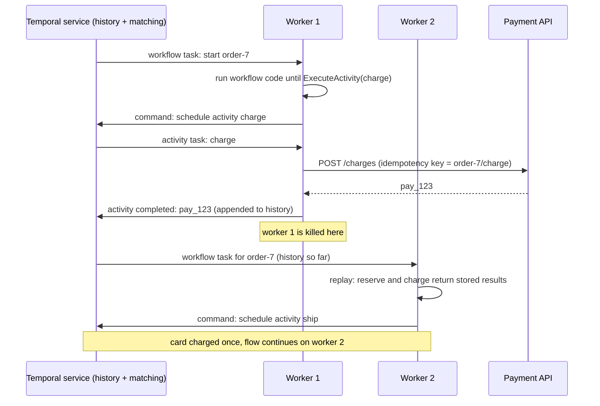
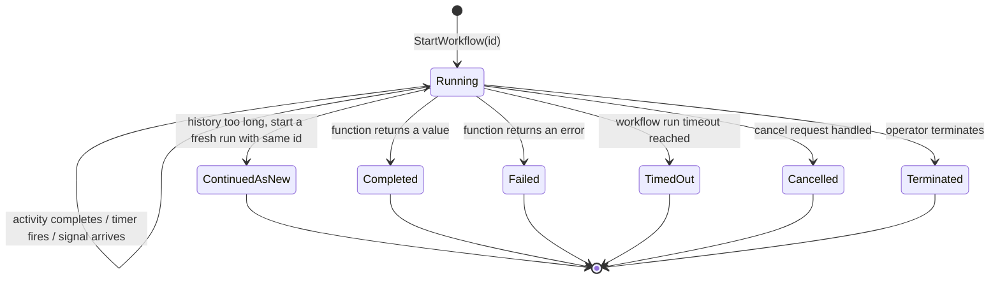

# Workflow Engines and Durable Execution

> [!summary] TL;DR
> A **workflow** is a business process with several steps that can take seconds or months: reserve stock, charge the card, wait for the courier, refund if it fails. A **workflow engine** such as Temporal runs that process as ordinary code and records every step's result in a durable **event history**. If the machine dies, another worker **replays** the code against the history and continues from the exact step where it stopped. This is called **durable execution**.

> [!abstract] Core idea
> - Split the process into **workflow code** (decides what happens next; must be deterministic) and **activities** (do the side effects: HTTP calls, DB writes, emails).
> - The engine stores each activity result. On recovery it re-runs the workflow function from the top, and already-completed activities return their stored result instead of running again.
> - Timers, retries with backoff, and waiting for external signals become one line of code each, and survive restarts.
> - Activities still run **at least once**, so they must be idempotent.
> - Classic mistake: calling `time.Now()`, `rand`, or a network API directly in workflow code. Replay then takes a different path and the engine reports a nondeterminism error.

## 1. Why it exists

Take an order flow: reserve stock (inventory service), charge ₹499 (payment provider), book a courier (logistics API), and if courier booking fails three times, refund and release stock. Booking can take up to 2 days because the courier confirms by webhook.

Built by hand, this becomes:
- a `status` column with 9 states and a `next_retry_at` column,
- a cron job that scans for stuck rows every minute ([[Scheduled Jobs - Cron to Durable Schedulers]]),
- a queue for each step and a worker for each queue ([[Background Jobs and Worker Pools]]),
- webhook handlers that find the row and nudge the state,
- compensations written as more states ([[Saga Pattern]]).

The business logic ("charge, then ship, refund on failure") is scattered across 6 places. Each new step needs a migration, a queue and new crash-recovery logic. A bug in any one leaves orders stuck in `CHARGING` with nobody knowing whether the card was charged.

A workflow engine lets you write the flow as one function and makes the engine responsible for persistence, retries, timers and recovery.

## 2. Mental model

The workflow function is a **recipe** and the event history is a **cook's notebook**. Every time the cook finishes a step ("eggs whisked, result: bowl A"), they write it down. If the cook faints, a new cook starts reading the recipe from the top. For each step, they check the notebook first: "eggs whisked? Yes, bowl A" and move on without whisking again. When they reach the first step not in the notebook, they actually do it.

This only works if the recipe gives the same instructions every time it is read. If the recipe says "add salt if it is raining" and the weather changed, the new cook goes a different way than the notebook records. That is why workflow code must be **deterministic**.

Terms:
- **Workflow execution:** one running instance, identified by a workflow ID (for example `order-7`).
- **Activity:** a function that does one side effect. It can fail, time out and be retried.
- **Event history:** the append-only log of everything that happened to one execution: started, activity scheduled, activity completed with result, timer fired, signal received.
- **Worker:** your process that hosts workflow and activity code and polls the engine for tasks.
- **Task queue:** the named queue on which the engine hands tasks to workers.
- **Signal:** a message sent into a running workflow from outside (for example "courier confirmed").
- **Durable timer:** a sleep stored by the engine, so `Sleep(48h)` survives restarts and costs no worker resources while waiting.

## 3. How it works



Step by step:
1. A client starts a workflow with an ID. The engine writes `WorkflowExecutionStarted` to the history and puts a **workflow task** on the task queue.
2. A worker takes the task and runs the workflow function. When the code calls `ExecuteActivity`, the SDK does not run the activity. It records a command "schedule activity" and suspends the workflow.
3. The engine appends `ActivityTaskScheduled` and puts an **activity task** on the queue. A worker runs the activity and reports the result, which becomes `ActivityTaskCompleted` in the history.
4. The engine schedules a new workflow task. The worker (often from a cache, or from scratch by replay) resumes the function, which now receives the activity result and runs to its next command.
5. If any worker dies, the engine notices through timeouts and gives the task to another worker, which replays the history.

### Execution lifecycle



### What must be deterministic

Workflow code runs many times over the life of one execution. Anything that could differ between runs must go through the SDK so its value is recorded in history:

| Do not use in workflow code | Use instead (Temporal Go SDK) |
| --- | --- |
| `time.Now()`, `time.Sleep` | `workflow.Now(ctx)`, `workflow.Sleep(ctx, d)`, `workflow.NewTimer` |
| `go func()`, channels, `select` | `workflow.Go`, `workflow.Channel`, `workflow.Selector` |
| `rand`, `uuid.New()` | `workflow.SideEffect` (records the value once) or generate it in an activity |
| HTTP calls, DB queries, reading files or env vars | an activity |
| iterating a Go map (random order) and acting on order | sort the keys first |

### Retries and timeouts

Activities get retry policies declared once, not hand-written loops. Temporal's default activity retry policy: first retry after 1 s, backoff coefficient 2.0, maximum interval 100 × the initial interval, and unlimited attempts. Only `ScheduleToClose` (or a `MaximumAttempts` you set) ends the retries; `StartToClose` bounds a single attempt:
- **StartToClose:** maximum time for one attempt. Always set it.
- **ScheduleToClose:** maximum time for all attempts together.
- **ScheduleToStart:** maximum time waiting in the queue for a worker.
- **Heartbeat timeout:** for long activities that report progress; a missed heartbeat fails the attempt early.

Non-retryable error types (for example "card declined") stop retries at once. Detail on backoff and jitter: [[Timeouts, Retries and Backoff]].

## 4. Worked example

### Whiteboard version

```text
workflow order-7:
  reserve(sku-1)   -> history[0] = reserve ok
  charge(49900)    -> history[1] = charge pay_123
  ship(order-7)    -> worker dies mid-call, nothing recorded
new worker replays order-7 from the top:
  reserve -> history[0] exists -> return "ok", do NOT call inventory
  charge  -> history[1] exists -> return "pay_123", do NOT charge again
  ship    -> no history[2] -> really call the courier -> "trk-9"
  history[2] = ship trk-9 -> workflow returns "shipped"
if ship fails 3 times: refund(pay_123) -> "refunded"   (saga as code)
if a deploy reorders reserve/charge: replay sees charge where history
  says reserve -> nondeterminism error, execution stops for a fix
```

### Go: a toy durable-execution engine

This is a teaching model of the replay idea, not a Temporal client. `Ctx.Execute` either answers from history or runs the activity with retries and appends the result. `ErrWorkerCrash` simulates the worker dying mid-activity: nothing is recorded, so the step is retried after recovery.

```go
// Package workflow is a toy durable-execution engine. Workflow code calls
// activities through Ctx.Execute; every completed activity is appended to an
// event history. After a crash the workflow function runs again from the top
// and Execute answers from the history instead of re-running the activity.
package workflow

import (
	"errors"
	"fmt"
	"sync"
)

// Event is one entry of a workflow's history.
type Event struct {
	Activity string
	Result   string
	Err      string // non-empty if the activity failed after all retries
}

// Store is the durable history (Temporal keeps it in Cassandra, MySQL or PostgreSQL).
type Store struct {
	mu      sync.Mutex
	history map[string][]Event
}

func NewStore() *Store { return &Store{history: map[string][]Event{}} }

func (s *Store) Load(id string) []Event {
	s.mu.Lock()
	defer s.mu.Unlock()
	return append([]Event(nil), s.history[id]...)
}

func (s *Store) Append(id string, e Event) {
	s.mu.Lock()
	defer s.mu.Unlock()
	s.history[id] = append(s.history[id], e)
}

// Activity does the side effect (call a payment API, send an email ...).
type Activity func(input string) (string, error)

// ErrNondeterminism means the workflow code no longer matches its history.
var ErrNondeterminism = errors.New("nondeterminism: workflow code changed")

// ErrWorkerCrash simulates the worker process dying mid-activity: nothing is
// recorded, so the activity runs again after recovery.
var ErrWorkerCrash = errors.New("worker crashed")

// Ctx is handed to workflow code.
type Ctx struct {
	id          string
	store       *Store
	history     []Event
	pos         int
	activities  map[string]Activity
	maxAttempts int
}

// Execute runs (or replays) the next activity.
func (c *Ctx) Execute(name, input string) (string, error) {
	if c.pos < len(c.history) {
		ev := c.history[c.pos]
		if ev.Activity != name {
			return "", fmt.Errorf("%w: history has %q at step %d, code asked for %q",
				ErrNondeterminism, ev.Activity, c.pos, name)
		}
		c.pos++
		if ev.Err != "" {
			return "", errors.New(ev.Err)
		}
		return ev.Result, nil
	}
	act, ok := c.activities[name]
	if !ok {
		return "", fmt.Errorf("unknown activity %q", name)
	}
	var res string
	var err error
	for attempt := 1; attempt <= c.maxAttempts; attempt++ {
		res, err = act(input)
		if errors.Is(err, ErrWorkerCrash) {
			return "", err
		}
		if err == nil {
			break
		}
	}
	ev := Event{Activity: name, Result: res}
	if err != nil {
		ev.Err = err.Error()
	}
	c.store.Append(c.id, ev)
	c.history = append(c.history, ev)
	c.pos++
	return res, err
}

// Engine runs workflow functions durably.
type Engine struct {
	Store       *Store
	Activities  map[string]Activity
	MaxAttempts int
}

// Run starts or resumes workflow id. Calling it again after a crash replays
// the history and continues where the previous run stopped.
func (e *Engine) Run(id string, wf func(*Ctx) (string, error)) (string, error) {
	c := &Ctx{
		id: id, store: e.Store, history: e.Store.Load(id),
		activities: e.Activities, maxAttempts: max(1, e.MaxAttempts),
	}
	return wf(c)
}
```

```go
package workflow

import (
	"errors"
	"fmt"
	"sync/atomic"
	"testing"
)

// orderWorkflow: reserve stock, charge the card, ship; refund if shipping fails.
func orderWorkflow(c *Ctx) (string, error) {
	if _, err := c.Execute("reserve", "sku-1"); err != nil {
		return "", err
	}
	payID, err := c.Execute("charge", "49900")
	if err != nil {
		return "", err
	}
	if _, err := c.Execute("ship", "order-7"); err != nil {
		if errors.Is(err, ErrWorkerCrash) {
			return "", err
		}
		if _, rerr := c.Execute("refund", payID); rerr != nil {
			return "", rerr
		}
		return "refunded", nil
	}
	return "shipped", nil
}

type counters struct{ reserve, charge, ship, refund atomic.Int32 }

func activities(n *counters, ship Activity) map[string]Activity {
	return map[string]Activity{
		"reserve": func(string) (string, error) { n.reserve.Add(1); return "ok", nil },
		"charge":  func(string) (string, error) { n.charge.Add(1); return "pay_123", nil },
		"ship":    func(in string) (string, error) { n.ship.Add(1); return ship(in) },
		"refund":  func(string) (string, error) { n.refund.Add(1); return "ok", nil },
	}
}

func TestResumeAfterCrashDoesNotChargeTwice(t *testing.T) {
	var n counters
	crashed := false
	e := &Engine{Store: NewStore(), MaxAttempts: 3, Activities: activities(&n, func(string) (string, error) {
		if !crashed {
			crashed = true
			return "", ErrWorkerCrash
		}
		return "trk-9", nil
	})}
	if _, err := e.Run("wf-1", orderWorkflow); !errors.Is(err, ErrWorkerCrash) {
		t.Fatalf("first run: %v", err)
	}
	out, err := e.Run("wf-1", orderWorkflow) // a new worker picks it up
	if err != nil || out != "shipped" {
		t.Fatalf("resume: %q %v", out, err)
	}
	if n.reserve.Load() != 1 || n.charge.Load() != 1 || n.ship.Load() != 2 {
		t.Fatalf("reserve=%d charge=%d ship=%d", n.reserve.Load(), n.charge.Load(), n.ship.Load())
	}
}

func TestRetriesThenCompensates(t *testing.T) {
	var n counters
	e := &Engine{Store: NewStore(), MaxAttempts: 3, Activities: activities(&n, func(string) (string, error) {
		return "", errors.New("carrier down")
	})}
	out, err := e.Run("wf-2", orderWorkflow)
	if err != nil || out != "refunded" {
		t.Fatalf("got %q %v", out, err)
	}
	if n.ship.Load() != 3 || n.refund.Load() != 1 {
		t.Fatalf("ship=%d refund=%d", n.ship.Load(), n.refund.Load())
	}
	// Replaying a finished workflow runs no activity again.
	if out, _ := e.Run("wf-2", orderWorkflow); out != "refunded" || n.charge.Load() != 1 {
		t.Fatalf("replay: %q charge=%d", out, n.charge.Load())
	}
}

func TestChangedCodeIsDetected(t *testing.T) {
	var n counters
	e := &Engine{Store: NewStore(), MaxAttempts: 1, Activities: activities(&n, func(string) (string, error) {
		return "", ErrWorkerCrash
	})}
	_, _ = e.Run("wf-3", orderWorkflow) // history: reserve, charge
	// New deployment swaps the order of the first two steps.
	v2 := func(c *Ctx) (string, error) {
		if _, err := c.Execute("charge", "49900"); err != nil {
			return "", err
		}
		return c.Execute("reserve", "sku-1")
	}
	_, err := e.Run("wf-3", v2)
	if !errors.Is(err, ErrNondeterminism) {
		t.Fatalf("want ErrNondeterminism, got %v", err)
	}
}

func TestManyWorkflowsConcurrently(t *testing.T) {
	var n counters
	e := &Engine{Store: NewStore(), MaxAttempts: 1, Activities: activities(&n, func(string) (string, error) {
		return "trk", nil
	})}
	done := make(chan error, 50)
	for i := 0; i < 50; i++ {
		go func(i int) {
			_, err := e.Run(fmt.Sprintf("wf-%d", i), orderWorkflow)
			done <- err
		}(i)
	}
	for i := 0; i < 50; i++ {
		if err := <-done; err != nil {
			t.Fatal(err)
		}
	}
	if n.charge.Load() != 50 {
		t.Fatalf("charge=%d", n.charge.Load())
	}
}
```

`go vet` is clean and `go test -race` passes (Go 1.24). The tests prove the four properties that matter: a resumed workflow does not charge twice, failed activities are retried and then compensated, changed workflow code is caught by replay, and many executions run concurrently without sharing state.

### The same flow in the Temporal Go SDK

For comparison, here is the same flow written against the real Temporal Go SDK (`go.temporal.io/sdk` v1.38.0). It adds the 48-hour wait for the courier's webhook, delivered as a signal. The activities are stubs here; in a real service they call the inventory, payment and courier APIs.

```go
package temporalwf

import (
	"context"
	"time"

	"go.temporal.io/sdk/temporal"
	"go.temporal.io/sdk/workflow"
)

func Reserve(ctx context.Context, orderID string) error          { return nil }
func Charge(ctx context.Context, orderID string) (string, error) { return "pay_123", nil }
func Refund(ctx context.Context, payID string) error             { return nil }

func OrderWorkflow(ctx workflow.Context, orderID string) (string, error) {
	ctx = workflow.WithActivityOptions(ctx, workflow.ActivityOptions{
		StartToCloseTimeout: 10 * time.Second,
		RetryPolicy: &temporal.RetryPolicy{
			MaximumAttempts:        3,
			NonRetryableErrorTypes: []string{"CardDeclined"},
		},
	})
	if err := workflow.ExecuteActivity(ctx, Reserve, orderID).Get(ctx, nil); err != nil {
		return "", err
	}
	var payID string
	if err := workflow.ExecuteActivity(ctx, Charge, orderID).Get(ctx, &payID); err != nil {
		return "", err
	}
	// Wait up to 48 hours for the courier's webhook, delivered as a signal.
	confirmed := false
	sel := workflow.NewSelector(ctx)
	sel.AddReceive(workflow.GetSignalChannel(ctx, "courier-confirmed"), func(c workflow.ReceiveChannel, _ bool) {
		c.Receive(ctx, nil)
		confirmed = true
	})
	sel.AddFuture(workflow.NewTimer(ctx, 48*time.Hour), func(workflow.Future) {})
	sel.Select(ctx)
	if !confirmed {
		_ = workflow.ExecuteActivity(ctx, Refund, payID).Get(ctx, nil)
		return "refunded", nil
	}
	return "shipped", nil
}
```

The SDK ships an in-memory test environment that runs workflows without a server and skips timers forward instantly, so the 48-hour branch tests in milliseconds:

```go
package temporalwf

import (
	"testing"
	"time"

	"go.temporal.io/sdk/testsuite"
)

func TestShippedWhenSignalled(t *testing.T) {
	var s testsuite.WorkflowTestSuite
	env := s.NewTestWorkflowEnvironment()
	env.RegisterActivity(Reserve)
	env.RegisterActivity(Charge)
	env.RegisterActivity(Refund)
	env.RegisterDelayedCallback(func() { env.SignalWorkflow("courier-confirmed", nil) }, time.Hour)
	env.ExecuteWorkflow(OrderWorkflow, "order-7")
	var out string
	if err := env.GetWorkflowResult(&out); err != nil || out != "shipped" {
		t.Fatalf("%q %v", out, err)
	}
}

func TestRefundAfter48h(t *testing.T) {
	var s testsuite.WorkflowTestSuite
	env := s.NewTestWorkflowEnvironment()
	env.RegisterActivity(Reserve)
	env.RegisterActivity(Charge)
	env.RegisterActivity(Refund)
	env.ExecuteWorkflow(OrderWorkflow, "order-7")
	var out string
	if err := env.GetWorkflowResult(&out); err != nil || out != "refunded" {
		t.Fatalf("%q %v", out, err)
	}
}
```

Both tests pass under `go vet` and `go test -race` (Go 1.24, SDK v1.38.0).

The 48-hour wait is a durable timer: no goroutine sleeps for 48 hours. The engine stores the timer and wakes the workflow when it fires or when the signal arrives.

## 5. Variants and comparison

| Option | How it works | Use when | Cost |
| --- | --- | --- | --- |
| Temporal / Cadence | Workflow as code in Go, Java, TypeScript, Python and more; event history plus replay | Long-running, many-step business processes with compensation | A cluster (Temporal server plus Cassandra, MySQL or PostgreSQL) or Temporal Cloud; determinism discipline |
| AWS Step Functions | State machine in JSON (Amazon States Language); each state calls a Lambda or AWS API | AWS-native orchestration, few custom services | Logic in JSON, not code; per-transition pricing on Standard |
| Azure Durable Functions | Orchestrator functions replayed from history, like Temporal | Azure Functions shops | Azure lock-in; same determinism rules |
| Restate, DBOS, Inngest | Durable execution as a library or lightweight service, often journaling steps in a DB you already run | Smaller teams wanting durable steps without a big cluster | Younger ecosystems |
| Airflow, Argo Workflows | DAGs of batch tasks on a schedule | Data pipelines, ETL, ML training | Not built for per-request workflows with signals and low latency |
| Hand-built state machine | Status column + queues + cron + webhook handlers | Two or three steps, short-lived | Recovery and retries are your code and your bugs |
| Choreography with events | Each service reacts to the previous one's event | Loosely coupled flows with no central owner | Hard to see the whole flow or change it; see [[Saga Pattern]] |

**Step Functions types:** Standard workflows run up to 1 year with exactly-once execution of each workflow step and full history; Express workflows run up to 5 minutes, priced per request and duration, for high-volume short flows; asynchronous Express runs are at-least-once and synchronous Express runs are at-most-once.

## 6. Trade-offs and when not to use

- **Determinism discipline.** Every developer must know what may not appear in workflow code. Library upgrades or innocent refactors can break replay of running executions.
- **Versioning running workflows.** A workflow that waits 30 days runs on code you will change many times. You must branch with `workflow.GetVersion` (or route old executions to old workers with worker versioning) for every change that alters the command sequence.
- **History size.** Temporal limits one execution's history (warnings start at 10,240 events or 10 MB; the hard limit is 51,200 events or 50 MB). Infinite loops (a subscription renewing monthly forever) must call **Continue-As-New**, which starts a fresh run with the same workflow ID and an empty history.
- **Latency.** Each step is a round trip through the engine and a durable write. Fine for business processes; wrong for a hot path that must answer in 20 ms.
- **Payloads.** Activity inputs and results are stored in history. Keep them small (IDs, not files).
- **When not to use it:**
	- A single background job with a retry: use a job queue.
	- Stream processing of millions of events per second: use [[Stream Processing Basics]].
	- A simple two-step flow where an outbox plus one consumer is enough ([[Transactional Outbox and CDC]]).

## 7. In production

- **Real systems:** Cadence was built at Uber and open-sourced in 2017; Temporal was forked from it in 2019 by Cadence's original authors. Typical uses: order and payment flows, onboarding and KYC with human steps, infrastructure provisioning, subscription billing loops, and long-running sagas.
- **Failure modes → fixes:**
	- *Nondeterminism error after a deploy.* Workflow code changed the order or type of commands. Fix: wrap changes in `GetVersion`, run replay tests against saved histories in CI (the Go SDK has a `WorkflowReplayer` for this).
	- *Activity charged twice.* The activity succeeded but the worker died before reporting, so it was retried. Fix: pass a stable idempotency key (workflow ID plus activity name) to the payment API; see [[Idempotency and Idempotency Keys]].
	- *Workers overloaded or starving.* Task-queue backlog grows (schedule-to-start latency rises). Fix: scale workers per task queue; split slow activities onto their own queue.
	- *Huge histories.* Long loops or large payloads hit history limits. Fix: Continue-As-New and storing large data outside (an object store) with only a reference in history.
	- *Stuck workflows.* An activity with no StartToClose timeout waits forever on a hung call. Fix: always set timeouts and heartbeats for long activities.
- **What to monitor:** schedule-to-start latency per task queue (worker capacity), workflow and activity failure rates, nondeterminism errors (should be 0), activity retry counts, history length percentiles, number of open executions per workflow type.

## 8. Deep dive

- **Replay mechanics.** A worker usually keeps a running workflow cached in memory ("sticky execution") and only feeds it new events. Full replay happens on cache eviction, worker restart or a different worker taking over. Replay compares each command the code produces with the next command recorded in history; a mismatch is a nondeterminism error and the workflow task fails (and is retried) until fixed code is deployed.
- **Why activities are at-least-once.** The engine records `ActivityTaskCompleted` only after the worker reports. If the worker dies after the side effect but before reporting, the engine sees a timeout and schedules another attempt. No engine can avoid this window, which is the same dual-write problem as in [[Transactional Outbox and CDC]].
- **Workflow code is exactly-once in effect.** Workflow code may execute many times, but its *decisions* are recorded once, because the history is the source of truth. That is why it may not have side effects of its own.
- **Signals, queries and updates.** Signals append an event and wake the workflow (fire and forget). Queries read the workflow's state without changing history. Updates (newer in Temporal) are a request/response: a validated change whose result the caller waits for.
- **Child workflows** give a large process its own history and failure boundary. **Workflow ID reuse policies** decide whether starting `order-7` again is rejected, allowed after completion, or terminates a running one, which gives you idempotent starts.
- **Durable execution vs event sourcing.** Both rebuild state by replaying a log. In [[Event Sourcing]] the log holds domain events and you write the fold. In a workflow engine the log holds *execution* events and the SDK replays your code over them.
- **Sagas as code.** Compensations become a `defer`-like list: after each successful step, push its undo onto a slice; on failure, run the slice in reverse. The engine makes sure the compensations themselves are retried until they succeed. The saga concept is in [[Saga Pattern]].

## 9. Interview questions

> [!question]- What is durable execution in one sentence?
> Running ordinary code whose progress is recorded step by step in a durable history, so that after a crash the code is replayed against the history and continues from the last completed step instead of restarting the whole process.

> [!question]- Why must workflow code be deterministic?
> Because recovery re-runs the code from the top and matches each command against the recorded history. If the code takes a different path (different time, random value, changed order), the commands no longer match and the engine cannot tell what already happened.

> [!question]- Does Temporal give you exactly-once side effects? (trap)
> No. Workflow decisions are recorded once, but activities run at least once: a worker can die after the side effect and before reporting completion. Make activities idempotent, for example with an idempotency key derived from the workflow ID.

> [!question]- How do you change the code of a workflow that has 10,000 running executions?
> Guard the change with `workflow.GetVersion` so old executions replay the old branch and new ones take the new branch, or use worker versioning to keep old executions on old workers. Test with a replayer against real histories before deploying.

> [!question]- Workflow engine vs choreographed events for a saga?
> An engine (orchestration) puts the whole flow in one place, with retries, timers and compensations, and makes the current state visible. Choreography keeps services decoupled but spreads the flow across consumers and makes it hard to see or change. Use orchestration when the flow has many steps, timeouts or compensations.

> [!question]- How does a workflow wait 30 days without holding a goroutine?
> `workflow.Sleep` records a timer in the engine and the workflow's state is just its history. No worker holds anything; when the timer fires, the engine schedules a workflow task and a worker replays and continues.

> [!question]- Step Functions Standard or Express?
> Standard for long-running (up to a year), low-volume flows needing exactly-once step execution and history. Express for high-volume, short (up to 5 minutes) flows such as event processing, where at-least-once (asynchronous) or at-most-once (synchronous) execution is acceptable and cost matters.

## 10. Cheat sheet

- Workflow = deterministic orchestration code; activity = side effect, retried, at-least-once.
- Engine stores event history; recovery = replay code against history.
- No `time.Now`, `rand`, goroutines or I/O in workflow code; use SDK equivalents or activities.
- Durable timers and signals replace cron scans and status columns.
- Always set StartToClose; make activities idempotent with a stable key.
- Version changes with `GetVersion`; replay-test histories in CI.
- Long loops → Continue-As-New (history limits: 51,200 events / 50 MB in Temporal).
- Step Functions: Standard (1 year, exactly-once steps) vs Express (5 min, at-least-once async / at-most-once sync).

## Links

- **Before this:** [[Saga Pattern]], [[Background Jobs and Worker Pools]], [[Timeouts, Retries and Backoff]]
- **Next:** [[Stream Processing Basics]], [[Scheduled Jobs - Cron to Durable Schedulers]]
- **Compare with:** [[Event Sourcing]] (replaying domain events), [[Transactional Outbox and CDC]] (the same crash window, solved for one event), [[AWS SQS, SNS and EventBridge]]
