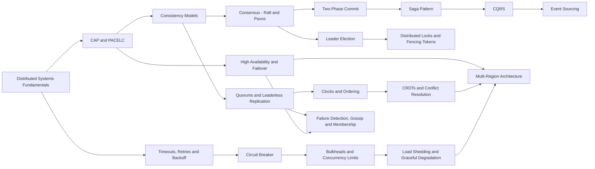

# 10 Distributed Systems & Resilience MOC

> [!summary] What this folder covers
> How to build services that survive partial failure. After this folder you can protect a service with timeouts, retries, breakers, bulkheads and shedding; reason about CAP, consistency, quorums, clocks and consensus; and design cross-service workflows and multi-region systems.

## Before and after

- **Before this:** [[07 Databases MOC]] · [[08 Caching & Redis MOC]] · [[09 Messaging & Async MOC]]
- **After this:** [[11 System Design MOC]]

Back to [[Home]].

## Learning path

### Resilience basics

1. [[Distributed Systems Fundamentals]] · basic. Partial failure, unreliable networks and system models, which are the reasons everything else in this folder exists.
2. [[Timeouts, Retries and Backoff]] · basic. This note covers the first line of defence and shows how retries without jitter and budgets cause retry storms.
3. [[Circuit Breaker]] · basic. A breaker stops calling a dependency that is failing so that it can recover and your threads stay free.
4. [[Bulkheads and Concurrency Limits]] · intermediate. Bulkheads isolate resources so that one slow dependency cannot exhaust the whole service.
5. [[Load Shedding and Graceful Degradation]] · intermediate. When overloaded, a service should reject work early and degrade features instead of failing completely.

### Consistency and replication

6. [[CAP and PACELC]] · basic. This note explains the real trade-off during a partition and the latency trade-off when there is no partition.
7. [[Consistency Models]] · intermediate. It moves from linearizable to eventual consistency, including the session guarantees that users actually notice.
8. [[High Availability and Failover]] · intermediate. It covers redundancy across availability zones, failover mechanics and the split-brain risk.
9. [[Quorums and Leaderless Replication]] · intermediate. Read and write quorums (R + W > N), sloppy quorums and repair in Dynamo-style stores are explained here.
10. [[Clocks and Ordering]] · advanced. Physical clocks drift, so this note shows how Lamport clocks, vector clocks and HLC order events instead.

### Coordination

11. [[Consensus - Raft and Paxos]] · advanced. Consensus lets a majority agree on one replicated log, and it underlies etcd, Spanner and DynamoDB partitions.
12. [[Leader Election]] · advanced. Lease-based election with etcd or a database row ensures that only one instance does the work.
13. [[Distributed Locks and Fencing Tokens]] · advanced. A lock is not safe without fencing, and this note explains why Redlock-style locks need fencing tokens.
14. [[Two-Phase Commit]] · advanced. Atomic commit across participants works, but the protocol blocks when the coordinator fails.
15. [[Failure Detection, Gossip and Membership]] · advanced. Heartbeats, phi-accrual detectors and SWIM gossip show how a cluster learns who is alive.

### Cross-service workflows and data

16. [[Saga Pattern]] · advanced. A saga runs local transactions with compensations, using either orchestration or choreography.
17. [[CQRS]] · advanced. CQRS separates the write model from read models and asks you to accept the lag between them.
18. [[Event Sourcing]] · advanced. Event sourcing stores events as the source of truth and rebuilds state through projections and snapshots.
19. [[CRDTs and Conflict Resolution]] · advanced. CRDTs are data types that merge concurrent writes without coordination, which is safer than last-writer-wins.
20. [[Multi-Region Architecture]] · advanced. It compares active-passive and active-active designs, data residency, and the cost of cross-region consistency.

## Concept map

## Interview focus

- How do you configure retries safely, and why do you need jitter, budgets and idempotency? See [[Timeouts, Retries and Backoff]].
- How does a circuit breaker work, and what are its three states? See [[Circuit Breaker]].
- Explain CAP. Is your database CP or AP, and what does PACELC add? See [[CAP and PACELC]].
- What is the difference between linearizability and eventual consistency, and what is read-your-writes? See [[Consistency Models]].
- How does Raft elect a leader and replicate the log safely? See [[Consensus - Raft and Paxos]].
- Why is a Redis lock alone unsafe, and what is a fencing token? See [[Distributed Locks and Fencing Tokens]].
- Why does two-phase commit block, and when would you use a saga instead? See [[Two-Phase Commit]] and [[Saga Pattern]].
- How do you design an order or payment flow across services with compensations? See [[Saga Pattern]].
- When are CQRS and event sourcing worth their complexity? See [[CQRS]] and [[Event Sourcing]].
- How would you take a service active-active across regions? See [[Multi-Region Architecture]].

## Sources worth reading

- Martin Kleppmann, *Designing Data-Intensive Applications*, chapters 5, 8 and 9.
- Diego Ongaro and John Ousterhout, "In Search of an Understandable Consensus Algorithm" (the Raft paper), and the visualisation at raft.github.io.
- Michael Nygard, *Release It!*, second edition, on stability patterns.
- Amazon Builders' Library: "Timeouts, retries, and backoff with jitter" and "Using load shedding to avoid overload".
- Martin Kleppmann, "How to do distributed locking" (2016).
- Daniel Abadi, "Consistency Tradeoffs in Modern Distributed Database System Design" (the PACELC paper, 2012).
- Elhemali et al., "Amazon DynamoDB: A Scalable, Predictably Performant, and Fully Managed NoSQL Database Service" (USENIX ATC 2022).
- Chris Richardson, microservices.io, on the Saga, CQRS and Event Sourcing patterns.
- Marc Shapiro et al., "Conflict-free Replicated Data Types" (2011).
