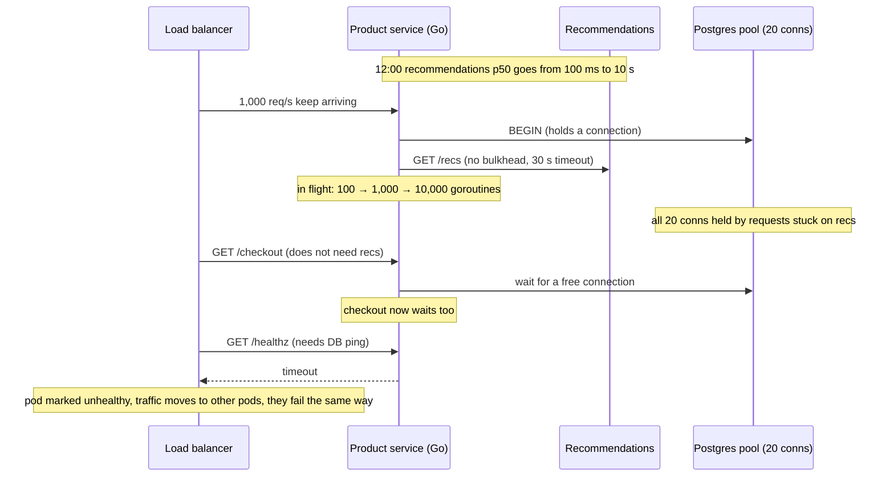
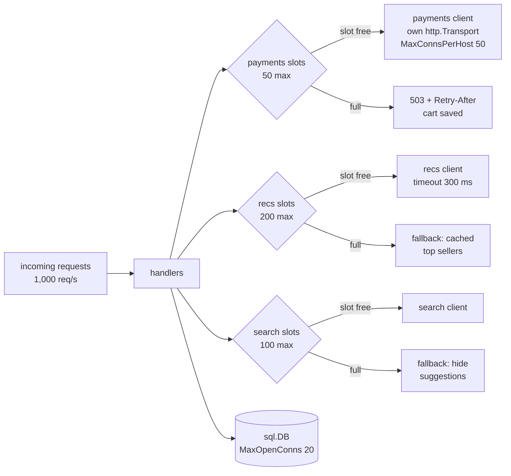

# Bulkheads and Concurrency Limits

> [!summary] TL;DR
> A **bulkhead** gives each dependency its own fixed share of a service's capacity (goroutines, connections, pool slots), so a slow dependency can use up only its own share and the rest of the service keeps working. A **concurrency limit** is the number that sets that share: how many calls may be in flight at once.

> [!abstract] Core idea
> - **Little's Law:** requests in flight = arrival rate × time each one takes. When latency jumps, in-flight work jumps with it.
> - A slow dependency does not fail loudly; it quietly hoards goroutines, connections and memory until everything is slow.
> - Cap in-flight calls **per dependency** (semaphore, pool size, `MaxConnsPerHost`), and reject or fall back when the cap is full.
> - Size the cap from rate × latency with headroom; put timeouts on everything so slots come back.
> - Classic mistake in Go: "goroutines are cheap, so there is no pool to exhaust". The pools are your connections, your database and your memory.

## 1. Why it exists

The old notes' interview explanation still holds: *a service has 100 worker threads and an external API starts taking 10 seconds instead of 100 ms; threads pile up, new requests wait, p99 latency rises, and health checks may fail.* Here is the same story in numbers, using **Little's Law**: `L = λ × W`, where `L` is the average number of requests in the system, `λ` the arrival rate and `W` the average time each spends inside.

A product-page service receives 1,000 requests per second and calls a recommendations service on every request.

| Recommendations latency | In flight (`1,000/s × W`) | What it costs |
| --- | --- | --- |
| 100 ms (normal) | 100 | Nothing worth noticing |
| 1 s (degraded) | 1,000 | Connection pool and memory grow 10× |
| 10 s (badly degraded) | 10,000 | Thousands of goroutines, sockets and buffers; DB pool and file descriptors run out |

In a thread-per-request server such as Tomcat (default `maxThreads` 200), the pool fills at 200 in flight and new requests queue, **including requests that never touch recommendations**. Checkout stops working because recommendations got slow.

Go has no request thread pool, so the failure looks different but ends the same way:

- **Goroutines and memory.** Each stuck request is a goroutine (stack starting at 2 KB, growing as needed) plus its request and response buffers. Assuming about 20 KB per stuck request (an estimate; measure your own with a heap profile), 10,000 of them hold about 200 MB.
- **Outbound connections.** `http.Transport.MaxConnsPerHost` defaults to 0, meaning unlimited, so Go opens a new socket for every waiting request. The default of `MaxIdleConnsPerHost` is 2, so after the spike most of those connections are closed again instead of reused.
- **File descriptors.** Every socket is a descriptor. A typical soft limit of 1,024 per process on Linux (check `ulimit -n`) turns into `accept: too many open files`, which breaks *incoming* traffic as well.
- **Database pool.** If a handler opens a transaction before calling recommendations, every stuck request also holds one of the `sql.DB` connections. Other handlers then wait inside `database/sql` for a free connection (visible as `DBStats.WaitCount`).
- **Health checks** wait on the same resources, the load balancer marks the pod unhealthy, and traffic shifts to the remaining pods, which fail the same way.

## 2. Mental model

The name comes from ships. A hull is split into watertight compartments by walls called bulkheads. A hole floods one compartment, and the ship stays afloat.

In a service, the "water" is waiting work. Without bulkheads, all requests draw from one shared pool of resources, so whatever is slowest fills it. With bulkheads, recommendations get 200 slots, payments get 50, search gets 100. When recommendations hang, their 200 slots fill and further recommendation calls are turned away at once (and the page shows a fallback), while payments still have all 50 of their slots.

The limit is the size of the compartment. Too small and you reject healthy traffic; too large and the compartment is the whole ship.

## 3. How it works

### How a slow dependency exhausts a service



The fixes listed in the old notes still apply, each at a different layer:

1. **Timeouts on every dependency call**, so slots come back ([[Timeouts, Retries and Backoff]]).
2. **Separate pools (bulkheads) for risky dependencies**, so one cannot take everything.
3. **Circuit breakers**, so a known-bad dependency is not called at all ([[10 Distributed Systems & Resilience/Circuit Breaker|Circuit Breaker]]).
4. **Non-blocking I/O where it helps**, which Go provides by default (below).
5. **Queues with bounds and backpressure**, never unbounded queues ([[Backpressure and Flow Control]]).
6. **Connection pool limits** on HTTP clients and `sql.DB` ([[Connection Pooling]]).
7. **Do not hold scarce resources across remote calls**: commit or release the DB connection before calling another service.

### Bulkheads per dependency



A bulkhead can be built at several levels. They combine:

| Level | Mechanism in Go | Bounds |
| --- | --- | --- |
| Per call site | Buffered channel or `semaphore.Weighted` around the call | In-flight calls to one dependency |
| Per client | A separate `http.Client` with its own `http.Transport` and `MaxConnsPerHost` | Sockets to one host |
| Per database | `db.SetMaxOpenConns(n)`; a separate `sql.DB` for reporting queries | Connections and server-side backends |
| Per fan-out | `errgroup.SetLimit(n)` or a bounded worker pool | Goroutines spawned by one request or job |
| Per process | Separate deployments for critical and best-effort traffic | CPU, memory, failure domain |
| In the mesh | Envoy cluster thresholds: `max_connections`, `max_pending_requests`, `max_requests` (default 1,024 each), `max_retries` (default 3) | Load sent to one upstream cluster |

### Thread-per-request, event loop and Go's scheduler

| Model | How waiting on I/O behaves | What exhausts first |
| --- | --- | --- |
| Thread-per-request (Tomcat, classic Java) | Each waiting call blocks an OS thread; pool default 200 | The thread pool: new requests queue at the connector |
| Event loop (Node.js) | I/O is non-blocking; one JavaScript thread runs callbacks | CPU-heavy or synchronous code blocks *every* request; libuv's thread pool (default 4) for file and DNS work |
| Go (M:N scheduler) | Goroutines waiting on network I/O are parked by the **netpoller** and use no OS thread; a goroutine in a blocking syscall or cgo call keeps its thread, and the scheduler hands its P to another thread | Memory, sockets, descriptors and downstream pools; nothing stops goroutine growth by default |
| Java 21 virtual threads | Like Go: a blocked virtual thread unmounts from its carrier thread | Same as Go: downstream pools, unless limited |

The lesson: cheap waiting (Go, virtual threads, Node) moves the bottleneck from threads to everything else. You still need explicit limits. Scheduler internals are in [[Runtime - Goroutine Scheduler (GMP)]].

### Sizing a limit

- **I/O-bound calls:** `limit ≈ target rate × normal latency × headroom`. For 1,000 req/s at 100 ms p99 with 2× headroom: `1,000 × 0.1 × 2 = 200`.
- **CPU-bound work:** about the number of cores (`runtime.GOMAXPROCS(0)`). More workers only add context switching. Before Go 1.25, `GOMAXPROCS` in a container defaulted to the host's CPU count, not the container's CPU limit (teams used `go.uber.org/automaxprocs`); since Go 1.25 the runtime reads the cgroup CPU limit.
- **Downstream capacity wins.** If Postgres allows 100 connections (`max_connections` default) and you run 10 pods, each pod's `MaxOpenConns` must be at most about 10, minus room for migrations and admin sessions.
- **Waiting versus rejecting.** A short wait for a slot (a few milliseconds) smooths bursts; a long wait just rebuilds the unbounded queue. Reject when the wait would exceed what the caller can afford.

## 4. Worked example

### Whiteboard version

A per-dependency bulkhead is a buffered channel used as a semaphore. Separate clients give separate connection pools.

```go
package wbbulk

import (
	"database/sql"
	"errors"
	"net"
	"net/http"
	"time"
)

// recsSlots allows at most 20 calls to recommendations at once.
var recsSlots = make(chan struct{}, 20)

// CallRecs rejects at once when all 20 slots are busy.
func CallRecs(fn func() error) error {
	select {
	case recsSlots <- struct{}{}:
		defer func() { <-recsSlots }()
		return fn()
	default:
		return errors.New("recs bulkhead full")
	}
}

// NewPaymentsClient gives payments its own pool, separate from other clients.
func NewPaymentsClient() *http.Client {
	return &http.Client{
		Timeout: 3 * time.Second, // whole exchange, including reading the body
		Transport: &http.Transport{
			DialContext:           (&net.Dialer{Timeout: 500 * time.Millisecond}).DialContext,
			TLSHandshakeTimeout:   500 * time.Millisecond,
			ResponseHeaderTimeout: 2 * time.Second,
			MaxConnsPerHost:       50, // the bulkhead: default 0 means unlimited
			MaxIdleConnsPerHost:   50, // default 2 forces constant reconnects
			IdleConnTimeout:       90 * time.Second,
		},
	}
}

// LimitDB caps the database pool; callers queue inside database/sql.
func LimitDB(db *sql.DB) {
	db.SetMaxOpenConns(20) // default 0 means unlimited
	db.SetMaxIdleConns(20)
	db.SetConnMaxLifetime(30 * time.Minute)
}
```

### The bulkhead type

The production version adds an optional bounded wait, context cancellation, gauges and counters for metrics, and Little's Law as a helper for sizing. The wait timer is injected (`after`), so tests never sleep.

```go
// Package bulkhead caps how many calls may be in flight to one dependency,
// so a slow dependency can only tie up its own slots.
package bulkhead

import (
	"context"
	"errors"
	"sync/atomic"
	"time"
)

// ErrFull means no slot freed up within the allowed wait.
var ErrFull = errors.New("bulkhead full")

// Bulkhead is a counting semaphore built on a buffered channel.
type Bulkhead struct {
	slots    chan struct{}
	maxWait  time.Duration
	after    func(time.Duration) <-chan time.Time // injected for tests
	rejected atomic.Int64
}

// New allows maxConcurrent calls at once. A caller waits at most maxWait
// for a slot; 0 means reject immediately when full.
func New(maxConcurrent int, maxWait time.Duration) *Bulkhead {
	return &Bulkhead{slots: make(chan struct{}, maxConcurrent), maxWait: maxWait, after: time.After}
}

// Do runs fn if a slot is available, and frees the slot when fn returns.
func (b *Bulkhead) Do(ctx context.Context, fn func(context.Context) error) error {
	if err := b.acquire(ctx); err != nil {
		return err
	}
	defer func() { <-b.slots }()
	return fn(ctx)
}

func (b *Bulkhead) acquire(ctx context.Context) error {
	select {
	case b.slots <- struct{}{}: // fast path: a slot is free
		return nil
	default:
	}
	if b.maxWait == 0 {
		b.rejected.Add(1)
		return ErrFull
	}
	select {
	case b.slots <- struct{}{}:
		return nil
	case <-b.after(b.maxWait):
		b.rejected.Add(1)
		return ErrFull
	case <-ctx.Done():
		return ctx.Err()
	}
}

// InFlight is the number of slots in use: export it as a gauge.
func (b *Bulkhead) InFlight() int { return len(b.slots) }

// Rejected counts calls turned away: export it as a counter.
func (b *Bulkhead) Rejected() int64 { return b.rejected.Load() }

// LittlesLaw returns the average number of requests in flight,
// L = arrival rate (per second) x time each one spends in the system.
func LittlesLaw(rps float64, latency time.Duration) float64 {
	return rps * latency.Seconds()
}
```

The tests show the property that matters: a hung recommendations bulkhead does not starve payments.

```go
package bulkhead

import (
	"context"
	"errors"
	"sync"
	"testing"
	"time"
)

func TestLittlesLaw(t *testing.T) {
	if got := LittlesLaw(1000, 100*time.Millisecond); got != 100 {
		t.Fatalf("healthy: %v", got)
	}
	if got := LittlesLaw(1000, 10*time.Second); got != 10000 {
		t.Fatalf("slow dependency: %v", got)
	}
}

// fill occupies every slot of b with calls that block until release is closed.
func fill(t *testing.T, b *Bulkhead, n int, release chan struct{}, wg *sync.WaitGroup) {
	t.Helper()
	var started sync.WaitGroup
	for i := 0; i < n; i++ {
		started.Add(1)
		wg.Add(1)
		go func() {
			defer wg.Done()
			_ = b.Do(context.Background(), func(context.Context) error {
				started.Done()
				<-release
				return nil
			})
		}()
	}
	started.Wait()
}

func TestRejectsWhenFull(t *testing.T) {
	b := New(2, 0)
	release := make(chan struct{})
	var wg sync.WaitGroup
	fill(t, b, 2, release, &wg)
	if b.InFlight() != 2 {
		t.Fatalf("in flight = %d", b.InFlight())
	}
	called := false
	err := b.Do(context.Background(), func(context.Context) error { called = true; return nil })
	if !errors.Is(err, ErrFull) || called || b.Rejected() != 1 {
		t.Fatalf("err=%v called=%v rejected=%d", err, called, b.Rejected())
	}
	close(release)
	wg.Wait()
	if b.InFlight() != 0 {
		t.Fatal("slots not released")
	}
}

func TestSlowRecommendationsDoNotStarvePayments(t *testing.T) {
	recs, payments := New(4, 0), New(4, 0)
	release := make(chan struct{})
	var wg sync.WaitGroup
	fill(t, recs, 4, release, &wg) // recommendations hang
	if err := recs.Do(context.Background(), func(context.Context) error { return nil }); !errors.Is(err, ErrFull) {
		t.Fatal("recs should be full")
	}
	if err := payments.Do(context.Background(), func(context.Context) error { return nil }); err != nil {
		t.Fatalf("payments starved: %v", err)
	}
	close(release)
	wg.Wait()
}

func TestWaitsForASlot(t *testing.T) {
	b := New(1, time.Hour)
	timer := make(chan time.Time) // never fires unless we send
	b.after = func(time.Duration) <-chan time.Time { return timer }
	release := make(chan struct{})
	var wg sync.WaitGroup
	fill(t, b, 1, release, &wg)
	got := make(chan error, 1)
	go func() { got <- b.Do(context.Background(), func(context.Context) error { return nil }) }()
	close(release) // the slot frees up while the second caller waits
	if err := <-got; err != nil {
		t.Fatalf("waiting caller should get the slot: %v", err)
	}
	wg.Wait()
}

func TestWaitTimesOut(t *testing.T) {
	b := New(1, time.Hour)
	timer := make(chan time.Time, 1)
	timer <- time.Time{} // the wait expires at once
	b.after = func(time.Duration) <-chan time.Time { return timer }
	release := make(chan struct{})
	var wg sync.WaitGroup
	fill(t, b, 1, release, &wg)
	if err := b.Do(context.Background(), func(context.Context) error { return nil }); !errors.Is(err, ErrFull) {
		t.Fatalf("want ErrFull, got %v", err)
	}
	close(release)
	wg.Wait()
}

func TestWaitHonoursContext(t *testing.T) {
	b := New(1, time.Hour)
	b.after = func(time.Duration) <-chan time.Time { return nil } // never fires
	release := make(chan struct{})
	var wg sync.WaitGroup
	fill(t, b, 1, release, &wg)
	ctx, cancel := context.WithCancel(context.Background())
	cancel()
	if err := b.Do(ctx, func(context.Context) error { return nil }); !errors.Is(err, context.Canceled) {
		t.Fatalf("want Canceled, got %v", err)
	}
	close(release)
	wg.Wait()
}

func TestNeverExceedsLimit(t *testing.T) {
	b := New(3, 0)
	var mu sync.Mutex
	cur, peak := 0, 0
	var wg sync.WaitGroup
	for i := 0; i < 50; i++ {
		wg.Add(1)
		go func() {
			defer wg.Done()
			_ = b.Do(context.Background(), func(context.Context) error {
				mu.Lock()
				cur++
				peak = max(peak, cur)
				mu.Unlock()
				mu.Lock()
				cur--
				mu.Unlock()
				return nil
			})
		}()
	}
	wg.Wait()
	if peak > 3 {
		t.Fatalf("peak %d > 3", peak)
	}
}
```

```bash
go vet ./... && go test -race ./bulkhead
```

The same scenario as section 1, with the bulkheads from the flowchart (recommendations limit 200, timeout 300 ms):

| | Without bulkhead | With a 200-slot recs bulkhead |
| --- | --- | --- |
| Recs calls in flight when recs hangs | grows toward 10,000 | at most 200 |
| What happens to recs calls | each waits about 10 s (the 30 s timeout never fires) | 200 slots ÷ 0.3 s admits about 670 req/s, which time out at 300 ms; the other ~330 req/s get `ErrFull` in microseconds; both render cached top sellers |
| Payments and checkout | starve on the DB pool | unaffected: own 50 slots, own transport |
| Health check | times out, pod is killed | passes |

### Bounded fan-out and weighted admission

A single request that fans out (fetch 50 items) needs a limit too, or one request can spawn thousands of goroutines. `errgroup.SetLimit` makes `g.Go` block while the limit is reached. `semaphore.Weighted` admits work by cost, for example letting a full export take 10 units of a 20-unit budget.

```go
// Package pool bounds fan-out work with errgroup.SetLimit and
// weighted admission with semaphore.Weighted.
package pool

import (
	"context"

	"golang.org/x/sync/errgroup"
	"golang.org/x/sync/semaphore"
)

// FetchAll runs fetch for every id, at most limit at a time. The first
// error cancels ctx, so fetches that honour ctx return early; Wait
// returns that first error.
func FetchAll(ctx context.Context, ids []string, limit int,
	fetch func(context.Context, string) (string, error)) ([]string, error) {
	g, ctx := errgroup.WithContext(ctx)
	g.SetLimit(limit) // g.Go blocks while limit goroutines are running
	out := make([]string, len(ids))
	for i, id := range ids {
		g.Go(func() error { // Go 1.22+: i and id are per-iteration
			v, err := fetch(ctx, id)
			out[i] = v
			return err
		})
	}
	return out, g.Wait()
}

// Exports admits big report exports by weight: a 1-row export costs 1,
// a full export costs 10, out of a total budget of 20.
type Exports struct{ sem *semaphore.Weighted }

func NewExports() *Exports { return &Exports{sem: semaphore.NewWeighted(20)} }

// TryRun runs fn only if weight units are free right now.
func (e *Exports) TryRun(weight int64, fn func()) bool {
	if !e.sem.TryAcquire(weight) {
		return false
	}
	defer e.sem.Release(weight)
	fn()
	return true
}
```

```go
package pool

import (
	"context"
	"errors"
	"sync"
	"sync/atomic"
	"testing"
)

func TestFetchAllRespectsLimit(t *testing.T) {
	var cur, peak atomic.Int64
	ids := make([]string, 50)
	for i := range ids {
		ids[i] = "id"
	}
	out, err := FetchAll(context.Background(), ids, 4, func(_ context.Context, id string) (string, error) {
		n := cur.Add(1)
		for {
			p := peak.Load()
			if n <= p || peak.CompareAndSwap(p, n) {
				break
			}
		}
		cur.Add(-1)
		return id + "!", nil
	})
	if err != nil || len(out) != 50 || out[49] != "id!" {
		t.Fatalf("err=%v out=%v", err, out)
	}
	if peak.Load() > 4 {
		t.Fatalf("peak concurrency %d > 4", peak.Load())
	}
}

func TestFetchAllStopsOnError(t *testing.T) {
	boom := errors.New("boom")
	_, err := FetchAll(context.Background(), []string{"a", "b", "c"}, 1,
		func(_ context.Context, id string) (string, error) {
			if id == "a" {
				return "", boom
			}
			return id, nil
		})
	if !errors.Is(err, boom) {
		t.Fatalf("err = %v", err)
	}
}

func TestExportsWeighted(t *testing.T) {
	e := NewExports()
	hold, started := make(chan struct{}), make(chan struct{})
	var wg sync.WaitGroup
	wg.Add(1)
	go func() {
		defer wg.Done()
		e.TryRun(10, func() { close(started); <-hold })
	}()
	<-started
	if !e.TryRun(10, func() {}) { // 10 + 10 = 20 fits
		t.Fatal("second full export should fit")
	}
	inner := false
	e.TryRun(10, func() { // holds 20 of 20 with the first one
		inner = e.TryRun(1, func() {})
	})
	if inner {
		t.Fatal("budget exceeded")
	}
	close(hold)
	wg.Wait()
}
```

## 5. Variants and comparison

| Option | How it works | Use when | Cost |
| --- | --- | --- | --- |
| Semaphore bulkhead (channel or `semaphore.Weighted`) | Count in-flight calls; reject or wait when full | Per dependency, in-process | A fixed limit can be wrong as latency changes |
| Pool bulkhead (separate `http.Transport`, `sql.DB`) | Each dependency gets its own connections | Different hosts or databases with different criticality | More idle connections overall |
| Bounded worker pool / `errgroup.SetLimit` | N workers pull from a bounded queue | Background jobs, fan-out inside a request | Queue sizing; work can wait |
| Separate deployments (cells, shards) | Critical and best-effort traffic on different pods | Strong isolation; noisy tenants | More infrastructure and capacity planning |
| Mesh thresholds (Envoy) | Proxy caps connections, pending and active requests per cluster | Polyglot fleets; uniform policy | Coarse; no business-aware fallback |
| Adaptive concurrency limit (AIMD, Vegas, Gradient) | Limit moves with measured latency | Latency and capacity vary a lot | More complex; needs good signals ([[Load Shedding and Graceful Degradation]]) |

## 6. Trade-offs and when not to use

- **Fixed limits drift.** A limit sized for 100 ms latency is too small after a dependency legitimately slows to 200 ms, and you start rejecting healthy traffic. Revisit limits with capacity planning, or use adaptive limits.
- **Partitioning wastes capacity.** Slots reserved for payments sit idle while search is busy. Bulkheads buy isolation with utilisation.
- **Too many compartments** make configuration hard to reason about. Give bulkheads to dependencies that are slow or risky and those whose failure must not spread; one shared limit is fine for a fast, critical in-cluster cache.
- **Waiting queues in front of a bulkhead** quietly rebuild the problem. Keep waits short and bounded.
- **A bulkhead without a fallback** still returns errors; the gain is that the errors stay inside one feature.
- **Not a replacement for timeouts.** A bulkhead with no timeout fills with hung calls and stays full forever.

## 7. In production

- **Real systems:**
	- Tomcat's `maxThreads` (default 200) and `acceptCount` (default 100) are a server-level bulkhead and queue.
	- Envoy and Istio `DestinationRule` connection-pool settings and Envoy cluster circuit-breaker thresholds bound load per upstream.
	- Netflix's `concurrency-limits` library implements adaptive limits (Vegas, Gradient2, AIMD) for servers and clients.
	- Go: `golang.org/x/sync/semaphore`, `errgroup.SetLimit`, buffered channels; `failsafe-go` provides a bulkhead policy.
- **Failure modes → fixes:**
	- Goroutine count climbs with a dependency's latency → per-dependency semaphore plus timeouts.
	- `too many open files` → cap `MaxConnsPerHost`, raise `MaxIdleConnsPerHost` so connections are reused, raise `ulimit -n` deliberately.
	- DB pool starvation from a slow external call → release the DB connection (commit) before calling out; separate pools for slow reporting queries.
	- Postgres hits `max_connections` after scaling out → per-pod `MaxOpenConns` from the database's budget, or a pooler such as PgBouncer.
	- CPU throttling in containers → set `GOMAXPROCS` to the CPU limit (automatic since Go 1.25).
	- One tenant's heavy requests block everyone → per-tenant limits or separate cells.
- **What to monitor:**
	- In-flight count and rejections per bulkhead (the `InFlight` and `Rejected` values above).
	- `runtime.NumGoroutine()` (Prometheus `go_goroutines`) against request rate.
	- `sql.DBStats`: `InUse`, `Idle`, `WaitCount`, `WaitDuration`.
	- Open file descriptors (`process_open_fds`) against the limit.
	- A goroutine profile (`/debug/pprof/goroutine?debug=1`) during incidents, which groups stuck goroutines by stack and shows where they wait.

## 8. Deep dive

- **Little's Law holds for any stable system**, whatever the arrival distribution, as long as averages are measured over the same period. Use it backwards for incidents: if 5,000 goroutines are stuck and the rate is 500 req/s, the average wait is 10 s, which usually matches some timeout.
- **Why latency is the trigger, not errors.** A dependency that fails fast (connection refused in 1 ms) costs almost nothing per call. A dependency that hangs costs a slot for the whole timeout. That is why a slow dependency is more dangerous than a dead one, and why bulkheads and timeouts come before breakers.
- **Blocking syscalls in Go.** Network I/O goes through the netpoller, so 10,000 goroutines waiting on sockets need no extra threads. File I/O on most platforms, some DNS lookups via cgo, and cgo calls do block a thread; the runtime then starts more threads, up to `debug.SetMaxThreads` (default 10,000), past which the program crashes. A bulkhead around cgo or disk-heavy work protects against that.
- **Limits compose across hops.** If the API pod allows 200 recommendations calls and there are 20 API pods, recommendations can receive 4,000 concurrent calls. Size limits from the downstream's capacity divided by the number of callers, or let the downstream protect itself with load shedding.
- **Head-of-line blocking inside a pool.** One pool for fast and slow queries lets slow ones occupy every connection while fast ones queue behind them. Separate pools (or `sql.Conn` reservations for long jobs) keep the fast path fast.
- **Fairness.** A plain channel semaphore does not guarantee FIFO order among waiters; `semaphore.Weighted` is FIFO, and a large waiting request blocks smaller ones behind it until it fits. Choose deliberately.
- **Adaptive limits** treat the limit like TCP's congestion window: increase it while latency stays near the baseline, decrease it when latency rises or calls fail. That ties the bulkhead to what the dependency can really handle now, instead of what it could handle when someone wrote the config.

## 9. Interview questions

> [!question]- A dependency's latency goes from 100 ms to 10 s. Why does your whole service go down, even pages that do not use it?
> By Little's Law in-flight work rises 100×. Stuck requests hold goroutines, memory, sockets and often DB connections, so shared pools run out and unrelated handlers and health checks wait too. Per-dependency bulkheads plus timeouts keep the damage inside that dependency.

> [!question]- Go has no thread pool. Do Go services need bulkheads?
> Yes. Goroutines are cheap, but what they hold is not: sockets, file descriptors, `sql.DB` connections, memory, and the downstream's capacity. `http.Transport.MaxConnsPerHost` and `sql.DB` max open connections are unlimited by default, so a slow dependency can grow all of these without bound.

> [!question]- How do you size a concurrency limit?
> For I/O-bound calls, rate × latency × headroom: 1,000 req/s × 0.1 s × 2 = 200. For CPU-bound work, about the core count. Then check downstream budgets, for example Postgres `max_connections` divided across pods. Revisit with load tests, or use an adaptive limit.

> [!question]- Bulkhead versus circuit breaker: what does each protect against?
> A bulkhead caps how much of your capacity one dependency can occupy, from the first request onward. A breaker stops calling a dependency after it has proven to be failing. A breaker needs failures to accumulate; a bulkhead works even while the dependency is merely slow. Use both.

> [!question]- Trap: "Let's just raise the pool size to 2,000 so we never reject." Good idea?
> No. It moves the queue somewhere else: more memory, more sockets and more load on a dependency that is already slow, and Postgres or the remote API will refuse the extra connections anyway. The point of a limit is to reject early and keep the rest healthy.

> [!question]- How would you find goroutine exhaustion during an incident?
> Graph goroutine count against request rate, check `sql.DBStats.WaitCount` and open descriptors, and take a goroutine profile from `/debug/pprof/goroutine`, which groups stuck goroutines by stack so the slow call stands out. Then compare in-flight count with rate × latency.

> [!question]- What changes with Java 21 virtual threads compared with a Tomcat thread pool?
> Blocking calls no longer pin an OS thread, so the 200-thread ceiling disappears, much like Go. That removes the accidental limit, so you must add explicit ones (semaphores, pool sizes) or a slow dependency exhausts connections and memory instead.

## 10. Cheat sheet

- Little's Law: in flight = rate × latency; 1,000 req/s × 10 s = 10,000.
- Slow is worse than dead: a hang holds a slot for the full timeout.
- Bulkhead per risky dependency: semaphore + own `http.Transport` (`MaxConnsPerHost`) + timeout + fallback.
- `sql.DB`: set `MaxOpenConns` from the database's budget per pod; never hold a transaction across a remote call.
- Fan-out: `errgroup.SetLimit`; weighted work: `semaphore.Weighted`.
- CPU-bound limit ≈ cores; `GOMAXPROCS` is cgroup-aware since Go 1.25.
- Watch goroutines, DB pool waits, open descriptors, bulkhead rejections.

## Links

- **Before this:** [[Timeouts, Retries and Backoff]], [[10 Distributed Systems & Resilience/Circuit Breaker|Circuit Breaker]], [[Goroutines and Channels]], [[Concurrency Primitives - Mutex, Semaphore, Atomics]]
- **Next:** [[Load Shedding and Graceful Degradation]], [[Performance Engineering and Capacity Planning]]
- **Compare with:** [[Connection Pooling]] (database pools in depth), [[Backpressure and Flow Control]] (limits between producers and consumers), [[Runtime - Goroutine Scheduler (GMP)]] (why goroutines block cheaply), [[Background Jobs and Worker Pools]] (bounded workers for async work)
