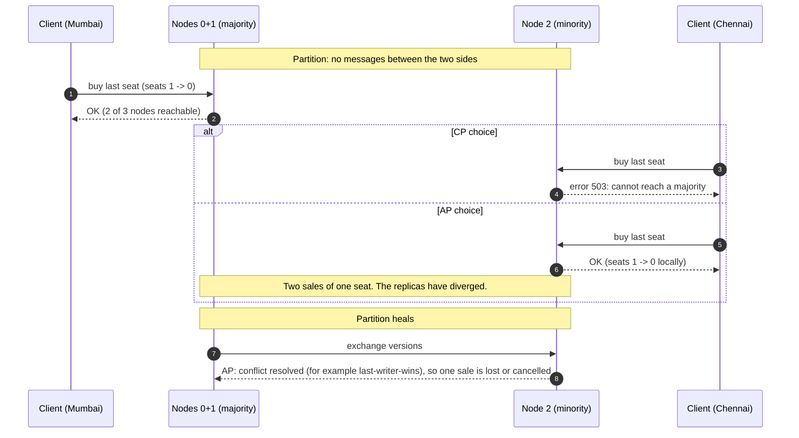
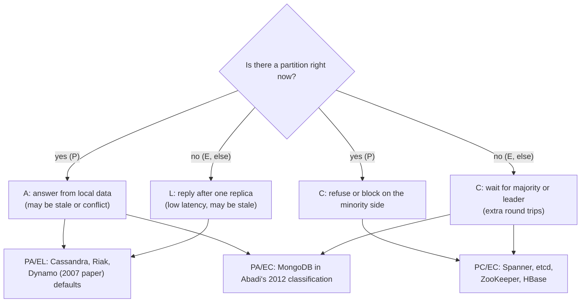

# CAP and PACELC

> [!summary] TL;DR
> When the network between copies of your data breaks (a **partition**), each copy must either refuse requests to stay correct (**consistency**) or keep answering and risk returning old or conflicting data (**availability**). PACELC adds the everyday half: even with a healthy network, stronger consistency costs **latency**.

> [!abstract] Core idea
> - A partition is not optional: messages between nodes will be lost or delayed, so the real choice is what to do *during* one.
> - CP: refuse or block requests on the side that cannot reach a majority. AP: answer from local data and reconcile later.
> - "C" in CAP means linearizability (every read sees the latest write), not the "C" in ACID.
> - PACELC: if Partition, choose A or C; Else, choose Latency or Consistency. The "else" branch is what you pay every day.
> - Classic mistake: "pick 2 of 3". A "CA" system is just a single node, or a system that has not met a partition yet.

## 1. Why it exists

A ticketing service keeps the seat count for a show on 3 replicas, two in Mumbai (nodes 0 and 1) and one in Chennai (node 2). The link between the cities drops for 90 seconds. A user in Chennai tries to buy the last seat while a user in Mumbai does the same.

- If node 2 sells the seat on its own, both users get a ticket for one seat. When the link returns, one sale must be cancelled.
- If node 2 refuses ("try again later"), no seat is double-sold, but Chennai users see errors for 90 seconds.

There is no third option that is both correct and always answering. CAP names that choice, so a design review can say "seat booking is CP, the 'people viewing this show' counter is AP" instead of arguing about vague "reliability".

## 2. Mental model

- **Partition**: some nodes cannot exchange messages with others. It is not only a cut cable. A long GC pause, a full NIC queue, a misconfigured firewall rule or a switch reboot all look the same to the other side: messages are lost or arrive too late.
- **Consistency (C)**: the system behaves like a single copy. Once a write is acknowledged, every later read, on any node, returns it or something newer. The formal name is **linearizability** (see [[Consistency Models]]).
- **Availability (A)**: every request that reaches a *non-failed* node gets a non-error response. The definition says nothing about speed, so a node that answers in 30 seconds is still "available" in the CAP sense.

**Analogy.** Two bank branches share one ledger by phone. The phone line goes dead. Each branch can either stop serving withdrawals until the line is back (C), or keep serving and sort out overdrafts later (A). Ignoring the dead phone is not an option.

## 3. How it works

The theorem (Brewer's conjecture in 2000, proved by Gilbert and Lynch in 2002) says: in an asynchronous network where messages can be lost, no system can guarantee both linearizability and availability on every node during a partition.

The proof sketch is short:

1. Split the nodes into two groups, G1 and G2, and drop every message between them.
2. A client writes `x = 1` to a node in G1. To be available, G1 must acknowledge it.
3. Another client then reads `x` from a node in G2. To be available, G2 must answer.
4. G2 never received the write, so it returns the old value. That breaks linearizability.

So during a partition each node on the minority side must pick: answer (and maybe be stale) or refuse (and be unavailable).



### Why "pick 2 of 3" misleads

- You cannot opt out of P. If your system runs on more than one machine, partitions happen. Bailis and Kingsbury (2014) collect public incident reports of exactly this.
- So the choice exists **only while a partition is happening**. The rest of the time a system can offer both C and A.
- "CA" therefore means "one node" (a single PostgreSQL server) or "a cluster that has not had a partition yet". It is not a third design.
- The choice can be **per operation**, not per product: Brewer's 2012 article points out that a system can refuse some operations during a partition and allow others.

### PACELC

Daniel Abadi (2010 blog, 2012 IEEE Computer article) observed that CAP ignores normal operation. To be linearizable, a write must reach other replicas (or a majority) before it is acknowledged, and that costs round trips even when nothing is broken.



## 4. Worked example

### Whiteboard version

The decision a node makes on every request, in pseudo-code:

```text
on request(op) at node n:
    peers = nodes n can reach right now (including n)
    if len(peers) > N/2:            # n is on the majority side
        apply op on all peers       # replicate, then acknowledge
        return OK
    # n is on a minority side
    if mode == CP:
        return ERROR "unavailable"  # stay correct, lose availability
    else:                           # mode == AP
        apply op locally with a timestamp
        return OK                   # stay available, may diverge

on partition heal:
    CP: nothing to merge (minority accepted nothing)
    AP: merge versions; last-writer-wins keeps the highest timestamp,
        so one acknowledged write disappears
```

### Go simulation

This package models one register on 3 replicas with a partition map. It compiles and passes `go vet` and `go test -race` on Go 1.24. Logical timestamps are passed in, so the tests are deterministic.

```go
// Package cap simulates one replicated register under a network partition,
// so the CP and AP choices can be compared in a test.
package cap

import "errors"

// ErrUnavailable is what a CP node returns when it cannot reach a majority.
var ErrUnavailable = errors.New("unavailable: no majority reachable")

// Mode picks what a node does when it is cut off from the majority.
type Mode int

const (
	CP Mode = iota // refuse the request (stay consistent)
	AP             // answer from local state (stay available)
)

type version struct {
	value string
	ts    int64 // logical write time supplied by the caller
	node  int   // tie-breaker so merges are deterministic
}

// Cluster is n replicas of one register plus a partition map.
type Cluster struct {
	mode     Mode
	replicas []version
	group    []int // group[i] = partition side of node i; same side = can talk
}

func NewCluster(n int, mode Mode) *Cluster {
	return &Cluster{mode: mode, replicas: make([]version, n), group: make([]int, n)}
}

// Partition puts the listed nodes on side 1; everyone else stays on side 0.
func (c *Cluster) Partition(side1 ...int) {
	for i := range c.group {
		c.group[i] = 0
	}
	for _, n := range side1 {
		c.group[n] = 1
	}
}

func (c *Cluster) reachable(from int) []int {
	var out []int
	for i := range c.group {
		if c.group[i] == c.group[from] {
			out = append(out, i)
		}
	}
	return out
}

func (c *Cluster) hasMajority(from int) bool {
	return len(c.reachable(from))*2 > len(c.replicas)
}

// Write stores value through node `at` at logical time ts.
func (c *Cluster) Write(at int, value string, ts int64) error {
	if c.mode == CP && !c.hasMajority(at) {
		return ErrUnavailable
	}
	v := version{value: value, ts: ts, node: at}
	for _, i := range c.reachable(at) { // replicate to every node on our side
		c.replicas[i] = v
	}
	return nil
}

// Read returns the value seen through node `at`.
func (c *Cluster) Read(at int) (string, error) {
	if c.mode == CP && !c.hasMajority(at) {
		return "", ErrUnavailable
	}
	return c.replicas[at].value, nil
}

// Heal removes the partition and reconciles with last-writer-wins:
// the highest (ts, node) version overwrites every replica.
func (c *Cluster) Heal() {
	c.Partition()
	best := c.replicas[0]
	for _, v := range c.replicas[1:] {
		if v.ts > best.ts || (v.ts == best.ts && v.node > best.node) {
			best = v
		}
	}
	for i := range c.replicas {
		c.replicas[i] = best
	}
}
```

The tests replay the seat scenario from section 1:

```go
package cap

import (
	"errors"
	"testing"
)

func TestCPRejectsMinoritySide(t *testing.T) {
	c := NewCluster(3, CP)
	if err := c.Write(0, "seats=10", 1); err != nil {
		t.Fatal(err)
	}
	c.Partition(2) // node 2 is alone on side 1

	if err := c.Write(2, "seats=9", 2); !errors.Is(err, ErrUnavailable) {
		t.Fatalf("minority write: got %v, want ErrUnavailable", err)
	}
	if _, err := c.Read(2); !errors.Is(err, ErrUnavailable) {
		t.Fatalf("minority read: got %v, want ErrUnavailable", err)
	}
	if err := c.Write(0, "seats=8", 3); err != nil { // majority side still works
		t.Fatal(err)
	}
	c.Heal()
	for i := 0; i < 3; i++ {
		if got, _ := c.Read(i); got != "seats=8" {
			t.Fatalf("node %d = %q, want seats=8", i, got)
		}
	}
}

func TestAPAcceptsBothSidesThenLWWDropsOne(t *testing.T) {
	c := NewCluster(3, AP)
	_ = c.Write(0, "seats=10", 1)
	c.Partition(2)

	if err := c.Write(0, "seats=8", 3); err != nil {
		t.Fatal(err)
	}
	if err := c.Write(2, "seats=9", 2); err != nil { // minority side still answers
		t.Fatal(err)
	}
	a, _ := c.Read(0)
	b, _ := c.Read(2)
	if a == b {
		t.Fatalf("expected divergence during partition, both = %q", a)
	}

	c.Heal()
	for i := 0; i < 3; i++ {
		if got, _ := c.Read(i); got != "seats=8" {
			t.Fatalf("node %d = %q, want seats=8 (ts 3 wins)", i, got)
		}
	}
	// The write "seats=9" was acknowledged to its client and is now gone.
}
```

What the two tests show:

| Step | CP cluster | AP cluster |
| --- | --- | --- |
| Partition {0,1} / {2} | node 2 has 1 of 3 nodes: no majority | same |
| Write at node 2 | `ErrUnavailable` | OK, stored only on node 2 |
| Read at node 2 | `ErrUnavailable` | returns `seats=9` (diverged) |
| Heal | nothing to merge | LWW keeps `ts=3`; the acknowledged `seats=9` write is silently dropped |

The majority side (nodes 0 and 1) keeps working in both modes. CP does not mean "the whole system is down"; it means the minority side stops.

## 5. Variants and comparison

Where real systems sit, using their **default** settings. Many are tunable per request, so treat this as a starting point, not a label.

| System | During a partition (PAC) | Normal operation (ELC) | Why |
| --- | --- | --- | --- |
| etcd, ZooKeeper, Consul KV | C | C | Raft / ZAB: a minority partition cannot elect a leader or commit writes |
| Google Spanner | C | C | Paxos groups plus TrueTime commit-wait; pays latency for external consistency |
| HBase | C | C | One RegionServer owns each region; a region is unavailable while it is reassigned |
| CockroachDB, YugabyteDB | C | C | Raft per range; see [[Distributed SQL]] |
| Cassandra, ScyllaDB, Riak | A | L | Leaderless; `ONE` or `LOCAL_ONE` answers from one replica. Tunable to `QUORUM` |
| Amazon Dynamo (2007 paper) | A | L | Sloppy quorums, hinted handoff, vector clocks |
| Amazon DynamoDB (single Region) | C for strong reads | L by default | Leader per partition with Multi-Paxos; eventually consistent reads may hit any replica, `ConsistentRead=true` goes to the leader |
| DynamoDB global tables (multi-Region eventual mode) | A | L | Each Region accepts writes; async replication; last-writer-wins on conflict |
| DynamoDB global tables (multi-Region strong consistency mode, GA 2025) | C | C | A write is acknowledged only after it is durable in a second Region; a Region cut off from the others cannot accept writes. Needs exactly 3 Regions (replicas or a witness) |
| MongoDB | A in Abadi's 2012 classification; C with today's defaults | C | Single primary per replica set. Abadi classed it PA/EC under the old `w: 1` default, where a deposed primary's unreplicated writes are rolled back. With `w: "majority"` (default since 5.0) and majority reads it behaves PC/EC |
| DNS | A | L | Caches serve the old record until TTL expires |
| PostgreSQL primary + async replicas | neither cleanly | L on replicas, C on primary | see the deep dive |

> [!warning] Interview trap: DynamoDB is not Dynamo
> The 2007 Dynamo paper describes a leaderless, AP store. DynamoDB is a different system: each partition has 3 replicas in different Availability Zones, and one of them is the leader, elected with Multi-Paxos. Writes go through the leader, and a strongly consistent read is served by the leader (USENIX ATC 2022 paper). Do not call DynamoDB "leaderless" or "Dynamo-style".

### Tunable consistency in practice

| Knob | Weak / fast | Strong / slower |
| --- | --- | --- |
| Cassandra consistency level | `ONE`, `LOCAL_ONE` | `QUORUM`, `LOCAL_QUORUM`, `ALL`; strong reads need `R + W > N` (see [[Quorums and Leaderless Replication]]) |
| DynamoDB `GetItem` / `Query` | default: eventually consistent | `ConsistentRead: true` (twice the read capacity cost) |
| MongoDB | `readConcern: "local"`, `w: 1` | `readConcern: "majority"` or `"linearizable"`, `w: "majority"` (the default write concern since MongoDB 5.0) |

## 6. Trade-offs and when not to use

- **CP costs availability on the minority side and latency everywhere.** Every write waits for a majority. Cross-region majorities add one inter-region round trip (tens of milliseconds, an estimate that depends on the regions).
- **AP costs correctness work.** Someone must merge divergent versions: last-writer-wins (silently loses writes), application merge (shopping cart union), or CRDTs (see [[CRDTs and Conflict Resolution]]).
- **Map by feature, not by company.**
  - Lean CP: payments, inventory and seat booking, auth and permissions, unique usernames, leader election and locks.
  - Lean AP: likes and view counters, feeds, presence ("online now"), recommendations, analytics events.
- **CAP is too coarse for design work.** It only talks about one consistency level (linearizable) and one failure type (partition). Use [[Consistency Models]] for the real menu and PACELC for everyday latency.
- **Do not cite CAP to justify a weak design.** Most outages are not partitions. A system that loses writes during normal operation has a bug, not a CAP trade-off.

## 7. In production

- **Real systems:**
  - Kubernetes stores cluster state in etcd. If the etcd members lose quorum, the API server cannot write: CP by design.
  - Cassandra lets each query choose. A common pattern is `LOCAL_QUORUM` for reads and writes in each data centre, which gives strong consistency inside a DC and avoids cross-DC latency.
  - DynamoDB eventually consistent reads cost half of a strongly consistent read, so many read paths deliberately take the "L".
- **Failure modes → fixes:**
  - AP store silently loses concurrent updates under LWW → use conditional writes or a CP store for that entity, or use version vectors and merge.
  - CP cluster loses quorum after two of three nodes fail → run 5 members for tolerance of 2 failures, spread across 3 zones.
  - Split brain in a "CP" setup built from a primary plus a failover script → require a majority to promote and fence the old primary (see [[High Availability and Failover]]).
  - Clients treat a timeout as failure and retry a non-idempotent write that actually committed → use idempotency keys (see [[Idempotency and Idempotency Keys]]).
- **What to monitor:**
  - Replica lag and the number of unreachable peers per node.
  - Rejected requests caused by "no quorum" (CP) and conflict or read-repair counts (AP).
  - Hinted-handoff backlog in Cassandra-style stores.

## 8. Deep dive

- **Where single-leader databases sit.** PostgreSQL with one primary and async replicas fits no CAP label cleanly. Reads from replicas are not linearizable even with no partition, so they are not "C". If the primary is cut off, writes stop until failover, so writes are not "A". After a failover, writes acknowledged by the old primary but not yet replicated are lost. CAP was never meant to classify every configuration; describe the actual guarantees instead (see [[Replication]]).
- **"Available" in CAP is weaker than "available" in an SLO.** CAP-availability has no latency bound and only applies to non-failed nodes. An SLO counts slow responses as failures and counts every user request. A CP system can have a higher SLO availability than an AP system if its partitions are rare and short.
- **Partition detection is a timeout.** A node cannot tell "the other side crashed" from "the other side is slow". Every CP system therefore picks a timeout, and while it waits it is neither consistent-and-answering nor refusing: it is just slow. That is PACELC's latency cost showing up again.
- **Partition recovery** (Brewer 2012): track which operations ran on each side, then merge, compensate (refund the double-booked seat), or apologise. Designing this recovery path is most of the real work of an AP system.
- **Stronger than CAP's C, weaker than CAP's C.** Spanner offers strict serializability (external consistency): linearizability extended to multi-key transactions, so it is stronger than CAP's single-register C. Causal consistency is the strongest model that stays available during partitions (Mahajan, Alvisi and Dahlin, 2011). See [[Consistency Models]].

## 9. Interview questions

> [!question]- Explain CAP in two sentences.
> In a distributed system, network partitions will happen. While one is happening, each node that cannot reach the others must either refuse requests (keep consistency) or answer from possibly stale local data (keep availability).

> [!question]- Is the C in CAP the same as the C in ACID? (trap)
> No. CAP's C is linearizability: every read sees the latest acknowledged write, as if there were one copy. ACID's C means a transaction moves the database from one valid state to another (constraints hold). A single-node database is "CAP-consistent" trivially and can still violate ACID constraints if the application is buggy.

> [!question]- Why can't I build a CA system?
> Because you cannot choose to have no partitions on a network. "CA" only describes a single node, or a cluster that has not yet met a partition. When one happens, it must still behave as either C or A.

> [!question]- Is DynamoDB AP? Is it Dynamo-style leaderless? (trap)
> DynamoDB is not leaderless. Each partition has a leader elected with Multi-Paxos among 3 replicas in different AZs. Default reads are eventually consistent (they may go to any replica); `ConsistentRead=true` reads are served by the leader. Global tables in their default multi-Region eventual consistency mode replicate asynchronously between Regions with last-writer-wins; the newer multi-Region strong consistency mode (GA 2025) instead acknowledges a write only after it reaches a second Region, which is PC/EC.

> [!question]- What does PACELC add?
> The "else" case. Even with no partition, a strongly consistent system waits for a leader or majority on each write (and on linearizable reads), which adds latency. Cassandra is PA/EL, Spanner and etcd are PC/EC, MongoDB was classed PA/EC in 2012, though its current majority defaults are closer to PC/EC.

> [!question]- Which parts of an e-commerce site would you make CP and which AP?
> CP: payment capture, inventory decrement at checkout, order state, coupon redemption, login and permissions. AP: product view counts, recommendations, "recently viewed", reviews feed, cart (merge carts on conflict, as the Dynamo paper does).

> [!question]- A partition heals in an AP system. What happens to the data?
> Replicas exchange versions. With last-writer-wins, the version with the highest timestamp overwrites the others and the rest are lost, even though they were acknowledged. With version vectors, concurrent versions are kept as siblings and the application or a CRDT merges them.

## 10. Cheat sheet

- Partition = lost or delayed messages between nodes; it will happen.
- During a partition: CP refuses on the minority side, AP answers and diverges.
- C = linearizability, not ACID consistency. A = every non-failed node answers, no time limit.
- "CA" = one node. "Pick 2 of 3" is a myth.
- PACELC: else (no partition), choose latency or consistency.
- PA/EL: Cassandra, Riak. PC/EC: Spanner, etcd, ZooKeeper. PA/EC: MongoDB (Abadi 2012, under the old `w: 1` default).
- DynamoDB is leader-based (Multi-Paxos per partition), not Dynamo.
- Choose per feature: money and inventory CP; counters and feeds AP.

## Links

- **Before this:** [[Distributed Systems Fundamentals]], [[Replication]]
- **Next:** [[Consistency Models]], [[Quorums and Leaderless Replication]], [[Consensus - Raft and Paxos]]
- **Compare with:** [[Distributed SQL]] (PC/EC in practice), [[Wide-Column Stores and Cassandra]] (PA/EL with tunable levels), [[High Availability and Failover]] (availability as uptime, not CAP-availability)
