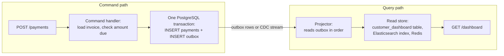
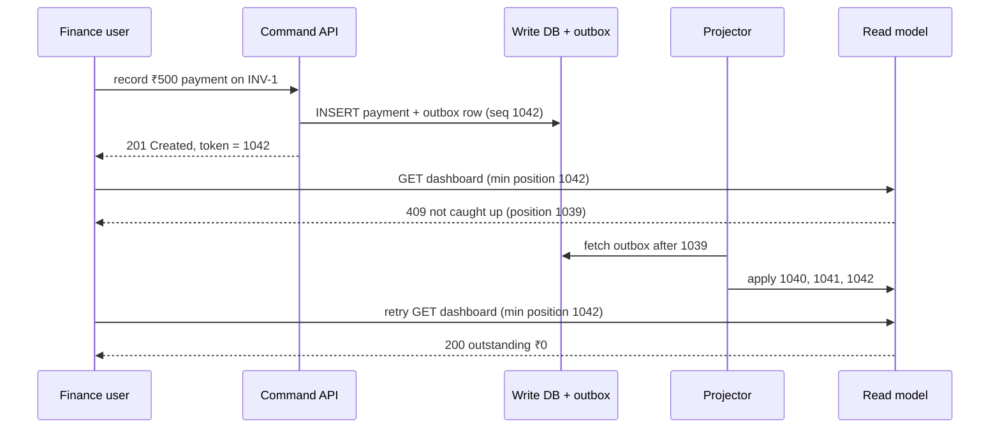

# CQRS

> [!summary] TL;DR
> **CQRS** (Command Query Responsibility Segregation) means using one model to **change** data (commands) and a different model to **read** it (queries). The read model is shaped for the screens that need it, and is kept up to date from the write side, sometimes instantly and often a little later.

> [!abstract] Core idea
> - Commands change state and return little more than "ok" and an id; queries return data and change nothing.
> - The write model is normalized and guards the business rules; read models are denormalized copies built for one query each.
> - Read models can be updated in the same transaction, through an outbox or CDC, or from an event-sourced stream.
> - When updates are asynchronous, reads lag writes, so the UI must handle "I just saved it but don't see it yet".
> - Classic mistake: thinking CQRS requires events, a message broker or event sourcing. It requires none of them.

## 1. Why it exists

InvoiceOps (the billing app built in [[Capstone - InvoiceOps]]) has a normalized PostgreSQL schema: `customers`, `invoices`, `invoice_lines`, `payments`. Writes are simple: issue an invoice, record a payment.

The finance dashboard is not simple. For each of 20,000 customers it shows open invoices, amount outstanding, oldest due date and last payment. Computed on every page load, that query joins four tables and aggregates millions of payment rows. Meanwhile:

- reads outnumber writes by a large factor (an estimate: a dashboard refreshing every 30 seconds for 200 finance users is about 7 queries per second, while the whole company issues a few invoices per minute);
- adding an index for the dashboard slows every payment insert;
- a second screen (search by invoice text) wants a completely different shape, ideally in a search engine.

One model is being asked to be good at two opposite jobs. CQRS splits them: the write model stays normalized and strict, and each screen gets a read model that is precomputed for it.

## 2. Mental model

Start from **CQS** (Command-Query Separation, Bertrand Meyer): a method either changes state (a command) or returns a value (a query), never both. CQRS applies that rule to the whole data model: separate **models**, not just separate methods.

The analogy is a **restaurant kitchen and its menu board**. Orders (commands) go to the kitchen, which follows strict rules: stock, recipes, order of work. The board in the dining room (a read model) shows "today's specials, 3 left", copied from the kitchen and updated when someone has a moment. Diners read the board; nobody cooks from it. If the board says 3 left and the kitchen has 2, the kitchen wins.

Terms used below:

- **Write model (command model):** the code and tables that validate commands and enforce invariants (rules that must always hold, such as "payments never exceed the invoice amount").
- **Read model (query model, view, projection):** a denormalized table, cache or index built for one query.
- **Projector:** the code that turns write-side changes into read-model updates.
- **Projection lag:** how far the read model is behind the write model.

## 3. How it works

### The two paths



Nothing in this picture needs a broker or event sourcing. The arrow from the transaction to the projector can be a polling loop over an outbox table, a CDC stream (change data capture: reading the database's own log, see [[Transactional Outbox and CDC]]), or a broker topic. It can even disappear entirely: see level 1 below.

### Three levels of separation

| Level | Read model lives in | Updated by | Lag |
| --- | --- | --- | --- |
| 1. Separate code paths | The same tables, or a read table in the same database | The same transaction as the write | None |
| 2. Separate read tables | Same database, separate tables or a materialized view | Outbox poller, trigger, or `REFRESH MATERIALIZED VIEW` | Milliseconds to minutes |
| 3. Separate read store | Elasticsearch, Redis, a column store, another database | Outbox relay, CDC (Debezium), or an event stream | Usually under a second, unbounded when the projector is down |

Most teams should start at level 1 and move up only when a specific query forces them to.

### Write, then read: where lag bites

With an asynchronous projector, a user can save something and not see it:



The command returns a **version token**: the outbox position of its change. The query sends it back, and the read side either answers from a position at least that new, waits briefly, or says "not yet". This gives read-your-writes (you always see your own changes, see [[Consistency Models]]) without making everyone read the write database.

Other ways to hide lag:

- **Optimistic UI:** the client shows the change it just made locally and reconciles when the read model catches up.
- **Read from the write side for the writer:** for a few seconds after a write, that user's queries go to the write model.
- **Return the new state from the command:** fine for the object just changed, not for aggregates such as totals.

## 4. Worked example

### Whiteboard version

Level 1, in PostgreSQL 17: the command updates the normalized table and the read table in one transaction, so the dashboard is never stale.

```sql
BEGIN;
-- Command: record a payment (the write model checks the rule)
UPDATE invoices
SET    paid = paid + 50000
WHERE  id = 'INV-1' AND paid + 50000 <= amount;     -- 0 rows = overpayment, abort

INSERT INTO payments (invoice_id, amount) VALUES ('INV-1', 50000);

-- Read model: one row per customer, shaped for the dashboard
UPDATE customer_dashboard
SET    outstanding   = outstanding - 50000,
       open_invoices = open_invoices - (SELECT (paid = amount)::int FROM invoices WHERE id = 'INV-1')
WHERE  customer_id = 'acme';
COMMIT;
```

Cost: every payment now also locks the customer's dashboard row, so two payments for the same big customer serialize on it. When that becomes the bottleneck, move to level 2 or 3 with an asynchronous projector, as below.

### Go: asynchronous projector with version tokens

The write model validates commands and appends events to an outbox under one lock (standing in for one database transaction). The projector applies events strictly in order and skips duplicates, so at-least-once delivery is safe. `Summary` takes the caller's version token and refuses to answer from a stale position. `Rebuild` replays the outbox into a fresh read model. It passes `go vet` and `go test -race` on Go 1.24.

```go
package cqrs

import (
	"errors"
	"sync"
)

// Event is a fact the write side records in its outbox, in the same
// transaction as the state change. Seq is the outbox position.
type Event struct {
	Seq       int64
	Type      string // "InvoiceIssued" or "PaymentReceived"
	InvoiceID string
	Customer  string
	Amount    int64 // paise
}

var (
	ErrExists      = errors.New("invoice already exists")
	ErrNotFound    = errors.New("invoice not found")
	ErrOverpayment = errors.New("payment exceeds amount due")
	ErrStale       = errors.New("read model has not caught up yet")
)

// ---- Command side ----

type invoice struct {
	customer     string
	amount, paid int64
}

// WriteModel validates commands against normalized state. The mutex stands
// in for one database transaction covering the state change and the outbox.
type WriteModel struct {
	mu       sync.Mutex
	invoices map[string]*invoice
	outbox   []Event
}

func NewWriteModel() *WriteModel { return &WriteModel{invoices: map[string]*invoice{}} }

func (w *WriteModel) append(e Event) int64 {
	e.Seq = int64(len(w.outbox)) + 1
	w.outbox = append(w.outbox, e)
	return e.Seq
}

// IssueInvoice returns the outbox position of its event: the client's
// "version token" for reading its own write later.
func (w *WriteModel) IssueInvoice(id, customer string, amount int64) (int64, error) {
	w.mu.Lock()
	defer w.mu.Unlock()
	if _, ok := w.invoices[id]; ok {
		return 0, ErrExists
	}
	w.invoices[id] = &invoice{customer: customer, amount: amount}
	return w.append(Event{Type: "InvoiceIssued", InvoiceID: id, Customer: customer, Amount: amount}), nil
}

func (w *WriteModel) RecordPayment(id string, amount int64) (int64, error) {
	w.mu.Lock()
	defer w.mu.Unlock()
	inv, ok := w.invoices[id]
	if !ok {
		return 0, ErrNotFound
	}
	if inv.paid+amount > inv.amount {
		return 0, ErrOverpayment // the invariant lives on the write side only
	}
	inv.paid += amount
	return w.append(Event{Type: "PaymentReceived", InvoiceID: id, Customer: inv.customer, Amount: amount}), nil
}

// EventsAfter is what a projector polls (or what CDC would stream).
func (w *WriteModel) EventsAfter(seq int64, limit int) []Event {
	w.mu.Lock()
	defer w.mu.Unlock()
	if seq >= int64(len(w.outbox)) {
		return nil
	}
	end := min(int(seq)+limit, len(w.outbox))
	return append([]Event(nil), w.outbox[seq:end]...)
}

// ---- Query side ----

// CustomerSummary is one row of the InvoiceOps dashboard, shaped for the
// screen: no joins at read time.
type CustomerSummary struct {
	Customer     string
	OpenInvoices int
	Outstanding  int64
}

type ReadModel struct {
	mu        sync.RWMutex
	position  int64 // last applied Seq; stored with the rows in a real read store
	customers map[string]*CustomerSummary
	due       map[string]int64 // invoice id -> amount still due
}

func NewReadModel() *ReadModel {
	return &ReadModel{customers: map[string]*CustomerSummary{}, due: map[string]int64{}}
}

// Apply is idempotent and ordered: it applies only the next event in
// sequence. A duplicate (Seq <= position) or an event after a gap
// (Seq > position+1) is skipped and reported, and the next poll refetches.
func (r *ReadModel) Apply(e Event) bool {
	r.mu.Lock()
	defer r.mu.Unlock()
	if e.Seq != r.position+1 {
		return false
	}
	c := r.customers[e.Customer]
	if c == nil {
		c = &CustomerSummary{Customer: e.Customer}
		r.customers[e.Customer] = c
	}
	switch e.Type {
	case "InvoiceIssued":
		c.OpenInvoices++
		c.Outstanding += e.Amount
		r.due[e.InvoiceID] = e.Amount
	case "PaymentReceived":
		c.Outstanding -= e.Amount
		r.due[e.InvoiceID] -= e.Amount
		if r.due[e.InvoiceID] == 0 {
			c.OpenInvoices--
		}
	}
	r.position = e.Seq
	return true
}

func (r *ReadModel) Position() int64 {
	r.mu.RLock()
	defer r.mu.RUnlock()
	return r.position
}

// Summary serves a query. minPosition is the version token from the
// caller's last command; 0 means "any freshness is fine".
func (r *ReadModel) Summary(customer string, minPosition int64) (CustomerSummary, error) {
	r.mu.RLock()
	defer r.mu.RUnlock()
	if r.position < minPosition {
		return CustomerSummary{}, ErrStale
	}
	if c := r.customers[customer]; c != nil {
		return *c, nil
	}
	return CustomerSummary{Customer: customer}, nil
}

// Project moves the read model forward by up to one batch and returns how
// many events it applied. Run it in a loop, or trigger it from CDC.
func Project(w *WriteModel, r *ReadModel, batch int) int {
	applied := 0
	for _, e := range w.EventsAfter(r.Position(), batch) {
		if r.Apply(e) {
			applied++
		}
	}
	return applied
}

// Rebuild replays the whole outbox into a fresh read model: how you add a
// new query shape or recover from a projector bug.
func Rebuild(w *WriteModel, batch int) *ReadModel {
	r := NewReadModel()
	for Project(w, r, batch) > 0 {
	}
	return r
}
```

The tests cover read-your-writes, an invariant that only the write side enforces, duplicate and out-of-order delivery, a full rebuild, and commands racing the projector:

```go
package cqrs

import (
	"errors"
	"fmt"
	"sync"
	"testing"
)

func TestReadYourWritesWithVersionToken(t *testing.T) {
	w, r := NewWriteModel(), NewReadModel()
	token, err := w.IssueInvoice("INV-1", "acme", 50_000)
	if err != nil {
		t.Fatal(err)
	}
	// Projection has not run yet: the dashboard is behind the write.
	if _, err := r.Summary("acme", token); !errors.Is(err, ErrStale) {
		t.Fatalf("err %v, want ErrStale", err)
	}
	Project(w, r, 100)
	got, err := r.Summary("acme", token)
	if err != nil || got.OpenInvoices != 1 || got.Outstanding != 50_000 {
		t.Fatalf("got %+v err %v", got, err)
	}
}

func TestPaymentsCloseInvoices(t *testing.T) {
	w, r := NewWriteModel(), NewReadModel()
	w.IssueInvoice("INV-1", "acme", 50_000)
	w.IssueInvoice("INV-2", "acme", 20_000)
	w.RecordPayment("INV-1", 30_000)
	w.RecordPayment("INV-1", 20_000)
	if _, err := w.RecordPayment("INV-2", 25_000); !errors.Is(err, ErrOverpayment) {
		t.Fatalf("err %v, want ErrOverpayment", err)
	}
	Project(w, r, 2) // two batches are needed; run until caught up
	Project(w, r, 2)
	got, _ := r.Summary("acme", 0)
	if got.OpenInvoices != 1 || got.Outstanding != 20_000 {
		t.Fatalf("got %+v", got)
	}
}

func TestDuplicateDeliveryIsIgnored(t *testing.T) {
	w, r := NewWriteModel(), NewReadModel()
	w.IssueInvoice("INV-1", "acme", 50_000)
	events := w.EventsAfter(0, 10)
	if !r.Apply(events[0]) {
		t.Fatal("first delivery not applied")
	}
	if r.Apply(events[0]) { // at-least-once delivery hands it over again
		t.Fatal("duplicate applied")
	}
	got, _ := r.Summary("acme", 0)
	if got.Outstanding != 50_000 {
		t.Fatalf("outstanding %d, duplicate was applied twice", got.Outstanding)
	}
}

func TestRebuildMatchesLiveProjection(t *testing.T) {
	w, live := NewWriteModel(), NewReadModel()
	for i := range 50 {
		id := fmt.Sprintf("INV-%d", i)
		w.IssueInvoice(id, fmt.Sprintf("cust-%d", i%5), 10_000)
		if i%3 == 0 {
			w.RecordPayment(id, 10_000)
		}
		Project(w, live, 7)
	}
	for Project(w, live, 7) > 0 {
	}
	rebuilt := Rebuild(w, 1000)
	for c := range 5 {
		name := fmt.Sprintf("cust-%d", c)
		a, _ := live.Summary(name, 0)
		b, _ := rebuilt.Summary(name, 0)
		if a != b {
			t.Fatalf("%s live %+v rebuilt %+v", name, a, b)
		}
	}
}

func TestEventAfterGapIsNotApplied(t *testing.T) {
	w, r := NewWriteModel(), NewReadModel()
	w.IssueInvoice("INV-1", "acme", 100)
	w.IssueInvoice("INV-2", "acme", 200)
	events := w.EventsAfter(0, 10)
	if r.Apply(events[1]) { // Seq 2 before Seq 1 would silently lose INV-1
		t.Fatal("applied an event after a gap")
	}
	Project(w, r, 10)
	if got, _ := r.Summary("acme", 2); got.Outstanding != 300 {
		t.Fatalf("got %+v", got)
	}
}

func TestConcurrentCommandsAndProjector(t *testing.T) {
	w, r := NewWriteModel(), NewReadModel()
	var wg sync.WaitGroup
	for g := range 4 {
		wg.Add(1)
		go func() {
			defer wg.Done()
			for i := range 100 {
				w.IssueInvoice(fmt.Sprintf("INV-%d-%d", g, i), "acme", 100)
			}
		}()
	}
	done := make(chan struct{})
	var proj sync.WaitGroup
	proj.Add(1)
	go func() { // projector runs while commands arrive
		defer proj.Done()
		for {
			select {
			case <-done:
				return
			default:
				Project(w, r, 16)
			}
		}
	}()
	wg.Wait()
	close(done)
	proj.Wait()
	for Project(w, r, 16) > 0 {
	}
	got, _ := r.Summary("acme", 400)
	if got.OpenInvoices != 400 || got.Outstanding != 40_000 {
		t.Fatalf("got %+v", got)
	}
}
```

A level-3 version of the same projector stores the read model and its position together, in one transaction on the read side, so a crash cannot apply an event without recording that it did:

```sql
-- Read side, PostgreSQL 17 (could be a separate database)
CREATE TABLE customer_dashboard (
    customer_id   text PRIMARY KEY,
    open_invoices int    NOT NULL DEFAULT 0,
    outstanding   bigint NOT NULL DEFAULT 0
);
CREATE TABLE projector_position (
    projector text PRIMARY KEY,
    position  bigint NOT NULL
);

BEGIN;
SELECT position FROM projector_position WHERE projector = 'dashboard' FOR UPDATE;  -- 1041
INSERT INTO customer_dashboard (customer_id, outstanding, open_invoices)
VALUES ('acme', 50000, 1)
ON CONFLICT (customer_id) DO UPDATE
SET outstanding   = customer_dashboard.outstanding + EXCLUDED.outstanding,
    open_invoices = customer_dashboard.open_invoices + EXCLUDED.open_invoices;
UPDATE projector_position SET position = 1042 WHERE projector = 'dashboard';
COMMIT;
```

## 5. Variants and comparison

### Ways to update a read model

| Option | How it works | Use when | Cost |
| --- | --- | --- | --- |
| Same transaction | Command writes the read table too | Read and write in one database, low write contention | Write latency and lock contention on hot read rows |
| Materialized view | `REFRESH MATERIALIZED VIEW CONCURRENTLY` on a schedule | Minutes of staleness is fine, query is expressible in SQL | Full recompute on each refresh (see [[Materialized Views and Denormalization]]) |
| Outbox poller | Projector polls an outbox table by position | You want explicit events and control over ordering | Polling load, outbox cleanup |
| CDC (Debezium, logical decoding) | Stream row changes from the WAL | Many read stores, no changes to write code | Row changes, not business intent; schema coupling |
| Event-sourced projection | Projector folds the event stream (see [[Event Sourcing]]) | The write side is already event-sourced | All of event sourcing's costs |

### CQRS vs neighbours

| Idea | Separates | Consistency of reads |
| --- | --- | --- |
| Read replicas ([[Replication]]) | Where reads run; same schema | Replica lag, same shape as the primary |
| Cache-aside ([[Caching Patterns]]) | A copy of the same data | TTL-based, invalidation is hard |
| Materialized view | A precomputed query in the same database | Stale until refresh |
| CQRS | The model itself: different schemas, maybe different stores | Synchronous or eventually consistent, by design |
| Event sourcing | How state is stored (as events) | Not about reads at all; often paired with CQRS |

## 6. Trade-offs and when not to use

- **It is two models to maintain.** Every new field touches the command side, the event or outbox format, the projector and the read model.
- **Eventual consistency leaks into the product.** Somebody must decide what a user sees during lag, and support must know why "the dashboard was wrong for two seconds".
- **Projectors are new production software.** They need deployment, monitoring, replays and on-call.
- **Overkill for CRUD.** If screens show roughly what the table holds, one model with a few indexes is simpler and strongly consistent.
- **Never validate commands against a read model.** It may be stale; "is this username free?" must be checked on the write side, typically with a unique constraint.
- **Do use it** when read and write loads differ greatly, when there are many query shapes (search, analytics, dashboards), or when different teams own the reads and the writes.

## 7. In production

- **Real systems:**
	- Search: products are written to PostgreSQL and projected into Elasticsearch or OpenSearch for full-text queries (see [[Search Engines and Inverted Indexes]]).
	- Feeds and timelines: writes go to a posts table; per-user timelines are precomputed read models (see [[Case Study - News Feed]]).
	- Event-sourced systems (EventStoreDB, now KurrentDB; Axon) are almost always CQRS, because an event log cannot answer queries on its own.
- **Failure modes → fixes:**
	- Projector crashes and the dashboard freezes → alert on lag; the projector resumes from its stored position.
	- Projector bug corrupts the read model → fix the code, build a new read model by replaying from position 0 into a new table, then switch reads to it (blue/green for read models).
	- Duplicate delivery double-counts money → idempotent projector keyed by event position or event id.
	- Events applied out of order → apply strictly by position per stream, or make updates commutative.
	- Read model drifts from the truth silently → a nightly reconciliation job compares totals with the write side.
- **What to monitor:**
	- Projection lag, both as positions behind (`head − position`) and as seconds (now − timestamp of the last applied event).
	- Projector error rate and events skipped.
	- Rebuild duration: if a full replay takes 9 hours, recovery from a bug takes 9 hours.
	- Rate of "not caught up" answers to version-token queries.

## 8. Deep dive

### Outbox positions are not commit order

In PostgreSQL a `bigserial` value is taken when the row is inserted, not when the transaction commits. Transaction A can take id 101, transaction B take 102 and commit first. A poller that reads "after 101" sees 102, advances its position, and never sees 101 when A commits. Fixes:

- Read the outbox through **logical decoding** (CDC), which delivers changes in commit order.
- Or poll only rows older than the longest transaction (`created_at < now() - interval '5 seconds'`), accepting that delay. This is a heuristic, not a guarantee.
- Or serialize outbox inserts (one writer, or a lock), which caps write throughput.

The Go example sidesteps this because its single lock makes allocation and commit one step.

### Rebuilds at scale

A replay must be faster than real time, or it never catches up. Batch reads (thousands of events per query), batch writes to the read store, and disable read-store indexes until the end where the store allows it. Build into a new table or index and switch an alias, so queries never see a half-built model. Keep the event or outbox history long enough to rebuild from it, or snapshot read models periodically.

### Ordering scope

Total order across all events makes a projector simple but single-threaded. Most read models only need order **per entity** (per invoice, per customer). Partition the stream by that key (see [[Message Ordering and Partition Keys]]) and run one projector worker per partition. Then the version token is per partition, not global.

### CQRS and validation that needs a query

"Reject an invoice if the customer's outstanding total exceeds the credit limit" reads an aggregate. Keep that aggregate on the write side (a `credit_used` column updated in the same transaction) rather than reading the dashboard. The read model is for people; the write model is for decisions.

## 9. Interview questions

> [!question]- What is CQRS, in one sentence, and how does it differ from CQS?
> CQS says each method is either a command (changes state) or a query (returns data). CQRS lifts that to architecture: separate models, and often separate storage, for writes and for reads. The write model enforces invariants; read models are denormalized for specific queries.

> [!question]- (Trap) Does CQRS require event sourcing or a message broker?
> No. The read model can be updated in the same transaction, refreshed as a materialized view, fed from an outbox table, or fed by CDC. Event sourcing pairs well with CQRS because an event log needs projections to be queryable, but each pattern stands alone.

> [!question]- A user saves a form and the list page does not show it. How do you fix that?
> That is projection lag breaking read-your-writes. Return a version token (the write's position) from the command and have queries wait for or require that position; or route that user's reads to the write side briefly; or show the change optimistically in the UI. Do not make every read hit the write database.

> [!question]- How do you rebuild a read model after a projector bug?
> Fix the projector, replay the full history (events or outbox) into a new table or index, let it catch up to live, then switch reads to it and drop the old one. That needs retained history, idempotent ordered projectors and a replay faster than the live write rate.

> [!question]- When is CQRS overkill?
> When screens mirror the tables (CRUD), read and write volumes are similar, and one database with indexes answers every query fast enough. Then CQRS adds a second model, a projector and eventual consistency for nothing.

> [!question]- Can a command handler check a rule by querying the read model?
> Not safely: the read model may be stale, so two commands can both pass the check. Keep the data a rule needs on the write side and enforce it there, with a constraint, a conditional update or a lock.

> [!question]- What do you monitor for a CQRS system?
> Projection lag in events and in seconds, projector errors and skipped events, rebuild time, and the rate at which version-token reads are refused. Add a reconciliation job that compares read-side totals with the write side.

## 10. Cheat sheet

- Commands change state; queries return data; CQRS gives each its own model.
- Levels: same transaction → separate read tables → separate read store.
- Update paths: same transaction, materialized view, outbox, CDC, event projection.
- Async read models lag: version tokens, optimistic UI or read-from-writer for read-your-writes.
- Projectors are idempotent and ordered per key; their position is stored with the read model.
- Rebuild = replay into a new model, then switch.
- Never validate commands against a read model.
- No events, broker or event sourcing required.

## Links

- **Before this:** [[Materialized Views and Denormalization]], [[Transactional Outbox and CDC]], [[Consistency Models]]
- **Next:** [[Event Sourcing]], [[Saga Pattern]]
- **Compare with:** [[Replication]] (read replicas keep the same model), [[Caching Patterns]] (a copy, not a new model), [[Materialized Views and Denormalization]] (CQRS inside one database)
