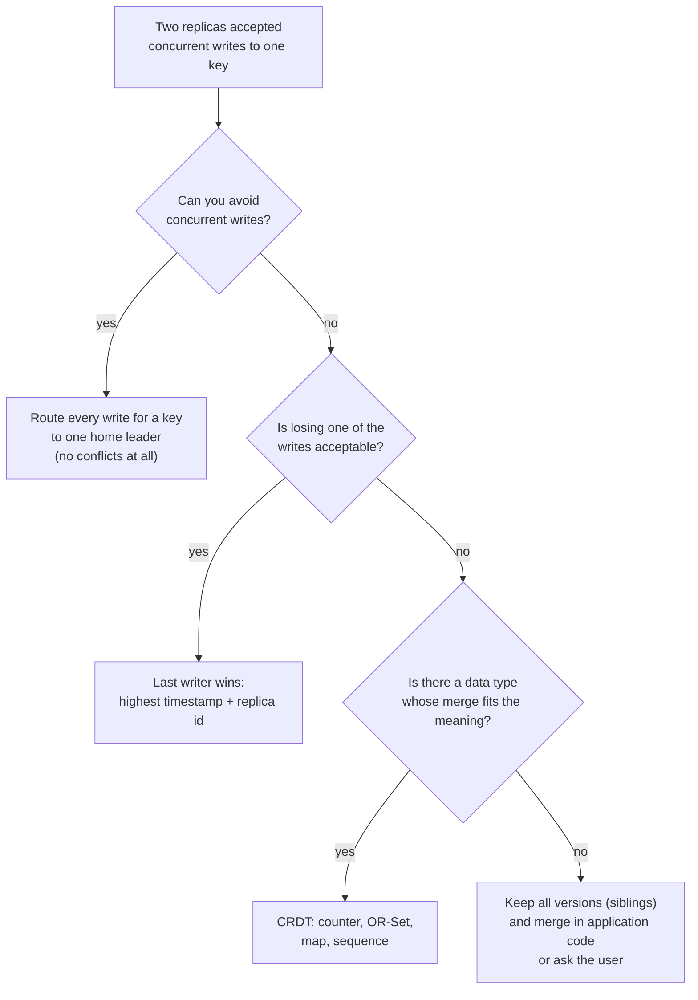
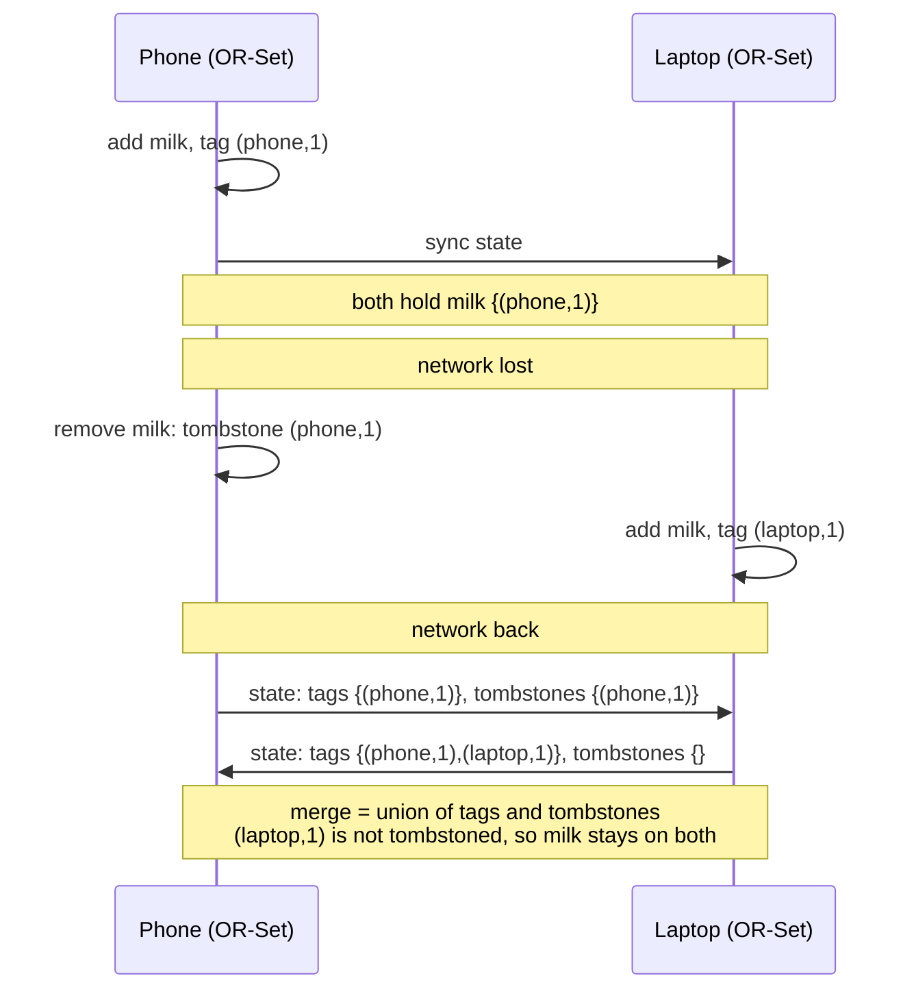

# CRDTs and Conflict Resolution

> [!summary] TL;DR
> When two replicas accept writes to the same data without talking to each other, their copies **conflict**. Conflict resolution is the rule that decides the final value. A **CRDT** (Conflict-free Replicated Data Type) is a data structure whose merge rule is designed so that all replicas that have seen the same updates end up with the same value automatically, in any order, without coordination.

> [!abstract] Core idea
> - Conflicts appear whenever more than one replica accepts writes: multi-leader, leaderless, offline clients, multi-region active-active.
> - Simple rules (last writer wins) converge but silently drop writes; keeping all versions (siblings) loses nothing but pushes the merge onto the application.
> - CRDTs merge with a function that is commutative, associative and idempotent, so order, duplication and delay of sync do not matter.
> - Counters, sets, registers, maps and even text sequences have CRDT versions; each has a built-in policy (for example, add wins over remove).
> - Classic mistake: thinking CRDTs remove the need to think about semantics. They guarantee convergence, not that the merged value is what the business wanted.

## 1. Why it exists

A shopping list app syncs between a phone and a laptop. Both are offline on a train:

- On the phone, the user removes "milk".
- On the laptop, a family member adds "milk" again because they ran out.

When both reconnect, what is on the list? Three common answers:

| Rule | Result | Problem |
| --- | --- | --- |
| Last writer wins by wall clock | Whichever device's clock says later | Clocks drift, and one person's write vanishes without a trace |
| Keep both versions, ask the app | `{[], ["milk"]}` returned as siblings | Every reader must write merge code |
| OR-Set CRDT | "milk" is on the list: the add was not seen by the remove | None for this case; the policy (add wins) is built in |

The same problem appears at much larger scale: a like counter written in Mumbai and Frankfurt regions at once (see [[Multi-Region Architecture]]), a Cassandra row updated by two clients, a Google-Docs-style editor with 20 people typing. Wherever writes are accepted on more than one replica to stay available during a network partition (the "A" choice in [[CAP and PACELC]]), something has to merge them.

## 2. Mental model

Think of each replica's state as a point that can only move **up** in a partial order, and merge as "take the smallest point above both". For a grow-only counter, each replica keeps its own tally, and merge takes the maximum per replica:

- Mumbai's view `{mumbai: 120, frankfurt: 70}`, Frankfurt's view `{mumbai: 100, frankfurt: 80}`.
- Merge → `{mumbai: 120, frankfurt: 80}`, total 200. Merging again changes nothing. Merging in the other order gives the same answer.

The analogy is **two people ticking boxes on copies of the same attendance sheet**. Combining the sheets means "a box is ticked if it is ticked on either copy". You can combine them in any order, combine one twice, and the result is the same. A plain "count = 5" number cannot be combined that way; a sheet of ticks can.

Terms used below:

- **Concurrent writes:** two writes where neither replica had seen the other's when it wrote. They are not ordered by causality (see [[Clocks and Ordering]]).
- **Convergence (strong eventual consistency):** replicas that have received the same set of updates have equal state, without any further coordination.
- **Join-semilattice:** the math behind state-based CRDTs: a set of states with a merge ("join") that is commutative (`a ⊔ b = b ⊔ a`), associative (`(a ⊔ b) ⊔ c = a ⊔ (b ⊔ c)`) and idempotent (`a ⊔ a = a`).
- **Tombstone:** a marker that something was deleted, kept so the deletion can be merged.

## 3. How it works

### Strategies, from simplest to richest



- **Avoid conflicts.** Give each key a home replica that takes all its writes. Most multi-region systems do this for most data; it is the cheapest "resolution".
- **Last writer wins (LWW).** Attach a timestamp to each write and keep the highest, breaking ties with the replica id. Cassandra does this per cell, and DynamoDB global tables do it per item in their default (eventually consistent) mode. It converges, but a concurrent write is dropped silently, and with skewed clocks even a causally later write can lose.
- **Siblings (multi-value).** Detect concurrency with version vectors (one counter per replica, see [[Clocks and Ordering]]) and keep every concurrent value. Riak returns siblings to the client, which merges and writes back. This was the approach of Amazon's Dynamo paper for shopping carts.
- **CRDTs.** Choose a data type whose merge is defined for every pair of states.

### State-based vs operation-based CRDTs

| Kind | Replicas exchange | Requirement on the network | Example |
| --- | --- | --- | --- |
| State-based (CvRDT, convergent) | Whole states, merged with join | None: messages may be lost, duplicated or reordered, as long as states eventually spread | G-Counter as a map of per-replica counts |
| Operation-based (CmRDT, commutative) | Operations ("increment by 3") | Every operation delivered exactly once to every replica, in causal order where the type needs it | Counter sending `+3` |
| Delta-state | Small "delta" states since last sync, merged with join | Like state-based, but much smaller messages | Akka Distributed Data's delta CRDTs |

State-based is easiest to get right, because merge tolerates any delivery. Op-based sends less data but needs a reliable causal broadcast layer underneath.

### The common types

- **G-Counter (grow-only):** a map `replica → count`. Increment your own entry; value = sum; merge = per-replica max.
- **PN-Counter:** two G-Counters, one for increments (P) and one for decrements (N); value = P − N.
- **LWW-Register:** a single value with a `(timestamp, replica)` tag; merge keeps the higher tag.
- **MV-Register (multi-value):** keeps all concurrent values, tagged with version vectors; the reader sees a set.
- **G-Set / 2P-Set:** grow-only set; two-phase set adds a tombstone set, but an element once removed can never be added back.
- **OR-Set (observed-remove set):** every add gets a unique tag; remove deletes only the tags the remover has seen. An add concurrent with a remove therefore survives: **add wins**.
- **Maps:** a map of CRDTs, merged key by key (Riak maps, Automerge objects).
- **Sequences:** lists and text where each character has a unique, ordered id (RGA, YATA in Yjs, Automerge's list type), so concurrent inserts at the same position interleave deterministically.

### The shopping list, step by step



The phone's remove only tombstoned the tag it had seen. The laptop's new tag `(laptop,1)` was invisible to it, so the remove does not cover it.

## 4. Worked example

### Whiteboard version

A grow-only counter in one screen:

```go
package wb

// GCounter: one slot per replica; a replica only bumps its own slot.
type GCounter map[string]uint64

func (g GCounter) Inc(replica string) { g[replica]++ }

func (g GCounter) Value() (sum uint64) {
	for _, v := range g {
		sum += v
	}
	return sum
}

// Merge takes the max per replica: order and repetition do not matter.
func (g GCounter) Merge(o GCounter) {
	for r, v := range o {
		g[r] = max(g[r], v)
	}
}
```

Why not a single shared number with "add the other side's number"? Because syncing twice would double-count. Per-replica max is idempotent; addition is not.

### Go: counters, a register and an OR-Set

Four state-based CRDTs. The tests check the three merge laws on random histories (seeded, so deterministic), the like counter from section 2, a stock counter that goes down, a deterministic LWW tie-break, and the shopping-list scenario. They pass `go vet` and `go test -race` on Go 1.24.

```go
package crdt

import "maps"

// Every type here is a state-based CRDT: replicas change their own copy
// locally and later exchange whole states. Merge must be commutative,
// associative and idempotent, so replicas that have seen the same updates
// end up equal no matter the order or how often states are exchanged.

// ---- G-Counter: grow-only counter ----

// GCounter keeps one count per replica. A replica only increments its own entry.
type GCounter map[string]uint64

func (g GCounter) Inc(replica string, n uint64) { g[replica] += n }

func (g GCounter) Value() uint64 {
	var sum uint64
	for _, v := range g {
		sum += v
	}
	return sum
}

// Merge takes the per-replica maximum.
func (g GCounter) Merge(o GCounter) {
	for r, v := range o {
		g[r] = max(g[r], v)
	}
}

// ---- PN-Counter: counter that can go down ----

type PNCounter struct{ P, N GCounter }

func NewPNCounter() PNCounter { return PNCounter{P: GCounter{}, N: GCounter{}} }

func (c PNCounter) Inc(replica string, n uint64) { c.P.Inc(replica, n) }
func (c PNCounter) Dec(replica string, n uint64) { c.N.Inc(replica, n) }
func (c PNCounter) Value() int64                 { return int64(c.P.Value()) - int64(c.N.Value()) }
func (c PNCounter) Merge(o PNCounter)            { c.P.Merge(o.P); c.N.Merge(o.N) }

// ---- LWW-Register: last writer wins ----

// LWWRegister keeps the value with the highest (timestamp, replica) pair.
// The replica id breaks ties so every replica picks the same winner.
type LWWRegister struct {
	Value   string
	TS      int64 // e.g. a hybrid logical clock reading
	Replica string
}

func (r *LWWRegister) Set(v string, ts int64, replica string) {
	r.Merge(LWWRegister{Value: v, TS: ts, Replica: replica})
}

func (r *LWWRegister) Merge(o LWWRegister) {
	if o.TS > r.TS || (o.TS == r.TS && o.Replica > r.Replica) {
		*r = o
	}
}

// ---- OR-Set: observed-remove set (add wins) ----

// Tag uniquely identifies one add operation.
type Tag struct {
	Replica string
	Seq     uint64
}

// ORSet tags every add. Remove deletes only the tags this replica has seen,
// so an add that happened concurrently with a remove survives the merge.
type ORSet struct {
	replica string
	seq     uint64
	adds    map[string]map[Tag]bool // element -> tags that added it
	removed map[Tag]bool            // tombstones
}

func NewORSet(replica string) *ORSet {
	return &ORSet{replica: replica, adds: map[string]map[Tag]bool{}, removed: map[Tag]bool{}}
}

func (s *ORSet) Add(e string) {
	s.seq++
	if s.adds[e] == nil {
		s.adds[e] = map[Tag]bool{}
	}
	s.adds[e][Tag{s.replica, s.seq}] = true
}

func (s *ORSet) Remove(e string) {
	for t := range s.adds[e] {
		s.removed[t] = true
	}
}

func (s *ORSet) Contains(e string) bool {
	for t := range s.adds[e] {
		if !s.removed[t] {
			return true
		}
	}
	return false
}

func (s *ORSet) Elements() []string {
	var out []string
	for e := range s.adds {
		if s.Contains(e) {
			out = append(out, e)
		}
	}
	return out
}

// Merge unions the add tags and the tombstones.
func (s *ORSet) Merge(o *ORSet) {
	for e, tags := range o.adds {
		if s.adds[e] == nil {
			s.adds[e] = map[Tag]bool{}
		}
		maps.Copy(s.adds[e], tags)
	}
	maps.Copy(s.removed, o.removed)
}
```

```go
package crdt

import (
	"maps"
	"math/rand/v2"
	"slices"
	"testing"
)

func clone(g GCounter) GCounter { return maps.Clone(g) }

func TestGCounterMergeLaws(t *testing.T) {
	rng := rand.New(rand.NewPCG(1, 2)) // fixed seed: deterministic
	for range 200 {
		a, b, c := GCounter{}, GCounter{}, GCounter{}
		for _, g := range []GCounter{a, b, c} {
			for range 5 {
				g.Inc([]string{"mumbai", "frankfurt", "virginia"}[rng.IntN(3)], uint64(rng.IntN(10)))
			}
		}
		ab := clone(a)
		ab.Merge(b)
		ba := clone(b)
		ba.Merge(a)
		if !maps.Equal(ab, ba) {
			t.Fatal("merge is not commutative")
		}
		abc1 := clone(ab)
		abc1.Merge(c)
		bc := clone(b)
		bc.Merge(c)
		abc2 := clone(a)
		abc2.Merge(bc)
		if !maps.Equal(abc1, abc2) {
			t.Fatal("merge is not associative")
		}
		again := clone(ab)
		again.Merge(b)
		if !maps.Equal(again, ab) {
			t.Fatal("merge is not idempotent")
		}
	}
}

func TestConcurrentLikesConverge(t *testing.T) {
	// Two regions count likes while partitioned, then exchange state twice.
	mum, fra := GCounter{}, GCounter{}
	mum.Inc("mumbai", 120)
	fra.Inc("frankfurt", 80)
	fra.Merge(mum)
	mum.Merge(fra)
	mum.Merge(fra) // a duplicate exchange changes nothing
	if mum.Value() != 200 || fra.Value() != 200 {
		t.Fatalf("mumbai %d frankfurt %d, want 200", mum.Value(), fra.Value())
	}
}

func TestPNCounterStock(t *testing.T) {
	a, b := NewPNCounter(), NewPNCounter()
	a.Inc("a", 10) // restock 10
	b.Dec("b", 3)  // sell 3 elsewhere
	a.Dec("a", 2)
	a.Merge(b)
	b.Merge(a)
	if a.Value() != 5 || b.Value() != 5 {
		t.Fatalf("a %d b %d, want 5", a.Value(), b.Value())
	}
}

func TestLWWTieBreakIsDeterministic(t *testing.T) {
	x := LWWRegister{}
	y := LWWRegister{}
	x.Set("blue", 100, "r1")
	y.Set("green", 100, "r2") // same timestamp on another replica
	x2, y2 := x, y
	x2.Merge(y)
	y2.Merge(x)
	if x2 != y2 || x2.Value != "green" {
		t.Fatalf("x %+v y %+v: replicas disagree", x2, y2)
	}
	x2.Set("red", 90, "r1") // an older write loses even if it arrives later
	if x2.Value != "green" {
		t.Fatalf("older write won: %+v", x2)
	}
}

func TestORSetAddWinsOverConcurrentRemove(t *testing.T) {
	phone, laptop := NewORSet("phone"), NewORSet("laptop")
	phone.Add("milk")
	laptop.Merge(phone) // both see milk

	phone.Remove("milk") // phone removes the milk it saw
	laptop.Add("milk")   // laptop adds milk again, concurrently

	phone.Merge(laptop)
	laptop.Merge(phone)
	if !phone.Contains("milk") || !laptop.Contains("milk") {
		t.Fatal("concurrent add was lost")
	}

	phone.Remove("milk") // a remove that has seen every add does delete it
	laptop.Merge(phone)
	if laptop.Contains("milk") || phone.Contains("milk") {
		t.Fatal("remove after observing all adds did not delete")
	}
}

func TestORSetConvergesInAnyMergeOrder(t *testing.T) {
	rng := rand.New(rand.NewPCG(7, 7))
	items := []string{"milk", "eggs", "bread"}
	reps := []*ORSet{NewORSet("a"), NewORSet("b"), NewORSet("c")}
	for range 300 {
		r := reps[rng.IntN(3)]
		switch e := items[rng.IntN(3)]; rng.IntN(3) {
		case 0, 1:
			r.Add(e)
		case 2:
			r.Remove(e)
		}
		if rng.IntN(4) == 0 { // occasional partial sync
			reps[rng.IntN(3)].Merge(reps[rng.IntN(3)])
		}
	}
	for _, i := range []int{0, 1, 2, 2, 1, 0} { // full anti-entropy round
		for _, j := range []int{0, 1, 2} {
			reps[j].Merge(reps[i])
		}
	}
	want := reps[0].Elements()
	slices.Sort(want)
	for _, r := range reps[1:] {
		got := r.Elements()
		slices.Sort(got)
		if !slices.Equal(got, want) {
			t.Fatalf("replicas diverged: %v vs %v", got, want)
		}
	}
}
```

The like-counter numbers: Mumbai counted 120 and Frankfurt 80 while partitioned. After two exchanges in opposite directions and one duplicate exchange, both report 200. With a plain integer and "add what the other side sent", the duplicate exchange would double-count: Mumbai receiving Frankfurt's 80 twice would show 280.

## 5. Variants and comparison

### Conflict-resolution strategies

| Strategy | How it works | Use when | Cost |
| --- | --- | --- | --- |
| Home leader per key | All writes for a key go to one replica | Most business data; strong per-key rules (balances, uniqueness) | Writes from far away pay a round trip; failover needed |
| LWW | Keep highest `(timestamp, replica)` | Overwrites where any recent value is fine: profile photo, last-seen time, cache entries | Silent loss of concurrent writes; clock skew picks the wrong winner |
| Siblings + app merge | Version vectors detect concurrency; client merges | Domain-specific merge that no CRDT captures | Every reader must handle sets of values |
| CRDT | Type-specific join, automatic | Counters, sets, collaborative documents, offline-first apps | Metadata (per-replica entries, tags, tombstones); a fixed merge policy |
| Operational transformation (OT) | Concurrent edits are transformed against each other, in practice ordered by a central server | Real-time text editing with a server (Google Docs) | Practical systems rely on a central server; peer-to-peer transform functions are notoriously hard to get right |

### CRDT types at a glance

| Type | State | Merge | Policy and cost |
| --- | --- | --- | --- |
| G-Counter | replica → count | per-replica max | Only grows; one entry per replica ever seen |
| PN-Counter | two G-Counters | merge each | Can go negative: cannot enforce "stock ≥ 0" |
| LWW-Register | value, timestamp, replica | higher tag | Concurrent writes lost |
| MV-Register | values with version vectors | keep non-dominated values | Reader sees several values |
| OR-Set | element → tags, tombstones | union both | Add wins; tombstones grow until garbage-collected |
| Sequence (RGA, YATA) | elements with unique ordered ids | union, ordered by ids | Per-character metadata; interleaving of concurrent inserts |

## 6. Trade-offs and when not to use

- **Invariants across replicas are impossible.** A PN-Counter cannot guarantee "stock never below zero" or "balance never negative": two regions can each sell the last unit. Such rules need coordination (a home leader, consensus, or escrow: pre-split the stock between regions).
- **Metadata grows.** Per-replica counters grow with the number of replicas ever seen; OR-Set tags and tombstones grow with every add and remove. Garbage-collecting tombstones safely needs to know every replica has seen them, which is a coordination step.
- **The policy is fixed.** Add-wins vs remove-wins is chosen by the data type, not per request. If the business wants "remove wins", you need a different type.
- **Merge is not meaning.** Two people concurrently editing a price from ₹100 to ₹120 and to ₹90 give a register with one winner or two siblings; no CRDT knows which is right.
- **Do not use CRDTs** when there is a single writer per key anyway, or when you need uniqueness (usernames), balances or any invariant that spans replicas.

## 7. In production

- **Real systems:**
	- **Redis Enterprise Active-Active** databases replicate across regions using CRDT-based types: counters, sets, strings, hashes and others each have documented conflict rules.
	- **Riak KV** offers siblings with causal context (dotted version vectors) and built-in data types: counters, sets, maps and HyperLogLogs at the top level, with registers and flags usable only as fields inside a map.
	- **Cassandra** resolves every cell by LWW on its write timestamp, and has a counter type with its own replication path (see [[Wide-Column Stores and Cassandra]]).
	- **DynamoDB global tables** in their default multi-Region eventual consistency mode use last writer wins between regions. DynamoDB itself is leader-based within a region (Multi-Paxos per partition), not Dynamo-style leaderless.
	- **Collaborative editors:** Yjs (YATA) and Automerge are CRDT libraries used for shared documents and offline-first apps; Google Docs uses operational transformation instead.
- **Failure modes → fixes:**
	- LWW drops a write due to clock skew → use hybrid logical clocks for timestamps, or move the field to a CRDT or a home leader.
	- Siblings pile up because clients never merge → enforce merge on read, and cap siblings with an alert.
	- Tombstones grow without bound → periodic garbage collection once all replicas acknowledge a causal point; in Cassandra, run repair within `gc_grace_seconds` (default 10 days) so deleted data does not come back.
	- A counter "loses" increments after a replica is removed and re-added with the same id → never reuse replica ids; give a rebuilt replica a fresh id.
- **What to monitor:**
	- Replication lag between replicas or regions.
	- Count of conflicts or siblings per key type, and keys with many siblings.
	- CRDT metadata size per key (tombstones, tags, replica entries).
	- For LWW: clock offset between nodes.

## 8. Deep dive

### Why the three laws matter

Anti-entropy (background sync, often via gossip, see [[Failure Detection, Gossip and Membership]]) delivers states late, repeatedly and in any order. Commutativity handles reordering, associativity handles batching (merging A into B then into C equals merging in any grouping), and idempotence handles duplicates. Together they mean the network layer can be as sloppy as it likes; this is why state-based CRDTs need no exactly-once delivery.

### OR-Set internals and garbage collection

The tag set grows forever in the naive design shown here. Production implementations (the "optimized OR-Set" and dot-based designs) replace explicit tombstones with a **causal context**: a version vector summarizing which tags each replica has seen. A tag that the context covers but the add-set does not contain must have been removed. That makes removes cost no extra space, at the price of more intricate merge code.

### Sequence CRDTs for text

Each inserted character gets a unique id `(replica, counter)` and a reference to the character it was inserted after. Concurrent inserts after the same character are ordered by a deterministic rule on their ids, so every replica produces the same text. Deletes mark characters as tombstones so later inserts can still refer to them. Libraries compress runs of characters typed in a row into one entry, which keeps memory practical for long documents.

### LWW and time

LWW is only as good as its clock. With physical clocks, a node whose clock runs 2 seconds fast wins every conflict within that window, even against later writes. Hybrid logical clocks (physical time plus a logical counter that respects causality) remove the "causally later write loses" case, but concurrent writes are still decided arbitrarily. See [[Clocks and Ordering]].

### Escrow: getting bounded invariants back

To sell 100 seats from two regions without coordination per sale, split the quota: 50 rights in Mumbai, 50 in Frankfurt. Each region sells locally within its rights and asks the other to transfer rights when it runs low. Local decisions stay safe, and coordination happens only on transfers. This is how a counter-like value can respect a lower bound.

## 9. Interview questions

> [!question]- What makes a data type a CRDT?
> For state-based CRDTs: states form a join-semilattice, updates only move state up, and merge is the join, which is commutative, associative and idempotent. Then any replicas that received the same updates converge, whatever the order or duplication of syncs. Op-based CRDTs instead require concurrent operations to commute and rely on reliable causal delivery.

> [!question]- Why does a G-Counter keep one entry per replica instead of one number?
> So merge can be idempotent. With per-replica entries, merge takes the max of each entry, so syncing the same state twice changes nothing. With a single number, merging would have to add, and a duplicate sync would double-count.

> [!question]- (Trap) "We use CRDTs, so we can enforce that inventory never goes below zero across regions." True?
> No. CRDTs guarantee convergence, not invariants. Two regions can each sell the last unit concurrently and the merged count is −1. Invariants need coordination: a home leader, consensus, or escrow (split the quota between regions).

> [!question]- What is wrong with last writer wins?
> It silently discards concurrent writes, and with physical clocks a skewed node can make an older write win. It is fine for values where any recent write is acceptable (last-seen time), not for anything where losing a write matters (cart items, counters).

> [!question]- OR-Set: what happens on concurrent add and remove of the same element?
> The add wins. Remove only deletes the tags it has observed; the concurrent add created a new tag the remover never saw, so the element is still present after merge.

> [!question]- State-based or operation-based: what is the trade-off?
> State-based ships whole (or delta) states and tolerates lost, duplicated and reordered messages, at the cost of bandwidth. Op-based ships small operations but needs exactly-once, causally ordered delivery to every replica. Delta-state CRDTs get small messages with state-based robustness.

> [!question]- CRDT or OT for a collaborative editor?
> Production OT systems use a central server to order and transform operations, which is fine for online editing (Google Docs). CRDTs (Yjs, Automerge) work peer-to-peer and offline, at the cost of per-character metadata. Pick CRDTs when offline or peer-to-peer editing matters.

## 10. Cheat sheet

- Conflicts come from accepting concurrent writes on more than one replica.
- Options: avoid (home leader), LWW, siblings + app merge, CRDT.
- CRDT merge is commutative, associative, idempotent → convergence without coordination.
- G-Counter = per-replica max; PN = two G-Counters; OR-Set = tags, add wins.
- State-based tolerates any delivery; op-based needs exactly-once causal delivery; delta-state is the middle.
- CRDTs cannot enforce cross-replica invariants (stock ≥ 0, unique names): coordinate or use escrow.
- Metadata and tombstones grow; GC needs agreement.
- Real: Redis Enterprise Active-Active, Riak data types, Yjs, Automerge; Cassandra and DynamoDB global tables use LWW.

## Links

- **Before this:** [[Replication]], [[Clocks and Ordering]], [[Consistency Models]], [[Quorums and Leaderless Replication]]
- **Next:** [[Multi-Region Architecture]], [[Failure Detection, Gossip and Membership]]
- **Compare with:** [[Consensus - Raft and Paxos]] (coordinate every write instead of merging later), [[Quorums and Leaderless Replication]] (read repair and LWW in Dynamo-style stores)
