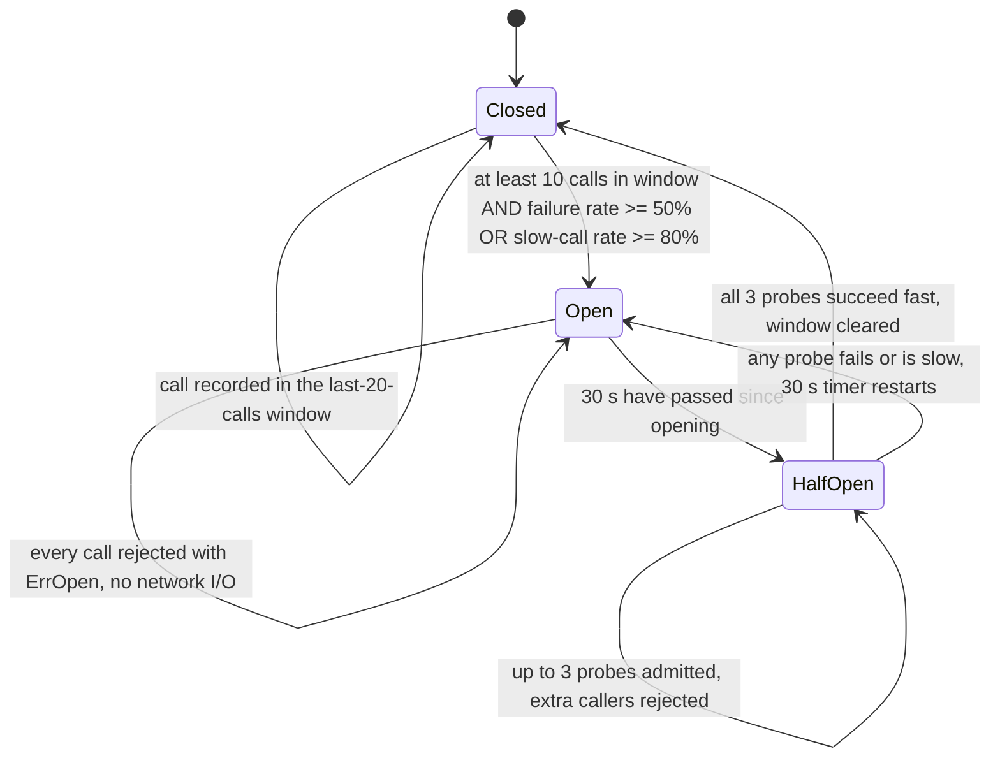
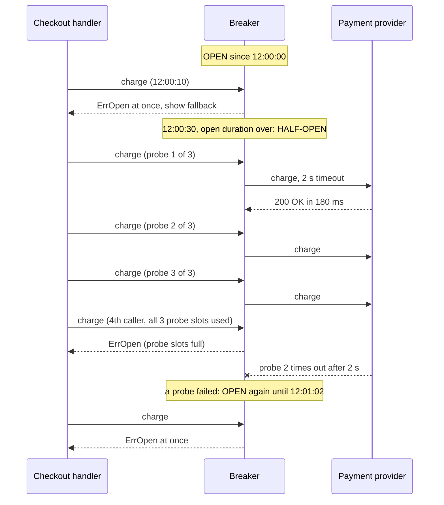

# Circuit Breaker

> [!summary] TL;DR
> A **circuit breaker** sits in front of calls to one dependency and counts how many fail. When too many fail, it **opens** and rejects calls at once for a while, instead of letting every caller wait on a dependency that is down. After a pause it lets a few **probe** calls through to test whether the dependency has recovered.

> [!abstract] Core idea
> - Three states: **closed** (calls flow and are counted), **open** (calls fail fast), **half-open** (a few probes decide).
> - Trip on a failure **rate** over a sliding window, only after a minimum number of calls.
> - Count timeouts, 5xx and connection errors as failures, not 4xx client errors.
> - Put the timeout inside the breaker, the retry loop outside it, and never retry while it is open.
> - Classic mistake: a breaker with no fallback just turns slow errors into fast errors; decide what the user sees.

## 1. Why it exists

A breaker stops **cascading failure**: one slow dependency making its callers fail too.

The old notes' example, with numbers. A checkout service handles 200 requests per second and calls a payment provider that normally answers in 200 ms. So about `200 × 0.2 = 40` calls are in flight (Little's Law: in flight = rate × latency).

The provider degrades and every call now hangs until the 10 s client timeout:

- In flight becomes `200 × 10 = 2,000` goroutines, each holding an outbound connection, request buffers and a database transaction that was opened before the call.
- The database pool (say 50 connections) is exhausted by transactions waiting on the provider, so even pages that do not touch payments start to time out.
- Health checks queue behind the same pool, the load balancer marks the pods unhealthy, and the outage spreads from the payment provider to the whole site.

The provider is clearly failing, yet every request still pays 10 s to rediscover that. A breaker learns from the first few dozen failures and rejects the rest in microseconds, so threads, connections and memory stay free for the work that can still succeed.

## 2. Mental model

The name comes from the electrical breaker in a house. When a fault draws too much current, the breaker trips and cuts the circuit, so the wiring does not burn. You flip it back once the fault is fixed.

The software version adds a "test" step: after a cool-down it does not fully close at once, it lets a few calls through. If they work, it closes; if not, it stays open for another cool-down.

Another way to see it: the breaker is a **memory of recent failures shared by all callers in the process**. Without it, each request discovers the outage on its own by waiting for a timeout.

## 3. How it works

### The state machine with real thresholds

The values below are this note's example configuration. Every library has the same knobs under different names.



The knobs:

| Knob | Meaning | Example | resilience4j default |
| --- | --- | --- | --- |
| Sliding window | Which calls are judged: last N calls (count-based) or last N seconds (time-based) | last 20 calls | count-based, 100 calls |
| Minimum calls | Do not judge until this many calls are in the window | 10 | 100 |
| Failure-rate threshold | Trip when failures ÷ calls reaches this | 50% | 50% |
| Slow-call threshold | Calls at least this long count as slow | 2 s | 60 s |
| Slow-call rate | Trip when slow calls ÷ calls reaches this | 80% | 100% |
| Open duration | How long to reject before probing | 30 s | 60 s |
| Half-open probes | Calls allowed through to test recovery | 3 | 10 |

### What counts as a failure

| Counts as failure | Does not count |
| --- | --- |
| Timeouts (`context.DeadlineExceeded` from the per-call timeout) | 4xx client errors: 400, 404, 409, 422 (the request was bad, the dependency is fine) |
| 5xx responses: 500, 502, 503, 504 | Business declines ("card declined", "insufficient funds") |
| Connection refused, reset, DNS failure | The caller cancelled (`context.Canceled`): exclude it entirely |
| 429 if it reflects provider overload (a judgment call) | Errors raised before the call was attempted |

If 404s counted, a burst of bad user input could open the breaker and block every good request.

### Half-open: a probe succeeding and a probe failing



### Where the breaker goes

- **Per dependency, often per host.** One breaker per downstream (payments, recommendations, search). If the client talks to many replicas, a breaker per host lets healthy hosts keep serving while a bad one is cut off. One breaker for "all outbound calls" would let a single bad dependency block everything.
- **In the client library or in the mesh.** In-process (gobreaker, failsafe-go, resilience4j) knows business errors and can run fallbacks. In a service mesh, Envoy's **outlier detection** ejects a misbehaving host from the load-balancing pool after, by default, 5 consecutive 5xx errors, for a base of 30 s. Envoy's own setting called "circuit breaking" is different: it caps connections, pending requests and retries per cluster, which is a bulkhead ([[Bulkheads and Concurrency Limits]]).

### How it fits with timeouts and retries

Order the wrappers from outside to inside like this: `retry( breaker( timeout( call ) ) )`.

- The **timeout is inside** the breaker, so a hung call becomes a recorded failure instead of a goroutine stuck forever.
- The **retry loop is outside**, so the breaker sees each attempt, and the loop must treat `ErrOpen` as permanent: never retry, never back off waiting for an open breaker.
- Retries are what keep a sick dependency sick; the breaker is what stops them. See [[Timeouts, Retries and Backoff]].

### Fallbacks

The breaker decides *whether* to call. The fallback decides *what the user gets* when it does not.

- **Cached or stale data:** last known exchange rates, yesterday's recommendations.
- **A default:** "free delivery estimate unavailable" instead of a price; an empty "you may also like" row.
- **Queue for later:** accept the order, mark payment "pending", charge when the provider recovers (with an idempotency key).
- **Hide the feature:** remove the reviews widget from the page.
- **A clear, fast error:** "Payments are temporarily unavailable, your cart is saved". For a core dependency with no substitute this is the honest answer, and failing in 1 ms is still far better than failing in 10 s.

## 4. Worked example

### Whiteboard version

Consecutive failures, a timer, and one probe. Enough to explain the idea in an interview before refining it.

```go
package wbbreaker

import (
	"errors"
	"time"
)

// Breaker opens after 5 consecutive failures and allows one probe after 30 s.
// Not safe for concurrent use: the full version adds a mutex.
type Breaker struct {
	failures int
	openedAt time.Time
	now      func() time.Time
}

func (b *Breaker) Call(fn func() error) error {
	if b.failures >= 5 && b.now().Sub(b.openedAt) < 30*time.Second {
		return errors.New("open: failing fast")
	}
	// closed, or open long enough that this call is the half-open probe
	if err := fn(); err != nil {
		b.failures++
		if b.failures >= 5 {
			b.openedAt = b.now() // (re)open and restart the timer
		}
		return err
	}
	b.failures = 0 // a success closes the breaker
	return nil
}
```

### The full breaker

`Breaker` adds what production needs:

- a count-based window over the last `WindowSize` calls (a ring buffer);
- a minimum number of calls before judging;
- separate failure-rate and slow-call-rate thresholds;
- an `IsFailure` classifier so 4xx errors are not counted;
- a fixed number of half-open probes, with extra callers rejected;
- a **generation counter** so a call that started under an old state cannot affect the new one;
- an injected clock and an `onChange` hook for metrics and logs.

```go
// Package breaker is a count-based circuit breaker with a failure-rate
// threshold, a slow-call threshold, a minimum call volume and a limited
// number of half-open probes.
package breaker

import (
	"errors"
	"sync"
	"time"
)

// State of the breaker.
type State int

const (
	Closed   State = iota // calls flow; outcomes are recorded
	Open                  // calls fail fast with ErrOpen
	HalfOpen              // a few probe calls test the dependency
)

func (s State) String() string { return [...]string{"closed", "open", "half-open"}[s] }

// ErrOpen is returned without calling the dependency.
var ErrOpen = errors.New("circuit breaker is open")

// Config holds the thresholds. All fields are required except IsFailure.
type Config struct {
	WindowSize     int              // judge the last N calls, e.g. 20
	MinCalls       int              // never trip on fewer calls than this, e.g. 10
	FailureRate    float64          // trip when failures/calls >= this, e.g. 0.5
	SlowCall       time.Duration    // a call at least this long counts as slow
	SlowRate       float64          // trip when slow/calls >= this, e.g. 0.8
	OpenFor        time.Duration    // how long to fail fast before probing, e.g. 30 s
	HalfOpenProbes int              // probe calls allowed in half-open, e.g. 3
	IsFailure      func(error) bool // nil means every non-nil error is a failure
}

type outcome struct{ failed, slow bool }

// Breaker is safe for concurrent use.
type Breaker struct {
	cfg      Config
	now      func() time.Time
	onChange func(from, to State)

	mu       sync.Mutex
	state    State
	gen      uint64    // bumps on every transition; stale results are ignored
	window   []outcome // ring buffer of the last WindowSize outcomes
	next     int
	filled   int
	openedAt time.Time
	admitted int // half-open probes let through
	passed   int // half-open probes that succeeded
}

// New builds a breaker. now is injected so tests control time;
// onChange may be nil and is called with the lock held, so keep it cheap.
func New(cfg Config, now func() time.Time, onChange func(from, to State)) *Breaker {
	if cfg.IsFailure == nil {
		cfg.IsFailure = func(err error) bool { return err != nil }
	}
	if onChange == nil {
		onChange = func(State, State) {}
	}
	return &Breaker{cfg: cfg, now: now, onChange: onChange, window: make([]outcome, cfg.WindowSize)}
}

// State returns the current state, moving open to half-open if OpenFor passed.
func (b *Breaker) State() State {
	b.mu.Lock()
	defer b.mu.Unlock()
	b.maybeHalfOpen()
	return b.state
}

// Execute runs fn unless the breaker rejects it. fn should carry its own
// timeout, so that a hung dependency becomes a recorded failure.
func (b *Breaker) Execute(fn func() error) error {
	gen, err := b.before()
	if err != nil {
		return err
	}
	start := b.now()
	err = fn()
	b.after(gen, b.now().Sub(start), err)
	return err
}

func (b *Breaker) before() (uint64, error) {
	b.mu.Lock()
	defer b.mu.Unlock()
	b.maybeHalfOpen()
	switch b.state {
	case Open:
		return 0, ErrOpen
	case HalfOpen:
		if b.admitted >= b.cfg.HalfOpenProbes {
			return 0, ErrOpen // enough probes already in flight
		}
		b.admitted++
	}
	return b.gen, nil
}

func (b *Breaker) after(gen uint64, took time.Duration, err error) {
	b.mu.Lock()
	defer b.mu.Unlock()
	if gen != b.gen {
		return // started under an older state; its result no longer counts
	}
	o := outcome{failed: err != nil && b.cfg.IsFailure(err), slow: took >= b.cfg.SlowCall}
	switch b.state {
	case Closed:
		b.window[b.next] = o
		b.next = (b.next + 1) % len(b.window)
		b.filled = min(b.filled+1, len(b.window))
		if b.shouldTrip() {
			b.transition(Open)
		}
	case HalfOpen:
		if o.failed || o.slow {
			b.transition(Open)
			return
		}
		b.passed++
		if b.passed >= b.cfg.HalfOpenProbes {
			b.transition(Closed)
		}
	}
}

func (b *Breaker) shouldTrip() bool {
	if b.filled < b.cfg.MinCalls {
		return false
	}
	failed, slow := 0, 0
	for _, o := range b.window[:b.filled] {
		if o.failed {
			failed++
		}
		if o.slow {
			slow++
		}
	}
	n := float64(b.filled)
	return float64(failed)/n >= b.cfg.FailureRate || float64(slow)/n >= b.cfg.SlowRate
}

func (b *Breaker) maybeHalfOpen() {
	if b.state == Open && b.now().Sub(b.openedAt) >= b.cfg.OpenFor {
		b.transition(HalfOpen)
	}
}

func (b *Breaker) transition(to State) {
	from := b.state
	b.state = to
	b.gen++
	b.admitted, b.passed = 0, 0
	if to == Open {
		b.openedAt = b.now()
	}
	if to == Closed {
		b.next, b.filled = 0, 0 // start judging from a clean window
	}
	b.onChange(from, to)
}
```

The tests use a fake clock, so moving 30 s into the future is instant and exact:

```go
package breaker

import (
	"errors"
	"sync"
	"sync/atomic"
	"testing"
	"time"
)

type clock struct {
	mu sync.Mutex
	t  time.Time
}

func (c *clock) Now() time.Time { c.mu.Lock(); defer c.mu.Unlock(); return c.t }
func (c *clock) Advance(d time.Duration) {
	c.mu.Lock()
	c.t = c.t.Add(d)
	c.mu.Unlock()
}

var (
	errUnavailable = errors.New("503 unavailable")
	errNotFound    = errors.New("404 not found")
)

func cfg() Config {
	return Config{
		WindowSize: 20, MinCalls: 10, FailureRate: 0.5,
		SlowCall: 2 * time.Second, SlowRate: 0.8,
		OpenFor: 30 * time.Second, HalfOpenProbes: 3,
		IsFailure: func(err error) bool { return !errors.Is(err, errNotFound) },
	}
}

func newBreaker(t *testing.T) (*Breaker, *clock, *[]string) {
	t.Helper()
	c := &clock{t: time.Unix(0, 0)}
	var log []string
	b := New(cfg(), c.Now, func(from, to State) { log = append(log, from.String()+"->"+to.String()) })
	return b, c, &log
}

func fail() error { return errUnavailable }
func ok() error   { return nil }

func TestStaysClosedBelowMinCalls(t *testing.T) {
	b, _, _ := newBreaker(t)
	for i := 0; i < 9; i++ { // 100% failures, but only 9 calls
		_ = b.Execute(fail)
	}
	if b.State() != Closed {
		t.Fatal("tripped before MinCalls")
	}
	_ = b.Execute(fail) // the 10th call reaches MinCalls
	if b.State() != Open {
		t.Fatal("should trip at 10 calls with 100% failures")
	}
}

func TestTripsAtFailureRate(t *testing.T) {
	b, _, _ := newBreaker(t)
	for i := 0; i < 6; i++ {
		_ = b.Execute(ok)
	}
	for i := 0; i < 4; i++ {
		_ = b.Execute(fail)
	}
	if b.State() != Closed { // 4/10 = 40% < 50%
		t.Fatal("tripped at 40%")
	}
	_ = b.Execute(fail) // 5/11 = 45%
	_ = b.Execute(fail) // 6/12 = 50%
	if b.State() != Open {
		t.Fatal("should trip at 50%")
	}
}

func TestClientErrorsDoNotCount(t *testing.T) {
	b, _, _ := newBreaker(t)
	for i := 0; i < 20; i++ {
		if err := b.Execute(func() error { return errNotFound }); !errors.Is(err, errNotFound) {
			t.Fatal("caller must still see its own error")
		}
	}
	if b.State() != Closed {
		t.Fatal("404s must not open the breaker")
	}
}

func TestSlowCallsTrip(t *testing.T) {
	b, c, _ := newBreaker(t)
	slowOK := func() error { c.Advance(3 * time.Second); return nil }
	for i := 0; i < 8; i++ {
		_ = b.Execute(slowOK)
	}
	for i := 0; i < 2; i++ {
		_ = b.Execute(ok)
	}
	if b.State() != Open { // 8/10 slow = 80%
		t.Fatal("slow calls should trip the breaker")
	}
}

func TestOpenFailsFastThenHalfOpenProbesClose(t *testing.T) {
	b, c, log := newBreaker(t)
	for i := 0; i < 10; i++ {
		_ = b.Execute(fail)
	}
	called := false
	if err := b.Execute(func() error { called = true; return nil }); !errors.Is(err, ErrOpen) || called {
		t.Fatal("open breaker must reject without calling")
	}
	c.Advance(30 * time.Second)
	if b.State() != HalfOpen {
		t.Fatal("should be half-open after OpenFor")
	}
	for i := 0; i < 3; i++ {
		if err := b.Execute(ok); err != nil {
			t.Fatal(err)
		}
	}
	if b.State() != Closed {
		t.Fatal("3 good probes should close it")
	}
	want := []string{"closed->open", "open->half-open", "half-open->closed"}
	if len(*log) != 3 || (*log)[0] != want[0] || (*log)[1] != want[1] || (*log)[2] != want[2] {
		t.Fatalf("transitions = %v", *log)
	}
}

func TestHalfOpenFailedProbeReopens(t *testing.T) {
	b, c, _ := newBreaker(t)
	for i := 0; i < 10; i++ {
		_ = b.Execute(fail)
	}
	c.Advance(30 * time.Second)
	_ = b.Execute(ok)
	_ = b.Execute(fail)
	if b.State() != Open {
		t.Fatal("a failed probe should reopen")
	}
	c.Advance(29 * time.Second)
	if b.State() != Open {
		t.Fatal("the open timer restarts on reopen")
	}
}

func TestHalfOpenLimitsProbes(t *testing.T) {
	b, c, _ := newBreaker(t)
	for i := 0; i < 10; i++ {
		_ = b.Execute(fail)
	}
	c.Advance(30 * time.Second)
	release := make(chan struct{})
	var started sync.WaitGroup
	var done sync.WaitGroup
	for i := 0; i < 3; i++ { // three probes hang in flight
		started.Add(1)
		done.Add(1)
		go func() {
			defer done.Done()
			_ = b.Execute(func() error { started.Done(); <-release; return nil })
		}()
	}
	started.Wait()
	if err := b.Execute(ok); !errors.Is(err, ErrOpen) {
		t.Fatal("a 4th caller during half-open must be rejected")
	}
	close(release)
	done.Wait()
	if b.State() != Closed {
		t.Fatal("three successful probes should close")
	}
}

func TestStaleResultIgnored(t *testing.T) {
	b, c, _ := newBreaker(t)
	release, started := make(chan struct{}), make(chan struct{})
	var done sync.WaitGroup
	done.Add(1)
	go func() { // starts while closed, finishes after the breaker opened
		defer done.Done()
		_ = b.Execute(func() error { close(started); <-release; return nil })
	}()
	<-started
	for i := 0; i < 10; i++ {
		_ = b.Execute(fail)
	}
	c.Advance(30 * time.Second)
	if b.State() != HalfOpen {
		t.Fatal("want half-open")
	}
	close(release)
	done.Wait()
	_ = b.Execute(fail) // first probe fails; the stale success must not have counted
	if b.State() != Open {
		t.Fatal("stale success leaked into half-open")
	}
}

func TestConcurrentUse(t *testing.T) {
	c := &clock{t: time.Unix(0, 0)}
	b := New(cfg(), c.Now, nil)
	var calls atomic.Int64
	var wg sync.WaitGroup
	for g := 0; g < 16; g++ {
		wg.Add(1)
		go func() {
			defer wg.Done()
			for i := 0; i < 200; i++ {
				_ = b.Execute(func() error { calls.Add(1); return fail() })
				c.Advance(time.Second)
			}
		}()
	}
	wg.Wait()
	if calls.Load() >= 16*200 {
		t.Fatal("breaker never rejected anything")
	}
}
```

```bash
go vet ./... && go test -race ./breaker
```

Trace of `TestTripsAtFailureRate` against the example configuration (window 20, minimum 10, threshold 50%):

| Call | Result | Failures / calls | State after |
| --- | --- | --- | --- |
| 1–6 | ok | 0 / 6 | closed (below minimum) |
| 7–10 | fail | 4 / 10 = 40% | closed |
| 11 | fail | 5 / 11 = 45% | closed |
| 12 | fail | 6 / 12 = 50% | **open** |

### With a library: sony/gobreaker v2

The same policy expressed with `github.com/sony/gobreaker/v2` (v2.4.0). Its counters cover a time window (`Interval`, rolled in `BucketPeriod` buckets), and `ReadyToTrip` receives the counts so you can write a rate rule with a minimum volume. Its default `ReadyToTrip` trips after more than 5 consecutive failures, and the default open `Timeout` is 60 s.

```go
// Package gb wraps a payment-provider call with sony/gobreaker v2.
package gb

import (
	"context"
	"errors"
	"log/slog"
	"time"

	"github.com/sony/gobreaker/v2"
)

// ErrClient marks 4xx-style errors that say nothing about provider health.
var ErrClient = errors.New("client error")

// NewProviderBreaker trips at a 50% failure rate over a 60 s window
// once at least 20 calls were seen, and probes with 3 calls after 30 s.
func NewProviderBreaker() *gobreaker.CircuitBreaker[string] {
	return gobreaker.NewCircuitBreaker[string](gobreaker.Settings{
		Name:         "payment-provider",
		MaxRequests:  3,                // half-open probes
		Interval:     60 * time.Second, // closed-state window...
		BucketPeriod: 10 * time.Second, // ...rolled in 10 s buckets
		Timeout:      30 * time.Second, // open for 30 s
		ReadyToTrip: func(c gobreaker.Counts) bool {
			return c.Requests >= 20 && float64(c.TotalFailures)/float64(c.Requests) >= 0.5
		},
		IsExcluded: func(err error) bool { // the caller gave up: not the provider's fault
			return errors.Is(err, context.Canceled)
		},
		IsSuccessful: func(err error) bool { return err == nil || errors.Is(err, ErrClient) },
		OnStateChange: func(name string, from, to gobreaker.State) {
			slog.Warn("breaker state change", "name", name, "from", from.String(), "to", to.String())
		},
	})
}

// Charge runs the provider call with its own timeout inside the breaker.
func Charge(ctx context.Context, cb *gobreaker.CircuitBreaker[string],
	call func(context.Context) (string, error)) (string, error) {
	return cb.Execute(func() (string, error) {
		ctx, cancel := context.WithTimeout(ctx, 2*time.Second)
		defer cancel()
		return call(ctx)
	})
}
```

```go
package gb

import (
	"context"
	"errors"
	"testing"

	"github.com/sony/gobreaker/v2"
)

func TestProviderBreakerTrips(t *testing.T) {
	cb := NewProviderBreaker()
	down := func(context.Context) (string, error) { return "", errors.New("502 bad gateway") }
	declined := func(context.Context) (string, error) { return "", ErrClient }
	for i := 0; i < 19; i++ {
		_, _ = Charge(context.Background(), cb, down)
	}
	if cb.State() != gobreaker.StateClosed {
		t.Fatal("tripped before 20 calls")
	}
	_, _ = Charge(context.Background(), cb, declined) // counts as success
	if cb.State() != gobreaker.StateClosed {
		t.Fatal("a client error must not trip it")
	}
	_, _ = Charge(context.Background(), cb, down) // 20 failures of 21 calls
	if cb.State() != gobreaker.StateOpen {
		t.Fatal("should be open")
	}
	if _, err := Charge(context.Background(), cb, down); !errors.Is(err, gobreaker.ErrOpenState) {
		t.Fatalf("want ErrOpenState, got %v", err)
	}
}
```

## 5. Variants and comparison

| Variant | How it decides to open | Use when | Cost |
| --- | --- | --- | --- |
| Consecutive failures | N failures in a row (gobreaker default: more than 5) | Low or steady traffic, simple code | One success resets it, so 50% failure can keep it closed |
| Count-based rate window | Failure rate over the last N calls, with a minimum | Steady traffic; the usual default | At low traffic the window can span minutes of stale history |
| Time-based rate window | Failure rate over the last N seconds (bucketed) | Bursty traffic; when "recent" should mean wall-clock time | Needs a minimum volume, or a quiet minute with 2 calls can trip it |
| Slow-call rule | Share of calls slower than a threshold | Dependencies that degrade by getting slow, not by erroring | Must sit below the call timeout to be useful |
| Outlier detection (Envoy) | Ejects one host from the pool on consecutive 5xx or outlying success rate | Many replicas behind one name | Only per host; capped by `max_ejection_percent` (default 10%) |
| Adaptive throttling (Google SRE) | Client rejects locally with probability based on requests vs accepts | Very high-traffic internal RPC | No clean open/closed state to reason about |

Compare with [[17 LLD/Practice/Circuit Breaker|the Circuit Breaker LLD practice problem]], which treats the same idea as a class-design exercise (State and Decorator patterns, interfaces, tests).

## 6. Trade-offs and when not to use

- **Fast failure is still failure.** Without a fallback, an open breaker only changes a 10 s error into a 1 ms error. That protects your resources, but the user still needs a defined experience.
- **Low-traffic endpoints** make rates meaningless: 2 failures out of 3 calls is 67%. Use a minimum call count, or a consecutive-failure rule, or no breaker.
- **Flapping:** a dependency at the edge of its capacity can open, recover under reduced load, close, overload again, and repeat. Longer open durations, more probes, and gradually ramping traffic back help.
- **Shared fate:** one breaker for many hosts trips everything when one host is bad; one breaker per host needs per-host traffic to be judged.
- **Not for local code.** A breaker around an in-process function or a local cache adds nothing.
- **Not a rate limiter.** A breaker reacts to the dependency's failures. Protecting a dependency from your volume is [[Rate Limiting - Algorithms and Distributed Design]] or a bulkhead.

## 7. In production

- **Real systems:**
	- Netflix Hystrix popularised the pattern; it has been in maintenance mode since 2018, and Netflix pointed users to resilience4j. Hystrix defaults were: a 10 s rolling window, at least 20 requests, and a 50% error threshold, with a 5 s sleep window before probing.
	- resilience4j (Java) uses count-based or time-based windows with the defaults shown in section 3.
	- Go: `sony/gobreaker` (shown above), `failsafe-go` (breakers composed with retries, timeouts and bulkheads in one policy chain).
	- Envoy and Istio: outlier detection per host, plus concurrency "circuit breakers" per cluster.
- **Failure modes → fixes:**
	- 4xx from bad input opens the breaker → classify failures; exclude client errors and cancellations.
	- Breaker never opens because calls hang longer than any window → put a per-call timeout inside it.
	- Breaker opens, but callers keep retrying and hammer the probe → treat `ErrOpen` as permanent in the retry loop.
	- Thundering herd at half-open → limit probes; reject extra callers until the probes finish.
	- One bad replica trips the whole dependency → breaker per host, or mesh outlier detection.
	- Breaker hides an outage nobody notices → alert on transitions to open.
- **What to monitor:**
	- State per breaker as a gauge (0 closed, 1 half-open, 2 open) and a counter of transitions.
	- Calls rejected by the breaker per second.
	- Failure rate and slow-call rate as the breaker sees them.
	- Fallback invocations, so degraded responses are visible ([[Observability in Go Services]]).
	- Test it on purpose: inject latency and errors and check that the breaker opens and the fallback serves ([[Chaos Engineering]]).

## 8. Deep dive

- **Stale results and generations.** A call can start while the breaker is closed and finish after it opened and moved to half-open. If its success counted as a probe, a dependency that failed every real probe could be closed by an old result. gobreaker and the code above tag each call with the generation at admission and ignore results from older generations.
- **Count-based vs time-based windows at the extremes.** At 10,000 calls/s, a 100-call window covers 10 ms: it reacts quickly but trips on tiny bursts. At 1 call/min, a 100-call window covers 100 minutes of history. Pick the window so it covers roughly 10–60 s of traffic, or use time-based buckets.
- **The slow-call threshold must sit below the timeout.** If the call timeout is 2 s and the slow threshold is 5 s, no call is ever "slow"; every slow call becomes a timeout failure instead. Put the slow threshold at about the latency where users already suffer (for example 1 s) and the timeout above it.
- **Half-open probe count is a trade.** One probe recovers quickly but can be fooled by one lucky success; more probes give confidence but prolong the outage for users. Some implementations ramp traffic back (10%, 25%, 50%, 100%) instead of a single step.
- **Per-process breakers disagree.** With 100 pods, each pod has its own breaker and its own view. That is usually good (no shared state to fail), but it means each pod must observe failures itself. A shared breaker in Redis adds a dependency to protect the dependency.
- **Lock contention.** The breaker sits on the hot path of every call. A mutex held only for counter updates (never during the call, as above) is fine at tens of thousands of calls per second; beyond that, use striped or atomic counters.
- **Bulkheads plus breakers.** A breaker reacts after failures accumulate. A bulkhead caps concurrency from the first request, so even before the breaker trips, a slow dependency can hold only its own slots. Use both.

## 9. Interview questions

> [!question]- What problem does a circuit breaker solve that a timeout alone does not?
> A timeout bounds each call, but every request still waits the full timeout to discover the outage, so goroutines, connections and pools fill up and the failure cascades. A breaker remembers recent failures across all requests and rejects at once, freeing those resources and giving the dependency room to recover.

> [!question]- Walk through the states and what moves between them.
> Closed: calls pass and outcomes go into a sliding window; when the failure rate (or slow-call rate) crosses the threshold after a minimum number of calls, it opens. Open: calls fail fast; after the open duration it goes half-open. Half-open: a limited number of probes go through; all succeed → closed, any fails → open again.

> [!question]- Which errors should count as failures?
> Timeouts, 5xx and connection errors, because they show the dependency is unhealthy. Not 4xx client errors or business declines, and exclude cancellations by the caller. Otherwise bad user input could open the breaker for everyone.

> [!question]- Trap: you add retries and a breaker. In which order do you wrap them, and what does the retry loop do with `ErrOpen`?
> `retry(breaker(timeout(call)))`: each attempt goes through the breaker and has its own timeout. The retry loop must treat `ErrOpen` as permanent and stop. Retrying an open breaker just spins, and wrapping the breaker in the retry the other way round hides attempts from it.

> [!question]- Why a minimum number of calls, and what happens on low-traffic endpoints?
> Rates on tiny samples are noise: 1 failure in 2 calls is 50%. The minimum stops that. On endpoints with very little traffic, use a consecutive-failure rule or a time-based window with a minimum, or skip the breaker and rely on timeouts.

> [!question]- What does the user see when the breaker is open?
> A fallback you chose per dependency: cached or stale data, a default, a hidden widget, work queued for later, or a fast and clear error for core features with no substitute. Track how often fallbacks are served.

> [!question]- Envoy has "circuit breaking" and "outlier detection". Which is the classic circuit breaker?
> Outlier detection: it ejects a host after consecutive errors and readmits it after an ejection time, which matches the open and half-open idea per host. Envoy's "circuit breaking" settings cap connections, pending requests and retries per cluster, which is really a bulkhead.

## 10. Cheat sheet

- Closed → open on failure rate ≥ threshold over a window, after a minimum number of calls; open → half-open after a cool-down; a few probes decide.
- Failures = timeouts, 5xx, connection errors. Not 4xx, not cancellations.
- One breaker per dependency (or per host), not one global breaker.
- `retry(breaker(timeout(call)))`; `ErrOpen` is never retried.
- Always pair with a fallback: stale data, default, hide, queue, or a fast clear error.
- Ignore results from calls admitted under an older state (generation counter).
- Alert on transitions to open; graph rejected calls and fallback rate.

## Links

- **Before this:** [[Distributed Systems Fundamentals]], [[Timeouts, Retries and Backoff]]
- **Next:** [[Bulkheads and Concurrency Limits]], [[Load Shedding and Graceful Degradation]]
- **Compare with:** [[17 LLD/Practice/Circuit Breaker|Circuit Breaker (LLD practice problem)]] (the class-design angle), [[Rate Limiting - Algorithms and Distributed Design]] (limits your volume instead of reacting to failures), [[Calling External APIs]] (Go client setup)
