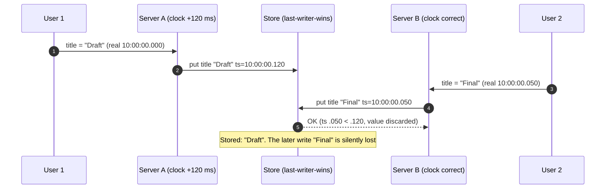
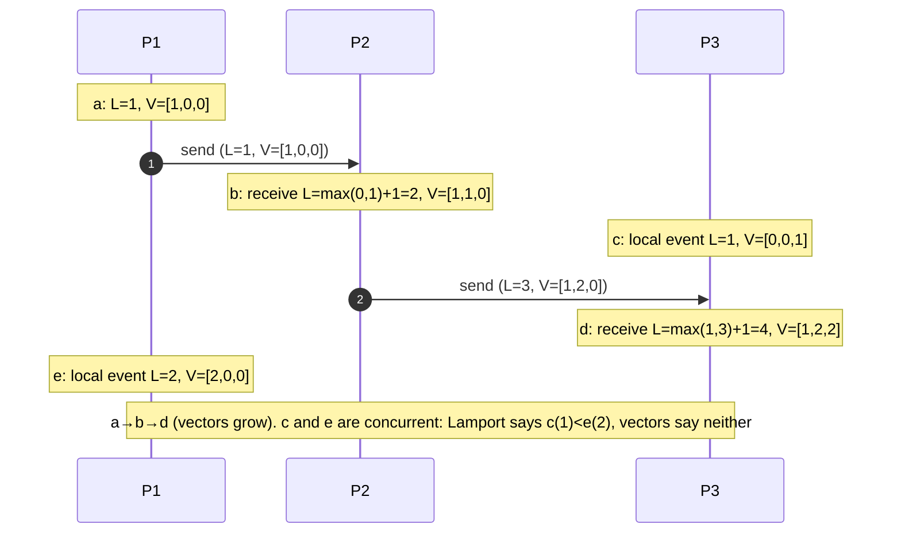

# Clocks and Ordering

> [!summary] TL;DR
> Every machine has its own clock, and no two agree exactly, so you cannot use timestamps from different machines to decide which event happened first. Distributed systems instead use **logical clocks** (counters passed along with messages), **sequence numbers** from a single owner, or carefully bounded physical time (Spanner's TrueTime) to order events.

> [!abstract] Core idea
> - Wall clocks drift and jump (NTP corrections, leap seconds), so "later timestamp" does not mean "happened later" across machines.
> - Use a **monotonic** clock to measure durations on one machine; never use wall-clock differences.
> - Lamport clocks give an order that respects cause and effect; vector clocks also detect when two events are concurrent.
> - Hybrid logical clocks stay close to real time while keeping causality; TrueTime waits out the uncertainty instead.
> - Classic mistake: last-writer-wins with wall-clock timestamps. It silently drops writes whenever clocks are skewed.

## 1. Why it exists

Two app servers handle edits to the same document title. Server A's clock is 120 ms fast.

- 10:00:00.000 (real time): a user on server A sets the title to "Draft". A stamps it 10:00:00.120.
- 10:00:00.050 (real time): a user on server B sets the title to "Final". B stamps it 10:00:00.050.

The database keeps the write with the larger timestamp: "Draft". The later edit, "Final", was acknowledged and then lost, and no error was logged anywhere. 120 ms of skew is ordinary for a VM whose NTP sync failed for an hour.



## 2. Mental model

- **Wall clock (time-of-day)**: what `date` prints. It can be stepped backwards or forwards by NTP or an operator.
- **Monotonic clock**: a counter that only moves forward, used to measure elapsed time on one machine. Its absolute value means nothing.
- **Drift**: how fast a clock gains or loses time, in parts per million (ppm). 50 ppm is 4.3 seconds per day.
- **Skew (offset)**: the difference between two clocks at one instant.
- **Happens-before (→)**: A → B if A and B are on the same process and A came first, or A is the send of a message and B its receipt, or there is a chain of these. If neither A → B nor B → A, the events are **concurrent**.

**Analogy.** Letters between pen-pals in different time zones with unreliable watches. You cannot order letters by the time written on them. But if a letter says "replying to your letter #7", you know it came after #7. Logical clocks are that "replying to" number.

## 3. How it works

### Physical clocks and their limits

- **Drift**: commodity quartz oscillators drift by tens of ppm and change with temperature (an estimate; Spanner's TrueTime assumes a worst case of 200 ppm).
- **NTP**: synchronises to time servers. Typical accuracy is tens of milliseconds over the public internet and well under a millisecond inside a data centre with a nearby server (estimates; both depend on network jitter and asymmetry). PTP and cloud services such as Amazon Time Sync can do better.
- **Jumps**: if the offset is large, NTP clients may **step** the clock instead of slewing it gradually, so wall time can go backwards.
- **Leap seconds**: UTC occasionally inserts a second. Google and Amazon **smear** it, spreading the extra second over many hours (Google: 24 hours, noon to noon) so clocks never repeat a second. Mixing smeared and unsmeared servers creates up to a second of skew during the smear.
- **Go**: since Go 1.9, `time.Now()` returns a `time.Time` that carries both a wall reading and a monotonic reading. `time.Since(start)` and `t2.Sub(t1)` use the monotonic part when both values have it, so durations are correct even if the wall clock jumps. Serialising a time (or calling `t.Round(0)`) strips the monotonic reading, so durations computed across processes or from stored values use the wall clock.

### Lamport clocks

Each process keeps a counter `L`:

1. Before each local event or send: `L = L + 1`; attach `L` to the message.
2. On receive with stamp `m`: `L = max(L, m) + 1`.

Guarantee: if A → B then `L(A) < L(B)`. The converse does not hold: `L(A) < L(B)` does not mean A happened before B. To get a total order (for example for a mutual-exclusion queue), break ties with the process id: compare `(L, pid)`.

### Vector clocks

Each process keeps a vector with one counter per process:

1. Local event or send: increment your own entry; attach a copy of the vector.
2. Receive: take the element-wise max with the received vector, then increment your own entry.

Compare `a` and `b`: if every entry of `a` ≤ `b` and at least one is smaller, `a` happened before `b`. If some entry is bigger in each, they are **concurrent**. Vector clocks are exactly as precise as happens-before, which is why Dynamo and Riak use version vectors to keep concurrent writes as siblings instead of dropping one.



Cost: one entry per process (or per replica that wrote the key). With many clients writing, vectors grow, so systems use per-replica entries (version vectors), prune old entries (the Dynamo paper truncates after 10 entries), or use dotted version vectors (Riak).

### Hybrid logical clocks (HLC)

An HLC timestamp is `(wall, logical)`: `wall` is the largest physical time this node has seen (its own or in a message), and `logical` counts events while `wall` does not move. It respects happens-before like a Lamport clock, stays within the clock skew of real time, and fits in 64 bits. CockroachDB orders transactions with HLC timestamps, and MongoDB's cluster time (since 3.6) is a hybrid logical clock used for causally consistent sessions.

### TrueTime and commit-wait (Spanner)

Spanner's `TT.now()` returns an interval `[earliest, latest]` guaranteed to contain true time, using GPS receivers and atomic clocks in each data centre. The uncertainty ε was typically 1 to 7 ms in the 2012 paper. A transaction picks commit timestamp `s = TT.now().latest` and then **waits** until `TT.now().earliest > s` before making the commit visible. After that wait, any transaction that starts later in real time gets a larger timestamp, which gives external consistency (strict serializability). The cost is about 2ε of latency per read-write commit.

### Sequence numbers as ordering

When one owner assigns order, you do not need clocks at all:

- Kafka assigns each record an **offset** within a partition: order is total within a partition and undefined across partitions (see [[Kafka and Event Streaming]]).
- A database `SEQUENCE` or the WAL's LSN orders events on that database.
- Raft log indexes order every command in a replicated state machine (see [[Consensus - Raft and Paxos]]).

The price is that every ordered event goes through the owner.

## 4. Worked example

### Whiteboard version

```text
Lamport:
    tick():      L = L + 1
    recv(m):     L = max(L, m) + 1

Vector (process p):
    tick():      V[p] += 1
    recv(W):     for q: V[q] = max(V[q], W[q]);  V[p] += 1
    compare(a,b): a<b if all a[q]<=b[q] and some a[q]<b[q]
                  concurrent if some a[q]>b[q] and some a[q]<b[q]

HLC (pt = physical clock):
    now():       if pt > wall: (wall, l) = (pt, 0) else l += 1
    recv(mw,ml): wall' = max(wall, mw, pt)
                 l' = 0                     if wall' == pt (and pt is strictly largest)
                      ml + 1                if wall' == mw > wall
                      l + 1                 if wall' == wall > mw
                      max(l, ml) + 1        if wall == mw == wall'
```

### Go: Lamport, vector and hybrid logical clocks

This compiles and passes `go vet` and `go test -race` on Go 1.24. The HLC takes its physical clock as a function, so the test controls skew exactly.

```go
// Package clocks implements Lamport clocks, vector clocks and a hybrid
// logical clock (HLC). Physical time is injected so tests are deterministic.
package clocks

// Lamport is a single counter per process.
type Lamport struct{ t uint64 }

// Tick is called for a local event or before sending; it returns the stamp.
func (l *Lamport) Tick() uint64 { l.t++; return l.t }

// Recv merges a received stamp: max(local, remote) + 1.
func (l *Lamport) Recv(remote uint64) uint64 {
	l.t = max(l.t, remote) + 1
	return l.t
}

// Vector is one counter per process, indexed by process id.
type Vector map[string]uint64

func (v Vector) Tick(self string) { v[self]++ }

// Merge takes the element-wise max with a received vector, then ticks self.
func (v Vector) Merge(self string, remote Vector) {
	for p, n := range remote {
		v[p] = max(v[p], n)
	}
	v[self]++
}

func (v Vector) Copy() Vector {
	c := make(Vector, len(v))
	for p, n := range v {
		c[p] = n
	}
	return c
}

// Order is the result of comparing two vector clocks.
type Order int

const (
	Before     Order = iota // a happened before b
	After                   // b happened before a
	Equal                   // same event
	Concurrent              // neither saw the other
)

func Compare(a, b Vector) Order {
	aLess, bLess := false, false
	for _, p := range keys(a, b) {
		switch {
		case a[p] < b[p]:
			aLess = true
		case a[p] > b[p]:
			bLess = true
		}
	}
	switch {
	case aLess && bLess:
		return Concurrent
	case aLess:
		return Before
	case bLess:
		return After
	}
	return Equal
}

func keys(a, b Vector) []string {
	seen := map[string]bool{}
	var out []string
	for _, m := range []Vector{a, b} {
		for p := range m {
			if !seen[p] {
				seen[p] = true
				out = append(out, p)
			}
		}
	}
	return out
}

// HLCStamp is (wall, logical): wall is the largest physical time seen,
// logical breaks ties when wall does not move.
type HLCStamp struct {
	Wall    int64
	Logical uint32
}

func (a HLCStamp) Less(b HLCStamp) bool {
	return a.Wall < b.Wall || (a.Wall == b.Wall && a.Logical < b.Logical)
}

// HLC is a hybrid logical clock (Kulkarni et al., 2014).
type HLC struct {
	now  func() int64 // physical clock, e.g. UnixNano; injected
	last HLCStamp
}

func NewHLC(now func() int64) *HLC { return &HLC{now: now} }

// Now stamps a local or send event.
func (h *HLC) Now() HLCStamp {
	pt := h.now()
	if pt > h.last.Wall {
		h.last = HLCStamp{Wall: pt}
	} else {
		h.last.Logical++
	}
	return h.last
}

// Update merges a stamp received in a message.
func (h *HLC) Update(m HLCStamp) HLCStamp {
	pt := h.now()
	switch {
	case pt > h.last.Wall && pt > m.Wall:
		h.last = HLCStamp{Wall: pt}
	case m.Wall > h.last.Wall:
		h.last = HLCStamp{Wall: m.Wall, Logical: m.Logical + 1}
	case h.last.Wall > m.Wall:
		h.last.Logical++
	default: // equal walls
		h.last.Logical = max(h.last.Logical, m.Logical) + 1
	}
	return h.last
}
```

```go
package clocks

import "testing"

func TestLamportRespectsCausality(t *testing.T) {
	var a, b Lamport
	send := a.Tick()     // A sends at 1
	b.Tick()             // B does local work: 1
	b.Tick()             // 2
	recv := b.Recv(send) // max(2,1)+1 = 3
	if !(send < recv) || recv != 3 {
		t.Fatalf("send=%d recv=%d", send, recv)
	}
	// The converse does not hold: a smaller stamp is not proof of "before".
	c := Lamport{}
	if x := c.Tick(); !(x < recv) {
		t.Fatal("unrelated event should still get a smaller number")
	}
}

func TestVectorDetectsConcurrency(t *testing.T) {
	a, b := Vector{}, Vector{}
	a.Tick("A")     // A:1
	msg := a.Copy() // A sends to B
	b.Merge("B", msg)
	if Compare(msg, b) != Before {
		t.Fatalf("send should be before receive")
	}
	a.Tick("A") // A:2, B:0 — B never heard of it
	b.Tick("B") // A:1, B:2
	if got := Compare(a, b); got != Concurrent {
		t.Fatalf("want Concurrent, got %v", got)
	}
	if Compare(b, b.Copy()) != Equal {
		t.Fatal("copy should be Equal")
	}
}

func TestHLCOrdersMessagesDespiteSkew(t *testing.T) {
	fastNow := int64(1_000) // node A's clock runs 100 units ahead
	slowNow := int64(900)   // node B
	a := NewHLC(func() int64 { return fastNow })
	b := NewHLC(func() int64 { return slowNow })

	sent := a.Now() // {1000, 0}
	got := b.Update(sent)
	if !sent.Less(got) {
		t.Fatalf("receive %v must be after send %v", got, sent)
	}
	if got != (HLCStamp{Wall: 1000, Logical: 1}) {
		t.Fatalf("got %+v", got)
	}
	next := b.Now() // B's physical clock (900) is still behind: logical grows
	if next != (HLCStamp{Wall: 1000, Logical: 2}) {
		t.Fatalf("got %+v", next)
	}
	slowNow = 1_200 // physical time passes the max seen: logical resets
	if s := b.Now(); s != (HLCStamp{Wall: 1200, Logical: 0}) {
		t.Fatalf("got %+v", s)
	}
}
```

What the HLC test shows: B's own clock says 900, but after hearing from A it stamps events `(1000, 1)`, `(1000, 2)`, so its events still sort after A's send. Once B's physical clock passes 1000, the logical part resets to 0 and timestamps track real time again. A plain wall clock would have stamped B's receive at 900, *before* the send.

## 5. Variants and comparison

| Mechanism | Size | Respects causality? | Detects concurrency? | Close to real time? | Used by |
| --- | --- | --- | --- | --- | --- |
| Wall clock (NTP) | 8 bytes | no | no | yes, within skew | logs, TTLs, Cassandra cell timestamps |
| Lamport clock | 8 bytes | yes (A→B ⇒ L(A)<L(B)) | no | no | total-order broadcast, Raft terms are similar in spirit |
| Vector / version vector | one counter per process or replica | yes | yes | no | Dynamo, Riak (dotted version vectors) |
| Hybrid logical clock | 8 to 12 bytes | yes | no | yes, within skew | CockroachDB, MongoDB cluster time, YugabyteDB |
| TrueTime | interval | yes, via commit-wait | no | yes, bounded by ε | Spanner |
| Single-owner sequence | 8 bytes | yes, for events through that owner | n/a | no | Kafka offsets, DB sequences, Raft log index |

## 6. Trade-offs and when not to use

- **Logical clocks cannot answer "what happened at 3 pm?"** Use wall time for display and audit, and logical or sequence ordering for correctness.
- **Vector clocks grow with the number of writers** and need pruning, which can turn concurrent versions into false "before" relations.
- **HLC still trusts clocks to stay within a bound.** If a node's clock jumps far ahead, every HLC that hears from it is dragged ahead too. CockroachDB guards this with `--max-offset` (500 ms by default); a node shuts itself down when its clock offset from at least half of the other nodes exceeds 80% of `--max-offset` (400 ms with the default), so a node never serves with an offset beyond the bound the uncertainty logic assumes.
- **TrueTime needs special hardware** and charges commit-wait latency on every read-write transaction.
- **Sequences need one owner**, which is a throughput and availability bottleneck; partition the sequence (Kafka partitions) and accept no order across partitions.
- **When a simpler answer wins:** if all writes for a key go through one leader, the leader's log order is the order. Do not add vector clocks to a single-leader database.

## 7. In production

- **Rules of thumb:**
  - Store timestamps in UTC (`timestamptz` in PostgreSQL 17, `time.Time` in UTC in Go) and convert only for display.
  - Assign event times on the server, not from client devices; treat a client time as a hint stored next to the server time.
  - Never order or deduplicate by client clocks; use sequence numbers or versions.
  - Measure durations with the monotonic clock (`time.Since`) and never by subtracting stored wall times.
- **Leases and TTLs under clock jumps.** A lock holder that thinks its 10 s lease is still valid may have been paused for 15 s (GC, VM migration), or its clock may run slow. Another node already got the lock. The storage layer must reject the stale holder with a **fencing token** (a number that increases with each lease grant); see [[Distributed Locks and Fencing Tokens]].
- **Snowflake IDs when the clock goes backwards.** A Snowflake-style ID is 41 bits of milliseconds, 10 bits of worker id and 12 bits of sequence. If NTP steps the clock back, the generator could reissue IDs it already used. Twitter's original implementation refuses to generate IDs until the clock passes the last timestamp it used; alternatives keep the last timestamp and keep incrementing from it. See [[Unique ID Generation]].
- **Failure modes → fixes:**
  - LWW loses writes under skew → conditional writes with a version number, or version vectors, or a single writer per key.
  - Cron jobs run twice or skip during DST or clock steps → schedule in UTC and make jobs idempotent.
  - Certificate or token validation fails on a node with a wrong clock → alert on NTP offset and refuse to serve when it exceeds a threshold.
- **What to monitor:** NTP or chrony offset and sync status per host, stratum, clock step events, and HLC "max offset" warnings in CockroachDB-style systems.

## 8. Deep dive

- **Why Lamport ordering is not enough for conflicts.** A total order from `(L, pid)` always picks a winner, even for concurrent writes, so it behaves like LWW: deterministic, but it still discards one of two concurrent updates. Detecting concurrency requires vectors or explicit dependency tracking.
- **Version vectors vs vector clocks.** Vector clocks track events per process; version vectors track versions per replica of one data item. Riak's dotted version vectors add a "dot" (replica, counter) per write so that concurrent writes through the same replica are not mistaken for ordered ones.
- **HLC bounds.** In the HLC paper, `wall − pt` never exceeds the maximum clock skew ε, and the logical part stays small, bounded by the number of events in an ε window. That is why it fits in a 64-bit integer (48 bits of time, 16 of counter, in the paper's layout).
- **CockroachDB uncertainty intervals.** Without TrueTime, a CockroachDB transaction that reads a value with a timestamp slightly above its own, but within `max-offset`, cannot tell whether that write happened before it in real time. It restarts at a higher timestamp ("uncertainty restart"). That is the price of getting serializability without atomic clocks (see [[Distributed SQL]]).
- **Kafka ordering.** Ordering per partition holds only if the producer does not reorder retries. With `max.in.flight.requests.per.connection > 1` and retries, ordering requires the idempotent producer (default since Kafka 3.0). See [[Delivery Semantics and Exactly-Once]].

## 9. Interview questions

> [!question]- Why can't you order events across servers by timestamp?
> Each server's clock drifts and is corrected independently, so offsets of milliseconds to seconds are normal, and a clock can even step backwards. An event stamped later on one server may have happened earlier in real time, so timestamp order is not happens-before order.

> [!question]- What does a Lamport clock guarantee, and what does it not? (trap)
> If A happened before B, then `L(A) < L(B)`. It does not guarantee the converse: `L(A) < L(B)` can hold for concurrent events, so a Lamport timestamp cannot tell you whether two events are concurrent. Vector clocks can.

> [!question]- When do you need vector clocks instead of Lamport clocks?
> When you must detect concurrent updates to keep both and merge them, as in leaderless stores (Dynamo, Riak siblings) or CRDTs. The price is metadata that grows with the number of writers.

> [!question]- What is a hybrid logical clock?
> A `(wall, logical)` pair where `wall` is the largest physical time seen and `logical` counts events while `wall` stands still. It respects causality like Lamport, stays within the clock skew of real time, and is used by CockroachDB and MongoDB's cluster time.

> [!question]- How does Spanner get external consistency?
> TrueTime returns an interval guaranteed to contain real time. A commit takes `s = latest` and waits until `earliest > s` before it is visible, so every later transaction gets a larger timestamp. The wait is about twice the uncertainty, a few milliseconds.

> [!question]- In Go, how should you measure how long a request took?
> `start := time.Now()` then `time.Since(start)`. Since Go 1.9 `time.Now()` carries a monotonic reading and `Since` uses it, so the result is correct even if NTP steps the wall clock. Durations from stored or serialised times lose the monotonic part.

> [!question]- A lock service gives a 10 s lease. Why can the holder still corrupt data?
> The holder can pause (GC, VM migration) or its clock can run slow, so it acts after the lease expired and another holder got it. The resource must check a fencing token that increases with each grant and reject older tokens.

## 10. Cheat sheet

- Wall clocks drift (ppm) and jump; NTP gives ms over the internet, sub-ms in a DC (estimates).
- Measure durations with monotonic time (`time.Since` in Go).
- Happens-before: same process order, send before receive, transitively.
- Lamport: `max + 1`; A→B ⇒ L(A)<L(B), not the reverse.
- Vector clocks detect concurrency; cost grows with writers.
- HLC = Lamport + physical time (CockroachDB, MongoDB). TrueTime = bounded uncertainty + commit-wait (Spanner).
- Prefer single-owner sequences (Kafka offsets, LSN) when one owner is acceptable.
- Store UTC, stamp on the server, never order by client clocks, fence leases.

## Links

- **Before this:** [[Consistency Models]], [[Quorums and Leaderless Replication]]
- **Next:** [[Consensus - Raft and Paxos]], [[Distributed Locks and Fencing Tokens]], [[CRDTs and Conflict Resolution]]
- **Compare with:** [[Unique ID Generation]] (time-based IDs), [[Distributed SQL]] (HLC and TrueTime in practice), [[Kafka and Event Streaming]] (ordering by offset)
