# Consensus - Raft and Paxos

> [!summary] TL;DR
> **Consensus** is how a group of servers agrees on one value, or on one ordered list of commands, even when some of them crash or messages get lost. Raft and Paxos do it by requiring a **majority** of servers to accept every decision, so any two decisions always share at least one server that remembers both.

> [!abstract] Core idea
> - A majority (quorum) of `2f+1` servers can make progress while `f` of them are down; any two majorities overlap.
> - Raft elects one leader per numbered **term**; the leader appends commands to a log and copies them to followers.
> - An entry is **committed** once a majority stores it; committed entries are never lost or reordered.
> - You almost never implement this yourself: you use etcd, ZooKeeper, Consul or a database that embeds Raft.
> - Classic mistake: thinking a 4-node cluster is safer than 3. It tolerates the same single failure and needs one more vote.

## Start here: the basics 🟢

> [!info] How to read this note (pick your level)
> - 🟢 **New to this?** Read "From zero" below, then sections 1, 2 and the cheat sheet (10). Stop there, that is a full first pass.
> - 🟡 **Know the basics?** Add section 3 (how it works), 4 (worked example), 5 (variants) and 6 (trade-offs).
> - 🔴 **Interview / SDE-3 prep?** Add 7, 8 and 9. Headings are tagged 🟢🟡🔴 so you always know where you are.

> [!note] Before this note
> - [[Distributed Systems Fundamentals]]: servers talk over a network that can lose or delay messages, and a slow server looks exactly like a dead one.
> - [[Replication]]: keeping copies of the same data on several machines, usually with one leader taking the writes.
> - [[CAP and PACELC]]: when the network splits, a system must pick between still answering and always being correct.

**From zero, in 60 seconds** 🟢

You run 3 copies of a server so that one crash does not stop you.
But the copies must agree on the same list of actions, in the same order.
If they disagree, one copy says "job ran" and another says "job never ran".

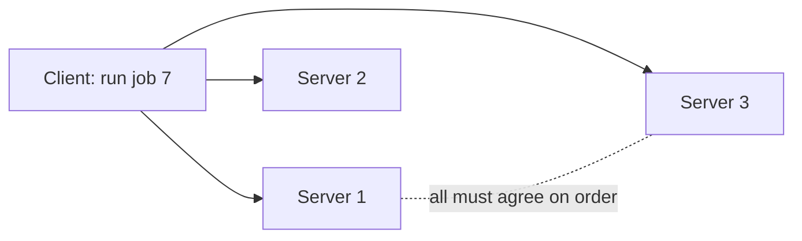

**Consensus** is the way a group of servers agrees on one answer, even when some crash.
The trick is a **majority**: a decision counts only when more than half the servers have saved it.
Any two majorities share at least one server, so nothing decided can be forgotten.
Raft does this with one **leader** who proposes, and followers who save and say "ok".

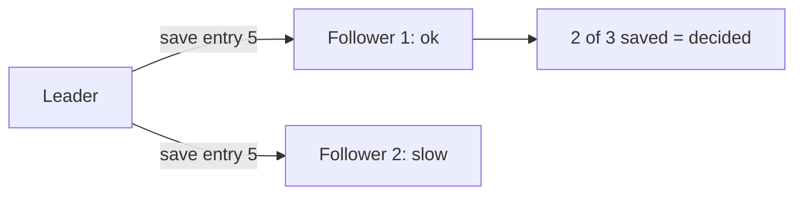

The rest of this note is just these 3 questions:
1. How is a leader picked?
2. How does the leader copy entries to the others?
3. Why does a decided entry never get lost, even after crashes?

**The problem in one story.**
Three friends keep the same shared shopping list on their own phones.
Phones go offline, messages arrive late, and one phone dies mid-update.
They still need one list, in one order, that nobody later "un-writes".
Consensus is the rule book that gets them there: nothing counts until most of the group has written it down.

**Words you need first**

| Word | Plain meaning | Tiny example |
| --- | --- | --- |
| Replica / node | One copy of the service on one machine | Server A of a 3-server etcd cluster |
| Majority (quorum) | More than half of the servers | 2 of 3, or 3 of 5 |
| Leader | The one server that accepts writes and orders them | Server A decides "job 7 comes after job 6" |
| Follower | A server that copies the leader's decisions | Servers B and C |
| Log | An ordered, append-only list of commands | `1: add job 6`, `2: add job 7` |
| Term | A numbered "era" with at most one leader | Term 4 began when A won an election |
| Committed | Stored on a majority, so it can never be lost | Entry 2 is on A and B: committed |
| Split brain | Two servers both believing they are the leader | Both accept writes; histories diverge |
| Candidate | A follower that is asking for votes to become leader | B says "vote for me in term 5" |
| Heartbeat | A tiny "I'm still alive" message from the leader | etcd sends one every 100 ms |
| Election timeout | How long a follower waits with no heartbeat before starting an election | a random 150–300 ms |
| RPC | A message asking another server to run a function and reply | `RequestVote`, `AppendEntries` |
| fsync | Forcing data from memory onto the disk before replying | save the vote to disk, then answer |
| State machine | The program the log is fed into, such as a key-value map | applying `SET x=5` makes x equal 5 |

**Picture it**

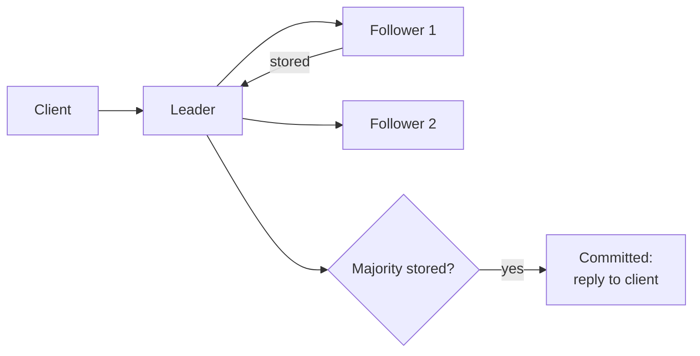

**Analogy.** A committee where a motion passes only when more than half of the members sign the minutes. Any two "more than half" groups share at least one member, so two contradicting motions cannot both pass.
Where it breaks: real committee members do not crash and forget mid-sentence; servers do, so Raft also needs disk writes, terms and election rules.

**How the rest of this note builds up**

- First, why agreement is hard and why primary-backup with a timeout causes split brain (section 1), then the quorum mental model (section 2).
- Then how Raft works: terms, leader election, log replication and the safety rule (section 3).
- Then a Go worked example and the cost of one write (section 4), and Paxos, Multi-Paxos and other variants (section 5).
- Finally the SDE-3 deep dive: production pitfalls in etcd and ZooKeeper, membership changes, leases and linearizable reads (sections 6-8).

> [!tip] Remember
> Nothing is decided until a majority has written it down, and any two majorities always share a server.

## 1. Why it exists 🟢

🟢 **Plain version:** Say you keep three copies of a job scheduler so one crash does not stop it. If a backup takes over just because the main copy went quiet, you can end up with two bosses giving different orders. If every write must reach all three copies, one dead copy freezes everything. Consensus is the middle path: a write counts once 2 of the 3 copies have saved it. You almost never write this yourself; ready-made tools such as etcd and ZooKeeper do it for you.

You run a job scheduler with three replicas so it survives a crash. Every replica must agree on "which jobs exist and who owns them". Without an agreement protocol you get one of two failures:

- **Primary-backup with a timeout.** The backup promotes itself when the primary stops answering for 5 seconds. A **network partition** (the network breaks so some servers cannot reach others, even though all are running) makes the primary *look* dead while it is still serving clients, so both accept writes. That is **split brain**: two histories that cannot be merged.
- **Write to all three.** Safe, but one slow or dead replica stops every write. Availability is worse than with one machine.

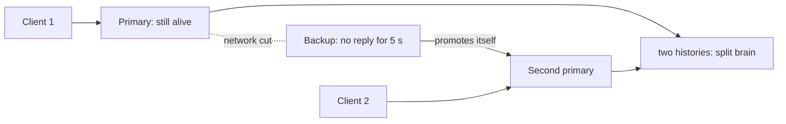

Consensus sits in between. With 3 servers it needs 2 acknowledgements per write, so one server can be down or partitioned away and the system still makes progress, and it can never produce two conflicting histories, because two groups of 2 out of 3 always share a server.

You rarely call a consensus algorithm directly. You rely on systems built on it: etcd (a small key-value store that holds all Kubernetes cluster state), ZooKeeper, Consul (both coordination services, used for config, locks and picking leaders), Kafka's KRaft controller quorum (the small group of Kafka servers that agree on cluster metadata), and databases such as CockroachDB and TiKV that run one Raft group per data range.

### Real-life example 🟢

Picture a food-delivery app like Swiggy running on Kubernetes.
Kubernetes keeps facts such as "run 10 copies of the order service" in etcd, which usually runs on 3 or 5 servers using Raft.
Say there are 3 etcd servers and one dies during the dinner rush: the other 2 are still a majority, so deploys and scaling keep working and nothing saved is lost.
If 2 of the 3 die, etcd refuses all writes, so nobody can deploy or scale.
The order-service copies already running keep serving orders, though, because they do not need etcd to handle a request.

## 2. Mental model 🟢

🟢 **Plain version:** Consensus makes three promises: everyone ends with the same answer, the answer is one that somebody really proposed, and they do finish in the end. Agree on one answer, then the next, and you get a shared numbered list of commands. Run the same list on every server and they all end up in the same state. Raft and Paxos assume servers may crash or lose messages, but never lie.

**The problem, formally.** Each server proposes a value; they must decide so that:

- **Agreement:** no two correct servers decide different values.
- **Validity:** the decided value was proposed by someone (no made-up values).
- **Termination:** every correct server eventually decides.

Agreeing on one value is enough: agree on "command #1", then "command #2", and so on, and you have a **replicated log**. Feed the same log to the same deterministic program (one that always gives the same output for the same input) on every server and you get identical copies, a **replicated state machine**. Leader election, configuration storage and locks are all built on this.

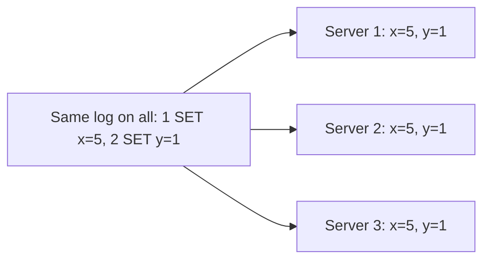

**Fault models.** Raft and Paxos tolerate **crash faults**: a server stops, or messages are delayed, lost or duplicated, but nobody lies. Tolerating **Byzantine** faults (servers that send wrong or malicious messages) needs `3f+1` servers for `f` faults and different protocols (PBFT, short for Practical Byzantine Fault Tolerance, and blockchain-style protocols). Inside one company's data centre, crash faults are the normal assumption.

**Analogy.** A committee keeps one minute book. A chair (the leader) writes proposals; a proposal counts only when a majority of members have copied it into their own books. A new chair can only be elected by a majority, and members only vote for a candidate whose book is at least as complete as theirs. So every passed motion survives any change of chair.

### Quorum arithmetic

**In plain words:** with n servers you need more than half to agree. 3 servers survive 1 crash, 5 survive 2.

| Servers `n` | Majority | Failures tolerated `f` | Note |
| --- | --- | --- | --- |
| 1 | 1 | 0 | no fault tolerance |
| 3 | 2 | 1 | the common minimum |
| 4 | 3 | 1 | same tolerance as 3, one more vote per write |
| 5 | 3 | 2 | the usual production size for control planes |
| 7 | 4 | 3 | rare; every write waits for the 4th-fastest ack |

`n = 2f + 1`. Even sizes add cost without adding tolerance, and a 2–2 network split leaves neither side with a majority.

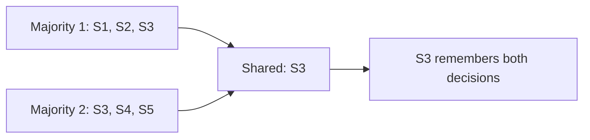

## Common beginner mistakes 🟢

- **Running 4 servers "for extra safety"** → a majority of 4 is 3, so it still survives only 1 failure, and a 2–2 split stops all writes → use 3 or 5.
- **Putting 3 servers in 2 zones (2 + 1)** → if the zone holding 2 goes down, 1 server is left, which is not a majority → spread them over 3 zones, one each.
- **Thinking more servers make writes faster** → every write waits for a majority, so with 7 servers you wait for the 4th-fastest → keep each group small, and split data into more groups to scale.
- **Keeping business data in etcd or ZooKeeper** → they are built for small coordination data (etcd's default limit is 2 GiB) → keep orders and users in a real database.
- **Assuming "we use Raft" means exactly-once** → a client that times out and retries can add the same command twice → add request IDs or idempotency keys.

## 3. How it works 🟡

> 🟢 → 🟡 **You now know** that a decision counts only when a majority has saved it, and that any two majorities share a server. **Next we open the box** and see how Raft actually does it: how a leader is picked, how it copies entries, and why a decided entry can never be lost. Each subsection starts with a plain step-by-step walk using three servers, S1, S2 and S3.

Raft (2014) splits consensus into three parts: leader election, log replication and safety.

### Roles and terms

**In plain words:** each server is a leader, a follower or a candidate. Time is split into numbered terms, and each term has at most one leader.

**Step by step:**
1. Servers S1, S2 and S3 all start as followers in term 1.
2. S1 hears no leader, so it becomes a candidate and moves to term 2.
3. S1 wins the votes and leads term 2. Every message it sends is stamped "term 2".
4. Later S1 is cut off, and S3 is elected leader in term 3.
5. S1 comes back and sends a "term 2" message. The others reject it; S1 sees "term 3" in the reply and steps down to follower.

Time is divided into **terms** numbered 1, 2, 3 and so on. Each term has at most one leader.

Every message carries the sender's term; a server that sees a higher term updates its own and becomes a follower, and a server that receives a message with a lower term rejects it.

Terms act as a **logical clock** (a counter that puts events in order without using wall-clock time) that exposes stale leaders.

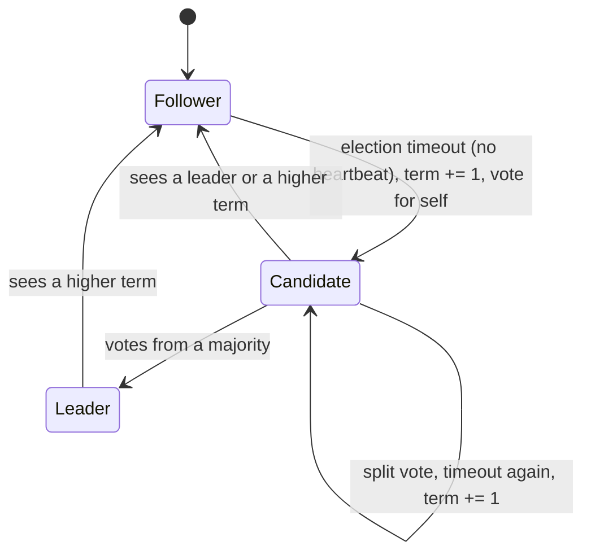

### Leader election

**In plain words:** if followers stop hearing from the leader, one of them waits a random time, then asks for votes. A majority makes it the new leader.

**Step by step:**
1. Leader S1 crashes. S2 and S3 stop getting heartbeats.
2. Each has a random wait: S2 has 180 ms, S3 has 260 ms.
3. S2's timer fires first. It moves to term 5, votes for itself, and asks S3 for a vote.
4. S3 has not voted in term 5, and S2's log is at least as complete as its own, so S3 saves "voted for S2" to disk and says yes.
5. S2 now has 2 of 3 votes. It becomes leader and sends heartbeats, which reset S3's timer before it fires.

The full detail:

1. Followers expect a heartbeat (an empty `AppendEntries`; `AppendEntries` is the leader's "add these entries to your log" message, and with no entries it doubles as a heartbeat) from the leader. Each follower picks a **randomized election timeout**, 150–300 ms in the paper's example. etcd's defaults are a 100 ms heartbeat and a 1000 ms election timeout.
2. A follower whose timeout fires becomes a **candidate**: it increments its term, votes for itself and sends `RequestVote(term, lastLogIndex, lastLogTerm)` (the "please vote for me" message, carrying where the candidate's log ends) to everyone.
3. Each server grants **at most one vote per term**, first come first served, and persists that vote to disk before replying.
4. **Election restriction:** a server refuses to vote for a candidate whose log is less up to date than its own. "More up to date" means a higher last term, or the same last term and a longer log.
5. A candidate with votes from a majority becomes leader and starts sending heartbeats. Randomized timeouts make it unlikely that two candidates split the vote repeatedly.

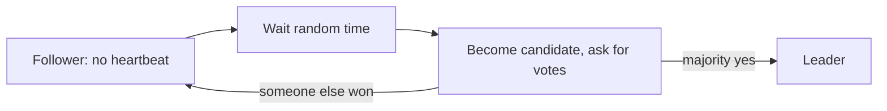

### Log replication

**In plain words:** the leader adds the command to its list, sends it to the followers, and calls it done once a majority saved it.

**Step by step:**
1. A client asks leader S1: `SET x=5`.
2. S1 adds it as entry 7 in its own log and saves it to disk.
3. S1 sends entry 7 to S2 and S3, with a note: "the entry before this is #6 from term 3". Each follower checks it has that same #6.
4. S2 matches, saves entry 7 and replies ok. S1 + S2 = 2 of 3, so entry 7 is committed.
5. S1 applies `x=5` and answers the client. Its next message tells S2 and S3 "committed up to 7", so they apply it too.

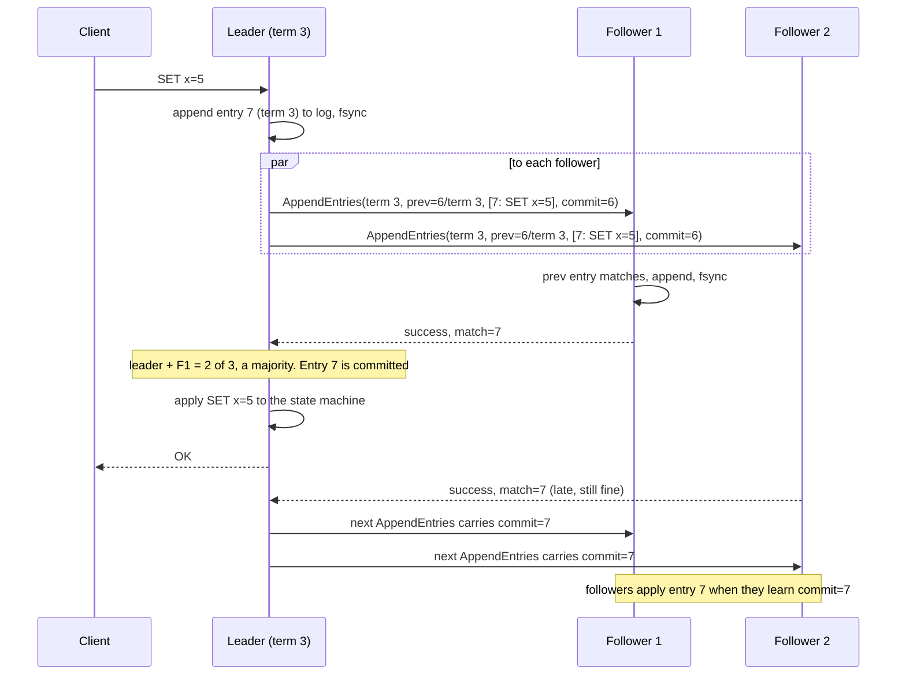

- **Consistency check.** Each `AppendEntries` names the index and term of the entry just before the new ones (`prevLogIndex`, `prevLogTerm`). A follower that does not hold exactly that entry rejects the call. The leader then retries one step further back (real implementations skip back a whole term at a time) until they match.
- **Follower repair.** At the match point, the follower deletes any conflicting entries after it and takes the leader's. Only uncommitted entries can ever be deleted this way.
- **Commit.** The leader marks an index committed once a majority stores it, and tells followers through `leaderCommit` on the next message. Each server applies committed entries in order.

### Safety: why committed entries survive

**In plain words:** a new leader needs a majority's votes, and that majority always includes someone with every decided entry.

**Step by step:**
1. Entry 7 is committed: it sits on S1 and S2 (2 of 3).
2. S1 crashes. S3, which never got entry 7, asks for votes.
3. S3 needs S2's vote to reach 2 of 3. S2 sees that S3's log lacks entry 7, so it refuses.
4. S3 cannot win. Only S2, which has entry 7, can become leader, so entry 7 survives.

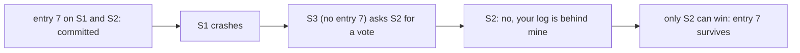

- **Leader completeness.** A committed entry is on a majority. A new leader needs votes from a majority. The two majorities overlap in at least one server, and that server refuses to vote for a candidate missing the entry (the election restriction). So every future leader already has every committed entry.
- **Only current-term entries are committed by counting.** A new leader must not declare an entry from an *earlier* term committed just because it now sits on a majority. Figure 8 of the Raft paper shows how such an entry can still be overwritten by another leader. The leader instead commits an entry from its own term; everything before it then commits too. That is why a new Raft leader appends a **no-op entry** (an empty "do nothing" command) at the start of its term.
- **Durability.** `currentTerm`, `votedFor` and the log must be fsynced before a server replies. A server that forgets its vote after a reboot could vote twice in one term.

## 4. Worked example 🟡

### Whiteboard version

**In plain words:** the two rules that keep Raft safe: only vote for a candidate whose list is at least as new as yours, and only accept entries that match your list.

The two rules that carry Raft's safety, as pseudo-code. In it, `matchIndex` means: for each server, the highest log position the leader knows that server has stored.

```text
// Follower: vote at most once per term, only for an up-to-date log.
if term < currentTerm { reject }
if term > currentTerm { currentTerm, votedFor = term, "" }
if votedFor != "" && votedFor != candidate { reject }
if !(cLastTerm > myLastTerm || (cLastTerm == myLastTerm && cLastIdx >= myLastIdx)) { reject }
votedFor = candidate // fsync before replying

// Leader: commit index N when a majority has it AND log[N].term == currentTerm.
N = median(matchIndex over all servers)
for N > commitIndex && log[N].term != currentTerm { N-- }
commitIndex = N
```

The full version below is the safety core of Raft (Figure 2 of the paper) as pure functions: voting, the `AppendEntries` consistency check with follower repair, and the leader's commit rule. Networking, timers and persistence are left out so every rule is testable on its own. It passes `go vet` and `go test -race` on Go 1.24.

```go
package raft

import "slices"

// Entry is one command in the replicated log. Index starts at 1.
type Entry struct {
	Term    uint64
	Command string
}

// Node holds the Raft state that matters for safety.
// currentTerm, votedFor and log must be on disk (fsynced) before replying.
type Node struct {
	CurrentTerm uint64
	VotedFor    string  // "" means no vote in CurrentTerm
	Log         []Entry // Log[0] is index 1
	CommitIndex int
}

func (n *Node) lastIndexTerm() (int, uint64) {
	if len(n.Log) == 0 {
		return 0, 0
	}
	return len(n.Log), n.Log[len(n.Log)-1].Term
}

// termAt returns the term of the entry at index i (1-based); index 0 has term 0.
func (n *Node) termAt(i int) uint64 {
	if i == 0 {
		return 0
	}
	return n.Log[i-1].Term
}

// RequestVote is the follower side of an election (Raft paper, Figure 2).
func (n *Node) RequestVote(term uint64, candidate string, lastIdx int, lastTerm uint64) (uint64, bool) {
	if term < n.CurrentTerm {
		return n.CurrentTerm, false // stale candidate
	}
	if term > n.CurrentTerm {
		n.CurrentTerm, n.VotedFor = term, "" // new term: forget the old vote
	}
	if n.VotedFor != "" && n.VotedFor != candidate {
		return n.CurrentTerm, false // one vote per term
	}
	// Election restriction: the candidate's log must be at least as up to date.
	myIdx, myTerm := n.lastIndexTerm()
	upToDate := lastTerm > myTerm || (lastTerm == myTerm && lastIdx >= myIdx)
	if !upToDate {
		return n.CurrentTerm, false
	}
	n.VotedFor = candidate
	return n.CurrentTerm, true
}

// AppendEntries is the follower side of replication.
// prevIdx/prevTerm identify the entry just before the new ones.
func (n *Node) AppendEntries(term uint64, prevIdx int, prevTerm uint64, entries []Entry, leaderCommit int) (uint64, bool) {
	if term < n.CurrentTerm {
		return n.CurrentTerm, false // message from a deposed leader
	}
	if term > n.CurrentTerm {
		n.CurrentTerm, n.VotedFor = term, ""
	}
	// Consistency check: we must already hold prevIdx with prevTerm.
	if prevIdx > len(n.Log) || n.termAt(prevIdx) != prevTerm {
		return n.CurrentTerm, false // leader retries with a smaller prevIdx
	}
	for i, e := range entries {
		idx := prevIdx + 1 + i
		if idx <= len(n.Log) {
			if n.Log[idx-1].Term == e.Term {
				continue // already have it (duplicate or reordered RPC)
			}
			n.Log = n.Log[:idx-1] // conflict: drop this entry and all after it
		}
		n.Log = append(n.Log, e)
	}
	if leaderCommit > n.CommitIndex {
		n.CommitIndex = min(leaderCommit, prevIdx+len(entries))
	}
	return n.CurrentTerm, true
}

// LeaderCommitIndex returns the highest index a leader may mark committed.
// matchIndex holds, for every server including the leader, the highest index
// known to be stored there. Only an entry from the leader's current term is
// committed by counting replicas (Raft paper, section 5.4.2).
func LeaderCommitIndex(log []Entry, currentTerm uint64, matchIndex []int, oldCommit int) int {
	sorted := slices.Clone(matchIndex)
	slices.Sort(sorted)
	// With n servers, the value at position (n-1)/2 of the ascending sort is
	// stored on at least a majority (n/2+1) of them.
	majority := sorted[(len(sorted)-1)/2]
	for idx := majority; idx > oldCommit; idx-- {
		if log[idx-1].Term == currentTerm {
			return idx
		}
	}
	return oldCommit
}
```

The tests replay the classic scenarios: one vote per term, the election restriction, a follower with stale entries from a deposed leader being repaired, a delayed duplicate RPC that must not truncate the log, and the Figure 8 rule.

```go
package raft

import (
	"slices"
	"testing"
)

func TestOneVotePerTerm(t *testing.T) {
	n := &Node{CurrentTerm: 4}
	if _, ok := n.RequestVote(5, "B", 0, 0); !ok {
		t.Fatal("first candidate in term 5 should get the vote")
	}
	if _, ok := n.RequestVote(5, "C", 0, 0); ok {
		t.Fatal("second candidate in the same term must be refused")
	}
	if _, ok := n.RequestVote(5, "B", 0, 0); !ok {
		t.Fatal("a retried request from the same candidate is granted again")
	}
	if _, ok := n.RequestVote(3, "D", 9, 9); ok {
		t.Fatal("stale term must be refused")
	}
}

func TestElectionRestriction(t *testing.T) {
	// Voter has entries up to index 3 from term 2.
	n := &Node{CurrentTerm: 2, Log: []Entry{{1, "x"}, {1, "y"}, {2, "z"}}}
	if _, ok := n.RequestVote(3, "B", 5, 1); ok {
		t.Fatal("longer log with an older last term is less up to date")
	}
	if _, ok := n.RequestVote(4, "C", 2, 2); ok {
		t.Fatal("same last term but shorter log is less up to date")
	}
	if _, ok := n.RequestVote(5, "D", 1, 3); !ok {
		t.Fatal("newer last term wins even with a shorter log")
	}
}

func TestAppendEntriesRepairsDivergentFollower(t *testing.T) {
	// Follower kept two uncommitted entries from an old term-2 leader.
	f := &Node{CurrentTerm: 2, Log: []Entry{{1, "a"}, {2, "b"}, {2, "c"}}}
	// New leader (term 3) has a, then its own entries at 2 and 3.
	leader := []Entry{{1, "a"}, {3, "B"}, {3, "C"}}

	// Leader first tries prevIdx=2: follower's index 2 has term 2, not 3.
	if _, ok := f.AppendEntries(3, 2, 3, leader[2:], 0); ok {
		t.Fatal("consistency check should fail at index 2")
	}
	// Leader backs up to prevIdx=1, which matches.
	if _, ok := f.AppendEntries(3, 1, 1, leader[1:], 2); !ok {
		t.Fatal("consistency check should pass at index 1")
	}
	if !slices.Equal(f.Log, leader) {
		t.Fatalf("follower log = %v, want %v", f.Log, leader)
	}
	if f.CommitIndex != 2 {
		t.Fatalf("commit index = %d, want 2", f.CommitIndex)
	}
}

func TestDuplicateAppendDoesNotTruncate(t *testing.T) {
	f := &Node{CurrentTerm: 3, Log: []Entry{{1, "a"}, {3, "B"}, {3, "C"}}}
	// A delayed copy of an older RPC carrying only index 2.
	if _, ok := f.AppendEntries(3, 1, 1, []Entry{{3, "B"}}, 0); !ok {
		t.Fatal("duplicate should be accepted")
	}
	if len(f.Log) != 3 {
		t.Fatalf("log length = %d, want 3 (index 3 must survive)", len(f.Log))
	}
}

func TestLeaderCommitsByMajority(t *testing.T) {
	log := []Entry{{1, "a"}, {2, "b"}, {2, "c"}}
	// 5 servers; leader is at 3, two followers at 3, two lagging.
	if got := LeaderCommitIndex(log, 2, []int{3, 3, 3, 1, 0}, 0); got != 3 {
		t.Fatalf("commit = %d, want 3", got)
	}
	// Only two of five have index 3: majority is at index 1.
	if got := LeaderCommitIndex(log, 2, []int{3, 3, 1, 1, 0}, 0); got != 0 {
		t.Fatalf("commit = %d, want 0 (index 1 is from term 1, not current)", got)
	}
}

func TestOldTermEntryNotCommittedByCounting(t *testing.T) {
	// Leader in term 4 holds an entry from term 2 at index 2, now on 3 of 5.
	log := []Entry{{1, "a"}, {2, "b"}}
	if got := LeaderCommitIndex(log, 4, []int{2, 2, 2, 1, 1}, 1); got != 1 {
		t.Fatalf("commit = %d, want 1: a term-2 entry must not be committed by counting", got)
	}
	// Once a term-4 entry at index 3 reaches a majority, index 2 commits with it.
	log = append(log, Entry{4, "noop"})
	if got := LeaderCommitIndex(log, 4, []int{3, 3, 3, 1, 1}, 1); got != 3 {
		t.Fatalf("commit = %d, want 3", got)
	}
}
```

**Tracing the repair test.** The follower holds `[a(1), b(2), c(2)]` from an old term-2 leader that crashed before committing `b` and `c`. The term-3 leader holds `[a(1), B(3), C(3)]`.

| Step | Leader sends | Follower check | Follower log after |
| --- | --- | --- | --- |
| 1 | prev = index 2, term 3; entries `[C]` | its index 2 has term 2, mismatch, reject | `[a, b, c]` |
| 2 | prev = index 1, term 1; entries `[B, C]`, commit 2 | index 1 term 1 matches; index 2 conflicts, truncate | `[a, B, C]`, commit 2 |

### Cost of one write

**In plain words:** one write costs a disk save on the leader plus one network round trip to the fastest majority.

A committed write needs: the leader's fsync, one network round trip to the followers, the fastest majority's fsyncs, then the reply. Estimates, not measurements:

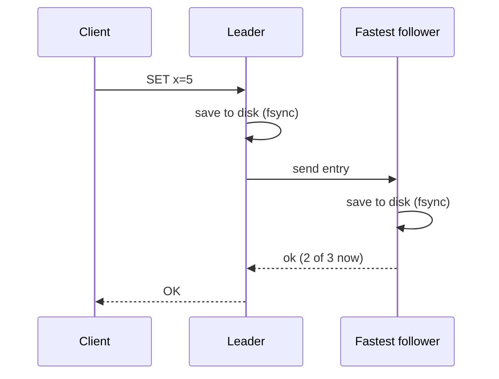

- One data centre (0.2–0.5 ms RTT, round-trip time: how long a message takes to go and come back; fsync from well under 1 ms on SSDs with power-loss protection to several ms on cheaper disks): about 2–5 ms per write, much higher throughput with batching and pipelining (sending many entries in one message, and not waiting for one reply before sending the next).
- Three regions with 70 ms between them: at least one cross-region RTT, so roughly 70–100 ms per write. Place replicas, or the leader, close to where the writes come from.

## 5. Variants and comparison 🟡

| Protocol | How it works | Used in | Notes |
| --- | --- | --- | --- |
| Basic Paxos | Two phases per value. Phase 1: a proposer (the server suggesting a value) sends `Prepare(n)`, acceptors (the servers that vote on it) promise to ignore lower numbers and report any value already accepted. Phase 2: `Accept(n, v)` where `v` must be the highest-numbered accepted value reported, if any; chosen once a majority accepts | Building block, rarely run alone | Decides one value; two RTTs; competing proposers can livelock (keep cancelling each other, so nothing is decided although nobody is stuck) |
| Multi-Paxos | A stable leader runs Phase 1 once for all future slots, then only Phase 2 per command | Google Chubby (a lock service), Spanner (Google's global database; one Paxos group per split, a chunk of the key range), DynamoDB (Multi-Paxos per partition, leader-based) | Same steady-state cost as Raft; the paper leaves many details to the implementer |
| Raft | Strong leader, terms, log must be contiguous, election restriction | etcd, Consul, Kafka KRaft, CockroachDB, TiKV, YugabyteDB, MongoDB's replica-set protocol is Raft-like | Designed for understandability; the leader is a throughput bottleneck per group |
| ZAB | ZooKeeper Atomic Broadcast: leader with epochs (ZAB's name for terms), a discovery and sync phase on election, then ordered broadcast | ZooKeeper | Primary-order guarantees; similar shape to Raft |
| Viewstamped Replication | Primary with view numbers (again, the same idea as terms) and view changes (1988, revised 2012) | Research, some storage systems | Predates Paxos publication; very similar to Raft |
| PBFT and BFT protocols | Three-phase protocol, `3f+1` replicas, signed messages | Permissioned blockchains | Handles lying nodes; much more messaging |

> [!warning] Interview trap
> DynamoDB is **not** a Dynamo-style leaderless store. Each partition has a leader chosen through Multi-Paxos, and strongly consistent reads go to that leader. Leaderless quorum stores (Cassandra, Riak) are covered in [[Quorums and Leaderless Replication]].

### Raft versus things people confuse it with 🟡

| Approach | What it does | Needs | If a key server dies |
| --- | --- | --- | --- |
| Raft / Paxos | Copies agree on one ordered log | A majority (2 of 3) | A new leader is elected; writes pause briefly |
| Primary-backup with a timeout | Backup takes over when the primary goes quiet | Only the backup's own guess | Risk of split brain: two primaries |
| Two-phase commit | Several databases all commit one transaction, or none do | Every participant says yes | If the coordinator dies, participants wait, stuck |
| Leaderless quorum (Cassandra) | Write to W copies, read from R copies, no leader | `W + R > N` so reads and writes overlap | No election needed, but no agreed order of writes |

## 6. Trade-offs and when not to use 🟡

- **Latency:** every write waits for a majority's fsync. Throughput is bounded by one leader per group; scale out by splitting data into many groups (multi-Raft).
- **Availability under partition:** the minority side cannot write, and cannot serve linearizable reads (reads guaranteed to see every write that finished before they started). That is the CP choice (stay Consistent, give up Availability, during a Partition) in [[CAP and PACELC]].
- **Small data only (for coordination stores):** etcd's default storage quota is 2 GiB (8 GiB suggested maximum). Store configuration, leases and metadata there, not business data.
- **Do not build your own.** Raft has many subtle corners (Figure 8, membership changes, snapshots, disk corruption). Use etcd, ZooKeeper or Consul, or `go.etcd.io/raft` / `hashicorp/raft` if you truly need an embedded log.
- **You may not need it:** a single primary database with synchronous replication and a managed failover (see [[High Availability and Failover]]) is enough for most services. Use consensus directly only for coordination (leaders, locks, config) or when you are building a storage system.

## 7. In production 🔴

> 🟡 → 🔴 **You now know** how Raft picks a leader, copies entries and keeps committed entries safe, and how it compares with Paxos. **Next is the advanced part**: what goes wrong when real etcd or ZooKeeper clusters run for months, how reads stay correct without a full write, how servers join or leave safely, and the theory interviewers like to probe (FLP).

- **Real systems:**
	- **etcd** stores all Kubernetes objects; in a standard cluster only the API server talks to it.
	- **ZooKeeper** coordinated HBase, older Kafka and many Hadoop services. Kafka replaced it with **KRaft**, its own Raft-based controller quorum (KIP-500); Kafka 4.0 runs only in KRaft mode.
	- **Consul** uses Raft among its servers and gossip for membership (see [[Failure Detection, Gossip and Membership]]).
	- **CockroachDB, TiKV, YugabyteDB** run one Raft group per range or tablet (a slice of the key space), thousands per node (see [[Distributed SQL]]).
- **Failure modes → fixes:**
	- Slow disk on the leader → heartbeats are late, followers start elections, leadership flaps (keeps switching back and forth). Use dedicated SSDs and monitor fsync latency (etcd's docs recommend a WAL, its on-disk log file, fsync p99 under 10 ms; p99 means 99 out of 100 calls are faster than this).
	- A partitioned node keeps incrementing its term, then rejoins and forces the healthy leader to step down → **PreVote**: a node first asks whether it *could* win before bumping its term.
	- A leader cut off from the majority keeps believing it leads → **CheckQuorum**: the leader steps down if it has not heard from a majority within an election timeout.
	- Log grows forever → **snapshots**: the state machine is saved and the log prefix discarded; a far-behind follower receives `InstallSnapshot`.
	- Cluster loses its majority for good (2 of 3 disks lost) → no automatic recovery is safe. Restore from a snapshot with a forced new cluster, accepting possible loss of the last writes.
- **What to monitor:** leader changes per hour, proposals committed vs failed, WAL fsync and backend commit latency (p99), follower lag in entries, peer round-trip time, database size against the quota.

## 8. Deep dive 🔴

- **FLP impossibility (1985).** In a fully asynchronous system, no deterministic algorithm can guarantee consensus terminates if even one process may crash, because a slow process cannot be told apart from a dead one. Raft and Paxos never violate safety (nothing wrong is ever decided); they give up guaranteed *liveness* (the promise that a decision is always eventually reached). Timeouts and randomization let them make progress whenever the network behaves for long enough (partial synchrony).
- **Linearizable reads.** A leader cannot just read its local state: it may have been deposed without knowing.
	- *Log read:* append the read as an entry. Correct but costs a full write.
	- *ReadIndex:* record the current commit index, confirm leadership with one heartbeat round to a majority, wait until that index is applied, then read. etcd uses this by default.
	- *Lease read:* skip the heartbeat round while within a leader lease (a time window in which the leader assumes no other leader can be elected) shorter than the election timeout. Faster, but correct only if clock drift (two machines' clocks slowly disagreeing) is bounded (see [[Clocks and Ordering]]).
	- *Follower read:* the follower asks the leader for the read index, waits to apply it, and serves locally.
- **Membership changes.** Switching straight from configuration C-old to C-new can create two disjoint majorities during the switch. Raft's paper uses **joint consensus** (decisions need majorities of both old and new configurations during the transition). The thesis simplifies this to **one server at a time**, where any two majorities still overlap. etcd adds new members as non-voting **learners** first so they catch up before they count toward the quorum.
- **Paxos in one paragraph.** Proposal numbers play the role of terms. Phase 1 (`Prepare`/`Promise`) makes the proposer learn any value that might already be chosen; Phase 2 (`Accept`/`Accepted`) asks a majority to accept it. The rule "propose the highest-numbered value already accepted" is what makes a chosen value stick, the same job Raft's election restriction does. Multi-Paxos skips Phase 1 while the leader is stable, and Raft is effectively a fully specified Multi-Paxos with a contiguous log.
- **Why followers need the term check on every message.** A leader paused by a long GC pause (the runtime stops the program to free memory) can wake up and send `AppendEntries` with an old term. Followers reject it, and the reply carries the new term, so the old leader steps down. This is the same idea as the fencing token in [[Distributed Locks and Fencing Tokens]].

## 9. Interview questions 🔴

> [!question]- Why 3 or 5 nodes and not 4?
> A majority of 4 is 3, so 4 nodes still tolerate only one failure, while every write needs one more ack. An even size can also split 2–2 and leave no majority. Use `2f+1`: 3 nodes for one failure, 5 for two.

> [!question]- How does Raft prevent two leaders?
> At most one leader per term: each server votes once per term and persists the vote, and winning needs a majority. Two leaders can exist briefly in *different* terms, but the old one's messages carry a stale term and are rejected, and it steps down on seeing the higher term.

> [!question]- A new leader finds an entry from an older term stored on a majority. Can it mark it committed?
> Not by counting replicas (Figure 8 of the paper). It must first replicate an entry from its own term (usually a no-op) to a majority; committing that commits everything before it. Otherwise a later leader could still overwrite the old entry.

> [!question]- Does FLP mean consensus is impossible in practice?
> No. FLP says no deterministic algorithm can *guarantee termination* in a fully asynchronous system with one crash. Raft and Paxos stay safe always and make progress when timing behaves, using timeouts and randomized elections.

> [!question]- How do you serve a linearizable read without writing to the log?
> ReadIndex: note the commit index, confirm leadership with a heartbeat round to a majority, wait until applied, then read locally. A lease read skips the round trip but relies on bounded clock drift.

> [!question]- Trap: "We use Raft, so our service is exactly-once."
> Raft gives an ordered, durable log, not deduplication. A client that times out and retries can append the same command twice. You still need client IDs with sequence numbers or idempotency keys (see [[Delivery Semantics and Exactly-Once]]).

> [!question]- Raft vs Paxos?
> Equivalent fault tolerance and steady-state cost. Raft specifies the whole system (strong leader, contiguous log, election restriction, membership changes); Multi-Paxos leaves much of that open. Most new systems pick Raft for clarity; Chubby, Spanner and DynamoDB use Multi-Paxos.

## 10. Cheat sheet 🟢

🟢 **Plain version:** Use 3 or 5 servers, never an even number. There is one leader at a time; it copies each command to the others, and a command is final once most servers have saved it. If the leader goes quiet, a follower waits a random time and asks for votes. Each write costs a disk save plus one trip across the network. Use a ready-made tool such as etcd; do not build your own.

- `n = 2f + 1`; majority of 3 is 2, of 5 is 3. Never 4.
- Raft: terms, one vote per term, randomized timeouts (150–300 ms in the paper; etcd 100 ms heartbeat, 1 s election).
- Election restriction: vote only for a log at least as up to date (last term, then length).
- Commit = stored on a majority **and** from the current term; new leader writes a no-op.
- Each write = leader fsync + 1 RTT + majority fsync.
- Linearizable reads: log read, ReadIndex, or lease read (needs bounded clock drift).
- FLP: safety always, liveness only when timing behaves.
- Use etcd, ZooKeeper or Consul; do not write your own.

## Self-check 🟢🟡

🟢 Easy

> [!question]- With 5 servers, how many can crash while the cluster still accepts writes?
> 2. The 3 that remain are still a majority.

> [!question]- When does Raft call an entry committed?
> When a majority of servers have saved it (and it is from the leader's current term, or comes before such an entry).

> [!question]- What does a follower do when heartbeats stop?
> It waits out its random election timeout, becomes a candidate, moves to the next term and asks everyone for votes.

🟡 Medium

> [!question]- Why can a server that is missing a committed entry never become leader?
> It needs votes from a majority, that majority overlaps the majority holding the entry, and those servers refuse to vote for a log that is behind theirs.

> [!question]- Why does a new leader write a no-op entry first?
> It may only commit entries from its own term by counting copies; once the no-op is on a majority, every older entry before it commits too.

> [!question]- Three servers sit in three regions 70 ms apart. Roughly how long does one write take, and why?
> About 70–100 ms: the leader needs at least one round trip to another region to reach a majority, plus disk saves.

## Links

- **Before this:** [[Distributed Systems Fundamentals]], [[Replication]], [[CAP and PACELC]]
- **Next:** [[Leader Election]], [[Distributed Locks and Fencing Tokens]], [[Two-Phase Commit]]
- **Compare with:** [[Quorums and Leaderless Replication]] (overlapping quorums without a leader or agreement), [[Distributed SQL]] (Raft per range in practice)
- **Code to read:** `go.etcd.io/raft` (etcd's Raft library), `github.com/hashicorp/raft`, and the Raft visualization at raft.github.io

### Watch on YouTube

- [Distributed Consensus - Raft Leader Election / Systems Design Interview 0 to 1 with Ex-Google SWE](https://www.youtube.com/watch?v=Al2JNJBGG30) · Jordan has no life · 8 min · 26,516 views
- [Consensus Algorithms Explained: Raft, Paxos & PBFT for Beginners](https://www.youtube.com/watch?v=-5ESi61Z7is) · CodeLucky · 4 min · 2,150 views
