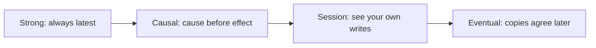
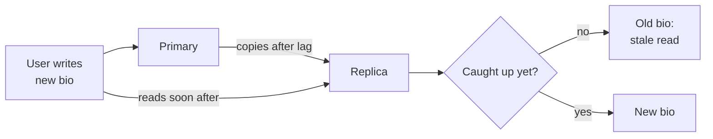
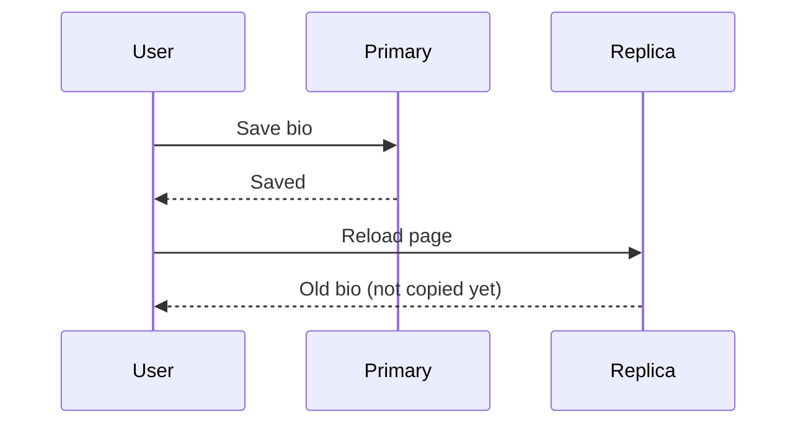
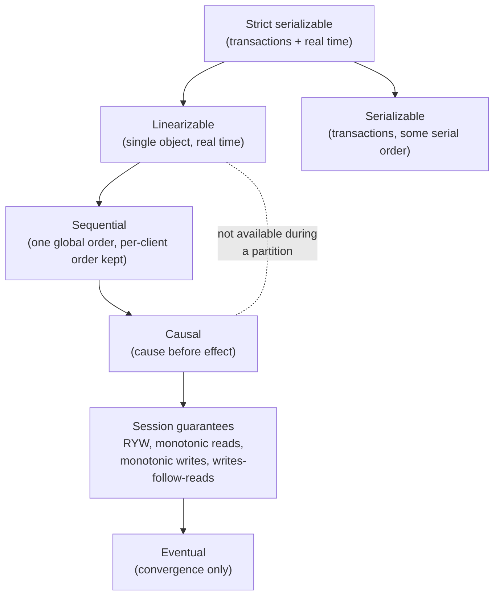
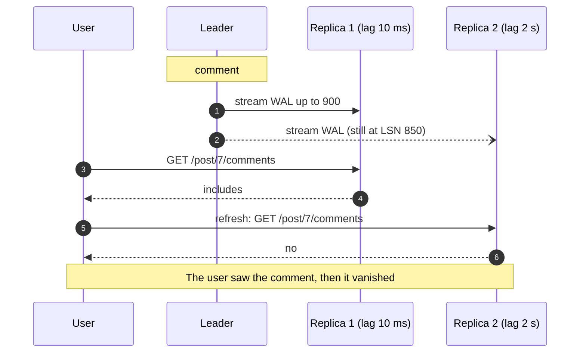
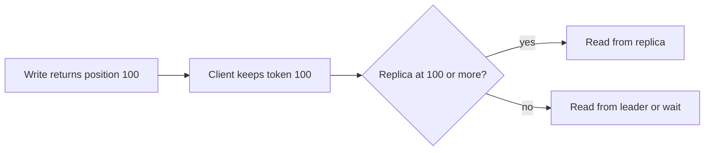

# Consistency Models

> [!summary] TL;DR
> A consistency model is the promise a replicated system makes about **which value a read may return**. Strong models (linearizable) behave like one copy; weak models (eventual) only promise that copies agree *eventually*. In between sit causal consistency and per-user **session guarantees** such as "you always see your own writes".

> [!abstract] Core idea
> - Each model is a list of allowed and forbidden anomalies, such as "read an older value after a newer one".
> - Linearizable = one copy in real time; causal = cause before effect; eventual = copies converge if writes stop.
> - Session guarantees (read-your-writes, monotonic reads, monotonic writes, writes-follow-reads) fix what users notice, cheaply.
> - Stronger models cost latency and availability (see [[CAP and PACELC]]), so choose per feature.
> - Classic mistake: confusing linearizable (one object, real-time) with serializable (multi-object transactions, any order).

## Start here: the basics 🟢

> [!info] How to read this note (pick your level)
> - 🟢 **New to this?** Read "From zero" below, then sections 1, 2 and the cheat sheet (10). Stop there, that is a full first pass.
> - 🟡 **Know the basics?** Add section 3 (how it works), 4 (worked example), 5 (variants) and 6 (trade-offs).
> - 🔴 **Interview / SDE-3 prep?** Add 7, 8 and 9. Headings are tagged 🟢🟡🔴 so you always know where you are.

> [!note] Before this note
> - [[CAP and PACELC]]: during a network break a copy must choose between refusing and answering with maybe-old data; even on good days, being always correct is slower.
> - [[Replication]]: one main copy (the primary or leader) takes writes and copies them to followers a little later.
> - [[Isolation Levels and MVCC]]: inside one database, transactions can see each other's changes in stronger or weaker ways.

**From zero, in 60 seconds** 🟢

Big apps keep copies of the same data on several machines.
One copy gets a change first. The others catch up a moment later.
So if you read from a copy that is behind, you see old data.


A **consistency model** is the promise a system makes about what a read may return.
The strongest promise acts like there is only one copy: you always see the latest.
The weakest promise only says copies agree **eventually**.
In between are friendly promises, like "you always see your own changes".



The rest of this note is just these 3 questions:
1. What does each model promise, and what does it allow?
2. How does lag between copies cause strange reads?
3. How do you fix it cheaply, for example with a "read your own writes" token?

**The problem in one story.**
You change your profile photo and press save.
The page reloads and shows your old photo.
You save again, and a friend on another phone still sees the old one.
A consistency model is the written promise about which version each reader is allowed to see.

**Words you need first**

| Word | Plain meaning | Tiny example |
| --- | --- | --- |
| Replica | Another copy of the same data on another machine | A read replica of the main database |
| Primary | The copy that accepts writes first | The Postgres primary |
| Replication lag | How far a replica is behind the primary | Replica is 400 ms behind |
| Stale read | Reading an older value after a newer one was written | Old bio after saving a new one |
| Anomaly | A result a weaker model allows but users find wrong | Seeing a reply before the question |
| Session | One user's sequence of requests | All requests from one logged-in browser |
| Linearizable | Behaves like one single copy in real time | Once a write returns, every read sees it |
| Eventual | Copies agree once writes stop | DNS changes spreading over minutes |
| LSN | Log sequence number: a write's position in the database's change log | Write landed at LSN 900; replica has applied up to 850 |
| Serializable | Transactions act as if run one at a time, in some order | Two bookings never both take the last seat |
| Causal | If one thing caused another, everyone sees the cause first | The question always shows before the reply |

**Picture it**



**Analogy.** A shared notice board with copies in several buildings, updated by a courier. A strong model says "every copy changes the instant the main board does"; an eventual model says "the courier will get there".
Where it breaks: a courier visits buildings in order, but replicas can apply writes in different orders unless the model forbids it.

**How the rest of this note builds up**

- First, why a system must state what reads may return (section 1), and the mental model of allowed and forbidden anomalies (section 2).
- Then the hierarchy of models, single-object models, session guarantees and how replication lag causes each anomaly (section 3).
- Then a Go example with LSN tokens over lagging replicas (section 4), and linearizable vs serializable plus defaults in real systems (section 5).
- Finally the SDE-3 deep dive: choosing per feature, production cases and the costs behind each guarantee (sections 6-8).

> [!tip] Remember
> A consistency model is a contract about stale reads; pick the weakest one each feature can tolerate.

## 1. Why it exists 🟢

A user edits their profile bio. The write goes to the primary database, and the page reloads from a read replica that is 400 ms behind. The old bio comes back, the user thinks the save failed, and edits again.

Nothing is "broken": the replica will catch up. But the system never said what a read may return, so the application cannot tell whether this is a bug. A consistency model is that contract. Here the violated promise is **read-your-writes**, and it can be fixed without making every read go to the primary.



### Real-life example 🟢

You post a photo on Instagram and your friend likes it. For a few seconds, you might see "1 like" on your phone while your friend's phone already shows "2 likes". Nobody minds: the like count only needs eventual consistency.
But if you post a comment and it vanishes when you refresh, you would think the app is broken. That comment needs "read your own writes".
And in WhatsApp, a reply must never appear before the message it answers. That needs causal consistency.
One app, three features, three different promises.

## 2. Mental model 🟢

🟢 **Plain version:** Imagine every read and write from every user on one long timeline. A strong model says each reader sees that timeline as it really happened. Weaker models let readers see it a little late or a little shuffled. The weakest only promises that, once writes stop, everyone ends up seeing the same thing.

Think of all operations from all clients laid out on one timeline. A consistency model says how much the system may **reorder or delay** what each reader sees.

- **Linearizable**: there is one copy, and every operation happens at an instant between its start and its end.
- **Sequential**: everyone sees the same single order, and it respects each client's own order, but it may lag real time.
- **Causal**: if A could have influenced B (B read A, or the same client did A then B), everyone sees A before B. Unrelated writes may appear in different orders on different nodes.
- **Eventual**: no ordering promise at all, only that copies converge once writes stop.

**Analogy.** A group chat. Linearizable: everyone sees each message the moment it is sent. Causal: you never see a reply before the message it replies to. Eventual: messages may arrive in any order, but after a while everyone's history is the same.

## Common beginner mistakes 🟢

- **Treating linearizable and serializable as the same** → linearizable is about one value in real time; serializable is about whole transactions in some order → name the one you need.
- **Making every read strong "to be safe"** → every read then pays a trip to the leader, and fails during partitions → pick the weakest model each feature can live with.
- **Sending a user's next read to any random replica** → they can see new data, then old data on refresh → keep the user on one replica, or use a version token.
- **Assuming a quorum store is automatically linearizable** → concurrent writes and clock skew still allow odd reads → read its docs and its Jepsen report.
- **Forgetting the cache** → a cache in front of a strong database can serve old values → invalidate on write and put the version in the cache key.

## 3. How it works 🟡

> 🟢 → 🟡 **You now know** that a consistency model is a promise about which value a read may return, from "always the latest" down to "eventually the same". **Next we open the box**: how the models rank against each other, what each forbids, the four per-user session promises, how replica lag causes odd reads, and how to fix them cheaply. Each subsection starts with a short walk-through.

### The hierarchy

**In plain words:** stronger promises sit at the top. If a system gives you a strong one, you also get every weaker one below it.

**Step by step:**
1. Start at the bottom: eventual. Copies agree some time after writes stop.
2. Add per-user promises (session guarantees): you see your own writes, and your view never goes back in time.
3. Add causal: everyone, not just you, sees causes before effects.
4. Add sequential and then linearizable: everyone sees one order, and finally that order matches real time.
5. At the top, strict serializable applies the real-time rule to whole transactions. Each step up costs more waiting.

An arrow points from a stronger model to a weaker one. A system that gives a model also gives every model reachable below it.



Linearizable, sequential and serializable cannot stay available on the minority side of a partition. Causal consistency is the strongest model that can (Mahajan, Alvisi and Dahlin, 2011).

### Single-object models

**In plain words:** how fresh one value must look: always the latest, or the same order for everyone, or just eventually right.

**Step by step:**
1. Asha sets `price = 100`, and the write returns "ok" at 10:00:00.
2. Linearizable: Ravi reads at 10:00:01 and must see 100.
3. Sequential: Ravi may still see the old 90 for a moment, but everyone sees 90 then 100, never the other way round.
4. Causal: if Ravi replies "nice price!" after seeing 100, nobody sees his reply next to the old 90.
5. Eventual: Ravi may see 90, then 100, then 90 again for a while, but in the end all copies say 100.

| Model | Promise | Allowed | Forbidden |
| --- | --- | --- | --- |
| Linearizable | Behaves like one copy; once a write completes, every later read (in real time) sees it | nothing beyond concurrent ops in some order | stale read after a completed write |
| Sequential | One global order consistent with each client's program order | reader lags behind real time | two readers disagree on the order of two writes |
| Causal | Causally related ops seen in the same order everywhere | concurrent writes seen in different orders | reply visible before the message it answers |
| Eventual | If writes stop, all replicas converge | almost anything in the meantime | replicas staying different forever |

### Session guarantees

**In plain words:** four small promises scoped to one user, like "you see your own writes" and "time never goes backwards for you".

**Step by step:**
1. Priya saves a new bio. Read-your-writes: her next reload shows the new bio.
2. Priya sees comment #42. Monotonic reads: a refresh never hides #42 again.
3. Priya sets price 120, then price 100. Monotonic writes: every copy ends at 100, never at 120.
4. Priya reads a post and replies. Writes-follow-reads: no copy shows her reply without the post.
5. None of this needs other users' copies to agree: each promise is only about Priya's own session.

These four come from the Bayou project (a 1994 research system for phones and laptops that sync now and then; Terry et al.). Each is scoped to **one client session**, which is why they are cheap: no global coordination is needed.

| Guarantee | Promise to one client | Anomaly it prevents |
| --- | --- | --- |
| Read-your-writes | after you write, your reads see that write or newer | the profile-bio problem above |
| Monotonic reads | once you have seen a value, you never see an older one | a comment appears, then disappears on refresh |
| Monotonic writes | your writes are applied in the order you made them | "set price 120" lands before "set price 100" |
| Writes-follow-reads | a write you make after reading X is ordered after X everywhere | your reply is visible on a replica that does not have the post you replied to |

Causal consistency includes all four.

### How replication lag produces the anomalies

**In plain words:** each copy is a little behind. Read from different copies and you can see new data, then old data again.

**Step by step:**
1. Comment #42 is saved on the leader at log position 900.
2. Replica 1 is 10 ms behind and quickly reaches 900. Replica 2 is 2 s behind, still at 850.
3. The user's first read goes to Replica 1 and shows #42.
4. The load balancer sends the refresh to Replica 2, which does not have #42 yet.
5. The comment "disappears". That is a monotonic-reads violation, caused purely by lag.

With a leader and asynchronous followers (see [[Replication]]), each follower is a slightly old copy, and each one is old by a different amount. The leader streams its **WAL** (write-ahead log: the ordered list of every change) to the followers. A load balancer that sends consecutive reads to different followers turns that lag into time travel:



### Implementing session guarantees

**In plain words:** remember how far your last write got, and only read from a copy that has caught up at least that far.

**Step by step:**
1. Priya saves her bio. The leader replies "saved at position 100".
2. Her app keeps the token 100 (in a cookie or header).
3. On the next read, the router checks the replicas: Replica 1 is at 120, Replica 2 at 95.
4. It sends the read to Replica 1, because 120 ≥ 100. If none had reached 100, it would ask the leader.
5. After the read, the token becomes 120, so Priya's view never moves backwards.

- **Read from the leader** for a short window after the user writes (for example 5 s). Simple, but it moves load to the leader.
- **Sticky routing**: send each user to the same replica (picked by a hash, a fixed number computed from the user id). This gives monotonic reads while that replica stays up, but not read-your-writes if the write went to the leader and the replica lags.
- **Version tokens (LSN tokens)**: after each write or read, the client keeps the highest log position it has seen. A read goes only to a replica that has applied at least that position, otherwise to the leader. In PostgreSQL 17 the primary reports `pg_current_wal_lsn()` and a **standby** (a replica) reports `pg_last_wal_replay_lsn()`. MongoDB causally consistent sessions do the same with `operationTime` and `afterClusterTime`.
- **Synchronous apply**: PostgreSQL `synchronous_commit = remote_apply` makes a commit wait until the synchronous standbys have applied it, so reads on those standbys see it. This costs a round trip on every commit.



## 4. Worked example 🟡

### Whiteboard version

**In plain words:** the write returns a position number; the next read waits for, or picks, a copy that has reached that number.

The LSN-token rule fits on a whiteboard:

```text
client keeps: minLSN = 0

write(k, v):
    lsn = leader.apply(k, v)        # leader returns the log position
    minLSN = max(minLSN, lsn)

read(k):
    for r in replicas:
        if r.appliedLSN >= minLSN:  # replica has everything this client saw
            node = r; break
    else:
        node = leader               # nobody is caught up: fall back
    minLSN = max(minLSN, node.appliedLSN)   # never go backwards
    return node.get(k)
```

The first `max` gives read-your-writes. The second gives monotonic reads.

### Go: LSN tokens over lagging replicas

**In plain words:** a small simulation of lagging copies, and code that uses the position token to never show you stale data.

This compiles and passes `go vet` and `go test -race` on Go 1.24. Replication lag is simulated with an explicit `CatchUp` call, so the tests are deterministic.

```go
// Package session gives a client read-your-writes and monotonic reads on top
// of a leader with lagging replicas, using a log-position (LSN) token.
package session

// Node is a leader or a replica. AppliedLSN is how far it has applied the log.
type Node struct {
	Name       string
	AppliedLSN uint64
	data       map[string]string
}

func NewNode(name string) *Node { return &Node{Name: name, data: map[string]string{}} }

// Cluster has one leader and replicas that apply the leader's log later.
type Cluster struct {
	Leader   *Node
	Replicas []*Node
	log      []entry
}

type entry struct{ key, value string }

func NewCluster(replicas ...*Node) *Cluster {
	return &Cluster{Leader: NewNode("leader"), Replicas: replicas}
}

// Write goes to the leader and returns the LSN of the write.
func (c *Cluster) Write(key, value string) uint64 {
	c.log = append(c.log, entry{key, value})
	c.Leader.data[key] = value
	c.Leader.AppliedLSN = uint64(len(c.log))
	return c.Leader.AppliedLSN
}

// CatchUp makes a replica apply the log up to lsn (simulates replication lag ending).
func (c *Cluster) CatchUp(r *Node, lsn uint64) {
	for r.AppliedLSN < lsn && r.AppliedLSN < uint64(len(c.log)) {
		e := c.log[r.AppliedLSN]
		r.data[e.key] = e.value
		r.AppliedLSN++
	}
}

// Session is one client's view. MinLSN is the highest LSN it has written or read.
type Session struct {
	MinLSN uint64
	c      *Cluster
}

func (c *Cluster) NewSession() *Session { return &Session{c: c} }

func (s *Session) Write(key, value string) {
	lsn := s.c.Write(key, value)
	s.MinLSN = max(s.MinLSN, lsn)
}

// Read picks the first replica that has applied at least MinLSN.
// If none has, it falls back to the leader. It returns the value and who served it.
func (s *Session) Read(key string) (string, string) {
	n := s.c.Leader
	for _, r := range s.c.Replicas {
		if r.AppliedLSN >= s.MinLSN {
			n = r
			break
		}
	}
	s.MinLSN = max(s.MinLSN, n.AppliedLSN) // remember what we saw: monotonic reads
	return n.data[key], n.Name
}

// NaiveRead reads from replica i with no token: the source of the anomalies.
func (c *Cluster) NaiveRead(i int, key string) string { return c.Replicas[i].data[key] }
```

The tests first reproduce both anomalies with naive reads, then show the token preventing them:

```go
package session

import "testing"

func TestNaiveReadsShowAnomalies(t *testing.T) {
	r1, r2 := NewNode("r1"), NewNode("r2")
	c := NewCluster(r1, r2)
	c.Write("bio", "v1")
	c.CatchUp(r1, 1)
	c.CatchUp(r2, 1)
	lsn := c.Write("bio", "v2")

	// Read-your-writes violation: the writer reads a replica that lags.
	if got := c.NaiveRead(0, "bio"); got != "v1" {
		t.Fatalf("want stale v1, got %q", got)
	}
	// Monotonic-reads violation: r1 caught up, r2 did not.
	c.CatchUp(r1, lsn)
	first, second := c.NaiveRead(0, "bio"), c.NaiveRead(1, "bio")
	if first != "v2" || second != "v1" {
		t.Fatalf("want v2 then v1 (time goes backwards), got %q then %q", first, second)
	}
}

func TestSessionTokenGivesReadYourWrites(t *testing.T) {
	r1, r2 := NewNode("r1"), NewNode("r2")
	c := NewCluster(r1, r2)
	s := c.NewSession()
	s.Write("bio", "v1") // LSN 1, no replica has it yet

	if v, from := s.Read("bio"); v != "v1" || from != "leader" {
		t.Fatalf("got %q from %s, want v1 from leader", v, from)
	}
	c.CatchUp(r2, 1)
	if v, from := s.Read("bio"); v != "v1" || from != "r2" {
		t.Fatalf("got %q from %s, want v1 from r2", v, from)
	}
}

func TestSessionTokenGivesMonotonicReads(t *testing.T) {
	r1, r2 := NewNode("r1"), NewNode("r2")
	c := NewCluster(r1, r2)
	writer := c.NewSession()
	writer.Write("price", "100") // LSN 1
	writer.Write("price", "120") // LSN 2
	c.CatchUp(r1, 2)             // r1 is current
	c.CatchUp(r2, 1)             // r2 lags one write behind

	reader := c.NewSession() // a different user: token starts at 0
	if v, from := reader.Read("price"); v != "120" || from != "r1" {
		t.Fatalf("got %q from %s, want 120 from r1", v, from)
	}
	// r1 is taken out of rotation; only the lagging r2 is left.
	c.Replicas = []*Node{r2}
	if v, from := reader.Read("price"); v != "120" || from != "leader" {
		t.Fatalf("got %q from %s, want 120 from leader (never back to 100)", v, from)
	}
}
```

In a real service the token travels in a cookie or response header (for example `X-Min-LSN: 0/3000060`), and the read router compares it with each replica's `pg_last_wal_replay_lsn()`, polled every few hundred milliseconds.

## 5. Variants and comparison 🟡

### Linearizable vs serializable vs strict serializable

**In plain words:** these sound alike but differ: one is about single values and real time, one is about whole transactions.

| Property | Scope | Real-time order? | Example |
| --- | --- | --- | --- |
| Linearizable | single object (one key or register) | yes | etcd key, a compare-and-set lock ("set to B only if it is still A") |
| Serializable | multi-object transactions | no: any serial order is fine, even one that puts a later transaction first | PostgreSQL `SERIALIZABLE` (SSI, Postgres's method for it) on one node; see [[Isolation Levels and MVCC]] |
| Strict serializable | multi-object transactions | yes | Spanner, FoundationDB. CockroachDB is serializable and gives single-key linearizability; its own consistency write-ups say it is not strict serializable for transactions on unrelated keys (no stale reads, but causal reverse is possible) |

### Defaults in real systems

**In plain words:** what popular databases promise out of the box, and the setting to get a stronger promise.

| System | Default | How to get stronger |
| --- | --- | --- |
| Amazon DynamoDB | eventually consistent reads | `ConsistentRead: true` on `GetItem`, `Query`, `Scan` (not on global secondary indexes, the extra lookup tables DynamoDB keeps in sync in the background) |
| Amazon S3 | strong read-after-write for PUT and DELETE of objects, since December 2020 | already strong; list operations are strongly consistent too |
| Cassandra | per query; the DataStax drivers (Java 4.x, Python) default to `LOCAL_ONE`, `cqlsh` to `ONE` | `QUORUM` / `LOCAL_QUORUM` on both reads and writes; see [[Quorums and Leaderless Replication]] |
| MongoDB | `readConcern: "local"` on reads; `w: "majority"` writes since 5.0 | `readConcern: "majority"` / `"linearizable"`, causally consistent sessions |
| PostgreSQL primary | linearizable for single-row reads and writes on that node | already strong |
| PostgreSQL async replica | eventual (bounded by replay lag) | `remote_apply` on sync standbys, or LSN tokens |

### Choosing per feature

The table carried over from the old note, with the model named:

| Feature | Needed model | Why |
| --- | --- | --- |
| Bank balance before a withdrawal | linearizable (or a serializable transaction) | a stale balance allows an overdraft |
| Like count | eventual | off by a few for a second is invisible |
| Profile edit by its owner | read-your-writes | only the author notices staleness |
| Comment thread | causal (at least writes-follow-reads) | a reply must not appear before its parent |
| Feed of followed accounts | monotonic reads | posts must not vanish on refresh |

## 6. Trade-offs and when not to use 🟡

- **Linearizable costs a round trip to a leader or majority on every write and, for strict reads, on every read.** Across regions that is tens of milliseconds per operation (an estimate). It also stops on the minority side of a partition.
- **Causal costs metadata.** Each write carries its dependencies (**vector clocks**, a small counter per node, or explicit dependency lists, see [[Clocks and Ordering]]), and a replica must delay showing a write until its dependencies have arrived.
- **Session guarantees cost routing complexity** and fall back to the leader when replicas lag, so a lag spike becomes a leader load spike.
- **Eventual costs application logic**: every reader must tolerate stale or conflicting data, and conflicting writes must be merged (see [[CRDTs and Conflict Resolution]]).
- **When not to bother:** a single-node database is already linearizable. Add replicas for reads only when you have measured that the primary cannot serve them.

## 7. In production 🔴

> 🟡 → 🔴 **You now know** the ladder of models, the four session guarantees, how lag causes each odd read, and how LSN tokens fix them. **Next comes the advanced part**: how real systems and Jepsen tests check these promises, what fails in production, and the subtle points such as why quorums alone are not linearizable.

- **Real systems:**
  - Read-after-write routing that pins a user to the primary for a few seconds after a write is a common pattern in Rails and Django database routers.
  - MongoDB causally consistent sessions (since 3.6) pass `afterClusterTime` so a secondary waits until it has caught up.
  - S3's December 2020 change removed the old "eventually consistent overwrite" caveat, so code that re-read objects in a retry loop to wait for consistency can be deleted.
- **Testing:** Jepsen (Kyle Kingsbury's testing tool and reports) runs real clusters, injects partitions, clock skew and crashes, records every operation's start and end time, and checks the history against a model (for example with the Knossos and Elle checkers). Many databases have had their documented guarantees corrected after a Jepsen analysis. Read the Jepsen report for any store before trusting its "strong consistency" claim.
- **Failure modes → fixes:**
  - "Saved, then gone" complaints → read-your-writes via leader pinning or LSN tokens.
  - Replica lag spikes during a bulk import push all token reads to the leader → throttle the import, cap fallback with a circuit breaker, or accept stale reads for non-owners.
  - Cache in front of the DB breaks the model the DB gives → invalidate on write and include the version in the cache key.
- **What to monitor:**
  - Replica replay lag in bytes and seconds (`pg_stat_replication.replay_lag`).
  - Percentage of reads that fell back to the leader.
  - Conflict and **read-repair** (fixing a stale copy when a read notices it) counts in leaderless stores.

## 8. Deep dive 🔴

- **Linearizability is composable; serializability is not.** If each object is linearizable, the whole system of objects is linearizable (Herlihy and Wing call this locality). Serializability is defined over transactions, so two separately serializable databases do not give a serializable cross-database transaction.
- **Serializable does not mean fresh.** A serializable system may serve a read-only transaction from an old snapshot, because ordering it "before" recent writes is a valid serial order. That is why Spanner and FoundationDB advertise strict serializability.
- **Quorums are not enough for linearizability.** `R + W > N` with last-writer-wins can still return a new value to one reader and an old value to a later reader if a write is in flight. Linearizable quorum reads need a read-repair that completes before returning (the ABD algorithm, named after Attiya, Bar-Noy and Dolev). See [[Quorums and Leaderless Replication]].
- **Sequential vs linearizable.** Sequential consistency allows a read to return a value that is "old in real time" as long as everyone agrees on the order. Linearizability adds the real-time constraint, which is what makes it useful for locks and **leader leases** (a time-limited right to act as leader).
- **Causal needs dependency tracking.** Systems such as COPS track explicit dependencies per write. Others use **hybrid logical clocks** (a timestamp that mixes wall-clock time with a counter; MongoDB cluster time) to approximate causality cheaply (see [[Clocks and Ordering]]).

## 9. Interview questions 🔴

> [!question]- What is the difference between linearizable and serializable? (trap)
> Linearizable is about single objects and real time: once a write completes, every later read sees it. Serializable is about multi-object transactions: the result equals *some* serial order, which need not match real time. Strict serializable is both.

> [!question]- A user updates their profile and sees the old one on reload. What is wrong and how do you fix it?
> Read-your-writes is violated because the read went to a lagging replica. Fix it by reading from the leader for that user for a few seconds after a write, or by sending the write's LSN as a token and reading only from replicas that have replayed past it.

> [!question]- What do the four session guarantees mean?
> Read-your-writes: you see your own writes. Monotonic reads: you never see older data after newer. Monotonic writes: your writes apply in order. Writes-follow-reads: what you write after reading X is ordered after X everywhere. All are per client, so they need no global coordination.

> [!question]- Why is causal consistency interesting if it is weaker than linearizable?
> It is the strongest model that can stay available during a partition, and it prevents the anomalies users actually notice (replies before posts, missing own writes). It costs dependency tracking rather than cross-node round trips.

> [!question]- Does `R + W > N` give linearizability?
> No. Concurrent writes, writes that fail on some replicas but land on others, and last-writer-wins with skewed clocks all allow non-linearizable histories. It gives a read that overlaps the latest *completed* write set, which is weaker.

> [!question]- Is DynamoDB strongly consistent?
> Reads are eventually consistent by default. `ConsistentRead: true` gives a strongly consistent read of the item from the partition leader, at double the read capacity cost, and is not supported on global secondary indexes.

> [!question]- How would you check that a database really gives the model it claims?
> Run a Jepsen-style test: many clients, record each operation's invocation and completion time, inject partitions, crashes and clock skew, then check the history with a linearizability or serializability checker.

## 10. Cheat sheet 🟢

- Strict serializable > linearizable / serializable > sequential > causal > session guarantees > eventual.
- Linearizable = one copy, real time, single object. Serializable = some serial order of transactions.
- Causal is the strongest model that stays available in a partition.
- Session guarantees: RYW, monotonic reads, monotonic writes, writes-follow-reads.
- Fix RYW with leader pinning, LSN tokens, or `remote_apply`.
- DynamoDB eventual by default; S3 strong since Dec 2020; Cassandra tunable; MongoDB concerns.
- Pick per feature: balance linearizable, likes eventual, profile RYW, comments causal.

## Self-check 🟢🟡

🟢 Easy

> [!question]- What is a stale read?
> Reading an older value after a newer one was already written, usually from a replica that is behind.

> [!question]- Which model does a like counter usually need?
> Eventual: being off by a few for a second is invisible to users.

> [!question]- You save your bio and the reload shows the old one. Which promise broke?
> Read-your-writes.

🟡 Medium

> [!question]- What is the key difference between linearizable and serializable?
> Linearizable covers one object and must respect real time; serializable covers whole transactions in some serial order that may not match real time.

> [!question]- Your token says 100. Replicas are at 95 and 120. Where does the read go?
> To the replica at 120, because it has applied everything up to and past 100.

> [!question]- Why does sticky routing give monotonic reads but not always read-your-writes?
> The same replica never goes backwards, but your write went to the leader and that replica may not have it yet.

## Links

- **Before this:** [[CAP and PACELC]], [[Replication]]
- **Next:** [[Quorums and Leaderless Replication]], [[Clocks and Ordering]], [[Consensus - Raft and Paxos]]
- **Compare with:** [[Isolation Levels and MVCC]] (single-node transaction isolation), [[Distributed SQL]] (serializable transactions across nodes; strict serializability only in some systems, such as Spanner), [[CRDTs and Conflict Resolution]] (making eventual consistency safe)

### Watch on YouTube

- [L17: Consistency Models in Distributed Systems](https://www.youtube.com/watch?v=Fm8iUFM2iWU) · Distributed Systems Course · 18 min · 43,952 views
- [Consistency Models / System Design / Distributed Systems](https://www.youtube.com/watch?v=uAqIa-mtjJ4) · Knowledge Center · 10 min · 35,135 views
