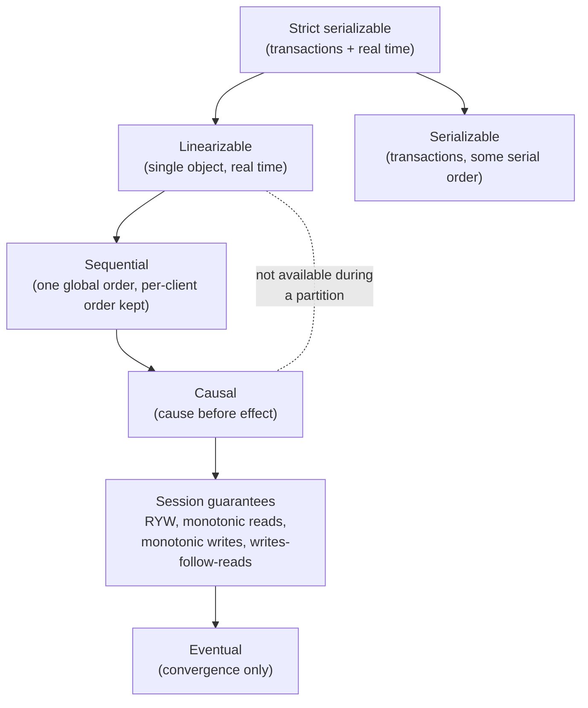
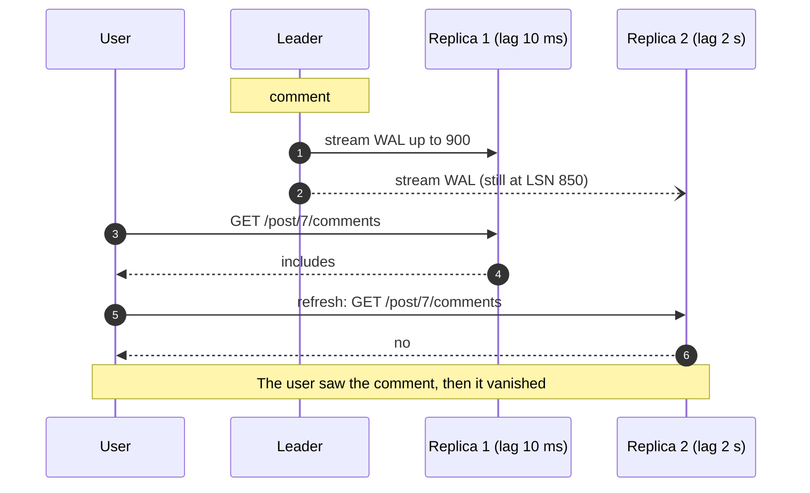

# Consistency Models

> [!summary] TL;DR
> A consistency model is the promise a replicated system makes about **which value a read may return**. Strong models (linearizable) behave like one copy; weak models (eventual) only promise that copies agree *eventually*. In between sit causal consistency and per-user **session guarantees** such as "you always see your own writes".

> [!abstract] Core idea
> - Each model is a list of allowed and forbidden anomalies, such as "read an older value after a newer one".
> - Linearizable = one copy in real time; causal = cause before effect; eventual = copies converge if writes stop.
> - Session guarantees (read-your-writes, monotonic reads, monotonic writes, writes-follow-reads) fix what users notice, cheaply.
> - Stronger models cost latency and availability (see [[CAP and PACELC]]), so choose per feature.
> - Classic mistake: confusing linearizable (one object, real-time) with serializable (multi-object transactions, any order).

## 1. Why it exists

A user edits their profile bio. The write goes to the primary database, and the page reloads from a read replica that is 400 ms behind. The old bio comes back, the user thinks the save failed, and edits again.

Nothing is "broken": the replica will catch up. But the system never said what a read may return, so the application cannot tell whether this is a bug. A consistency model is that contract. Here the violated promise is **read-your-writes**, and it can be fixed without making every read go to the primary.

## 2. Mental model

Think of all operations from all clients laid out on one timeline. A consistency model says how much the system may **reorder or delay** what each reader sees.

- **Linearizable**: there is one copy, and every operation happens at an instant between its start and its end.
- **Sequential**: everyone sees the same single order, and it respects each client's own order, but it may lag real time.
- **Causal**: if A could have influenced B (B read A, or the same client did A then B), everyone sees A before B. Unrelated writes may appear in different orders on different nodes.
- **Eventual**: no ordering promise at all, only that copies converge once writes stop.

**Analogy.** A group chat. Linearizable: everyone sees each message the moment it is sent. Causal: you never see a reply before the message it replies to. Eventual: messages may arrive in any order, but after a while everyone's history is the same.

## 3. How it works

### The hierarchy

An arrow points from a stronger model to a weaker one. A system that gives a model also gives every model reachable below it.



Linearizable, sequential and serializable cannot stay available on the minority side of a partition. Causal consistency is the strongest model that can (Mahajan, Alvisi and Dahlin, 2011).

### Single-object models

| Model | Promise | Allowed | Forbidden |
| --- | --- | --- | --- |
| Linearizable | Behaves like one copy; once a write completes, every later read (in real time) sees it | nothing beyond concurrent ops in some order | stale read after a completed write |
| Sequential | One global order consistent with each client's program order | reader lags behind real time | two readers disagree on the order of two writes |
| Causal | Causally related ops seen in the same order everywhere | concurrent writes seen in different orders | reply visible before the message it answers |
| Eventual | If writes stop, all replicas converge | almost anything in the meantime | replicas staying different forever |

### Session guarantees

These four come from the Bayou project (Terry et al., 1994). Each is scoped to **one client session**, which is why they are cheap: no global coordination is needed.

| Guarantee | Promise to one client | Anomaly it prevents |
| --- | --- | --- |
| Read-your-writes | after you write, your reads see that write or newer | the profile-bio problem above |
| Monotonic reads | once you have seen a value, you never see an older one | a comment appears, then disappears on refresh |
| Monotonic writes | your writes are applied in the order you made them | "set price 120" lands before "set price 100" |
| Writes-follow-reads | a write you make after reading X is ordered after X everywhere | your reply is visible on a replica that does not have the post you replied to |

Causal consistency includes all four.

### How replication lag produces the anomalies

With a leader and asynchronous followers (see [[Replication]]), each follower is a slightly old copy, and each one is old by a different amount. A load balancer that sends consecutive reads to different followers turns that lag into time travel:



### Implementing session guarantees

- **Read from the leader** for a short window after the user writes (for example 5 s). Simple, but it moves load to the leader.
- **Sticky routing**: send each user to the same replica (hash of user id). This gives monotonic reads while that replica stays up, but not read-your-writes if the write went to the leader and the replica lags.
- **Version tokens (LSN tokens)**: after each write or read, the client keeps the highest log position it has seen. A read goes only to a replica that has applied at least that position, otherwise to the leader. In PostgreSQL 17 the primary reports `pg_current_wal_lsn()` and a standby reports `pg_last_wal_replay_lsn()`. MongoDB causally consistent sessions do the same with `operationTime` and `afterClusterTime`.
- **Synchronous apply**: PostgreSQL `synchronous_commit = remote_apply` makes a commit wait until the synchronous standbys have applied it, so reads on those standbys see it. This costs a round trip on every commit.

## 4. Worked example

### Whiteboard version

The LSN-token rule fits on a whiteboard:

```text
client keeps: minLSN = 0

write(k, v):
    lsn = leader.apply(k, v)        # leader returns the log position
    minLSN = max(minLSN, lsn)

read(k):
    for r in replicas:
        if r.appliedLSN >= minLSN:  # replica has everything this client saw
            node = r; break
    else:
        node = leader               # nobody is caught up: fall back
    minLSN = max(minLSN, node.appliedLSN)   # never go backwards
    return node.get(k)
```

The first `max` gives read-your-writes. The second gives monotonic reads.

### Go: LSN tokens over lagging replicas

This compiles and passes `go vet` and `go test -race` on Go 1.24. Replication lag is simulated with an explicit `CatchUp` call, so the tests are deterministic.

```go
// Package session gives a client read-your-writes and monotonic reads on top
// of a leader with lagging replicas, using a log-position (LSN) token.
package session

// Node is a leader or a replica. AppliedLSN is how far it has applied the log.
type Node struct {
	Name       string
	AppliedLSN uint64
	data       map[string]string
}

func NewNode(name string) *Node { return &Node{Name: name, data: map[string]string{}} }

// Cluster has one leader and replicas that apply the leader's log later.
type Cluster struct {
	Leader   *Node
	Replicas []*Node
	log      []entry
}

type entry struct{ key, value string }

func NewCluster(replicas ...*Node) *Cluster {
	return &Cluster{Leader: NewNode("leader"), Replicas: replicas}
}

// Write goes to the leader and returns the LSN of the write.
func (c *Cluster) Write(key, value string) uint64 {
	c.log = append(c.log, entry{key, value})
	c.Leader.data[key] = value
	c.Leader.AppliedLSN = uint64(len(c.log))
	return c.Leader.AppliedLSN
}

// CatchUp makes a replica apply the log up to lsn (simulates replication lag ending).
func (c *Cluster) CatchUp(r *Node, lsn uint64) {
	for r.AppliedLSN < lsn && r.AppliedLSN < uint64(len(c.log)) {
		e := c.log[r.AppliedLSN]
		r.data[e.key] = e.value
		r.AppliedLSN++
	}
}

// Session is one client's view. MinLSN is the highest LSN it has written or read.
type Session struct {
	MinLSN uint64
	c      *Cluster
}

func (c *Cluster) NewSession() *Session { return &Session{c: c} }

func (s *Session) Write(key, value string) {
	lsn := s.c.Write(key, value)
	s.MinLSN = max(s.MinLSN, lsn)
}

// Read picks the first replica that has applied at least MinLSN.
// If none has, it falls back to the leader. It returns the value and who served it.
func (s *Session) Read(key string) (string, string) {
	n := s.c.Leader
	for _, r := range s.c.Replicas {
		if r.AppliedLSN >= s.MinLSN {
			n = r
			break
		}
	}
	s.MinLSN = max(s.MinLSN, n.AppliedLSN) // remember what we saw: monotonic reads
	return n.data[key], n.Name
}

// NaiveRead reads from replica i with no token: the source of the anomalies.
func (c *Cluster) NaiveRead(i int, key string) string { return c.Replicas[i].data[key] }
```

The tests first reproduce both anomalies with naive reads, then show the token preventing them:

```go
package session

import "testing"

func TestNaiveReadsShowAnomalies(t *testing.T) {
	r1, r2 := NewNode("r1"), NewNode("r2")
	c := NewCluster(r1, r2)
	c.Write("bio", "v1")
	c.CatchUp(r1, 1)
	c.CatchUp(r2, 1)
	lsn := c.Write("bio", "v2")

	// Read-your-writes violation: the writer reads a replica that lags.
	if got := c.NaiveRead(0, "bio"); got != "v1" {
		t.Fatalf("want stale v1, got %q", got)
	}
	// Monotonic-reads violation: r1 caught up, r2 did not.
	c.CatchUp(r1, lsn)
	first, second := c.NaiveRead(0, "bio"), c.NaiveRead(1, "bio")
	if first != "v2" || second != "v1" {
		t.Fatalf("want v2 then v1 (time goes backwards), got %q then %q", first, second)
	}
}

func TestSessionTokenGivesReadYourWrites(t *testing.T) {
	r1, r2 := NewNode("r1"), NewNode("r2")
	c := NewCluster(r1, r2)
	s := c.NewSession()
	s.Write("bio", "v1") // LSN 1, no replica has it yet

	if v, from := s.Read("bio"); v != "v1" || from != "leader" {
		t.Fatalf("got %q from %s, want v1 from leader", v, from)
	}
	c.CatchUp(r2, 1)
	if v, from := s.Read("bio"); v != "v1" || from != "r2" {
		t.Fatalf("got %q from %s, want v1 from r2", v, from)
	}
}

func TestSessionTokenGivesMonotonicReads(t *testing.T) {
	r1, r2 := NewNode("r1"), NewNode("r2")
	c := NewCluster(r1, r2)
	writer := c.NewSession()
	writer.Write("price", "100") // LSN 1
	writer.Write("price", "120") // LSN 2
	c.CatchUp(r1, 2)             // r1 is current
	c.CatchUp(r2, 1)             // r2 lags one write behind

	reader := c.NewSession() // a different user: token starts at 0
	if v, from := reader.Read("price"); v != "120" || from != "r1" {
		t.Fatalf("got %q from %s, want 120 from r1", v, from)
	}
	// r1 is taken out of rotation; only the lagging r2 is left.
	c.Replicas = []*Node{r2}
	if v, from := reader.Read("price"); v != "120" || from != "leader" {
		t.Fatalf("got %q from %s, want 120 from leader (never back to 100)", v, from)
	}
}
```

In a real service the token travels in a cookie or response header (for example `X-Min-LSN: 0/3000060`), and the read router compares it with each replica's `pg_last_wal_replay_lsn()`, polled every few hundred milliseconds.

## 5. Variants and comparison

### Linearizable vs serializable vs strict serializable

| Property | Scope | Real-time order? | Example |
| --- | --- | --- | --- |
| Linearizable | single object (one key or register) | yes | etcd key, a compare-and-set lock |
| Serializable | multi-object transactions | no: any serial order is fine, even one that puts a later transaction first | PostgreSQL `SERIALIZABLE` (SSI) on one node; see [[Isolation Levels and MVCC]] |
| Strict serializable | multi-object transactions | yes | Spanner, FoundationDB. CockroachDB is serializable and gives single-key linearizability; its own consistency write-ups say it is not strict serializable for transactions on unrelated keys (no stale reads, but causal reverse is possible) |

### Defaults in real systems

| System | Default | How to get stronger |
| --- | --- | --- |
| Amazon DynamoDB | eventually consistent reads | `ConsistentRead: true` on `GetItem`, `Query`, `Scan` (not on global secondary indexes) |
| Amazon S3 | strong read-after-write for PUT and DELETE of objects, since December 2020 | already strong; list operations are strongly consistent too |
| Cassandra | per query; the DataStax drivers (Java 4.x, Python) default to `LOCAL_ONE`, `cqlsh` to `ONE` | `QUORUM` / `LOCAL_QUORUM` on both reads and writes; see [[Quorums and Leaderless Replication]] |
| MongoDB | `readConcern: "local"` on reads; `w: "majority"` writes since 5.0 | `readConcern: "majority"` / `"linearizable"`, causally consistent sessions |
| PostgreSQL primary | linearizable for single-row reads and writes on that node | already strong |
| PostgreSQL async replica | eventual (bounded by replay lag) | `remote_apply` on sync standbys, or LSN tokens |

### Choosing per feature

The table carried over from the old note, with the model named:

| Feature | Needed model | Why |
| --- | --- | --- |
| Bank balance before a withdrawal | linearizable (or a serializable transaction) | a stale balance allows an overdraft |
| Like count | eventual | off by a few for a second is invisible |
| Profile edit by its owner | read-your-writes | only the author notices staleness |
| Comment thread | causal (at least writes-follow-reads) | a reply must not appear before its parent |
| Feed of followed accounts | monotonic reads | posts must not vanish on refresh |

## 6. Trade-offs and when not to use

- **Linearizable costs a round trip to a leader or majority on every write and, for strict reads, on every read.** Across regions that is tens of milliseconds per operation (an estimate). It also stops on the minority side of a partition.
- **Causal costs metadata.** Each write carries its dependencies (vector clocks or explicit dependency lists, see [[Clocks and Ordering]]), and a replica must delay showing a write until its dependencies have arrived.
- **Session guarantees cost routing complexity** and fall back to the leader when replicas lag, so a lag spike becomes a leader load spike.
- **Eventual costs application logic**: every reader must tolerate stale or conflicting data, and conflicting writes must be merged (see [[CRDTs and Conflict Resolution]]).
- **When not to bother:** a single-node database is already linearizable. Add replicas for reads only when you have measured that the primary cannot serve them.

## 7. In production

- **Real systems:**
  - Read-after-write routing that pins a user to the primary for a few seconds after a write is a common pattern in Rails and Django database routers.
  - MongoDB causally consistent sessions (since 3.6) pass `afterClusterTime` so a secondary waits until it has caught up.
  - S3's December 2020 change removed the old "eventually consistent overwrite" caveat, so code that re-read objects in a retry loop to wait for consistency can be deleted.
- **Testing:** Jepsen (Kyle Kingsbury) runs real clusters, injects partitions, clock skew and crashes, records every operation's start and end time, and checks the history against a model (for example with the Knossos and Elle checkers). Many databases have had their documented guarantees corrected after a Jepsen analysis. Read the Jepsen report for any store before trusting its "strong consistency" claim.
- **Failure modes → fixes:**
  - "Saved, then gone" complaints → read-your-writes via leader pinning or LSN tokens.
  - Replica lag spikes during a bulk import push all token reads to the leader → throttle the import, cap fallback with a circuit breaker, or accept stale reads for non-owners.
  - Cache in front of the DB breaks the model the DB gives → invalidate on write and include the version in the cache key.
- **What to monitor:**
  - Replica replay lag in bytes and seconds (`pg_stat_replication.replay_lag`).
  - Percentage of reads that fell back to the leader.
  - Conflict and read-repair counts in leaderless stores.

## 8. Deep dive

- **Linearizability is composable; serializability is not.** If each object is linearizable, the whole system of objects is linearizable (Herlihy and Wing call this locality). Serializability is defined over transactions, so two separately serializable databases do not give a serializable cross-database transaction.
- **Serializable does not mean fresh.** A serializable system may serve a read-only transaction from an old snapshot, because ordering it "before" recent writes is a valid serial order. That is why Spanner and FoundationDB advertise strict serializability.
- **Quorums are not enough for linearizability.** `R + W > N` with last-writer-wins can still return a new value to one reader and an old value to a later reader if a write is in flight. Linearizable quorum reads need a read-repair that completes before returning (ABD algorithm). See [[Quorums and Leaderless Replication]].
- **Sequential vs linearizable.** Sequential consistency allows a read to return a value that is "old in real time" as long as everyone agrees on the order. Linearizability adds the real-time constraint, which is what makes it useful for locks and leader leases.
- **Causal needs dependency tracking.** Systems such as COPS track explicit dependencies per write. Others use hybrid logical clocks (MongoDB cluster time) to approximate causality cheaply (see [[Clocks and Ordering]]).

## 9. Interview questions

> [!question]- What is the difference between linearizable and serializable? (trap)
> Linearizable is about single objects and real time: once a write completes, every later read sees it. Serializable is about multi-object transactions: the result equals *some* serial order, which need not match real time. Strict serializable is both.

> [!question]- A user updates their profile and sees the old one on reload. What is wrong and how do you fix it?
> Read-your-writes is violated because the read went to a lagging replica. Fix it by reading from the leader for that user for a few seconds after a write, or by sending the write's LSN as a token and reading only from replicas that have replayed past it.

> [!question]- What do the four session guarantees mean?
> Read-your-writes: you see your own writes. Monotonic reads: you never see older data after newer. Monotonic writes: your writes apply in order. Writes-follow-reads: what you write after reading X is ordered after X everywhere. All are per client, so they need no global coordination.

> [!question]- Why is causal consistency interesting if it is weaker than linearizable?
> It is the strongest model that can stay available during a partition, and it prevents the anomalies users actually notice (replies before posts, missing own writes). It costs dependency tracking rather than cross-node round trips.

> [!question]- Does `R + W > N` give linearizability?
> No. Concurrent writes, writes that fail on some replicas but land on others, and last-writer-wins with skewed clocks all allow non-linearizable histories. It gives a read that overlaps the latest *completed* write set, which is weaker.

> [!question]- Is DynamoDB strongly consistent?
> Reads are eventually consistent by default. `ConsistentRead: true` gives a strongly consistent read of the item from the partition leader, at double the read capacity cost, and is not supported on global secondary indexes.

> [!question]- How would you check that a database really gives the model it claims?
> Run a Jepsen-style test: many clients, record each operation's invocation and completion time, inject partitions, crashes and clock skew, then check the history with a linearizability or serializability checker.

## 10. Cheat sheet

- Strict serializable > linearizable / serializable > sequential > causal > session guarantees > eventual.
- Linearizable = one copy, real time, single object. Serializable = some serial order of transactions.
- Causal is the strongest model that stays available in a partition.
- Session guarantees: RYW, monotonic reads, monotonic writes, writes-follow-reads.
- Fix RYW with leader pinning, LSN tokens, or `remote_apply`.
- DynamoDB eventual by default; S3 strong since Dec 2020; Cassandra tunable; MongoDB concerns.
- Pick per feature: balance linearizable, likes eventual, profile RYW, comments causal.

## Links

- **Before this:** [[CAP and PACELC]], [[Replication]]
- **Next:** [[Quorums and Leaderless Replication]], [[Clocks and Ordering]], [[Consensus - Raft and Paxos]]
- **Compare with:** [[Isolation Levels and MVCC]] (single-node transaction isolation), [[Distributed SQL]] (serializable transactions across nodes; strict serializability only in some systems, such as Spanner), [[CRDTs and Conflict Resolution]] (making eventual consistency safe)
