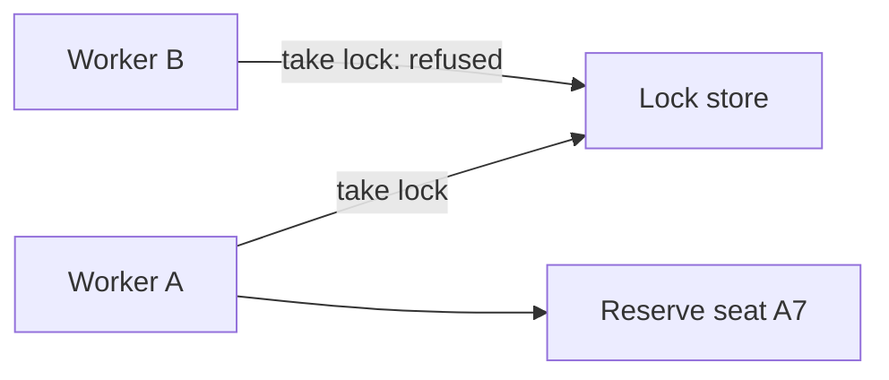
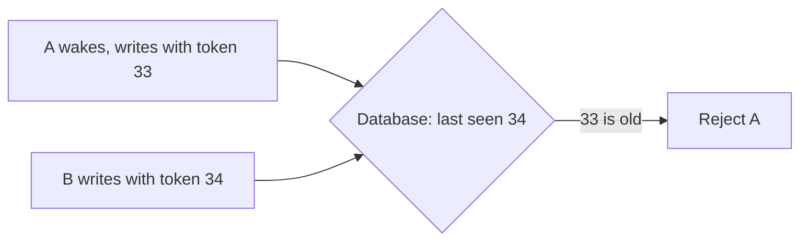
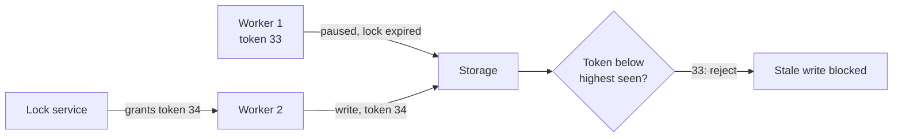
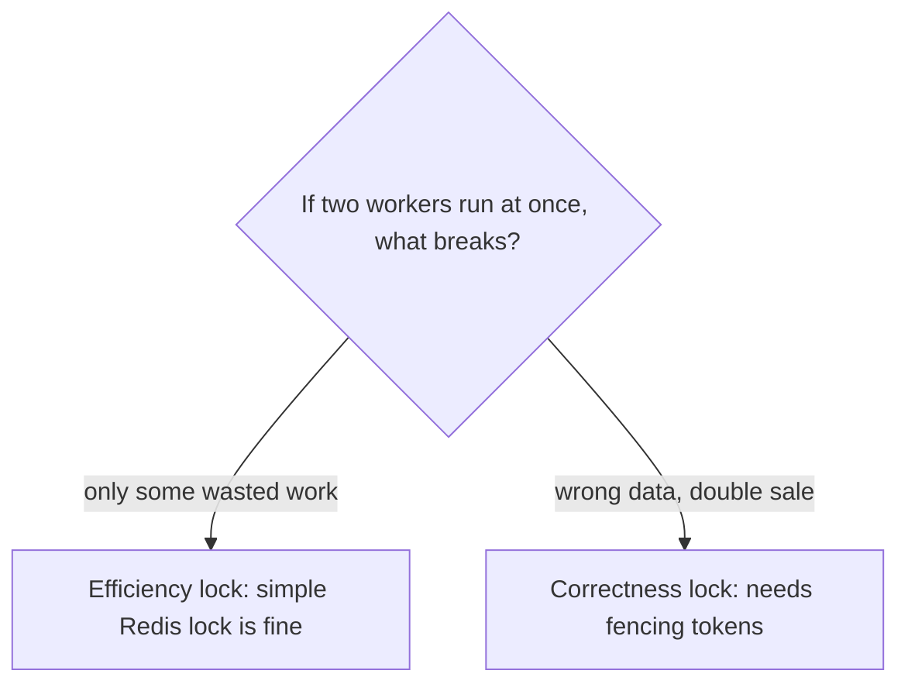
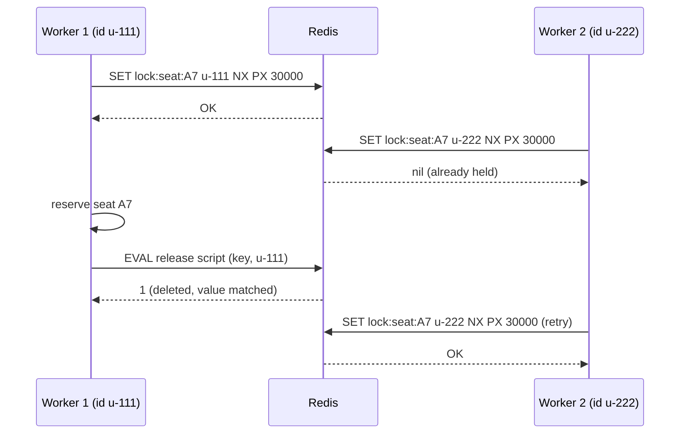
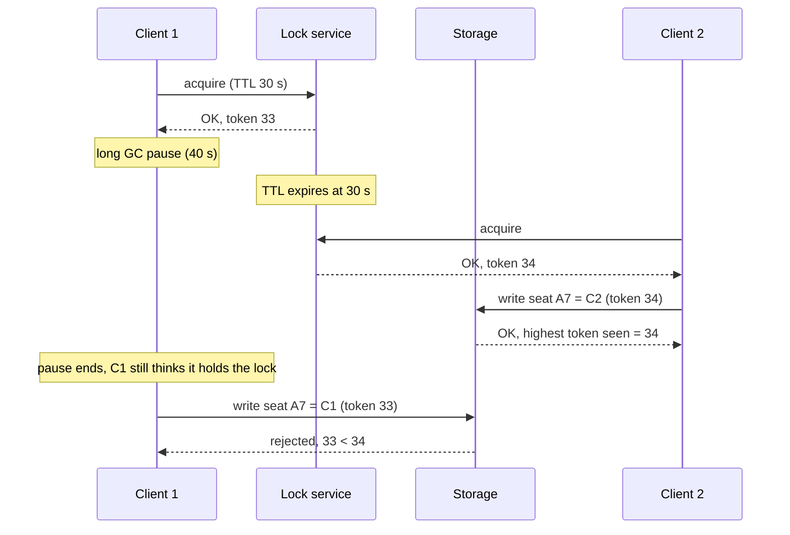

# Distributed Locks and Fencing Tokens

> [!summary] TL;DR
> A **distributed lock** lets only one of many processes, on different machines, work on a shared thing at a time. Because a lock holder can pause or lose its network and its lock can expire without it knowing, a lock alone is not enough for correctness: the protected resource must also check a **fencing token**, an increasing number issued with each lock, and reject requests carrying an older one.

> [!abstract] Core idea
> - Every distributed lock has a timeout (TTL), otherwise a crashed holder would block everyone forever.
> - A TTL means a paused holder (GC, network delay, slow disk) can lose the lock and still act as if it holds it.
> - Fix: the lock service hands out a token that grows with every grant; the storage rejects any write with a token lower than one it has already seen.
> - For efficiency (avoid doing work twice) a Redis lock is fine; for correctness (never corrupt data) use fencing plus a consensus store (etcd, ZooKeeper) or a database constraint.
> - Classic mistake: `SET lock 1 NX` with the same value for every client, and `DEL lock` to release. A slow client then deletes someone else's lock.

## Start here: the basics 🟢

> [!info] How to read this note (pick your level)
> - 🟢 **New to this?** Read "From zero" below, then sections 1, 2 and the cheat sheet (10). Stop there, that is a full first pass.
> - 🟡 **Know the basics?** Add section 3 (how it works), 4 (worked example), 5 (variants) and 6 (trade-offs).
> - 🔴 **Interview / SDE-3 prep?** Add 7, 8 and 9. Headings are tagged 🟢🟡🔴 so you always know where you are.

> [!note] Before this note
> - [[Leader Election]]: one copy holds an expiring lease in a shared store, and every new holder gets a bigger epoch number.
> - [[Consensus - Raft and Paxos]]: etcd and ZooKeeper agree by majority, so they never hand the same thing to two clients.
> - [[Locking - Optimistic vs Pessimistic]]: inside one database you either lock a row first, or check a version number when you write.

**From zero, in 60 seconds** 🟢

Two copies of a service try to do the same job at the same time, like reserving seat A7.
Without care, both do it and the seat is sold twice.
A **distributed lock** is a shared "busy" sign kept in a store like Redis: only the holder may work.



But locks expire. Worker A can freeze for a while, lose its lock without knowing, and then wake up and write anyway.
The fix is a **fencing token**: every new lock comes with a bigger number.
The database remembers the biggest number it has seen and rejects any write with a smaller one.



The rest of this note is just these 3 questions:
1. How do you build a lock in Redis correctly?
2. Why is a lock alone not safe when a holder pauses?
3. Where do fencing tokens come from, and who checks them?

**The problem in one story.**
Two cinema clerks in different branches both see seat A7 as free.
Both sell it at the same moment, and one customer arrives to find someone in their seat.
They need a shared "talking stick": only the clerk holding it may sell a seat.
But a clerk can doze off holding the stick, and the stick must be taken back and given to someone else.

**Words you need first**

| Word | Plain meaning | Tiny example |
| --- | --- | --- |
| Lock / mutex | Permission that only one worker holds at a time | `sync.Mutex` inside one Go program |
| Distributed lock | A lock stored outside any one process, shared by many machines | A key in Redis or etcd |
| TTL (lease) | An expiry time after which the lock frees itself | Lock expires after 10 s |
| Holder | The process that currently owns the lock | Worker 2 |
| Process pause | A process stops running for a while without knowing | A 15 s garbage-collection pause |
| Fencing token | A number that grows with every lock grant | Grant 33, then 34, then 35 |
| Idempotent | Safe to do twice with the same result | "Set seat A7 to order 9" |
| NX / PX (Redis) | NX = set only if the key does not exist; PX = expire after this many milliseconds | `SET lock 123 NX PX 30000` |
| Lua script (Redis) | A small program Redis runs in one step, with nothing else in between | "Delete only if the value is mine" |
| Watchdog | A background helper that keeps extending the lock while work runs | Renew every 10 s for a 30 s lock |
| Stampede | Many workers rushing to rebuild the same thing at once | 500 requests all recompute one cache key |

**Picture it**



**Analogy.** A deli ticket machine: every customer gets a higher number, and the counter ignores anyone holding a number lower than the last one served.
Where it breaks: a deli counter checks tickets by itself; your storage must be built to check the token, or the token protects nothing.

**How the rest of this note builds up**

- First, why in-process locks are not enough across machines (section 1) and the mental model of lock plus lease (section 2).
- Then a correct single-Redis lock, the pause problem, and where fencing tokens come from (section 3).
- Then a Go lock service with fenced storage (section 4), and Redlock, etcd, ZooKeeper and database locks compared (section 5).
- Finally the SDE-3 deep dive: efficiency vs correctness locks, production failures and the Redlock debate (sections 6-8).

> [!tip] Remember
> A lock with a TTL can be lost without the holder knowing; only a fencing token checked by the storage makes it safe.

## 1. Why it exists 🟢

Two instances of an order service process the same "reserve seat A7" message at the same moment (a retry plus a redelivery). Each reads "A7 free", each writes "A7 held by me". One customer's booking silently disappears. Inside one process a `sync.Mutex` (Go's in-memory lock) fixes this; across machines you need a lock that lives outside any one process.

Typical uses:

- Run a scheduled job on one instance only.
- Hold an inventory item or seat while a payment completes.
- Make one worker rebuild an expensive cache entry while others wait (avoid a stampede).
- Serialize writes (make them happen one at a time) to an external system that has no transactions, such as a file in object storage (like Amazon S3).

### Real-life example 🟢

On BookMyShow, when you tap seat A7 for a Friday show, it turns grey for everyone else while you pay. Behind that, the booking service takes a short lock on "show 512, seat A7" with an expiry of a few minutes.
If your phone dies, the lock expires and the seat comes back for others.
But if your payment request was only stuck, not dead, it might arrive late and try to confirm A7 after someone else has it. A fencing number on each hold lets the seat table reject that late, older request.

## 2. Mental model 🟢

**Efficiency vs correctness (Kleppmann's distinction).** Ask what happens if the lock fails and two processes run at once:

- **Efficiency lock:** some work is done twice. Two workers both rebuild a cache entry or both send a report. Annoying, not dangerous. A simple Redis lock is fine.
- **Correctness lock:** data is corrupted. Two writers overwrite each other's file; a seat is sold twice. Here the lock must be backed by fencing, or replaced by a database constraint.

**Analogy.** A lock with a TTL is a hotel key card that stops working at checkout time. If you fall asleep in the lobby past checkout, the room is given to someone else, but you still *think* it is yours. A fencing token is a room number plus a booking number printed on the card: the door only opens for the newest booking number it has seen.



## Common beginner mistakes 🟢

- **Same lock value for every client and a plain `DEL` to release** → a slow client can delete a lock someone else now holds → store a unique ID and release with the compare-and-delete script.
- **A lock with no TTL** → if the holder crashes, nobody can ever get the lock again → always set an expiry.
- **Trusting the lock alone for money or seats** → a paused holder can wake up and write after its lock expired → send a fencing token and let the storage reject old ones.
- **Checking "do I still hold the lock?" right before writing** → the pause can happen between the check and the write → only a check done by the storage itself is safe.
- **Reaching for a lock first** → most "only once" problems are simpler with a unique constraint or an idempotency key → try those before adding a lock service.

## 3. How it works 🟡

> 🟢 → 🟡 **You now know** that a lock is a shared "busy" sign with an expiry, and that an expired holder can still wake up and write, so storage must check a growing token. **Next we open the box**: how to build a correct single-Redis lock, exactly how the pause problem plays out, and where fencing tokens come from. Each subsection starts with a short walk-through.

### A single-Redis lock, done correctly

**In plain words:** set the key only if it is empty, give it an expiry, store your own id, and delete it only if it still holds your id.

**Step by step:**
1. Worker 1 makes a random ID, `u-111`, and runs `SET lock:seat:A7 u-111 NX PX 30000`. The key was empty, so Redis says OK.
2. Worker 2 tries the same with `u-222`. The key exists, so Redis says no.
3. Worker 1 reserves the seat, then runs a tiny script: "if the key's value is `u-111`, delete it".
4. The value matches, so the key is deleted. Worker 2's next try succeeds.
5. If Worker 1's job runs long, a watchdog keeps extending the 30 s expiry while it works.

- **Acquire:** `SET lock:seat:A7 <unique-id> NX PX 30000`. `NX` sets only if absent; `PX 30000` expires after 30 s; the value is a random ID (a UUID, a 128-bit random identifier) unique to *this* acquisition.
- **Release:** delete only if the value is still yours, atomically, with a Lua script:

```lua
-- KEYS[1] = lock key, ARGV[1] = my unique id
if redis.call("GET", KEYS[1]) == ARGV[1] then
    return redis.call("DEL", KEYS[1])
else
    return 0
end
```

- **Renew (watchdog):** for long work, a background routine extends the TTL with the same compare-then-`PEXPIRE` script while the work runs. Redisson's (a Java Redis library) watchdog defaults to a 30 s lease, renewed every 10 s.



### The pause problem

**In plain words:** the holder can freeze longer than the lock lasts. It wakes up still thinking it owns the lock.

**Step by step:**
1. Client 1 gets the lock with a 30 s TTL and token 33.
2. Client 1 freezes for 40 s (say, a long memory clean-up pause).
3. At 30 s the lock expires. Client 2 gets it with token 34 and writes "A7 = Client 2". Storage notes "highest token seen: 34".
4. Client 1 wakes up. It still believes it holds the lock and writes "A7 = Client 1" with token 33.
5. Storage compares: 33 is lower than 34, so it rejects the write. Without that check, Client 2's booking would be overwritten.

TTL, unique value and safe release are **necessary but not sufficient**. The holder can stop for longer than the TTL at any point: a stop-the-world GC pause (the whole program frozen while memory is cleaned), a VM migration (the cloud moving the virtual machine to another host), a page fault on a swapped-out page (memory that was moved to disk and must be read back), or a network packet delayed in a queue. When it resumes it has no way to know time passed.



Without the token check, the last arrow succeeds and client 1 overwrites client 2: both "held the lock". With it, the storage itself refuses the stale write. Checking "do I still hold the lock?" just before writing does not help, because the pause can happen between the check and the write.

### Where fencing tokens come from

**In plain words:** use a number that only grows, like etcd's revision or a database sequence, and hand it out with each lock.

**Step by step:**
1. The lock service keeps a counter that only goes up. In etcd, every write gets the next revision number.
2. When Worker 2 gets the lock, the lock key's revision, say 34, becomes its token.
3. Worker 2 sends 34 along with every write to the seats table.
4. The seats table keeps a `fence` column and only accepts the write if `fence < 34`, then stores 34.
5. Any later write with 33 or lower now matches zero rows and is refused.

- **etcd:** every key has a `create_revision`, a cluster-wide number that grows with every write. The lock key's create revision is a ready-made fencing token.
- **ZooKeeper:** the sequence number of the ephemeral sequential znode (an entry that gets a rising number and vanishes when its owner disconnects), or the `zxid` (ZooKeeper's global transaction counter) of its creation.
- **PostgreSQL:** a `bigserial` or a counter row incremented in the same transaction as the grant.
- **Chubby** (Google's internal lock service) called these *sequencers* (2006).

The storage side is one comparison. In SQL:

```sql
-- seats(seat_id text PRIMARY KEY, holder text, fence bigint NOT NULL DEFAULT 0)
UPDATE seats
SET holder = $2, fence = $3
WHERE seat_id = $1
  AND fence < $3;      -- reject a token we have already seen or passed
```

Representative output (PostgreSQL 17) for the stale write with token 33 after token 34 was applied: `UPDATE 0`. The application treats zero rows as "you lost the lock" and aborts. (Use `<=` instead of `<` if the same holder may write several times with one token.)

## 4. Worked example 🟡

### Whiteboard version

**In plain words:** take the lock and its token, send the token with every write, and let storage reject older tokens.

```text
LockService.Acquire(owner, ttl):
    if held and not expired: fail
    owner, expiry = owner, now + ttl
    token += 1;  return token

Storage.Write(token, data):
    if token < maxTokenSeen: reject (stale)
    maxTokenSeen = token; apply data
```

### Go: lock service plus fenced storage

**In plain words:** a working lock service and a storage that checks tokens, plus a test that freezes one worker on purpose.

The lock service mirrors `SET NX PX` with an owner check on release and adds a token. `Storage` is the protected resource that enforces the token. The clock is injected so the 40-second pause is simulated instantly. It passes `go vet` and `go test -race` on Go 1.24.

```go
package fencing

import (
	"errors"
	"sync"
	"time"
)

var (
	ErrHeld       = errors.New("lock held by another client")
	ErrNotOwner   = errors.New("not the current lock owner")
	ErrStaleToken = errors.New("stale fencing token")
)

// LockService grants a TTL lock and a fencing token that grows with every grant,
// like an etcd revision or a ZooKeeper zxid.
type LockService struct {
	mu      sync.Mutex
	now     func() time.Time
	owner   string // unique per acquirer (a UUID in real code)
	expires time.Time
	token   uint64
}

func NewLockService(now func() time.Time) *LockService { return &LockService{now: now} }

// Acquire is the moral equivalent of Redis SET key owner NX PX ttl, plus a token.
func (l *LockService) Acquire(owner string, ttl time.Duration) (uint64, error) {
	l.mu.Lock()
	defer l.mu.Unlock()
	now := l.now()
	if l.owner != "" && now.Before(l.expires) {
		return 0, ErrHeld
	}
	l.owner, l.expires = owner, now.Add(ttl)
	l.token++
	return l.token, nil
}

// Release deletes the lock only if owner still holds it
// (the Lua compare-and-delete in Redis).
func (l *LockService) Release(owner string) error {
	l.mu.Lock()
	defer l.mu.Unlock()
	if l.owner != owner || !l.now().Before(l.expires) {
		return ErrNotOwner
	}
	l.owner = ""
	return nil
}

// Storage is the protected resource. It remembers the highest token it has
// seen and rejects anything older. This check is what makes the lock safe.
type Storage struct {
	mu       sync.Mutex
	maxToken uint64
	Data     map[string]string
}

func NewStorage() *Storage { return &Storage{Data: map[string]string{}} }

func (s *Storage) Write(token uint64, key, value string) error {
	s.mu.Lock()
	defer s.mu.Unlock()
	if token < s.maxToken {
		return ErrStaleToken
	}
	s.maxToken = token
	s.Data[key] = value
	return nil
}
```

The first test is the sequence diagram above, step by step; the others check that the lock is exclusive while live and that exactly one of 64 concurrent acquirers wins.

```go
package fencing

import (
	"errors"
	"sync"
	"testing"
	"time"
)

type fakeClock struct {
	mu sync.Mutex
	t  time.Time
}

func (c *fakeClock) Now() time.Time          { c.mu.Lock(); defer c.mu.Unlock(); return c.t }
func (c *fakeClock) Advance(d time.Duration) { c.mu.Lock(); c.t = c.t.Add(d); c.mu.Unlock() }

// The GC-pause scenario: client 1's lease expires while it is paused,
// client 2 acquires and writes, then client 1 wakes up and tries to write.
func TestStaleHolderIsFencedOff(t *testing.T) {
	clk := &fakeClock{t: time.Unix(0, 0)}
	locks, store := NewLockService(clk.Now), NewStorage()

	t1, err := locks.Acquire("client-1-uuid", 30*time.Second)
	if err != nil || t1 != 1 {
		t.Fatalf("client 1: token %d, err %v", t1, err)
	}
	clk.Advance(40 * time.Second) // client 1 is paused for 40s; its lease expired

	t2, err := locks.Acquire("client-2-uuid", 30*time.Second)
	if err != nil || t2 != 2 {
		t.Fatalf("client 2: token %d, err %v", t2, err)
	}
	if err := store.Write(t2, "seat:A7", "client-2"); err != nil {
		t.Fatal(err)
	}

	// Client 1 resumes, still believing it holds the lock.
	if err := store.Write(t1, "seat:A7", "client-1"); !errors.Is(err, ErrStaleToken) {
		t.Fatalf("stale write: err = %v, want ErrStaleToken", err)
	}
	if got := store.Data["seat:A7"]; got != "client-2" {
		t.Fatalf("seat:A7 = %q, want client-2", got)
	}
	// And client 1 cannot release client 2's lock.
	if err := locks.Release("client-1-uuid"); !errors.Is(err, ErrNotOwner) {
		t.Fatalf("release by old owner: err = %v, want ErrNotOwner", err)
	}
}

func TestLockIsExclusiveWhileLive(t *testing.T) {
	clk := &fakeClock{t: time.Unix(0, 0)}
	locks := NewLockService(clk.Now)
	if _, err := locks.Acquire("a", 10*time.Second); err != nil {
		t.Fatal(err)
	}
	clk.Advance(9 * time.Second)
	if _, err := locks.Acquire("b", 10*time.Second); !errors.Is(err, ErrHeld) {
		t.Fatalf("err = %v, want ErrHeld", err)
	}
	if err := locks.Release("a"); err != nil {
		t.Fatal(err)
	}
	if tok, err := locks.Acquire("b", 10*time.Second); err != nil || tok != 2 {
		t.Fatalf("b: token %d, err %v", tok, err)
	}
}

func TestConcurrentAcquireOneWinner(t *testing.T) {
	clk := &fakeClock{t: time.Unix(0, 0)}
	locks := NewLockService(clk.Now)
	var wg sync.WaitGroup
	var mu sync.Mutex
	wins := 0
	for i := 0; i < 64; i++ {
		wg.Add(1)
		go func(i int) {
			defer wg.Done()
			if _, err := locks.Acquire(string(rune('a'+i)), time.Minute); err == nil {
				mu.Lock()
				wins++
				mu.Unlock()
			}
		}(i)
	}
	wg.Wait()
	if wins != 1 {
		t.Fatalf("wins = %d, want 1", wins)
	}
}
```

## 5. Variants and comparison 🟡

| Lock | How it works | Fencing token | Use when | Weakness |
| --- | --- | --- | --- | --- |
| Single Redis node | `SET k uuid NX PX ttl`, Lua compare-and-delete | None built in (an `INCR` counter can be added) | Efficiency locks | Redis replication is asynchronous: a failover can lose the key and grant it twice |
| Redlock (Redis's multi-node lock recipe) | Acquire on a majority of N (usually 5) independent Redis masters within a time budget; validity = TTL − elapsed − drift allowance | None | Rarely the best choice | Safety depends on bounded pauses, network delay and clock drift (see below) |
| etcd `concurrency.Mutex` | Session lease (TTL, kept alive) + key under a prefix; lowest create revision holds; wait on predecessor | Create revision of the key | Correctness locks in Go services with etcd | Needs etcd; lease expiry during a pause still requires fencing downstream |
| ZooKeeper lock recipe | Ephemeral sequential znode; lowest number holds; watch only the next-lower node | Znode sequence / zxid | JVM stacks with ZooKeeper | Session timeouts to tune |
| `pg_advisory_lock(key)` | Session or transaction-scoped lock in PostgreSQL (`pg_advisory_xact_lock` releases at commit) | None (add a counter column) | Service already on one PostgreSQL primary | Session lock silently lost if the connection drops; does not span databases |
| `SELECT … FOR UPDATE SKIP LOCKED` | Row locks; other workers skip locked rows | Not needed when the work is in the same transaction | Job queues, claiming work items | Lock lives only as long as the transaction |
| Unique constraint / conditional write | `INSERT … ON CONFLICT DO NOTHING`, `UPDATE … WHERE version = $v` | The row version is the token | Most "only once" problems | Requires the work's result to live in that database |

### Distributed lock versus things people confuse it with 🟡

| Thing | What it does | How it differs from a distributed lock |
| --- | --- | --- |
| `sync.Mutex` | Locks inside one process | Cannot be lost by a pause and needs no TTL; only works within one program |
| Leader election | Picks one long-lived owner of a role | A lock is usually short and per resource; election is held and renewed for hours |
| Database row lock (`FOR UPDATE`) | Locks a row inside one transaction | Released automatically at commit or crash; no TTL guessing, but only inside that database |
| Idempotency key | Makes a repeat harmless | Does not stop two runs; makes the second run do nothing |

**Go libraries:** `github.com/go-redsync/redsync/v4` (Redis and Redlock), `go.etcd.io/etcd/client/v3/concurrency` (`NewSession`, `NewMutex`, `Lock`, `Unlock`), and plain `pgx` for advisory locks.

## 6. Trade-offs and when not to use 🟡

- **Try to avoid the lock first.** Most "lock" problems disappear with one of:
	- **Idempotency:** make the operation safe to run twice (see [[Idempotency and Idempotency Keys]]).
	- **A unique constraint or conditional update:** let the database reject the second writer (see [[Locking - Optimistic vs Pessimistic]]).
	- **Single-writer partitioning:** route all work for a key to one consumer, as a Kafka partition does.
- **TTL sizing.** The TTL must exceed the longest normal hold time plus GC and network jitter, but every extra second is a second of unavailability after a crash. Use a short TTL plus a renewal watchdog for long work, and still fence.
- **Fencing needs a cooperating resource.** The storage must store and compare the token. An external API that ignores your token (a payment provider, an email sender) cannot be fenced; use idempotency keys with it instead.
- **A lock service is a dependency.** If Redis or etcd is down, nothing can acquire. Decide whether the work should fail closed or open.

## 7. In production 🔴

> 🟡 → 🔴 **You now know** how to build a correct Redis lock, why a paused holder can still write, how fencing tokens stop it, and how Redis, etcd, ZooKeeper and Postgres locks compare. **Next comes the advanced part**: where real systems use these locks, how they fail in production, the Redlock debate, etcd internals and keeping tokens growing across failovers.

- **Real systems:**
	- Kubernetes controllers and Patroni rely on lease locks in etcd or the API server (see [[Leader Election]]).
	- Google's Chubby (2006) provided coarse-grained locks and introduced sequencers checked by servers.
	- Many cron and batch frameworks use Redis locks (ShedLock, a Java library for running scheduled tasks once, supports Redis, JDBC and ZooKeeper backends) for efficiency-grade "run once".
- **Failure modes → fixes:**
	- Lock released by the wrong client (same value, plain `DEL`) → unique value per acquisition plus the Lua compare-and-delete.
	- Holder paused past TTL; two writers → fencing tokens checked by the storage.
	- Redis failover loses the lock key → accept it for efficiency locks; use etcd/ZooKeeper or a database constraint for correctness.
	- Lock never released because the process crashed → that is what the TTL is for; never create a lock without one.
	- Herd of waiters polling the lock → ZooKeeper/etcd "watch your predecessor", or retry with jittered backoff (see [[Timeouts, Retries and Backoff]]).
	- Long job outlives its TTL → watchdog renewal, and have the job check the lock (or its token) between steps.
- **What to monitor:** acquire latency and failure rate, hold-time distribution compared with the TTL, number of expirations while held (watchdog misses), stale-token rejections at the storage (each one is a near miss), lock-service availability.

## 8. Deep dive 🔴

- **The Redlock debate (2016).** Redlock acquires the lock on a majority of 5 independent Redis nodes and computes how much validity time remains. Kleppmann argued it is unsafe for correctness: it relies on bounded process pauses, bounded network delay and clocks that do not jump (a node whose clock jumps forward expires the key early, letting a second client get a majority), and it provides no fencing token. antirez (Salvatore Sanfilippo, the creator of Redis) replied that the algorithm checks elapsed time after acquiring, that clock jumps can be avoided operationally, and that fencing makes the lock almost unnecessary. Takeaway for interviews: Redlock is an efficiency lock with extra cost; for correctness, use a consensus store plus fencing.
- **etcd lock internals.** `concurrency.NewMutex(session, "/locks/seat-A7")` creates the key `/locks/seat-A7/<leaseID>` attached to the session's lease. The holder is the key with the lowest create revision; each waiter waits for the deletion of the key just before its own. If the process dies, the lease expires and the key disappears. The mutex does not export its key's create revision directly: read it with `Get(m.Key())`, or use `m.Header().Revision` after `Lock`, which is at least as large and also grows with every new holder. For writes kept in etcd itself, `Txn().If(m.IsOwner())` (which compares the key's create revision) commits only while the lock key still exists.
- **Clocks.** Redis expires keys using its own clock. A TTL lock's safety assumes the holder's sense of elapsed time and the server's agree within a margin. Use a monotonic clock for the holder's countdown (Go's `time.Since` does; see [[Clocks and Ordering]]).
- **Token monotonicity across failovers.** Tokens must keep growing even when the lock service fails over. A consensus store gives this for free (revisions are part of the replicated log). A counter on a single Redis node can go backwards after a failover with asynchronous replication, which would let an old token pass.
- **Lock granularity.** One lock per seat scales; one lock per show serializes the whole show. Lock the smallest unit the **invariant** (the rule that must always hold, such as "one buyer per seat") needs, and always acquire multiple locks in a fixed order to avoid deadlock.

## 9. Interview questions 🔴

> [!question]- What is wrong with `SET lock 1 NX EX 30` and `DEL lock`?
> Every client writes the same value, so a client whose lock already expired can `DEL` a lock now held by someone else. Use a unique value per acquisition and release with a Lua script that deletes only if the value matches.

> [!question]- The lock has a TTL, a unique value and a safe release. Is it now correct?
> No. A holder paused past the TTL (GC, network delay) resumes and writes while another client holds the lock. Only the protected resource can stop that, by checking a fencing token that increases with each grant.

> [!question]- Where does a fencing token come from, and who checks it?
> From the lock service: etcd's create revision, a ZooKeeper sequence number, or a database counter. The storage being protected checks it: it remembers the highest token seen and rejects lower ones, for example `UPDATE … WHERE fence < $token`.

> [!question]- Is Redlock safe?
> Safe only under timing assumptions: bounded pauses, bounded network delay, no clock jumps. It also gives no fencing token. Fine for efficiency; for correctness use a consensus-backed lock with fencing, or a database constraint.

> [!question]- Trap: "We check that we still hold the lock right before writing, so we don't need fencing."
> The pause can happen between the check and the write, or the write can sit in a network queue after the check. The check and the write are not atomic, so only a check performed by the storage itself is safe.

> [!question]- How would you make a cron job run once across 10 instances?
> Prefer a database guarantee: insert `(job, scheduled_for)` with a unique constraint, or claim the row with `FOR UPDATE SKIP LOCKED`. If you use a lock (Redis, etcd), make the job idempotent too, since a lock can be lost.

## 10. Cheat sheet 🟢

- Efficiency lock (duplicate work is fine) vs correctness lock (must never double-write).
- Redis: `SET key <uuid> NX PX ttl`; release with Lua compare-and-delete; watchdog to renew.
- TTL + unique value + safe release is necessary, not sufficient.
- Fencing token: increases per grant; storage rejects `token < max seen`.
- Tokens: etcd create revision, ZooKeeper sequence/zxid, DB counter.
- Redlock: timing assumptions, no token. Debate: Kleppmann vs antirez, 2016.
- Avoid locks: idempotency, unique constraints, `SKIP LOCKED`, single-writer partitions.

## Self-check 🟢🟡

🟢 Easy

> [!question]- Why does every distributed lock need a TTL?
> If the holder crashes, the lock must free itself, or nobody can ever take it again.

> [!question]- Why store a unique ID as the lock's value?
> So the release deletes the lock only if it is still yours, not one a newer client now holds.

> [!question]- What does a fencing token do?
> It is a number that grows with every lock grant; storage rejects any write carrying a lower number than it has seen.

🟡 Medium

> [!question]- Storage has seen token 34. A write arrives with token 33. What happens and why?
> It is rejected: 33 came from an older lock grant, so its holder has lost the lock.

> [!question]- When is a plain single-Redis lock good enough?
> For efficiency locks, where two runs only waste work (like rebuilding a cache entry), not corrupt data.

> [!question]- Name a way to avoid a lock for "run tonight's job once".
> Insert `(job, date)` with a unique constraint, or claim the row with `FOR UPDATE SKIP LOCKED`.

## Links

- **Before this:** [[Leader Election]], [[Consensus - Raft and Paxos]], [[Locking - Optimistic vs Pessimistic]]
- **Next:** [[Two-Phase Commit]], [[Idempotency and Idempotency Keys]]
- **Compare with:** [[Redis Use Cases]] (the Redis lock as one use case), [[Scheduled Jobs - Cron to Durable Schedulers]] (run-once without a lock)

### Watch on YouTube

- [Distributed Locks Explained: Why Yours Isn't Safe, and What Fencing Tokens Actually Fix](https://www.youtube.com/watch?v=OSZxn_tsj8U) · Elite Dev News · 18 min · 60 views
- [Distributed Locks in Go: Fencing Tokens & Safety Guide](https://www.youtube.com/watch?v=w3wGI40segM) · Lets learn with Ajay · 6 min · 4 views
