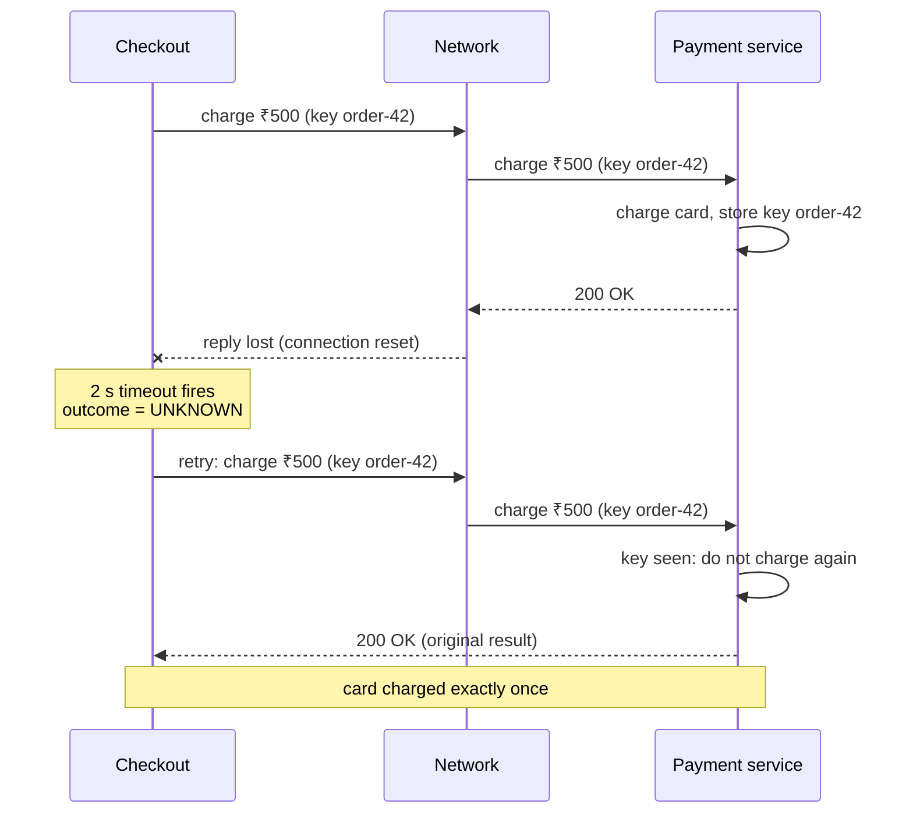
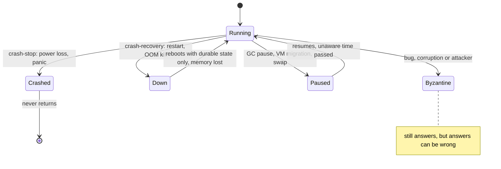

# Distributed Systems Fundamentals

> [!summary] TL;DR
> A **distributed system** is a set of programs on different machines that cooperate by sending messages over a network. Any message can be lost, delayed or duplicated, and any machine can stop or slow down while the others keep going, so a caller that hears nothing cannot tell whether its request failed, succeeded, or is still running.

> [!abstract] Core idea
> - **Partial failure** is normal: one part breaks while the rest keeps running.
> - A timeout tells you that you stopped waiting, not that the other side failed. The outcome is **unknown**.
> - So every remote write must be safe to repeat (idempotent) or checkable afterwards.
> - You design against a **system model**: which failures you assume can happen (crash, restart, lies) and how slow things can get.
> - Classic mistake: treating a remote call like a local function call that either returns or throws.

## 1. Why it exists

A single process either works or crashes as a whole. Spread the same program over machines and a new kind of failure appears: **partial failure**, where some parts work and some do not, and nobody has a complete view.

A concrete scenario. A checkout service calls a payment service to charge ₹500, with a 2-second timeout.

1. The request reaches the payment service, which charges the card.
2. The reply packet is lost (a switch drops it, or the connection is reset).
3. After 2 seconds the checkout service gives up with `context deadline exceeded`.

The checkout service now has three possible worlds: the charge never happened, it happened, or it is still in progress. Nothing in the error tells them apart. A naive retry charges ₹1,000. Never retrying loses sales. This note is about the rules that make such situations manageable.

The numbers make it worse as systems grow:

- **Serial dependencies multiply.** If a request needs 10 services and each is up 99.9% of the time, the request succeeds `0.999^10 ≈ 99.0%` of the time (arithmetic): ten times the downtime of any one service.
- **Fan-out amplifies tails.** If one server is slow (over 1 s) on 1% of requests, a request that fans out to 100 servers is slow `1 − 0.99^100 ≈ 63%` of the time. This is the example from *The Tail at Scale*.
- **The network is slow compared with memory.** A round trip inside one data centre is about 0.5 ms, and California to the Netherlands and back is about 150 ms (Jeff Dean's "numbers everyone should know"; treat them as orders of magnitude). A chatty design that makes 50 sequential cross-region calls spends 7.5 s on the wire.

## 2. Mental model

Think of the network as a **postal service with no tracking**. You post a letter and wait for a reply.

- If a reply arrives, you know the letter arrived and was acted on.
- If no reply arrives, you do not know whether the letter got lost, the reply got lost, the recipient is on holiday, or the recipient is still writing.
- Posting the same letter again might make the recipient act twice, unless the letter says "if you already did order #42, ignore this".

Three ideas follow from this picture and run through the whole folder:

1. **Unknown is a real outcome.** Code paths must handle "maybe".
2. **Make repeats harmless** with idempotency keys, so "maybe" can be resolved by retrying ([[Idempotency and Idempotency Keys]]).
3. **Suspect, do not know.** A node that stays silent is *suspected* dead. You never get proof.

### The eight fallacies

Peter Deutsch (with an eighth added by James Gosling) listed the assumptions that newcomers make and that fail in production. Each one maps to a concrete design rule.

| Fallacy | What actually happens | Design response |
| --- | --- | --- |
| 1. The network is reliable | Packets drop, connections reset, links partition | Timeouts, retries with idempotency, [[Delivery Semantics and Exactly-Once]] |
| 2. Latency is zero | Each hop costs 0.5 ms in a DC and up to 150 ms across the world | Batch calls, avoid chatty APIs, keep calls in-region |
| 3. Bandwidth is infinite | Large payloads saturate NICs and cross-AZ links cost money | Pagination, compression, streaming |
| 4. The network is secure | Traffic can be read or forged inside the DC | mTLS, authentication on internal calls |
| 5. Topology doesn't change | Pods move, IPs change, nodes join and leave | Service discovery, health checks, short DNS TTLs |
| 6. There is one administrator | Many teams, many configs, many rollout schedules | Versioned APIs, backward compatibility |
| 7. Transport cost is zero | Serialization CPU and egress fees are real | Efficient encodings (Protobuf), co-location |
| 8. The network is homogeneous | Mixed hardware, kernels, languages and middleboxes | Standard protocols, explicit timeouts at every hop |

## 3. How it works

### What the caller can conclude

Every remote call ends in one of three states for the caller: **succeeded** (a reply said so), **failed** (a reply said nothing was done), or **unknown** (no reply). The sequence below shows how the unknown state arises even though the server did its job.



### System models: what can go wrong

Before reasoning about an algorithm you fix a **system model**: an explicit list of the failures you assume are possible. There are two independent axes.

**Timing (how slow can things be?):**

- **Synchronous:** every message and every step has a known upper bound on delay. Easy to reason about, but real networks and garbage-collected processes do not give such bounds.
- **Asynchronous:** no bound at all. A message may take any finite time. Here, the **FLP result** (1985) proves that no deterministic algorithm can guarantee consensus if even one process may crash, because a crashed process and a very slow one look identical.
- **Partially synchronous:** the system behaves asynchronously for a while but eventually respects bounds. This is the realistic model, and Raft and Paxos are designed for it: they are always safe, and they make progress whenever the network behaves well for long enough.

**Node failures (how can a machine misbehave?):**



- **Crash-stop:** a node runs correctly until it stops forever.
- **Crash-recovery:** a node can stop and come back, keeping only what it wrote to durable storage. Most databases and consensus systems assume this model, which is why they `fsync` before acknowledging.
- **Byzantine:** a node may send wrong or contradictory messages. Tolerating `f` such nodes needs at least `3f + 1` nodes. Ordinary backends inside one organisation assume non-Byzantine nodes and guard against corruption with checksums. Blockchains and some aerospace systems use Byzantine tolerance.
- **Process pauses** are not a separate model but matter in every model: a node paused for 10 s by a stop-the-world GC or a VM migration wakes up and keeps acting on stale beliefs, such as "I still hold the lock". See [[Distributed Locks and Fencing Tokens]].

**Links (how can messages misbehave?):** reliable links deliver every message exactly once; **fair-loss** links may drop, duplicate or reorder, but a message sent infinitely often eventually arrives. TCP turns fair-loss packets into a reliable byte stream *while the connection lives*, but a reset connection still leaves the application not knowing what the other side processed.

### Partitions, gray failures and suspicion

- **Network partition:** some nodes can talk to each other but not to the others. A partition need not be a cut cable: a full queue, a misconfigured firewall rule or a long GC pause produces the same symptoms. How systems choose between consistency and availability during a partition is [[CAP and PACELC]].
- **Gray failure:** a component is broken for its users but looks healthy to its monitor. Huang et al. (HotOS 2017) call this *differential observability*. Example: a server answers health checks on a separate thread while every real request times out because its disk is failing.
- **Failure detection is suspicion.** A detector marks a node "suspected" after a silence longer than a timeout. Short timeouts declare slow nodes dead (false positives that trigger needless failovers). Long timeouts leave users waiting on dead nodes. Adaptive detectors, gossip and membership are in [[Failure Detection, Gossip and Membership]].
- **No shared clock.** Each machine's clock drifts and can jump. Ordering events across machines needs logical clocks or bounded-uncertainty clocks, covered in [[Clocks and Ordering]].

## 4. Worked example

### Whiteboard version

The core rule in code: a remote call has three outcomes, and the timeout case must be treated as "maybe".

```go
package wbfund

import (
	"context"
	"errors"
	"time"
)

// CallPayment shows the three answers a remote call can give.
func CallPayment(ctx context.Context, pay func(context.Context) error) string {
	ctx, cancel := context.WithTimeout(ctx, 2*time.Second)
	defer cancel()
	err := pay(ctx)
	switch {
	case err == nil:
		return "succeeded"
	case errors.Is(err, context.DeadlineExceeded):
		return "unknown: maybe charged, check before retrying"
	default:
		return "failed"
	}
}
```

### The full example: a lost reply and a fooled detector

The package below models the two facts this note is about:

1. `LossyLink` delivers every request but drops chosen replies. Without an idempotency key, the natural retry double-charges. With a key, the server deduplicates.
2. `Detector` is the simplest failure detector: a fixed timeout on heartbeats. It shows both limits of detection: a slow node is suspected and then cleared, and a gray-failing node keeps sending heartbeats so it is never suspected.

Time is injected (`now func() time.Time`) so the tests are deterministic.

```go
// Package fundamentals models two facts of distributed systems:
// a lost reply makes the outcome of a call unknown, and a timeout-based
// failure detector can only suspect a node, never know it is dead.
package fundamentals

import (
	"context"
	"errors"
	"sync"
	"time"
)

// Outcome is what the caller knows after a remote call.
type Outcome int

const (
	Succeeded Outcome = iota // a reply said it worked
	Failed                   // a reply said it did not happen
	Unknown                  // no reply: it may or may not have happened
)

func (o Outcome) String() string {
	return [...]string{"succeeded", "failed", "unknown"}[o]
}

// ErrRejected is a definite answer from the server: nothing was applied.
var ErrRejected = errors.New("rejected by server")

// ErrReplyLost stands for a reset connection or a dropped response packet.
var ErrReplyLost = errors.New("connection reset before reply")

// Classify maps a call's error to what the caller can safely conclude.
func Classify(err error) Outcome {
	switch {
	case err == nil:
		return Succeeded
	case errors.Is(err, context.DeadlineExceeded), errors.Is(err, ErrReplyLost):
		return Unknown
	default:
		return Failed
	}
}

// Ledger is a toy payment server. With a non-empty key it is idempotent.
type Ledger struct {
	mu      sync.Mutex
	charges []int
	seen    map[string]bool
}

func NewLedger() *Ledger { return &Ledger{seen: map[string]bool{}} }

// Charge applies a charge once per idempotency key ("" means no key).
func (l *Ledger) Charge(key string, cents int) {
	l.mu.Lock()
	defer l.mu.Unlock()
	if key != "" && l.seen[key] {
		return // duplicate: already applied, do nothing
	}
	if key != "" {
		l.seen[key] = true
	}
	l.charges = append(l.charges, cents)
}

// Total is the sum of applied charges.
func (l *Ledger) Total() int {
	l.mu.Lock()
	defer l.mu.Unlock()
	t := 0
	for _, c := range l.charges {
		t += c
	}
	return t
}

// LossyLink delivers every request to the ledger but drops the replies
// of the calls whose number (1-based) is in DropReply.
type LossyLink struct {
	Ledger    *Ledger
	DropReply map[int]bool
	calls     int
}

// Charge sends one request over the link.
func (n *LossyLink) Charge(key string, cents int) error {
	n.calls++
	n.Ledger.Charge(key, cents) // the server does the work...
	if n.DropReply[n.calls] {
		return ErrReplyLost // ...but the caller never hears about it
	}
	return nil
}

// Detector is a fixed-timeout heartbeat failure detector.
type Detector struct {
	timeout time.Duration
	now     func() time.Time
	mu      sync.Mutex
	last    map[string]time.Time
}

func NewDetector(timeout time.Duration, now func() time.Time) *Detector {
	return &Detector{timeout: timeout, now: now, last: map[string]time.Time{}}
}

// Heartbeat records that node was heard from just now.
func (d *Detector) Heartbeat(node string) {
	d.mu.Lock()
	defer d.mu.Unlock()
	d.last[node] = d.now()
}

// Suspected reports whether node has been silent for longer than the timeout.
// It is a guess: a slow network and a dead node look the same.
func (d *Detector) Suspected(node string) bool {
	d.mu.Lock()
	defer d.mu.Unlock()
	t, ok := d.last[node]
	return !ok || d.now().Sub(t) > d.timeout
}
```

The tests trace the scenarios from sections 1 and 3:

```go
package fundamentals

import (
	"context"
	"fmt"
	"testing"
	"time"
)

func TestClassify(t *testing.T) {
	cases := []struct {
		err  error
		want Outcome
	}{
		{nil, Succeeded},
		{ErrRejected, Failed},
		{ErrReplyLost, Unknown},
		{fmt.Errorf("charge: %w", context.DeadlineExceeded), Unknown},
	}
	for _, c := range cases {
		if got := Classify(c.err); got != c.want {
			t.Errorf("Classify(%v) = %v, want %v", c.err, got, c.want)
		}
	}
}

func TestLostReplyWithoutKeyDoubleCharges(t *testing.T) {
	link := &LossyLink{Ledger: NewLedger(), DropReply: map[int]bool{1: true}}
	err := link.Charge("", 500)
	if Classify(err) != Unknown {
		t.Fatalf("first call: want unknown, got %v", Classify(err))
	}
	if err := link.Charge("", 500); err != nil { // naive retry
		t.Fatal(err)
	}
	if got := link.Ledger.Total(); got != 1000 {
		t.Fatalf("total = %d, want 1000 (charged twice)", got)
	}
}

func TestLostReplyWithKeyChargesOnce(t *testing.T) {
	link := &LossyLink{Ledger: NewLedger(), DropReply: map[int]bool{1: true}}
	_ = link.Charge("order-42", 500)
	if err := link.Charge("order-42", 500); err != nil {
		t.Fatal(err)
	}
	if got := link.Ledger.Total(); got != 500 {
		t.Fatalf("total = %d, want 500", got)
	}
}

func TestDetectorSuspectsAfterSilence(t *testing.T) {
	now := time.Unix(0, 0)
	d := NewDetector(3*time.Second, func() time.Time { return now })
	if !d.Suspected("db-2") {
		t.Fatal("never-heard node should be suspected")
	}
	d.Heartbeat("db-2")
	now = now.Add(3 * time.Second)
	if d.Suspected("db-2") {
		t.Fatal("exactly at the timeout should still be trusted")
	}
	now = now.Add(time.Millisecond)
	if !d.Suspected("db-2") {
		t.Fatal("silent past the timeout should be suspected")
	}
	d.Heartbeat("db-2") // it was only slow
	if d.Suspected("db-2") {
		t.Fatal("a late heartbeat clears the suspicion")
	}
}

// Gray failure: heartbeats flow, so the detector says healthy,
// while every real request fails.
func TestDetectorMissesGrayFailure(t *testing.T) {
	now := time.Unix(0, 0)
	d := NewDetector(3*time.Second, func() time.Time { return now })
	failed := 0
	for i := 0; i < 10; i++ {
		d.Heartbeat("api-7")
		if Classify(ErrRejected) == Failed { // every user request fails
			failed++
		}
		now = now.Add(time.Second)
	}
	if d.Suspected("api-7") || failed != 10 {
		t.Fatalf("suspected=%v failed=%d", d.Suspected("api-7"), failed)
	}
}

func TestDetectorConcurrent(t *testing.T) {
	d := NewDetector(time.Second, time.Now)
	done := make(chan struct{})
	for i := 0; i < 8; i++ {
		go func() {
			defer func() { done <- struct{}{} }()
			for j := 0; j < 100; j++ {
				d.Heartbeat("n")
				_ = d.Suspected("n")
			}
		}()
	}
	for i := 0; i < 8; i++ {
		<-done
	}
}
```

Run it (Go 1.24.4, macOS arm64):

```bash
go vet ./... && go test -race ./fundamentals
```

Trace of `TestLostReplyWithoutKeyDoubleCharges`:

| Step | Server ledger | Caller sees | Caller's conclusion |
| --- | --- | --- | --- |
| Call 1, reply dropped | ₹500 | `ErrReplyLost` | unknown |
| Call 2 (naive retry) | ₹1,000 | `nil` | succeeded, but the customer paid twice |

With the key `order-42` the second call finds the key already recorded and leaves the ledger at ₹500. That is the whole reason [[Idempotency and Idempotency Keys]] exists.

## 5. Variants and comparison

How the main system models compare, and which real systems assume which:

| Model | What it allows | Nodes needed to tolerate f faults | Used by |
| --- | --- | --- | --- |
| Crash-stop, synchronous | Nodes stop forever; delays bounded | f + 1 | Textbook algorithms; rarely realistic |
| Crash-recovery, partially synchronous | Nodes restart with durable state; delays eventually bounded | 2f + 1 (majority quorum) | Raft (etcd, Consul), Multi-Paxos (Spanner, DynamoDB per partition), ZooKeeper's ZAB |
| Byzantine, partially synchronous | Nodes may lie or send conflicting messages | 3f + 1 | PBFT, Tendermint, some blockchains |
| Asynchronous, crash | No timing bound at all | Deterministic consensus impossible (FLP) | Used only to prove limits; real systems add timeouts or randomness |

And the failure types a backend engineer meets weekly:

| Failure | Typical cause | Looks like | First defence |
| --- | --- | --- | --- |
| Crash | OOM kill, panic, host loss | Connection refused, reset | Replicas plus health checks |
| Omission | Dropped packet, full queue | Timeout | Timeout plus idempotent retry |
| Slowness | GC pause, noisy neighbour, hot partition | Timeout or high p99 | Timeouts, hedging, [[Bulkheads and Concurrency Limits]] |
| Partition | Bad route, firewall change | Some peers reachable, others not | Quorums, fencing tokens |
| Gray failure | Failing disk, half-broken dependency | Health checks pass, users fail | Health checks that exercise the real path; client-side outlier detection |
| Byzantine | Memory corruption, bad deploy, attacker | Wrong data | Checksums, validation, authentication |

## 6. Trade-offs and when not to use

Distribution is a cost you pay for something specific: scale beyond one machine, fault tolerance, or being close to users. Do not distribute without one of those reasons.

- **A single well-sized machine** (with a hot standby) handles far more than most products need, and it avoids partial failure entirely. A modular monolith on one database is the default until a measured limit forces a split.
- **Every network hop adds** latency, a failure mode, a timeout to tune and a retry policy to get right.
- **Stronger guarantees cost latency and availability.** Majority quorums need a round trip to other nodes on every write and stop accepting writes when a majority is unreachable.
- **Byzantine tolerance** costs 3f + 1 replicas and much more messaging; inside one company, authentication and checksums are cheaper answers to corruption.
- **Failure detection timeouts** trade speed for accuracy: there is no setting that is both fast and never wrong.

## 7. In production

- **Real systems:**
	- Kubernetes liveness and readiness probes are timeout-based failure detectors. A liveness probe that is too strict restarts pods during GC pauses or load spikes.
	- etcd and Consul use Raft and assume crash-recovery with durable logs. They stop accepting writes without a majority. See [[Consensus - Raft and Paxos]].
	- DynamoDB replicates each partition with a leader elected by Multi-Paxos. It is not a Dynamo-style leaderless store, despite the similar name.
	- Envoy's outlier detection ejects a host after consecutive 5xx responses, which catches some gray failures that health checks miss.
- **Failure modes → fixes:**
	- Duplicate side effects after a timeout → idempotency keys and deduplication on the server.
	- Health check passes while users fail (gray failure) → health checks that exercise the real dependency path, plus client-side error-rate tracking.
	- Failover storms from aggressive detectors → longer or adaptive timeouts, and requiring several observers to agree before declaring a node dead.
	- A paused node acts on stale beliefs (old leader keeps writing) → fencing tokens and leases with safety margins.
	- Cascading slowness from one slow dependency → timeouts, [[10 Distributed Systems & Resilience/Circuit Breaker|Circuit Breaker]], [[Bulkheads and Concurrency Limits]].
- **What to monitor:**
	- Timeout rate per dependency, separately from error rate.
	- p99 and p99.9 latency per hop, not only averages.
	- Unknown-outcome counts (timeouts on writes) and how many were later reconciled.
	- Failure-detector flaps: how often a node is marked down and then up again.

## 8. Deep dive

- **Why a timeout cannot be "correct".** In an asynchronous network no finite timeout separates "slow" from "dead". Any value you choose is a bet on the latency distribution. A common starting point is the dependency's measured p99.9 plus margin, revisited when the distribution changes. [[Timeouts, Retries and Backoff]] covers budgets and deadline propagation.
- **FLP in practice.** FLP says a deterministic protocol cannot guarantee that consensus *terminates* in a fully asynchronous system with one crash. Raft and Paxos escape it by never risking safety and only needing timing to behave eventually for liveness: during long instability they may elect leaders repeatedly and make no progress, but they never decide two different values.
- **Two Generals.** Two parties communicating over a lossy link cannot both be certain they agree to act, because the last acknowledgement can always be lost. That is why "exactly-once delivery" on the wire is impossible and systems build *effectively-once processing* from at-least-once delivery plus idempotency instead. See [[Delivery Semantics and Exactly-Once]].
- **Unknown outcomes need a resolution path.** Options, in order of preference: retry with the same idempotency key; query the remote side by key ("did order-42 get charged?"); wait for an asynchronous callback; run a periodic reconciliation job against the provider's records.
- **Metastable failures.** Some systems stay broken after the trigger disappears: a brief slowdown causes timeouts, timeouts cause retries, and the extra load keeps the system slow. Retry budgets and load shedding break the loop ([[Load Shedding and Graceful Degradation]]).
- **Tail at scale.** When one user request fans out to many servers, the slowest server sets the response time. Engineering for the tail (hedged requests, tied requests, micro-partitioning) matters more than lowering the median.
- **The end-to-end argument.** Reliability in a lower layer (TCP's retransmission) does not remove the need for checks at the application ends (did the payment get recorded exactly once?). Only the endpoints know what "done" means.

## 9. Interview questions

> [!question]- Your call to a payment API timed out. Did the payment fail?
> You do not know. The request may have been lost, processed with the reply lost, or still running. Treat the outcome as unknown: retry with the same idempotency key, or query the provider by that key, and reconcile later if neither answers.

> [!question]- Name the fallacies of distributed computing and the one that bites most often.
> Reliable network, zero latency, infinite bandwidth, secure network, fixed topology, one administrator, zero transport cost, homogeneous network. "The network is reliable" bites most often, because it leads to missing timeouts and non-idempotent retries.

> [!question]- What is a gray failure and why do health checks miss it?
> A component is failing for its real users but looks healthy to its monitor, for example a health endpoint that returns 200 while real requests hang on a broken disk. The monitor and the users observe different paths. Fix it by checking the real path and by tracking error rates on the client side.

> [!question]- Crash-stop, crash-recovery, Byzantine: which model do most databases assume, and what follows from it?
> Crash-recovery: a node can restart and keeps only what it made durable. So a node must persist its log (fsync) before acknowledging, and restarted nodes must catch up from others. Byzantine tolerance is not assumed; checksums handle corruption.

> [!question]- Trap: "TCP guarantees delivery, so I don't need retries or idempotency." True?
> No. TCP delivers bytes in order while the connection lives. If the connection resets, the application cannot tell which requests the server processed. Application-level retries with idempotency are still needed.

> [!question]- What does the FLP result mean for a system like etcd?
> No deterministic algorithm can guarantee that consensus finishes in a fully asynchronous system where one node may crash. etcd (Raft) stays safe always and makes progress only when timing is stable enough to elect a leader. During heavy instability it can stall, but it never commits conflicting values.

> [!question]- A request fans out to 100 backends, each slow 1% of the time. How often is the request slow?
> About `1 − 0.99^100 ≈ 63%`. Fan-out turns rare per-server slowness into the common case, which is why tail latency (p99, p99.9) and hedged requests matter more than averages.

## 10. Cheat sheet

- Partial failure is the default: parts fail while the rest runs.
- A remote call ends in succeeded, failed, or **unknown**. A timeout means unknown.
- Make writes idempotent (keys) so unknown can be resolved by retrying.
- System model = timing (sync, partial sync, async) × node failures (crash-stop, crash-recovery, Byzantine).
- Majority quorum tolerates f crashes with 2f + 1 nodes; Byzantine needs 3f + 1.
- Failure detection is suspicion; gray failures fool health checks.
- Availability multiplies across serial dependencies; fan-out amplifies tails.

## Links

- **Before this:** [[TCP - Handshake, Reliability, Flow and Congestion Control]], [[Context Package]]
- **Next:** [[Timeouts, Retries and Backoff]], [[10 Distributed Systems & Resilience/Circuit Breaker|Circuit Breaker]], [[CAP and PACELC]]
- **Compare with:** [[Failure Detection, Gossip and Membership]] (detection in depth), [[Clocks and Ordering]] (why there is no shared time), [[Replication]] (keeping copies in sync)
