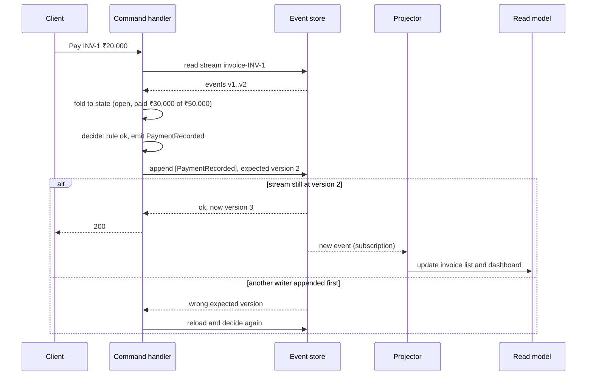
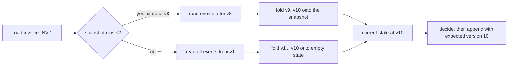

# Event Sourcing

> [!summary] TL;DR
> In **event sourcing** you do not store an entity's current state. You store the full list of **events** (facts such as `InvoiceIssued` or `PaymentRecorded`) that happened to it, and you compute the current state by replaying them in order. The event log is the source of truth; every table you query is derived from it.

> [!abstract] Core idea
> - Each aggregate (one invoice, one account) has its own append-only stream of past-tense events.
> - Current state = fold of the stream: start empty and apply each event in order.
> - Writes append with an **expected version**, so two concurrent writers cannot both succeed on stale state.
> - Queries are served by projections (read models) built from the events, which makes event sourcing almost always paired with CQRS.
> - Classic mistake: using Kafka alone as the event store. It cannot append "only if this invoice is still at version 7".

## 1. Why it exists

InvoiceOps stores invoices as rows: `status = 'paid', paid = 50000`. A customer disputes an invoice: "We paid ₹30,000 on 3 March and ₹20,000 on 9 March, and then you voided and reissued it." The row only says `paid`. The `updated_at` column says when it last changed, not what happened before.

Teams usually bolt on an audit table written by triggers or application code. Now there are two records of the truth, and they drift: a bulk fix applied with plain SQL updates the row and skips the audit.

Event sourcing turns this around. The history **is** the data:

| Version | Event | Data |
| --- | --- | --- |
| 1 | `InvoiceIssued` | customer acme, ₹50,000 |
| 2 | `PaymentRecorded` | ₹30,000 on 3 March |
| 3 | `PaymentRecorded` | ₹20,000 on 9 March |

"Status = paid" is computed from these three rows. Nothing can change state without leaving an event, so the audit trail cannot drift, and you can answer "what did this invoice look like on 5 March?" by replaying up to that date.

## 2. Mental model

A bank statement. The bank does not store "balance = ₹12,400" and overwrite it; it stores every deposit and withdrawal, and the balance is the sum. A chess game is the same: the list of moves is the record, and the board is what you get when you replay them.

Terms used below:

- **Event:** an immutable fact, named in the past tense, that happened to one aggregate.
- **Aggregate:** a cluster of data that is changed as one unit and guards its own rules, such as one invoice (from domain-driven design; see [[Domain-Driven Design - Tactical Patterns in Go]]).
- **Stream:** the ordered events of one aggregate, for example `invoice-INV-1`.
- **Fold (replay, rehydrate):** apply events one by one to an empty state to get the current state.
- **Projection:** a read model built by folding events into a shape made for queries (see [[CQRS]]).
- **Snapshot:** a saved copy of state at version N, so a load can start there instead of at event 1.

## 3. How it works

### The command cycle



Three rules make this work:

1. **Decide, then append.** The decision function reads state and returns events; it never mutates state. State changes only by applying events, so live writes and replays run the same code.
2. **Expected version.** The append carries the version the decision was based on. The store rejects it if anyone else appended in between. This is optimistic concurrency per aggregate (see [[Locking - Optimistic vs Pessimistic]]); no locks are held while deciding.
3. **Publish from the store.** Projectors subscribe to the event store itself, so there is no gap between "saved" and "published", the dual-write problem the outbox solves elsewhere (see [[Transactional Outbox and CDC]]).

### Loading with snapshots

A long-lived aggregate (a bank account with 40,000 transactions) would be slow to replay on every command. Take a snapshot every N events and fold only the tail:



A snapshot is a cache. It can be deleted at any time and rebuilt from events, so a bug in snapshot code is fixed by deleting snapshots, never by touching events.

### Designing events

- **Past tense and business-meaningful:** `PaymentRecorded`, not `InvoiceUpdated` or `SetPaidColumn`. An event should say why something changed.
- **Small and specific:** one fact per event. A giant `InvoiceChanged` with every field forces every consumer to diff.
- **Versioned:** carry a schema version, because events are kept forever and the code reading them will change (see [[Event Schemas and Schema Registry]]).
- **Self-contained enough:** include the data a projector needs (the amount, the currency), but not copies of other aggregates' state that will go stale.
- **No secrets or raw personal data:** events are immutable and replicated everywhere; see the GDPR section below.

## 4. Worked example

### Whiteboard version

State is a fold over events:

```go
package wb

type Event struct {
	Type   string
	Amount int64
}

type Account struct{ Balance int64 }

// Replay derives state; the state itself is never stored.
func Replay(events []Event) Account {
	var a Account
	for _, e := range events {
		switch e.Type {
		case "Deposited":
			a.Balance += e.Amount
		case "Withdrawn":
			a.Balance -= e.Amount
		}
	}
	return a
}
```

Everything else (expected versions, snapshots, upcasting) exists to make this fold safe under concurrency, fast for long streams and stable as the code evolves.

### Go: an event-sourced invoice

An in-memory event store with expected-version appends and snapshots, an invoice aggregate whose decisions return events, a repository that retries on version conflicts, and an upcaster that reads schema-version-1 events (which had no currency) as version 2. It passes `go vet` and `go test -race` on Go 1.24.

```go
package es

import (
	"encoding/json"
	"errors"
	"fmt"
	"sync"
)

// Event is one stored fact. Data is JSON, as in a real event store.
type Event struct {
	Stream        string // one stream per aggregate, e.g. "invoice-INV-1"
	Version       int    // 1, 2, 3 ... within the stream
	Type          string // past tense: InvoiceIssued, PaymentRecorded, InvoiceVoided
	SchemaVersion int
	Data          json.RawMessage
}

var ErrConcurrency = errors.New("expected version mismatch")

// ---- Event store ----

// Store is an append-only log of streams. Append succeeds only if the
// stream is still at expectedVersion: optimistic concurrency per aggregate.
type Store struct {
	mu        sync.Mutex
	streams   map[string][]Event
	snapshots map[string]Snapshot
}

type Snapshot struct {
	Version int
	State   Invoice
}

func NewStore() *Store {
	return &Store{streams: map[string][]Event{}, snapshots: map[string]Snapshot{}}
}

func (s *Store) Append(stream string, expectedVersion int, events []Event) error {
	s.mu.Lock()
	defer s.mu.Unlock()
	if len(s.streams[stream]) != expectedVersion {
		return fmt.Errorf("%w: stream %s at %d, expected %d",
			ErrConcurrency, stream, len(s.streams[stream]), expectedVersion)
	}
	for i := range events {
		events[i].Stream = stream
		events[i].Version = expectedVersion + i + 1
	}
	s.streams[stream] = append(s.streams[stream], events...)
	return nil
}

// Read returns the events after fromVersion.
func (s *Store) Read(stream string, fromVersion int) []Event {
	s.mu.Lock()
	defer s.mu.Unlock()
	all := s.streams[stream]
	if fromVersion >= len(all) {
		return nil
	}
	return append([]Event(nil), all[fromVersion:]...)
}

func (s *Store) SaveSnapshot(stream string, snap Snapshot) {
	s.mu.Lock()
	defer s.mu.Unlock()
	s.snapshots[stream] = snap
}

func (s *Store) LoadSnapshot(stream string) (Snapshot, bool) {
	s.mu.Lock()
	defer s.mu.Unlock()
	snap, ok := s.snapshots[stream]
	return snap, ok
}

// ---- Event payloads ----

type InvoiceIssued struct {
	Customer string `json:"customer"`
	Amount   int64  `json:"amount"`
	Currency string `json:"currency"` // added in schema version 2
}

type PaymentRecorded struct {
	Amount int64 `json:"amount"`
}

type InvoiceVoided struct {
	Reason string `json:"reason"`
}

// upcast turns old event shapes into the current one while reading.
// Stored events are never rewritten.
func upcast(e Event) Event {
	if e.Type == "InvoiceIssued" && e.SchemaVersion == 1 {
		var v1 struct {
			Customer string `json:"customer"`
			Amount   int64  `json:"amount"`
		}
		_ = json.Unmarshal(e.Data, &v1)
		e.Data, _ = json.Marshal(InvoiceIssued{Customer: v1.Customer, Amount: v1.Amount, Currency: "INR"})
		e.SchemaVersion = 2
	}
	return e
}

func newEvent(typ string, payload any) Event {
	data, _ := json.Marshal(payload)
	return Event{Type: typ, SchemaVersion: 2, Data: data}
}

// ---- Aggregate ----

type Status string

const (
	None Status = ""
	Open Status = "open"
	Paid Status = "paid"
	Void Status = "void"
)

// Invoice is current state, derived only by folding events.
type Invoice struct {
	ID       string
	Status   Status
	Customer string
	Currency string
	Amount   int64
	Paid     int64
	Version  int // number of events folded so far
}

func (inv *Invoice) apply(e Event) {
	e = upcast(e)
	switch e.Type {
	case "InvoiceIssued":
		var d InvoiceIssued
		_ = json.Unmarshal(e.Data, &d)
		inv.Status, inv.Customer, inv.Amount, inv.Currency = Open, d.Customer, d.Amount, d.Currency
	case "PaymentRecorded":
		var d PaymentRecorded
		_ = json.Unmarshal(e.Data, &d)
		inv.Paid += d.Amount
		if inv.Paid == inv.Amount {
			inv.Status = Paid
		}
	case "InvoiceVoided":
		inv.Status = Void
	}
	inv.Version = e.Version
}

// Decisions: check rules against current state and return new events.
// They never mutate state directly.

func (inv Invoice) Issue(customer string, amount int64) ([]Event, error) {
	if inv.Status != None {
		return nil, errors.New("invoice already issued")
	}
	if amount <= 0 {
		return nil, errors.New("amount must be positive")
	}
	return []Event{newEvent("InvoiceIssued", InvoiceIssued{Customer: customer, Amount: amount, Currency: "INR"})}, nil
}

func (inv Invoice) Pay(amount int64) ([]Event, error) {
	if inv.Status != Open {
		return nil, fmt.Errorf("cannot pay a %q invoice", inv.Status)
	}
	if inv.Paid+amount > inv.Amount {
		return nil, errors.New("overpayment")
	}
	return []Event{newEvent("PaymentRecorded", PaymentRecorded{Amount: amount})}, nil
}

func (inv Invoice) VoidIt(reason string) ([]Event, error) {
	if inv.Status != Open || inv.Paid > 0 {
		return nil, errors.New("only an unpaid open invoice can be voided")
	}
	return []Event{newEvent("InvoiceVoided", InvoiceVoided{Reason: reason})}, nil
}

// ---- Repository ----

type Repo struct {
	Store         *Store
	SnapshotEvery int // take a snapshot every N events (0 = never)
}

func stream(id string) string { return "invoice-" + id }

// Load starts from the latest snapshot and folds only the tail.
func (r *Repo) Load(id string) Invoice {
	inv := Invoice{ID: id}
	if snap, ok := r.Store.LoadSnapshot(stream(id)); ok {
		inv = snap.State
	}
	for _, e := range r.Store.Read(stream(id), inv.Version) {
		inv.apply(e)
	}
	return inv
}

// Handle runs load -> decide -> append, retrying when another writer
// appended to the same stream first.
func (r *Repo) Handle(id string, decide func(Invoice) ([]Event, error)) (Invoice, error) {
	for attempt := 0; attempt < 3; attempt++ {
		inv := r.Load(id)
		events, err := decide(inv)
		if err != nil {
			return inv, err
		}
		err = r.Store.Append(stream(id), inv.Version, events)
		if errors.Is(err, ErrConcurrency) {
			continue // reload and decide again on fresh state
		}
		if err != nil {
			return inv, err
		}
		before := inv.Version
		for _, e := range events {
			inv.apply(e)
		}
		if n := r.SnapshotEvery; n > 0 && inv.Version/n > before/n {
			r.Store.SaveSnapshot(stream(id), Snapshot{Version: inv.Version, State: inv})
		}
		return inv, nil
	}
	return Invoice{}, ErrConcurrency
}
```

The tests check the lifecycle, the conflict between two writers, eight concurrent payers racing for one invoice, snapshot-plus-tail against full replay, and upcasting:

```go
package es

import (
	"encoding/json"
	"errors"
	"sync"
	"testing"
)

func TestLifecycleIsAFoldOfEvents(t *testing.T) {
	r := &Repo{Store: NewStore()}
	if _, err := r.Handle("INV-1", func(i Invoice) ([]Event, error) { return i.Issue("acme", 50_000) }); err != nil {
		t.Fatal(err)
	}
	r.Handle("INV-1", func(i Invoice) ([]Event, error) { return i.Pay(30_000) })
	inv, err := r.Handle("INV-1", func(i Invoice) ([]Event, error) { return i.Pay(20_000) })
	if err != nil || inv.Status != Paid || inv.Version != 3 {
		t.Fatalf("inv %+v err %v", inv, err)
	}
	if _, err := r.Handle("INV-1", func(i Invoice) ([]Event, error) { return i.VoidIt("typo") }); err == nil {
		t.Fatal("voided a paid invoice")
	}
	if got := len(r.Store.Read("invoice-INV-1", 0)); got != 3 {
		t.Fatalf("%d events stored, rejected commands must not append", got)
	}
}

func TestExpectedVersionRejectsStaleWriter(t *testing.T) {
	s := NewStore()
	r := &Repo{Store: s}
	r.Handle("INV-1", func(i Invoice) ([]Event, error) { return i.Issue("acme", 50_000) })

	a, b := r.Load("INV-1"), r.Load("INV-1") // two writers read version 1
	ea, _ := a.Pay(50_000)
	eb, _ := b.Pay(50_000)
	if err := s.Append("invoice-INV-1", a.Version, ea); err != nil {
		t.Fatal(err)
	}
	if err := s.Append("invoice-INV-1", b.Version, eb); !errors.Is(err, ErrConcurrency) {
		t.Fatalf("err %v: second full payment must be rejected", err)
	}
}

func TestConcurrentHandlersNeverOverpay(t *testing.T) {
	r := &Repo{Store: NewStore()}
	r.Handle("INV-1", func(i Invoice) ([]Event, error) { return i.Issue("acme", 100) })
	var wg sync.WaitGroup
	for range 8 {
		wg.Add(1)
		go func() {
			defer wg.Done()
			r.Handle("INV-1", func(i Invoice) ([]Event, error) { return i.Pay(60) })
		}()
	}
	wg.Wait()
	if inv := r.Load("INV-1"); inv.Paid != 60 {
		t.Fatalf("paid %d, want exactly one payment of 60", inv.Paid)
	}
}

func TestSnapshotPlusTailEqualsFullReplay(t *testing.T) {
	s := NewStore()
	r := &Repo{Store: s, SnapshotEvery: 4}
	r.Handle("INV-1", func(i Invoice) ([]Event, error) { return i.Issue("acme", 1_000) })
	for range 9 {
		r.Handle("INV-1", func(i Invoice) ([]Event, error) { return i.Pay(100) })
	}
	snap, ok := s.LoadSnapshot("invoice-INV-1")
	if !ok || snap.Version != 8 {
		t.Fatalf("snapshot %+v ok %v, want version 8", snap, ok)
	}
	withSnap := r.Load("INV-1")
	full := (&Repo{Store: &Store{streams: s.streams, snapshots: map[string]Snapshot{}}}).Load("INV-1")
	if withSnap != full || full.Version != 10 || full.Paid != 900 {
		t.Fatalf("snapshot load %+v, full replay %+v", withSnap, full)
	}
}

func TestOldEventsAreUpcastOnRead(t *testing.T) {
	s := NewStore()
	v1, _ := json.Marshal(map[string]any{"customer": "acme", "amount": 700})
	s.Append("invoice-OLD", 0, []Event{{Type: "InvoiceIssued", SchemaVersion: 1, Data: v1}})
	inv := (&Repo{Store: s}).Load("OLD")
	if inv.Currency != "INR" || inv.Amount != 700 || inv.Status != Open {
		t.Fatalf("upcast failed: %+v", inv)
	}
	if s.Read("invoice-OLD", 0)[0].SchemaVersion != 1 {
		t.Fatal("stored event was rewritten")
	}
}
```

`TestConcurrentHandlersNeverOverpay` is the important one. Eight goroutines each try to pay 60 on an invoice of 100. Each reads state, decides "60 fits" and appends. The expected-version check lets exactly one append win; the others reload, see 60 already paid, and their decision rejects the overpayment.

### The same store in PostgreSQL 17

A relational event store is a single append-only table. The unique constraint is the expected-version check:

```sql
CREATE TABLE events (
    global_position bigint GENERATED ALWAYS AS IDENTITY PRIMARY KEY,
    stream_id       text        NOT NULL,          -- 'invoice-INV-1'
    version         int         NOT NULL,          -- 1, 2, 3 within the stream
    type            text        NOT NULL,          -- 'PaymentRecorded'
    schema_version  int         NOT NULL,
    data            jsonb       NOT NULL,
    metadata        jsonb       NOT NULL DEFAULT '{}',  -- correlation id, user, causation id
    recorded_at     timestamptz NOT NULL DEFAULT now(),
    UNIQUE (stream_id, version)
);

-- Append with expected version 2: the handler computed version 3.
INSERT INTO events (stream_id, version, type, schema_version, data)
VALUES ('invoice-INV-1', 3, 'PaymentRecorded', 2, '{"amount": 2000000}');  -- ₹20,000 in paise
-- A concurrent writer that also expected version 2 gets:
-- ERROR:  duplicate key value violates unique constraint "events_stream_id_version_key"

-- Load one aggregate: an index range scan on (stream_id, version)
SELECT version, type, schema_version, data
FROM events
WHERE stream_id = 'invoice-INV-1' AND version > 8
ORDER BY version;
```

Revoke `UPDATE` and `DELETE` on the table from the application role so "append-only" is enforced by the database, not by convention. `global_position` gives projectors one feed to follow, with the same caveat as any identity column: positions are allocated before commit, so a projector following it must handle commit-order gaps (see the deep dive in [[CQRS]]).

## 5. Variants and comparison

### Where to store events

| Option | Append with expected version | Read one aggregate | Subscriptions | Notes |
| --- | --- | --- | --- | --- |
| EventStoreDB / KurrentDB | Built in (expected revision on append) | Built in, per stream | Built in, catch-up and persistent | Purpose-built; another database to run |
| PostgreSQL append-only table | `UNIQUE (stream_id, version)` | Index range scan | Poll by global position, or logical decoding | Good default when you already run PostgreSQL |
| DynamoDB | Conditional put on `(stream_id, version)` | Query by partition key | DynamoDB Streams | Scales well; 400 KB item limit |
| Kafka alone | Not possible: no conditional append per key | Scan a whole partition and filter | Native | Good as the publication channel, weak as the store |
| Axon Server, Marten (on PostgreSQL) | Built in | Built in | Built in | Framework-specific |

### Event sourcing vs neighbours

| Approach | Source of truth | History | Cost |
| --- | --- | --- | --- |
| State + audit table | Current-state rows | Separate, can drift | Low |
| State + outbox events | Current-state rows | Events are notifications, may be pruned | Medium |
| Event sourcing | The event log | Complete by construction | High: projections, versioning, replays |
| Temporal tables (system-versioned) | Current rows + row history | Row-level, not business intent | Low to medium, database-specific |

## 6. Trade-offs and when not to use

- **Every query needs a projection.** "List invoices over ₹1 lakh" cannot be answered from streams; you need [[CQRS]] read models and their lag.
- **Events are forever.** A badly named or badly shaped event lives in the store for years; every reader must handle every version ever written.
- **Changing your mind is expensive.** Splitting one aggregate into two means migrating streams.
- **Personal data is hard to delete** from an immutable log (see GDPR below).
- **Learning curve.** Teams new to the pattern tend to model CRUD as `XCreated / XUpdated / XDeleted`, which gives all of the cost and none of the value.
- **Use it** for ledgers and wallets, audit-heavy domains (billing, insurance claims, healthcare orders), workflows where "how did we get here?" matters, and temporal queries ("state as of 31 March").
- **Do not use it** for CRUD screens, settings, catalogues and anything where history has no business value. Event sourcing is a per-aggregate decision, not a whole-system one: an event-sourced ledger can sit next to plain tables.

## 7. In production

- **Real systems:**
	- Accounting ledgers are the original event-sourced systems: journal entries are never edited, corrections are new entries (see [[Practice/Digital Wallet and Ledger]]).
	- Git is a loose analogy: history is append-only and commits are immutable, though each commit stores a full snapshot of the tree rather than only the change.
	- EventStoreDB/KurrentDB, Axon Framework (Java) and Marten (.NET on PostgreSQL) are the common purpose-built stores; many teams use a plain PostgreSQL table.
- **Failure modes → fixes:**
	- Concurrent writers both succeed → enforce expected version in the store (unique constraint or conditional put), never in application memory.
	- Aggregate loads get slow as streams grow → snapshots every N events, or split the aggregate along a time boundary ("closing the books": a `PeriodClosed` event starts a new stream with the opening balance).
	- Projection corrupted by a bug → fix and replay into a new read model, then switch.
	- Old events fail to deserialize after a deploy → upcasters, and a test that loads a sample of every historical event type and version.
	- Projector applies an event twice → track the last processed position per projection, in the same transaction as the read-model update.
- **What to monitor:**
	- Events per stream (p99 and max), which shows when snapshots are needed.
	- Append conflict rate: high rates mean a hot aggregate that needs splitting.
	- Projection lag per projector, and replay time for each.
	- Aggregate load latency.

## 8. Deep dive

### Upcasting and schema evolution

Events written in 2023 must still load in 2027. Options, from cheapest:

- **Weak schema:** add optional fields only, with defaults when absent.
- **Upcasting:** a function that converts version N to N+1 at read time, as the Go `upcast` does for the missing currency. Upcasters chain (v1 → v2 → v3), and the stored bytes never change.
- **Copy-and-transform:** write a new store with migrated events, then switch. Use it rarely, for example when splitting an aggregate.

Never edit stored events in place: projections already built from them, and every downstream consumer that saw them, would disagree with the store.

### GDPR erasure and crypto-shredding

GDPR Article 17 gives a person the right to have their personal data erased, but the event log is immutable. Two patterns:

- **Keep personal data out of events.** Store a `customer_id`; keep name, email and address in a normal table you can delete from.
- **Crypto-shredding.** Encrypt personal fields inside events with a per-person key held in a key store. To erase, delete the key: the ciphertext in every event, backup and replica becomes unreadable. Projections must treat "cannot decrypt" as "erased".

### Why Kafka alone is a weak event store

- **No conditional append.** Kafka cannot reject a write because the invoice moved past version 7, so two handlers can both append on stale state. (Kafka's idempotent producer prevents duplicates from retries; it does not provide per-key optimistic concurrency.)
- **No efficient per-aggregate read.** To load one invoice you read its whole partition and filter.
- **Retention and compaction are easy to get wrong.** The default time-based retention (`retention.ms`, 7 days) deletes old events unless you set it to keep data forever, and compaction keeps only the latest record per key, which is state, not history.

A common, sound design: PostgreSQL or EventStoreDB as the store, and Kafka as the channel that publishes committed events to other services (see [[Kafka and Event Streaming]]).

### Ordering and projections

Within one stream, order is total. Across streams there is no meaningful order except the store's global position. Projectors that combine streams (a per-customer dashboard) must either follow the global position or tolerate events from different invoices arriving in any order, which works when their updates commute (sum, count). Projectors must be idempotent, because subscriptions deliver at least once (see [[Delivery Semantics and Exactly-Once]]).

### Side effects during replay

Replaying events must rebuild state, not resend emails or recharge cards. Keep side effects out of `apply`; trigger them from a dedicated subscriber that records which events it has handled.

## 9. Interview questions

> [!question]- What is the difference between event sourcing and keeping an audit log?
> With an audit log, current-state rows are the truth and the log is a side record that can drift or be skipped. With event sourcing, the events are the truth and state is derived from them, so the history is complete by construction and can be replayed into any new view.

> [!question]- How do you prevent two concurrent commands from corrupting one aggregate?
> Load the stream, decide, and append with the version you loaded. The store accepts the append only if the stream is still at that version (a unique `(stream_id, version)` constraint, a conditional put, or the store's expected-revision check). The loser reloads and decides again.

> [!question]- (Trap) Can Kafka be your event store?
> Not on its own. It has no per-key conditional append, so it cannot enforce expected versions, and loading one aggregate means scanning a partition. Default retention (7 days) and compaction also discard history unless the topic is configured to keep everything forever. Use a store with expected-version appends, and Kafka to publish committed events.

> [!question]- An aggregate has 200,000 events and loads slowly. What do you do?
> Snapshot every N events and fold only the tail. If the aggregate grows without bound (an account over years), split it by period: close the period with an event carrying the closing balance and start a new stream. Also check whether it is really one aggregate.

> [!question]- How do you change an event's schema after it has been in production for a year?
> Add a schema version and write an upcaster that converts old versions to the new shape at read time; never rewrite stored events. For additive changes, optional fields with defaults are enough. Test by loading samples of every historical version.

> [!question]- A user asks you to delete their personal data. How, with an immutable log?
> Keep personal data out of events where possible (reference ids instead). Where it must be there, encrypt it with a per-user key and delete the key (crypto-shredding). Projections show the data as erased, and backups become unreadable for that user too.

> [!question]- When would you not use event sourcing?
> For CRUD data with no business value in its history: settings, catalogues, profiles. The costs (projections, versioning, replays, eventual consistency of reads) only pay off when history, audit or temporal queries matter. Apply it per aggregate, not system-wide.

## 10. Cheat sheet

- Store events, derive state by folding; the log is the source of truth.
- One stream per aggregate; append with expected version for optimistic concurrency.
- Decide returns events; apply mutates state; replays reuse apply.
- Snapshots every N events are a disposable cache; split unbounded streams by period.
- Events: past tense, small, versioned; upcast on read; never edit in place.
- Queries need projections (CQRS), which are eventually consistent and idempotent.
- GDPR: keep PII out of events or crypto-shred it.
- Kafka publishes events well but cannot be the store alone.

## Links

- **Before this:** [[CQRS]], [[Transactions and ACID]], [[Locking - Optimistic vs Pessimistic]], [[Event-Driven Architecture Basics]]
- **Next:** [[Saga Pattern]], [[Practice/Digital Wallet and Ledger]], [[Event Schemas and Schema Registry]]
- **Compare with:** [[Transactional Outbox and CDC]] (state stays the truth, events are notifications), [[Kafka and Event Streaming]] (a log for publishing, not an aggregate store)
