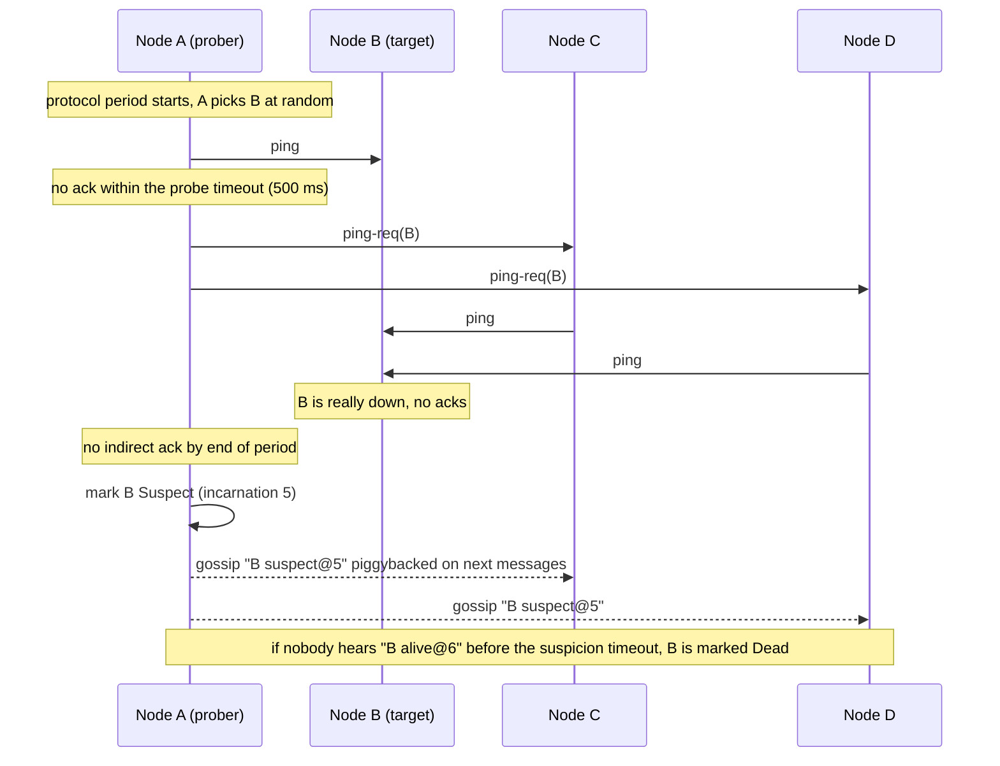
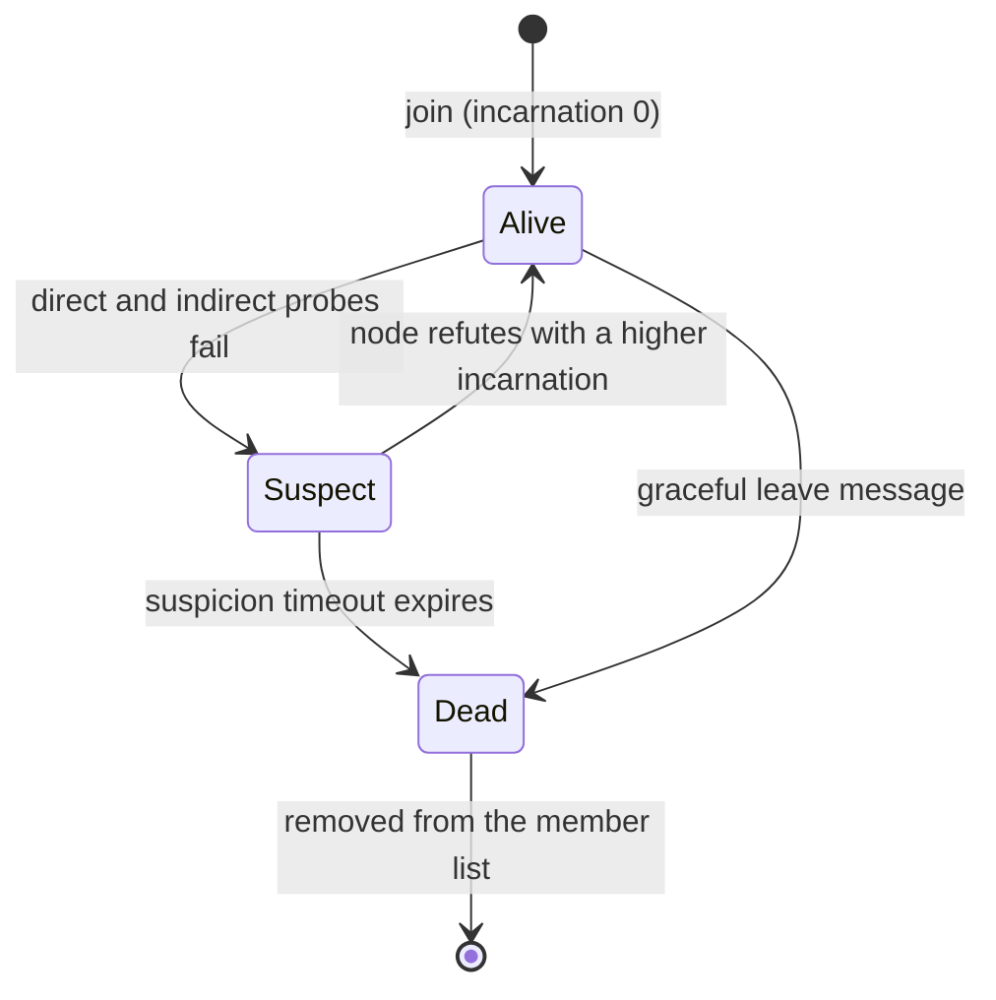

# Failure Detection, Gossip and Membership

> [!summary] TL;DR
> In a cluster, every node needs to know which other nodes are alive. A **failure detector** guesses that a node is dead when its heartbeats stop arriving; it can only guess, because a slow node looks exactly like a dead one. **Gossip** spreads that knowledge: each node periodically tells a few random peers what it knows, and news reaches all `N` nodes in about `log N` rounds.

> [!abstract] Core idea
> - You cannot tell "crashed" from "slow" over a network, so every failure detector trades speed of detection against false alarms.
> - **Phi accrual** outputs a suspicion level based on how late a heartbeat is compared with the node's normal rhythm, instead of a fixed timeout.
> - **SWIM** probes one random member per period, asks others to probe indirectly before suspecting, and lets a suspected node refute the rumour.
> - **Gossip** (epidemic) dissemination spreads updates in `O(log N)` rounds with constant load per node; **Merkle-tree anti-entropy** repairs data that gossip missed.
> - Classic mistake: having every node heartbeat every other node. That is `N²` messages per interval: 1,000 nodes means about a million messages every heartbeat interval.

## 1. Why it exists

A 300-node Cassandra cluster loses a node to a kernel panic. Coordinators keep sending it reads and writes; each one waits for a timeout, latency climbs, and the client retries make it worse. The cluster needs to learn, within seconds, "node 47 is down: stop routing to it, store hints for it, and replace it if it does not come back". Every node needs the same answer, without a central server that would itself be a single point of failure.

Three separate jobs hide in that sentence:

1. **Detect:** decide that node 47 has probably failed.
2. **Disseminate:** tell all other nodes, cheaply.
3. **Agree on membership:** keep a list of members and their states that converges on every node.

## 2. Mental model

**Detector properties** (Chandra and Toueg, 1996):

- **Completeness:** every crashed node is eventually suspected by every correct node.
- **Accuracy:** correct nodes are not suspected (or, in the weaker form, eventually not suspected).

You cannot have perfect accuracy and fast completeness at the same time on an asynchronous network. A short timeout catches crashes quickly and flags healthy nodes during a GC pause; a long one is accurate and slow.

**Analogy.** Rumours in an office. You do not phone all 300 colleagues when you hear news; you tell 3 people you happen to meet, each of them tells 3 more, and within a lunch break everyone knows. Before you declare that Sam has left the company because Sam missed a meeting, you ask two other people to check on Sam, and if Sam hears the rumour, Sam can say "I'm still here".

## 3. How it works

### Heartbeats and timeouts

The basic detector: node B expects a heartbeat from A every `T` seconds and suspects A after `k × T` of silence. All-to-all heartbeats cost `N²` messages per period; heartbeating to a central monitor costs `N` but creates a single point of failure. Gossip and SWIM keep the per-node cost constant.

### Phi accrual

Instead of answering "dead or alive", the phi accrual detector (Hayashibara et al., 2004) outputs a suspicion level:

`phi = -log10( P(the next heartbeat arrives later than now) )`

It learns the distribution of recent heartbeat gaps from a sliding window. If heartbeats usually arrive every 1 s and it has been 1 s, phi is low; after 18 s, phi is high. The application picks a threshold: Cassandra convicts a node when phi exceeds `phi_convict_threshold`, default 8. Because the model adapts to each node's normal rhythm, a node on a jittery link is not convicted for jitter it always has.

With exponentially distributed gaps (Cassandra's approximation), `phi = elapsed / (mean × ln 10)`. For a 1 s mean gap:

| Silence | phi | Chance the node is alive and just late |
| --- | --- | --- |
| 1 s | 0.43 | about 37% |
| 5 s | 2.17 | about 0.7% |
| 18 s | 7.82 | about 1.5 in 10⁸ |
| 19 s | 8.25 | about 5.6 in 10⁹, convict at threshold 8 |

### SWIM

SWIM (2002) separates detection from dissemination and keeps both at constant cost per node.



1. **Probe:** every protocol period (memberlist's LAN default: 1 s), each node pings one random member.
2. **Indirect probe:** if no ack arrives within the probe timeout (500 ms), it asks `k` other members (3 by default) to ping the target on its behalf. This filters out a bad link between just two nodes.
3. **Suspect:** still no ack → mark the target **Suspect**, not Dead, and gossip that.
4. **Refute:** the suspected node, on hearing the rumour, increments its **incarnation number** and gossips "Alive" with the higher incarnation. Only the node itself may raise its incarnation.
5. **Confirm:** if the suspicion timeout passes without a refutation, the member is marked **Dead** and removed.
6. **Disseminate:** membership updates ride piggybacked on ping and ack messages (infection style), so there are no extra messages.

### Member states



The merge rule that makes every node converge: Dead is final in this simplified model (a dead node rejoins as a new member); otherwise a higher incarnation wins, and at the same incarnation Dead beats Suspect beats Alive. So "Suspect@5" overrides "Alive@5", and only "Alive@6", sent by the node itself, clears it.

### Gossip dissemination

Each round, each node that knows an update sends it to `f` random peers (the **fanout**). The number of informed nodes roughly multiplies each round, then a tail of rounds catches the last few nodes.

**Measured:** a push-gossip simulation in Go 1.24, 100 seeded runs per row, counting rounds until every node knows an update started at one node.

| Nodes | Fanout 1: average (worst) rounds | Fanout 3: average (worst) rounds |
| --- | --- | --- |
| 100 | 12.5 (19) | 5.8 (8) |
| 1,000 | 18.2 (22) | 8.2 (9) |
| 10,000 | 23.6 (29) | 10.5 (12) |

Going from 1,000 to 10,000 nodes adds only about 2 rounds at fanout 3: logarithmic growth. With memberlist's 200 ms gossip interval, 9 rounds is under 2 seconds.

## 4. Worked example

### Whiteboard version

```text
phi detector:
    on heartbeat(now): window.push(now - last); last = now
    phi(now) = (now - last) / (mean(window) * ln 10)
    suspect if phi > 8

membership merge(current, incoming):
    if current is Dead: keep current
    if incoming.inc > current.inc: take incoming
    if same inc and rank(incoming) > rank(current): take incoming   # Alive < Suspect < Dead
    else keep current

on hearing "me Suspect@inc": broadcast "me Alive@(inc+1)"
```

### Go: phi accrual detector and SWIM merge rules

Time is passed in by the caller, so tests are deterministic. It passes `go vet` and `go test -race` on Go 1.24.

```go
package failure

import (
	"math"
	"time"
)

// PhiDetector is a phi-accrual failure detector. Instead of a yes/no answer
// it reports phi = -log10(P(a heartbeat this late)). Inter-arrival times are
// modelled as exponential (as Cassandra does), so phi = elapsed / (mean * ln 10).
type PhiDetector struct {
	window  []time.Duration // recent heartbeat gaps
	size    int
	last    time.Time
	hasLast bool
}

func NewPhiDetector(windowSize int) *PhiDetector { return &PhiDetector{size: windowSize} }

// Heartbeat records a heartbeat that arrived at now.
func (d *PhiDetector) Heartbeat(now time.Time) {
	if d.hasLast {
		d.window = append(d.window, now.Sub(d.last))
		if len(d.window) > d.size {
			d.window = d.window[1:]
		}
	}
	d.last, d.hasLast = now, true
}

// Phi returns the suspicion level at now. 1 means about a 10% chance the
// node is alive and merely slow, 2 means 1%, 8 means 0.000001%.
func (d *PhiDetector) Phi(now time.Time) float64 {
	if len(d.window) == 0 {
		return 0
	}
	var sum time.Duration
	for _, g := range d.window {
		sum += g
	}
	mean := sum.Seconds() / float64(len(d.window))
	elapsed := now.Sub(d.last).Seconds()
	return elapsed / (mean * math.Ln10)
}

// Status of a member in a SWIM-style membership list.
type Status int

const (
	Alive Status = iota
	Suspect
	Dead
)

// Member is what gossip carries about one node. Incarnation is a counter only
// the node itself increments, to refute suspicion about itself.
type Member struct {
	Status      Status
	Incarnation uint64
}

// Merge decides whether gossip about a node overrides what we know.
// Higher incarnation wins; at equal incarnation Dead > Suspect > Alive.
// So "Suspect@5" beats "Alive@5", and the node refutes it with "Alive@6".
func Merge(current, incoming Member) Member {
	if current.Status == Dead {
		return current // dead is final; the node must rejoin with a new identity
	}
	if incoming.Incarnation > current.Incarnation {
		return incoming
	}
	if incoming.Incarnation == current.Incarnation && incoming.Status > current.Status {
		return incoming
	}
	return current
}

// Refute is what a node does when it hears it is suspected.
func Refute(self Member, rumour Member) Member {
	if rumour.Status != Alive && rumour.Incarnation >= self.Incarnation {
		return Member{Status: Alive, Incarnation: rumour.Incarnation + 1}
	}
	return self
}
```

The tests check the phi values in the table, that the same silence is alarming for a 1 s sender but routine for a 3 s sender, that the sliding window forgets old gaps, and every merge and refutation rule.

```go
package failure

import (
	"math"
	"testing"
	"time"
)

func TestPhiGrowsWithSilence(t *testing.T) {
	d := NewPhiDetector(100)
	start := time.Unix(0, 0)
	now := start
	for i := 0; i < 10; i++ { // steady 1s heartbeats
		d.Heartbeat(now)
		now = now.Add(time.Second)
	}
	last := now.Add(-time.Second)
	cases := []struct {
		after time.Duration
		want  float64
	}{
		{1 * time.Second, 1 / math.Ln10},   // 0.43: perfectly normal
		{5 * time.Second, 5 / math.Ln10},   // 2.17
		{18 * time.Second, 18 / math.Ln10}, // 7.82: just under 8
		{19 * time.Second, 19 / math.Ln10}, // 8.25: convict at threshold 8
	}
	for _, c := range cases {
		got := d.Phi(last.Add(c.after))
		if math.Abs(got-c.want) > 1e-9 {
			t.Fatalf("phi after %v = %.4f, want %.4f", c.after, got, c.want)
		}
	}
}

func TestPhiAdaptsToSlowerHeartbeats(t *testing.T) {
	fast, slow := NewPhiDetector(100), NewPhiDetector(100)
	t0 := time.Unix(0, 0)
	for i := 0; i <= 10; i++ {
		fast.Heartbeat(t0.Add(time.Duration(i) * time.Second))
		slow.Heartbeat(t0.Add(time.Duration(i) * 3 * time.Second))
	}
	// The same 6s of silence is alarming for a 1s sender and routine for a 3s one.
	pf := fast.Phi(t0.Add(10*time.Second + 6*time.Second))
	ps := slow.Phi(t0.Add(30*time.Second + 6*time.Second))
	if !(pf > 2.5 && ps < 1) {
		t.Fatalf("phi fast=%.2f slow=%.2f", pf, ps)
	}
}

func TestWindowDropsOldGaps(t *testing.T) {
	d := NewPhiDetector(3)
	t0 := time.Unix(0, 0)
	for _, s := range []int{0, 10, 20, 21, 22, 23} { // gaps 10,10,1,1,1
		d.Heartbeat(t0.Add(time.Duration(s) * time.Second))
	}
	got := d.Phi(t0.Add(24 * time.Second)) // mean of last 3 gaps = 1s
	if math.Abs(got-1/math.Ln10) > 1e-9 {
		t.Fatalf("phi = %.4f, want %.4f", got, 1/math.Ln10)
	}
}

func TestMergeRules(t *testing.T) {
	cases := []struct {
		name          string
		cur, in, want Member
	}{
		{"suspect beats alive at same incarnation", Member{Alive, 5}, Member{Suspect, 5}, Member{Suspect, 5}},
		{"alive at same incarnation does not clear suspicion", Member{Suspect, 5}, Member{Alive, 5}, Member{Suspect, 5}},
		{"refutation with higher incarnation clears it", Member{Suspect, 5}, Member{Alive, 6}, Member{Alive, 6}},
		{"old rumour is ignored", Member{Alive, 6}, Member{Suspect, 5}, Member{Alive, 6}},
		{"dead is final", Member{Dead, 5}, Member{Alive, 9}, Member{Dead, 5}},
		{"dead beats suspect", Member{Suspect, 5}, Member{Dead, 5}, Member{Dead, 5}},
	}
	for _, c := range cases {
		if got := Merge(c.cur, c.in); got != c.want {
			t.Errorf("%s: got %+v, want %+v", c.name, got, c.want)
		}
	}
}

func TestRefute(t *testing.T) {
	self := Member{Alive, 5}
	got := Refute(self, Member{Suspect, 5})
	if got != (Member{Alive, 6}) {
		t.Fatalf("got %+v, want Alive@6", got)
	}
	// Everyone else accepts the refutation.
	if m := Merge(Member{Suspect, 5}, got); m != got {
		t.Fatalf("peer kept %+v", m)
	}
}
```

## 5. Variants and comparison

| Technique | How it works | Use when | Cost |
| --- | --- | --- | --- |
| Fixed-timeout heartbeat | Suspect after `k` missed intervals | Small clusters, a leader watching followers (Raft heartbeats) | One number to tune for every network condition |
| Central monitor | Every node heartbeats a coordinator or registers a lease in etcd/ZooKeeper | You already run a coordination service; you need one authoritative view | Coordinator load grows with `N`; it must itself be highly available |
| All-to-all heartbeats | Every node pings every node | Very small groups only | `N²` messages per interval |
| Phi accrual | Suspicion level from the observed gap distribution | Varied or jittery networks (Cassandra, Akka Cluster) | Window per peer; still needs a threshold |
| SWIM | Random probe + indirect probes + suspicion + incarnation; piggybacked gossip | Large clusters needing membership without a coordinator | Weakly consistent: nodes may briefly disagree |
| SWIM + Lifeguard (memberlist) | Nodes that notice they are slow (missed acks) widen their own timeouts; suspicion timeouts shrink as more peers confirm | Production SWIM | More tuning knobs |
| Anti-entropy (Merkle trees) | Replicas compare hash trees of their data and stream only differing ranges | Repairing data after missed writes (Dynamo, Cassandra repair) | CPU and I/O to build trees; run periodically |

## 6. Trade-offs and when not to use

- **Speed vs false positives.** Lower thresholds detect crashes faster and cause more flapping during GC pauses, CPU starvation or packet loss. False suspicion is not free: it triggers re-replication, hinted handoff or failover.
- **A detector is advice, not truth.** Never use "I think the leader is dead" as the only reason to start acting as leader. Pair detection with a lease or a consensus decision and fencing (see [[Leader Election]]).
- **Gossip is eventually consistent.** Two nodes may disagree about membership for a few rounds. That is fine for routing and monitoring and wrong for anything needing a single authoritative decision, such as which node owns a lock.
- **Small, fixed clusters do not need SWIM.** Three to five nodes behind a consensus protocol already have heartbeats in Raft; a Kubernetes deployment already has kubelet health checks and the node lifecycle controller.

## 7. In production

- **Real systems:**
	- **Cassandra:** each node gossips every second with up to three other nodes, exchanging heartbeat generations and versions per endpoint; phi accrual (threshold 8) marks peers down; Merkle-tree repair (`nodetool repair`) fixes data divergence (see [[Wide-Column Stores and Cassandra]]).
	- **Consul and Nomad:** Serf, built on hashicorp/memberlist (SWIM + Lifeguard), runs a LAN gossip pool per datacenter and a WAN pool between server nodes. Raft among the servers holds the authoritative catalog (see [[Consensus - Raft and Paxos]]).
	- **Dynamo (2007):** gossip for membership and ring ownership, hinted handoff for temporary failures, Merkle trees for anti-entropy (see [[Quorums and Leaderless Replication]] and [[Consistent Hashing]]).
	- **Akka Cluster:** gossip membership plus a phi accrual detector.
	- **Redis Cluster:** nodes exchange ping/pong over a cluster bus; a master is marked failing when a majority of masters report it unreachable within a validity window of twice the node timeout.
- **Failure modes → fixes:**
	- Flapping during GC pauses or CPU saturation → raise the phi threshold or suspicion multiplier; Lifeguard-style local health awareness; fix the pauses.
	- Asymmetric partition (A can reach B but not the reverse) → indirect probes through other nodes; require several independent suspicions.
	- Zombie node rejoins with stale state → incarnation numbers or generation (Cassandra uses a generation number set at process start), so old state loses the merge.
	- Gossip storm after a mass restart → rate-limit gossip, cap message size, stagger restarts.
	- Membership disagreement causes mis-routing → clients retry on another replica; data placement tolerates it through replication and hinted handoff.
- **What to monitor:** suspicion and conviction events per node, flaps (alive → suspect → alive), probe round-trip time, gossip message rate and size, time for a membership change to reach all nodes, repair backlog and the bytes it streams.

## 8. Deep dive

- **Why indirect probes matter.** Without them, one bad network link (or one overloaded prober) convicts healthy nodes. Asking `k` random members to probe means the target is suspected only if it is unreachable from `k + 1` vantage points.
- **Suspicion timeout scales with cluster size.** memberlist computes a minimum suspicion timeout of `SuspicionMult × max(1, log10(N)) × ProbeInterval` (4 s for up to 10 nodes on LAN defaults), so bigger clusters wait longer, giving the refutation time to spread. With Lifeguard the timer starts at `SuspicionMaxTimeoutMult` (6) times that minimum and shrinks toward the minimum as independent confirmations arrive.
- **Infection-style dissemination with retransmit limits.** Each update is piggybacked a limited number of times (`RetransmitMult × ⌈log10(N+1)⌉` times in memberlist), which is enough for every node to hear it with high probability without sending it forever.
- **Push, pull and push-pull gossip.** Push spreads fast while few nodes know the news; pull finishes faster when most nodes already know it; push-pull combines both. Periodic full-state push-pull syncs (memberlist does one every 30 s on LAN) catch anything piggybacking missed.
- **Merkle-tree anti-entropy.** Each replica builds a hash tree over its key ranges: leaves hash small ranges, parents hash their children. Two replicas compare roots; if equal, they are in sync; otherwise they descend only into differing branches. For a 1 TB range with a few differing keys, they exchange a few kilobytes of hashes instead of scanning everything. Cassandra builds these during repair, which is I/O-heavy, so repairs are scheduled (incremental repair limits work to unrepaired data).
- **Membership vs consensus.** Gossip membership is weakly consistent and scales to thousands; consensus membership is strongly consistent and stays small (3–7 voters). Systems combine them: Consul gossips health among thousands of agents but keeps the catalog in Raft on a few servers.

## 9. Interview questions

> [!question]- Why can't a failure detector be perfect?
> On an asynchronous network a crashed node and a slow node look the same: both are silent. Any detector either waits long (accurate, slow) or suspects early (fast, false positives). Systems treat detection as a hint and rely on leases, quorums and fencing for safety.

> [!question]- What does phi accrual improve over a fixed timeout?
> It outputs a suspicion level from the observed distribution of heartbeat gaps, so it adapts to each node's normal rhythm and jitter. You tune one threshold (Cassandra: 8) that means roughly the same probability of a mistake on any network.

> [!question]- Walk through SWIM.
> Each period a node pings one random member. No ack → ask `k` others to ping it. Still nothing → mark it Suspect and gossip that; the node can refute by gossiping Alive with a higher incarnation. If not refuted in time, it is Dead. Updates piggyback on pings, so load per node is constant.

> [!question]- How fast does gossip spread, and why?
> In about `log N` rounds: the number of informed nodes multiplies each round. Measured in a seeded simulation with fanout 3: about 8 rounds for 1,000 nodes and 10.5 for 10,000.

> [!question]- Trap: "Gossip tells us node 47 is dead, so we can promote its replica to leader."
> Gossip is eventually consistent and detection is a guess: node 47 may be alive behind a partition, and other nodes may disagree. Promotion needs an authoritative decision (consensus or a lease) and fencing, or you risk two leaders.

> [!question]- What is Merkle-tree anti-entropy for?
> Repairing replicas that missed writes (a node was down beyond hint retention, or hints were lost). Replicas compare hash trees top-down and stream only differing ranges, so the cost is proportional to the difference, not the data size.

## 10. Cheat sheet

- Crashed and slow look the same; detection is always a trade-off between speed and false alarms.
- Phi accrual: `phi = -log10(P(late))`; Cassandra convicts at phi > 8.
- SWIM: random ping → `k` indirect pings → Suspect → refute with higher incarnation, or Dead.
- Merge: higher incarnation wins; same incarnation, Dead > Suspect > Alive.
- Gossip spreads in `O(log N)` rounds; measured 8 rounds for 1,000 nodes at fanout 3.
- memberlist LAN: probe 1 s, timeout 500 ms, 3 indirect checks, gossip every 200 ms to 3 nodes.
- Merkle trees repair data that writes and hinted handoff missed.
- Detection is a hint; leadership needs consensus and fencing.

## Links

- **Before this:** [[Distributed Systems Fundamentals]], [[Timeouts, Retries and Backoff]], [[Quorums and Leaderless Replication]]
- **Next:** [[Leader Election]], [[CRDTs and Conflict Resolution]]
- **Compare with:** [[Consensus - Raft and Paxos]] (strongly consistent membership for a few voters), [[Wide-Column Stores and Cassandra]] (gossip and repair in a real database)
