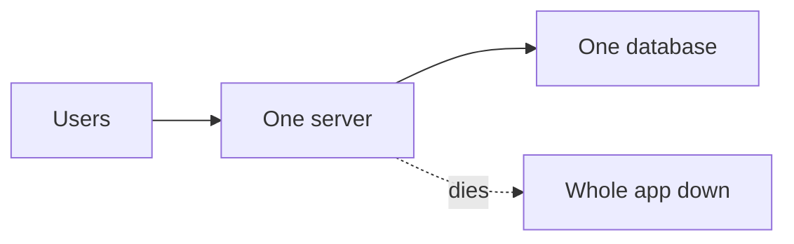
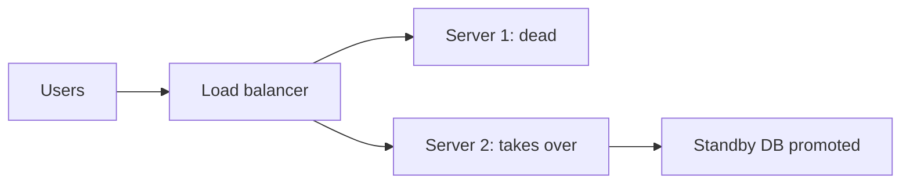
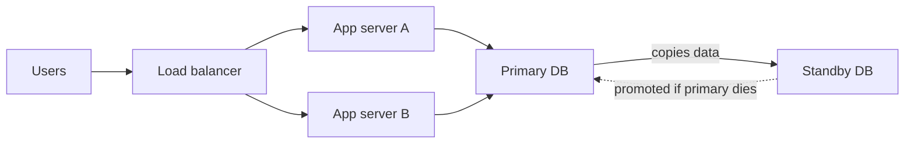
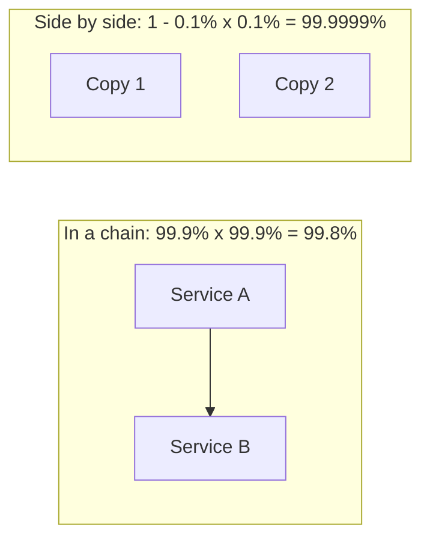
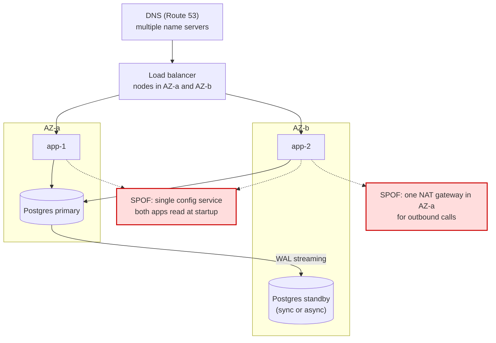
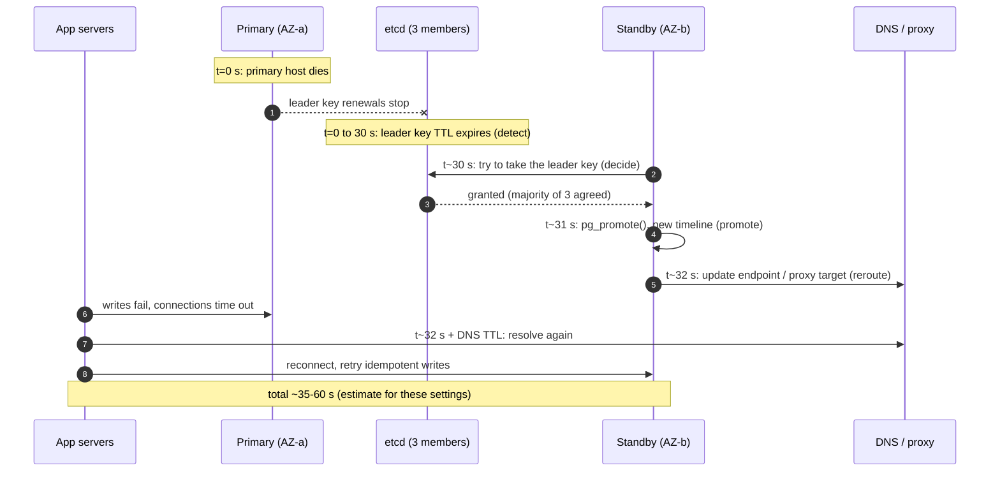

# High Availability and Failover

> [!summary] TL;DR
> **Availability** is the fraction of time a service answers correctly. You raise it by removing **single points of failure** (one box whose death takes everything down) with redundant copies, and by **failing over**: detecting that a copy died and moving traffic to a healthy one fast enough that users barely notice.

> [!abstract] Core idea
> - Availability = uptime / total time. Each extra "nine" cuts the downtime budget by 10×.
> - Components in series multiply availabilities (worse); independent redundant copies multiply failure rates (much better).
> - Failover time = detect + decide + promote + reroute. Detection timeouts trade false alarms against slow recovery.
> - Stateful failover is the hard part: async replicas lose recent writes, and two primaries (split brain) corrupt data unless the old one is fenced.
> - Classic mistake: adding a standby and never testing the failover. An untested failover path usually fails when it is needed.

## Start here: the basics 🟢

> [!info] How to read this note (pick your level)
> - 🟢 **New to this?** Read "From zero" below, then sections 1, 2 and the cheat sheet (10). Stop there, that is a full first pass.
> - 🟡 **Know the basics?** Add section 3 (how it works), 4 (worked example), 5 (variants) and 6 (trade-offs).
> - 🔴 **Interview / SDE-3 prep?** Add 7, 8 and 9. Headings are tagged 🟢🟡🔴 so you always know where you are.

> [!note] Before this note
> - [[Distributed Systems Fundamentals]]: a dead machine and a slow one look the same from outside, so "is it down?" is always a guess.
> - [[Replication]]: a primary database copies its changes to standbys, either before replying (sync) or a little after (async).
> - [[Load Balancing]]: a load balancer spreads requests over several servers and stops sending to ones that fail health checks.

**From zero, in 60 seconds** 🟢

Your app runs on one server with one database.
If that server dies at 2 am, the app is down until someone fixes it.
That one server is a **single point of failure**: one box whose death takes everything down.



High availability means: keep spare copies of everything, ready to take over.
When one copy dies, the system notices and moves traffic to a healthy copy.
That switch is called **failover**. Done well, users barely notice.



The rest of this note is just these 3 questions:
1. How do you measure availability (the "nines")?
2. How do you remove single points of failure?
3. How fast can you notice a failure and switch over?

**The problem in one story.**
Your shop's website runs on one computer.
At 2 a.m. that computer's power supply dies.
Nobody can buy anything until someone wakes up and fixes it.
High availability means keeping a second copy ready, so traffic moves to it on its own within seconds.

**Words you need first**

| Word | Plain meaning | Tiny example |
| --- | --- | --- |
| Server / node | One machine (or VM) running your program | One EC2 instance running your Go API |
| Replica / standby | An extra copy kept ready to take over | A second PostgreSQL that copies the first |
| Primary | The copy that currently accepts writes | The database your app writes orders to |
| Load balancer | A box that spreads requests across healthy servers | AWS ALB in front of 3 app servers |
| Health check | A small regular "are you alive?" request | `GET /healthz` every 10 s |
| Availability Zone (AZ) | A separate data centre inside one cloud region | `ap-south-1a` vs `ap-south-1b` |
| Downtime budget | How long you may be down per month for a target | 99.9% allows about 43 min/month |
| RTO | Recovery time objective: the longest outage you accept | "Back within 1 minute" |
| RPO | Recovery point objective: how much recent data you accept losing | "At most 5 seconds of orders" |
| Split brain | Two copies both acting as primary and taking writes | Old and new primary both accept orders |
| Fencing | Cutting off the old primary so it cannot write any more | Revoke its network access, or power it off |

**Picture it**



**Analogy.** A shop with two cashiers: if one faints, customers walk to the other till.
Where it breaks: cashiers share nothing, but a database standby must already hold the same data, and a few of the newest sales may not have reached it yet.

**How the rest of this note builds up**

- First, why it exists (section 1) and the vocabulary: availability, SPOF, RTO, RPO (section 2).
- Then how it works: availability math, failure detection and the steps of a failover (section 3), with a worked Go example (section 4).
- Then the variants (active-passive, active-active) and trade-offs (sections 5-6).
- Finally the SDE-3 deep dive: split brain, fencing, real failover times and testing in production (sections 7-8).

> [!tip] Remember
> Remove every single point of failure, then actually test that traffic moves to the spare when one dies.

## 1. Why it exists 🟢

An API runs on one VM with one PostgreSQL instance. The VM's host fails at 02:10. Someone gets paged, restores from a snapshot, and the service is back at 03:40: 90 minutes down. A 99.9% monthly target allows 43 minutes, so one incident blew two months of budget.

With two app servers in two Availability Zones (AZs) behind a load balancer, and a database standby that is promoted automatically, the same host failure costs one failed health check on the app tier and roughly a minute of write errors on the database tier. Same hardware failure, two orders of magnitude less downtime.


### Real-life example 🟢

At 8 pm on a Saturday, a food delivery app is at its busiest. If one of its database servers dies, the app cannot stop taking orders for an hour.
So the database has a standby copy in another data centre building. Within a minute the standby is promoted, the app reconnects, and most people only see one "something went wrong, try again".
Maybe the last few seconds of order updates need to be checked again; that is the RPO. The minute of errors is the RTO.

## 2. Mental model 🟢

- **Availability**: `uptime / (uptime + downtime)`, measured over a window (a month or a year). An SLO (service level objective: a reliability target) usually defines "up" from the user's view: successful requests divided by all requests (see [[SLIs, SLOs, SLAs and Error Budgets]]).
- **Single point of failure (SPOF)**: a component with no redundant copy.
- **Failover**: moving the work of a failed component to a standby.
- **RTO (recovery time objective)**: the longest acceptable outage.
- **RPO (recovery point objective)**: the most data, measured in time, you accept losing.

**Analogy.** A hospital has two generators and a switch that starts the second when mains power fails. Two generators are useless if the switch is broken, if both share one fuel tank (a shared SPOF), or if nobody has tested the switch in a year.

## Common beginner mistakes 🟢

- **Adding a standby and never testing failover** → the switch fails the one day you need it → run regular drills that kill the primary on purpose.
- **Putting both copies in the same rack or zone** → one power or network failure takes both down → spread copies across Availability Zones.
- **A very short failure timeout "for speed"** → normal pauses trigger needless failovers that each lose a few writes → wait for several missed heartbeats.
- **Letting whichever standby notices first promote itself** → two standbys can both become primary → let one node win a majority vote or a lease.
- **Forgetting the old primary** → it may come back and keep taking writes (split brain) → fence it before or while promoting the new one.

## 3. How it works 🟡

> 🟢 → 🟡 **You now know** that high availability means spare copies of everything plus an automatic switch (failover) when one dies. **Next we open the box**: what the "nines" really allow, how chains and spares change the maths, how to find single points of failure, how failure is detected, the failover patterns and where the seconds of a failover go.

### The nines

**In plain words:** 99.9% sounds high, but it still allows about 43 minutes of downtime a month. Each extra 9 cuts that by 10 times.

**Step by step:**
1. Pick a target, say 99.9%. The allowed downtime is 0.1% of the time.
2. A 30-day month has about 43,200 minutes. 0.1% of that is about 43 minutes.
3. At 99.99% the budget drops to about 4 minutes a month.
4. So one 5-minute failover already breaks a four-nines target for that month.

Downtime allowed by each target (from `(1 − a) × period`; the 30-day column uses 30 days):

| Availability | Per year | Per 30 days |
| --- | --- | --- |
| 99% | 3.65 days | 7.2 h |
| 99.9% | 8.76 h | 43.2 min |
| 99.95% | 4.38 h | 21.6 min |
| 99.99% | 52.6 min | 4.32 min |
| 99.999% | 5.26 min | 25.9 s |

At four nines, a failover that takes 5 minutes uses more than a month's budget. That is why HA design is mostly about failover time.

### Serial vs parallel math

**In plain words:** parts in a chain multiply their weak spots; spare copies side by side cover for each other.

**Step by step:**
1. A request goes through service A, then service B, each up 99.9%. Both must work: 0.999 × 0.999 ≈ 99.8%. Worse than either.
2. Now run two copies of A side by side; either one is enough. Each is down 0.1% of the time.
3. Both are down together only 0.1% × 0.1% = 0.0001% of the time, so the pair is up about 99.9999%.
4. That only holds if they fail independently. Two copies on one power supply fail together.

- **Series** (every component must work): multiply availabilities. Two 99.9% services in a chain: `0.999 × 0.999 = 0.998` (99.8%).
- **Parallel** (any one copy is enough, failures independent): multiply the *failure* probabilities. Two 99.9% copies: `1 − 0.001 × 0.001 = 0.999999` (six nines on paper).
- The parallel formula assumes **independent** failures. Two replicas in one rack, on one power feed or running one bad deploy fail together, so real gains are far smaller. Spreading across AZs is what makes independence roughly true.



### Removing SPOFs

**In plain words:** for every box, ask "what if this dies?" and add a spare where the answer is "everything stops".

**Step by step:**
1. Draw every box a request touches: DNS, load balancer, app servers, database, config service, NAT gateway.
2. For each box ask: "if only this dies, does everything stop?"
3. Two app servers in two zones: no. One database primary with a standby: no, after failover.
4. One config service both apps read at startup: yes. That is a single point of failure.
5. Add a spare (or remove the dependency) for each "yes", then check again.



The app tier and the database are redundant, but the red boxes are still SPOFs. An HA review walks every arrow and asks "what if this one dies?". A **NAT gateway** is the box that lets private servers make calls to the internet. **N+1** means one spare beyond the capacity you need, so you survive one failure; **N+2** survives one failure during maintenance of another.

### Failure detection

**In plain words:** a machine cannot see another one crash. It only notices silence, so it waits a little before deciding.

**Step by step:**
1. The load balancer calls `GET /healthz` on app-1 every 10 s.
2. One check times out. That alone could be a short pause, so it waits.
3. Three checks in a row fail. Now the load balancer removes app-1 from rotation.
4. If app-1 recovers, it passes checks again and is added back.

A node cannot see that another node crashed; it can only notice silence.

- **Health checks**: the LB or orchestrator probes `/healthz` every few seconds and removes a target after k failures in a row.
- **Heartbeats**: each node sends "I am alive" periodically; a peer declares it dead after a timeout.
- **Phi-accrual detector** (Hayashibara et al., 2004): instead of a fixed timeout, it learns the distribution of heartbeat gaps and outputs a suspicion level φ. Cassandra marks a node down at `phi_convict_threshold = 8` by default.
- **The timeout trade-off:** a short timeout detects failure quickly but fires on GC pauses (the program freezing while it cleans memory) and network blips (false positives cause needless, risky failovers). A long timeout avoids false alarms but adds directly to downtime.

### Failover patterns

**In plain words:** spares can sit idle and cold, warm and ready, or already serve traffic. Faster switch means higher cost.

**Step by step:**
1. Active-active: two servers both take traffic. One dies; the load balancer sends everything to the other in seconds.
2. Hot standby: a second database copies the first all the time. On failure it is promoted in about a minute.
3. Warm standby: a smaller copy runs, and is scaled up on failure. Minutes.
4. Cold standby: only the setup scripts and backups exist. Restore takes hours.
5. Each step down is cheaper and slower; pick per system using its RTO.

| Pattern | How it works | Failover time | Cost |
| --- | --- | --- | --- |
| Active-active | all copies serve traffic; the LB stops sending to a dead one | seconds (health-check interval × threshold) | each copy must handle the extra load; state must be shared or partitioned |
| Active-passive, hot standby | standby runs and replicates continuously, takes over on promotion | tens of seconds to ~2 min | standby capacity mostly idle |
| Warm standby | standby runs at reduced size; scale up on failover | minutes | cheaper; scaling may fail during a regional event |
| Cold standby | infrastructure defined but not running; restore from backup | hours | cheapest; RPO = last backup (see [[Backup, PITR and Disaster Recovery]]) |

### The failover time budget

**In plain words:** total switch time is notice + decide + promote + move traffic. Each step adds seconds.

**Step by step:**
1. t = 0 s: the primary database's host dies. It stops renewing its "I am leader" key in etcd.
2. t ≈ 30 s: the key's TTL runs out. That was detection.
3. The standby asks etcd for the leader key and gets it, because a majority agrees. That is the decision.
4. t ≈ 31 s: the standby switches itself to read-write (promote), and the DNS name or proxy is pointed at it (reroute).
5. Apps notice the change after their DNS cache expires, reconnect, and retry. Total: roughly 35 to 60 s.

`failover time = detect + decide + promote + reroute`



The timings above are an estimate for Patroni-like (Patroni is a popular PostgreSQL failover manager) defaults (`ttl: 30`, `loop_wait: 10`) and a short DNS TTL. Each term is a knob:

- **Detect**: heartbeat interval × misses. Shorter = more false failovers.
- **Decide**: who is allowed to promote? It must be one node, chosen with a majority (see [[Leader Election]]), never "whoever notices first".
- **Promote**: replay remaining WAL (the write-ahead log of changes not yet applied), switch to read-write.
- **Reroute**: DNS TTL, connection pool refresh, LB target change. Clients that cache DNS forever (some JVM, Java runtime, configurations do) never reroute. Drain connections from the old target so in-flight requests finish.

## 4. Worked example 🟡

### Whiteboard version

A heartbeat detector with confirmation, plus the availability formulas:

```text
serial(a1..an)   = a1 × a2 × ... × an
parallel(a1..an) = 1 − (1−a1)(1−a2)...(1−an)      # independent failures only
downtime(a, T)   = (1 − a) × T

detector(timeout, confirm):
    on heartbeat: last = now; misses = 0
    every tick:
        if now − last <= timeout: misses = 0; continue
        misses += 1
        if misses >= confirm: declare dead → start failover
```

The `confirm` count is the knob that turns one slow heartbeat into "keep waiting" instead of "fail over".

### Availability of a real chain

**In plain words:** put real numbers on a real request path and multiply them to see the true uptime.

A request path: load balancer 99.99%, two app servers at 99.9% each in different AZs, one database at 99.95%.

- App tier: `1 − 0.001² = 0.999999`.
- Whole chain: `0.9999 × 0.999999 × 0.9995 ≈ 0.99940`, about 99.94%, or 26 minutes per 30 days.
- The database dominates. Adding a third app server changes nothing visible; making the database HA does.

### Go: availability math and a failure detector

**In plain words:** code that does the uptime math and a detector that waits for a few missed heartbeats before calling a node dead.

This compiles and passes `go vet` and `go test -race` on Go 1.24. The detector's clock is injected, so the test runs in microseconds and never flakes.

```go
// Package ha has availability math and a heartbeat failure detector
// whose clock is injected so tests are deterministic.
package ha

import "time"

// Serial is the availability of components that must ALL work (a chain).
func Serial(a ...float64) float64 {
	p := 1.0
	for _, x := range a {
		p *= x
	}
	return p
}

// Parallel is the availability of independent replicas where ANY one is enough.
func Parallel(a ...float64) float64 {
	down := 1.0
	for _, x := range a {
		down *= 1 - x
	}
	return 1 - down
}

// Downtime is the allowed downtime for availability a over a period.
func Downtime(a float64, period time.Duration) time.Duration {
	return time.Duration((1 - a) * float64(period))
}

// Detector declares a peer dead when no heartbeat arrived for Timeout.
// It needs Confirm consecutive failed checks before it says "dead",
// which trades a slower failover for fewer false positives.
type Detector struct {
	Timeout time.Duration
	Confirm int
	now     func() time.Time
	last    time.Time
	misses  int
}

func NewDetector(timeout time.Duration, confirm int, now func() time.Time) *Detector {
	return &Detector{Timeout: timeout, Confirm: confirm, now: now, last: now()}
}

// Heartbeat records that the peer was seen alive.
func (d *Detector) Heartbeat() { d.last = d.now(); d.misses = 0 }

// Check is called on every tick; it returns true once the peer is judged dead.
func (d *Detector) Check() bool {
	if d.now().Sub(d.last) <= d.Timeout {
		d.misses = 0
		return false
	}
	d.misses++
	return d.misses >= d.Confirm
}
```

```go
package ha

import (
	"math"
	"testing"
	"time"
)

func near(a, b float64) bool { return math.Abs(a-b) < 1e-9 }

func TestAvailabilityMath(t *testing.T) {
	if got := Serial(0.999, 0.999); !near(got, 0.998001) {
		t.Fatalf("serial = %v", got)
	}
	if got := Parallel(0.999, 0.999); !near(got, 0.999999) {
		t.Fatalf("parallel = %v", got)
	}
	// LB (99.99%) -> pair of app servers (99.9% each) -> DB (99.95%)
	got := Serial(0.9999, Parallel(0.999, 0.999), 0.9995)
	if !near(got, 0.9999*0.999999*0.9995) {
		t.Fatalf("chain = %v", got)
	}
	year := 365 * 24 * time.Hour
	if d := Downtime(0.999, year).Round(time.Minute); d != 8*time.Hour+46*time.Minute {
		t.Fatalf("three nines per year = %v", d)
	}
	if d := Downtime(0.9999, 30*24*time.Hour).Round(time.Second); d != 4*time.Minute+19*time.Second {
		t.Fatalf("four nines per 30 days = %v", d)
	}
}

type fakeClock struct{ t time.Time }

func (f *fakeClock) Now() time.Time          { return f.t }
func (f *fakeClock) Advance(d time.Duration) { f.t = f.t.Add(d) }

func TestDetectorNeedsConfirmedMisses(t *testing.T) {
	clk := &fakeClock{t: time.Unix(0, 0)}
	d := NewDetector(3*time.Second, 3, clk.Now) // checked once per second

	clk.Advance(2 * time.Second)
	if d.Check() {
		t.Fatal("dead after 2s with a 3s timeout")
	}
	clk.Advance(2 * time.Second) // 4s silent: miss 1
	if d.Check() {
		t.Fatal("dead after one miss")
	}
	clk.Advance(time.Second) // miss 2
	if d.Check() {
		t.Fatal("dead after two misses")
	}
	d.Heartbeat() // a slow peer answers: counter resets, no false failover
	clk.Advance(4 * time.Second)
	d.Check()
	clk.Advance(time.Second)
	d.Check()
	clk.Advance(time.Second)
	if !d.Check() { // third consecutive miss, 6s after last heartbeat
		t.Fatal("expected dead after 3 confirmed misses")
	}
}
```

With a 3 s timeout, 3 confirmations and a 1 s check interval, the peer is declared dead 6 s after its last heartbeat: the first miss is seen at 4 s, the third (which triggers failover) at 6 s. Budget that, plus promotion and reroute, against your RTO.

## 5. Variants and comparison 🟡

### RTO and RPO per tier

**In plain words:** RTO is how long you can be down; RPO is how much recent data you can lose. Important systems get tighter numbers.

| Tier | Example | Typical target (estimate) | Design |
| --- | --- | --- | --- |
| Tier 0 | payments, login | RTO < 1 min, RPO 0 | synchronous replica or consensus store across AZs, automatic failover, multi-region plan |
| Tier 1 | orders, catalogue | RTO minutes, RPO seconds | async standby in another AZ, automatic promotion |
| Tier 2 | reporting, admin tools | RTO hours, RPO 1 h to 24 h | backups and restore runbook (see [[Backup, PITR and Disaster Recovery]]) |

### Managed and open-source failover

| System | Mechanism | Documented failover time |
| --- | --- | --- |
| Amazon RDS Multi-AZ DB instance | synchronous standby in another AZ (not readable); DNS endpoint flips on failover | typically 60–120 s (RDS User Guide) |
| Amazon RDS Multi-AZ DB cluster | one writer and two readable standbys in three AZs | typically under 35 s (RDS User Guide) |
| Patroni (PostgreSQL) | leader key with TTL in etcd, Consul or ZooKeeper; only the holder runs as primary | about `ttl` (30 s default) plus promotion |
| Redis Sentinel | sentinels agree by quorum that the master is down, then promote a replica | `down-after-milliseconds` plus election (see [[Redis Replication, Sentinel and Cluster]]) |
| Route 53 failover records | primary and secondary records; health checks every 30 s (or 10 s fast) with a failure threshold of 3 by default | detection interval × threshold plus record TTL |

### High availability versus things people confuse it with 🟡

| Thing | What it protects against | How it differs from HA |
| --- | --- | --- |
| Backups and disaster recovery | Losing data or a whole region | Restore takes minutes to hours; HA switches in seconds to minutes using live copies |
| CAP "availability" | Refusing requests during a network split | A theory term: every working node answers; HA is measured uptime from the user's view |
| Scaling out | Too much load | More servers for capacity; HA needs spares even when load is low |

## 6. Trade-offs and when not to use 🟡

- **Synchronous replication gives RPO 0 but adds a cross-AZ round trip to every commit**, and if the only sync standby dies, writes block unless the system falls back to async (PostgreSQL keeps waiting by default; `synchronous_standby_names` with `ANY 1 (s1, s2)` needs two standbys to avoid that).
- **Async replication is fast but has a data-loss window**: writes acknowledged by the old primary but not yet shipped are gone after promotion. RPO equals the replication lag at the moment of failure.
- **Automatic failover can make things worse**: a flapping network triggers repeated promotions, each losing a few writes. Use confirmation counts, a majority decision, and a minimum interval between failovers.
- **Active-active needs every copy to carry the full load of a failed peer.** Two nodes at 70% CPU each become one node at 140%. Plan for N+1 at peak.
- **When not to bother:** internal tools with a business-hours RTO, batch jobs that can re-run, and early products where restoring from backup in an hour is acceptable. HA multiplies infrastructure cost and operational complexity.

## 7. In production 🔴

> 🟡 → 🔴 **You now know** the nines, the series and parallel maths, how to hunt single points of failure, how detection works, the failover patterns and the four parts of failover time. **Next comes the advanced part**: how RDS, Patroni and Kubernetes fail over in practice, split brain and fencing, static stability, failback, testing, and gray failures.

- **Real systems:**
  - RDS Multi-AZ flips a DNS CNAME (an alias record pointing one name at another) to the standby; applications must re-resolve DNS and reconnect.
  - Patroni stores a leader key in etcd. If the primary cannot renew it (for example it is partitioned from etcd), it demotes itself, which is how Patroni avoids two primaries.
  - Kubernetes restarts failed pods (liveness probes) and removes unready pods from Services (readiness probes); see [[Graceful Shutdown and Health Checks]].
- **Split brain → fencing.** If the old primary is only slow, not dead, it may come back and accept writes while the new primary does too. Fixes:
  - Require a majority (quorum) to promote, so a minority partition cannot.
  - **Fence** the old primary: revoke its storage or network access, or power it off (STONITH, "shoot the other node in the head").
  - Use fencing tokens on downstream writes (see [[Distributed Locks and Fencing Tokens]]).
- **Static stability** (AWS Builders' Library): the data plane should keep working with what it already has when the control plane is down. Pre-provision capacity in every AZ instead of planning to launch instances during an AZ failure, because the launch API may be the thing that is impaired.
- **Failback**: after the old primary is repaired, rebuild it as a replica (for example with `pg_rewind`, a PostgreSQL tool that rewinds an old primary so it can follow the new one) rather than promoting it back blindly; schedule the switch-back in a quiet window.
- **Testing**: run game days (planned practice outages) and chaos experiments that kill a primary, block an AZ, or slow DNS (see [[Chaos Engineering]]). Measure the real failover time against the RTO.
- **Failure modes → fixes:**
  - Health check only checks the process, so a node with a dead DB connection stays in rotation → make readiness check dependencies that the node cannot work without, but not shared dependencies (or every node fails the check at once).
  - Health checks all fail together because the DB is down, so the LB removes every node → rely on "fail open": an ALB target group whose targets are all unhealthy routes to all of them anyway (NLB behaves the same way); other balancers may need it configured, and Envoy's (a common proxy) equivalent is panic mode.
  - Connection pools hold sockets to the dead primary → set TCP keepalives (small probes that detect dead connections) and pool `MaxConnLifetime`, retry on connection errors.
- **What to monitor:** replication lag (bytes and seconds), time since last successful failover drill, number of failovers per week, health-check flaps, and error rate during failovers.

## 8. Deep dive 🔴

- **Correlated failures break the parallel formula.** A bad config push, a certificate expiry or a shared dependency hits all replicas together. Real availability is usually limited by deploys and dependencies, not hardware. Staged rollouts and cell-based architecture (splitting users into independent copies of the whole stack) limit this **blast radius** (how much one failure can damage).
- **Detection is a consensus problem in disguise.** Two observers can disagree about whether a node is dead. Only one decision may win, so promotion uses a lease or a majority vote (see [[Leader Election]] and [[Consensus - Raft and Paxos]]). A self-demoting primary also needs its own clock to be trustworthy for the lease; see [[Clocks and Ordering]].
- **Gray failure.** A node that answers health checks but fails 30% of real requests is not detected by liveness probes. Detect it from the client side (error rate per backend, outlier ejection in Envoy) rather than from the node itself.
- **Retry storms after failover.** Every client retries at once when the new primary appears and overloads it. Use jittered backoff (see [[Timeouts, Retries and Backoff]]) and connection-pool limits.
- **Multi-region** adds DNS or anycast (one IP address served from many places) failover and much larger replication lag; see [[Multi-Region Architecture]].

## 9. Interview questions 🔴

> [!question]- Two services in a chain each have 99.9% availability. What is the end-to-end availability, and what if they are redundant instead?
> In series: `0.999 × 0.999 ≈ 99.8%`. As an independent redundant pair: `1 − 0.001² = 99.9999%`. The second number assumes independent failures, which is only roughly true across AZs and false for shared deploys or configs.

> [!question]- Walk me through a database failover. Where does the time go?
> Detect (missed heartbeats or an expired leader lease), decide (one candidate wins a majority vote), promote (replay WAL, switch to read-write), reroute (DNS or proxy change, clients reconnect). Detection and DNS TTL usually dominate. RDS Multi-AZ documents 60–120 s for the classic instance deployment.

> [!question]- What is split brain and how do you prevent it?
> Two nodes both believe they are primary and accept writes, so data diverges. Prevent it by requiring a majority to promote, by fencing the old primary (STONITH, revoking access) and by passing fencing tokens to storage so stale leaders' writes are rejected.

> [!question]- Why not set the heartbeat timeout to 100 ms for fast failover? (trap)
> Because GC pauses, network blips and CPU stalls exceed 100 ms regularly, so you would fail over constantly. Each needless failover can lose async writes and causes a reconnect storm. Pick the timeout from measured heartbeat gaps and add confirmation.

> [!question]- What are RTO and RPO, and how do sync vs async replication affect them?
> RTO is how long you may be down; RPO is how much recent data you may lose. Sync replication gives RPO 0 at the cost of commit latency; async gives RPO equal to the replication lag at failure time. RTO depends on detection and reroute, not on sync vs async.

> [!question]- What is static stability?
> Designing so that a failure needs no new actions from a control plane to recover: capacity is already running in each AZ, and data planes keep serving with cached configuration when the control plane is impaired.

> [!question]- Your LB health check hits the database. Is that good?
> Partly. It catches nodes that lost their DB connection, but when the shared DB is down every node fails the check and the LB may remove all of them. Check local dependencies for readiness, and rely on fail-open behaviour or separate alerts for shared ones.

## 10. Cheat sheet 🟢

- 99.9% = 43.2 min / 30 days; 99.99% = 4.32 min; 99.999% = 25.9 s.
- Series multiplies availability; parallel multiplies failure probability (if independent).
- Failover = detect + decide + promote + reroute; DNS TTL and timeouts dominate.
- Short timeouts cause false failovers; use confirmation or phi-accrual.
- Async standby: RPO = lag. Sync: RPO 0, slower commits.
- Prevent split brain: majority to promote, fence the old primary, fencing tokens.
- Static stability: pre-provision, do not depend on the control plane to recover.
- Test failover with game days; an untested standby is not HA.

## Self-check 🟢🟡

🟢 Easy

> [!question]- What is a single point of failure?
> One component with no spare, whose death stops the whole service.

> [!question]- About how much downtime does 99.9% allow in a 30-day month?
> About 43 minutes.

> [!question]- What is the difference between RTO and RPO?
> RTO is how long you may be down; RPO is how much recent data you may lose.

🟡 Medium

> [!question]- Two independent copies are each up 99.9%. What is the pair's availability, and what assumption does that need?
> About 99.9999%, assuming they fail independently (different zones, power, deploys).

> [!question]- Name the four parts of failover time.
> Detect, decide, promote, reroute.

> [!question]- With async replication, how much data can a failover lose?
> Whatever the old primary had confirmed but not yet shipped: about the replication lag at that moment.

## Links

- **Before this:** [[Distributed Systems Fundamentals]], [[Replication]], [[Load Balancing]]
- **Next:** [[Leader Election]], [[Failure Detection, Gossip and Membership]], [[Multi-Region Architecture]]
- **Compare with:** [[CAP and PACELC]] (CAP-availability vs uptime), [[Backup, PITR and Disaster Recovery]] (cold recovery), [[SLIs, SLOs, SLAs and Error Budgets]] (how availability is measured and budgeted)

### Watch on YouTube

- [Fail-over and High-Availability (Explained by Example)](https://www.youtube.com/watch?v=Zgy1miPsTNs) · Hussein Nasser · 19 min · 67,906 views
- [Design Patterns for High Availability: What gets you 99.999% uptime?](https://www.youtube.com/watch?v=LdvduBxZRLs) · Gaurav Sen · 13 min · 35,846 views
