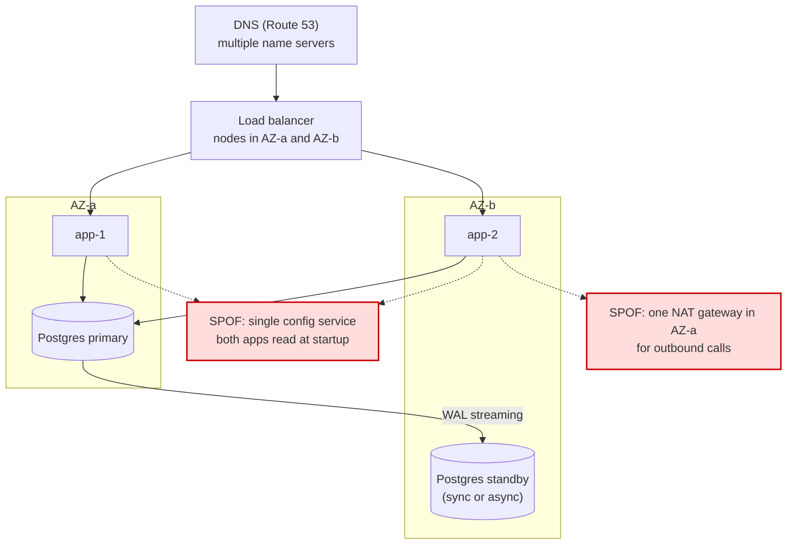
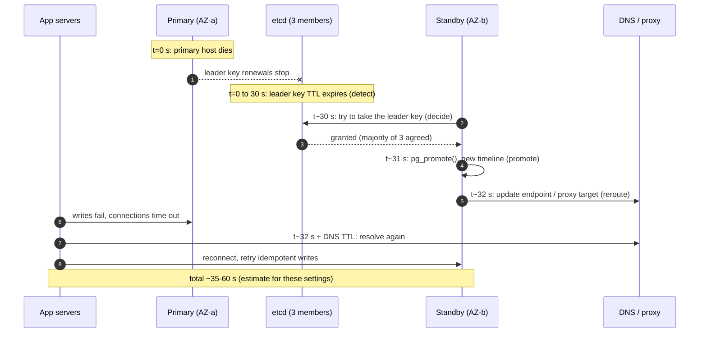

# High Availability and Failover

> [!summary] TL;DR
> **Availability** is the fraction of time a service answers correctly. You raise it by removing **single points of failure** (one box whose death takes everything down) with redundant copies, and by **failing over**: detecting that a copy died and moving traffic to a healthy one fast enough that users barely notice.

> [!abstract] Core idea
> - Availability = uptime / total time. Each extra "nine" cuts the downtime budget by 10×.
> - Components in series multiply availabilities (worse); independent redundant copies multiply failure rates (much better).
> - Failover time = detect + decide + promote + reroute. Detection timeouts trade false alarms against slow recovery.
> - Stateful failover is the hard part: async replicas lose recent writes, and two primaries (split brain) corrupt data unless the old one is fenced.
> - Classic mistake: adding a standby and never testing the failover. An untested failover path usually fails when it is needed.

## 1. Why it exists

An API runs on one VM with one PostgreSQL instance. The VM's host fails at 02:10. Someone gets paged, restores from a snapshot, and the service is back at 03:40: 90 minutes down. A 99.9% monthly target allows 43 minutes, so one incident blew two months of budget.

With two app servers in two Availability Zones (AZs) behind a load balancer, and a database standby that is promoted automatically, the same host failure costs one failed health check on the app tier and roughly a minute of write errors on the database tier. Same hardware failure, two orders of magnitude less downtime.

## 2. Mental model

- **Availability**: `uptime / (uptime + downtime)`, measured over a window (a month or a year). An SLO usually defines "up" from the user's view: successful requests divided by all requests (see [[SLIs, SLOs, SLAs and Error Budgets]]).
- **Single point of failure (SPOF)**: a component with no redundant copy.
- **Failover**: moving the work of a failed component to a standby.
- **RTO (recovery time objective)**: the longest acceptable outage.
- **RPO (recovery point objective)**: the most data, measured in time, you accept losing.

**Analogy.** A hospital has two generators and a switch that starts the second when mains power fails. Two generators are useless if the switch is broken, if both share one fuel tank (a shared SPOF), or if nobody has tested the switch in a year.

## 3. How it works

### The nines

Downtime allowed by each target (from `(1 − a) × period`; the 30-day column uses 30 days):

| Availability | Per year | Per 30 days |
| --- | --- | --- |
| 99% | 3.65 days | 7.2 h |
| 99.9% | 8.76 h | 43.2 min |
| 99.95% | 4.38 h | 21.6 min |
| 99.99% | 52.6 min | 4.32 min |
| 99.999% | 5.26 min | 25.9 s |

At four nines, a failover that takes 5 minutes uses more than a month's budget. That is why HA design is mostly about failover time.

### Serial vs parallel math

- **Series** (every component must work): multiply availabilities. Two 99.9% services in a chain: `0.999 × 0.999 = 0.998` (99.8%).
- **Parallel** (any one copy is enough, failures independent): multiply the *failure* probabilities. Two 99.9% copies: `1 − 0.001 × 0.001 = 0.999999` (six nines on paper).
- The parallel formula assumes **independent** failures. Two replicas in one rack, on one power feed or running one bad deploy fail together, so real gains are far smaller. Spreading across AZs is what makes independence roughly true.

### Removing SPOFs



The app tier and the database are redundant, but the red boxes are still SPOFs. An HA review walks every arrow and asks "what if this one dies?". **N+1** means one spare beyond the capacity you need, so you survive one failure; **N+2** survives one failure during maintenance of another.

### Failure detection

A node cannot see that another node crashed; it can only notice silence.

- **Health checks**: the LB or orchestrator probes `/healthz` every few seconds and removes a target after k failures in a row.
- **Heartbeats**: each node sends "I am alive" periodically; a peer declares it dead after a timeout.
- **Phi-accrual detector** (Hayashibara et al., 2004): instead of a fixed timeout, it learns the distribution of heartbeat gaps and outputs a suspicion level φ. Cassandra marks a node down at `phi_convict_threshold = 8` by default.
- **The timeout trade-off:** a short timeout detects failure quickly but fires on GC pauses and network blips (false positives cause needless, risky failovers). A long timeout avoids false alarms but adds directly to downtime.

### Failover patterns

| Pattern | How it works | Failover time | Cost |
| --- | --- | --- | --- |
| Active-active | all copies serve traffic; the LB stops sending to a dead one | seconds (health-check interval × threshold) | each copy must handle the extra load; state must be shared or partitioned |
| Active-passive, hot standby | standby runs and replicates continuously, takes over on promotion | tens of seconds to ~2 min | standby capacity mostly idle |
| Warm standby | standby runs at reduced size; scale up on failover | minutes | cheaper; scaling may fail during a regional event |
| Cold standby | infrastructure defined but not running; restore from backup | hours | cheapest; RPO = last backup (see [[Backup, PITR and Disaster Recovery]]) |

### The failover time budget

`failover time = detect + decide + promote + reroute`



The timings above are an estimate for Patroni-like defaults (`ttl: 30`, `loop_wait: 10`) and a short DNS TTL. Each term is a knob:

- **Detect**: heartbeat interval × misses. Shorter = more false failovers.
- **Decide**: who is allowed to promote? It must be one node, chosen with a majority (see [[Leader Election]]), never "whoever notices first".
- **Promote**: replay remaining WAL, switch to read-write.
- **Reroute**: DNS TTL, connection pool refresh, LB target change. Clients that cache DNS forever (some JVM configurations do) never reroute. Drain connections from the old target so in-flight requests finish.

## 4. Worked example

### Whiteboard version

A heartbeat detector with confirmation, plus the availability formulas:

```text
serial(a1..an)   = a1 × a2 × ... × an
parallel(a1..an) = 1 − (1−a1)(1−a2)...(1−an)      # independent failures only
downtime(a, T)   = (1 − a) × T

detector(timeout, confirm):
    on heartbeat: last = now; misses = 0
    every tick:
        if now − last <= timeout: misses = 0; continue
        misses += 1
        if misses >= confirm: declare dead → start failover
```

The `confirm` count is the knob that turns one slow heartbeat into "keep waiting" instead of "fail over".

### Availability of a real chain

A request path: load balancer 99.99%, two app servers at 99.9% each in different AZs, one database at 99.95%.

- App tier: `1 − 0.001² = 0.999999`.
- Whole chain: `0.9999 × 0.999999 × 0.9995 ≈ 0.99940`, about 99.94%, or 26 minutes per 30 days.
- The database dominates. Adding a third app server changes nothing visible; making the database HA does.

### Go: availability math and a failure detector

This compiles and passes `go vet` and `go test -race` on Go 1.24. The detector's clock is injected, so the test runs in microseconds and never flakes.

```go
// Package ha has availability math and a heartbeat failure detector
// whose clock is injected so tests are deterministic.
package ha

import "time"

// Serial is the availability of components that must ALL work (a chain).
func Serial(a ...float64) float64 {
	p := 1.0
	for _, x := range a {
		p *= x
	}
	return p
}

// Parallel is the availability of independent replicas where ANY one is enough.
func Parallel(a ...float64) float64 {
	down := 1.0
	for _, x := range a {
		down *= 1 - x
	}
	return 1 - down
}

// Downtime is the allowed downtime for availability a over a period.
func Downtime(a float64, period time.Duration) time.Duration {
	return time.Duration((1 - a) * float64(period))
}

// Detector declares a peer dead when no heartbeat arrived for Timeout.
// It needs Confirm consecutive failed checks before it says "dead",
// which trades a slower failover for fewer false positives.
type Detector struct {
	Timeout time.Duration
	Confirm int
	now     func() time.Time
	last    time.Time
	misses  int
}

func NewDetector(timeout time.Duration, confirm int, now func() time.Time) *Detector {
	return &Detector{Timeout: timeout, Confirm: confirm, now: now, last: now()}
}

// Heartbeat records that the peer was seen alive.
func (d *Detector) Heartbeat() { d.last = d.now(); d.misses = 0 }

// Check is called on every tick; it returns true once the peer is judged dead.
func (d *Detector) Check() bool {
	if d.now().Sub(d.last) <= d.Timeout {
		d.misses = 0
		return false
	}
	d.misses++
	return d.misses >= d.Confirm
}
```

```go
package ha

import (
	"math"
	"testing"
	"time"
)

func near(a, b float64) bool { return math.Abs(a-b) < 1e-9 }

func TestAvailabilityMath(t *testing.T) {
	if got := Serial(0.999, 0.999); !near(got, 0.998001) {
		t.Fatalf("serial = %v", got)
	}
	if got := Parallel(0.999, 0.999); !near(got, 0.999999) {
		t.Fatalf("parallel = %v", got)
	}
	// LB (99.99%) -> pair of app servers (99.9% each) -> DB (99.95%)
	got := Serial(0.9999, Parallel(0.999, 0.999), 0.9995)
	if !near(got, 0.9999*0.999999*0.9995) {
		t.Fatalf("chain = %v", got)
	}
	year := 365 * 24 * time.Hour
	if d := Downtime(0.999, year).Round(time.Minute); d != 8*time.Hour+46*time.Minute {
		t.Fatalf("three nines per year = %v", d)
	}
	if d := Downtime(0.9999, 30*24*time.Hour).Round(time.Second); d != 4*time.Minute+19*time.Second {
		t.Fatalf("four nines per 30 days = %v", d)
	}
}

type fakeClock struct{ t time.Time }

func (f *fakeClock) Now() time.Time          { return f.t }
func (f *fakeClock) Advance(d time.Duration) { f.t = f.t.Add(d) }

func TestDetectorNeedsConfirmedMisses(t *testing.T) {
	clk := &fakeClock{t: time.Unix(0, 0)}
	d := NewDetector(3*time.Second, 3, clk.Now) // checked once per second

	clk.Advance(2 * time.Second)
	if d.Check() {
		t.Fatal("dead after 2s with a 3s timeout")
	}
	clk.Advance(2 * time.Second) // 4s silent: miss 1
	if d.Check() {
		t.Fatal("dead after one miss")
	}
	clk.Advance(time.Second) // miss 2
	if d.Check() {
		t.Fatal("dead after two misses")
	}
	d.Heartbeat() // a slow peer answers: counter resets, no false failover
	clk.Advance(4 * time.Second)
	d.Check()
	clk.Advance(time.Second)
	d.Check()
	clk.Advance(time.Second)
	if !d.Check() { // third consecutive miss, 6s after last heartbeat
		t.Fatal("expected dead after 3 confirmed misses")
	}
}
```

With a 3 s timeout, 3 confirmations and a 1 s check interval, the peer is declared dead 6 s after its last heartbeat: the first miss is seen at 4 s, the third (which triggers failover) at 6 s. Budget that, plus promotion and reroute, against your RTO.

## 5. Variants and comparison

### RTO and RPO per tier

| Tier | Example | Typical target (estimate) | Design |
| --- | --- | --- | --- |
| Tier 0 | payments, login | RTO < 1 min, RPO 0 | synchronous replica or consensus store across AZs, automatic failover, multi-region plan |
| Tier 1 | orders, catalogue | RTO minutes, RPO seconds | async standby in another AZ, automatic promotion |
| Tier 2 | reporting, admin tools | RTO hours, RPO 1 h to 24 h | backups and restore runbook (see [[Backup, PITR and Disaster Recovery]]) |

### Managed and open-source failover

| System | Mechanism | Documented failover time |
| --- | --- | --- |
| Amazon RDS Multi-AZ DB instance | synchronous standby in another AZ (not readable); DNS endpoint flips on failover | typically 60–120 s (RDS User Guide) |
| Amazon RDS Multi-AZ DB cluster | one writer and two readable standbys in three AZs | typically under 35 s (RDS User Guide) |
| Patroni (PostgreSQL) | leader key with TTL in etcd, Consul or ZooKeeper; only the holder runs as primary | about `ttl` (30 s default) plus promotion |
| Redis Sentinel | sentinels agree by quorum that the master is down, then promote a replica | `down-after-milliseconds` plus election (see [[Redis Replication, Sentinel and Cluster]]) |
| Route 53 failover records | primary and secondary records; health checks every 30 s (or 10 s fast) with a failure threshold of 3 by default | detection interval × threshold plus record TTL |

## 6. Trade-offs and when not to use

- **Synchronous replication gives RPO 0 but adds a cross-AZ round trip to every commit**, and if the only sync standby dies, writes block unless the system falls back to async (PostgreSQL keeps waiting by default; `synchronous_standby_names` with `ANY 1 (s1, s2)` needs two standbys to avoid that).
- **Async replication is fast but has a data-loss window**: writes acknowledged by the old primary but not yet shipped are gone after promotion. RPO equals the replication lag at the moment of failure.
- **Automatic failover can make things worse**: a flapping network triggers repeated promotions, each losing a few writes. Use confirmation counts, a majority decision, and a minimum interval between failovers.
- **Active-active needs every copy to carry the full load of a failed peer.** Two nodes at 70% CPU each become one node at 140%. Plan for N+1 at peak.
- **When not to bother:** internal tools with a business-hours RTO, batch jobs that can re-run, and early products where restoring from backup in an hour is acceptable. HA multiplies infrastructure cost and operational complexity.

## 7. In production

- **Real systems:**
  - RDS Multi-AZ flips a DNS CNAME to the standby; applications must re-resolve DNS and reconnect.
  - Patroni stores a leader key in etcd. If the primary cannot renew it (for example it is partitioned from etcd), it demotes itself, which is how Patroni avoids two primaries.
  - Kubernetes restarts failed pods (liveness probes) and removes unready pods from Services (readiness probes); see [[Graceful Shutdown and Health Checks]].
- **Split brain → fencing.** If the old primary is only slow, not dead, it may come back and accept writes while the new primary does too. Fixes:
  - Require a majority (quorum) to promote, so a minority partition cannot.
  - **Fence** the old primary: revoke its storage or network access, or power it off (STONITH, "shoot the other node in the head").
  - Use fencing tokens on downstream writes (see [[Distributed Locks and Fencing Tokens]]).
- **Static stability** (AWS Builders' Library): the data plane should keep working with what it already has when the control plane is down. Pre-provision capacity in every AZ instead of planning to launch instances during an AZ failure, because the launch API may be the thing that is impaired.
- **Failback**: after the old primary is repaired, rebuild it as a replica (for example with `pg_rewind`) rather than promoting it back blindly; schedule the switch-back in a quiet window.
- **Testing**: run game days and chaos experiments that kill a primary, block an AZ, or slow DNS (see [[Chaos Engineering]]). Measure the real failover time against the RTO.
- **Failure modes → fixes:**
  - Health check only checks the process, so a node with a dead DB connection stays in rotation → make readiness check dependencies that the node cannot work without, but not shared dependencies (or every node fails the check at once).
  - Health checks all fail together because the DB is down, so the LB removes every node → rely on "fail open": an ALB target group whose targets are all unhealthy routes to all of them anyway (NLB behaves the same way); other balancers may need it configured, and Envoy's equivalent is panic mode.
  - Connection pools hold sockets to the dead primary → set TCP keepalives and pool `MaxConnLifetime`, retry on connection errors.
- **What to monitor:** replication lag (bytes and seconds), time since last successful failover drill, number of failovers per week, health-check flaps, and error rate during failovers.

## 8. Deep dive

- **Correlated failures break the parallel formula.** A bad config push, a certificate expiry or a shared dependency hits all replicas together. Real availability is usually limited by deploys and dependencies, not hardware. Staged rollouts and cell-based architecture limit this blast radius.
- **Detection is a consensus problem in disguise.** Two observers can disagree about whether a node is dead. Only one decision may win, so promotion uses a lease or a majority vote (see [[Leader Election]] and [[Consensus - Raft and Paxos]]). A self-demoting primary also needs its own clock to be trustworthy for the lease; see [[Clocks and Ordering]].
- **Gray failure.** A node that answers health checks but fails 30% of real requests is not detected by liveness probes. Detect it from the client side (error rate per backend, outlier ejection in Envoy) rather than from the node itself.
- **Retry storms after failover.** Every client retries at once when the new primary appears and overloads it. Use jittered backoff (see [[Timeouts, Retries and Backoff]]) and connection-pool limits.
- **Multi-region** adds DNS or anycast failover and much larger replication lag; see [[Multi-Region Architecture]].

## 9. Interview questions

> [!question]- Two services in a chain each have 99.9% availability. What is the end-to-end availability, and what if they are redundant instead?
> In series: `0.999 × 0.999 ≈ 99.8%`. As an independent redundant pair: `1 − 0.001² = 99.9999%`. The second number assumes independent failures, which is only roughly true across AZs and false for shared deploys or configs.

> [!question]- Walk me through a database failover. Where does the time go?
> Detect (missed heartbeats or an expired leader lease), decide (one candidate wins a majority vote), promote (replay WAL, switch to read-write), reroute (DNS or proxy change, clients reconnect). Detection and DNS TTL usually dominate. RDS Multi-AZ documents 60–120 s for the classic instance deployment.

> [!question]- What is split brain and how do you prevent it?
> Two nodes both believe they are primary and accept writes, so data diverges. Prevent it by requiring a majority to promote, by fencing the old primary (STONITH, revoking access) and by passing fencing tokens to storage so stale leaders' writes are rejected.

> [!question]- Why not set the heartbeat timeout to 100 ms for fast failover? (trap)
> Because GC pauses, network blips and CPU stalls exceed 100 ms regularly, so you would fail over constantly. Each needless failover can lose async writes and causes a reconnect storm. Pick the timeout from measured heartbeat gaps and add confirmation.

> [!question]- What are RTO and RPO, and how do sync vs async replication affect them?
> RTO is how long you may be down; RPO is how much recent data you may lose. Sync replication gives RPO 0 at the cost of commit latency; async gives RPO equal to the replication lag at failure time. RTO depends on detection and reroute, not on sync vs async.

> [!question]- What is static stability?
> Designing so that a failure needs no new actions from a control plane to recover: capacity is already running in each AZ, and data planes keep serving with cached configuration when the control plane is impaired.

> [!question]- Your LB health check hits the database. Is that good?
> Partly. It catches nodes that lost their DB connection, but when the shared DB is down every node fails the check and the LB may remove all of them. Check local dependencies for readiness, and rely on fail-open behaviour or separate alerts for shared ones.

## 10. Cheat sheet

- 99.9% = 43.2 min / 30 days; 99.99% = 4.32 min; 99.999% = 25.9 s.
- Series multiplies availability; parallel multiplies failure probability (if independent).
- Failover = detect + decide + promote + reroute; DNS TTL and timeouts dominate.
- Short timeouts cause false failovers; use confirmation or phi-accrual.
- Async standby: RPO = lag. Sync: RPO 0, slower commits.
- Prevent split brain: majority to promote, fence the old primary, fencing tokens.
- Static stability: pre-provision, do not depend on the control plane to recover.
- Test failover with game days; an untested standby is not HA.

## Links

- **Before this:** [[Distributed Systems Fundamentals]], [[Replication]], [[Load Balancing]]
- **Next:** [[Leader Election]], [[Failure Detection, Gossip and Membership]], [[Multi-Region Architecture]]
- **Compare with:** [[CAP and PACELC]] (CAP-availability vs uptime), [[Backup, PITR and Disaster Recovery]] (cold recovery), [[SLIs, SLOs, SLAs and Error Budgets]] (how availability is measured and budgeted)
