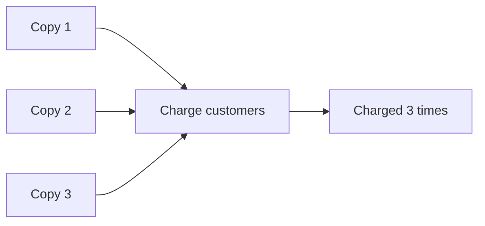
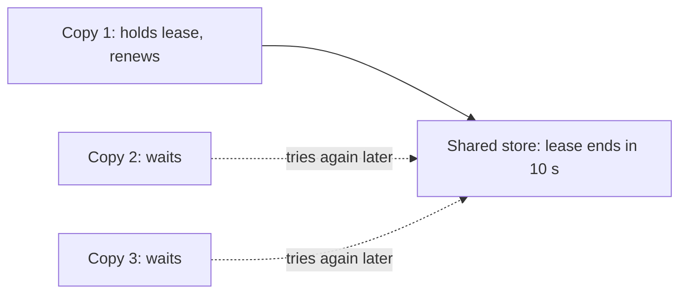
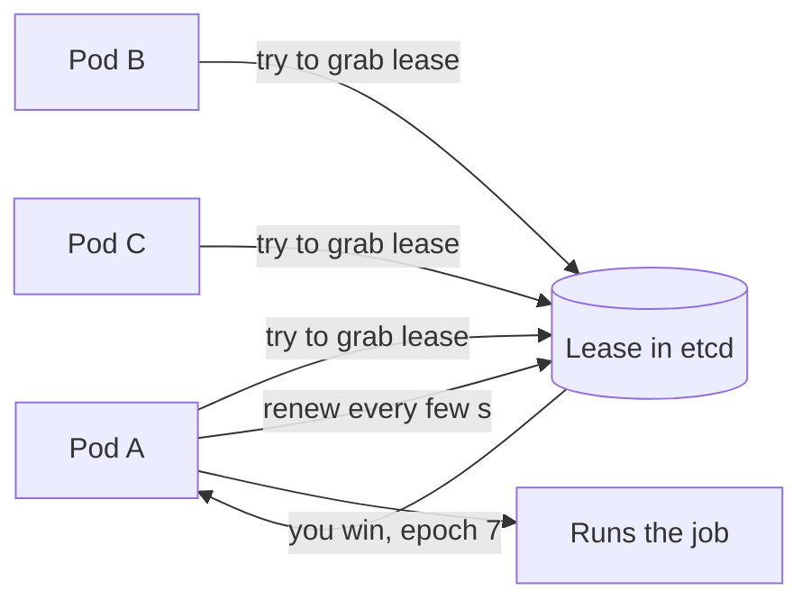
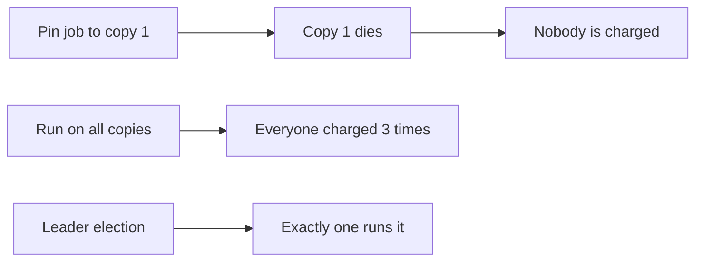
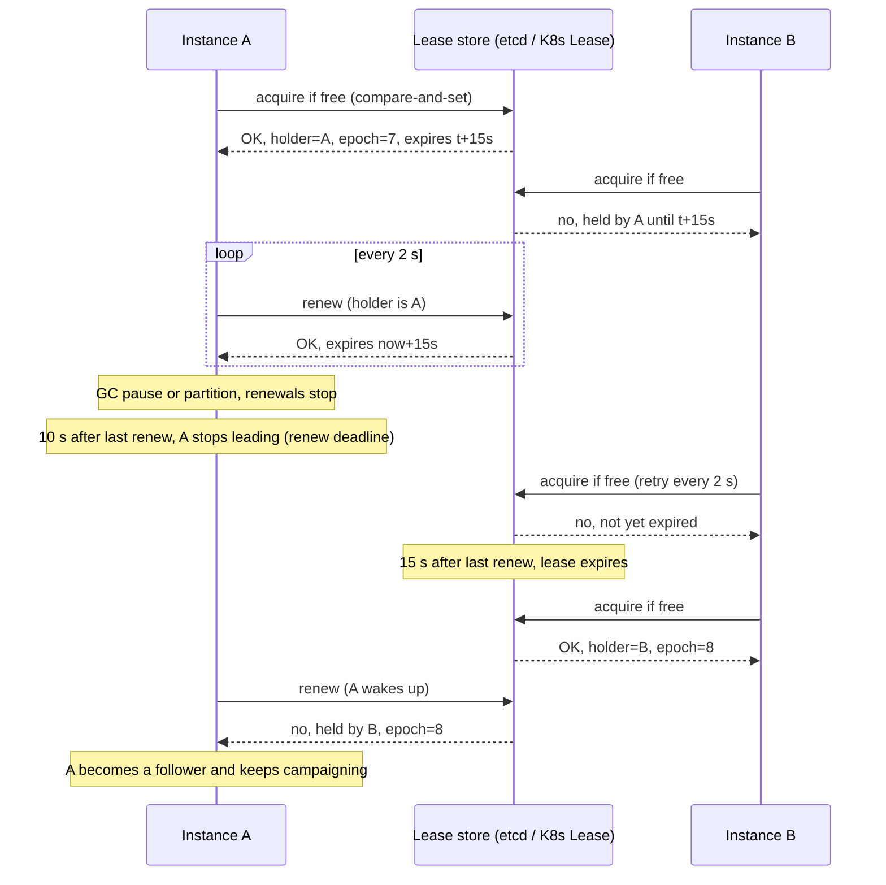
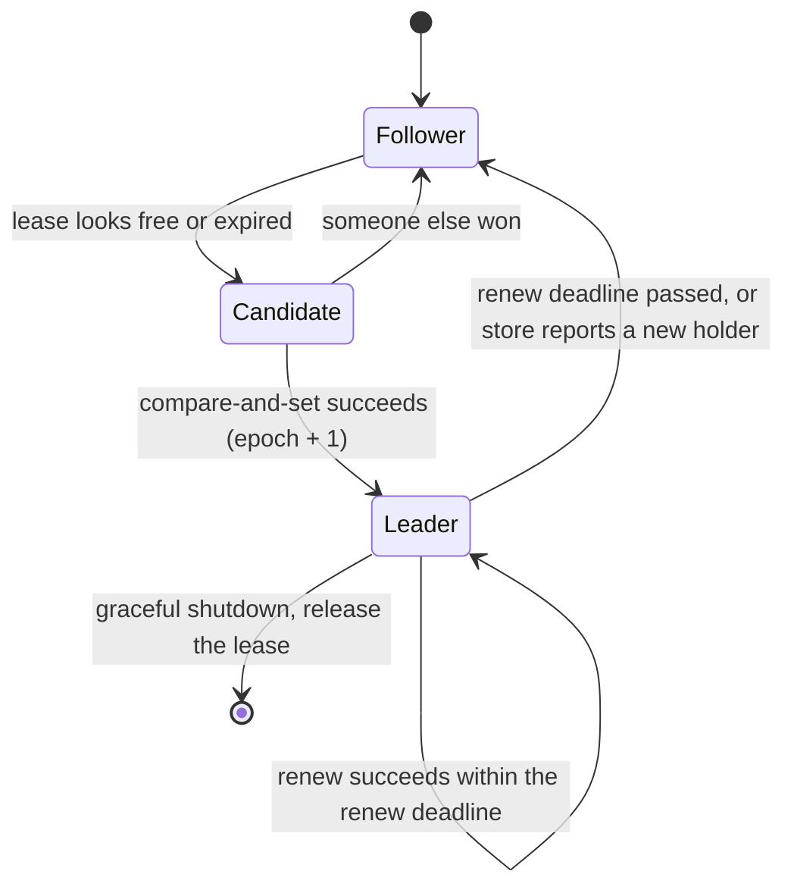
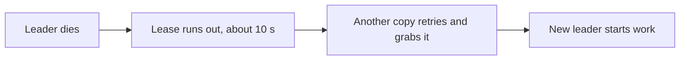

# Leader Election

> [!summary] TL;DR
> **Leader election** picks exactly one instance out of several to do a job that must not run twice at once, such as running a scheduler or being the only writer. In practice the instances race to hold a **lease**, a record with an expiry time in a strongly consistent store, and the holder must keep renewing it to stay leader.

> [!abstract] Core idea
> - Elect a leader when work must have a single owner: a cron scheduler, a primary database, a partition owner, a controller.
> - The safe way is a **lease** in a store built on consensus (etcd, ZooKeeper, Consul, a Kubernetes Lease, or a database row).
> - The leader stops acting before its lease can expire (renew deadline < lease TTL), and everyone else waits for full expiry.
> - Even so, a paused old leader can wake up and act: protect writes with an **epoch** (fencing) number.
> - Classic mistake: "the node with the lowest IP is leader", decided by each node from its own view of who is alive. That creates two leaders during a partition.

## Start here: the basics 🟢

> [!info] How to read this note (pick your level)
> - 🟢 **New to this?** Read "From zero" below, then sections 1, 2 and the cheat sheet (10). Stop there, that is a full first pass.
> - 🟡 **Know the basics?** Add section 3 (how it works), 4 (worked example), 5 (variants) and 6 (trade-offs).
> - 🔴 **Interview / SDE-3 prep?** Add 7, 8 and 9. Headings are tagged 🟢🟡🔴 so you always know where you are.

> [!note] Before this note
> - [[Consensus - Raft and Paxos]]: a group of servers can agree on one answer by majority vote, even when some crash; etcd and ZooKeeper are built this way.
> - [[Clocks and Ordering]]: clocks on different machines disagree and can jump, so "my lease ends at 10:00:15" is only roughly true.

**From zero, in 60 seconds** 🟢

You run 3 copies of a service, so one crash does not stop you.
But some jobs must run only once, like "charge every customer today".
If all 3 copies run it, every customer pays 3 times.



**Leader election** picks exactly one copy to do the job.
The copies race to grab a **lease**: a record in a safe shared store, with an expiry time.
The winner is the leader and must keep renewing the lease. If it dies, the lease runs out and another copy takes it.



The rest of this note is just these 3 questions:
1. How does a copy grab and keep the lease?
2. What happens when the leader dies or freezes?
3. How do you stop two copies from both thinking they lead?

**The problem in one story.**
You run three copies of a billing service so one crash does not stop it.
But the "charge everyone at 2 a.m." job must run only once.
If all three run it, each customer pays three times.
Leader election lets the copies agree that exactly one of them does the job, and another takes over if it dies.

**Words you need first**

| Word | Plain meaning | Tiny example |
| --- | --- | --- |
| Instance / replica | One running copy of the same program | 3 pods of `billing-svc` |
| Leader | The one copy allowed to do the special job | The pod that runs the cron |
| Lease | A "you are leader until time T" record that must be renewed | Kubernetes `Lease` object, 15 s |
| TTL | How long something stays valid without renewal | Lease expires 15 s after last renew |
| Consistent store | A database that never shows two different answers to the same question | etcd, ZooKeeper |
| Network partition | Machines are alive but cannot reach each other | A switch fails between two racks |
| Split brain | Two copies both think they are leader | Both pods run the billing job |
| Epoch / fencing token | A number that goes up with every new leader | Leader #7 replaced leader #6 |
| Compare-and-set | "Change it only if it still looks like what I last saw", done in one step | Set holder = A only if the lease is free |
| Renew deadline | How long the leader keeps acting without a successful renew | 10 s, shorter than the 15 s lease |
| GC pause | The program freezes while its memory cleaner runs | Pod A stops for 12 s, then wakes up |
| Failover | Another copy taking over when the leader dies | Pod B becomes leader 15 s later |

**Picture it**



**Analogy.** A relay baton with a sand timer: only the holder may run, and they must flip the timer before it empties or someone else may take the baton.
Where it breaks: a real runner knows when they dropped the baton; a paused process can wake up still believing it holds it, which is why epochs are needed.

**How the rest of this note builds up**

- First, why one owner is needed (section 1) and the lease vocabulary (section 2).
- Then how lease-based election works step by step (section 3) and a worked Go example (section 4).
- Then classic algorithms (bully, ring, Raft) and tools (etcd, ZooKeeper, Kubernetes, Postgres locks) compared (sections 5-6).
- Finally the SDE-3 deep dive: paused leaders, clock limits and fencing writes with epochs (sections 7-8).

> [!tip] Remember
> A leader is just whoever holds an expiring lease in a consistent store, and every leader action should carry its epoch.

## 1. Why it exists 🟢

You deploy a billing service with 3 replicas for availability. It has a job, "charge all subscriptions due today at 02:00", that must run **exactly once** per day. If all 3 replicas run it, each customer is charged 3 times. If you pin it to replica 1 and replica 1 dies, nobody is charged.

You need: one replica runs it, and if that replica dies, another takes over within seconds. That is leader election. The same need appears in:

- **Single writer:** a primary database; a Kafka partition leader (the one broker that accepts writes for a slice of a topic); one owner per **shard** (a slice of the data).
- **Coordinator:** a cluster controller, Kubernetes' `kube-controller-manager` and `kube-scheduler` (the Kubernetes parts that manage and place workloads), which run with several replicas and one active.
- **Scheduler:** the cron runner above (cron = a job that runs on a timetable), a job dispatcher, a cache warmer.

The hard part is not choosing; it is guaranteeing that two instances never both believe they lead (**split brain**) when the network is partitioned or a process is paused.



### Real-life example 🟢

When you hold seats on BookMyShow, they are reserved for about 10 minutes. Some background job must release seats whose hold has run out.
The booking service runs on many servers, but that clean-up job must run on only one of them at a time, or two servers could release and resell the same seat in a messy race.
So the servers elect one leader to run the clean-up. If that server crashes, another one takes over within seconds and seats keep getting released.

## 2. Mental model 🟢

**A baton with a sand timer.** There is one baton in a locked box (the consistent store). Whoever takes it turns over a 15-second sand timer and must come back to flip the timer before it runs out.

If the holder does not come back, after the sand runs out anyone may take the baton, and the box writes a new, higher number on it. Any action taken "as leader" quotes that number, so actions from an old holder can be spotted.

**Vocabulary:**

- **Lease:** the right to lead until a time; renewed periodically.
- **TTL / lease duration:** how long a lease lasts without renewal.
- **Renew deadline:** how long the leader keeps acting without a successful renewal. Always shorter than the TTL.
- **Epoch (or term, generation, `leaseTransitions`):** a number that grows each time leadership changes. Used as a fencing token.

## Common beginner mistakes 🟢

- **"Lowest IP is leader", decided by each node on its own** → during a network split each side picks its own leader → let a consistent store (etcd, ZooKeeper, a DB row) decide.
- **Using a single Redis key as the lease** → Redis can lose the key during failover, giving two leaders → use a consensus-backed store, and fence writes.
- **The leader keeps working until the lease has fully expired** → a follower may take over at that exact moment → stop early, at the renew deadline (10 s of a 15 s lease).
- **No epoch on writes** → an old leader waking from a pause can still write → send the epoch with every write and reject older ones.
- **Electing a leader just to run a cron job once** → a unique row per `(job, date)` or `SKIP LOCKED` does it with no election → use the database constraint when you can.

## 3. How it works 🟡

> 🟢 → 🟡 **You now know** that a leader is just whoever holds an expiring lease in a shared, consistent store, and that it must keep renewing. **Next we open the box**: the full life of a lease from grab to takeover, the states each copy moves through, and the four rules that keep two leaders from existing at once.

### The lease lifecycle

**In plain words:** grab the lease, renew it before it runs out, and if you cannot renew in time, stop acting as leader.

**Step by step:**
1. Pod A asks etcd: "make me holder if nobody holds it". It wins: holder A, epoch 7, expires in 15 s.
2. Pod B asks the same and is told "no, A holds it". B retries every 2 s.
3. A renews every 2 s, pushing the expiry forward each time.
4. A freezes. After 10 s with no successful renew, A's own rule says "stop leading", even though it is frozen and cannot act anyway.
5. At 15 s the lease expires. B's next try wins: holder B, epoch 8. When A wakes and tries to renew, it is told "held by B" and becomes a follower.



### Each instance's states

**In plain words:** each copy is either a follower waiting, a candidate trying to grab the lease, or the leader doing the work.

**Step by step:**
1. Pod C starts as a follower and watches the lease.
2. The lease looks expired, so C becomes a candidate and tries to grab it.
3. If C's compare-and-set works, C is leader and the epoch goes up by 1. If someone else won, C goes back to follower.
4. As leader, C stays leader only while renewals keep succeeding within the renew deadline.
5. On a clean shutdown, C releases the lease so another pod can take over at once.



### Four rules that keep it safe

**In plain words:** let the store decide, renew early, step down on time, and protect writes with a growing number.

1. **The store decides.** Acquisition must be an **atomic** (all-or-nothing, no one can sneak in between) compare-and-set (or create-if-absent) on a linearizable store (one that acts like a single copy). Two instances cannot both succeed.
2. **The leader gives up early.** It stops leader-only work when `now - lastSuccessfulRenew >= renewDeadline` (10 s), while followers wait for the full lease duration (15 s). The gap absorbs clock-rate differences and in-flight requests.
3. **Every takeover bumps the epoch.** Downstream systems reject writes carrying an older epoch. This handles the case rule 2 cannot: a leader paused *in the middle* of a write.
4. **Release on shutdown.** A leader that stops cleanly deletes the lease so a follower takes over immediately instead of waiting 15 s.

## 4. Worked example 🟡

### Whiteboard version

**In plain words:** a loop: try to take the lease; if you have it, renew and work; if renewal fails, stop at once.

```text
loop every retryPeriod (2s):
    ok, epoch = store.CompareAndSet(lease,
        if lease.holder == me or lease.expired(): holder = me, expires = now + ttl,
                                                  epoch += 1 if holder changed)
    if ok: lastRenew = now

before every leader-only action:
    if now - lastRenew >= renewDeadline (10s): not leader, stop
    send action with epoch; downstream rejects epoch < highest seen

on SIGTERM: release lease if I hold it
```

### Go implementation with an injected clock

**In plain words:** working code for the lease loop; time is passed in so tests can fast-forward the clock.

`Store` is the linearizable compare-and-set store (in production, etcd or a Kubernetes Lease object). `Elector` is one candidate. The clock is injected so the tests can simulate a 15-second pause without sleeping. It passes `go vet` and `go test -race` on Go 1.24.

```go
package election

import (
	"sync"
	"time"
)

// Lease is the single record every candidate competes for, like a
// Kubernetes Lease object or a row in a leases table.
type Lease struct {
	Holder  string
	Epoch   uint64    // bumped on every change of leader; used as a fencing token
	Expires time.Time // the store's own clock decides expiry
}

// Store is a linearizable compare-and-set store (etcd, a database row, a K8s Lease).
// now is injected so tests are deterministic.
type Store struct {
	mu    sync.Mutex
	lease Lease
	now   func() time.Time
}

func NewStore(now func() time.Time) *Store { return &Store{now: now} }

// TryAcquire makes id the leader if the lease is free or expired,
// or renews it if id already holds it. It returns the lease after the call.
func (s *Store) TryAcquire(id string, ttl time.Duration) (Lease, bool) {
	s.mu.Lock()
	defer s.mu.Unlock()
	now := s.now()
	switch {
	case s.lease.Holder == id && now.Before(s.lease.Expires):
		s.lease.Expires = now.Add(ttl) // renew, same epoch
	case s.lease.Holder == "" || !now.Before(s.lease.Expires):
		s.lease = Lease{Holder: id, Epoch: s.lease.Epoch + 1, Expires: now.Add(ttl)}
	default:
		return s.lease, false // someone else holds a live lease
	}
	return s.lease, true
}

// Release gives the lease up early (graceful step-down on shutdown).
func (s *Store) Release(id string, epoch uint64) {
	s.mu.Lock()
	defer s.mu.Unlock()
	if s.lease.Holder == id && s.lease.Epoch == epoch {
		s.lease.Holder = ""
		s.lease.Expires = time.Time{}
	}
}

// Elector is one candidate. It treats itself as leader only until
// renewDeadline after its last successful renew, which is shorter than the
// lease TTL, so it stops leading before anyone else can take over.
type Elector struct {
	ID            string
	Store         *Store
	TTL           time.Duration // e.g. 15s
	RenewDeadline time.Duration // e.g. 10s, must be < TTL
	Now           func() time.Time

	epoch     uint64
	lastRenew time.Time
}

// Tick runs one attempt (call it every retry period, e.g. 2s) and reports
// whether this instance may act as leader right now, with its epoch.
func (e *Elector) Tick() (leader bool, epoch uint64) {
	sent := e.Now() // count the renew deadline from when the request was sent
	if l, ok := e.Store.TryAcquire(e.ID, e.TTL); ok {
		e.epoch, e.lastRenew = l.Epoch, sent
	}
	return e.IsLeader()
}

// IsLeader is checked before every leader-only action.
func (e *Elector) IsLeader() (bool, uint64) {
	if e.epoch == 0 || e.Now().Sub(e.lastRenew) >= e.RenewDeadline {
		return false, 0
	}
	return true, e.epoch
}

// StepDown releases the lease so a follower can take over at once.
func (e *Elector) StepDown() {
	e.Store.Release(e.ID, e.epoch)
	e.epoch = 0
}
```

The tests walk through the sequence diagram: A leads and renews, A freezes, A stops leading at 10 s, B cannot take over until 15 s, B takes over with epoch 2, and A cannot come back. A third test runs 50 concurrent candidates against the store and checks exactly one wins.

```go
package election

import (
	"sync"
	"testing"
	"time"
)

type fakeClock struct {
	mu sync.Mutex
	t  time.Time
}

func (c *fakeClock) Now() time.Time          { c.mu.Lock(); defer c.mu.Unlock(); return c.t }
func (c *fakeClock) Advance(d time.Duration) { c.mu.Lock(); c.t = c.t.Add(d); c.mu.Unlock() }

func setup() (*fakeClock, *Elector, *Elector) {
	clk := &fakeClock{t: time.Date(2026, 11, 4, 9, 0, 0, 0, time.UTC)}
	s := NewStore(clk.Now)
	mk := func(id string) *Elector {
		return &Elector{ID: id, Store: s, TTL: 15 * time.Second, RenewDeadline: 10 * time.Second, Now: clk.Now}
	}
	return clk, mk("pod-a"), mk("pod-b")
}

func TestOnlyOneLeaderAndTakeoverAfterExpiry(t *testing.T) {
	clk, a, b := setup()
	if ok, ep := a.Tick(); !ok || ep != 1 {
		t.Fatalf("a should lead with epoch 1, got %v %d", ok, ep)
	}
	if ok, _ := b.Tick(); ok {
		t.Fatal("b must not lead while a's lease is live")
	}
	// a renews every 2s for a while; b keeps losing.
	for i := 0; i < 5; i++ {
		clk.Advance(2 * time.Second)
		if ok, _ := a.Tick(); !ok {
			t.Fatal("a should keep leading while it renews")
		}
		if ok, _ := b.Tick(); ok {
			t.Fatal("b must not lead")
		}
	}
	// a freezes (GC pause, partition): no more ticks from a.
	clk.Advance(10 * time.Second)
	if ok, _ := a.IsLeader(); ok {
		t.Fatal("a must stop acting as leader after its renew deadline")
	}
	if ok, _ := b.Tick(); ok {
		t.Fatal("lease (15s) has not expired yet at 10s")
	}
	clk.Advance(5 * time.Second) // 15s after a's last renew
	ok, ep := b.Tick()
	if !ok || ep != 2 {
		t.Fatalf("b should take over with epoch 2, got %v %d", ok, ep)
	}
	// a wakes up: its renew fails and it stays a follower.
	if ok, _ := a.Tick(); ok {
		t.Fatal("old leader must not regain leadership while b holds the lease")
	}
}

func TestGracefulStepDown(t *testing.T) {
	_, a, b := setup()
	a.Tick()
	a.StepDown()
	if ok, ep := b.Tick(); !ok || ep != 2 {
		t.Fatalf("b should take over immediately with epoch 2, got %v %d", ok, ep)
	}
}

func TestConcurrentCandidatesExactlyOneWins(t *testing.T) {
	clk := &fakeClock{t: time.Unix(0, 0)}
	s := NewStore(clk.Now)
	var wg sync.WaitGroup
	var mu sync.Mutex
	winners := 0
	for i := 0; i < 50; i++ {
		wg.Add(1)
		go func(id int) {
			defer wg.Done()
			if _, ok := s.TryAcquire(string(rune('A'+id)), time.Second); ok {
				mu.Lock()
				winners++
				mu.Unlock()
			}
		}(i)
	}
	wg.Wait()
	if winners != 1 {
		t.Fatalf("winners = %d, want exactly 1", winners)
	}
}
```

**Timeline from the first test** (seconds since A first acquired; A's last successful renew is at t = 10):

| Time | A thinks | Store says | B's attempt |
| --- | --- | --- | --- |
| 10 | leader, epoch 1 | holder A, expires 25 | refused |
| 20 | **not leader** (10 s ≥ renew deadline) | holder A, expires 25 | refused |
| 25 | not leader | expired | **wins, epoch 2** |
| 25+ | renew refused, follower | holder B | leader |

Between 20 and 25 nobody leads. That gap is the price of never having two leaders, and it is why failover takes "lease duration plus retry period" rather than zero.

**A simplification to know about.** The test uses one shared clock. In real systems the store and the instances have separate clocks.

Kubernetes' client-go avoids comparing them: each candidate measures, with its own monotonic clock, how long it has seen the same `renewTime` unchanged, and only takes over after a full lease duration of no change.

That still assumes clocks *run* at roughly the same rate, which is why the 10 s / 15 s margin exists.

## 5. Variants and comparison 🟡

| Method | How it works | Use when | Cost |
| --- | --- | --- | --- |
| Bully (1982) | On detecting the leader is down, a node messages all higher-ID nodes; if none answer, it declares itself leader | Textbook vocabulary; small static groups on a reliable network | Unsafe under partitions: each side elects its own leader |
| Ring (Chang–Roberts, 1979) | An election message circulates the ring collecting the highest ID | Textbook vocabulary | Same partition problem; `O(n)` to `O(n²)` messages |
| Consensus built in (Raft term) | Candidates request votes; a majority makes a leader for that term | You are building the replicated system itself | You must run a Raft group |
| etcd election | `concurrency.NewSession` (lease, default TTL 60 s, kept alive in the background), then `Election.Campaign`; the leader is the key with the lowest create revision under a prefix | Go services already running etcd | Needs an etcd cluster; revision of the key works as an epoch |
| ZooKeeper | Each candidate creates an ephemeral sequential znode (a ZooKeeper entry that gets a rising number and vanishes when its owner's session dies); the lowest sequence leads; each watches only its predecessor | JVM ecosystems already on ZooKeeper | Session timeouts to tune; no herd on change |
| Consul session | `PUT ?acquire=<session>` on a key; session tied to health checks; `lock-delay` (default 15 s) blocks reacquire after a release by invalidation | Consul shops | Health-check-based expiry |
| Kubernetes Lease | client-go `leaderelection` updates a `coordination.k8s.io/v1` Lease: `holderIdentity`, `renewTime`, `leaseTransitions` | Anything running in Kubernetes | Typical 15 s lease, 10 s renew deadline, 2 s retry; API-server load from renewals |
| Database lease | `pg_try_advisory_lock(42)` (a Postgres lock on a number, not on a row) on a session, or a `leases` row updated with `WHERE expires_at < now()` | You already have PostgreSQL and no etcd | The database becomes a dependency of failover; advisory locks are lost silently when the connection drops |

### Leader election versus things people confuse it with 🟡

| Thing | What it decides | How it differs from leader election |
| --- | --- | --- |
| Distributed lock | Who may touch one resource right now | Usually short and per task; leader election is a long-lived role that is renewed for hours |
| Consensus (Raft) | One agreed order of all writes | Raft elects a leader internally; app-level election usually borrows a store that already runs Raft |
| Failure detection | Whether a node is probably dead | Only a hint; the election store and fencing give the actual safety |

### PostgreSQL lease row

**In plain words:** one row in a table is the lease, and the database's own clock decides when it has expired.

When the only consistent store you have is PostgreSQL, a lease row works. The database's clock (`now()`) is the single clock, and the `epoch` column is the fencing token.

```sql
CREATE TABLE leader_lease (
    name       text PRIMARY KEY,
    holder     text NOT NULL,
    epoch      bigint NOT NULL,
    expires_at timestamptz NOT NULL
);
INSERT INTO leader_lease VALUES ('billing-cron', '', 0, '-infinity');

-- Acquire or renew in one statement. Returns a row only if we lead.
UPDATE leader_lease
SET holder     = $1,
    epoch      = CASE WHEN holder = $1 AND expires_at > now() THEN epoch ELSE epoch + 1 END,
    expires_at = now() + interval '15 seconds'
WHERE name = 'billing-cron'
  AND (holder = $1 OR expires_at <= now())
RETURNING epoch;
```

Representative output (PostgreSQL 17), first call by `pod-a`:

```text
 epoch
-------
     1
(1 row)

UPDATE 1
```

A call by `pod-b` while `pod-a`'s lease is live returns `(0 rows)` and `UPDATE 0`. The row lock taken by `UPDATE` serializes competing candidates, so at most one sees a row back.

## 6. Trade-offs and when not to use 🟡

- **Failover is never instant.** Detection time is roughly the lease duration, plus the retry period, plus the new leader's warm-up. Shorter leases mean faster failover but more renewal traffic and more false failovers during GC pauses or brief network blips.
- **A lease is a promise about time.** It holds only if clocks run at similar rates and pauses are shorter than the margin. Add fencing for anything that writes.
- **The leader is a bottleneck and a single point of slowness.** If the work can be split, partition it (each instance leads a set of shards, as Kafka does per partition) instead of one global leader.
- **Often you do not need a leader:**
	- For "run this cron job once", a row lock with `FOR UPDATE SKIP LOCKED` on a jobs table, or a unique constraint on `(job, run_date)`, makes duplicates impossible without any election (see [[Scheduled Jobs - Cron to Durable Schedulers]]).
	- Idempotent work can simply run on every replica.



## 7. In production 🔴

> 🟡 → 🔴 **You now know** the lease life cycle, the follower/candidate/leader states, the four safety rules, and how etcd, ZooKeeper, Kubernetes and PostgreSQL implement them. **Next comes the advanced part**: real systems such as Patroni, KRaft and Redis Sentinel, production failure modes, and the finer points of renew deadlines, thundering herds and epochs in the data path.

- **Real systems:**
	- `kube-controller-manager` and `kube-scheduler` run several replicas with one active via a Lease object.
	- Patroni elects the PostgreSQL primary through a lease in etcd, Consul or ZooKeeper (see [[High Availability and Failover]]).
	- Kafka: the KRaft controller quorum (Kafka's built-in Raft group) elects the active controller with Raft; the controller then picks a leader for each partition from its in-sync replicas (the copies that are fully caught up).
	- Redis Sentinel (helper processes that watch Redis and run failover): sentinels agree (by majority) that the master is down and elect one sentinel to run the failover.
- **Failure modes → fixes:**
	- Leadership flapping during GC pauses or a slow store → longer lease, separate the renewal goroutine from heavy work, alert on transitions.
	- Old leader keeps writing after a pause → fencing: pass the epoch to every downstream write and reject older ones (see [[Distributed Locks and Fencing Tokens]]).
	- 15-second outage on every deploy → release the lease on `SIGTERM` (the polite "please shut down" signal) (client-go's `ReleaseOnCancel: true`).
	- Leader holds the lease but its work loop is stuck → tie renewal to a health signal from the work loop, not just to "process is alive".
	- Advisory-lock leader loses its DB connection and the lock with it, but keeps running → check the lock (or re-acquire) before each unit of work, or use the lease row with an epoch.
- **What to monitor:** current leader identity, leadership transitions per hour, time since last successful renewal, renewal latency, and time with no leader during failovers.

## 8. Deep dive 🔴

- **Why renew deadline < lease duration.** The leader starts its 10 s countdown from when it *sent* its last successful renewal (the Go example records the time before calling the store for this reason), while the store computes expiry from when it *received* it, which is later. So the leader always believes its lease ends before the store does. The 5 s gap also absorbs a clock that runs a little fast and the time to finish an in-flight operation.
- **Detection vs safety.** A failure detector (heartbeats, phi accrual; see [[Failure Detection, Gossip and Membership]]) can say a leader is *probably* dead. It can never be sure, because a slow node looks like a dead one. So the safety of election must come from the store's atomic compare-and-set and from fencing, never from "I think the leader is dead".
- **Thundering herd** (many waiting clients all waking at once). With 100 candidates all watching one key, every change wakes 100 clients that all retry. ZooKeeper's recipe avoids this: each candidate watches only the znode just below its own, so one change wakes one client. etcd's `Campaign` does the same by waiting on the key with the previous revision.
- **Observers.** Followers often need to know who leads (to forward requests). etcd `Election.Observe` streams leader changes; Kubernetes clients read `holderIdentity`.
- **Epoch in the data path.** The strongest form puts the epoch inside the store transaction itself: etcd transactions can check that the leader key still has its create revision (`Txn().If(Compare(CreateRevision(leaderKey), "=", rev))`), so a write succeeds only while that exact leadership is live.

### The same with etcd's election API

**In plain words:** if you already run etcd, its library does the lease, the race and the renewal for you.

In a Go service that already runs etcd, the library does the lease, the campaign and the watch-your-predecessor logic. This compiles and passes `go vet` against `go.etcd.io/etcd/client/v3` v3.6.7; it needs a live etcd cluster to run, so it has no unit test here.

```go
package etcdel

import (
	"context"
	"fmt"

	clientv3 "go.etcd.io/etcd/client/v3"
	"go.etcd.io/etcd/client/v3/concurrency"
)

// RunAsLeader campaigns for leadership of /election/billing-cron and calls
// work with the leader key's create revision, which serves as the epoch.
// work must stop when ctx is cancelled (session lost or shutdown).
func RunAsLeader(ctx context.Context, cli *clientv3.Client, id string, work func(ctx context.Context, epoch int64) error) error {
	sess, err := concurrency.NewSession(cli, concurrency.WithTTL(15)) // default TTL is 60 s
	if err != nil {
		return fmt.Errorf("new session: %w", err)
	}
	defer sess.Close() // revokes the lease, so a follower takes over at once

	e := concurrency.NewElection(sess, "/election/billing-cron")
	if err := e.Campaign(ctx, id); err != nil { // blocks until this instance leads
		return fmt.Errorf("campaign: %w", err)
	}
	epoch := e.Rev() // create revision of our leader key

	// Stop leading as soon as the session's lease is lost.
	leadCtx, cancel := context.WithCancel(ctx)
	defer cancel()
	go func() {
		select {
		case <-sess.Done():
			cancel()
		case <-leadCtx.Done():
		}
	}()

	workErr := work(leadCtx, epoch)
	if err := e.Resign(context.WithoutCancel(ctx)); err != nil && workErr == nil {
		return fmt.Errorf("resign: %w", err)
	}
	return workErr
}
```

`sess.Done()` closes when the keep-alive fails and the lease is gone, but the process learns that late, so the epoch still has to be checked downstream.

## 9. Interview questions 🔴

> [!question]- Why can't each node just elect the node with the highest ID among those it can reach?
> During a partition each side sees a different set of live nodes and elects its own leader: split brain. Election must go through a majority-backed decision (a consensus store or a quorum vote), so the minority side cannot elect anyone.

> [!question]- Kubernetes uses a 15 s lease, 10 s renew deadline and 2 s retry period. Why is renew deadline shorter than the lease?
> The leader must stop acting before any other instance can take over. It stops 10 s after its last successful renew; others wait 15 s of no change. The 5 s gap covers request delays, clock-rate differences and finishing in-flight work.

> [!question]- The old leader was paused for 30 s by GC and then writes to the database. What stops it?
> Nothing in the election itself; the lease check happened before the pause. The database must check a fencing token: the leader sends its epoch with each write and the database rejects epochs lower than the highest it has seen.

> [!question]- How long does failover take?
> Roughly lease duration + retry period + startup work: with 15 s / 2 s, about 15–17 s before the new leader acts. Shortening the lease speeds it up but raises false failovers during pauses. A graceful shutdown that releases the lease brings it down to one retry period.

> [!question]- Trap: "Use a Redis `SETNX` key as the leader lock and you are done."
> A single Redis node is not linearizable through failover: asynchronous replication can lose the key when a replica is promoted, giving two leaders. And without fencing, a paused leader still writes after expiry. Use a consensus store, and fence writes either way.

> [!question]- Do you even need a leader for a daily cron job?
> Often not. Insert a row keyed by `(job_name, run_date)` with a unique constraint, or claim it with `SELECT … FOR UPDATE SKIP LOCKED`; whoever inserts or claims it runs it. That turns "exactly one runner" into a database constraint.

## 10. Cheat sheet 🟢

- Leader = holder of a lease in a linearizable store, acquired by compare-and-set.
- Kubernetes defaults: 15 s lease, 10 s renew deadline, 2 s retry.
- Leader stops at renew deadline; others take over only after full expiry.
- Each takeover bumps an epoch; downstream rejects older epochs (fencing).
- Release the lease on shutdown for fast handover.
- Bully and ring are vocabulary; they split-brain under partitions.
- Tools: etcd `concurrency.Election`, ZooKeeper ephemeral sequential znodes, Consul sessions, K8s Lease, a PostgreSQL lease row.
- Prefer no leader at all when a unique constraint or `SKIP LOCKED` does the job.

## Self-check 🟢🟡

🟢 Easy

> [!question]- What is a lease?
> A record in a shared store saying "X is leader until time T", which the leader must keep renewing.

> [!question]- What is split brain?
> Two copies both believing they are the leader and both doing leader work.

> [!question]- Why release the lease on shutdown?
> So a follower can take over right away instead of waiting for the lease to expire.

🟡 Medium

> [!question]- Lease 15 s, renew deadline 10 s, retry 2 s. The leader dies. Roughly how long until a new leader acts?
> About 15 to 17 s: full lease expiry plus up to one retry period.

> [!question]- Why must the renew deadline be shorter than the lease?
> So the old leader always stops before anyone else can take over, covering delays and small clock differences.

> [!question]- The old leader froze mid-write and wakes after a new leader took over. What stops its write?
> The fencing epoch: its write carries epoch 7, the database has seen 8, so it rejects the write.

## Links

- **Before this:** [[Consensus - Raft and Paxos]], [[Clocks and Ordering]]
- **Next:** [[Distributed Locks and Fencing Tokens]], [[Failure Detection, Gossip and Membership]]
- **Compare with:** [[High Availability and Failover]] (electing a database primary), [[Scheduled Jobs - Cron to Durable Schedulers]] (running a job once without an election)

### Watch on YouTube

- [Distributed Consensus - Raft Leader Election / Systems Design Interview 0 to 1 with Ex-Google SWE](https://www.youtube.com/watch?v=Al2JNJBGG30) · Jordan has no life · 8 min · 26,516 views
- [How Leader Election work in Distributed Systems / System Design Interview Basics](https://www.youtube.com/watch?v=TzwiGTbUSHg) · ByteMonk · 4 min · 22,179 views
