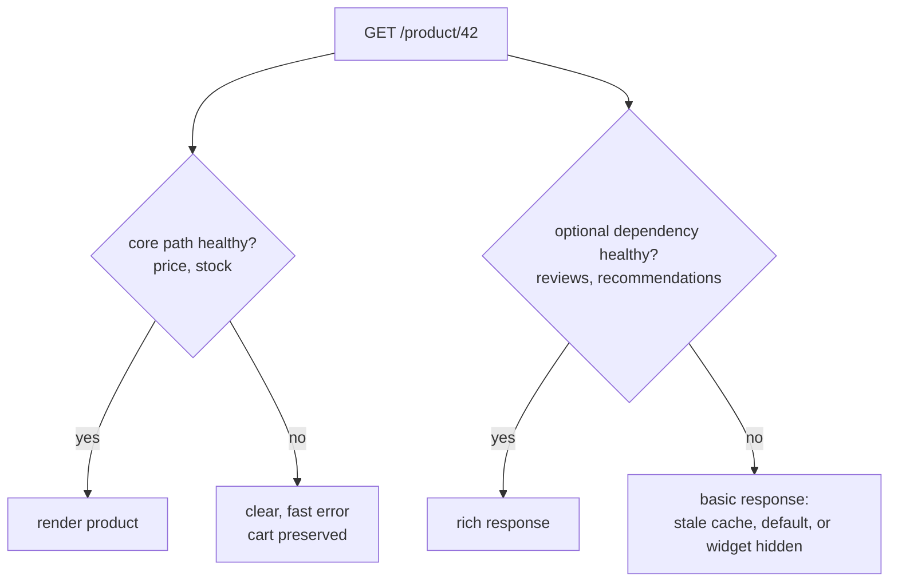
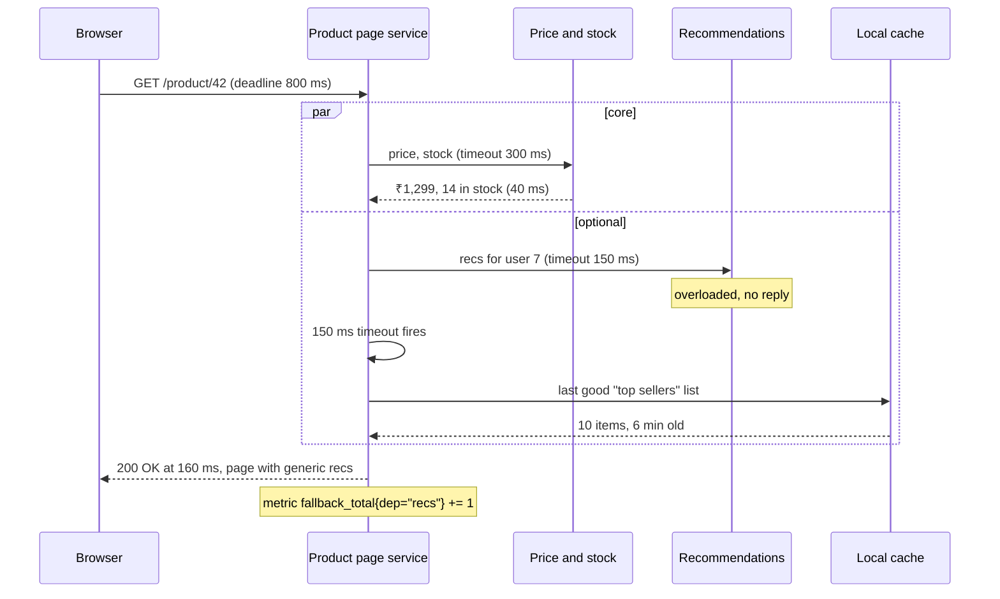
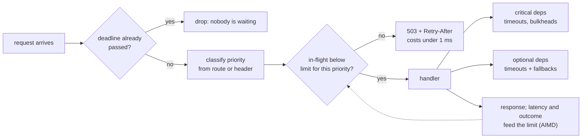

# Load Shedding and Graceful Degradation

> [!summary] TL;DR
> **Load shedding** means a server that is over capacity rejects some requests quickly (with 503 or 429 and a `Retry-After` header) so that the requests it accepts still finish fast. **Graceful degradation** means that when an optional part fails, the product keeps its most important flows working in a reduced form instead of failing as a whole.

> [!abstract] Core idea
> - Classify every feature and dependency as **critical** (checkout, login) or **optional** (recommendations, reviews).
> - Optional dependency fails → serve a fallback: stale cache, a default, a hidden widget, or "do it later".
> - Too much traffic → reject early, before doing work, and shed the lowest-priority requests first.
> - An **adaptive concurrency limit** finds the server's capacity from its latency, so you do not have to guess it.
> - Classic mistake: queueing everything "to be safe". Long queues mean every request is late, and late answers are wasted work.

## 1. Why it exists

Two different problems, with the same goal of keeping the important things working.

**Overload.** A service can complete 1,000 requests per second at 50 ms each. A flash sale sends 1,500 req/s. Without shedding, the extra 500 req/s queue up (illustrative arithmetic):

| After | Queue length | Wait for a new request | Clients (2 s timeout) |
| --- | --- | --- | --- |
| 1 s | 500 | 0.5 s | most still get answers |
| 4 s | 2,000 | 2 s | every new request times out before it is served |
| 10 s | 5,000 | 5 s | the server is 100% busy producing answers nobody reads |

Throughput of *useful* answers (goodput) drops to zero while the CPU is at 100%. Client retries then add more load. This is **congestion collapse**. With shedding, the server serves 1,000 req/s at 50 ms and rejects 500 req/s in under a millisecond each; users who are rejected can retry later, and everyone else gets a fast answer.

**Partial dependency failure.** A product page calls price, stock, reviews and recommendations. If recommendations times out and the page returns a 500, the shop loses the sale because of a widget. Customers can buy without recommendations; they cannot buy without price and stock.

## 2. Mental model

A hospital emergency room on a bad night.

- **Triage (priority shedding):** heart attacks are seen first; a sprained ankle may be told to come back tomorrow. The ER does not treat patients in arrival order when it is overwhelmed.
- **Admission control (load shedding):** when every bed is full, ambulances are diverted to another hospital *before* arriving, rather than lining stretchers in the corridor.
- **Graceful degradation:** the cafeteria and the gift shop close so their staff can help; the ER stays open.
- **Static stability:** if the hospital's central scheduling system goes down, each ward keeps working from the last printed rota instead of stopping.

## 3. How it works

### Step 1: classify features and dependencies

The old notes' core-versus-optional decision, made concrete:



| Tier | Examples | When it fails |
| --- | --- | --- |
| Critical | Login, cart, checkout, payment, seat hold | Fail clearly and fast; never silently pretend success |
| Degradable | Prices from a cache, search suggestions, delivery estimates | Serve stale or approximate data, labelled if users would care |
| Optional | Recommendations, reviews, "people also viewed", analytics beacons | Hide the component, return a default, or drop |
| Deferrable | Confirmation email, loyalty points, search indexing | Queue it and do it later, with an idempotency key |

### Step 2: give every optional call a fallback and a budget

Each optional dependency gets its own short timeout (inside the page's overall deadline), its own [[Bulkheads and Concurrency Limits|bulkhead]] and its own [[10 Distributed Systems & Resilience/Circuit Breaker|breaker]], plus a fallback:

- **Stale data:** serve the last good value. HTTP caches can do this with `Cache-Control: stale-if-error=86400` (RFC 5861), which lets a cache serve a stale response for up to a day when the origin errors.
- **Defaults:** "Top sellers" instead of personalised recommendations.
- **Hide:** remove the reviews block entirely.
- **Defer:** "Your confirmation email is on its way" while the email job waits in a queue.
- **Kill switch:** a [[Feature Flags|feature flag]] that turns an expensive feature off for everyone, flipped by on-call staff or by automation when error rates rise.



### Step 3: admission control and load shedding

When the server itself is the bottleneck, it must say no early, before it parses large bodies, opens database transactions or calls other services.



- **What to return.** `503 Service Unavailable` with `Retry-After` when the server is overloaded; `429 Too Many Requests` when *this client* is over its quota (that is [[Rate Limiting - Algorithms and Distributed Design]]). Clients must back off and honour `Retry-After` ([[Timeouts, Retries and Backoff]]).
- **Priority tiers.** Google's SRE book describes four request criticalities: `CRITICAL_PLUS`, `CRITICAL`, `SHEDDABLE_PLUS` and `SHEDDABLE`. Criticality is set at the edge and travels with the request through every RPC, so a backend deep in the stack still sheds batch traffic before user traffic. Netflix applies the same idea at its Zuul gateway, putting requests into priority buckets so that, under load, prefetch and logging are shed before requests that start playback.
- **Limits that adapt.** A fixed limit is a guess that ages. An **AIMD** limiter (additive increase, multiplicative decrease, the rule TCP uses for its congestion window) raises the limit slowly while latency stays under a target and cuts it by a fraction when latency rises or calls fail. Netflix's `concurrency-limits` library offers AIMD and latency-gradient algorithms such as Vegas and Gradient2.

### Step 4: manage the queue, not just the door

Some queueing absorbs bursts. Long queues create the collapse in section 1. Facebook's *Fail at Scale* describes two techniques:

- **Controlled Delay (CoDel):** if the queue has not been empty at any point in the last `N` ms (100 ms in their description), requests may wait only `M` ms (5 ms) before being dropped. A short burst can queue; a standing queue cannot.
- **Adaptive LIFO:** normally serve first in, first out; when a queue is building, switch to last in, first out. The newest requests belong to users still waiting, while the oldest have probably timed out already.

## 4. Worked example

### Whiteboard version

The smallest useful load shedder: a fixed number of slots, and a fast 503 with `Retry-After` when they are all taken.

```go
package wbshed

import "net/http"

// Shed admits at most limit requests at once and rejects the rest
// before any work is done, so the admitted ones stay fast.
func Shed(limit int, next http.Handler) http.Handler {
	slots := make(chan struct{}, limit)
	return http.HandlerFunc(func(w http.ResponseWriter, r *http.Request) {
		select {
		case slots <- struct{}{}:
			defer func() { <-slots }()
			next.ServeHTTP(w, r)
		default:
			w.Header().Set("Retry-After", "1")
			http.Error(w, "overloaded", http.StatusServiceUnavailable)
		}
	})
}
```

### Adaptive, priority-aware shedding with fallbacks

The package below has three parts:

1. **`Limiter`**: an AIMD concurrency limit. A call that finishes under the 200 ms target adds `1/limit`, so about +1 per round of `limit` calls. A slow or failed call multiplies the limit by 0.9. Sheddable requests may fill only 80% of the limit, so the top 20% is reserved for critical work.
2. **`Middleware`**: sheds with 503 and `Retry-After` before the handler runs, and reports 5xx responses back to the limiter as failures.
3. **`WithFallback`**: runs an optional call under its own timeout and returns a fallback value if it fails.

The clock is injected so tests control latency exactly.

```go
// Package shed admits requests under an adaptive (AIMD) concurrency limit,
// sheds low-priority work first, and falls back when an optional
// dependency is slow.
package shed

import (
	"context"
	"math"
	"net/http"
	"sync"
	"time"
)

// Priority decides who is shed first.
type Priority int

const (
	Critical  Priority = iota // checkout, payment, login
	Sheddable                 // recommendations, prefetch, analytics
)

// Limiter is an AIMD concurrency limiter: the limit grows by 1/limit after
// each fast success (about +1 per limit's worth of calls) and shrinks by
// 10% after each slow or failed call.
type Limiter struct {
	mu             sync.Mutex
	limit          float64
	minLimit       float64
	maxLimit       float64
	inflight       int
	target         time.Duration // latency above which we back off
	sheddableShare float64       // sheddable work may fill only this share of the limit
	now            func() time.Time
}

// NewLimiter starts at initial and keeps the limit inside [minLimit, maxLimit].
func NewLimiter(initial, minLimit, maxLimit float64, target time.Duration,
	sheddableShare float64, now func() time.Time) *Limiter {
	return &Limiter{limit: initial, minLimit: minLimit, maxLimit: maxLimit,
		target: target, sheddableShare: sheddableShare, now: now}
}

// Acquire admits the request or reports false (shed it). The caller must
// call release exactly once, with failed=true if the work errored or timed out.
func (l *Limiter) Acquire(p Priority) (release func(failed bool), ok bool) {
	l.mu.Lock()
	defer l.mu.Unlock()
	allowed := l.limit
	if p == Sheddable {
		allowed *= l.sheddableShare // keep headroom for critical work
	}
	if float64(l.inflight) >= math.Floor(allowed) {
		return nil, false
	}
	l.inflight++
	start := l.now()
	return func(failed bool) {
		l.mu.Lock()
		defer l.mu.Unlock()
		l.inflight--
		if failed || l.now().Sub(start) > l.target {
			l.limit = max(l.minLimit, l.limit*0.9) // multiplicative decrease
		} else {
			l.limit = min(l.maxLimit, l.limit+1/l.limit) // additive increase
		}
	}, true
}

// Limit returns the current limit: export it as a gauge.
func (l *Limiter) Limit() float64 {
	l.mu.Lock()
	defer l.mu.Unlock()
	return l.limit
}

// Middleware sheds before doing any work and tells clients when to return.
func Middleware(l *Limiter, classify func(*http.Request) Priority, next http.Handler) http.Handler {
	return http.HandlerFunc(func(w http.ResponseWriter, r *http.Request) {
		release, ok := l.Acquire(classify(r))
		if !ok {
			w.Header().Set("Retry-After", "2")
			http.Error(w, "overloaded, retry later", http.StatusServiceUnavailable)
			return
		}
		rec := &statusRecorder{ResponseWriter: w, status: http.StatusOK}
		defer func() { release(rec.status >= 500) }()
		next.ServeHTTP(rec, r)
	})
}

type statusRecorder struct {
	http.ResponseWriter
	status int
}

func (s *statusRecorder) WriteHeader(code int) {
	s.status = code
	s.ResponseWriter.WriteHeader(code)
}

// WithFallback calls an optional dependency under its own timeout and
// returns fallback() instead if it fails. degraded reports which one won.
func WithFallback[T any](ctx context.Context, timeout time.Duration,
	call func(context.Context) (T, error), fallback func() T) (v T, degraded bool) {
	ctx, cancel := context.WithTimeout(ctx, timeout)
	defer cancel()
	v, err := call(ctx)
	if err != nil {
		return fallback(), true
	}
	return v, false
}
```

```go
package shed

import (
	"context"
	"errors"
	"net/http"
	"net/http/httptest"
	"sync"
	"testing"
	"time"
)

type clock struct {
	mu sync.Mutex
	t  time.Time
}

func (c *clock) Now() time.Time { c.mu.Lock(); defer c.mu.Unlock(); return c.t }
func (c *clock) Advance(d time.Duration) {
	c.mu.Lock()
	c.t = c.t.Add(d)
	c.mu.Unlock()
}

func TestShedsSheddableFirst(t *testing.T) {
	c := &clock{t: time.Unix(0, 0)}
	l := NewLimiter(10, 2, 100, 200*time.Millisecond, 0.8, c.Now)
	var held []func(bool)
	for i := 0; i < 8; i++ { // sheddable work may fill 8 of 10 slots
		r, ok := l.Acquire(Sheddable)
		if !ok {
			t.Fatalf("sheddable %d rejected early", i)
		}
		held = append(held, r)
	}
	if _, ok := l.Acquire(Sheddable); ok {
		t.Fatal("9th sheddable request should be shed")
	}
	for i := 0; i < 2; i++ { // the last 2 slots are kept for critical work
		r, ok := l.Acquire(Critical)
		if !ok {
			t.Fatal("critical request shed while headroom remained")
		}
		held = append(held, r)
	}
	if _, ok := l.Acquire(Critical); ok {
		t.Fatal("critical beyond the limit should be shed too")
	}
	for _, r := range held {
		r(false)
	}
}

func TestAIMD(t *testing.T) {
	c := &clock{t: time.Unix(0, 0)}
	l := NewLimiter(10, 2, 100, 200*time.Millisecond, 0.8, c.Now)
	for i := 0; i < 10; i++ { // ten fast successes: about +1 in total
		r, _ := l.Acquire(Critical)
		c.Advance(50 * time.Millisecond)
		r(false)
	}
	if got := l.Limit(); got < 10.9 || got > 11.0 {
		t.Fatalf("after fast successes limit = %.2f, want about 10.95", got)
	}
	before := l.Limit()
	r, _ := l.Acquire(Critical)
	c.Advance(time.Second) // slower than the 200 ms target
	r(false)
	if got := l.Limit(); got != before*0.9 {
		t.Fatalf("slow call: limit %.2f, want %.2f", got, before*0.9)
	}
	for i := 0; i < 100; i++ { // a long outage drives it to the floor, not to zero
		r, ok := l.Acquire(Critical)
		if !ok {
			t.Fatal("rejected while idle")
		}
		r(true)
	}
	if got := l.Limit(); got != 2 {
		t.Fatalf("limit = %.2f, want floor 2", got)
	}
}

func TestMiddlewareReturns503WithRetryAfter(t *testing.T) {
	c := &clock{t: time.Unix(0, 0)}
	l := NewLimiter(1, 1, 10, time.Second, 1, c.Now)
	block, entered := make(chan struct{}), make(chan struct{})
	h := Middleware(l, func(r *http.Request) Priority {
		if r.URL.Path == "/recs" {
			return Sheddable
		}
		return Critical
	}, http.HandlerFunc(func(w http.ResponseWriter, r *http.Request) {
		if r.URL.Path == "/slow" {
			close(entered)
			<-block
		}
		w.WriteHeader(http.StatusOK)
	}))
	done := make(chan struct{})
	go func() {
		h.ServeHTTP(httptest.NewRecorder(), httptest.NewRequest("GET", "/slow", nil))
		close(done)
	}()
	<-entered // the single slot is taken
	rec := httptest.NewRecorder()
	h.ServeHTTP(rec, httptest.NewRequest("GET", "/recs", nil))
	if rec.Code != http.StatusServiceUnavailable || rec.Header().Get("Retry-After") != "2" {
		t.Fatalf("code=%d retry-after=%q", rec.Code, rec.Header().Get("Retry-After"))
	}
	close(block)
	<-done
	rec = httptest.NewRecorder()
	h.ServeHTTP(rec, httptest.NewRequest("GET", "/checkout", nil))
	if rec.Code != http.StatusOK {
		t.Fatalf("after recovery code=%d", rec.Code)
	}
}

func TestMiddlewareCounts5xxAsFailure(t *testing.T) {
	c := &clock{t: time.Unix(0, 0)}
	l := NewLimiter(10, 2, 100, time.Second, 1, c.Now)
	h := Middleware(l, func(*http.Request) Priority { return Critical },
		http.HandlerFunc(func(w http.ResponseWriter, r *http.Request) {
			w.WriteHeader(http.StatusInternalServerError)
		}))
	h.ServeHTTP(httptest.NewRecorder(), httptest.NewRequest("GET", "/", nil))
	if got := l.Limit(); got != 9 {
		t.Fatalf("limit = %.2f, want 9 after a 500", got)
	}
}

func TestWithFallback(t *testing.T) {
	stale := func() []string { return []string{"top-10 from cache"} }
	hang := func(ctx context.Context) ([]string, error) { <-ctx.Done(); return nil, ctx.Err() }
	got, degraded := WithFallback(context.Background(), 0, hang, stale)
	if !degraded || got[0] != "top-10 from cache" {
		t.Fatalf("got %v degraded=%v", got, degraded)
	}
	fresh := func(context.Context) ([]string, error) { return []string{"for you"}, nil }
	got, degraded = WithFallback(context.Background(), time.Second, fresh, stale)
	if degraded || got[0] != "for you" {
		t.Fatalf("got %v degraded=%v", got, degraded)
	}
	broken := func(context.Context) ([]string, error) { return nil, errors.New("500") }
	if _, degraded = WithFallback(context.Background(), time.Second, broken, stale); !degraded {
		t.Fatal("error should fall back")
	}
}

func TestLimiterConcurrent(t *testing.T) {
	l := NewLimiter(20, 2, 100, time.Second, 0.8, time.Now)
	var wg sync.WaitGroup
	for g := 0; g < 16; g++ {
		wg.Add(1)
		go func(g int) {
			defer wg.Done()
			for i := 0; i < 200; i++ {
				if r, ok := l.Acquire(Priority(g % 2)); ok {
					r(i%7 == 0)
				}
			}
		}(g)
	}
	wg.Wait()
	l.mu.Lock()
	defer l.mu.Unlock()
	if l.inflight != 0 {
		t.Fatalf("inflight = %d after all releases", l.inflight)
	}
}
```

```bash
go vet ./... && go test -race ./shed
```

Trace of `TestShedsSheddableFirst` (limit 10, sheddable share 0.8):

| Request | Priority | In flight before | Allowed for this priority | Result |
| --- | --- | --- | --- | --- |
| 1–8 | sheddable | 0–7 | 8 | admitted |
| 9 | sheddable | 8 | 8 | **shed** |
| 10–11 | critical | 8–9 | 10 | admitted |
| 12 | critical | 10 | 10 | **shed** |

And `TestAIMD`: ten 50 ms calls take the limit from 10 to about 10.95; one 1 s call cuts it by 10%; a long run of failures drives it down to the floor of 2 and no lower, so the server always keeps probing for capacity.

## 5. Variants and comparison

| Technique | How it works | Use when | Cost |
| --- | --- | --- | --- |
| Fixed concurrency limit | Reject when in-flight ≥ N | Simple services with stable capacity | N goes stale as code and hardware change |
| Adaptive limit (AIMD, Vegas, Gradient) | Limit follows measured latency | Capacity varies (deploys, noisy neighbours, autoscaling) | Needs a good latency target; can oscillate |
| Priority shedding | Lower tiers get a smaller share of the limit | Mixed traffic: user vs batch, checkout vs browse | Must classify requests and propagate the tier |
| Rate limiting per client | Token bucket per key; 429 | Fairness between tenants, abuse | Does not protect against total overload from many well-behaved clients |
| CoDel / queue deadline | Drop requests that waited too long | Servers with request queues | Tuning the target and interval |
| Adaptive LIFO | Serve newest first when backed up | Interactive traffic with client timeouts | Unfair to old requests (they likely timed out anyway) |
| Brownout | Turn off optional work (e.g. recommendations) as load rises | Pages with expensive optional parts | Reduced experience while active |
| Static stability | Keep running on last-known-good config and pre-provisioned capacity when the control plane fails | Data planes depending on a control plane | Extra capacity held in reserve; stale config |
| Scale out ([[Autoscaling]]) | Add instances | Load grows over minutes | Too slow for spikes of seconds; needs shedding meanwhile |

## 6. Trade-offs and when not to use

- **Shedding drops real users' requests.** It is the right call only when the alternative is failing *everyone*. Pair it with capacity planning so it is rare.
- **Rejection must be cheap.** If rejecting costs nearly as much as serving (TLS handshake, auth, parsing a 5 MB body first), shedding does not save the server. Shed as early as possible: at the load balancer or gateway for whole classes, in the first middleware for the rest.
- **Degraded answers can mislead.** Stale stock counts can sell items that are gone. Degrade only where staleness is acceptable, and label or reconcile where it matters (confirm stock at checkout).
- **Fallbacks are code paths that rarely run**, so they rot. A fallback that throws, or that calls the same broken dependency, is worse than none. Test them on purpose.
- **Kill switches need ownership:** who may flip them, how fast they propagate, and how they get turned back on.
- **Not for critical writes.** Never "degrade" a payment by pretending it succeeded; reject clearly or queue it with an idempotency key and tell the user it is pending.

## 7. In production

- **Real systems:**
	- Google: request criticality propagated through RPCs; client-side adaptive throttling; servers reject early.
	- Netflix: prioritized load shedding at the Zuul gateway; `concurrency-limits` in services.
	- Facebook: CoDel and adaptive LIFO in server request queues, as described in *Fail at Scale*.
	- AWS: load shedding in services and static stability designs, where data planes keep working with their last known configuration when the control plane is impaired, and capacity is pre-provisioned so losing one Availability Zone does not need new instances.
	- CDNs and HTTP caches: `stale-if-error` and `stale-while-revalidate` serve cached pages while the origin is down.
- **Failure modes → fixes:**
	- Server at 100% CPU but goodput near zero → shed early, cap queue wait (CoDel), drop requests whose deadline has passed.
	- Clients retry rejected requests at once and double the load → `Retry-After`, client retry budgets, jittered backoff.
	- The fallback calls the failing dependency too (for example a "cache" that misses to the same database) → fallbacks must use independent resources.
	- Cache tier restarts cold and the database melts → warm-up, request coalescing and limits in front of the database ([[Cache Failure Modes - Stampede, Avalanche, Penetration, Hot and Big Keys]]).
	- Configuration service down blocks every deploy and restart → static stability: cache config locally and start with the last good copy.
	- Autoscaling arrives after the spike is over → shed first, scale second; keep headroom.
- **What to monitor:**
	- Shed rate by priority tier (`shed_total{priority=...}`); any shedding of critical traffic pages someone.
	- Fallback rate per dependency (`fallback_total{dep=...}`) and the age of stale data served.
	- The adaptive limit and in-flight count as gauges.
	- Queue wait time (not just queue length) and goodput: successful responses delivered within the client's deadline.
	- SLO burn for critical flows separately from optional ones ([[SLIs, SLOs, SLAs and Error Budgets]]).
	- Test it: load tests past capacity, and chaos experiments that slow or kill each optional dependency ([[Chaos Engineering]]).

## 8. Deep dive

- **Why latency is the right signal.** CPU utilisation lags and varies with request mix; error rate rises only after users already suffer. Queueing shows up first as rising latency at a fixed concurrency, which is what AIMD and gradient limiters watch. TCP congestion control uses the same insight (Vegas reacts to RTT growth before packets drop).
- **AIMD dynamics.** Additive increase finds spare capacity slowly; multiplicative decrease backs off fast. Many independent servers running AIMD against a shared dependency converge towards a fair share, as TCP flows do on a shared link. Set a floor so one bad minute cannot drive the limit to zero, and a ceiling so a lucky period cannot raise it beyond what memory allows.
- **Drop what is already dead.** If a request carries a deadline (gRPC does; HTTP can carry a header set by the gateway) and the deadline has passed by the time it is dequeued, serving it is pure waste. This one check removes most of the "busy producing answers nobody reads" effect.
- **Priority inversion.** If a critical request depends on a call that the downstream classifies as sheddable, the downstream sheds it and the critical request fails. Criticality must be propagated with the request, not set separately by each service.
- **Retry amplification under shedding.** Rejected clients that retry without backoff add their retries on top of new demand, so a 1.5× overload grows with every round of retries. The server's `Retry-After`, client retry budgets, and in Google's design an explicit "overloaded, do not retry" signal for errors deep in the stack keep shedding from feeding itself.
- **Brownout control.** Klein et al. proposed a controller that adjusts the share of requests receiving optional content (for example recommendations) to keep response time near a target, which makes degradation gradual rather than all-or-nothing.
- **Static stability as design, not reaction.** A statically stable system does not need to *do* anything new when a dependency fails: no new instances, no config fetch, no DNS change. That is why AWS designs pre-provision capacity across zones and keep data planes running from cached state. The cost is capacity held idle in normal times.

## 9. Interview questions

> [!question]- The service is at 100% CPU and p99 is 20 s, but most clients see timeouts. What is happening and what do you do?
> Congestion collapse: the queue is so long that the server spends its time on requests whose clients already gave up. Shed early with 503 and `Retry-After`, cap time spent in the queue (CoDel or a queue deadline), drop requests whose deadline has passed, and make clients back off.

> [!question]- What is the difference between load shedding and rate limiting?
> Rate limiting enforces a per-client quota (fairness, abuse) and answers 429 even when the server has spare capacity. Load shedding protects the server as a whole when total demand exceeds capacity, answering 503, regardless of which client is "at fault". You usually need both.

> [!question]- How do you decide what to shed first?
> Assign a criticality to each request at the edge (for example critical for checkout, sheddable for prefetch and analytics), propagate it through every call, and give lower tiers a smaller share of each server's limit. Critical traffic is shed only when even its share is full.

> [!question]- Trap: "Let's add a big queue in front of the service so we never drop requests." Why not?
> A queue only helps with short bursts. Under sustained overload it grows without end, so every request waits longer than the client's timeout, and the server does work nobody receives. Bound the queue by wait time, and reject early instead.

> [!question]- Give three fallbacks for a failing recommendations service and say which you'd pick.
> Serve the last cached recommendations for the user, serve a generic "top sellers" list, or hide the widget. Pick stale personalised data if it is cheap and recent, then generic defaults; always under a short timeout so the page is not delayed.

> [!question]- How does an adaptive concurrency limit work?
> It treats the limit like TCP's congestion window: while requests finish below a latency target, increase it slowly (additive increase); when latency rises or requests fail, cut it by a fraction (multiplicative decrease). The limit settles near what the server can handle now, without a hand-tuned number.

> [!question]- What is static stability?
> A design where the system keeps working through a dependency failure without having to change anything: data planes run on the last known configuration when the control plane is down, and enough capacity is already running to lose a zone. Nothing new must be launched or fetched during the failure.

## 10. Cheat sheet

- Classify: critical (fail clearly), degradable (stale or approximate), optional (hide or default), deferrable (queue).
- Every optional call: own timeout, bulkhead, breaker and fallback; fallbacks must not touch the failing resource.
- Overloaded: reject early with 503 + `Retry-After`; 429 is for per-client quotas.
- Shed by priority; propagate criticality with the request.
- AIMD limit: +1/limit on fast success, ×0.9 on slow or failed; floor and ceiling.
- Bound queue wait (CoDel: 5 ms when the queue never emptied in 100 ms); adaptive LIFO when backed up; drop expired requests.
- Monitor shed rate by priority, fallback rate, limit, queue wait and goodput.

## Links

- **Before this:** [[Timeouts, Retries and Backoff]], [[10 Distributed Systems & Resilience/Circuit Breaker|Circuit Breaker]], [[Bulkheads and Concurrency Limits]]
- **Next:** [[CAP and PACELC]], [[High Availability and Failover]], [[Multi-Region Architecture]]
- **Compare with:** [[Rate Limiting - Algorithms and Distributed Design]] (per-client quotas), [[Backpressure and Flow Control]] (slowing producers instead of rejecting), [[Feature Flags]] (kill switches), [[Autoscaling]] (adding capacity rather than shedding demand)
