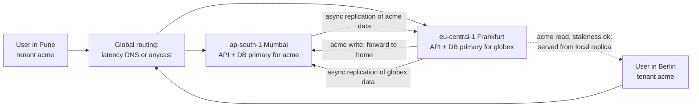
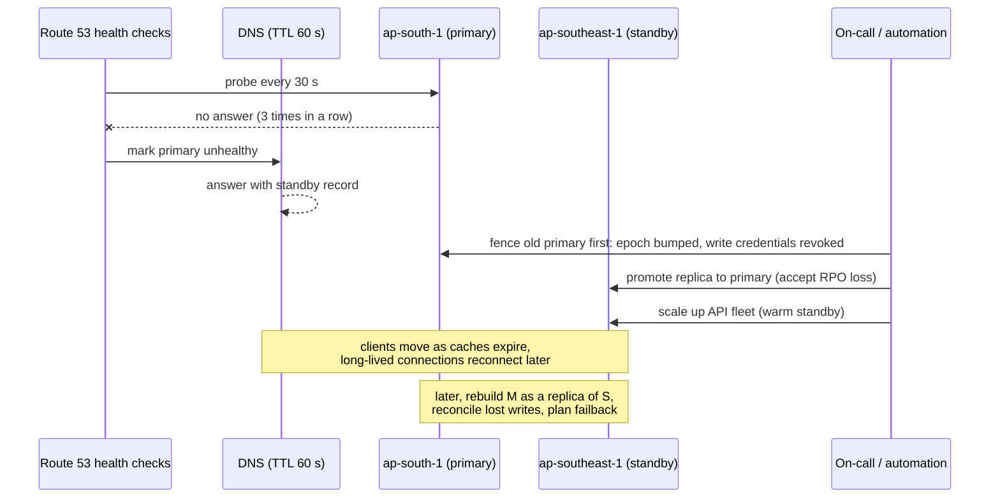

# Multi-Region Architecture

> [!summary] TL;DR
> A **multi-region** system runs in two or more geographic cloud regions (for example Mumbai and Singapore) so that it survives the loss of a whole region, serves users from nearby, or keeps data inside a country. The hard part is not running the servers twice; it is deciding where each piece of data is written, how it is copied, and what happens to writes in flight when a region fails.

> [!abstract] Core idea
> - Three reasons to go multi-region: disaster recovery, lower latency for far-away users, and data-residency law.
> - DR patterns trade cost for recovery: backup-restore, pilot light, warm standby, active-active.
> - Asynchronous cross-region replication loses the last moments of writes on failover; synchronous replication adds an inter-region round trip to every write.
> - Most active-active designs avoid write conflicts by giving each user or tenant a **home region** that owns its writes.
> - Classic mistake: assuming DNS failover is instant. Detection plus TTL plus resolvers that ignore TTL take minutes.

## 1. Why it exists

A billing SaaS runs in one AWS region, `ap-south-1` (Mumbai), spread over three availability zones (AZs: separate data centres within a region). That already survives a single data-centre failure (see [[High Availability and Failover]]). It does not survive:

- **A regional outage.** A control-plane or networking failure that affects every AZ in the region at once. Cloud providers have had such region-wide incidents.
- **Distance.** A customer in Frankfurt pays an inter-continental round trip on every request. Mumbai–Frankfurt round-trip time is roughly 110–130 ms (an estimate; measure your own regions), so a page that makes 5 sequential API calls spends over half a second on the wire alone.
- **Law.** An EU customer's contract or a regulator may require personal data to stay in the EU; RBI's 2018 circular requires payment system data for Indian payments to be stored only in India.

Each reason leads to a different design. DR alone can be a cold copy in a second region. Latency needs active serving close to users. Residency needs data to be partitioned by geography, which is the opposite of "replicate everything everywhere".

## 2. Mental model

Think of a company with offices in Mumbai and Frankfurt. Each customer account has one **home office** that keeps the master file; the other office keeps a photocopy that is a few seconds out of date, good for answering questions but not for changing the account. If the Mumbai office burns down, Frankfurt promotes its photocopies to masters, accepting that the last few seconds of changes might be missing. Moving a customer's home office is a deliberate, planned operation.

Terms used below:

- **RPO (recovery point objective):** how much recent data you may lose, measured in time. Async replication with 1 s of lag means an RPO of about 1 s.
- **RTO (recovery time objective):** how long until service is restored.
- **Active-passive:** one region serves traffic; others stand by.
- **Active-active:** several regions serve traffic at the same time.
- **Home region:** the one region that owns writes for a given user, tenant or record.
- **Blast radius:** how much of the system a single failure can take down.

## 3. How it works

### Disaster recovery patterns

The AWS DR whitepaper describes four patterns, ordered by cost and recovery speed:

| Pattern | What runs in the second region | Typical RPO | Typical RTO | Relative cost |
| --- | --- | --- | --- | --- |
| Backup and restore | Only backups (snapshots copied cross-region) | Hours (time since last backup) | Hours (restore + deploy) | Lowest |
| Pilot light | Data replicated live; servers off or minimal | Seconds to minutes | Tens of minutes (scale up compute) | Low |
| Warm standby | Full stack running at reduced size | Seconds | Minutes (scale up, switch traffic) | Medium |
| Multi-site active-active | Full stack serving live traffic | Near zero to seconds | Near zero to minutes | Highest |

RPO comes from **how data is copied**; RTO comes from **how much must start up and how fast traffic moves**. A warm standby with async replication still has an RPO of seconds.

### Routing users to regions

- **DNS-based routing** (Amazon Route 53 and similar): latency-based routing answers with the region that has the lowest measured latency for the resolver; geolocation routing answers by the user's country; failover routing answers with a secondary when the primary's health check fails. Route 53 health checkers probe every 30 s (or 10 s for fast checks) and declare an endpoint unhealthy after 3 failures by default.
- **Anycast** (AWS Global Accelerator, Cloudflare): one static IP is announced from many edge locations; the network routes each user to the nearest edge, which forwards to a healthy region. Failover happens at the edge once its own health checks fail, typically within tens of seconds, without waiting for DNS caches.
- **Application routing:** an edge or gateway looks up the user's home region and forwards the request there, regardless of which region received it.

**DNS TTL caveats:** a TTL (time to live) of 60 s does not mean clients move in 60 s. Some resolvers and client runtimes cache longer than the TTL, and long-lived connections (HTTP keep-alive, gRPC, WebSockets) keep talking to the old region until they reconnect. Plan for a long tail of minutes.

### Active-active with home regions



The Berlin user hits Frankfurt (nearest). Reads that tolerate a little staleness are served from Frankfurt's replica of acme's data. Writes for acme are forwarded to Mumbai, acme's home, so there is exactly one writer per tenant and no write conflicts. Mumbai is in turn a read replica for Frankfurt's tenants.

### Regional failover



Two steps people forget: **fencing** the old primary before promoting the standby, so that if it comes back it cannot accept writes (see [[Distributed Locks and Fencing Tokens]]), and **reconciling** the writes it took that never replicated.

## 4. Worked example

### Whiteboard version

The routing rule at the heart of an active-active, home-region design:

```go
package wb

// WriteRegion picks the region that owns a tenant's writes right now.
func WriteRegion(tenant string, home, standby map[string]string, down map[string]bool) (string, bool) {
	h := home[tenant]
	if !down[h] {
		return h, true // normal case: one writer per tenant, no conflicts
	}
	if s := standby[h]; s != "" && !down[s] {
		return s, true // failover: accept the async replication loss (RPO)
	}
	return "", false // both down: reject writes, keep serving stale reads
}
```

### Numbers: how long and how much

Mumbai primary, Singapore warm standby, Route 53 failover routing, Aurora Global Database replicating asynchronously:

| Stage | Time | Basis |
| --- | --- | --- |
| Detect: 3 failed probes at a 30 s interval | ≈ 90 s | Route 53 defaults (documented) |
| DNS answers change, resolvers expire 60 s TTL | ≈ 60 s, long tail longer | TTL you set; tail is an estimate |
| Promote secondary database | About a minute | AWS states a typical RTO under a minute for Aurora Global Database cross-Region failover; measure in drills |
| Scale API fleet from 25% to 100% | 3–5 min | Estimate for an autoscaling group; pre-warm to shorten |
| **RTO** | **roughly 5–8 minutes** | Estimate; drills give the real number |

RPO: replication lag at the moment of failure. Aurora documents typical lag under 1 second. At 2,000 writes per second, 1 s of lag means up to about 2,000 committed writes exist only in Mumbai when it fails (an estimate from those two numbers). Those writes are not destroyed; they are **unreachable** until Mumbai returns, and then they must be reconciled against what Singapore accepted meanwhile.

If that loss is unacceptable for some data (payments), that data needs synchronous cross-region commits: every write waits for at least one other region, adding at least one inter-region round trip (≈ 55–65 ms Mumbai–Singapore, an estimate) to its latency.

### Go: router with health thresholds, failover and fencing

The router sends writes to the tenant's home region, fails over to the paired standby only after a threshold of consecutive failed health checks (and fails back only after the same number of good ones, to avoid flapping), serves stale-tolerant reads from the caller's own region, and hands out an **epoch** per tenant. Each shard rejects writes with an older epoch, so a delayed request routed to the old home cannot overwrite data after ownership moved. It passes `go vet` and `go test -race` on Go 1.24.

```go
package region

import (
	"errors"
	"sync"
)

var ErrUnavailable = errors.New("no healthy region can take this write")

// Router sends each tenant's writes to its home region, fails over to a
// paired standby region when the home is declared down, and serves reads
// locally when slightly stale data is acceptable.
type Router struct {
	mu        sync.Mutex
	home      map[string]string // tenant -> home region
	standby   map[string]string // region -> failover partner
	failures  map[string]int    // consecutive failed health checks
	successes map[string]int    // consecutive good checks while down
	down      map[string]bool
	threshold int // checks in a row before changing state (like Route 53's failure threshold)
	epoch     map[string]int // tenant -> ownership epoch, bumped on every move
}

func NewRouter(home, standby map[string]string, threshold int) *Router {
	return &Router{
		home: home, standby: standby, threshold: threshold,
		failures: map[string]int{}, successes: map[string]int{},
		down: map[string]bool{}, epoch: map[string]int{},
	}
}

// Report feeds one health-check result. A region changes state only after
// `threshold` results in a row, so one lost probe does not trigger failover.
func (r *Router) Report(region string, healthy bool) {
	r.mu.Lock()
	defer r.mu.Unlock()
	if healthy {
		r.failures[region] = 0
		if r.down[region] {
			r.successes[region]++
			if r.successes[region] >= r.threshold {
				r.down[region] = false
				r.successes[region] = 0
			}
		}
		return
	}
	r.successes[region] = 0
	r.failures[region]++
	if r.failures[region] >= r.threshold {
		r.down[region] = true
	}
}

// writeRegion must be called with mu held.
func (r *Router) writeRegion(tenant string) (string, error) {
	h := r.home[tenant]
	if !r.down[h] {
		return h, nil
	}
	if s, ok := r.standby[h]; ok && !r.down[s] {
		return s, nil
	}
	return "", ErrUnavailable
}

// WriteTarget returns the region that owns the tenant's writes right now
// and an epoch. Regions reject writes carrying an older epoch, which fences
// off a home region that comes back still believing it is in charge.
func (r *Router) WriteTarget(tenant string) (string, int, error) {
	r.mu.Lock()
	defer r.mu.Unlock()
	return r.writeTargetLocked(tenant)
}

func (r *Router) writeTargetLocked(tenant string) (string, int, error) {
	reg, err := r.writeRegion(tenant)
	if err != nil {
		return "", 0, err
	}
	return reg, r.epoch[tenant], nil
}

// Move changes a tenant's home (planned migration or after failover is
// made permanent) and bumps its epoch.
func (r *Router) Move(tenant, to string) int {
	r.mu.Lock()
	defer r.mu.Unlock()
	r.home[tenant] = to
	r.epoch[tenant]++
	return r.epoch[tenant]
}

// ReadTarget serves from the caller's own region when stale reads are fine,
// and from the write region when the caller needs its own latest write.
func (r *Router) ReadTarget(tenant, clientRegion string, needFresh bool) (string, error) {
	r.mu.Lock()
	defer r.mu.Unlock()
	if !needFresh && !r.down[clientRegion] {
		return clientRegion, nil
	}
	reg, _, err := r.writeTargetLocked(tenant)
	return reg, err
}

// Shard is one region's copy of a tenant's data, guarded by an epoch fence.
type Shard struct {
	mu    sync.Mutex
	epoch int
	data  map[string]string
}

var ErrFenced = errors.New("write carries a stale epoch")

func NewShard() *Shard { return &Shard{data: map[string]string{}} }

func (s *Shard) Write(epoch int, k, v string) error {
	s.mu.Lock()
	defer s.mu.Unlock()
	if epoch < s.epoch {
		return ErrFenced
	}
	s.epoch = epoch
	s.data[k] = v
	return nil
}
```

```go
package region

import (
	"errors"
	"sync"
	"testing"
)

func newTestRouter() *Router {
	return NewRouter(
		map[string]string{"acme": "ap-south-1", "globex": "eu-central-1"},
		map[string]string{"ap-south-1": "ap-southeast-1", "eu-central-1": "eu-west-1"},
		3,
	)
}

func mustWrite(t *testing.T, r *Router, tenant string) string {
	t.Helper()
	reg, _, err := r.WriteTarget(tenant)
	if err != nil {
		t.Fatal(err)
	}
	return reg
}

func TestWritesGoHome(t *testing.T) {
	r := newTestRouter()
	if got := mustWrite(t, r, "acme"); got != "ap-south-1" {
		t.Fatalf("acme writes to %s", got)
	}
	if got := mustWrite(t, r, "globex"); got != "eu-central-1" {
		t.Fatalf("globex writes to %s", got)
	}
}

func TestFailoverNeedsThresholdFailuresInARow(t *testing.T) {
	r := newTestRouter()
	r.Report("ap-south-1", false)
	r.Report("ap-south-1", false)
	r.Report("ap-south-1", true) // one good probe resets the count
	r.Report("ap-south-1", false)
	r.Report("ap-south-1", false)
	if got := mustWrite(t, r, "acme"); got != "ap-south-1" {
		t.Fatalf("failed over on a flapping check: %s", got)
	}
	r.Report("ap-south-1", false) // third failure in a row
	if got := mustWrite(t, r, "acme"); got != "ap-southeast-1" {
		t.Fatalf("no failover: %s", got)
	}
	if got := mustWrite(t, r, "globex"); got != "eu-central-1" {
		t.Fatalf("other tenants must not move: %s", got)
	}
}

func TestFailbackNeedsThresholdSuccesses(t *testing.T) {
	r := newTestRouter()
	for range 3 {
		r.Report("ap-south-1", false)
	}
	r.Report("ap-south-1", true)
	r.Report("ap-south-1", true)
	if got := mustWrite(t, r, "acme"); got != "ap-southeast-1" {
		t.Fatalf("failed back too early: %s", got)
	}
	r.Report("ap-south-1", true)
	if got := mustWrite(t, r, "acme"); got != "ap-south-1" {
		t.Fatalf("no failback: %s", got)
	}
}

func TestBothRegionsDown(t *testing.T) {
	r := newTestRouter()
	for range 3 {
		r.Report("ap-south-1", false)
		r.Report("ap-southeast-1", false)
	}
	if _, _, err := r.WriteTarget("acme"); !errors.Is(err, ErrUnavailable) {
		t.Fatalf("err %v", err)
	}
}

func TestReadsLocalUnlessFreshNeeded(t *testing.T) {
	r := newTestRouter()
	if got, _ := r.ReadTarget("acme", "eu-west-1", false); got != "eu-west-1" {
		t.Fatalf("stale-ok read went to %s", got)
	}
	if got, _ := r.ReadTarget("acme", "eu-west-1", true); got != "ap-south-1" {
		t.Fatalf("read-your-writes went to %s", got)
	}
}

func TestEpochFencesTheOldHome(t *testing.T) {
	r := newTestRouter()
	oldHome, newHome := NewShard(), NewShard()
	_, e0, _ := r.WriteTarget("acme")
	if err := oldHome.Write(e0, "plan", "pro"); err != nil {
		t.Fatal(err)
	}
	e1 := r.Move("acme", "ap-southeast-1") // operators make the failover permanent
	if err := newHome.Write(e1, "plan", "enterprise"); err != nil {
		t.Fatal(err)
	}
	// The old home's data is replicated with the new epoch, then a delayed
	// client retries with the old one: it must be rejected.
	_ = oldHome.Write(e1, "plan", "enterprise")
	if err := oldHome.Write(e0, "plan", "free"); !errors.Is(err, ErrFenced) {
		t.Fatalf("stale write accepted: %v", err)
	}
}

func TestConcurrentHealthReportsAndRouting(t *testing.T) {
	r := newTestRouter()
	var wg sync.WaitGroup
	for i := range 8 {
		wg.Add(1)
		go func() {
			defer wg.Done()
			for range 100 {
				r.Report("eu-central-1", i%2 == 0)
				r.WriteTarget("globex")
				r.ReadTarget("globex", "eu-west-1", false)
			}
		}()
	}
	wg.Wait()
	if reg, _, err := r.WriteTarget("globex"); err != nil || (reg != "eu-central-1" && reg != "eu-west-1") {
		t.Fatalf("reg %s err %v", reg, err)
	}
}
```

### Residency with geo-partitioning (PostgreSQL 17)

Residency means some rows must physically live in one place. With plain PostgreSQL that means separate databases per jurisdiction, with the application routing by tenant. A directory table, replicated everywhere because it holds no personal data, tells every region where a tenant lives:

```sql
CREATE TABLE tenant_directory (
    tenant_id    text PRIMARY KEY,
    home_region  text NOT NULL CHECK (home_region IN ('ap-south-1', 'eu-central-1')),
    jurisdiction text NOT NULL CHECK (jurisdiction IN ('IN', 'EU')),
    epoch        int  NOT NULL DEFAULT 0
);

-- Moving a tenant is a planned operation: copy data, then flip and bump epoch.
UPDATE tenant_directory
SET    home_region = 'eu-central-1', epoch = epoch + 1
WHERE  tenant_id = 'globex' AND epoch = 4;   -- 0 rows = someone else moved it
```

Distributed SQL databases build this in: CockroachDB's `REGIONAL BY ROW` tables keep each row's replicas in the region named in a column (see [[Distributed SQL]]).

## 5. Variants and comparison

### Data replication options

| Option | How it works | Use when | Cost |
| --- | --- | --- | --- |
| Async read replicas (Aurora Global Database, cross-region PostgreSQL replica) | One writer region; replicas typically under 1 s behind | DR and local reads; one region can own all writes | RPO > 0 on failover; writes from far away pay a round trip |
| Home region per tenant | Each tenant's data has one writer region; others hold replicas | Active-active without conflicts; residency | Directory lookups; moving tenants is a project |
| Multi-writer with LWW (DynamoDB global tables, Cassandra multi-DC) | Every region accepts writes; last writer wins per item or cell | Data where losing a concurrent write is fine | Silent loss of concurrent writes (see [[CRDTs and Conflict Resolution]]) |
| Multi-writer with CRDTs (Redis Enterprise Active-Active) | Every region writes; type-specific merge | Counters, sets, sessions, presence | Cannot enforce cross-region invariants |
| Synchronous geo-distributed SQL (Spanner, CockroachDB) | Consensus across regions per write | Strong consistency across regions is required | Each write pays at least one inter-region round trip |

### Topologies

| Topology | Writes | Failover | Typical use |
| --- | --- | --- | --- |
| Active-passive (warm standby) | One region | Promote standby: minutes | DR for most business apps |
| Active-active, read-local | One region per tenant, reads everywhere | Promote the tenant's standby | SaaS with global users |
| Active-active, write-anywhere | Every region | Nothing to promote | Social features, carts, counters with merge rules |
| Geo-partitioned | Each region owns its jurisdiction's data | Per-region DR inside the jurisdiction | Residency-constrained data |

## 6. Trade-offs and when not to use

The hard problems, roughly in the order they bite:

- **Replication lag:** users read stale data in other regions; read-your-writes needs routing to the home region.
- **Conflict resolution:** any data written in two regions needs a merge rule or a single owner.
- **Global uniqueness:** usernames, emails and coupon codes need one authority (a home region for the namespace or a consensus-backed table); IDs need region bits or UUIDs (see [[Unique ID Generation]]).
- **Session affinity:** sessions stored in one region's Redis vanish on failover; use stateless tokens or a replicated session store.
- **Cache invalidation:** each region has its own caches; invalidations must replicate with the data, or TTLs must bound staleness.
- **Regional failover:** promotion, fencing, DNS tails and reconciliation must be rehearsed.
- **Compliance and data residency:** some data may not leave a country, which forbids "replicate everything".

Cost and judgement:

- **Cost:** a warm standby roughly adds the cost of its compute plus storage, and active-active doubles most of the bill. Inter-region data transfer is billed per GB on every major cloud, so replicating a busy database and its logs adds a recurring charge; estimate it from your write volume and current pricing.
- **Operational complexity:** two regions means two of every deploy, alarm and runbook.
- Use multi-region only when requirements justify it. It improves availability and latency, but makes consistency, operations and debugging much harder.
- **Often enough:** multi-AZ in one region with cross-region backups (backup-restore DR) and a CDN for static and cacheable content (see [[CDN and Edge]]).

## 7. In production

- **Real systems:**
	- Aurora Global Database: one write region, up to several read-only secondary regions, with managed switchover (planned, no data loss) and failover (unplanned, may lose the replication lag).
	- DynamoDB global tables: in the default multi-Region eventual consistency mode, every replica region accepts writes and conflicts are resolved by last writer wins. DynamoDB itself is leader-based within a region (Multi-Paxos per partition), not Dynamo-style leaderless.
	- Spanner and CockroachDB: consensus groups span regions, so commits are strongly consistent and cost cross-region round trips; leaders can be placed near the main writers.
	- **Cell-based architecture:** the system is split into many independent, identical **cells**, each serving a subset of customers with its own stack and data; a thin routing layer maps customers to cells. A bad deploy or a poison request takes down one cell, not everyone. Cells and regions combine: each region holds several cells, and a customer's cell has a partner cell in another region.
- **Failure modes → fixes:**
	- Failover by flapping health checks → require several failures in a row and several successes before failing back; make the final promotion a human decision for databases if the RPO cost is high.
	- Split brain: old primary returns and keeps taking writes → fence with epochs or by revoking its write credentials before promotion.
	- Standby region cannot take full load → keep it at a known capacity, pre-warm, and test with real traffic.
	- Shared global dependency fails (one region's IAM, one DNS provider, one config service) → map every dependency's region; avoid control-plane calls on the failover path.
	- Lost writes after failover never reconciled → keep a log of unreplicated changes from the old primary and run a reconciliation job when it returns.
- **What to monitor:**
	- Cross-region replication lag (seconds and bytes), with an alert well below your RPO.
	- Per-region health check status and the traffic share per region.
	- Error rate and latency per region, and for forwarded writes separately.
	- Inter-region transfer volume and cost.
	- Time since the last successful evacuation drill.
- **Regional evacuation drills:** regularly shift all traffic out of one region on purpose, during working hours, and measure the real RTO and RPO. A failover that has never been exercised usually fails on first use: expired credentials, missing capacity, a hard-coded endpoint (see [[Chaos Engineering]]).

## 8. Deep dive

### Why sync replication across regions is slow

A synchronous commit must reach a quorum. With three regions (Mumbai, Singapore, Tokyo), a Mumbai leader needs one other region's acknowledgement: one round trip to the nearest, Singapore, at about 55–65 ms (estimate). Users near Tokyo writing through that leader pay their own round trip to Mumbai plus that. This is the PACELC trade-off in practice (see [[CAP and PACELC]]): even without a partition, you choose between latency and consistency. Designs reduce it by placing leaders near the writers of each row (CockroachDB's regional tables) or by keeping only the data that needs it (money, uniqueness) synchronous.

### Picking a home region

Choose by who writes most: the tenant's billing address, the region where most of its users log in, or the jurisdiction the contract names. Store it in a directory that every region can read, cache it at the edge, and version it with an epoch. Moving a tenant: copy its data to the new region while writes continue, stop writes briefly (seconds), copy the final delta, flip the directory with a new epoch, and resume. The epoch fences any request still in flight to the old home.

### Global uniqueness

A username must be unique across all regions. Options: route all signups to one region for that table (simple; signup pays the latency), use a consensus-backed store spanning regions, or partition the namespace (usernames hashed to a region owner). Never check uniqueness against a local replica and insert locally in two regions; both inserts will succeed.

### Data residency in practice

- **GDPR** allows transfers outside the EU only under conditions (adequacy decisions, standard contractual clauses and others), so EU personal data is often kept in EU regions to stay simple.
- **India's DPDP Act, 2023** allows transfer outside India except to countries the central government restricts by notification; sector rules can be stricter, such as RBI's requirement that payment system data be stored only in India.
- Design: geo-partition personal data by jurisdiction; keep a global, non-personal directory; keep analytics on aggregated or pseudonymized data. Check logs, backups, caches and support tools too: a CDN log or a crash dump can carry personal data across borders.

### Caches and sessions across regions

Per-region caches are normal; what matters is invalidation. If the database replicates asynchronously, an invalidation sent at write time can arrive before the replica has the new row, and the cache refills with stale data. Invalidate from the replication stream in each region (after the replica applied the change), or rely on short TTLs. For sessions, signed tokens avoid cross-region lookups; if server-side sessions are needed, replicate them (a CRDT-based store suits this) or accept a re-login after failover.

## 9. Interview questions

> [!question]- Active-passive or active-active: how do you choose?
> Start from RPO, RTO and latency targets. If minutes of RTO and seconds of RPO are acceptable and users are mostly in one geography, active-passive (warm standby) is far simpler. Choose active-active when users are global and latency matters, or when RTO must be near zero, and then decide how each data type avoids or merges conflicts.

> [!question]- (Trap) "We fail over by changing DNS, so failover takes 60 seconds, our TTL." Right?
> No. Detection takes time first (Route 53 defaults: 3 failures at 30 s intervals ≈ 90 s), some resolvers and clients cache past the TTL, and long-lived connections stay on the old region until they reconnect. Then the database must be promoted and the standby scaled. Measure the real number in drills; anycast routing avoids the DNS part.

> [!question]- How do you avoid write conflicts in an active-active design?
> Give each tenant or user a home region that owns its writes; other regions forward writes there and serve stale-tolerant reads locally. Use multi-writer replication only for data with a safe merge rule (LWW where loss is fine, CRDTs for counters and sets), and keep invariants like balances and uniqueness single-homed or on consensus.

> [!question]- What is your RPO with asynchronous cross-region replication, and how do you shrink it?
> About the replication lag at the moment of failure: under a second for Aurora Global Database in normal conditions, but more under heavy write load. To shrink it, replicate synchronously for the critical subset of data (paying an inter-region round trip per write), or use a geo-distributed consensus database for it.

> [!question]- What is a cell-based architecture and why combine it with regions?
> The system is split into identical, independent cells, each serving a fixed subset of customers with its own stack and data, behind a thin routing layer. A failure or bad deploy hits one cell's customers only. Regions protect against geography; cells limit the blast radius of software and operator errors inside a region.

> [!question]- How do you keep EU customer data in the EU while serving them globally?
> Geo-partition: store EU tenants' personal data only in EU regions, keep a global directory with no personal data that maps tenants to regions, and route their writes and personal-data reads there. Check the side channels too: logs, backups, analytics exports and support tools.

> [!question]- Your old primary region comes back after a failover. What do you do?
> Keep it fenced (epoch or revoked credentials) so it cannot take writes. Extract the writes it committed that never replicated, reconcile them against the new primary (often a business process for money), rebuild it as a replica of the new primary, and fail back later as a planned, drilled switchover.

## 10. Cheat sheet

- Reasons: DR, latency, residency; each implies a different design.
- DR ladder: backup-restore (hours) → pilot light → warm standby (minutes) → active-active (near zero).
- RPO ≈ replication lag; RTO = detect + reroute + promote + scale.
- Async cross-region: fast writes, data loss on failover. Sync: no loss, + inter-region RTT per write.
- Home region per tenant = active-active without conflicts; forward writes, read locally.
- DNS failover is minutes, not TTL seconds; anycast is faster.
- Fence the old primary; reconcile its unreplicated writes.
- Cells limit blast radius; evacuation drills prove RTO.

## Links

- **Before this:** [[High Availability and Failover]], [[Replication]], [[CAP and PACELC]], [[DNS - Resolution, Records and Caching]]
- **Next:** [[CRDTs and Conflict Resolution]], [[Distributed SQL]], [[Backup, PITR and Disaster Recovery]]
- **Compare with:** [[High Availability and Failover]] (within one region, across AZs), [[CDN and Edge]] (moving only cacheable content close to users)
