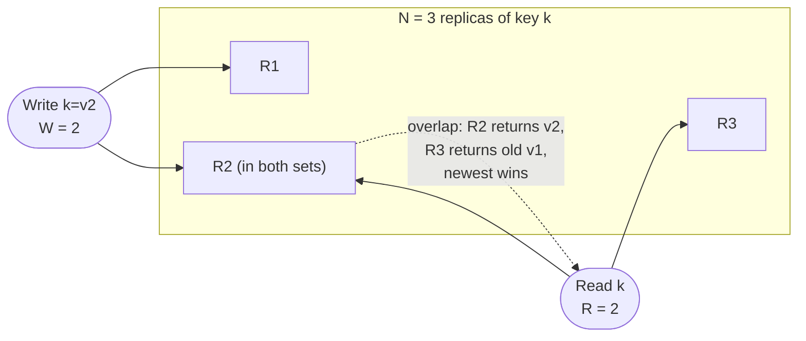
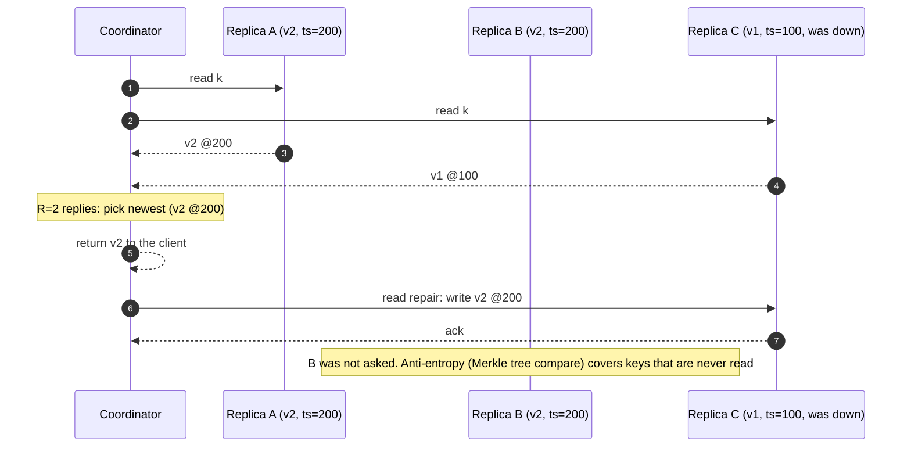
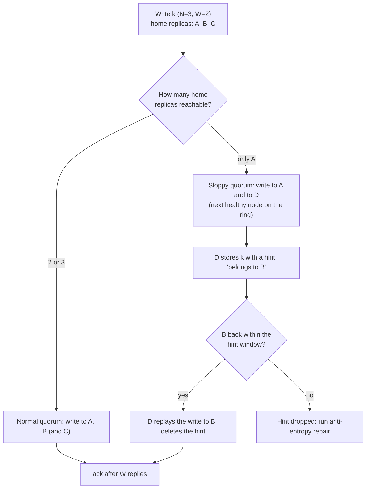

# Quorums and Leaderless Replication

> [!summary] TL;DR
> In **leaderless** replication every key is stored on `N` replicas and any of them accepts reads and writes. A write counts as done when `W` replicas acknowledge it, and a read asks `R` replicas and keeps the newest answer. If `R + W > N`, every read set overlaps every completed write set, so a read normally sees the latest completed write.

> [!abstract] Core idea
> - No leader: the client (or a coordinator node) sends each write to all `N` replicas and waits for `W` acks.
> - Reads ask `R` replicas, pick the newest version, and repair stale replicas they noticed.
> - `R + W > N` makes read and write sets overlap in at least one replica. The usual setting is `N=3, R=W=2`.
> - Quorums tolerate slow or dead replicas without failover, but they are not consensus and not linearizable.
> - Classic mistake: calling DynamoDB leaderless. DynamoDB has a leader per partition (Multi-Paxos); Cassandra, Riak and ScyllaDB are the leaderless ones.

## 1. Why it exists

With single-leader replication, every write for a key goes through one node. When that leader dies, writes for its keys stop until a failover finishes, which takes tens of seconds (see [[High Availability and Failover]]). A shopping cart service that must accept "add to cart" during a node failure cannot wait for that.

Leaderless replication removes the failover step. Each key lives on 3 replicas. A write that reaches any 2 of them succeeds, so one dead or slow replica is simply ignored. The Dynamo paper (2007) built Amazon's cart this way, trading strict consistency for "always writable".

## 2. Mental model

- **N**: replicas per key (the replication factor).
- **W**: acks needed before a write is reported successful.
- **R**: replies needed before a read returns.
- **Quorum**: a set of replicas large enough that any two such sets share a member.

Two groups of size `W` and `R` drawn from `N` must overlap if `W + R > N`, by the pigeonhole principle. The replica in the overlap has the latest completed write, and the reader picks the newest version among its `R` replies.

**Analogy.** A club records each decision in the notebooks of any 2 of its 3 secretaries. To learn the latest decision you ask any 2 secretaries and believe the newest entry. At least one of the two you ask wrote the last decision down.

## 3. How it works

### The overlap argument



Common settings with `N = 3`:

| R | W | R + W > N? | Behaviour |
| --- | --- | --- | --- |
| 2 | 2 | yes | the default "quorum" setting; tolerates 1 slow or dead replica for both reads and writes |
| 1 | 3 | yes | fast reads, but a write fails if any replica is down (read-heavy, rarely-written data) |
| 3 | 1 | yes | fast writes, reads fail if any replica is down |
| 1 | 1 | no | fastest and most available; reads may be stale (Cassandra `ONE`/`ONE`) |

### Write and read paths

1. **Write**: the coordinator stamps the value with a version (Cassandra: a timestamp per cell; Riak: a causal context), sends it to all `N` replicas, and replies "OK" after `W` acks. The remaining replicas still receive it unless they are down.
2. **Read**: the coordinator asks replicas, waits for `R` replies, and returns the newest version.
3. **Read repair**: if some of those replies were older, the coordinator writes the newest version back to them.
4. **Anti-entropy**: a background process compares replicas and copies missing data, so keys that are never read still converge. Cassandra (`nodetool repair`) and Dynamo compare **Merkle trees**: a hash tree over key ranges, where comparing root hashes and descending only into differing branches finds the differences with little data transfer.



### Choosing the newest value

- **Last-writer-wins (LWW)**: keep the version with the highest timestamp. Cassandra does this per cell. Simple, but concurrent writes lose silently, and a node with a fast clock wins wrongly (see [[Clocks and Ordering]]).
- **Version vectors and siblings**: each version carries a vector of per-replica counters. If neither version's vector dominates, they are concurrent and both are kept as **siblings** for the application (or a CRDT) to merge. Dynamo and Riak do this; the Dynamo cart merged siblings by union, which is why deleted items occasionally reappeared.

### Sloppy quorum and hinted handoff

When some of a key's `N` home replicas are unreachable, a **sloppy quorum** accepts the write on other healthy nodes outside the home set, which store it with a **hint** naming the intended owner. When the owner comes back, the hint is handed off.



The catch: a later read with `R = 2` may ask B and C, which both lack the write. **Sloppy quorums break the overlap guarantee**; they only promise durability on `W` nodes somewhere. Cassandra uses hinted handoff to speed up recovery but still counts only real replicas toward its consistency level (and `ANY` is the only level a hint alone satisfies). Its default `max_hint_window` is 3 hours.

## 4. Worked example

### Whiteboard version

```text
put(k, v, ts):
    acks = 0
    for r in replicas(k):                      # all N
        if r is up:
            if ts > r[k].ts: r[k] = (v, ts)    # keep newer only
            acks += 1
    return acks >= W ? OK : ERROR              # replicas that acked keep v anyway

get(k):
    asked = first R live replicas of k
    if len(asked) < R: return ERROR
    best = newest version among asked
    for r in asked:
        if r[k].ts < best.ts: r[k] = best      # read repair
    return best
```

Trace with `N = 3, R = W = 2`, replica 3 down:

1. `put(cart:7, "2 items", 100)`: replicas 1 and 2 ack, 2 ≥ W → OK.
2. Replica 2 also dies. `put(cart:7, "3 items", 200)`: only replica 1 acks → ERROR, but replica 1 now holds "3 items". This is a **partially failed write**: the client was told "failed", yet a later read may return it.

### Go: a toy leaderless store

This compiles and passes `go vet` and `go test -race` on Go 1.24. Timestamps are passed in, so ordering is deterministic.

```go
// Package quorum is a toy Dynamo-style (leaderless) store: N replicas,
// a write needs W acks, a read needs R replies, and reads repair stale replicas.
package quorum

import "errors"

var ErrNotEnoughReplicas = errors.New("not enough replicas responded")

// Versioned is a value with a last-writer-wins timestamp.
type Versioned struct {
	Value string
	TS    int64
}

type Replica struct {
	Up   bool
	data map[string]Versioned
}

type Store struct {
	N, R, W  int
	Replicas []*Replica
	Repairs  int // how many read repairs were sent (for tests and metrics)
}

func NewStore(n, r, w int) *Store {
	s := &Store{N: n, R: r, W: w}
	for i := 0; i < n; i++ {
		s.Replicas = append(s.Replicas, &Replica{Up: true, data: map[string]Versioned{}})
	}
	return s
}

// Put sends the write to every live replica and succeeds once W have acked.
// A replica keeps a write only if it is newer than what it has.
func (s *Store) Put(key, value string, ts int64) error {
	acks := 0
	for _, r := range s.Replicas {
		if !r.Up {
			continue
		}
		if cur, ok := r.data[key]; !ok || ts > cur.TS {
			r.data[key] = Versioned{value, ts}
		}
		acks++
	}
	if acks < s.W {
		return ErrNotEnoughReplicas // note: the replicas that did ack keep the write
	}
	return nil
}

// Get asks live replicas in order, stops after R replies, returns the newest
// version, and writes it back to any of those R replicas that were stale.
func (s *Store) Get(key string) (Versioned, error) {
	var asked []*Replica
	var best Versioned
	for _, r := range s.Replicas {
		if len(asked) == s.R {
			break
		}
		if !r.Up {
			continue
		}
		asked = append(asked, r)
		if v := r.data[key]; v.TS > best.TS {
			best = v
		}
	}
	if len(asked) < s.R {
		return Versioned{}, ErrNotEnoughReplicas
	}
	for _, r := range asked { // read repair
		if r.data[key].TS < best.TS {
			r.data[key] = best
			s.Repairs++
		}
	}
	return best, nil
}

// Peek reads one replica directly (for tests).
func (s *Store) Peek(i int, key string) Versioned { return s.Replicas[i].data[key] }
```

The tests cover the trace above, the overlap plus read repair, a non-overlapping configuration, and LWW losing a write:

```go
package quorum

import (
	"errors"
	"testing"
)

func TestOneReplicaDownStillServesQuorum(t *testing.T) {
	s := NewStore(3, 2, 2)
	s.Replicas[2].Up = false // replica 3 is down
	if err := s.Put("cart:7", "2 items", 100); err != nil {
		t.Fatalf("W=2 with 2 live replicas should succeed: %v", err)
	}
	s.Replicas[1].Up = false // now 2 of 3 are down
	if err := s.Put("cart:7", "3 items", 200); !errors.Is(err, ErrNotEnoughReplicas) {
		t.Fatalf("want ErrNotEnoughReplicas, got %v", err)
	}
	// The failed write still landed on replica 0: a "partially failed" write.
	if got := s.Peek(0, "cart:7").Value; got != "3 items" {
		t.Fatalf("replica 0 = %q", got)
	}
}

func TestOverlapAndReadRepair(t *testing.T) {
	s := NewStore(3, 2, 2)
	_ = s.Put("k", "v1", 1)
	s.Replicas[0].Up = false
	_ = s.Put("k", "v2", 2) // lands on replicas 1 and 2 only
	s.Replicas[0].Up = true // replica 0 is back, still holding v1

	got, err := s.Get("k") // asks replicas 0 and 1: overlap with the write set is replica 1
	if err != nil || got.Value != "v2" {
		t.Fatalf("got %+v, %v; want v2", got, err)
	}
	if s.Peek(0, "k").Value != "v2" || s.Repairs != 1 {
		t.Fatalf("replica 0 not repaired: %+v, repairs=%d", s.Peek(0, "k"), s.Repairs)
	}
}

func TestNoOverlapReadsStale(t *testing.T) {
	s := NewStore(3, 1, 1) // R + W = 2, not > N
	_ = s.Put("k", "v1", 1)
	s.Replicas[0].Up = false
	_ = s.Put("k", "v2", 2)
	s.Replicas[0].Up = true
	s.Replicas[1].Up = false
	s.Replicas[2].Up = false
	got, _ := s.Get("k")
	if got.Value != "v1" {
		t.Fatalf("want stale v1 with R=W=1, got %q", got.Value)
	}
}

func TestLWWDropsConcurrentWrite(t *testing.T) {
	s := NewStore(3, 2, 2)
	_ = s.Put("k", "from-client-A", 105) // A's clock runs 10 ms fast
	_ = s.Put("k", "from-client-B", 100) // B wrote later in real time
	got, _ := s.Get("k")
	if got.Value != "from-client-A" {
		t.Fatalf("got %q", got.Value)
	}
	// B's write was acknowledged (Put returned nil) and silently lost.
}
```

The toy contacts replicas in a fixed order to stay deterministic; a real coordinator sends to all and takes the first `R` replies, which is also why latency is set by the replicas, as the next section shows.

## 5. Variants and comparison

### Per-request choice in Cassandra

| Consistency level | Replicas that must answer | Use |
| --- | --- | --- |
| `ONE` / `LOCAL_ONE` | 1 (in the local DC for `LOCAL_ONE`) | metrics, logs, anything that tolerates stale reads |
| `QUORUM` | `floor(total RF / 2) + 1` across all DCs | single-DC strong reads with writes also at `QUORUM` |
| `LOCAL_QUORUM` | a majority of replicas in the coordinator's DC | the usual multi-DC choice: strong inside a DC, no cross-DC wait |
| `EACH_QUORUM` (writes) | a majority in every DC | writes that must be durable in every region before acking |
| `ALL` | every replica | rarely; one dead replica fails the request |

### Quorum vs consensus vs leader-based

| Approach | Who orders writes | Linearizable? | Failure handling | Examples |
| --- | --- | --- | --- | --- |
| Leaderless quorum | nobody; versions compared on read | no (see deep dive) | no failover; slow replicas ignored | Cassandra, ScyllaDB, Riak, Dynamo (2007 paper) |
| Single leader, async followers | the leader | on the leader only | failover needed, may lose writes | PostgreSQL, MySQL (see [[Replication]]) |
| Consensus (Raft, Multi-Paxos) | an elected leader, log committed by a majority | yes (with leader reads or read-index) | automatic leader election | etcd, Spanner, CockroachDB, DynamoDB (Multi-Paxos per partition) |

Quorum replicas only **acknowledge**: each one independently stores whatever arrives. Consensus makes replicas **agree on one order** of operations. A majority is used in both, which is why they get confused (see [[Consensus - Raft and Paxos]]).

> [!warning] Trap: DynamoDB is not Dynamo-style
> DynamoDB keeps 3 replicas per partition in different AZs, and one is the leader elected with Multi-Paxos. Writes go to the leader and are acknowledged after a majority persist them; strongly consistent reads go to the leader. It shares a name with the 2007 Dynamo paper, not its replication design.

## 6. Trade-offs and when not to use

- **Latency is set by the slowest replica you wait for.** With `W = 2` of 3, a write's latency is the second-fastest replica's. Coordinators reduce tail latency with **speculative retries**: if a replica has not answered by about its usual p99, ask another one (Cassandra's per-table `speculative_retry` option, default `99p`, written `99PERCENTILE` before 4.0).
- **Conflict handling moves to the application.** LWW loses concurrent writes; siblings need merge code.
- **No conditional updates for free.** "Increment if balance ≥ 10" needs consensus; Cassandra's lightweight transactions (`IF` clauses) run Paxos and cost several round trips.
- **When not to use:** money, inventory counts, uniqueness constraints, and anything that needs read-modify-write correctness. Use a leader-based or consensus store, or a CRDT if the operation merges naturally (see [[CRDTs and Conflict Resolution]]).
- **When it shines:** high write throughput, multi-DC writes, time-series, carts, sessions, and feeds where "always writable" beats "always exact".

## 7. In production

- **Real systems:** Cassandra and ScyllaDB (LWW per cell, tunable consistency, hinted handoff, Merkle-tree repair); Riak KV (siblings with dotted version vectors). Voldemort, LinkedIn's Dynamo-style store, is no longer actively developed.
- **Failure modes → fixes:**
  - A node down longer than the hint window misses writes forever → run `nodetool repair` (or incremental repair) on a schedule shorter than `gc_grace_seconds` (10 days by default), or deleted data can come back as "zombies" when a replica that missed the tombstone repairs others.
  - Clock skew on clients or coordinators makes LWW keep the wrong write → use server-side timestamps, NTP monitoring, or lightweight transactions for contended keys.
  - Read latency spikes from one slow replica → speculative retry, and dynamic snitching to prefer faster replicas.
  - Coordinator overload during a hint replay storm → throttle hinted handoff (`hinted_handoff_throttle` in Cassandra 4.1+, `hinted_handoff_throttle_in_kb` in older versions; it limits how fast each node replays its stored hints).
- **What to monitor:** hints stored and replayed, read-repair rate, repair progress and age of last successful repair per table, digest mismatch rate, per-replica p99 latency, and unavailable or timeout exceptions per consistency level.

## 8. Deep dive

Why `R + W > N` is still **not linearizable**:

- **Concurrent read during a write.** A write has reached 1 of 3 replicas. Reader A's quorum includes that replica and returns the new value; reader B, starting after A finished, picks two replicas without it and returns the old value. A newer value was seen, then an older one: not linearizable. The ABD algorithm fixes this by making the reader write back the value to a quorum *before* returning (a synchronous read repair), at the cost of a second round trip.
- **Partially failed writes.** A write that reports failure may still be on some replicas and appear in later reads, or later be overwritten by read repair from replicas that lack it, so the outcome depends on which replicas a reader happens to ask.
- **LWW with skewed clocks.** The "newest" write is decided by timestamps, not real order. A write stamped by a fast clock beats a later write. The last test above shows an acknowledged write being dropped.
- **Sloppy quorums.** The `W` nodes may not be home replicas, so the read set and write set need not overlap at all.
- **Membership changes.** While a node joins and streams data, the set of replicas for a range changes; a quorum computed over the old set and one over the new set may not overlap.

At scale:

- **Merkle tree granularity.** A tree over a large range with few leaves flags whole big ranges as different and streams much more data than needed; more leaves cost memory. Cassandra builds these trees during validation compaction, which is CPU and I/O heavy, so repairs are scheduled per range.
- **Choosing N.** `N = 3` with `R = W = 2` tolerates one unavailable replica per operation. `N = 5` with `R = W = 3` tolerates two but costs more storage and writes.

## 9. Interview questions

> [!question]- Explain `R + W > N` and why it matters.
> With `N` replicas, a write waits for `W` acks and a read for `R` replies. If `R + W > N`, any read set overlaps any completed write set in at least one replica, so the read sees the latest completed write and picks it by version. With `N = 3`, `R = W = 2` is the usual choice.

> [!question]- `N = 3`, one replica is down. Do reads and writes at `QUORUM` still work?
> Yes. Two replicas remain, which meets `W = 2` and `R = 2`. A second failure makes both fail. The downed replica catches up through hinted handoff, read repair or anti-entropy repair when it returns.

> [!question]- Does `R + W > N` give linearizability? (trap)
> No. Concurrent reads during an in-flight write can see new-then-old, partially failed writes can surface later, LWW with skewed clocks orders writes wrongly, and sloppy quorums break the overlap. Linearizable quorum reads need a write-back before returning (ABD), and read-modify-write needs consensus.

> [!question]- What is a sloppy quorum and what does it cost?
> When home replicas are unreachable, writes go to other nodes with a hint and are handed back later. It keeps writes available, but a later read from the home replicas may not see them, so the overlap guarantee is lost until the handoff completes.

> [!question]- Read repair vs anti-entropy?
> Read repair fixes stale replicas that a read happened to contact, so it only fixes keys that are read. Anti-entropy compares whole replicas in the background (Merkle trees) and fixes everything, including cold keys and deletes.

> [!question]- Is DynamoDB leaderless like Dynamo? (trap)
> No. DynamoDB has a leader replica per partition elected with Multi-Paxos; writes go through it and strongly consistent reads are served by it. Cassandra, Riak and ScyllaDB are the Dynamo-style leaderless systems.

> [!question]- How is a quorum different from consensus?
> Quorum replicas each store what they receive and acknowledge; nobody agrees on an order, so concurrent writes conflict. Consensus elects a leader and commits a single ordered log on a majority, which supports linearizable reads and conditional updates.

## 10. Cheat sheet

- Leaderless: any replica takes writes; no failover step.
- `R + W > N` → overlap → read sees the latest completed write. Default `N=3, R=W=2`.
- Newest value: LWW (loses concurrent writes) or version vectors with siblings.
- Repair: read repair (on read), anti-entropy with Merkle trees (background), hinted handoff (after outages).
- Sloppy quorum keeps writes available but breaks the overlap.
- Not linearizable: in-flight writes, partial failures, clock skew, sloppy quorums.
- Cassandra: `ONE`, `QUORUM`, `LOCAL_QUORUM`, `EACH_QUORUM`, `ALL`; speculative retry for tails.
- DynamoDB is leader-based (Multi-Paxos per partition), not leaderless.

## Links

- **Before this:** [[Replication]], [[Consistent Hashing]], [[CAP and PACELC]]
- **Next:** [[Clocks and Ordering]], [[CRDTs and Conflict Resolution]], [[Failure Detection, Gossip and Membership]]
- **Compare with:** [[Consensus - Raft and Paxos]] (majority agreement on an order), [[Wide-Column Stores and Cassandra]] (the main production example), [[Consistency Models]] (what guarantee you actually get)
