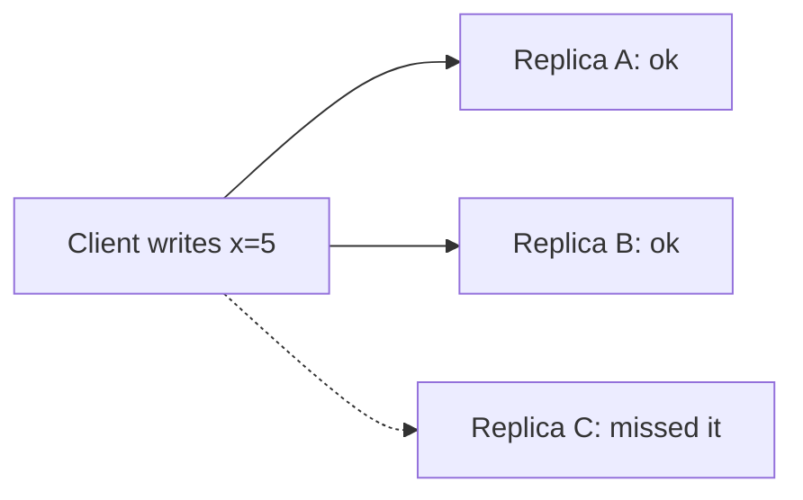
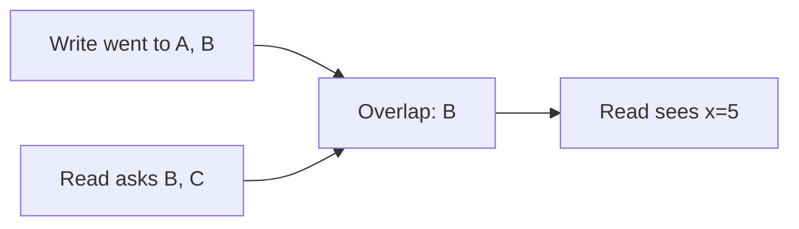
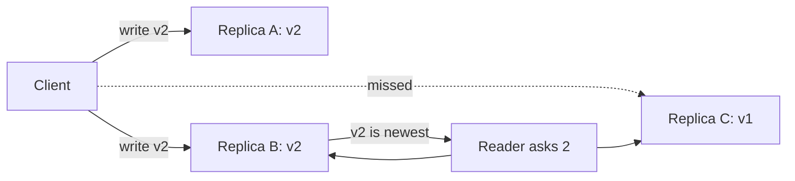
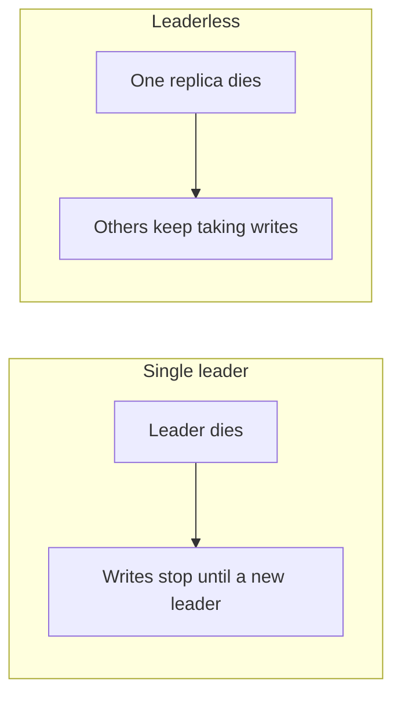
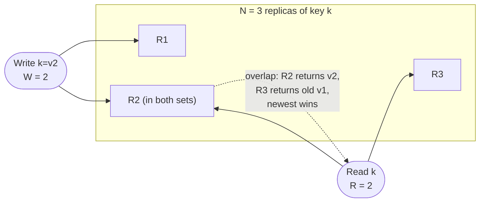
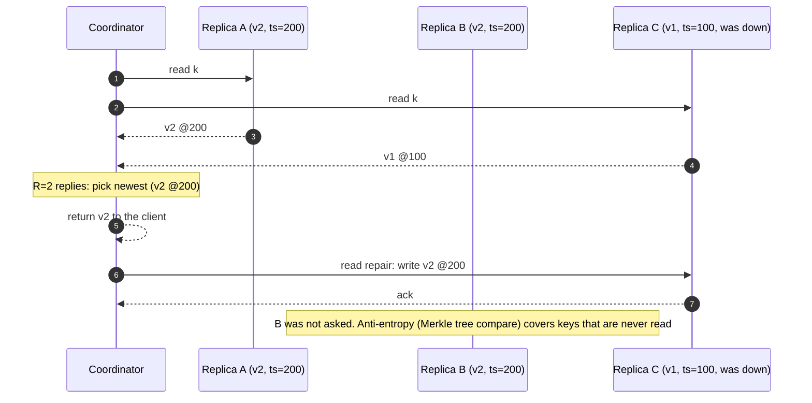
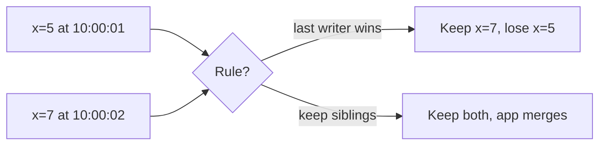
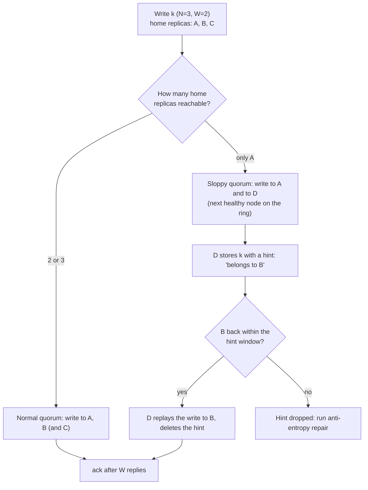

# Quorums and Leaderless Replication

> [!summary] TL;DR
> In **leaderless** replication every key is stored on `N` replicas and any of them accepts reads and writes. A write counts as done when `W` replicas acknowledge it, and a read asks `R` replicas and keeps the newest answer. If `R + W > N`, every read set overlaps every completed write set, so a read normally sees the latest completed write.

> [!abstract] Core idea
> - No leader: the client (or a coordinator node) sends each write to all `N` replicas and waits for `W` acks.
> - Reads ask `R` replicas, pick the newest version, and repair stale replicas they noticed.
> - `R + W > N` makes read and write sets overlap in at least one replica. The usual setting is `N=3, R=W=2`.
> - Quorums tolerate slow or dead replicas without failover, but they are not consensus and not linearizable.
> - Classic mistake: calling DynamoDB leaderless. DynamoDB has a leader per partition (Multi-Paxos); Cassandra, Riak and ScyllaDB are the leaderless ones.

## Start here: the basics 🟢

> [!info] How to read this note (pick your level)
> - 🟢 **New to this?** Read "From zero" below, then sections 1, 2 and the cheat sheet (10). Stop there, that is a full first pass.
> - 🟡 **Know the basics?** Add section 3 (how it works), 4 (worked example), 5 (variants) and 6 (trade-offs).
> - 🔴 **Interview / SDE-3 prep?** Add 7, 8 and 9. Headings are tagged 🟢🟡🔴 so you always know where you are.

> [!note] Before this note
> - [[Replication]]: the same data is copied to several machines; usually one leader takes the writes.
> - [[CAP and PACELC]]: during a network break a copy must choose between refusing and answering with maybe-old data.
> - [[Consistency Models]]: the promise about which value a read may return, from "always latest" to "eventually the same".
> - [[Consistent Hashing]]: keys are placed on a ring of servers, so each key has a fixed set of "home" servers.

**From zero, in 60 seconds** 🟢

Many databases keep each piece of data on 3 machines, called **replicas**.
In some designs, there is no boss machine. Any replica can take a write or a read.
So how do you know a read sees the latest write?



The trick is a **quorum**: wait for enough replicas, not all.
With 3 replicas, wait for 2 on every write, and ask 2 on every read.
Any 2 out of 3 always share at least one replica, so the read always reaches someone who has the new value.
The rule is: read count + write count must be bigger than the number of replicas.



The rest of this note is just these 3 questions:
1. Why does "R + W > N" make reads see recent writes?
2. How do replicas that missed a write catch up?
3. Why is this still not as strong as one single copy?

**The problem in one story.**
You keep a shopping cart on 3 database servers so one can die.
If one server is the "boss" for writes and it dies, nobody can add to cart until a new boss is chosen.
Instead, let any server accept the write, and call it done once 2 of the 3 have it.
To read, ask 2 servers and trust the newest answer: one of them must have the latest write.

**Words you need first**

| Word | Plain meaning | Tiny example |
| --- | --- | --- |
| Replica | One server holding a copy of the data | 3 replicas of key `cart:42` |
| Leader | One server that every write must go through | A Postgres primary |
| Leaderless | Any replica accepts reads and writes | Cassandra, Riak |
| Ack | "I stored it" reply from a replica | 2 acks received |
| N, W, R | Copies kept, acks needed to write, replies needed to read | `N=3, W=2, R=2` |
| Version | A tag telling which value is newer | Timestamp or version number |
| Stale | Old, out-of-date data | A replica that missed the last write |
| Consistency | Whether every reader sees the latest value | Read right after write sees it |
| Coordinator | The node that receives a client request and talks to the replicas for it | Node 4 forwards `cart:42` to A, B and C |
| Read repair | Fixing a stale replica when a read notices it is behind | Write v2 back to C after reading v1 there |
| Hinted handoff | Holding a write for a down replica and passing it on later | D keeps B's write until B is back |
| Last-writer-wins (LWW) | The version with the highest timestamp wins; others are dropped | `x=7 @10:00:02` beats `x=5 @10:00:01` |

**Picture it**



**Analogy.** A club writes each decision in the notebooks of any 2 of its 3 secretaries; asking any 2 secretaries always reaches at least one who wrote the latest entry.
Where it breaks: secretaries agree on what "newest" means, but servers with skewed clocks or concurrent writes can disagree, so overlap alone does not give perfect consistency.

**How the rest of this note builds up**

- First, why leaderless replication exists (section 1) and the N, W, R overlap rule (section 2).
- Then how reads, writes, read repair and hinted handoff work (section 3), with a worked Go example (section 4).
- Then variants (sloppy quorums, tunable consistency) and trade-offs (sections 5-6).
- Finally the SDE-3 deep dive: why quorums are not linearizable, conflict resolution and production tuning (sections 7-8).

> [!tip] Remember
> If `R + W > N`, every read overlaps the latest completed write, with no leader and no failover needed.

## 1. Why it exists 🟢

With single-leader replication, every write for a key goes through one node. When that leader dies, writes for its keys stop until a failover finishes, which takes tens of seconds (see [[High Availability and Failover]]). A shopping cart service that must accept "add to cart" during a node failure cannot wait for that.

Leaderless replication removes the failover step. Each key lives on 3 replicas. A write that reaches any 2 of them succeeds, so one dead or slow replica is simply ignored. The Dynamo paper (2007) built Amazon's cart this way, trading strict consistency for "always writable".



## 2. Mental model 🟢

- **N**: replicas per key (the replication factor).
- **W**: acks needed before a write is reported successful.
- **R**: replies needed before a read returns.
- **Quorum**: a set of replicas large enough that any two such sets share a member.

Two groups of size `W` and `R` drawn from `N` must overlap if `W + R > N`, by the **pigeonhole principle** (if you put more than N items into N boxes, some box gets two). The replica in the overlap has the latest completed write, and the reader picks the newest version among its `R` replies.

**Analogy.** A club records each decision in the notebooks of any 2 of its 3 secretaries. To learn the latest decision you ask any 2 secretaries and believe the newest entry. At least one of the two you ask wrote the last decision down.

## Common beginner mistakes 🟢

- **Calling DynamoDB leaderless** → DynamoDB has a leader per partition, chosen by Multi-Paxos → name Cassandra, Riak or ScyllaDB as the leaderless examples.
- **Thinking `R + W > N` makes it act like one perfect copy** → reads during an in-flight write can still see new, then old → use consensus when you need strict order.
- **Using `ONE`/`ONE` and expecting fresh reads** → 1 + 1 is not more than 3, so read and write sets may not overlap → use `QUORUM` (or `LOCAL_QUORUM`) on both sides.
- **Storing money or stock counts with last-writer-wins** → two concurrent updates and one silently disappears → use a leader-based or consensus store for these.
- **Never running repair** → a replica that missed writes, or deletes, stays wrong, and deleted data can come back → schedule anti-entropy repair regularly.

## 3. How it works 🟡

> 🟢 → 🟡 **You now know** that with no leader, a write waits for W replicas, a read asks R replicas, and `R + W > N` makes them overlap. **Next we open the box**: the overlap argument in detail, the write and read paths, how the "newest" value is chosen, and what happens when home replicas are down. Each subsection starts with a short walk-through.

### The overlap argument

**In plain words:** any group of W replicas and any group of R replicas must share one replica when R + W is bigger than N.

**Step by step:**
1. Key `cart:7` lives on 3 replicas: R1, R2, R3 (N = 3).
2. A write of v2 must reach 2 of them (W = 2). It lands on R1 and R2.
3. A read must hear from 2 (R = 2). It happens to ask R2 and R3.
4. 2 + 2 = 4 is more than 3, so the two pairs must share one replica: here R2.
5. R2 returns v2, R3 returns old v1. The reader keeps the newer v2.



Common settings with `N = 3`:

| R | W | R + W > N? | Behaviour |
| --- | --- | --- | --- |
| 2 | 2 | yes | the default "quorum" setting; tolerates 1 slow or dead replica for both reads and writes |
| 1 | 3 | yes | fast reads, but a write fails if any replica is down (read-heavy, rarely-written data) |
| 3 | 1 | yes | fast writes, reads fail if any replica is down |
| 1 | 1 | no | fastest and most available; reads may be stale (Cassandra `ONE`/`ONE`) |

### Write and read paths

**In plain words:** send the write to all replicas and wait for W to say ok; ask R replicas on read, keep the newest answer, and fix stale ones.

**Step by step (plain version):**
1. The client sends "set cart = 3 items" to a coordinator node, which stamps it "time 200".
2. The coordinator sends it to all 3 replicas and says "OK" as soon as 2 reply.
3. Later a read asks 2 replicas. One says "3 items @200", the other (which was down) says "2 items @100".
4. The coordinator returns "3 items" and quietly sends "3 items @200" to the stale replica.
5. In the background, a repair job compares all replicas, so even keys nobody reads get fixed.

1. **Write**: the coordinator stamps the value with a version (Cassandra: a timestamp per cell; Riak: a causal context), sends it to all `N` replicas, and replies "OK" after `W` acks. The remaining replicas still receive it unless they are down.
2. **Read**: the coordinator asks replicas, waits for `R` replies, and returns the newest version.
3. **Read repair**: if some of those replies were older, the coordinator writes the newest version back to them.
4. **Anti-entropy**: a background process compares replicas and copies missing data, so keys that are never read still converge. Cassandra (`nodetool repair`) and Dynamo compare **Merkle trees**: a hash tree over key ranges, where comparing root hashes and descending only into differing branches finds the differences with little data transfer.



### Choosing the newest value

**In plain words:** either the biggest timestamp wins (simple, can lose writes) or you keep both versions and let the app merge.

**Step by step:**
1. Two phones edit the same cart at nearly the same time: phone A sets `x=5` at 10:00:01, phone B sets `x=7` at 10:00:02.
2. With last-writer-wins, the store keeps `x=7` and throws `x=5` away, even though both were "OK".
3. With version vectors, each version carries a small counter per replica, so the store can see neither one came after the other.
4. It keeps both as siblings. The next read gets both, and the app merges them (for a cart, by joining the item lists).

- **Last-writer-wins (LWW)**: keep the version with the highest timestamp. Cassandra does this per cell. Simple, but concurrent writes lose silently, and a node with a fast clock wins wrongly (see [[Clocks and Ordering]]).
- **Version vectors and siblings**: each version carries a vector (a short list) of per-replica counters. If neither version's vector dominates, they are concurrent and both are kept as **siblings** for the application (or a CRDT, a data type built to merge automatically) to merge. Dynamo and Riak do this; the Dynamo cart merged siblings by union, which is why deleted items occasionally reappeared.



### Sloppy quorum and hinted handoff

**In plain words:** if home replicas are down, another machine holds the write for a while and hands it back later.

**Step by step:**
1. Key k's home replicas are A, B and C. B and C are down; only A is reachable.
2. A strict quorum (W = 2) would fail. A sloppy quorum also writes to D, the next healthy node on the ring.
3. D stores the write with a note: "this belongs to B".
4. B comes back within 3 hours. D sends B the write and deletes its note.
5. Until then, a read that asks only B and C misses the write. That is the price of staying writable.

When some of a key's `N` home replicas are unreachable, a **sloppy quorum** accepts the write on other healthy nodes outside the home set, which store it with a **hint** naming the intended owner. When the owner comes back, the hint is handed off.



The catch: a later read with `R = 2` may ask B and C, which both lack the write. **Sloppy quorums break the overlap guarantee**; they only promise durability on `W` nodes somewhere.

Cassandra uses hinted handoff to speed up recovery but still counts only real replicas toward its consistency level (and `ANY` is the only level a hint alone satisfies). Its default `max_hint_window` is 3 hours.

## 4. Worked example 🟡

### Whiteboard version

**In plain words:** the overlap rule and the read path in a few lines.

```text
put(k, v, ts):
    acks = 0
    for r in replicas(k):                      # all N
        if r is up:
            if ts > r[k].ts: r[k] = (v, ts)    # keep newer only
            acks += 1
    return acks >= W ? OK : ERROR              # replicas that acked keep v anyway

get(k):
    asked = first R live replicas of k
    if len(asked) < R: return ERROR
    best = newest version among asked
    for r in asked:
        if r[k].ts < best.ts: r[k] = best      # read repair
    return best
```

Trace with `N = 3, R = W = 2`, replica 3 down:

1. `put(cart:7, "2 items", 100)`: replicas 1 and 2 ack, 2 ≥ W → OK.
2. Replica 2 also dies. `put(cart:7, "3 items", 200)`: only replica 1 acks → ERROR, but replica 1 now holds "3 items". This is a **partially failed write**: the client was told "failed", yet a later read may return it.

### Go: a toy leaderless store

**In plain words:** a small working store with N, R and W you can change, to watch stale reads appear and disappear.

This compiles and passes `go vet` and `go test -race` on Go 1.24. Timestamps are passed in, so ordering is deterministic.

```go
// Package quorum is a toy Dynamo-style (leaderless) store: N replicas,
// a write needs W acks, a read needs R replies, and reads repair stale replicas.
package quorum

import "errors"

var ErrNotEnoughReplicas = errors.New("not enough replicas responded")

// Versioned is a value with a last-writer-wins timestamp.
type Versioned struct {
	Value string
	TS    int64
}

type Replica struct {
	Up   bool
	data map[string]Versioned
}

type Store struct {
	N, R, W  int
	Replicas []*Replica
	Repairs  int // how many read repairs were sent (for tests and metrics)
}

func NewStore(n, r, w int) *Store {
	s := &Store{N: n, R: r, W: w}
	for i := 0; i < n; i++ {
		s.Replicas = append(s.Replicas, &Replica{Up: true, data: map[string]Versioned{}})
	}
	return s
}

// Put sends the write to every live replica and succeeds once W have acked.
// A replica keeps a write only if it is newer than what it has.
func (s *Store) Put(key, value string, ts int64) error {
	acks := 0
	for _, r := range s.Replicas {
		if !r.Up {
			continue
		}
		if cur, ok := r.data[key]; !ok || ts > cur.TS {
			r.data[key] = Versioned{value, ts}
		}
		acks++
	}
	if acks < s.W {
		return ErrNotEnoughReplicas // note: the replicas that did ack keep the write
	}
	return nil
}

// Get asks live replicas in order, stops after R replies, returns the newest
// version, and writes it back to any of those R replicas that were stale.
func (s *Store) Get(key string) (Versioned, error) {
	var asked []*Replica
	var best Versioned
	for _, r := range s.Replicas {
		if len(asked) == s.R {
			break
		}
		if !r.Up {
			continue
		}
		asked = append(asked, r)
		if v := r.data[key]; v.TS > best.TS {
			best = v
		}
	}
	if len(asked) < s.R {
		return Versioned{}, ErrNotEnoughReplicas
	}
	for _, r := range asked { // read repair
		if r.data[key].TS < best.TS {
			r.data[key] = best
			s.Repairs++
		}
	}
	return best, nil
}

// Peek reads one replica directly (for tests).
func (s *Store) Peek(i int, key string) Versioned { return s.Replicas[i].data[key] }
```

The tests cover the trace above, the overlap plus read repair, a non-overlapping configuration, and LWW losing a write:

```go
package quorum

import (
	"errors"
	"testing"
)

func TestOneReplicaDownStillServesQuorum(t *testing.T) {
	s := NewStore(3, 2, 2)
	s.Replicas[2].Up = false // replica 3 is down
	if err := s.Put("cart:7", "2 items", 100); err != nil {
		t.Fatalf("W=2 with 2 live replicas should succeed: %v", err)
	}
	s.Replicas[1].Up = false // now 2 of 3 are down
	if err := s.Put("cart:7", "3 items", 200); !errors.Is(err, ErrNotEnoughReplicas) {
		t.Fatalf("want ErrNotEnoughReplicas, got %v", err)
	}
	// The failed write still landed on replica 0: a "partially failed" write.
	if got := s.Peek(0, "cart:7").Value; got != "3 items" {
		t.Fatalf("replica 0 = %q", got)
	}
}

func TestOverlapAndReadRepair(t *testing.T) {
	s := NewStore(3, 2, 2)
	_ = s.Put("k", "v1", 1)
	s.Replicas[0].Up = false
	_ = s.Put("k", "v2", 2) // lands on replicas 1 and 2 only
	s.Replicas[0].Up = true // replica 0 is back, still holding v1

	got, err := s.Get("k") // asks replicas 0 and 1: overlap with the write set is replica 1
	if err != nil || got.Value != "v2" {
		t.Fatalf("got %+v, %v; want v2", got, err)
	}
	if s.Peek(0, "k").Value != "v2" || s.Repairs != 1 {
		t.Fatalf("replica 0 not repaired: %+v, repairs=%d", s.Peek(0, "k"), s.Repairs)
	}
}

func TestNoOverlapReadsStale(t *testing.T) {
	s := NewStore(3, 1, 1) // R + W = 2, not > N
	_ = s.Put("k", "v1", 1)
	s.Replicas[0].Up = false
	_ = s.Put("k", "v2", 2)
	s.Replicas[0].Up = true
	s.Replicas[1].Up = false
	s.Replicas[2].Up = false
	got, _ := s.Get("k")
	if got.Value != "v1" {
		t.Fatalf("want stale v1 with R=W=1, got %q", got.Value)
	}
}

func TestLWWDropsConcurrentWrite(t *testing.T) {
	s := NewStore(3, 2, 2)
	_ = s.Put("k", "from-client-A", 105) // A's clock runs 10 ms fast
	_ = s.Put("k", "from-client-B", 100) // B wrote later in real time
	got, _ := s.Get("k")
	if got.Value != "from-client-A" {
		t.Fatalf("got %q", got.Value)
	}
	// B's write was acknowledged (Put returned nil) and silently lost.
}
```

The toy contacts replicas in a fixed order to stay deterministic; a real coordinator sends to all and takes the first `R` replies, which is also why latency is set by the replicas, as the next section shows.

## 5. Variants and comparison 🟡

### Per-request choice in Cassandra

**In plain words:** Cassandra lets each request choose how many replicas must answer: ONE is fast, QUORUM is safer.

| Consistency level | Replicas that must answer | Use |
| --- | --- | --- |
| `ONE` / `LOCAL_ONE` | 1 (in the local DC, or data centre, for `LOCAL_ONE`) | metrics, logs, anything that tolerates stale reads |
| `QUORUM` | `floor(total RF / 2) + 1` across all DCs (RF = replication factor, the N above) | single-DC strong reads with writes also at `QUORUM` |
| `LOCAL_QUORUM` | a majority of replicas in the coordinator's DC | the usual multi-DC choice: strong inside a DC, no cross-DC wait |
| `EACH_QUORUM` (writes) | a majority in every DC | writes that must be durable in every region before acking |
| `ALL` | every replica | rarely; one dead replica fails the request |

### Quorum vs consensus vs leader-based

**In plain words:** who decides the order of writes: nobody, a voted majority, or one leader.

| Approach | Who orders writes | Linearizable? | Failure handling | Examples |
| --- | --- | --- | --- | --- |
| Leaderless quorum | nobody; versions compared on read | no (see deep dive) | no failover; slow replicas ignored | Cassandra, ScyllaDB, Riak, Dynamo (2007 paper) |
| Single leader, async followers | the leader | on the leader only | failover needed, may lose writes | PostgreSQL, MySQL (see [[Replication]]) |
| Consensus (Raft, Multi-Paxos) | an elected leader, log committed by a majority | yes (with leader reads or read-index, where the leader confirms it is still leader before answering) | automatic leader election | etcd, Spanner, CockroachDB, DynamoDB (Multi-Paxos per partition) |

Quorum replicas only **acknowledge**: each one independently stores whatever arrives. Consensus makes replicas **agree on one order** of operations. A majority is used in both, which is why they get confused (see [[Consensus - Raft and Paxos]]).

> [!warning] Trap: DynamoDB is not Dynamo-style
> DynamoDB keeps 3 replicas per partition in different AZs (Availability Zones: separate data-centre sites in one region), and one is the leader elected with Multi-Paxos. Writes go to the leader and are acknowledged after a majority persist them; strongly consistent reads go to the leader. It shares a name with the 2007 Dynamo paper, not its replication design.

## 6. Trade-offs and when not to use 🟡

- **Latency is set by the slowest replica you wait for.** With `W = 2` of 3, a write's latency is the second-fastest replica's. Coordinators reduce tail latency with **speculative retries**: if a replica has not answered by about its usual p99 (the time 99 of 100 requests beat), ask another one (Cassandra's per-table `speculative_retry` option, default `99p`, written `99PERCENTILE` before 4.0).
- **Conflict handling moves to the application.** LWW loses concurrent writes; siblings need merge code.
- **No conditional updates for free.** "Increment if balance ≥ 10" needs consensus; Cassandra's lightweight transactions (`IF` clauses) run Paxos (a consensus protocol) and cost several round trips.
- **When not to use:** money, inventory counts, uniqueness constraints, and anything that needs read-modify-write correctness. Use a leader-based or consensus store, or a CRDT if the operation merges naturally (see [[CRDTs and Conflict Resolution]]).
- **When it shines:** high write throughput, multi-DC writes, time-series, carts, sessions, and feeds where "always writable" beats "always exact".

## 7. In production 🔴

> 🟡 → 🔴 **You now know** the overlap rule, the read and write paths, read repair, anti-entropy, siblings and sloppy quorums. **Next comes the advanced part**: how Cassandra and Riak run this in production, the failure modes (zombie data, clock skew, hint storms), and exactly why quorums are still not linearizable.

- **Real systems:** Cassandra and ScyllaDB (LWW per cell, tunable consistency, hinted handoff, Merkle-tree repair); Riak KV (siblings with dotted version vectors). Voldemort, LinkedIn's Dynamo-style store, is no longer actively developed.
- **Failure modes → fixes:**
  - A node down longer than the hint window misses writes forever → run `nodetool repair` (or incremental repair) on a schedule shorter than `gc_grace_seconds` (10 days by default), or deleted data can come back as "zombies" when a replica that missed the **tombstone** (a marker saying "this was deleted") repairs others.
  - Clock skew on clients or coordinators makes LWW keep the wrong write → use server-side timestamps, NTP (the protocol that syncs machine clocks) monitoring, or lightweight transactions for contended keys.
  - Read latency spikes from one slow replica → speculative retry, and dynamic snitching (Cassandra tracking which replicas are currently fast) to prefer faster replicas.
  - Coordinator overload during a hint replay storm → throttle hinted handoff (`hinted_handoff_throttle` in Cassandra 4.1+, `hinted_handoff_throttle_in_kb` in older versions; it limits how fast each node replays its stored hints).
- **What to monitor:** hints stored and replayed, read-repair rate, repair progress and age of last successful repair per table, digest mismatch rate (how often replicas' short fingerprints of the same data differ), per-replica p99 latency, and unavailable or timeout exceptions per consistency level.

## 8. Deep dive 🔴

Why `R + W > N` is still **not linearizable**:

- **Concurrent read during a write.** A write has reached 1 of 3 replicas. Reader A's quorum includes that replica and returns the new value; reader B, starting after A finished, picks two replicas without it and returns the old value. A newer value was seen, then an older one: not linearizable. The ABD algorithm fixes this by making the reader write back the value to a quorum *before* returning (a synchronous read repair), at the cost of a second round trip.
- **Partially failed writes.** A write that reports failure may still be on some replicas and appear in later reads, or later be overwritten by read repair from replicas that lack it, so the outcome depends on which replicas a reader happens to ask.
- **LWW with skewed clocks.** The "newest" write is decided by timestamps, not real order. A write stamped by a fast clock beats a later write. The last test above shows an acknowledged write being dropped.
- **Sloppy quorums.** The `W` nodes may not be home replicas, so the read set and write set need not overlap at all.
- **Membership changes.** While a node joins and streams data, the set of replicas for a range changes; a quorum computed over the old set and one over the new set may not overlap.

At scale:

- **Merkle tree granularity.** A tree over a large range with few leaves flags whole big ranges as different and streams much more data than needed; more leaves cost memory. Cassandra builds these trees during validation compaction (a background pass that reads the data files), which is CPU and I/O heavy, so repairs are scheduled per range.
- **Choosing N.** `N = 3` with `R = W = 2` tolerates one unavailable replica per operation. `N = 5` with `R = W = 3` tolerates two but costs more storage and writes.

## 9. Interview questions 🔴

> [!question]- Explain `R + W > N` and why it matters.
> With `N` replicas, a write waits for `W` acks and a read for `R` replies. If `R + W > N`, any read set overlaps any completed write set in at least one replica, so the read sees the latest completed write and picks it by version. With `N = 3`, `R = W = 2` is the usual choice.

> [!question]- `N = 3`, one replica is down. Do reads and writes at `QUORUM` still work?
> Yes. Two replicas remain, which meets `W = 2` and `R = 2`. A second failure makes both fail. The downed replica catches up through hinted handoff, read repair or anti-entropy repair when it returns.

> [!question]- Does `R + W > N` give linearizability? (trap)
> No. Concurrent reads during an in-flight write can see new-then-old, partially failed writes can surface later, LWW with skewed clocks orders writes wrongly, and sloppy quorums break the overlap. Linearizable quorum reads need a write-back before returning (ABD), and read-modify-write needs consensus.

> [!question]- What is a sloppy quorum and what does it cost?
> When home replicas are unreachable, writes go to other nodes with a hint and are handed back later. It keeps writes available, but a later read from the home replicas may not see them, so the overlap guarantee is lost until the handoff completes.

> [!question]- Read repair vs anti-entropy?
> Read repair fixes stale replicas that a read happened to contact, so it only fixes keys that are read. Anti-entropy compares whole replicas in the background (Merkle trees) and fixes everything, including cold keys and deletes.

> [!question]- Is DynamoDB leaderless like Dynamo? (trap)
> No. DynamoDB has a leader replica per partition elected with Multi-Paxos; writes go through it and strongly consistent reads are served by it. Cassandra, Riak and ScyllaDB are the Dynamo-style leaderless systems.

> [!question]- How is a quorum different from consensus?
> Quorum replicas each store what they receive and acknowledge; nobody agrees on an order, so concurrent writes conflict. Consensus elects a leader and commits a single ordered log on a majority, which supports linearizable reads and conditional updates.

## 10. Cheat sheet 🟢

- Leaderless: any replica takes writes; no failover step.
- `R + W > N` → overlap → read sees the latest completed write. Default `N=3, R=W=2`.
- Newest value: LWW (loses concurrent writes) or version vectors with siblings.
- Repair: read repair (on read), anti-entropy with Merkle trees (background), hinted handoff (after outages).
- Sloppy quorum keeps writes available but breaks the overlap.
- Not linearizable: in-flight writes, partial failures, clock skew, sloppy quorums.
- Cassandra: `ONE`, `QUORUM`, `LOCAL_QUORUM`, `EACH_QUORUM`, `ALL`; speculative retry for tails.
- DynamoDB is leader-based (Multi-Paxos per partition), not leaderless.

## Self-check 🟢🟡

🟢 Easy

> [!question]- With N = 3, W = 2, R = 2, do reads overlap writes?
> Yes. 2 + 2 = 4 > 3, so every read set shares at least one replica with every completed write set.

> [!question]- What does read repair do?
> When a read sees an older version on some replica, it writes the newest version back to that replica.

> [!question]- Name two leaderless databases.
> Cassandra and Riak (also ScyllaDB). Not DynamoDB.

🟡 Medium

> [!question]- N = 3, W = 1, R = 1. What can go wrong?
> 1 + 1 is not more than 3, so a read can hit a replica that never got the write and return stale data.

> [!question]- Why does a sloppy quorum break the overlap guarantee?
> The write may sit on nodes outside the home set, so a read from the home replicas can miss it entirely.

> [!question]- Why can last-writer-wins drop a write that was acknowledged?
> It keeps only the highest timestamp; a concurrent write with a lower timestamp (or a slower clock) is thrown away.

## Links

- **Before this:** [[Replication]], [[Consistent Hashing]], [[CAP and PACELC]]
- **Next:** [[Clocks and Ordering]], [[CRDTs and Conflict Resolution]], [[Failure Detection, Gossip and Membership]]
- **Compare with:** [[Consensus - Raft and Paxos]] (majority agreement on an order), [[Wide-Column Stores and Cassandra]] (the main production example), [[Consistency Models]] (what guarantee you actually get)

### Watch on YouTube

- [Quorums - Leaderless Replication Continued / Systems Design Interview 0 to 1 with Ex-Google SWE](https://www.youtube.com/watch?v=DAONthD50g0) · Jordan has no life · 10 min · 18,847 views
- [Database Replication - Leaderless / Dynamo principles, Failover strategies, Quorums / System Design](https://www.youtube.com/watch?v=rPvpa2WujsI) · udaykiran․tech · 10 min · 341 views
