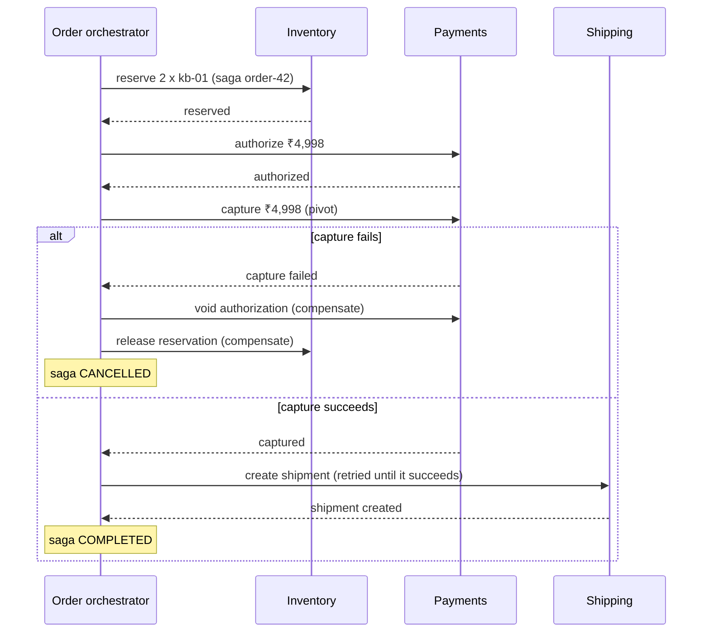
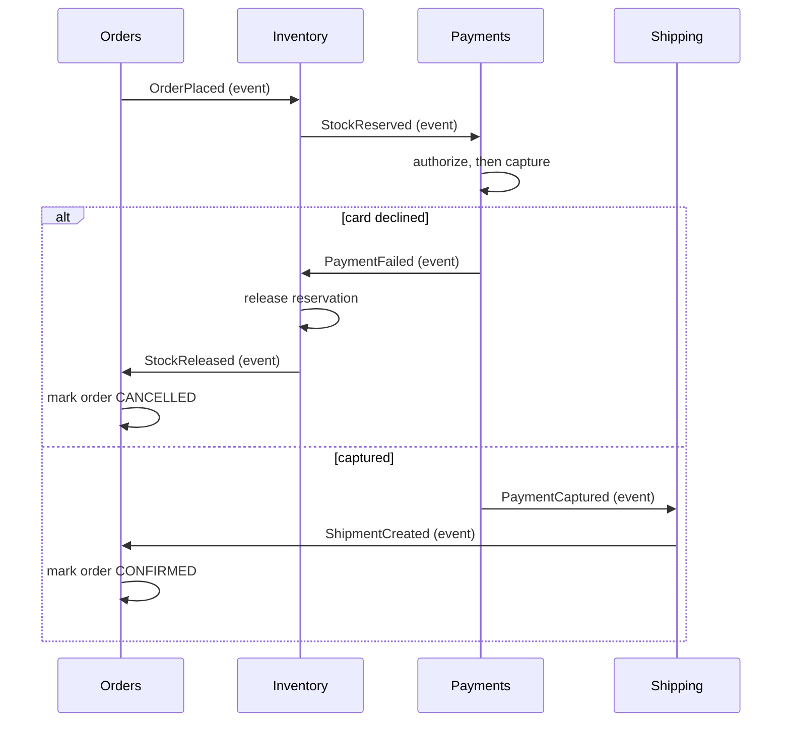
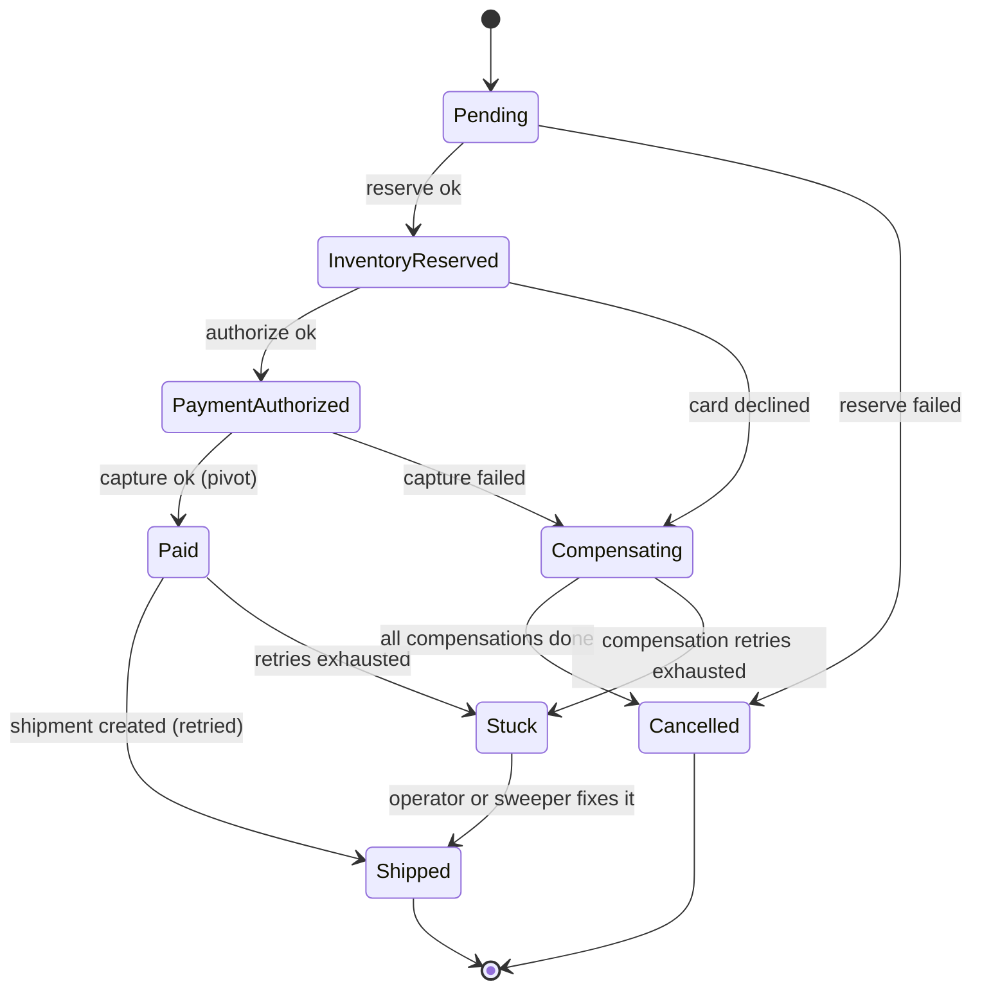

# Saga Pattern

> [!summary] TL;DR
> A **saga** runs one business operation that spans several services as a chain of small **local transactions**, one per service. If a later step fails, the saga runs **compensating actions** (business-level undo steps, such as "release the reserved stock") for the steps that already committed, instead of rolling back one big transaction.

> [!abstract] Core idea
> - Each service commits its own step in its own database; nothing locks across services.
> - A failure is handled by running compensations in reverse order, not by a rollback.
> - Order the steps: compensatable steps first, then one pivot (the point of no return), then retriable steps that must eventually succeed.
> - Sagas are atomic in the end (all or compensated) but not isolated: other requests can see half-finished work.
> - Classic mistake: charging the card before reserving stock, so every stock-out turns into a refund.

## 1. Why it exists

An online shop splits checkout across three services, each with its own database:

- **Inventory** reserves 2 units of SKU `kb-01`.
- **Payments** charges ₹4,998 through a payment provider such as Stripe or Razorpay.
- **Shipping** books a courier pickup.

Inside one PostgreSQL database you would wrap all three in `BEGIN … COMMIT`. Across services you cannot:

- The payment provider is an HTTP API. It does not join your database transaction, and it does not speak XA (the standard interface for distributed transactions).
- The courier API and the message broker do not either.
- [[Two-Phase Commit]] across your own databases would work in theory, but the coordinator **blocks**: if it crashes after "prepare", every participant holds its locks until the coordinator returns. One slow service then stalls checkout for everyone.

Without a pattern, a crash between "charge card" and "book courier" leaves a customer charged with no shipment, and nobody notices until a support ticket arrives. A saga makes that gap explicit: every step either completes, or the steps before it are compensated, and the saga's own state is persisted so a crash cannot lose track.

## 2. Mental model

A saga is a **travel booking done by phone**. You book a flight, then a hotel, then a car. If the car company has nothing, you do not "roll back time". You call the hotel and cancel, then call the airline and cancel. Each cancellation is a new, real action with its own rules: the airline may keep a fee.

Three terms used throughout:

- **Local transaction:** one ACID transaction inside one service's database.
- **Compensating action (compensation):** a new local transaction that semantically undoes an earlier one. It is a business action (a refund, a release, an apology email), not a database rollback. The original row stays in history.
- **Saga log:** the persisted record of which steps finished, so the saga can resume after a crash.

## 3. How it works

### Two ways to coordinate

- **Orchestration:** one component, the **orchestrator**, tells each service what to do next and records progress. The flow lives in one place.
- **Choreography:** there is no central brain. Each service listens for events and reacts with its own step, emitting the next event.

The orchestrated checkout, reserving stock before taking money:



The same flow as choreography. Each service subscribes to the previous event; a failure event triggers compensations upstream:



### Step types and the ordering rule

Not every step can be undone. Richardson's *Microservices Patterns* names three kinds:

| Step kind | Meaning | Checkout example | On failure |
| --- | --- | --- | --- |
| Compensatable | Can be undone by a compensation | Reserve stock, authorize card | Compensate earlier steps |
| Pivot | The go/no-go point. After it succeeds the saga must finish | Capture the payment | Compensate earlier steps |
| Retriable | Comes after the pivot and is retried until it succeeds | Create shipment, send receipt | Retry with backoff; never compensate |

**Ordering rule:** all compensatable steps first, then at most one pivot, then only retriable steps.

A common design charges the card first and reserves stock second. With that order a stock-out needs a refund, which costs a payment fee, takes days to reach the customer and creates support tickets. Reserving first means a stock-out costs nothing: there is nothing to undo.

### The orchestrator as a state machine

The orchestrator persists its state after every transition, so a restarted process knows where it was:



`Stuck` exists because a step after the pivot may not be compensated, and because a compensation may keep failing. When retries run out, the saga is parked and an alert fires; a person or a background sweeper finishes it in the same direction it was going (forwards after the pivot, backwards during compensation).

### Making each step reliable

A saga step talks to another service, so every message can be lost, delayed or duplicated:

- **Publish with the state change.** A service that commits "stock reserved" and then publishes `StockReserved` can crash in between. Write the event into an outbox table in the same local transaction (see [[Transactional Outbox and CDC]]).
- **Idempotent participants.** Brokers deliver at least once (see [[Delivery Semantics and Exactly-Once]]), and the orchestrator retries. Every step and every compensation takes the saga id as an idempotency key, so "reserve for order-42" twice reserves once (see [[Idempotency and Idempotency Keys]]).
- **Compensations must be retriable too.** "Release reservation" cannot be allowed to fail permanently, so it is retried with backoff (see [[Timeouts, Retries and Backoff]]).
- **Compensations must commute with a late original.** If "reserve" times out, the orchestrator compensates with "release". The reserve may still arrive later. The participant records "order-42 cancelled", so a late reserve for a cancelled saga is ignored.

## 4. Worked example

### Whiteboard version

The bare idea: run steps in order, and on failure undo the finished ones in reverse.

```go
package wb

import "context"

type Step struct {
	Do, Undo func(context.Context) error
}

// Run executes steps in order; on failure it undoes finished steps in reverse.
func Run(ctx context.Context, steps []Step) error {
	for i, s := range steps {
		if err := s.Do(ctx); err != nil {
			for j := i - 1; j >= 0; j-- {
				_ = steps[j].Undo(ctx) // real code retries and logs this
			}
			return err
		}
	}
	return nil
}
```

This is not yet safe: it forgets everything if the process crashes, it would undo a step after the pivot, and a failed undo is silently dropped. The full version fixes all three.

### Go: an orchestrator with a saga log

The orchestrator below validates the step order, writes a log entry after every step, retries retriable steps and compensations with exponential backoff, parks the saga as `Stuck` when a post-pivot step keeps failing, and can `Resume` from the log after a crash. Sleep is injected so the tests are deterministic. It passes `go vet` and `go test -race` on Go 1.24.

```go
package saga

import (
	"context"
	"errors"
	"fmt"
	"sync"
	"time"
)

// Kind says what may happen to a step after it succeeds.
type Kind int

const (
	Compensatable Kind = iota // can be undone by a compensating action
	Pivot                     // the point of no return: once it succeeds, the saga must finish
	Retriable                 // after the pivot: must eventually succeed, so it is retried
)

// Step is one local transaction in one service.
type Step struct {
	Name string
	Kind Kind
	Do   func(ctx context.Context) error
	Undo func(ctx context.Context) error // only for Compensatable steps
}

type Status string

const (
	Running      Status = "running"
	Compensating Status = "compensating"
	Completed    Status = "completed"
	Cancelled    Status = "cancelled"
	Stuck        Status = "stuck" // retries exhausted: a human or a sweeper must act
)

// Entry is one line of the saga log. The orchestrator writes it before
// moving on, so a crashed orchestrator can resume from the log.
type Entry struct {
	Step   int    // index of the step, -1 for a status change
	Event  string // "done", "compensated" or "status"
	Status Status
}

// Log is the durable saga log. MemLog is the in-memory version for tests;
// production stores it in a table in the orchestrator's database.
type Log interface {
	Append(sagaID string, e Entry) error
	Read(sagaID string) ([]Entry, error)
}

type MemLog struct {
	mu   sync.Mutex
	data map[string][]Entry
}

func NewMemLog() *MemLog { return &MemLog{data: map[string][]Entry{}} }

func (l *MemLog) Append(id string, e Entry) error {
	l.mu.Lock()
	defer l.mu.Unlock()
	l.data[id] = append(l.data[id], e)
	return nil
}

func (l *MemLog) Read(id string) ([]Entry, error) {
	l.mu.Lock()
	defer l.mu.Unlock()
	return append([]Entry(nil), l.data[id]...), nil
}

// ErrBadOrder means the steps break the rule
// compensatable* -> at most one pivot -> retriable*.
var ErrBadOrder = errors.New("saga: steps must be compensatable, then pivot, then retriable")

type Orchestrator struct {
	Steps      []Step
	Log        Log
	MaxRetries int                 // attempts for retriable steps and compensations
	Backoff    time.Duration       // base delay, doubled per attempt
	Sleep      func(time.Duration) // injected so tests do not sleep
}

func (o *Orchestrator) validate() error {
	phase := Compensatable
	for _, s := range o.Steps {
		if s.Kind < phase {
			return ErrBadOrder
		}
		if s.Kind == Pivot && phase == Pivot {
			return ErrBadOrder // two pivots
		}
		if s.Kind == Compensatable && s.Undo == nil {
			return fmt.Errorf("saga: step %q has no compensation", s.Name)
		}
		phase = s.Kind
		if phase == Pivot {
			phase = Pivot + 1 // only retriable steps may follow
		}
	}
	return nil
}

// retry runs f up to MaxRetries times with exponential backoff.
func (o *Orchestrator) retry(ctx context.Context, f func(context.Context) error) error {
	var err error
	delay := o.Backoff
	for attempt := 0; attempt < o.MaxRetries; attempt++ {
		if err = f(ctx); err == nil {
			return nil
		}
		if attempt < o.MaxRetries-1 {
			o.Sleep(delay)
			delay *= 2
		}
	}
	return err
}

func (o *Orchestrator) setStatus(id string, s Status) error {
	return o.Log.Append(id, Entry{Step: -1, Event: "status", Status: s})
}

// Run starts a new saga.
func (o *Orchestrator) Run(ctx context.Context, id string) (Status, error) {
	if err := o.validate(); err != nil {
		return "", err
	}
	if err := o.setStatus(id, Running); err != nil {
		return "", err
	}
	return o.Resume(ctx, id)
}

// Resume rebuilds the saga's position from its log and carries on.
// Run calls it too, so a fresh saga and a recovered one take the same path.
func (o *Orchestrator) Resume(ctx context.Context, id string) (Status, error) {
	entries, err := o.Log.Read(id)
	if err != nil {
		return "", err
	}
	status := Running
	compensating := false // set once the saga has started going backwards
	done := map[int]bool{}
	for _, e := range entries {
		switch e.Event {
		case "status":
			status = e.Status
			if e.Status == Compensating {
				compensating = true
			}
		case "done":
			done[e.Step] = true
		case "compensated":
			delete(done, e.Step)
		}
	}
	switch {
	case status == Completed || status == Cancelled:
		return status, nil
	case compensating:
		// Includes a saga parked as Stuck during compensation: a sweeper
		// must finish going backwards, never restart the forward steps.
		return o.compensate(ctx, id, done)
	}

	for i, s := range o.Steps {
		if done[i] {
			continue
		}
		var err error
		if s.Kind == Retriable {
			err = o.retry(ctx, s.Do)
		} else {
			err = s.Do(ctx) // a business "no" (declined card) is not retried here
		}
		if err != nil {
			if s.Kind == Retriable {
				// After the pivot we may not go back. Park the saga for a human.
				_ = o.setStatus(id, Stuck)
				return Stuck, fmt.Errorf("step %q: %w", s.Name, err)
			}
			if err := o.setStatus(id, Compensating); err != nil {
				return "", err
			}
			return o.compensate(ctx, id, done)
		}
		if err := o.Log.Append(id, Entry{Step: i, Event: "done"}); err != nil {
			return "", err
		}
		done[i] = true
	}
	if err := o.setStatus(id, Completed); err != nil {
		return "", err
	}
	return Completed, nil
}

// compensate undoes finished compensatable steps in reverse order.
func (o *Orchestrator) compensate(ctx context.Context, id string, done map[int]bool) (Status, error) {
	for i := len(o.Steps) - 1; i >= 0; i-- {
		if !done[i] {
			continue
		}
		s := o.Steps[i]
		if err := o.retry(ctx, s.Undo); err != nil {
			_ = o.setStatus(id, Stuck)
			return Stuck, fmt.Errorf("compensate %q: %w", s.Name, err)
		}
		if err := o.Log.Append(id, Entry{Step: i, Event: "compensated"}); err != nil {
			return "", err
		}
	}
	if err := o.setStatus(id, Cancelled); err != nil {
		return "", err
	}
	return Cancelled, nil
}
```

The tests drive the checkout saga with a failure at each step, a flaky courier, a courier that never recovers, and a crash in the middle:

```go
package saga

import (
	"context"
	"errors"
	"slices"
	"testing"
	"time"
)

// orderSaga wires the checkout saga to fake services. failAt names the
// step whose Do fails; shipFailures makes "create shipment" fail that many
// times before it succeeds.
func orderSaga(failAt string, shipFailures int) (*Orchestrator, *[]string, *[]time.Duration) {
	var calls []string
	var slept []time.Duration
	step := func(name string, k Kind, undo bool) Step {
		s := Step{Name: name, Kind: k, Do: func(context.Context) error {
			calls = append(calls, name)
			if name == failAt {
				return errors.New(name + " failed")
			}
			if name == "create shipment" && shipFailures > 0 {
				shipFailures--
				return errors.New("carrier timeout")
			}
			return nil
		}}
		if undo {
			s.Undo = func(context.Context) error {
				calls = append(calls, "undo "+name)
				return nil
			}
		}
		return s
	}
	o := &Orchestrator{
		Steps: []Step{
			step("reserve inventory", Compensatable, true),
			step("authorize payment", Compensatable, true),
			step("capture payment", Pivot, false),
			step("create shipment", Retriable, false),
		},
		Log:        NewMemLog(),
		MaxRetries: 5,
		Backoff:    100 * time.Millisecond,
		Sleep:      func(d time.Duration) { slept = append(slept, d) },
	}
	return o, &calls, &slept
}

func TestFailureAtEachStep(t *testing.T) {
	cases := []struct {
		failAt string
		want   Status
		calls  []string
	}{
		{"", Completed, []string{"reserve inventory", "authorize payment", "capture payment", "create shipment"}},
		{"reserve inventory", Cancelled, []string{"reserve inventory"}},
		{"authorize payment", Cancelled, []string{"reserve inventory", "authorize payment", "undo reserve inventory"}},
		{"capture payment", Cancelled, []string{"reserve inventory", "authorize payment", "capture payment",
			"undo authorize payment", "undo reserve inventory"}},
	}
	for _, c := range cases {
		t.Run("fail="+c.failAt, func(t *testing.T) {
			o, calls, _ := orderSaga(c.failAt, 0)
			got, err := o.Run(context.Background(), "order-42")
			if err != nil || got != c.want {
				t.Fatalf("status %v err %v, want %v", got, err, c.want)
			}
			if !slices.Equal(*calls, c.calls) {
				t.Fatalf("calls %v\nwant  %v", *calls, c.calls)
			}
		})
	}
}

func TestRetriableStepIsRetriedNotCompensated(t *testing.T) {
	o, calls, slept := orderSaga("", 2) // carrier times out twice
	got, err := o.Run(context.Background(), "order-43")
	if err != nil || got != Completed {
		t.Fatalf("status %v err %v", got, err)
	}
	if n := len(*calls); n != 6 { // 3 steps + 3 shipment attempts
		t.Fatalf("calls %v", *calls)
	}
	if !slices.Equal(*slept, []time.Duration{100 * time.Millisecond, 200 * time.Millisecond}) {
		t.Fatalf("backoff %v", *slept)
	}
}

func TestRetriableExhaustedParksSagaAsStuck(t *testing.T) {
	o, calls, _ := orderSaga("", 99)
	got, err := o.Run(context.Background(), "order-44")
	if got != Stuck || err == nil {
		t.Fatalf("status %v err %v, want stuck", got, err)
	}
	for _, c := range *calls {
		if c == "undo authorize payment" {
			t.Fatal("compensated after the pivot; money was already captured")
		}
	}
}

func TestResumeAfterCrashSkipsFinishedSteps(t *testing.T) {
	o, calls, _ := orderSaga("", 0)
	// Simulate a crash: the log says the first two steps finished.
	_ = o.Log.Append("order-45", Entry{Step: -1, Event: "status", Status: Running})
	_ = o.Log.Append("order-45", Entry{Step: 0, Event: "done"})
	_ = o.Log.Append("order-45", Entry{Step: 1, Event: "done"})

	got, err := o.Resume(context.Background(), "order-45")
	if err != nil || got != Completed {
		t.Fatalf("status %v err %v", got, err)
	}
	if !slices.Equal(*calls, []string{"capture payment", "create shipment"}) {
		t.Fatalf("calls %v", *calls)
	}
}

func TestResumeAfterStuckCompensationKeepsGoingBackwards(t *testing.T) {
	o, calls, _ := orderSaga("capture payment", 0)
	undo := o.Steps[0].Undo
	o.Steps[0].Undo = func(context.Context) error { return errors.New("inventory down") }
	if got, _ := o.Run(context.Background(), "order-46"); got != Stuck {
		t.Fatalf("status %v, want stuck", got)
	}
	o.Steps[0].Undo = undo // inventory is back; the sweeper resumes
	*calls = nil
	got, err := o.Resume(context.Background(), "order-46")
	if err != nil || got != Cancelled {
		t.Fatalf("status %v err %v", got, err)
	}
	if !slices.Equal(*calls, []string{"undo reserve inventory"}) {
		t.Fatalf("calls %v: forward steps must not rerun", *calls)
	}
}

func TestStepOrderIsValidated(t *testing.T) {
	o, _, _ := orderSaga("", 0)
	o.Steps[0], o.Steps[2] = o.Steps[2], o.Steps[0] // pivot first
	if _, err := o.Run(context.Background(), "x"); !errors.Is(err, ErrBadOrder) {
		t.Fatalf("err %v, want ErrBadOrder", err)
	}
}
```

What happens at each failure point, as the table-driven test checks:

| Fails at | Already committed | Compensations run | Final state | Customer sees |
| --- | --- | --- | --- | --- |
| Reserve inventory | nothing | none | Cancelled | "Out of stock", never charged |
| Authorize payment | reservation | release reservation | Cancelled | "Card declined" |
| Capture payment | reservation, authorization | void authorization, release reservation | Cancelled | Authorization hold disappears, no charge |
| Create shipment (transient) | everything up to capture | none: retried 100 ms, 200 ms, … | Completed | Order confirmed a little later |
| Create shipment (permanent) | everything up to capture | none | Stuck, alert fires | Support contacts them or the sweeper retries later |

In production the log is a table in the orchestrator's own database. A minimal schema in PostgreSQL 17:

```sql
CREATE TABLE saga_instance (
    saga_id     text PRIMARY KEY,
    saga_type   text NOT NULL,              -- 'checkout'
    status      text NOT NULL,              -- running | compensating | completed | cancelled | stuck
    current_step int NOT NULL DEFAULT 0,
    payload     jsonb NOT NULL,             -- order id, amount, sku, quantities
    updated_at  timestamptz NOT NULL DEFAULT now(),
    version     int NOT NULL DEFAULT 0      -- optimistic lock between orchestrator replicas
);

-- Sweeper: sagas that have not moved for 15 minutes.
SELECT saga_id, status, current_step
FROM saga_instance
WHERE status IN ('running', 'compensating')
  AND updated_at < now() - interval '15 minutes';
```

## 5. Variants and comparison

### Orchestration vs choreography

| | Orchestration | Choreography |
| --- | --- | --- |
| Where the flow lives | One orchestrator (code or a workflow engine) | Spread across services' event handlers |
| Coupling | Orchestrator knows every participant's API | Services know only event types |
| Seeing the state of one order | Read one row or one workflow | Join events from several services by correlation id |
| Adding a step | Change the orchestrator | Add a subscriber, and check nobody else breaks |
| Risk | The orchestrator grows into a "god service" | Cyclic event chains nobody can draw from memory |
| Use when | 4+ steps, compensations, timeouts, a business that asks "where is order 42?" | 2–3 steps owned by teams that want independence |

### Saga vs other ways to stay consistent

| Option | How it works | Use when | Cost |
| --- | --- | --- | --- |
| One local transaction | Put the data in one database | The data can live in one service | Larger service boundary |
| [[Two-Phase Commit]] | Coordinator collects "prepared" votes, then commits all | A few XA-capable resources inside one trust domain | Blocking on coordinator failure, locks held across round trips |
| Saga | Local transactions plus compensations | Long-running, cross-service, external APIs involved | No isolation, compensation code for every step |
| Reservation (TCC: try-confirm-cancel) | Each service offers try, confirm and cancel; try reserves resources | Resources can be held cheaply (seats, stock, credit) | Every participant implements three operations |

## 6. Trade-offs and when not to use

- **No isolation.** A saga is ACD without the I: between steps, other requests see its partial effects (section 8).
- **Compensation is not always possible.** You cannot unsend an email or un-ship a parcel. Put such actions after the pivot, or make the compensation a follow-up action ("send a correction").
- **More code and more states.** Every compensatable step needs an undo, an idempotency key and tests for crash points.
- **Eventual consistency in the UI.** "Order placed" may become "order cancelled" seconds later. Show a pending state.
- **Do not use a saga** when the data can live in one database. Merging two tightly coupled services is often cheaper than a saga between them.
- **Do not use a saga** for a two-step flow where a simple "do A, then retry B until it succeeds" (A durable, B idempotent) already works. That is a saga with no compensations; call it what it is and keep it small.

## 7. In production

- **Real systems:**
	- **Temporal** (and Cadence, which it forked from): the workflow is ordinary code whose state is persisted by replaying an event history; activities have retry policies; compensation is written as deferred calls in the workflow (see [[Workflow Engines and Durable Execution]]).
	- **AWS Step Functions:** a JSON state machine (Amazon States Language) with `Retry` and `Catch` per state; a `Catch` routes to compensation states.
	- **Camunda:** BPMN models with compensation events and boundary timers.
	- **Payment providers** support the authorize-then-capture split that makes capture a clean pivot, for example Stripe PaymentIntents with `capture_method=manual`.
- **Failure modes → fixes:**
	- Orchestrator crashes between a step and its log write → the step runs again on resume, so every step must be idempotent by saga id.
	- Step times out, then succeeds late → compensations must win over a late original: the participant remembers cancelled saga ids.
	- Compensation fails forever (refund API down) → retry with capped backoff, then `Stuck` and a human queue; never drop it silently.
	- Saga waits forever on a reply that was lost → every waiting state has a timeout transition.
	- Two orchestrator replicas drive the same saga → optimistic lock on `saga_instance.version`, or one consumer per saga id via partitioning.
- **What to monitor:**
	- Sagas by status, and the count stuck longer than N minutes (the stuck-saga dashboard).
	- Compensation rate per step: a spike in "card declined" compensations points at the payment provider.
	- End-to-end saga duration p50 and p99.
	- One **correlation id** (the saga id) in every log line, trace span and message header, so one order can be followed across services (see [[Distributed Tracing with OpenTelemetry]]).

## 8. Deep dive

### Lack of isolation and its countermeasures

Because each step commits on its own, concurrent sagas can interfere:

- **Lost update:** saga A reads a stock count, saga B overwrites it, A writes back a stale value.
- **Dirty read:** saga A reserves the last unit; a report counts it as sold; then A compensates. The report read data that never "really" existed.
- **Fuzzy (non-repeatable) read:** two steps of one saga read the same record and get different values because another saga changed it in between.

Countermeasures from *Microservices Patterns*:

| Countermeasure | Idea | Checkout example |
| --- | --- | --- |
| Semantic lock | Mark the record as "in a saga" with a pending state; others wait, fail or treat it carefully | Order row `status = 'APPROVAL_PENDING'` until the saga ends |
| Commutative updates | Use operations whose order does not matter | `stock = stock - 2` and `stock = stock + 2`, never "set stock to 7" |
| Pessimistic view | Reorder steps so a dirty read does the least harm | Raise a customer's credit limit only in a retriable step after the pivot, so no compensation ever has to take credit back |
| Reread value | Read again before writing and abort if it changed | Version check: `UPDATE … WHERE id = $1 AND version = $2` |
| Version file | Record operations so they can be reordered when they arrive out of order | A cancel that arrives before its reserve is stored and applied when the reserve shows up |
| By value | Pick the mechanism per request by business risk | Orders above ₹1 lakh use a distributed transaction or manual review; others use the saga |

### Semantic undo is a business decision

"Undo authorize" is a void, which is free. "Undo capture" would be a refund: it costs a fee, takes days and the customer sees two lines on the statement. That asymmetry is exactly why capture is the pivot. Ask the business owner for each step: "What does undo mean here, what does it cost, and who is told?"

### Timeouts are the hardest part

A step that does not answer is neither a success nor a failure. Treat a timeout as "unknown": query the participant by idempotency key before deciding. For payments, ask the provider for the status of the PaymentIntent before you void anything. Compensating blindly can release stock for an order that was in fact paid.

### Orchestrator scale

An orchestrator is stateless code over the `saga_instance` table, so it scales horizontally as long as one saga id is driven by one worker at a time. Partition the commands topic by saga id, or claim rows with `SELECT … FOR UPDATE SKIP LOCKED`. Workflow engines do this for you; Temporal shards workflow histories across its history service.

## 9. Interview questions

> [!question]- Why not use two-phase commit across microservices?
> The coordinator blocks: if it fails after participants vote "prepared", they hold locks until it recovers. Most participants (payment APIs, Kafka, third-party HTTP services) cannot join an XA transaction anyway. And holding locks across network round trips caps throughput. Sagas trade isolation for availability and loose coupling.

> [!question]- What is the difference between a compensating action and a rollback?
> A rollback discards uncommitted changes so it is as if they never happened. A compensation is a new committed transaction that semantically reverses an earlier one: a refund, a release, a cancellation email. Both the original and the compensation stay in history, and the compensation can have its own cost and side effects.

> [!question]- (Trap) "Charge the card, then reserve stock; refund if stock is gone." What is wrong?
> The order. Charging is the expensive-to-undo step, so it should be the pivot, placed after every step that might fail cheaply. Reserve stock first (compensatable), authorize the card (compensatable, voiding is free), capture (pivot), then ship (retriable). A stock-out then costs nothing.

> [!question]- Orchestration or choreography: which would you pick for checkout?
> Orchestration. Checkout has four or more steps, compensations, timeouts and a support team asking "where is order 42?". One state machine answers that with one query. Choreography fits short flows between independent teams, and gets hard to reason about past three steps.

> [!question]- How do you make sagas safe against duplicate and lost messages?
> Publish each step's event through a transactional outbox, so a commit and its event never diverge. Make every participant idempotent on the saga id. Retry with backoff, give every waiting state a timeout, persist the saga's state after each step, and run a sweeper for sagas that stopped moving.

> [!question]- Two sagas oversell the last unit. What countermeasure do you use?
> A semantic lock plus a commutative, conditional update: `UPDATE stock SET available = available - 2 WHERE sku = $1 AND available >= 2`. The reservation either succeeds atomically or fails cleanly. The order stays in a pending state until the saga ends, so other readers know it is not final.

> [!question]- What do you do when a step after the pivot keeps failing?
> You never compensate after the pivot. Keep retrying with capped backoff; when retries are exhausted, park the saga as stuck, alert, and let an operator or a sweeper finish it. Design post-pivot steps so they can eventually succeed: idempotent, with fallbacks such as a second courier.

## 10. Cheat sheet

- Saga = chain of local transactions + compensations; atomic in the end, never isolated.
- Order: compensatable → one pivot → retriable. Reserve before you charge.
- Compensation = new business transaction (void, release, refund, apology), not a rollback.
- Orchestration for complex flows; choreography for short ones between independent teams.
- Outbox for publishing, idempotency key = saga id, retries with backoff, timeouts on every wait.
- Persist saga state; resume after crash; `Stuck` + alert when retries run out.
- Countermeasures: semantic lock, commutative updates, reread/version check, pessimistic view.
- Tools: Temporal/Cadence, AWS Step Functions, Camunda.

## Links

- **Before this:** [[Transactions and ACID]], [[Two-Phase Commit]], [[Transactional Outbox and CDC]], [[Idempotency and Idempotency Keys]]
- **Next:** [[Workflow Engines and Durable Execution]], [[CQRS]], [[Event Sourcing]], [[Case Study - Payment System]]
- **Compare with:** [[Two-Phase Commit]] (atomic and isolated, but blocking), [[Patterns/State Machines in Go]] (the orchestrator is a persisted state machine)
