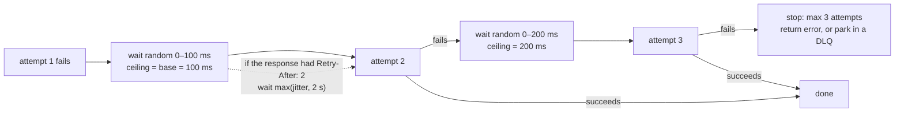
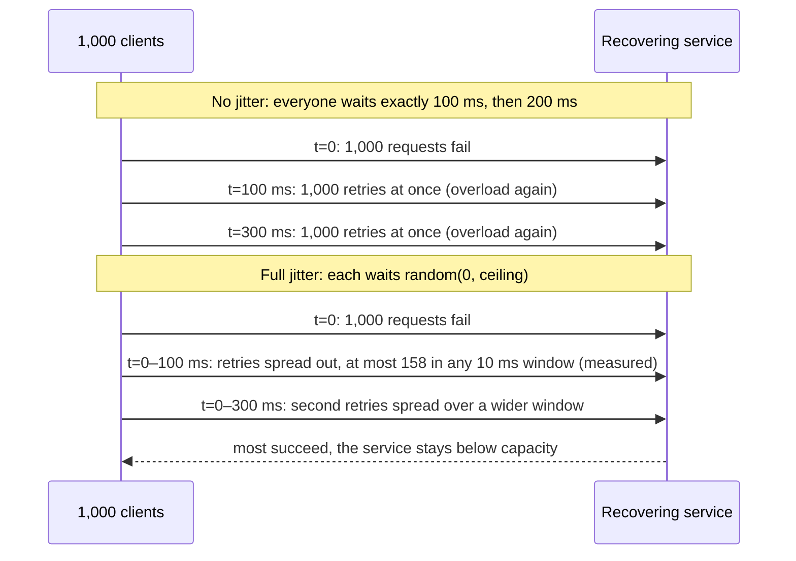

# Timeouts, Retries and Backoff

> [!summary] TL;DR
> A **timeout** is how long you wait for a remote call before giving up. A **retry** sends the call again after a transient failure, and **backoff** makes each wait longer than the last, with random **jitter** so that thousands of clients do not retry at the same instant.

> [!abstract] Core idea
> - Put a timeout on every network call; without one, a hung dependency hangs you.
> - Retry only transient errors (503, timeouts, resets) and only idempotent operations.
> - Wait `random(0, min(cap, base × 2^n))` before retry `n`: capped exponential backoff with full jitter.
> - Limit retries per request (about 3 attempts) and per client (a budget of about 10% extra load), and retry at one layer only.
> - Classic mistake: immediate retries in every layer, which multiply load on an already failing service.

## 1. Why it exists

Most failures between services are short: a pod restarting, a dropped packet, a leader election that takes a second. Retrying a moment later usually succeeds. But two naive habits turn short failures into outages.

**No timeout.** Go's `http.DefaultClient` has no timeout. If a dependency accepts the connection and never answers, every goroutine that calls it waits forever. At 500 requests per second, 30 s of hanging means 15,000 stuck goroutines, each holding a connection and memory (Little's Law: in flight = rate × wait; see [[Bulkheads and Concurrency Limits]]).

**Naive retries.** Suppose a database blips for 2 s and 1,000 clients each make 3 attempts with no wait in between. The database receives 1,000 requests, then another 1,000 at the same moment, then another 1,000: it sees three synchronized waves at the exact moment it is weakest. Now add layers. If the browser, the API gateway and the backend service each make 3 attempts, one user click becomes up to `3 × 3 × 3 = 27` calls to the bottom service.

**Measured in this note's test** (`TestJitterSpreadsAStorm`, seeded PCG random, 1,000 clients, 3 retries each, 100 ms base): without jitter the busiest 10 ms window receives **1,000** retries; with full jitter the busiest window receives **158**.

## 2. Mental model

Think of a crowded shop whose door jams for a minute.

- **Timeout:** each customer decides how long they will stand at the door before leaving. Without a limit, the queue outside grows without end.
- **Retry without backoff:** everyone pushes the door again every second. The crowd at the door never thins.
- **Exponential backoff:** each customer waits 1 minute, then 2, then 4 before trying again.
- **Jitter:** each customer picks a random time within that wait, so they come back one by one, not as a crowd.
- **Retry budget:** the shop lets only a few people re-try at once; the rest are told to come back later.

## 3. How it works

### Step 1: timeouts everywhere, as a budget

A timeout bounds one attempt. A **deadline** bounds the whole user request, and is passed down so that every hop knows how much time is left. In Go the deadline lives in the `context.Context`; in gRPC it travels in the `grpc-timeout` header, and the server's handler receives a context that expires at the same moment as the caller's.

Layers of timeouts on a Go HTTP client:

| Setting | Bounds | Typical value (estimate, tune per dependency) |
| --- | --- | --- |
| `net.Dialer.Timeout` | TCP connect | 100–500 ms inside a region |
| `http.Transport.TLSHandshakeTimeout` | TLS handshake | 500 ms–1 s |
| `http.Transport.ResponseHeaderTimeout` | Waiting for response headers after sending the request | about p99.9 of the dependency |
| `http.Client.Timeout` | The whole exchange, including reading the body | per-attempt budget |
| `context.WithTimeout` | Everything done with that context, across retries | the user-facing deadline |

On the server side, `http.Server` has `ReadHeaderTimeout`, `ReadTimeout`, `WriteTimeout` and `IdleTimeout`. All default to zero, which means no limit; a server without `ReadHeaderTimeout` can be held open by slow clients (Slowloris).

### Step 2: decide whether the error is retryable

Retry when the failure is **transient** and the operation is **idempotent** (repeating it has the same effect as doing it once). A non-idempotent POST is retryable only if it carries an idempotency key that the server deduplicates ([[Idempotency and Idempotency Keys]]).

| Retry | Do not retry |
| --- | --- |
| Connection refused or reset, DNS timeout | 400 Bad Request, 422 validation errors |
| 408 Request Timeout | 401 Unauthorized, 403 Forbidden |
| 429 Too Many Requests: honour `Retry-After` | 404 Not Found, 409 Conflict (business conflict) |
| 500, 502, 503, 504 on idempotent requests | 501 Not Implemented |
| gRPC `UNAVAILABLE`, and `RESOURCE_EXHAUSTED` with pushback | Invalid password, card declined, insufficient funds |
| Per-attempt timeout, when the overall deadline still has room | The caller's own deadline expired (`DEADLINE_EXCEEDED` on the outer context) |

Two subtleties:

- **408 and 429 are 4xx but retryable.** 429 means "you are sending too fast"; retry after the time in `Retry-After`, never sooner. See [[Rate Limiting - Algorithms and Distributed Design]].
- **gRPC `DEADLINE_EXCEEDED` is ambiguous.** The server may have done the work, and if the deadline was the caller's overall budget, there is no time left to retry. Retry it only for idempotent calls, with a per-attempt timeout shorter than the overall deadline.

### Step 3: back off, with jitter

Let `base` be the first wait and `cap` the longest. For retry number `n` (starting at 0) the **ceiling** is `min(cap, base × 2^n)`. Brooker's AWS article compares three ways to pick the actual wait:

- **Full jitter:** `sleep = random(0, ceiling)`.
- **Equal jitter:** `sleep = ceiling/2 + random(0, ceiling/2)`.
- **Decorrelated jitter:** `sleep = min(cap, random(base, previous_sleep × 3))`.

In his simulation, full and decorrelated jitter finished the same work with far fewer total calls than no jitter, and full jitter was the simplest of the good options, which is why it is the usual default. Equal jitter keeps a guaranteed minimum wait at the cost of more clustering.



Why jitter matters, shown as two timelines for the same outage:



### Step 4: bound the total

- **Per request:** a maximum number of attempts (3 is common; gRPC caps `maxAttempts` at 5) and the overall deadline.
- **Per client:** a **retry budget**. The Google SRE book recommends keeping retries below about 10% of requests per client, so that a total outage adds at most 10% load rather than tripling it. gRPC's retry throttling does this with a token bucket.
- **Per system:** retry at one layer only, usually the one closest to the failing dependency, or at the edge where the user can be told. Inner layers fail fast and return a clear error.

## 4. Worked example

### Whiteboard version

The essentials in about 20 lines: capped exponential backoff, full jitter, a cancellable sleep, and no sleep after the last attempt. Randomness is passed in so tests can fix it.

```go
package wbretry

import (
	"context"
	"math/rand/v2"
	"time"
)

// Retry calls op up to 3 times with capped exponential backoff and full jitter.
func Retry(ctx context.Context, r *rand.Rand, op func(context.Context) error) error {
	base, ceiling := 100*time.Millisecond, 2*time.Second
	var err error
	for attempt := 0; attempt < 3; attempt++ {
		if err = op(ctx); err == nil {
			return nil
		}
		if attempt == 2 {
			break // no sleep after the last attempt
		}
		backoff := min(ceiling, base<<attempt)               // 100 ms, 200 ms, 400 ms ...
		sleep := time.Duration(r.Int64N(int64(backoff) + 1)) // full jitter: [0, backoff]
		select {
		case <-time.After(sleep):
		case <-ctx.Done():
			return ctx.Err()
		}
	}
	return err
}
```

### A deadline budget, traced

A user request to `POST /checkout` has a 1 s deadline at the gateway. The checkout service calls payments, whose p99.9 latency is 250 ms (estimate for this example).

| Time | Event | Remaining budget |
| --- | --- | --- |
| 0 ms | Gateway sets deadline = now + 1,000 ms, passes it in the context | 1,000 ms |
| 20 ms | Checkout starts attempt 1 with a 300 ms per-attempt timeout | 980 ms |
| 320 ms | Attempt 1 times out; outcome unknown, but the request carries idempotency key `chk-9f2` | 680 ms |
| 320 ms | Retry 0: full jitter picks 64 ms out of the 0–100 ms range | 680 ms |
| 384 ms | Attempt 2 starts with a 300 ms timeout | 616 ms |
| 520 ms | Payments answers 200 OK (deduplicated by key if attempt 1 had landed) | 480 ms |
| 540 ms | Checkout replies to the gateway | 460 ms |

If attempt 2 had also timed out at 684 ms, a third attempt would need up to 200 ms of backoff plus 300 ms, which overruns the remaining 316 ms. The code below makes the simpler check: it returns the error instead of sleeping when the chosen backoff alone would outlive the deadline. A stricter version would also reserve time for the next attempt (backoff + per-attempt timeout ≤ remaining).

### Production version

`Do` adds what the whiteboard version leaves out:

- a `Policy` with base, cap and attempts, and all three jitter formulas;
- `Permanent(err)` to stop on errors that retrying cannot fix;
- `RetryAfterError`, so a server's `Retry-After` is respected;
- a `Budget` in which every request earns 0.1 tokens and every retry spends 1;
- a deadline check before sleeping;
- an injected `Sleeper` and `*rand.Rand`, so tests run instantly and give the same result every time.

```go
// Package retry runs an operation again after transient failures, with
// capped exponential backoff, full jitter, Retry-After and a retry budget.
package retry

import (
	"context"
	"errors"
	"math/rand/v2"
	"net/http"
	"strconv"
	"sync"
	"time"
)

// Policy bounds how often and how long we retry.
type Policy struct {
	Base        time.Duration // first backoff ceiling, e.g. 100 ms
	Cap         time.Duration // largest backoff ceiling, e.g. 5 s
	MaxAttempts int           // total attempts including the first, e.g. 3
}

// ceiling returns min(Cap, Base*2^n) without overflowing.
func (p Policy) ceiling(n int) time.Duration {
	d := p.Base
	for i := 0; i < n && d < p.Cap; i++ {
		d *= 2
	}
	return min(d, p.Cap)
}

// FullJitter returns a delay uniformly drawn from [0, min(Cap, Base*2^n)],
// where n is the retry number starting at 0.
func (p Policy) FullJitter(n int, r *rand.Rand) time.Duration {
	return time.Duration(r.Int64N(int64(p.ceiling(n)) + 1))
}

// EqualJitter keeps half the ceiling and randomises the other half.
func (p Policy) EqualJitter(n int, r *rand.Rand) time.Duration {
	half := p.ceiling(n) / 2
	return half + time.Duration(r.Int64N(int64(half)+1))
}

// Decorrelated returns min(Cap, random in [Base, prev*3]).
// Pass prev = Base for the first retry.
func (p Policy) Decorrelated(prev time.Duration, r *rand.Rand) time.Duration {
	hi := max(prev*3, p.Base)
	d := p.Base + time.Duration(r.Int64N(int64(hi-p.Base)+1))
	return min(d, p.Cap)
}

// permanentError marks an error that retrying cannot fix.
type permanentError struct{ err error }

func (e permanentError) Error() string { return e.err.Error() }
func (e permanentError) Unwrap() error { return e.err }

// Permanent wraps err so that Do stops at once.
func Permanent(err error) error { return permanentError{err} }

// RetryAfterError carries the server's Retry-After hint.
type RetryAfterError struct {
	Err   error
	After time.Duration
}

func (e *RetryAfterError) Error() string { return e.Err.Error() }
func (e *RetryAfterError) Unwrap() error { return e.Err }

// RetryableStatus reports whether an HTTP status is worth retrying
// for an idempotent request.
func RetryableStatus(code int) bool {
	switch code {
	case http.StatusRequestTimeout, http.StatusTooManyRequests,
		http.StatusInternalServerError, http.StatusBadGateway,
		http.StatusServiceUnavailable, http.StatusGatewayTimeout:
		return true
	}
	return false
}

// ParseRetryAfter reads a Retry-After value: delay-seconds or an HTTP-date.
func ParseRetryAfter(v string, now time.Time) (time.Duration, bool) {
	if s, err := strconv.Atoi(v); err == nil && s >= 0 {
		return time.Duration(s) * time.Second, true
	}
	if t, err := http.ParseTime(v); err == nil {
		return max(t.Sub(now), 0), true
	}
	return 0, false
}

// Budget allows retries only while they stay below a fraction of requests.
// Every request earns `ratio` tokens; every retry spends one token.
type Budget struct {
	mu     sync.Mutex
	ratio  float64
	tokens float64
	max    float64
}

// NewBudget with ratio 0.1 allows about one retry per ten requests.
func NewBudget(ratio, maxTokens float64) *Budget {
	return &Budget{ratio: ratio, tokens: maxTokens, max: maxTokens}
}

func (b *Budget) onRequest() {
	b.mu.Lock()
	b.tokens = min(b.tokens+b.ratio, b.max)
	b.mu.Unlock()
}

func (b *Budget) allowRetry() bool {
	b.mu.Lock()
	defer b.mu.Unlock()
	if b.tokens < 1 {
		return false
	}
	b.tokens--
	return true
}

// Sleeper waits for d or until ctx is done. Tests pass a fake.
type Sleeper func(ctx context.Context, d time.Duration) error

// RealSleep is the production Sleeper.
func RealSleep(ctx context.Context, d time.Duration) error {
	t := time.NewTimer(d)
	defer t.Stop()
	select {
	case <-t.C:
		return nil
	case <-ctx.Done():
		return ctx.Err()
	}
}

// ErrBudgetExhausted means the retry budget refused another attempt.
var ErrBudgetExhausted = errors.New("retry budget exhausted")

// Do calls op until it succeeds, fails permanently, runs out of attempts
// or budget, or ctx ends. It returns the number of attempts made.
func Do(ctx context.Context, p Policy, b *Budget, r *rand.Rand, sleep Sleeper,
	op func(context.Context) error) (int, error) {
	if b != nil {
		b.onRequest()
	}
	var err error
	for attempt := 1; ; attempt++ {
		if err = op(ctx); err == nil {
			return attempt, nil
		}
		var perm permanentError
		if errors.As(err, &perm) || ctx.Err() != nil || attempt >= p.MaxAttempts {
			return attempt, err
		}
		if b != nil && !b.allowRetry() {
			return attempt, errors.Join(ErrBudgetExhausted, err)
		}
		delay := p.FullJitter(attempt-1, r)
		var ra *RetryAfterError
		if errors.As(err, &ra) {
			delay = max(delay, ra.After) // never come back sooner than asked
		}
		if deadline, ok := ctx.Deadline(); ok && time.Until(deadline) < delay {
			return attempt, err // the wait would outlive the caller's deadline
		}
		if serr := sleep(ctx, delay); serr != nil {
			return attempt, errors.Join(serr, err)
		}
	}
}
```

The tests check the backoff ceilings, the three jitter ranges, when `Do` stops, `Retry-After`, the deadline check and the budget, and they measure how jitter spreads a storm:

```go
package retry

import (
	"context"
	"errors"
	"math/rand/v2"
	"sync"
	"testing"
	"time"
)

var errTransient = errors.New("503 service unavailable")

func newRand() *rand.Rand { return rand.New(rand.NewPCG(1, 2)) }

// fakeSleep records delays instead of waiting.
type fakeSleep struct{ delays []time.Duration }

func (f *fakeSleep) sleep(_ context.Context, d time.Duration) error {
	f.delays = append(f.delays, d)
	return nil
}

func TestCeilingDoublesThenCaps(t *testing.T) {
	p := Policy{Base: 100 * time.Millisecond, Cap: time.Second}
	want := []time.Duration{100, 200, 400, 800, 1000, 1000}
	for n, w := range want {
		if got := p.ceiling(n); got != w*time.Millisecond {
			t.Errorf("ceiling(%d) = %v, want %v", n, got, w*time.Millisecond)
		}
	}
	if got := p.ceiling(200); got != time.Second { // no overflow
		t.Errorf("ceiling(200) = %v", got)
	}
}

func TestJitterRanges(t *testing.T) {
	p := Policy{Base: 100 * time.Millisecond, Cap: time.Second}
	r := newRand()
	for i := 0; i < 1000; i++ {
		n := i % 6
		c := p.ceiling(n)
		if d := p.FullJitter(n, r); d < 0 || d > c {
			t.Fatalf("full jitter %v outside [0,%v]", d, c)
		}
		if d := p.EqualJitter(n, r); d < c/2 || d > c {
			t.Fatalf("equal jitter %v outside [%v,%v]", d, c/2, c)
		}
	}
	prev := p.Base
	for i := 0; i < 1000; i++ {
		d := p.Decorrelated(prev, r)
		if d < p.Base || d > p.Cap || d > max(prev*3, p.Base) {
			t.Fatalf("decorrelated %v from prev %v out of range", d, prev)
		}
		prev = d
	}
}

func TestRetriesTransientThenSucceeds(t *testing.T) {
	p := Policy{Base: 100 * time.Millisecond, Cap: time.Second, MaxAttempts: 4}
	fs := &fakeSleep{}
	calls := 0
	n, err := Do(context.Background(), p, nil, newRand(), fs.sleep, func(context.Context) error {
		calls++
		if calls < 3 {
			return errTransient
		}
		return nil
	})
	if err != nil || n != 3 || len(fs.delays) != 2 {
		t.Fatalf("n=%d err=%v delays=%v", n, err, fs.delays)
	}
	for i, d := range fs.delays {
		if d > p.ceiling(i) {
			t.Errorf("delay %d = %v above ceiling %v", i, d, p.ceiling(i))
		}
	}
}

func TestStopsAtMaxAttempts(t *testing.T) {
	p := Policy{Base: time.Millisecond, Cap: time.Second, MaxAttempts: 3}
	fs := &fakeSleep{}
	n, err := Do(context.Background(), p, nil, newRand(), fs.sleep,
		func(context.Context) error { return errTransient })
	if n != 3 || !errors.Is(err, errTransient) || len(fs.delays) != 2 {
		t.Fatalf("n=%d err=%v delays=%d", n, err, len(fs.delays))
	}
}

func TestPermanentErrorIsNotRetried(t *testing.T) {
	p := Policy{Base: time.Millisecond, Cap: time.Second, MaxAttempts: 5}
	errBad := errors.New("400 bad request")
	n, err := Do(context.Background(), p, nil, newRand(), (&fakeSleep{}).sleep,
		func(context.Context) error { return Permanent(errBad) })
	if n != 1 || !errors.Is(err, errBad) {
		t.Fatalf("n=%d err=%v", n, err)
	}
}

func TestRetryAfterIsHonoured(t *testing.T) {
	p := Policy{Base: 10 * time.Millisecond, Cap: 100 * time.Millisecond, MaxAttempts: 2}
	fs := &fakeSleep{}
	_, _ = Do(context.Background(), p, nil, newRand(), fs.sleep, func(context.Context) error {
		return &RetryAfterError{Err: errTransient, After: 2 * time.Second}
	})
	if len(fs.delays) != 1 || fs.delays[0] != 2*time.Second {
		t.Fatalf("delays = %v, want [2s]", fs.delays)
	}
}

func TestDoesNotSleepPastDeadline(t *testing.T) {
	p := Policy{Base: time.Hour, Cap: time.Hour, MaxAttempts: 5}
	ctx, cancel := context.WithTimeout(context.Background(), time.Minute)
	defer cancel()
	fs := &fakeSleep{}
	r := rand.New(rand.NewPCG(7, 7))
	n, err := Do(ctx, p, nil, r, fs.sleep, func(context.Context) error { return errTransient })
	// Seed 7 draws a first delay longer than the 1 min left, so Do gives up at once.
	if n != 1 || len(fs.delays) != 0 || !errors.Is(err, errTransient) {
		t.Fatalf("n=%d delays=%v err=%v", n, fs.delays, err)
	}
}

func TestBudgetCapsRetryRatio(t *testing.T) {
	p := Policy{Base: time.Millisecond, Cap: time.Millisecond, MaxAttempts: 3}
	b := NewBudget(0.1, 10) // starts full: 10 tokens
	fs := &fakeSleep{}
	retries := 0
	for i := 0; i < 1000; i++ { // the dependency is down for 1,000 requests
		n, _ := Do(context.Background(), p, b, newRand(), fs.sleep,
			func(context.Context) error { return errTransient })
		retries += n - 1
	}
	// 10 starting tokens + 0.1 per request => about 110 retries, not 2,000.
	t.Logf("retries with budget: %d", retries)
	if retries < 100 || retries > 120 {
		t.Fatalf("retries = %d, want about 110", retries)
	}
}

func TestBudgetConcurrent(t *testing.T) {
	b := NewBudget(0.1, 10)
	var wg sync.WaitGroup
	for i := 0; i < 8; i++ {
		wg.Add(1)
		go func() {
			defer wg.Done()
			for j := 0; j < 100; j++ {
				b.onRequest()
				b.allowRetry()
			}
		}()
	}
	wg.Wait()
}

func TestRetryableStatus(t *testing.T) {
	for _, c := range []int{408, 429, 500, 502, 503, 504} {
		if !RetryableStatus(c) {
			t.Errorf("%d should be retryable", c)
		}
	}
	for _, c := range []int{400, 401, 403, 404, 409, 422, 501} {
		if RetryableStatus(c) {
			t.Errorf("%d should not be retryable", c)
		}
	}
}

func TestParseRetryAfter(t *testing.T) {
	now := time.Date(2026, 11, 4, 10, 0, 0, 0, time.UTC)
	if d, ok := ParseRetryAfter("120", now); !ok || d != 2*time.Minute {
		t.Fatalf("seconds form: %v %v", d, ok)
	}
	if d, ok := ParseRetryAfter("Wed, 04 Nov 2026 10:00:30 GMT", now); !ok || d != 30*time.Second {
		t.Fatalf("date form: %v %v", d, ok)
	}
	if _, ok := ParseRetryAfter("soon", now); ok {
		t.Fatal("garbage accepted")
	}
}

func TestRealSleepStopsOnCancel(t *testing.T) {
	ctx, cancel := context.WithCancel(context.Background())
	cancel()
	if err := RealSleep(ctx, time.Hour); !errors.Is(err, context.Canceled) {
		t.Fatal(err)
	}
}

// TestJitterSpreadsAStorm: 1,000 clients fail at t=0 and retry 3 times.
// It counts the busiest 10 ms window the server sees.
func TestJitterSpreadsAStorm(t *testing.T) {
	p := Policy{Base: 100 * time.Millisecond, Cap: 2 * time.Second}
	peak := func(jitter bool) int {
		r := newRand()
		buckets := map[time.Duration]int{}
		for c := 0; c < 1000; c++ {
			at := time.Duration(0)
			for n := 0; n < 3; n++ {
				d := p.ceiling(n)
				if jitter {
					d = p.FullJitter(n, r)
				}
				at += d
				buckets[at/(10*time.Millisecond)]++
			}
		}
		m := 0
		for _, v := range buckets {
			m = max(m, v)
		}
		return m
	}
	noJitter, full := peak(false), peak(true)
	t.Logf("busiest 10 ms window: no jitter %d, full jitter %d", noJitter, full)
	if noJitter != 1000 || full > 200 {
		t.Fatalf("no jitter %d, full jitter %d", noJitter, full)
	}
}
```

```bash
go vet ./... && go test -race ./retry
go test -run 'Storm|Budget' -v ./retry
# prints: retries with budget: 109
# prints: busiest 10 ms window: no jitter 1000, full jitter 158
```

What `TestBudgetCapsRetryRatio` shows: with the dependency fully down for 1,000 requests and up to 3 attempts each, a client without a budget would send 3,000 calls. With a 10% budget and 10 starting tokens it sends 1,109 (1,000 first attempts plus 109 retries, measured by the test's log line `retries with budget: 109`).

The example policy from the old notes, corrected:

```yaml
max_attempts: 3          # including the first
base_delay: 100ms
max_delay: 2s
backoff: exponential     # ceiling = min(2s, 100ms * 2^n)
jitter: full             # sleep = random(0, ceiling); additive "+0-500ms" barely spreads multi-second waits
retry_on: [connect_error, reset, 408, 429, 500, 502, 503, 504, grpc UNAVAILABLE]
honour_retry_after: true # never retry sooner than the server asked
retry_budget: 10%        # per client
idempotent_only: true    # or the request carries an idempotency key
```

## 5. Variants and comparison

| Strategy | How it works | Use when | Cost |
| --- | --- | --- | --- |
| No retry, fail fast | Return the error at once | Inner layers of a deep call chain; non-idempotent calls without keys | Users see every transient blip |
| Fixed delay | Wait the same time each try | Rarely: background jobs against a slow but stable system | Synchronized waves after an outage |
| Exponential, no jitter | Ceiling doubles; everyone waits the same | Single client, nothing else retrying | Clients that failed together retry together |
| Exponential + full jitter | `random(0, ceiling)` | The default for clients of shared services | Some retries come back very early |
| Exponential + equal jitter | `ceiling/2 + random(0, ceiling/2)` | You need a minimum wait | More clustering than full jitter |
| Decorrelated jitter | `min(cap, random(base, prev × 3))` | Long-running retry loops | Slightly more state (previous sleep) |
| Hedged request | Send a second copy if the first is slower than about p95; take the first answer | Idempotent reads with long tails | Extra load (a few percent if the hedge is delayed to p95) |
| Queue-based retry | Message goes back to a queue with a delay (SQS visibility timeout, Kafka retry topics), then a DLQ | Async work that can wait minutes | Ordering is lost; needs idempotent consumers |

## 6. Trade-offs and when not to use

- **Retries add load exactly when the dependency is weakest.** A retry budget or a [[10 Distributed Systems & Resilience/Circuit Breaker|Circuit Breaker]] must cap them.
- **Retries add latency.** Each attempt plus backoff eats the user's deadline. For interactive calls, often 1 retry is right; for background jobs, many slow retries via a queue are fine.
- **Do not retry non-idempotent operations** without an idempotency key. A retried "transfer ₹500" without a key can move ₹1,000.
- **Do not retry in every layer.** Pick one layer; the others fail fast.
- **Do not retry overload signals blindly.** A 503 with `Retry-After` or a 429 means "come back later", not "come back now".
- **Timeouts that are too short** cause their own failures: if the timeout is below the dependency's normal p99, 1% of healthy calls fail and get retried, adding load for nothing.
- **Hedging doubles work** if done naively (hedge at once); delay the hedge until about p95 latency and cancel the loser.

## 7. In production

- **Real systems:**
	- gRPC's service config supports `retryPolicy` (maxAttempts, initialBackoff, maxBackoff, backoffMultiplier, retryableStatusCodes), `hedgingPolicy`, and retry throttling with a token bucket. Servers can push back with the `grpc-retry-pushback-ms` trailer.
	- AWS SDKs in "standard" retry mode default to 3 attempts, use exponential backoff with jitter (maximum backoff 20 s), and stop retrying when a client-side retry quota runs out.
	- Envoy and Istio retry policies (`retry_on: 5xx,reset,connect-failure`, `num_retries`, per-try timeout) move retries into the mesh. Then the application must not also retry.
	- Message queues: SQS redelivers after the visibility timeout and moves a message to a DLQ after `maxReceiveCount`; Kafka consumers use delayed retry topics and a DLQ ([[Dead Letter Queues and Poison Messages]]).
- **Failure modes → fixes:**
	- Retry storm after an outage → full jitter plus a retry budget.
	- 27× amplification through layers → retry at one layer; inner services fail fast.
	- Duplicate charges or emails after a timeout → idempotency keys, deduplication on the server.
	- Requests still running after the user left → propagate the context deadline; check `ctx.Err()` before expensive work.
	- Retry loop ignores `Retry-After` and gets banned → parse and honour it.
	- Metastable overload (the retries alone keep the service down) → budget, breaker, and server-side load shedding ([[Load Shedding and Graceful Degradation]]).
- **What to monitor:**
	- Retry rate (retries ÷ requests) per dependency; alert when it approaches the budget.
	- Attempts per successful call (1.0 when healthy).
	- Timeout rate per dependency, separate from error rate.
	- Budget-exhausted count and time spent in backoff.
	- Latency of first attempts versus retried requests.

## 8. Deep dive

- **Choosing a timeout from data.** Start from the dependency's latency distribution under normal load: a per-attempt timeout a little above p99.9 rarely cuts off healthy calls. Then check it fits the budget: `attempts × timeout + total backoff ≤ caller's deadline − own work`. Re-measure after the dependency changes.
- **Deadline propagation versus fixed timeouts.** Fixed per-hop timeouts can add up to more than the user waits: a gateway giving up at 1 s while the service below still waits 5 s on a database wastes 4 s of work. Passing the deadline down (gRPC does it automatically; with HTTP you send a header such as a remaining-time value and rebuild the context) lets every layer stop together. `context.WithoutCancel` (Go 1.21+) is the escape hatch for work that must finish after the caller leaves, such as writing an audit record.
- **Why full jitter wins.** With no jitter, clients that failed together stay synchronized forever, because they follow the same schedule. Additive jitter (`+random(0, 500 ms)`) barely helps once delays reach several seconds, since 500 ms is a small fraction of the wait. Full jitter spreads each wave over the whole window `[0, ceiling]`, so the arrival rate drops by the window's width.
- **Retry budgets versus attempt limits.** "3 attempts" alone still allows 3× load during a total outage. A ratio budget (retries ≤ 10% of requests) bounds the extra load to 1.1×, whatever the outage looks like. gRPC throttling disables retries when the token count falls below half of `maxTokens`, and refills by `tokenRatio` per success.
- **Hedged and tied requests.** *The Tail at Scale* reports that, in a Google BigTable benchmark reading 1,000 keys spread over 100 servers, sending a hedge after 10 ms cut 99.9th-percentile latency from 1,800 ms to 74 ms while adding only 2% more requests. Tied requests go further: both copies are queued and the server that starts first cancels the other.
- **Retries and circuit breakers together.** Order them so the breaker sees every attempt and the retry loop stops when the breaker is open: `retry(breaker(timeout(call)))`. Treat `ErrOpen` as permanent in the retry loop. See [[10 Distributed Systems & Resilience/Circuit Breaker|Circuit Breaker]].
- **Server-side cooperation.** The server can reject early with 503 + `Retry-After` when overloaded, return a distinct "do not retry" error for overload deep in the stack (the SRE book's pattern), and deduplicate by idempotency key. Client politeness and server protection are two halves of one design.

## 9. Interview questions

> [!question]- Why exponential backoff with jitter rather than a fixed delay?
> A fixed delay keeps clients that failed together in step, so they hit the recovering service in synchronized waves. Exponential backoff reduces the rate of retries over time, and jitter spreads each wave over a window. Full jitter, `random(0, min(cap, base·2^n))`, is the usual default.

> [!question]- Which errors do you retry, and which do you not?
> Retry transient ones: resets, connect failures, 408, 429 (after `Retry-After`), 500/502/503/504 and gRPC `UNAVAILABLE`, on idempotent operations or requests with idempotency keys. Do not retry validation errors, auth failures, 404, business conflicts, or anything after the caller's own deadline has passed.

> [!question]- Trap: "Our POST /payments retries 3 times on timeout. That makes it reliable." What's wrong?
> A timeout does not mean the payment failed; it may have gone through. Retrying without an idempotency key can charge the customer several times. Add a key that the server deduplicates, or query the payment status by key before retrying.

> [!question]- Three services in a chain each retry 3 times. What happens when the last one fails?
> The bottom service receives up to `3 × 3 × 3 = 27` attempts per user request, making the outage worse. Retry at one layer only, make the others fail fast, and add a per-client retry budget.

> [!question]- What is a retry budget, and why is "max 3 attempts" not enough?
> A budget caps retries as a fraction of requests per client, for example 10%. With only "max 3 attempts", a total outage triples the load. With a 10% budget, it adds at most 10%. gRPC's retry throttling and the AWS SDK retry quota both implement this idea.

> [!question]- How do deadlines differ from timeouts, and how do you propagate them in Go?
> A timeout bounds one wait; a deadline is an absolute time for the whole request. In Go, create it once with `context.WithTimeout` at the edge and pass the context to every call. gRPC sends the remaining time to the server, which receives a context with the same deadline. Before retrying, check that the remaining time can fit another attempt.

> [!question]- What are hedged requests and when are they safe?
> After waiting about the p95 latency, send a second copy of the request to another replica and use whichever answers first, cancelling the other. They cut tail latency for idempotent reads at the cost of a few percent extra load. Never hedge non-idempotent writes.

## 10. Cheat sheet

- Timeout on every remote call; Go's default HTTP client has none.
- One deadline per user request, created at the edge and passed down in `context`.
- Retry only transient errors on idempotent operations (or with idempotency keys); 408 and 429 are retryable.
- `sleep = random(0, min(cap, base·2^n))` (full jitter); honour `Retry-After`.
- Max about 3 attempts, a retry budget of about 10%, retries at one layer only.
- Never sleep past the deadline; stop when the breaker is open.
- Monitor retry ratio, attempts per success and timeout rate per dependency.

## Links

- **Before this:** [[Distributed Systems Fundamentals]], [[Context Package]], [[Idempotency and Idempotency Keys]]
- **Next:** [[10 Distributed Systems & Resilience/Circuit Breaker|Circuit Breaker]], [[Bulkheads and Concurrency Limits]], [[Load Shedding and Graceful Degradation]]
- **Compare with:** [[Rate Limiting - Algorithms and Distributed Design]] (the server side of 429), [[Dead Letter Queues and Poison Messages]] (retries for queued work), [[Calling External APIs]] (Go client setup), [[gRPC]] (retry and hedging policies)
