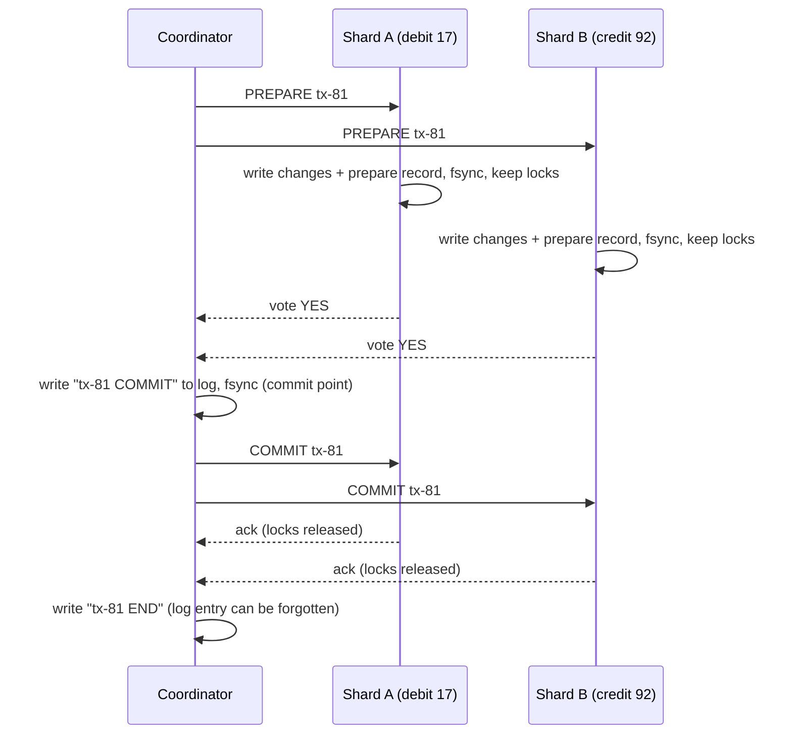
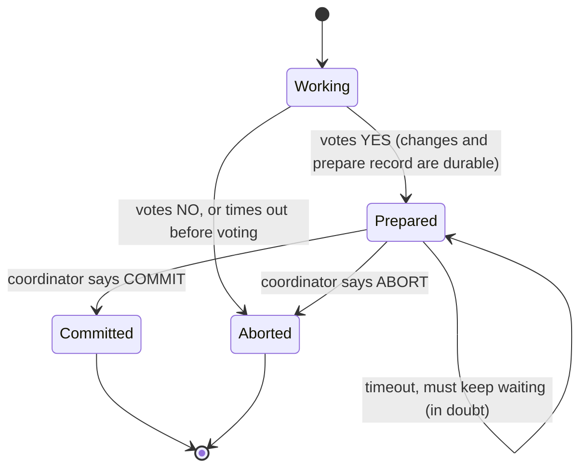

# Two-Phase Commit

> [!summary] TL;DR
> **Two-phase commit (2PC)** makes a transaction that touches several databases either commit everywhere or nowhere. A **coordinator** first asks every participant "can you commit?" (prepare), and only if all say yes does it tell them all to commit. Its weakness: if the coordinator crashes after participants said yes, they must wait, holding locks, until it comes back.

> [!abstract] Core idea
> - Phase 1 (prepare): each participant makes its changes durable and votes yes or no. A yes is a binding promise.
> - Phase 2 (commit or abort): the coordinator logs the decision durably, then tells everyone. One "no" aborts all.
> - Writing the decision to the coordinator's log is the **commit point**; after that the outcome cannot change.
> - A participant that voted yes is **in doubt** and cannot decide alone: 2PC is a **blocking** protocol.
> - Classic mistake: thinking 2PC is a consensus algorithm. It needs *every* participant, not a majority, and stalls when the coordinator is down.

## 1. Why it exists

An order moves money between two shards: debit account 17 on shard A, credit account 92 on shard B. Each shard has its own local transactions. Commit A first and crash before B, and money disappears; commit B first and crash before A, and money is created. Local transactions cannot fix this because no single database sees both writes.

**Atomic commit** is the requirement: all participants commit, or all abort, even if some crash in the middle. 2PC (Gray, 1978) is the standard protocol for it inside databases that span several nodes or several resource managers (a database plus a message queue, for example).

## 2. Mental model

**A wedding ceremony.** The officiant (coordinator) asks each partner "do you?" (prepare). Each may say no. Once both have said "I do", neither can walk away alone; only the officiant's pronouncement (the decision, recorded in the register) makes it final. If the officiant faints right after both said yes, the couple is in limbo: neither knows whether they are married until the officiant wakes up and reads the register.

**Terms:**

- **Coordinator (transaction manager):** drives the protocol and keeps the decision log.
- **Participant (resource manager):** a database or queue that holds part of the transaction.
- **Prepared / in doubt:** a participant that voted yes and has not yet heard the outcome.
- **Commit point:** the moment the coordinator durably records "commit".

## 3. How it works



**Phase 1, prepare.**
1. The coordinator sends `PREPARE` to every participant.
2. Each participant checks constraints, writes all changes and a *prepare record* to its log, fsyncs, and keeps its row locks. Then it votes **yes**. If anything fails it votes **no** and aborts locally.

**Phase 2, decide.**
1. All yes → the coordinator fsyncs `COMMIT` to its log. Any no or timeout → it records `ABORT` (with presumed abort it need not even write it).
2. It sends the decision to every participant and **retries until each acknowledges**. Participants apply it and release locks. Commit and abort messages must be idempotent because they are retried.

### Participant states



The self-loop on `Prepared` is the whole problem with 2PC. A participant that voted yes cannot abort on its own, because the coordinator may already have logged COMMIT and told another participant, which committed. It cannot commit on its own either, because another participant may have voted no. It can only wait, or ask other participants whether any of them has learned the outcome.

### Recovery rules

- **Coordinator restarts:** for each transaction in its log, resend the logged decision. A transaction with no decision record is aborted (**presumed abort**).
- **Participant restarts:** for each prepared transaction in its log, ask the coordinator for the outcome. Until it gets one, the transaction stays prepared and its locks stay held, even across the restart.

## 4. Worked example

### Whiteboard version

```text
coordinator(tx, participants):
    votes = [p.prepare(tx) for p in participants]    # parallel
    d = COMMIT if all(votes) else ABORT
    log.fsync(tx, d)                                 # commit point
    for p in participants: retry p.finish(tx, d) until ack

participant.prepare(tx):  persist changes + prepare record; keep locks; return yes/no
participant.on_timeout(): if Working: abort  |  if Prepared: wait (in doubt)
coordinator.recover(tx):  d = log.read(tx) or ABORT; resend d to everyone
```

### Go simulation

The simulation keeps the protocol and drops the networking: participants vote in parallel, the coordinator logs the decision before phase 2, and a `crashAfterLog` switch reproduces the blocking case. It passes `go vet` and `go test -race` on Go 1.24.

```go
package twopc

import (
	"errors"
	"sync"
)

type Decision int

const (
	None Decision = iota
	Commit
	Abort
)

// State of a participant for one transaction.
type State int

const (
	Working  State = iota // has not voted yet; may abort on its own
	Prepared              // voted yes; must wait for the coordinator (in doubt)
	Committed
	Aborted
)

var ErrInDoubt = errors.New("participant is prepared and cannot decide alone")

// Participant is one resource manager (a database shard, a queue).
type Participant struct {
	mu      sync.Mutex
	Name    string
	CanDo   bool // whether local checks pass (stock available, constraints ok)
	state   State
	locksOn bool // row locks held from prepare until the outcome arrives
}

// Prepare is phase 1. A yes vote is a promise: the participant has written
// its changes and a prepare record durably and will commit if told to.
func (p *Participant) Prepare() bool {
	p.mu.Lock()
	defer p.mu.Unlock()
	if !p.CanDo {
		p.state = Aborted // a no voter can abort at once
		return false
	}
	p.state, p.locksOn = Prepared, true
	return true
}

// Finish is phase 2. It is idempotent so the coordinator can resend it.
func (p *Participant) Finish(d Decision) {
	p.mu.Lock()
	defer p.mu.Unlock()
	if p.state == Committed || p.state == Aborted {
		return
	}
	if d == Commit {
		p.state = Committed
	} else {
		p.state = Aborted
	}
	p.locksOn = false
}

// TimeoutWithoutDecision is what a participant may do when it hears nothing.
func (p *Participant) TimeoutWithoutDecision() error {
	p.mu.Lock()
	defer p.mu.Unlock()
	if p.state == Prepared {
		return ErrInDoubt // blocked: aborting could contradict a logged commit
	}
	if p.state == Working {
		p.state = Aborted
	}
	return nil
}

func (p *Participant) State() (State, bool) {
	p.mu.Lock()
	defer p.mu.Unlock()
	return p.state, p.locksOn
}

// Log is the coordinator's durable log (fsynced in a real system).
type Log struct {
	mu       sync.Mutex
	decision map[string]Decision
}

func NewLog() *Log { return &Log{decision: map[string]Decision{}} }

func (l *Log) Write(tx string, d Decision) {
	l.mu.Lock()
	l.decision[tx] = d
	l.mu.Unlock()
}

func (l *Log) Read(tx string) Decision {
	l.mu.Lock()
	defer l.mu.Unlock()
	return l.decision[tx]
}

// Coordinator runs the protocol. crashAfterLog simulates the coordinator
// dying after writing the decision but before telling anyone.
type Coordinator struct {
	Log           *Log
	crashAfterLog bool
}

// Run executes 2PC for tx and returns the decision.
func (c *Coordinator) Run(tx string, ps []*Participant) Decision {
	// Phase 1: collect votes in parallel.
	votes := make([]bool, len(ps))
	var wg sync.WaitGroup
	for i, p := range ps {
		wg.Add(1)
		go func() {
			defer wg.Done()
			votes[i] = p.Prepare()
		}()
	}
	wg.Wait()

	d := Commit
	for _, v := range votes {
		if !v {
			d = Abort
		}
	}
	// The commit point: once this record is durable, the outcome is fixed.
	c.Log.Write(tx, d)
	if c.crashAfterLog {
		return d
	}
	// Phase 2: tell everyone (retried until acknowledged in real systems).
	for _, p := range ps {
		p.Finish(d)
	}
	return d
}

// Recover runs after a coordinator restart. Presumed abort: a transaction
// with no decision record is aborted.
func (c *Coordinator) Recover(tx string, ps []*Participant) Decision {
	d := c.Log.Read(tx)
	if d == None {
		d = Abort
		c.Log.Write(tx, d)
	}
	for _, p := range ps {
		p.Finish(d)
	}
	return d
}
```

The tests cover all-yes commit, one-no abort, the coordinator crashing after the commit point (participants stay in doubt with their locks held until recovery), presumed abort, a participant that may abort alone because it never voted, and idempotent phase-2 messages.

```go
package twopc

import (
	"errors"
	"testing"
)

func parts(canDo ...bool) []*Participant {
	names := []string{"orders-db", "inventory-db", "payments-db"}
	var ps []*Participant
	for i, ok := range canDo {
		ps = append(ps, &Participant{Name: names[i], CanDo: ok})
	}
	return ps
}

func TestAllYesCommits(t *testing.T) {
	ps := parts(true, true, true)
	c := &Coordinator{Log: NewLog()}
	if d := c.Run("tx-1", ps); d != Commit {
		t.Fatalf("decision = %v, want Commit", d)
	}
	for _, p := range ps {
		if s, locks := p.State(); s != Committed || locks {
			t.Fatalf("%s: state %v locks %v", p.Name, s, locks)
		}
	}
}

func TestOneNoAbortsEveryone(t *testing.T) {
	ps := parts(true, false, true)
	c := &Coordinator{Log: NewLog()}
	if d := c.Run("tx-2", ps); d != Abort {
		t.Fatalf("decision = %v, want Abort", d)
	}
	for _, p := range ps {
		if s, _ := p.State(); s != Aborted {
			t.Fatalf("%s: state %v, want Aborted", p.Name, s)
		}
	}
}

func TestCoordinatorCrashLeavesParticipantsInDoubt(t *testing.T) {
	ps := parts(true, true, true)
	log := NewLog()
	c := &Coordinator{Log: log, crashAfterLog: true}
	c.Run("tx-3", ps) // decision Commit is logged, nobody is told

	for _, p := range ps {
		if err := p.TimeoutWithoutDecision(); !errors.Is(err, ErrInDoubt) {
			t.Fatalf("%s: err = %v, want ErrInDoubt", p.Name, err)
		}
		if _, locks := p.State(); !locks {
			t.Fatalf("%s should still hold its locks while in doubt", p.Name)
		}
	}
	// The coordinator restarts and finishes the job from its log.
	restarted := &Coordinator{Log: log}
	if d := restarted.Recover("tx-3", ps); d != Commit {
		t.Fatalf("recovered decision = %v, want Commit", d)
	}
	for _, p := range ps {
		if s, locks := p.State(); s != Committed || locks {
			t.Fatalf("%s: state %v locks %v", p.Name, s, locks)
		}
	}
}

func TestPresumedAbortWhenNoDecisionLogged(t *testing.T) {
	ps := parts(true, true)
	for _, p := range ps {
		p.Prepare() // coordinator died before logging a decision
	}
	c := &Coordinator{Log: NewLog()}
	if d := c.Recover("tx-4", ps); d != Abort {
		t.Fatalf("decision = %v, want Abort", d)
	}
}

func TestUnpreparedParticipantMayAbortAlone(t *testing.T) {
	p := &Participant{Name: "x", CanDo: true}
	if err := p.TimeoutWithoutDecision(); err != nil {
		t.Fatal(err)
	}
	if s, _ := p.State(); s != Aborted {
		t.Fatalf("state %v, want Aborted", s)
	}
}

func TestFinishIsIdempotent(t *testing.T) {
	p := &Participant{Name: "x", CanDo: true}
	p.Prepare()
	p.Finish(Commit)
	p.Finish(Commit)
	p.Finish(Abort) // a confused duplicate must not flip a final state
	if s, _ := p.State(); s != Committed {
		t.Fatalf("state %v, want Committed", s)
	}
}
```

### The same protocol in PostgreSQL 17

PostgreSQL exposes the participant side of 2PC. The application, or a transaction manager, plays coordinator. `max_prepared_transactions` defaults to `0`, which disables the feature; set it to at least `max_connections` on servers that participate, and restart.

```sql
-- On shard A
BEGIN;
UPDATE accounts SET balance = balance - 500 WHERE id = 17;
PREPARE TRANSACTION 'tx-81';      -- phase 1: durable, locks kept, session detached

-- On shard B
BEGIN;
UPDATE accounts SET balance = balance + 500 WHERE id = 92;
PREPARE TRANSACTION 'tx-81';

-- Coordinator logs COMMIT for tx-81 in its own durable store, then:
COMMIT PREPARED 'tx-81';          -- run on shard A, then on shard B
-- or, on any NO vote:  ROLLBACK PREPARED 'tx-81';
```

After a crash between the two phases, the prepared transaction survives the restart and keeps its locks:

```sql
SELECT gid, prepared, owner, database FROM pg_prepared_xacts;
```

Representative output (PostgreSQL 17):

```text
  gid  |           prepared            |  owner  | database
-------+-------------------------------+---------+----------
 tx-81 | 2026-11-04 10:15:02.481253+00 | app     | shop
(1 row)
```

Any `UPDATE` on account 17 now waits on that row lock until someone runs `COMMIT PREPARED` or `ROLLBACK PREPARED`. A forgotten prepared transaction also holds back the xmin horizon, so `VACUUM` cannot remove dead rows newer than it in that database or in the shared catalogs, and cannot advance freezing toward wraparound protection (see [[Isolation Levels and MVCC]]). Alert on any row in `pg_prepared_xacts` older than a few minutes.

## 5. Variants and comparison

| Approach | How it works | Use when | Cost |
| --- | --- | --- | --- |
| 2PC | Prepare, log decision, commit; every participant must vote yes | Atomic commit across shards or resources you control, short transactions | 2 round trips, fsyncs at each participant plus the coordinator; blocks if the coordinator is lost |
| Presumed abort / presumed commit | Optimizations that skip writing (and acknowledging) one outcome; missing record means abort (or commit) | Inside real 2PC implementations | Fewer fsyncs and messages |
| 3PC (Skeen, 1981) | Adds a pre-commit phase so participants can finish without the coordinator | Theory; synchronous networks with crash-only faults | Not safe under network partitions or unbounded delay; rarely used |
| 2PC over consensus groups (Paxos Commit, Spanner) | Coordinator and each participant are replicated Raft/Paxos groups, so none of them "crashes" for good | Distributed SQL: Spanner, CockroachDB, YugabyteDB | Each step is a consensus write; higher latency, no blocking on a single machine |
| Percolator (Google, 2010; TiDB) | Client-driven 2PC on a key-value store: one "primary" lock decides the transaction; other keys point at it | Large transactional KV stores | Lock cleanup by readers; timestamp oracle |
| XA (X/Open, 1991) | Standard API for a transaction manager to drive 2PC across heterogeneous resources (databases, JMS brokers) | Legacy enterprise stacks (Java EE JTA) | Heuristic outcomes, driver bugs, poor support in cloud services |
| [[Saga Pattern]] | Sequence of local transactions with compensating actions, no global locks | Microservices, long-running business flows | No isolation: others see intermediate states; compensations must be designed |
| [[Transactional Outbox and CDC]] | Write the event in the same local transaction as the state change; relay it later | "Update my DB and publish an event" | Eventual consistency; consumers must be idempotent |

## 6. Trade-offs and when not to use

- **Blocking.** Prepared participants hold locks until the coordinator recovers. A coordinator lost for 10 minutes means 10 minutes of blocked rows.
- **Availability is the product of all participants.** Every participant must be up to commit: five services at 99.9% each give at most about 99.5% for the combined operation (0.999⁵).
- **Latency.** At least two round trips plus several forced log writes, and locks are held across both. Throughput on hot rows drops.
- **Across microservices, prefer sagas or an outbox.** Each service owns its database, and most managed services (SaaS APIs, many cloud databases) cannot take part in 2PC at all. Coupling every service's availability to a coordinator defeats the point of splitting them.
- **Use 2PC inside one system you control:** a sharded database's own cross-shard commits, a distributed SQL engine, Kafka's transactional producer writing to several partitions.

## 7. In production

- **Real systems:**
	- **Spanner** runs 2PC across Paxos groups; the coordinator is the leader of one participant group, so its log is replicated (see [[Distributed SQL]]).
	- **CockroachDB** uses a transaction record plus parallel commits, a 2PC variant built on Raft-replicated ranges.
	- **Kafka transactions** (KIP-98): a transaction coordinator writes the decision to an internal log, then writes commit markers to every partition involved. This is a 2PC-shaped protocol (see [[Kafka and Event Streaming]] and [[Delivery Semantics and Exactly-Once]]).
	- **PostgreSQL** (`PREPARE TRANSACTION`) and **MySQL** (`XA START … XA PREPARE … XA COMMIT`) act as participants; Citus uses PostgreSQL's 2PC for multi-shard writes.
- **Failure modes → fixes:**
	- Coordinator dies after prepare → recovery process that reads the coordinator log and finishes every open transaction; replicate the coordinator log (consensus) to remove the single point.
	- Orphaned prepared transactions after the application lost its coordinator state → monitor `pg_prepared_xacts`, resolve by checking the coordinator log, never guess.
	- Heuristic decisions (an operator or XA resource commits or aborts a prepared transaction by hand) → can break atomicity; record and reconcile them.
	- Lost phase-2 messages → retries with idempotent handlers keyed by transaction ID.
- **What to monitor:** number and age of prepared (in-doubt) transactions, prepare-to-commit latency, abort rate by reason, coordinator recovery backlog, lock waits on rows held by prepared transactions.

## 8. Deep dive

- **2PC vs consensus.** Consensus needs a majority and tolerates minority failures; it agrees on *some* proposed value. Atomic commit needs *every* participant to vote yes and must abort if any says no; one unreachable participant stops it. The fix in modern systems is to make every participant and the coordinator a consensus group, so "unreachable forever" no longer happens (Gray and Lamport's Paxos Commit, Spanner).
- **Why 3PC does not save you.** 3PC inserts a "pre-commit" state so that, if the coordinator dies, participants can decide among themselves: if anyone is in pre-commit, nobody had voted no. That reasoning assumes a participant that does not answer has crashed. Under a network partition, one side can commit while the other aborts. Real networks are asynchronous, so 3PC is mostly a textbook answer.
- **Cooperative termination.** A participant in doubt can ask the other participants. If any has committed or aborted, or never voted (and can therefore abort), the outcome is known. Only if all live participants are prepared must they wait for the coordinator.
- **Isolation still matters.** 2PC gives atomicity across nodes; isolation comes from each participant's locks or MVCC. Distributed SQL engines also need a global timestamp order (TrueTime or hybrid logical clocks; see [[Clocks and Ordering]]) so cross-shard reads see a consistent snapshot.
- **Read-only participants** can vote "read-only" and drop out of phase 2, a common optimization.

## 9. Interview questions

> [!question]- Walk me through 2PC.
> Coordinator sends prepare; each participant persists its changes and a prepare record, keeps locks and votes. If all vote yes, the coordinator durably logs commit (the commit point) and sends commit to all, retrying until acknowledged; otherwise it sends abort. Participants apply the decision and release locks.

> [!question]- Why is 2PC called blocking?
> A participant that voted yes cannot decide alone: the coordinator may have logged commit and another participant may already have committed. If the coordinator crashes, prepared participants wait, holding locks, until it recovers.

> [!question]- What is the commit point?
> The moment the coordinator's commit decision is durably on disk. Before it, the transaction can still abort; after it, recovery must commit it everywhere, whatever crashes.

> [!question]- Trap: "2PC is a consensus algorithm, like Raft."
> No. Consensus needs only a majority and survives minority failures; 2PC needs unanimous yes votes and blocks if the coordinator or any participant is unreachable. Spanner makes 2PC fault tolerant by running it between Paxos-replicated groups.

> [!question]- Does 3PC solve blocking?
> Only with a synchronous network where a silent node has crashed. Under partitions it can let one side commit and the other abort, so it is rarely used. Replicating the coordinator with consensus is the practical fix.

> [!question]- Why do microservices use sagas instead of 2PC?
> Services own separate databases and many dependencies cannot take part in 2PC. 2PC holds locks across services and makes every service's outage everyone's outage. Sagas use local transactions plus compensations, trading isolation for availability.

> [!question]- What happens if you forget a `PREPARE TRANSACTION` in PostgreSQL?
> It survives restarts, keeps its row locks, and holds back the xmin horizon so `VACUUM` cannot remove dead rows, causing bloat. Monitor `pg_prepared_xacts` and resolve old entries from the coordinator's log.

## 10. Cheat sheet

- Phase 1: prepare, persist, keep locks, vote. Phase 2: log decision, then commit or abort everywhere.
- Commit point = coordinator's decision durably logged.
- Prepared participant = in doubt; cannot decide alone (blocking).
- Presumed abort: no decision record means abort.
- Needs all participants; consensus needs a majority.
- PostgreSQL: `PREPARE TRANSACTION`, `COMMIT PREPARED`, `pg_prepared_xacts`; `max_prepared_transactions` defaults to 0.
- Fault-tolerant 2PC = participants and coordinator are Paxos/Raft groups (Spanner, CockroachDB).
- Across services: [[Saga Pattern]] or [[Transactional Outbox and CDC]].

## Links

- **Before this:** [[Transactions and ACID]], [[Consensus - Raft and Paxos]]
- **Next:** [[Saga Pattern]], [[Distributed SQL]]
- **Compare with:** [[Transactional Outbox and CDC]] (atomic "write and publish" without 2PC), [[Delivery Semantics and Exactly-Once]] (Kafka transactions)
