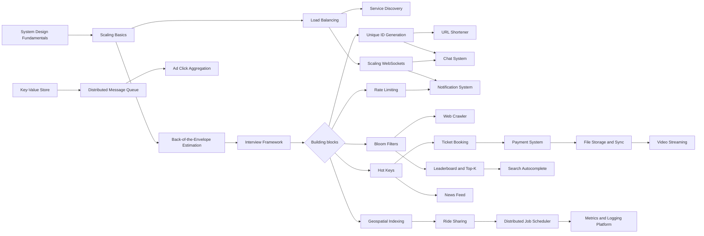

# 11 System Design MOC

> [!summary] What this folder covers
> After this folder you can size a system, pick and justify its building blocks, and drive a 45-minute design interview through seventeen worked case studies.

## Before and after

- **Before this:** [[10 Distributed Systems & Resilience MOC]] · [[16 Software Architecture MOC]]
- **After this:** [[19 Interview & Career MOC]]

Back to [[Home]].

## Learning path

### Foundations

1. [[System Design Fundamentals]] · basic. The vocabulary: requirements, trade-offs and the standard boxes.
2. [[Scaling Basics]] · basic. Vertical versus horizontal scaling and the scale cube.
3. [[Back-of-the-Envelope Estimation]] · basic. Turning users into QPS, storage and bandwidth in two minutes.
4. [[Load Balancing]] · basic. L4 versus L7, algorithms and health checks.
5. [[System Design Interview Framework]] · basic. A repeatable plan for the 45-minute round.

### Building blocks

6. [[Unique ID Generation]] · intermediate. UUIDs, Snowflake, ticket servers and sortable IDs.
7. [[Rate Limiting - Algorithms and Distributed Design]] · intermediate → advanced. The five algorithms plus the full "design a rate limiter" case.
8. [[Bloom Filters and Probabilistic Data Structures]] · intermediate. Bloom, Count-Min Sketch and HyperLogLog for memory you cannot afford.
9. [[Service Discovery]] · intermediate. How callers find healthy instances.
10. [[Hot Keys and Hot Partitions]] · advanced. Detecting and spreading skewed load.
11. [[Scaling WebSockets]] · advanced. Millions of stateful connections and the fan-out bus.
12. [[Geospatial Indexing]] · advanced. Geohash, quadtrees and S2/H3 for "near me" queries.

### Case studies

13. [[Case Study - URL Shortener]] · basic. The warm-up: IDs, caching and redirects.
14. [[Case Study - Notification System]] · intermediate. Multi-channel delivery with retries and preferences.
15. [[Case Study - Key-Value Store]] · intermediate. Dynamo-style partitioning, quorums and repair.
16. [[Case Study - Search Autocomplete]] · intermediate. Top-K per prefix served from a trie.
17. [[Case Study - News Feed]] · intermediate. Fan-out on write versus read, and the celebrity problem.
18. [[Case Study - Chat System]] · intermediate. Presence, ordering and delivery receipts.
19. [[Case Study - Ticket Booking]] · intermediate. Seat holds that never double-sell.
20. [[Case Study - Leaderboard and Top-K]] · intermediate. Sorted sets, sharded ranks and approximate heavy hitters.
21. [[Case Study - Payment System]] · advanced. Idempotency, double-entry ledgers and reconciliation.
22. [[Case Study - File Storage and Sync]] · advanced. Chunking, deduplication and conflict handling.
23. [[Case Study - Web Crawler]] · advanced. Frontier, politeness and URL deduplication.
24. [[Case Study - Ride Sharing and Proximity]] · advanced. Live locations, matching and offer leases.
25. [[Case Study - Distributed Job Scheduler]] · advanced. Exactly-once-ish timers at scale.
26. [[Case Study - Metrics and Logging Platform]] · advanced. High-volume ingestion, time-series storage and queries.
27. [[Case Study - Video Streaming]] · advanced. Transcoding pipeline, adaptive bitrate and CDN delivery.
28. [[Case Study - Distributed Message Queue]] · advanced. Building Kafka: logs, partitions and replication.
29. [[Case Study - Ad Click Aggregation]] · advanced. Windowed streaming counts with exactly-once results.

## Concept map

## Interview focus

- How would you design a URL shortener, and how do you generate the short codes? See [[Case Study - URL Shortener]] and [[Unique ID Generation]].
- Design a distributed rate limiter. Which algorithm, and where does the state live? See [[Rate Limiting - Algorithms and Distributed Design]].
- Design a news feed. When do you fan out on write versus on read? See [[Case Study - News Feed]].
- Design a chat system like WhatsApp. How do you scale the WebSocket tier? See [[Case Study - Chat System]] and [[Scaling WebSockets]].
- Design a ticket booking system that never double-sells a seat. See [[Case Study - Ticket Booking]].
- Design a payment system. How do you guarantee a charge happens exactly once? See [[Case Study - Payment System]].
- Design a ride-sharing service. How do you find nearby drivers? See [[Case Study - Ride Sharing and Proximity]] and [[Geospatial Indexing]].
- How would you handle a celebrity or hot key? See [[Hot Keys and Hot Partitions]].
- Estimate the QPS and storage for this system. See [[Back-of-the-Envelope Estimation]].
- Design a notification system. See [[Case Study - Notification System]].

## Sources worth reading

- Alex Xu, *System Design Interview*, Volumes 1 and 2.
- Martin Kleppmann, *Designing Data-Intensive Applications*.
- DeCandia et al., "Dynamo: Amazon's Highly Available Key-value Store" (SOSP 2007).
- The ByteByteGo and High Scalability blogs for real-world architecture write-ups.
- Engineering blogs from Uber, Discord, Stripe and Netflix on the systems that inspired these case studies.
